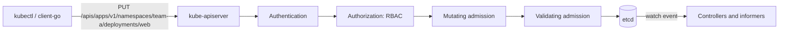

# Kubernetes API Primer for Platform Engineers

## Learning Objectives
- Understand Kubernetes API structure: Groups, Versions, Resources
- Learn API verbs and their semantics
- Master resource representation: metadata, spec, status
- Work with API discovery and client libraries

## Prerequisites
- Basic Kubernetes concepts (pods, services, deployments)
- YAML/JSON familiarity
- kubectl basics

---

## API Structure



### Group/Version/Resource (GVR)
```text
Group/Version/Resource (GVR)
├── Group: apps, batch, networking.k8s.io, platform.mycompany.io
├── Version: v1, v1beta1, v1alpha1
└── Resource: deployments, jobs, ingresses, tenants
```

### API Groups
| Group | Purpose | Stability |
|-------|---------|-----------|
| core (empty) | Pods, Services, ConfigMaps, Secrets | GA |
| apps | Deployments, ReplicaSets, StatefulSets | GA |
| batch | Jobs, CronJobs | GA |
| networking.k8s.io | Ingress, NetworkPolicy, IngressClass | GA |
| storage.k8s.io | StorageClass, VolumeAttachment | GA |
| rbac.authorization.k8s.io | Roles, RoleBindings, ClusterRoles | GA |
| apiextensions.k8s.io | CustomResourceDefinitions | GA |
| admissionregistration.k8s.io | Validating/Mutating Webhooks | GA |

### Version Lifecycle
```text
v1alpha1 → v1beta1 → v1 (GA) → deprecated → removed
   ^           ^         ^           ^          ^
   |           |         |           |          |
Experimental  Beta    Stable    Deprecation  Removal
```

---

## API Verbs

### Read Operations
| Verb | Scope | Description |
|------|-------|-------------|
| get | Namespaced/Cluster | Retrieve single resource |
| list | Namespaced/Cluster | Retrieve multiple resources |
| watch | Namespaced/Cluster | Stream changes (WebSocket) |

### Write Operations
| Verb | Scope | Description |
|------|-------|-------------|
| create | Namespaced/Cluster | Create new resource |
| update | Namespaced/Cluster | Replace entire resource |
| patch | Namespaced/Cluster | Partial update (strategic/JSON/merge) |
| delete | Namespaced/Cluster | Delete single resource |
| deletecollection | Namespaced | Delete multiple resources |

### Special Operations
| Verb | Purpose |
|------|---------|
| bind | Bind pods to nodes (scheduler) |
| escalate | Escalate RBAC privileges |
| impersonate | Act as another user |
| proxy | Proxy requests to services |

---

## Resource Representation

### Metadata
```yaml
metadata:
  name: my-deployment          # Unique within namespace
  namespace: production        # Empty for cluster-scoped
  uid: a1b2c3d4-e5f6-...       # System-generated UUID
  resourceVersion: "12345"     # Optimistic locking
  generation: 3                # Spec mutation counter
  creationTimestamp: "2024-01-15T10:30:00Z"
  labels:
    app: myapp
    version: v1.2.0
    environment: production
  annotations:
    deployment.kubernetes.io/revision: "3"
    kubectl.kubernetes.io/last-applied-configuration: |
      {"apiVersion":"apps/v1",...}
  finalizers:
    - foregroundDeletion
  ownerReferences:
    - apiVersion: apps/v1
      kind: ReplicaSet
      name: my-deployment-abc123
      uid: x7y8z9...
      controller: true
      blockOwnerDeletion: true
```

### Spec (Desired State)
```yaml
spec:
  replicas: 3
  selector:
    matchLabels:
      app: myapp
  template:
    metadata:
      labels:
        app: myapp
    spec:
      containers:
      - name: app
        image: myapp:v1.2.0
        ports:
        - containerPort: 8080
```

### Status (Observed State)
```yaml
status:
  observedGeneration: 3
  replicas: 3
  updatedReplicas: 3
  readyReplicas: 3
  availableReplicas: 3
  conditions:
  - type: Available
    status: "True"
    lastUpdateTime: "2024-01-15T10:35:00Z"
    reason: MinimumReplicasAvailable
    message: Deployment has minimum availability
```

---

## API Discovery

### Discover API Groups
```bash
# List all API groups
kubectl api-resources --api-group=apps

# List all resources (wide output)
kubectl api-resources -o wide

# Check specific resource
kubectl api-resources --namespaced=true --resource=deployments
```

### OpenAPI/Swagger
```bash
# Get OpenAPI spec
kubectl get --raw=/openapi/v2 | jq '.paths | keys[]' | head -20

# Get specific resource schema
kubectl get --raw=/openapi/v2 | jq '.paths."/apis/apps/v1/namespaces/{namespace}/deployments".get'
```

---

## Client Libraries

### Go Client (client-go)
```go
import (
    "k8s.io/client-go/kubernetes"
    "k8s.io/client-go/rest"
    "k8s.io/client-go/tools/clientcmd"
)

// In-cluster config
config, err := rest.InClusterConfig()

// Or kubeconfig
config, err := clientcmd.BuildConfigFromFlags("", "/path/to/kubeconfig")

// Create clientset
clientset, err := kubernetes.NewForConfig(config)

// Use typed clients
deployments := clientset.AppsV1().Deployments("namespace")
pods := clientset.CoreV1().Pods("namespace")
```

### Dynamic Client (for CRDs)
```go
import (
    "k8s.io/client-go/dynamic"
    "k8s.io/apimachinery/pkg/apis/meta/v1/unstructured"
    "k8s.io/apimachinery/pkg/runtime/schema"
)

dynamicClient, _ := dynamic.NewForConfig(config)

gvr := schema.GroupVersionResource{
    Group:    "platform.mycompany.io",
    Version:  "v1",
    Resource: "tenants",
}

// List
list, _ := dynamicClient.Resource(gvr).Namespace("ns").List(ctx, metav1.ListOptions{})

// Create
obj := &unstructured.Unstructured{
    Object: map[string]interface{}{
        "apiVersion": "platform.mycompany.io/v1",
        "kind":       "Tenant",
        "metadata": map[string]interface{}{
            "name": "my-tenant",
        },
        "spec": map[string]interface{}{
            "displayName": "My Tenant",
        },
    },
}
created, _ := dynamicClient.Resource(gvr).Namespace("ns").Create(ctx, obj, metav1.CreateOptions{})
```

### Controller Runtime Client
```go
import (
    "sigs.k8s.io/controller-runtime/pkg/client"
    "sigs.k8s.io/controller-runtime/pkg/client/config"
)

cfg := config.GetConfigOrDie()
cl, _ := client.New(cfg, client.Options{Scheme: scheme})

// List with field selector
var tenants TenantList
cl.List(ctx, &tenants, client.InNamespace("ns"), client.MatchingFields{"spec.owner": "team-a"})

// Create
tenant := &Tenant{...}
cl.Create(ctx, tenant)

// Update with retry
retryErr := retry.RetryOnConflict(retry.DefaultRetry, func() error {
    existing := &Tenant{}
    cl.Get(ctx, key, existing)
    existing.Spec = newSpec
    return cl.Update(ctx, existing)
})
```

---

## API Patterns for Platform Engineers

### Label Selectors
```bash
# Equality-based
kubectl get pods -l app=myapp,version=v1.2.0

# Set-based
kubectl get pods -l 'app in (myapp,otherapp),version notin (v1.0.0)'

# In code
labels.Set{"app": "myapp", "version": "v1.2.0"}.AsSelector()
labels.SelectorFromSet(labels.Set{"environment": "production"})
```

### Field Selectors
```bash
# Only supports metadata fields
kubectl get pods --field-selector=status.phase=Running
kubectl get pods --field-selector=spec.nodeName=node-1
```

### Pagination (Large Clusters)
```go
listOpts := metav1.ListOptions{
    Limit:        500,
    Continue:     "",
}

for {
    list, err := clientset.CoreV1().Pods("").List(ctx, listOpts)
    if err != nil { break }
    
    for _, pod := range list.Items {
        // process pod
    }
    
    if list.Continue == "" { break }
    listOpts.Continue = list.Continue
}
```

### Watch for Changes
```go
watch, _ := clientset.CoreV1().Pods("ns").Watch(ctx, metav1.ListOptions{
    FieldSelector: "status.phase=Pending",
})

for event := range watch.ResultChan() {
    switch event.Type {
    case watch.Added:
        // New pod
    case watch.Modified:
        // Pod updated
    case watch.Deleted:
        // Pod deleted
    case watch.Error:
        // Handle error
    }
}
```

---

## Hands-On Exercises

These exercises need a running cluster. Use the [Lab 01 cluster](../../labs/lab-01-cluster-setup/README.md) or any `kind` cluster.

### Exercise 1: Explore API resources

**Goal:** list the API groups, find which resources are namespaced, and read the schema of a field.

```bash
# 1. List all API group versions
kubectl api-versions | sort

# 2. Find all namespaced resources
kubectl api-resources --namespaced=true -o name | sort

# 3. Find all cluster-scoped resources
kubectl api-resources --namespaced=false -o name | sort

# 4. Read the schema of a nested field
kubectl explain deployment.spec.template.spec.containers
```

Expected output (abbreviated, versions vary by cluster):

```text
admissionregistration.k8s.io/v1
apps/v1
...
v1
```

**Check:** `kubectl api-resources --namespaced=false -o name | grep -x nodes` prints `nodes`, and
`kubectl api-resources --namespaced=true -o name | grep -x deployments.apps` prints `deployments.apps`.

### Exercise 2: List CRDs with the dynamic client

**Goal:** read an arbitrary resource type without generated Go types.

Create a new directory, run `go mod init crdlist`, save the program as `main.go`, and run `go get k8s.io/client-go@latest k8s.io/apimachinery@latest`.

```go
package main

import (
    "context"
    "fmt"

    metav1 "k8s.io/apimachinery/pkg/apis/meta/v1"
    "k8s.io/apimachinery/pkg/runtime/schema"
    "k8s.io/client-go/dynamic"
    "k8s.io/client-go/tools/clientcmd"
)

func main() {
    config, err := clientcmd.BuildConfigFromFlags("", clientcmd.RecommendedHomeFile)
    if err != nil {
        panic(err)
    }
    dynClient, err := dynamic.NewForConfig(config)
    if err != nil {
        panic(err)
    }

    gvr := schema.GroupVersionResource{
        Group:    "apiextensions.k8s.io",
        Version:  "v1",
        Resource: "customresourcedefinitions",
    }

    list, err := dynClient.Resource(gvr).List(context.Background(), metav1.ListOptions{})
    if err != nil {
        panic(err)
    }
    for _, item := range list.Items {
        name := item.GetName()
        group := item.Object["spec"].(map[string]interface{})["group"]
        fmt.Printf("CRD: %s (group: %s)\n", name, group)
    }
}
```

Run it:

```bash
go run .
```

Expected output depends on the CRDs installed. On a cluster with Gateway API installed:

```text
CRD: gateways.gateway.networking.k8s.io (group: gateway.networking.k8s.io)
```

**Check:** the number of lines printed equals `kubectl get crd --no-headers | wc -l`.

### Exercise 3: Patch operations

**Goal:** change a replica count with each of the three patch types and see that all three produce the same result.

```bash
# 0. Create the Deployment used below
kubectl create deployment myapp --image=nginx:alpine

# 1. Strategic merge patch (default for built-in types)
kubectl patch deployment myapp -p '{"spec":{"replicas":5}}'

# 2. JSON patch (RFC 6902)
kubectl patch deployment myapp --type=json -p='[{"op":"replace","path":"/spec/replicas","value":3}]'

# 3. Merge patch
kubectl patch deployment myapp --type=merge -p='{"spec":{"replicas":2}}'
```

Expected output after each command:

```text
deployment.apps/myapp patched
```

**Check:** `kubectl get deployment myapp -o jsonpath='{.spec.replicas}'` prints `2`. Clean up with `kubectl delete deployment myapp`.

---

## Troubleshooting

### Resource Rejected With a Conflict (409)
```bash
# The object changed since you read it. Re-read, then retry with the new resourceVersion
kubectl get deployment web -o jsonpath='{.metadata.resourceVersion}{"\n"}'
```

### Field Silently Dropped
```bash
# The field is not in the schema for this API version. Check what the server accepts
kubectl explain deployment.spec.template.spec --api-version=apps/v1
kubectl apply -f deploy.yaml --dry-run=server -o yaml   # compare the output with your manifest
```

### Forbidden (403) on a Call That Should Work
```bash
# Ask the API server what the current identity may do
kubectl auth can-i update deployments -n team-a --as system:serviceaccount:team-a:ci-bot
kubectl auth can-i --list -n team-a
```

### Discovery Is Slow or Stale
```bash
# Clear the local discovery cache after installing a CRD
rm -rf ~/.kube/cache/discovery
kubectl api-resources | grep platform.mycompany.io
```

---

## Further Reading

- [Kubernetes API Concepts](https://kubernetes.io/docs/concepts/overview/kubernetes-api/)
- [API Reference](https://kubernetes.io/docs/reference/kubernetes-api/)
- [Client-go Examples](https://github.com/kubernetes/client-go/tree/master/examples)
- [Controller Runtime Client](https://pkg.go.dev/sigs.k8s.io/controller-runtime/pkg/client)
- [Kubernetes API Conventions](https://github.com/kubernetes/community/blob/master/contributors/devel/sig-architecture/api-conventions.md)
