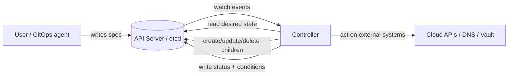
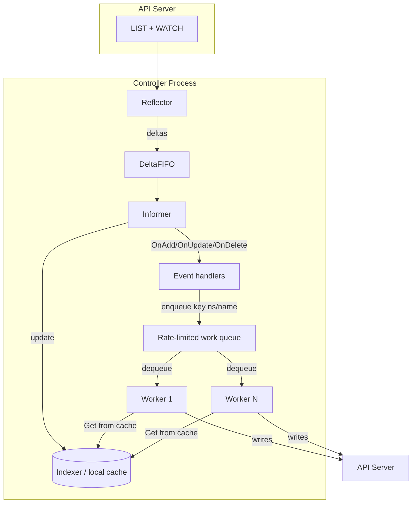
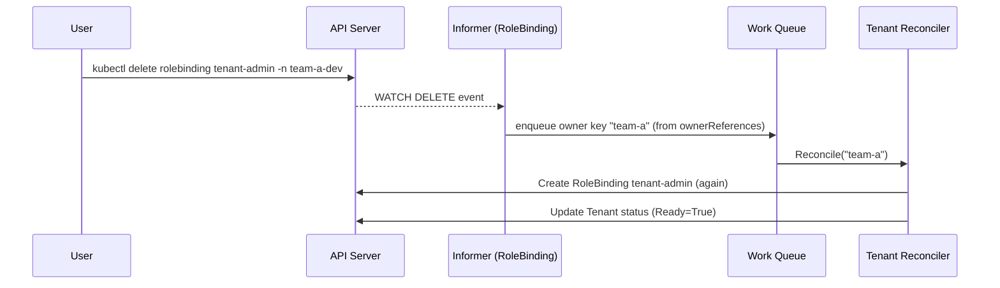
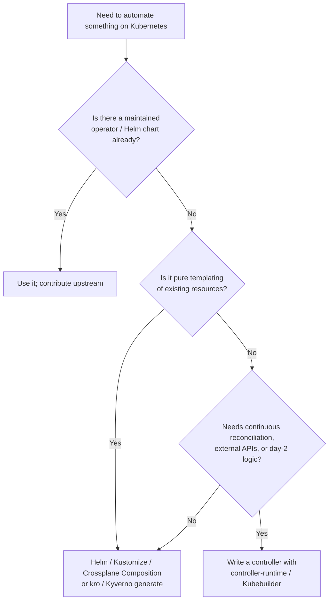
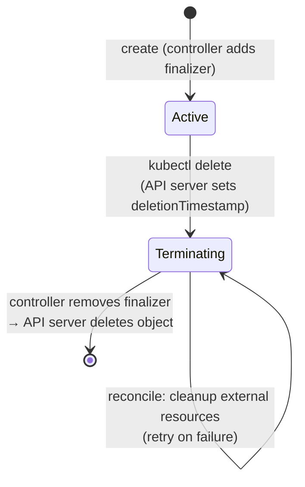

# Controllers and Operators

## Learning Objectives
- Explain the controller pattern: level-triggered reconciliation of desired vs. observed state
- Understand the machinery behind controllers: informers, shared caches, work queues, and leader election
- Distinguish a *controller* from an *operator* and know when a platform team should write one
- Use owner references, finalizers, and status conditions correctly
- Build a minimal reconciler for the platform `Tenant` CRD with controller-runtime
- Debug stuck reconciliations, hot loops, and objects that refuse to delete

## Prerequisites
- [Kubernetes Architecture](./kubernetes-architecture.md) — especially the controller manager section
- [Kubernetes API Primer](./api-primer.md) — GVR/GVK, watch, `resourceVersion`, patch types
- Basic Go (structs, interfaces, `context.Context`) for the code sections
- A local cluster from [Lab 01: Cluster Setup](../../labs/lab-01-cluster-setup/README.md)

---

## Why Controllers Matter to Platform Engineers

Everything in Kubernetes that *does* something is a controller. A Deployment is just a record in etcd; the
Deployment controller is what turns it into ReplicaSets, and the ReplicaSet controller is what turns those into
Pods. The platform you build on top of Kubernetes works the same way: a `Tenant` object is inert until a
controller reconciles it into Namespaces, RBAC, quotas, and network policies.

| Layer | Declarative object | Controller that acts on it |
|-------|-------------------|----------------------------|
| Core workloads | `Deployment`, `StatefulSet`, `Job` | `kube-controller-manager` |
| Networking | `Service`, `EndpointSlice` | EndpointSlice controller, kube-proxy / CNI |
| Storage | `PersistentVolumeClaim` | PV binder + CSI external-provisioner |
| Platform add-ons | `Certificate`, `ExternalSecret`, `Application` | cert-manager, ESO, Argo CD |
| **Your platform** | `Tenant`, `Environment`, `Workload` (`platform.mycompany.io/v1alpha1`) | tenant-, environment-, workload-operator |

The architecture doc introduced a simplified reconcile loop. This document goes one level deeper into *how*
that loop is fed, how it stays correct under failure, and the conventions that make controllers composable.

---

## The Controller Pattern

A controller continuously drives the **observed state** of the world toward the **desired state** recorded in
the API server, and reports what it observed back into `status`.



### Level-Triggered, Not Edge-Triggered

The most important property of a Kubernetes controller is that it is **level-triggered**: it reacts to *the
current state*, not to *the event that happened*. A watch event is only a hint that "something about object X
may have changed, go look".

| Edge-triggered (avoid) | Level-triggered (Kubernetes way) |
|------------------------|----------------------------------|
| "Pod was deleted → create one Pod" | "Want 3 replicas, see 2 → create 1" |
| Missed event = permanent drift | Missed event is repaired on next resync / next event |
| Must process events in order | Events can be coalesced; only latest state matters |
| Handler logic per event type | One `Reconcile(key)` function for all event types |

Consequences for your code:

1. `Reconcile` receives only a **key** (`namespace/name`), never the event or the old object.
2. `Reconcile` must be **idempotent** — running it twice in a row must be harmless.
3. Never store state in controller memory that is not reconstructible from the cluster (or the external system).
4. Several rapid changes to one object may collapse into a single reconcile — that is a feature.

### Spec, Status, and Generation

| Field | Written by | Meaning |
|-------|-----------|---------|
| `metadata.generation` | API server | Incremented on every change to `spec` (for CRDs with the status subresource) |
| `spec` | Users / GitOps | Desired state |
| `status.observedGeneration` | Controller | Generation the controller last fully processed |
| `status.conditions[]` | Controller | Machine-readable summary (`Ready`, `Progressing`, `Degraded`) |

If `status.observedGeneration < metadata.generation`, the controller hasn't caught up yet. GitOps tools and
`kubectl wait` rely on this pairing to know whether a `Ready=True` condition is fresh or stale.

---

## Inside a Controller: Informers, Caches, and Work Queues

Hitting the API server with a `GET` for every reconcile would not scale. client-go provides machinery that every
production controller (including all of `kube-controller-manager`) uses.



| Component | Responsibility |
|-----------|----------------|
| **Reflector** | Performs an initial `LIST`, then a long-running `WATCH` starting from the list's `resourceVersion`; re-lists on `410 Gone` |
| **DeltaFIFO** | Queues add/update/delete deltas so the informer processes them in order |
| **Informer / SharedInformer** | Keeps the local cache up to date and fans events out to handlers; *shared* so many controllers reuse one watch per type |
| **Indexer** | Thread-safe in-memory store with secondary indexes (e.g. by namespace, by owner) |
| **Work queue** | De-duplicates keys, rate-limits retries (exponential backoff per item), guarantees a key is processed by only one worker at a time |
| **Workers** | Goroutines that pop keys and call `Reconcile` |

Key properties:

- **Reads come from the cache.** The cache may be milliseconds-to-seconds stale. Write logic that tolerates that
  (optimistic concurrency via `resourceVersion` will reject stale updates with `409 Conflict`).
- **The queue de-duplicates.** If a key is enqueued 50 times while it waits, it is reconciled once.
- **Resync.** Informers can periodically re-deliver every cached object as an update. This is not a re-list; it
  is a safety net for controllers that act on external systems.

### Watching Children: Mapping Events Back to the Owner

A Tenant controller cares about events on the `Tenant` *and* on the Namespaces/RoleBindings it creates. If a
user deletes a managed RoleBinding, the controller must wake up and recreate it. That is done by mapping the
child event back to the owner's key, usually via the child's `ownerReferences`:



---

## Controller vs. Operator

The terms are often used interchangeably, but there is a useful distinction:

| | Controller | Operator |
|---|-----------|----------|
| Definition | Any loop reconciling Kubernetes objects | A controller + CRDs that encode **operational knowledge** for a specific application or domain |
| Typical scope | Generic (Deployments, Endpoints, Jobs) | Domain-specific (PostgreSQL, Kafka, a `Tenant`) |
| Example | ReplicaSet controller | CloudNativePG, Strimzi, Prometheus Operator, your tenant-operator |
| Day-2 logic | Minimal | Backups, failover, upgrades, scaling, rotation |

The [Operator Capability Levels](https://sdk.operatorframework.io/docs/overview/operator-capabilities/) are a
handy maturity scale: **1** basic install → **2** seamless upgrades → **3** full lifecycle (backup/restore) →
**4** deep insights (metrics, alerts) → **5** auto pilot (auto-scaling, auto-tuning).

### Should Your Platform Team Write an Operator?



Write an operator when the logic needs **continuous** convergence, multi-step workflows, external side effects,
or rich status. Don't write one to replace a Helm chart.

---

## Core Conventions Every Controller Must Follow

### 1. Owner References and Garbage Collection

An `ownerReference` tells the garbage collector "delete me when my owner is deleted".

```yaml
# namespace-owned-by-tenant.yaml (as written by the tenant-operator)
apiVersion: v1
kind: Namespace
metadata:
  name: team-a-dev
  labels:
    platform.mycompany.io/tenant: team-a          # makes ownership queryable with -l
    platform.mycompany.io/managed-by: tenant-operator
  ownerReferences:
    - apiVersion: platform.mycompany.io/v1alpha1
      kind: Tenant
      name: team-a
      uid: 6f1c2a0e-8a4b-4c7e-9d0b-3a1f2e5c7b90   # must match the live owner's UID
      controller: true                              # at most one owner can be "the controller"
      blockOwnerDeletion: true                      # foreground deletion waits for this child
```

Rules enforced by the API server and garbage collector:

| Owner scope | Dependent scope | Allowed? |
|-------------|----------------|----------|
| Namespaced | Same namespace | ✅ |
| Namespaced | Different namespace | ❌ (treated as unresolvable; GC may delete the dependent) |
| Namespaced | Cluster-scoped | ❌ |
| Cluster-scoped (`Tenant`) | Cluster-scoped (`Namespace`) | ✅ |
| Cluster-scoped (`Tenant`) | Namespaced (`RoleBinding`) | ✅ |

Deletion propagation policies (`kubectl delete --cascade=...`):

| Policy | Behavior |
|--------|----------|
| `background` (default) | Owner deleted immediately; GC deletes dependents afterwards |
| `foreground` | Owner gets `deletionTimestamp` + `foregroundDeletion` finalizer; deleted after all `blockOwnerDeletion` dependents are gone |
| `orphan` | Owner deleted; dependents kept and their `ownerReferences` removed |

### 2. Finalizers for External Cleanup

Owner references only clean up *Kubernetes* objects. If your controller created something outside the cluster
(a cloud IAM role, a Vault policy, a DNS record), use a **finalizer** so deletion waits for your cleanup.



Rules:
- Add the finalizer **before** creating external resources.
- When `deletionTimestamp` is set, do cleanup, then remove *only your own* finalizer.
- Cleanup must be idempotent and must succeed if the external resource is already gone.
- Never block forever — surface failures in a condition so humans can intervene.

### 3. Status Conditions

Use the standard `metav1.Condition` shape so tooling (`kubectl wait`, Argo CD health checks, Backstage) can read it.

```yaml
# tenant-status-example.yaml
status:
  observedGeneration: 4
  namespaces: [team-a-dev, team-a-staging, team-a-prod]
  conditions:
    - type: Ready
      status: "True"
      reason: ReconcileSucceeded
      message: "3/3 namespaces provisioned"
      observedGeneration: 4
      lastTransitionTime: "2026-10-23T09:14:02Z"
    - type: QuotaApplied
      status: "False"
      reason: QuotaExceedsClusterCapacity
      message: "requested cpu=200 exceeds cluster allocatable headroom"
      observedGeneration: 4
      lastTransitionTime: "2026-10-23T09:14:02Z"
```

```bash
# Wait until a Tenant is ready (works because of the standard condition shape)
kubectl wait tenant/team-a --for=condition=Ready --timeout=120s
```

### 4. Optimistic Concurrency and Server-Side Apply

Every object carries a `resourceVersion`. An `Update` with a stale version fails with `409 Conflict`. Two safe
patterns:

| Pattern | When | How |
|---------|------|-----|
| Get → mutate → Update, requeue on conflict | Status updates, small edits | `if apierrors.IsConflict(err) { return ctrl.Result{Requeue: true}, nil }` |
| Server-Side Apply (SSA) with a field manager | Owning a well-defined set of fields on children | `client.Apply` patch with `client.FieldOwner("tenant-operator")` and `client.ForceOwnership` |

SSA is generally the better default for children: the controller declares the fields it owns, and other actors
(HPA changing replicas, users adding labels) don't conflict with it.

### 5. Leader Election

Run controllers with ≥2 replicas for availability, but only one should reconcile at a time. Leader election uses a
`coordination.k8s.io/v1` **Lease** object:

```bash
kubectl get lease -n tenant-operator-system
# NAME                                       HOLDER                                  AGE
# tenant-operator.platform.mycompany.io      tenant-operator-6d9f7c8b5-x2k4j_7c1e…   3d
```

---

## Building a Tenant Controller with controller-runtime

[controller-runtime](https://github.com/kubernetes-sigs/controller-runtime) (v0.17+) wraps informers, caches,
queues, and leader election behind a `Manager` and a `Reconciler` interface. [Kubebuilder](https://book.kubebuilder.io/)
scaffolds projects on top of it. The full implementation lives in [`code/tenant-operator/`](../../code/tenant-operator/);
the platform API design is covered in [Kubernetes CRDs](../09-platform-apis/kubernetes-crds.md) and
[controller-runtime deep dive](../09-platform-apis/controller-runtime.md).

### The API Type

```go
// api/v1alpha1/tenant_types.go
package v1alpha1

import metav1 "k8s.io/apimachinery/pkg/apis/meta/v1"

// TenantSpec is the desired state: who owns the tenant and which environments it gets.
type TenantSpec struct {
	// Owner is the team (IdP group) that administers this tenant.
	// +kubebuilder:validation:MinLength=1
	Owner string `json:"owner"`

	// Environments become namespaces named <tenant>-<env>.
	// +kubebuilder:validation:MinItems=1
	Environments []string `json:"environments"`
}

// TenantStatus is the observed state written only by the controller.
type TenantStatus struct {
	ObservedGeneration int64              `json:"observedGeneration,omitempty"`
	Namespaces         []string           `json:"namespaces,omitempty"`
	Conditions         []metav1.Condition `json:"conditions,omitempty"`
}

// +kubebuilder:object:root=true
// +kubebuilder:resource:scope=Cluster
// +kubebuilder:subresource:status
// +kubebuilder:printcolumn:name="Owner",type=string,JSONPath=`.spec.owner`
// +kubebuilder:printcolumn:name="Ready",type=string,JSONPath=`.status.conditions[?(@.type=="Ready")].status`
type Tenant struct {
	metav1.TypeMeta   `json:",inline"`
	metav1.ObjectMeta `json:"metadata,omitempty"`

	Spec   TenantSpec   `json:"spec,omitempty"`
	Status TenantStatus `json:"status,omitempty"`
}
```

The `+kubebuilder:subresource:status` marker is essential: it splits `spec` and `status` into separate endpoints
so users can't overwrite status and so `metadata.generation` only bumps on spec changes.

### The Reconciler

```go
// internal/controller/tenant_controller.go
package controller

import (
	"context"
	"fmt"

	corev1 "k8s.io/api/core/v1"
	rbacv1 "k8s.io/api/rbac/v1"
	apierrors "k8s.io/apimachinery/pkg/api/errors"
	"k8s.io/apimachinery/pkg/api/meta"
	metav1 "k8s.io/apimachinery/pkg/apis/meta/v1"
	"k8s.io/apimachinery/pkg/runtime"
	ctrl "sigs.k8s.io/controller-runtime"
	"sigs.k8s.io/controller-runtime/pkg/builder"
	"sigs.k8s.io/controller-runtime/pkg/client"
	"sigs.k8s.io/controller-runtime/pkg/controller/controllerutil"
	"sigs.k8s.io/controller-runtime/pkg/log"
	"sigs.k8s.io/controller-runtime/pkg/predicate"

	platformv1alpha1 "github.com/mycompany/tenant-operator/api/v1alpha1"
)

const tenantFinalizer = "platform.mycompany.io/tenant-cleanup"

type TenantReconciler struct {
	client.Client
	Scheme *runtime.Scheme
}

// RBAC markers generate the operator's ClusterRole (see rbac.md for least privilege).
// +kubebuilder:rbac:groups=platform.mycompany.io,resources=tenants,verbs=get;list;watch;update;patch
// +kubebuilder:rbac:groups=platform.mycompany.io,resources=tenants/status,verbs=get;update;patch
// +kubebuilder:rbac:groups=platform.mycompany.io,resources=tenants/finalizers,verbs=update
// +kubebuilder:rbac:groups="",resources=namespaces,verbs=get;list;watch;create;update;patch;delete
// +kubebuilder:rbac:groups=rbac.authorization.k8s.io,resources=rolebindings,verbs=get;list;watch;create;update;patch;delete

func (r *TenantReconciler) Reconcile(ctx context.Context, req ctrl.Request) (ctrl.Result, error) {
	logger := log.FromContext(ctx)

	// 1. Fetch the Tenant from the cache. NotFound means it was deleted: nothing to do.
	var tenant platformv1alpha1.Tenant
	if err := r.Get(ctx, req.NamespacedName, &tenant); err != nil {
		return ctrl.Result{}, client.IgnoreNotFound(err)
	}

	// 2. Handle deletion via finalizer (external cleanup would go here).
	if !tenant.DeletionTimestamp.IsZero() {
		if controllerutil.ContainsFinalizer(&tenant, tenantFinalizer) {
			if err := r.cleanupExternal(ctx, &tenant); err != nil {
				return ctrl.Result{}, err // retried with backoff
			}
			controllerutil.RemoveFinalizer(&tenant, tenantFinalizer)
			if err := r.Update(ctx, &tenant); err != nil {
				return ctrl.Result{}, err
			}
		}
		return ctrl.Result{}, nil
	}
	if controllerutil.AddFinalizer(&tenant, tenantFinalizer) {
		if err := r.Update(ctx, &tenant); err != nil {
			return ctrl.Result{}, err
		}
	}

	// 3. Converge children: one Namespace + admin RoleBinding per environment.
	var namespaces []string
	for _, env := range tenant.Spec.Environments {
		nsName := fmt.Sprintf("%s-%s", tenant.Name, env)
		ns := &corev1.Namespace{ObjectMeta: metav1.ObjectMeta{Name: nsName}}
		op, err := controllerutil.CreateOrUpdate(ctx, r.Client, ns, func() error {
			if ns.Labels == nil {
				ns.Labels = map[string]string{}
			}
			ns.Labels["platform.mycompany.io/tenant"] = tenant.Name
			ns.Labels["platform.mycompany.io/environment"] = env
			ns.Labels["pod-security.kubernetes.io/enforce"] = "restricted"
			return controllerutil.SetControllerReference(&tenant, ns, r.Scheme)
		})
		if err != nil {
			return r.setReady(ctx, &tenant, metav1.ConditionFalse, "NamespaceFailed", err.Error())
		}
		logger.V(1).Info("namespace reconciled", "namespace", nsName, "operation", op)

		rb := &rbacv1.RoleBinding{ObjectMeta: metav1.ObjectMeta{Name: "tenant-admin", Namespace: nsName}}
		if _, err := controllerutil.CreateOrUpdate(ctx, r.Client, rb, func() error {
			rb.RoleRef = rbacv1.RoleRef{APIGroup: rbacv1.GroupName, Kind: "ClusterRole", Name: "admin"}
			rb.Subjects = []rbacv1.Subject{{Kind: rbacv1.GroupKind, APIGroup: rbacv1.GroupName, Name: tenant.Spec.Owner}}
			return controllerutil.SetControllerReference(&tenant, rb, r.Scheme)
		}); err != nil {
			return r.setReady(ctx, &tenant, metav1.ConditionFalse, "RoleBindingFailed", err.Error())
		}
		namespaces = append(namespaces, nsName)
	}

	// 4. Report observed state.
	tenant.Status.Namespaces = namespaces
	return r.setReady(ctx, &tenant, metav1.ConditionTrue, "ReconcileSucceeded",
		fmt.Sprintf("%d/%d namespaces provisioned", len(namespaces), len(tenant.Spec.Environments)))
}

func (r *TenantReconciler) setReady(ctx context.Context, t *platformv1alpha1.Tenant,
	status metav1.ConditionStatus, reason, msg string) (ctrl.Result, error) {
	t.Status.ObservedGeneration = t.Generation
	meta.SetStatusCondition(&t.Status.Conditions, metav1.Condition{
		Type: "Ready", Status: status, Reason: reason, Message: msg, ObservedGeneration: t.Generation,
	})
	if err := r.Status().Update(ctx, t); err != nil {
		if apierrors.IsConflict(err) {
			return ctrl.Result{Requeue: true}, nil // cache was stale; try again
		}
		return ctrl.Result{}, err
	}
	if status == metav1.ConditionFalse {
		return ctrl.Result{}, fmt.Errorf("tenant %s not ready: %s", t.Name, reason)
	}
	return ctrl.Result{}, nil
}

func (r *TenantReconciler) cleanupExternal(ctx context.Context, t *platformv1alpha1.Tenant) error {
	// e.g. delete the tenant's Vault policy or cloud IAM role. Must be idempotent.
	return nil
}

// SetupWithManager wires watches: Tenants (spec changes only) + owned children.
func (r *TenantReconciler) SetupWithManager(mgr ctrl.Manager) error {
	return ctrl.NewControllerManagedBy(mgr).
		For(&platformv1alpha1.Tenant{},
			builder.WithPredicates(predicate.GenerationChangedPredicate{})). // ignore status-only updates
		Owns(&corev1.Namespace{}).    // child events map to owner via ownerReferences
		Owns(&rbacv1.RoleBinding{}).
		Complete(r)
}
```

Notes on the choices above:

| Choice | Why |
|--------|-----|
| `client.IgnoreNotFound` on Get | A deleted object produces one last reconcile; it's not an error |
| `GenerationChangedPredicate` on `For` | Our own status writes would otherwise re-trigger reconcile (hot loop) |
| `Owns(...)` | Deleting or editing a child wakes the owning Tenant → self-healing |
| Returning an error | Requeues with per-item exponential backoff (5ms → ~16min by default) |
| `RequeueAfter` (not used here) | For polling external systems that can't push events |
| `CreateOrUpdate` | Simple and readable; switch to SSA when other actors co-own fields |

### The Manager

```go
// cmd/main.go (excerpt)
mgr, err := ctrl.NewManager(ctrl.GetConfigOrDie(), ctrl.Options{
	Scheme:                 scheme,
	HealthProbeBindAddress: ":8081",
	LeaderElection:         true,
	LeaderElectionID:       "tenant-operator.platform.mycompany.io", // name of the Lease
})
if err != nil {
	setupLog.Error(err, "unable to create manager")
	os.Exit(1)
}
if err := (&controller.TenantReconciler{Client: mgr.GetClient(), Scheme: mgr.GetScheme()}).
	SetupWithManager(mgr); err != nil {
	setupLog.Error(err, "unable to create controller", "controller", "Tenant")
	os.Exit(1)
}
_ = mgr.AddHealthzCheck("healthz", healthz.Ping)
_ = mgr.AddReadyzCheck("readyz", healthz.Ping)
if err := mgr.Start(ctrl.SetupSignalHandler()); err != nil {
	os.Exit(1)
}
```

---

## Common Controller Anti-Patterns

| Anti-pattern | Symptom | Fix |
|--------------|---------|-----|
| Edge-triggered logic ("on create do X") | Drift after missed events or restarts | Compute desired children from spec every reconcile |
| Updating status unconditionally without a predicate | CPU pegged, API server flooded, `reconcile_total` climbing | `GenerationChangedPredicate`, or skip writes when status is unchanged |
| Writing to `spec` from the controller | Fights with GitOps (Argo CD shows OutOfSync forever) | Controllers own `status`; users/GitOps own `spec` |
| Uncached `List` across the cluster each reconcile | API server latency, throttling | Read from the informer cache; add field indexes |
| Watching all Secrets/ConfigMaps cluster-wide | Huge memory footprint | Restrict cache by label/namespace (`cache.Options.ByObject`) |
| Finalizer with no timeout/condition | Objects stuck `Terminating` forever | Report failure via condition, alert, document manual removal |
| Cross-namespace owner references | Children randomly garbage-collected | Use labels + a custom watch mapping instead |
| Long blocking calls inside Reconcile | Queue backs up | Make external calls async; return `RequeueAfter` |

---

## Observability for Controllers

controller-runtime exposes Prometheus metrics on the manager's metrics endpoint:

| Metric | What it tells you |
|--------|-------------------|
| `controller_runtime_reconcile_total{controller,result}` | Reconcile rate split by `success`, `error`, `requeue`, `requeue_after` |
| `controller_runtime_reconcile_errors_total` | Errors returned from Reconcile |
| `controller_runtime_reconcile_time_seconds` | Latency histogram per controller |
| `workqueue_depth{name}` | Backlog; sustained growth means workers can't keep up |
| `workqueue_retries_total{name}` | Items being retried (persistent failures) |
| `controller_runtime_active_workers` | Concurrency in use (`MaxConcurrentReconciles`) |

```yaml
# prometheusrule-tenant-operator.yaml
apiVersion: monitoring.coreos.com/v1
kind: PrometheusRule
metadata:
  name: tenant-operator
  namespace: tenant-operator-system
spec:
  groups:
    - name: tenant-operator
      rules:
        - alert: TenantOperatorReconcileErrors
          expr: sum(rate(controller_runtime_reconcile_errors_total{controller="tenant"}[5m])) > 0.1
          for: 15m
          labels:
            severity: warning
          annotations:
            summary: "tenant-operator is failing reconciles"
        - alert: TenantOperatorQueueBacklog
          expr: workqueue_depth{name="tenant"} > 100
          for: 10m
          labels:
            severity: warning
          annotations:
            summary: "tenant-operator work queue backing up"
```

See [Metrics Stack](../10-observability/metrics-stack.md) for scraping and dashboards.

---

## Hands-On Exercise

### Exercise 1: Watch the Built-in Controllers Work

```bash
# 1. Create a Deployment and watch the controller chain create children
kubectl create deployment web --image=nginx:1.27 --replicas=3
kubectl get deploy,rs,pods -l app=web

# 2. Inspect the ownership chain: Pod -> ReplicaSet -> Deployment
POD=$(kubectl get pod -l app=web -o jsonpath='{.items[0].metadata.name}')
kubectl get pod "$POD" -o jsonpath='{.metadata.ownerReferences[0].kind}/{.metadata.ownerReferences[0].name}{"\n"}'
RS=$(kubectl get pod "$POD" -o jsonpath='{.metadata.ownerReferences[0].name}')
kubectl get rs "$RS" -o jsonpath='{.metadata.ownerReferences[0].kind}/{.metadata.ownerReferences[0].name}{"\n"}'

# 3. Level-triggered self-healing: delete a Pod, see it replaced
kubectl delete pod "$POD" --wait=false
kubectl get pods -l app=web -w   # Ctrl-C after the replacement is Running

# 4. Orphan the ReplicaSet: delete the Deployment but keep its children
kubectl delete deployment web --cascade=orphan
kubectl get rs,pods -l app=web   # still there, ownerReferences removed
kubectl delete rs -l app=web
```

### Exercise 2: Observe Generation vs. ObservedGeneration

```bash
kubectl create deployment gen-demo --image=nginx:1.27
kubectl get deploy gen-demo -o jsonpath='gen={.metadata.generation} observed={.status.observedGeneration}{"\n"}'

# Spec change bumps generation; the controller catches up shortly after
kubectl scale deploy gen-demo --replicas=2
kubectl get deploy gen-demo -o jsonpath='gen={.metadata.generation} observed={.status.observedGeneration}{"\n"}'

# A label change is metadata, not spec: generation does NOT change
kubectl label deploy gen-demo platform.mycompany.io/team=demo
kubectl get deploy gen-demo -o jsonpath='gen={.metadata.generation}{"\n"}'
kubectl delete deploy gen-demo
```

### Exercise 3: Finalizers by Hand

```bash
# Simulate a controller that never finishes cleanup
kubectl create configmap stuck-demo --from-literal=a=b
kubectl patch configmap stuck-demo --type=merge \
  -p '{"metadata":{"finalizers":["platform.mycompany.io/demo-cleanup"]}}'

kubectl delete configmap stuck-demo --wait=false
kubectl get configmap stuck-demo -o jsonpath='{.metadata.deletionTimestamp}{"\n"}'  # set, but object remains

# "Cleanup done" -> remove the finalizer; the API server completes the delete
kubectl patch configmap stuck-demo --type=json -p '[{"op":"remove","path":"/metadata/finalizers"}]'
kubectl get configmap stuck-demo   # NotFound
```

### Exercise 4: Scaffold and Run a Tenant Operator

```bash
# Requires Go 1.22+ and kubebuilder v4
mkdir tenant-operator && cd tenant-operator
kubebuilder init --domain mycompany.io --repo github.com/mycompany/tenant-operator
kubebuilder create api --group platform --version v1alpha1 --kind Tenant \
  --namespaced=false --resource --controller

# Replace api/v1alpha1/tenant_types.go and internal/controller/tenant_controller.go
# with the code above, then:
make manifests generate     # regenerate CRD YAML, RBAC, deepcopy
make install                # apply CRDs to the current cluster
make run                    # run the controller locally against your kubeconfig
```

In another terminal:

```yaml
# tenant-team-a.yaml
apiVersion: platform.mycompany.io/v1alpha1
kind: Tenant
metadata:
  name: team-a
spec:
  owner: team-a-admins
  environments: [dev, staging]
```

```bash
kubectl apply -f tenant-team-a.yaml
kubectl wait tenant/team-a --for=condition=Ready --timeout=60s
kubectl get ns -l platform.mycompany.io/tenant=team-a

# Self-healing: delete a managed RoleBinding, watch it come back
kubectl delete rolebinding tenant-admin -n team-a-dev
kubectl get rolebinding tenant-admin -n team-a-dev

# Garbage collection: delete the Tenant, namespaces follow
kubectl delete tenant team-a
kubectl get ns -l platform.mycompany.io/tenant=team-a
```

Continue in [Lab 03: Platform API](../../labs/lab-03-platform-api/) and
[Lab 07: Multi-Tenancy](../../labs/lab-07-multi-tenancy/), which build the full Tenant/Environment/Workload operators.

---

## Troubleshooting

### Object Stuck in `Terminating`

```bash
# Which finalizers are blocking?
kubectl get tenant team-a -o jsonpath='{.metadata.finalizers}{"\n"}'

# Is the owning controller running and does it log cleanup errors?
kubectl -n tenant-operator-system logs deploy/tenant-operator-controller-manager | grep team-a

# For namespaces: which resources remain inside?
kubectl get ns team-a-dev -o jsonpath='{.status.conditions}' | jq
kubectl api-resources --verbs=list --namespaced -o name \
  | xargs -n1 kubectl get -n team-a-dev --ignore-not-found --show-kind
```

Only remove a finalizer manually once you've confirmed the external resource is cleaned up — otherwise you
leak it.

### Controller Hot-Looping (Reconciling Constantly)

- Check `controller_runtime_reconcile_total` rate — hundreds/sec for a handful of objects is a loop.
- Usual causes: writing status on every reconcile without a predicate; mutating a field that another controller
  reverts (e.g. both you and an HPA setting `replicas`); non-deterministic output (map iteration order, timestamps
  in labels).
- Diff successive versions: `kubectl get tenant team-a -w -o yaml` and look for flapping fields.

### Changes Not Picked Up

```bash
# Is the controller leader? Only the lease holder reconciles.
kubectl get lease -n tenant-operator-system -o wide

# Does the controller have RBAC to watch the type?
kubectl auth can-i watch namespaces \
  --as=system:serviceaccount:tenant-operator-system:tenant-operator-controller-manager
```

Look for `forbidden` or `failed to list` errors in logs — an informer that can't list never syncs, and
controller-runtime waits for cache sync before starting workers.

### `409 Conflict: the object has been modified`

Expected occasionally — the cache was stale. Requeue (as in `setReady` above) rather than logging an error. If
frequent, another actor is writing the same object; consider Server-Side Apply with distinct field managers.

### Children Unexpectedly Garbage-Collected

Check for invalid owner references (cross-namespace, or namespaced owner of a cluster-scoped child). The garbage
collector emits `OwnerRefInvalidNamespace` events:

```bash
kubectl get events -A --field-selector reason=OwnerRefInvalidNamespace
```

---

## Further Reading

### Official Documentation
- [Controllers](https://kubernetes.io/docs/concepts/architecture/controller/)
- [Operator pattern](https://kubernetes.io/docs/concepts/extend-kubernetes/operator/)
- [Garbage Collection & Owner References](https://kubernetes.io/docs/concepts/architecture/garbage-collection/)
- [Finalizers](https://kubernetes.io/docs/concepts/overview/working-with-objects/finalizers/)
- [Leases](https://kubernetes.io/docs/concepts/architecture/leases/)

### Building Controllers
- [The Kubebuilder Book](https://book.kubebuilder.io/)
- [controller-runtime](https://github.com/kubernetes-sigs/controller-runtime) and its [FAQ](https://github.com/kubernetes-sigs/controller-runtime/blob/main/FAQ.md)
- [client-go sample-controller](https://github.com/kubernetes/sample-controller)
- [API Conventions — status and conditions](https://github.com/kubernetes/community/blob/master/contributors/devel/sig-architecture/api-conventions.md#typical-status-properties)
- [Operator SDK capability levels](https://sdk.operatorframework.io/docs/overview/operator-capabilities/)

### Books
- *Programming Kubernetes* — Michael Hausenblas & Stefan Schimanski (informers, work queues, CRDs)
- *Kubernetes Operators* — Jason Dobies & Joshua Wood

---

## Next Steps

1. **Read**: [Scheduling](./scheduling.md) — the scheduler is itself a specialized controller
2. **Read**: [RBAC](./rbac.md) — give your operator least-privilege permissions
3. **Go deeper**: [Kubernetes CRDs](../09-platform-apis/kubernetes-crds.md) and [controller-runtime](../09-platform-apis/controller-runtime.md)
4. **Build**: [Lab 03: Platform API](../../labs/lab-03-platform-api/) — implement `Tenant`, `Environment`, and `Workload` controllers
5. **Explore**: [`code/tenant-operator/`](../../code/tenant-operator/) for a complete reference implementation
