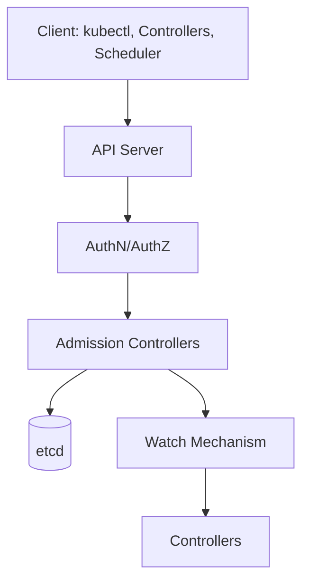
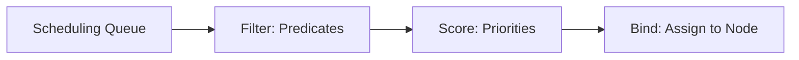

# Kubernetes Architecture for Platform Engineers

## Learning Objectives
- Understand Kubernetes control plane components and their responsibilities
- Learn how platform engineers interact with and extend the control plane
- Master the API server, controller manager, scheduler, and etcd
- Understand node components: kubelet, kube-proxy, container runtime

## Prerequisites
- Basic container knowledge (Docker/Podman)
- Familiarity with YAML
- Basic Linux networking concepts

---

## Control Plane Components

### API Server (`kube-apiserver`)
The API server is the **front door** to the Kubernetes control plane. All communication goes through it.

**Key Responsibilities:**
- Authentication & Authorization
- Admission Control (mutating/validating webhooks)
- API version conversion
- Request validation and persistence to etcd
- Watch mechanism for controllers



**Platform Engineer Touchpoints:**
- **Admission Webhooks**: Validate/mutate platform resources
- **API Aggregation Layer**: Extend Kubernetes API with custom APIs
- **Authentication**: Integrate OIDC, LDAP, Webhook auth
- **Authorization**: Custom RBAC, ABAC policies

### etcd
Distributed key-value store - the **source of truth** for cluster state.

**Platform Engineer Concerns:**
- **Backup/Restore**: Velero, etcdctl snapshot
- **Encryption at Rest**: EncryptionConfiguration
- **Performance**: Disk IOPS, latency budgets
- **Scaling**: Learner nodes, multi-AZ deployment

```yaml
# EncryptionConfiguration example
apiVersion: apiserver.config.k8s.io/v1
kind: EncryptionConfiguration
resources:
  - resources:
      - secrets
      - configmaps
    providers:
      - aescbc:
          keys:
            - name: key1
              secret: <base64-encoded-32-byte-key>
      - identity: {}
```

### Controller Manager (`kube-controller-manager`)
Runs core control loops that reconcile desired state → actual state.

**Core Controllers:**
- **Node Controller**: Node lifecycle, health checks
- **Replication Controller**: ReplicaSet/Deployment scaling
- **Endpoint Controller**: Service ↔ Pod mapping
- **Service Account Controller**: Default SA, token management
- **PV/PVC Controller**: Volume binding, provisioning

**Platform Engineer Extensions:**
- **Custom Controllers**: Implement platform CRDs
- **Controller Runtime**: Build operators with controller-runtime
- **Leader Election**: HA for custom controllers

### Scheduler (`kube-scheduler`)
Assigns pods to nodes based on constraints and optimization.

**Scheduling Framework:**


**Extension Points:**
- **Scheduler Profiles**: Custom plugins for filter/score/bind
- **Pod Topology Spread**: Zone/region distribution
- **Custom Schedulers**: Batch, ML, GPU-aware scheduling

---

## Node Components

### Kubelet
Primary node agent - manages pod lifecycle on the node.

**Key Responsibilities:**
- Pod admission & validation
- Container lifecycle (create, start, stop, remove)
- Health checks (liveness, readiness, startup)
- Resource management (cgroups, QoS classes)
- Volume mounting
- Image pulling & garbage collection

**Platform Engineer Configuration:**
```yaml
# KubeletConfiguration example
apiVersion: kubelet.config.k8s.io/v1beta1
kind: KubeletConfiguration
featureGates:
  RotateKubeletServerCertificate: true
  KubeletPodResources: true
  KubeletPodResourcesGetAllocatable: true
authentication:
  anonymous:
    enabled: false
  webhook:
    enabled: true
  x509:
    clientCAFile: /etc/kubernetes/pki/ca.crt
authorization:
  mode: Webhook
evictionHard:
  memory.available: "500Mi"
  nodefs.available: "10%"
  imagefs.available: "15%"
```

### Kube-proxy
Implements Service abstraction - network proxy & load balancer.

**Modes:**
- **iptables** (default): Kernel-level, high performance
- **IPVS**: Better performance at scale, more features
- **nftables**: Modern replacement for iptables

**Platform Engineer Considerations:**
- **Service Topology**: Topology-aware routing
- **External Traffic Policy**: Local vs Cluster
- **Proxy Protocol**: Preserve client IP

### Container Runtime Interface (CRI)
Standard interface between kubelet and container runtime.

**Popular Runtimes:**
| Runtime | CRI Implementation | Use Case |
|---------|-------------------|----------|
| containerd | Built-in | General purpose, CNCF graduated |
| CRI-O | Built-in | OpenShift, minimal footprint |
| Docker Engine | dockershim (deprecated) | Legacy |

---

## Kubernetes API Concepts

### Resource Model
```text
Group/Version/Resource (GVR)
├── Group: apps, batch, networking.k8s.io, platform.mycompany.io
├── Version: v1, v1beta1, v1alpha1
└── Resource: deployments, jobs, ingresses, tenants
```

### API Verb Categories
- **Read**: get, list, watch
- **Write**: create, update, patch, delete, deletecollection
- **Admin**: bind, escalate, impersonate

### Controller Pattern
```go
// Simplified controller loop
func (c *Controller) Reconcile(ctx context.Context, req ctrl.Request) (ctrl.Result, error) {
    // 1. Fetch desired state
    desired := c.getDesiredState(req.NamespacedName)
    
    // 2. Observe actual state
    actual, err := c.getActualState(req.NamespacedName)
    if err != nil {
        return ctrl.Result{}, err
    }
    
    // 3. Compute diff
    diff := c.computeDiff(desired, actual)
    
    // 4. Apply changes
    if diff.HasChanges() {
        if err := c.applyChanges(diff); err != nil {
            return ctrl.Result{Requeue: true}, err
        }
    }
    
    // 5. Update status
    c.updateStatus(actual)
    
    return ctrl.Result{RequeueAfter: 30 * time.Second}, nil
}
```

---

## Hands-On Exercises

### Explore Your Cluster
```bash
# 1. View control plane components
kubectl get pods -n kube-system -l tier=control-plane

# 2. Check API server health
kubectl get --raw=/healthz

# 3. View node resources
kubectl describe node <node-name>

# 4. Check kubelet config
kubectl get node <node-name> -o jsonpath='{.spec.kubeletConfig}'

# 5. View scheduler events
kubectl get events -n kube-system --field-selector involvedObject.kind=Pod,reason=Scheduled
```

### Deploy a Custom Scheduler
```yaml
# custom-scheduler.yaml
apiVersion: v1
kind: ServiceAccount
metadata:
  name: custom-scheduler
  namespace: kube-system
---
apiVersion: rbac.authorization.k8s.io/v1
kind: ClusterRoleBinding
metadata:
  name: custom-scheduler
roleRef:
  apiGroup: rbac.authorization.k8s.io
  kind: ClusterRole
  name: system:kube-scheduler
subjects:
- kind: ServiceAccount
  name: custom-scheduler
  namespace: kube-system
---
apiVersion: apps/v1
kind: Deployment
metadata:
  name: custom-scheduler
  namespace: kube-system
spec:
  replicas: 1
  selector:
    matchLabels:
      component: custom-scheduler
  template:
    metadata:
      labels:
        component: custom-scheduler
    spec:
      serviceAccountName: custom-scheduler
      containers:
      - name: scheduler
        image: registry.k8s.io/kube-scheduler:v1.28.0
        command:
        - kube-scheduler
        - --scheduler-name=custom-scheduler
        - --leader-elect=true
        - --kubeconfig=/etc/kubernetes/scheduler.conf
```

### Test Custom Scheduler
```yaml
# pod-with-custom-scheduler.yaml
apiVersion: v1
kind: Pod
metadata:
  name: nginx-custom-scheduler
spec:
  schedulerName: custom-scheduler
  containers:
  - name: nginx
    image: nginx:alpine
```

---

## Troubleshooting

Replace `<node>` in the commands below with the name of the control-plane node (for example `kind-control-plane`).

### Symptom: the API server does not respond
```bash
# Check API server logs
kubectl logs -n kube-system kube-apiserver-<node>

# Check etcd health
kubectl exec -n kube-system etcd-<node> -- etcdctl endpoint health

# Check etcd status
kubectl exec -n kube-system etcd-<node> -- etcdctl endpoint status --write-out=table
```

### Symptom: Pods stay Pending
```bash
# Check scheduler logs
kubectl logs -n kube-system kube-scheduler-<node>

# View pending pods
kubectl get pods --all-namespaces --field-selector=status.phase=Pending

# Check node resources
kubectl describe nodes | grep -A 5 "Allocated resources"
```

### Symptom: a node is NotReady or Pods do not start
```bash
# Check kubelet status
systemctl status kubelet

# View kubelet logs
journalctl -u kubelet -f

# Check container runtime
crictl ps -a
crictl info
```

---

## Further Reading

### Official Documentation
- [Kubernetes Architecture](https://kubernetes.io/docs/concepts/architecture/)
- [API Server](https://kubernetes.io/docs/reference/command-line-tools-reference/kube-apiserver/)
- [Controller Manager](https://kubernetes.io/docs/reference/command-line-tools-reference/kube-controller-manager/)
- [Scheduler](https://kubernetes.io/docs/concepts/scheduling-eviction/kube-scheduler/)

### Deep Dives
- [Kubernetes the Hard Way](https://github.com/kelseyhightower/kubernetes-the-hard-way) - Manual cluster setup
- [Controller Runtime](https://github.com/kubernetes-sigs/controller-runtime) - Building controllers
- [Scheduler Framework](https://kubernetes.io/docs/concepts/scheduling-eviction/scheduling-framework/) - Extending scheduler

### Books
- "Kubernetes Up & Running" - Brendan Burns, Kelsey Hightower
- "Programming Kubernetes" - Stefan Schimanski, Michael Hausenblas
- "Kubernetes Operators" - Jason Dobies, Joshua Wood

---

## Next Steps

1. **Complete Lab 01**: Set up a local cluster with Kind/k3d
2. **Read**: [Container Runtime Fundamentals](../02-container-runtime/container-runtimes.md)
3. **Practice**: Deploy a custom controller using Kubebuilder
4. **Explore**: [Kubernetes API Reference](https://kubernetes.io/docs/reference/kubernetes-api/)