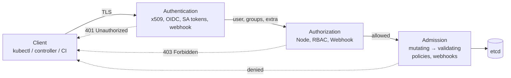
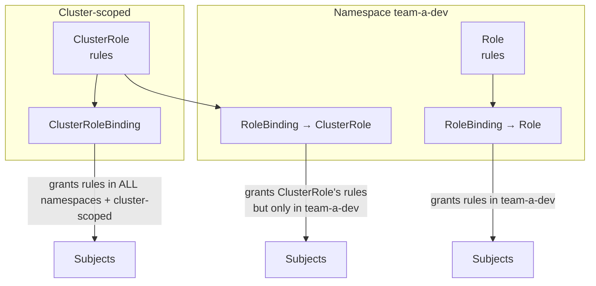
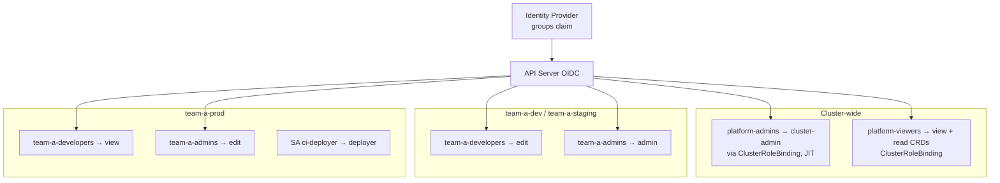

# Role-Based Access Control (RBAC)

## Learning Objectives
- Place RBAC in the API request pipeline (authentication → authorization → admission)
- Model subjects (users, groups, ServiceAccounts) and how they're authenticated
- Write Roles, ClusterRoles, RoleBindings, and ClusterRoleBindings, including aggregated roles for CRDs
- Understand privilege-escalation prevention (`escalate`, `bind`) and impersonation
- Recognize dangerous permissions and design a least-privilege tenant model
- Audit and debug access with `kubectl auth can-i`, `kubectl auth whoami`, and impersonation

## Prerequisites
- [Kubernetes Architecture](./kubernetes-architecture.md) — API server role
- [Kubernetes API Primer](./api-primer.md) — API groups, resources, verbs, subresources
- [Controllers and Operators](./controllers-operators.md) — operators need RBAC too
- A cluster from [Lab 01: Cluster Setup](../../labs/lab-01-cluster-setup/README.md)

---

## Where RBAC Fits

Every request to the API server passes through three gates. RBAC is the most common **authorizer**.



| Stage | Question | Examples |
|-------|----------|----------|
| Authentication | *Who are you?* | Client certs, OIDC (Entra ID, Okta, Keycloak, Dex), ServiceAccount tokens, cloud IAM (EKS access entries, GKE IAM) |
| Authorization | *May you do this verb on this resource?* | `Node` authorizer (kubelets), **RBAC**, webhook (cloud IAM, OPA) |
| Admission | *Is this specific object acceptable?* | Pod Security Admission, ValidatingAdmissionPolicy (CEL), Kyverno, Gatekeeper |

RBAC is **purely additive**: there are no deny rules. Anything not granted is denied. If you need "deny" or
conditions on object *content* (e.g. "may create Services, but not of type LoadBalancer"), that is admission's job
— see [Policy Engine](../12-security-compliance/policy-engine.md).

---

## Subjects: Who Gets Permissions

Kubernetes has no `User` object. Users and groups are strings asserted by the authenticator.

| Subject kind | Identity string | Source |
|--------------|-----------------|--------|
| `User` | e.g. `alice@mycompany.io` | Cert CN, OIDC claim (`email`/`sub`), cloud IAM mapping |
| `Group` | e.g. `team-a-admins` | Cert O, OIDC `groups` claim, cloud IAM mapping |
| `ServiceAccount` | `system:serviceaccount:<ns>:<name>` | Namespaced API object; token issued by the API server |

Built-in groups worth knowing:

| Group | Members |
|-------|---------|
| `system:authenticated` | Every authenticated request |
| `system:unauthenticated` | Anonymous requests (if anonymous auth is enabled) |
| `system:serviceaccounts` | All ServiceAccounts |
| `system:serviceaccounts:<ns>` | All ServiceAccounts in a namespace |
| `system:masters` | Bypasses authorization entirely — **never** issue certs with this group except break-glass |
| `system:nodes` | Kubelets (authorized by the Node authorizer) |

```bash
# Who does the API server think I am? (SelfSubjectReview, GA in 1.28)
kubectl auth whoami
# ATTRIBUTE   VALUE
# Username    kubernetes-admin
# Groups      [kubeadm:cluster-admins system:authenticated]
```

### ServiceAccount Tokens

Modern clusters issue **bound, short-lived, audience-scoped** tokens via the TokenRequest API, projected into
Pods and rotated by kubelet. Long-lived Secret-based tokens are no longer auto-created.

```yaml
# serviceaccount.yaml
apiVersion: v1
kind: ServiceAccount
metadata:
  name: checkout
  namespace: team-a-prod
  labels:
    platform.mycompany.io/tenant: team-a
automountServiceAccountToken: false   # opt in per Pod only if the app calls the API server
```

```bash
# Mint a short-lived token for testing (not stored anywhere)
kubectl -n team-a-prod create token checkout --duration=10m
```

The same tokens power **workload identity** (EKS Pod Identity / IRSA, GKE Workload Identity, Azure Workload
Identity, Vault Kubernetes auth): external systems trust the cluster's OIDC issuer — see
[Vault Integration](../06-secrets-management/vault-integration.md).

---

## RBAC Objects



| Object | Scope of rules | Can grant cluster-scoped resources? |
|--------|---------------|-------------------------------------|
| `Role` + `RoleBinding` | One namespace | No |
| `ClusterRole` + `RoleBinding` | The binding's namespace | No (cluster-scoped rules are ignored) |
| `ClusterRole` + `ClusterRoleBinding` | All namespaces + cluster-scoped resources | Yes |

**Pattern:** define permissions once as a ClusterRole, grant them per namespace with RoleBindings. This is exactly
how the built-in `admin`/`edit`/`view` roles are meant to be used.

### Rules Anatomy

```yaml
# role-deployer.yaml
apiVersion: rbac.authorization.k8s.io/v1
kind: Role
metadata:
  name: deployer
  namespace: team-a-dev
rules:
  - apiGroups: ["apps"]                     # "" = core group (pods, services, configmaps...)
    resources: ["deployments"]
    verbs: ["get", "list", "watch", "create", "update", "patch"]
  - apiGroups: ["apps"]
    resources: ["deployments/scale"]        # subresources are separate resources
    verbs: ["update", "patch"]
  - apiGroups: [""]
    resources: ["pods", "pods/log"]
    verbs: ["get", "list", "watch"]
  - apiGroups: [""]
    resources: ["configmaps"]
    resourceNames: ["checkout-config"]      # only this object; can't restrict list/watch/create by name
    verbs: ["get", "update", "patch"]
```

| Verb | HTTP | Notes |
|------|------|-------|
| `get`, `list`, `watch` | GET | `list`/`watch` return *full objects* — `list secrets` = read every secret |
| `create` | POST | |
| `update`, `patch` | PUT, PATCH | |
| `delete`, `deletecollection` | DELETE | |
| `impersonate` | headers | On `users`, `groups`, `serviceaccounts`, `userextras/*`, `uids` |
| `bind`, `escalate` | — | On `roles`/`clusterroles`; see escalation prevention |
| `approve`, `sign` | — | CertificateSigningRequests |
| `use` | — | Historically PodSecurityPolicy; some CRDs use custom verbs |

Common subresources: `pods/exec`, `pods/attach`, `pods/portforward`, `pods/log`, `pods/eviction`,
`deployments/scale`, `<crd>/status`, `serviceaccounts/token`, `nodes/proxy`.

### Bindings

```yaml
# rolebinding-team-a-dev.yaml
apiVersion: rbac.authorization.k8s.io/v1
kind: RoleBinding
metadata:
  name: team-a-edit
  namespace: team-a-dev
  labels:
    platform.mycompany.io/tenant: team-a
    platform.mycompany.io/managed-by: tenant-operator
subjects:
  - kind: Group
    apiGroup: rbac.authorization.k8s.io
    name: team-a-developers                 # from the IdP's groups claim
  - kind: ServiceAccount
    name: ci-deployer                       # SA subjects need namespace, no apiGroup
    namespace: team-a-ci
roleRef:                                    # immutable — delete and recreate to change
  apiGroup: rbac.authorization.k8s.io
  kind: ClusterRole
  name: edit
```

---

## Built-in and Aggregated Roles

| ClusterRole | Intended binding | Grants |
|-------------|------------------|--------|
| `cluster-admin` | ClusterRoleBinding (break-glass only) | Everything |
| `admin` | RoleBinding per namespace | Full control of namespace incl. Roles/RoleBindings; not ResourceQuota or the namespace itself |
| `edit` | RoleBinding | Read/write most objects incl. Secrets; no RBAC |
| `view` | RoleBinding | Read most objects; **excludes Secrets** |

These roles are **aggregated**: the controller manager unions in rules from any ClusterRole carrying matching
labels. That is how you make your platform CRDs available to tenants without editing the built-ins.

```yaml
# clusterroles-platform-aggregation.yaml
apiVersion: rbac.authorization.k8s.io/v1
kind: ClusterRole
metadata:
  name: platform-mycompany-io:edit
  labels:
    rbac.authorization.k8s.io/aggregate-to-admin: "true"   # admins get it
    rbac.authorization.k8s.io/aggregate-to-edit: "true"    # editors get it
rules:
  - apiGroups: ["platform.mycompany.io"]
    resources: ["workloads", "environments"]
    verbs: ["get", "list", "watch", "create", "update", "patch", "delete"]
---
apiVersion: rbac.authorization.k8s.io/v1
kind: ClusterRole
metadata:
  name: platform-mycompany-io:view
  labels:
    rbac.authorization.k8s.io/aggregate-to-view: "true"
rules:
  - apiGroups: ["platform.mycompany.io"]
    resources: ["workloads", "environments", "workloads/status", "environments/status"]
    verbs: ["get", "list", "watch"]
```

You can build your own aggregated roles:

```yaml
# clusterrole-tenant-developer.yaml
apiVersion: rbac.authorization.k8s.io/v1
kind: ClusterRole
metadata:
  name: tenant-developer
aggregationRule:
  clusterRoleSelectors:
    - matchLabels:
        platform.mycompany.io/aggregate-to-tenant-developer: "true"
rules: []        # filled in by the controller manager; manual edits are overwritten
```

Note that `Tenant` is cluster-scoped and should *not* be editable by tenants — only by the platform team or via a
self-service flow ([Service Catalog](../08-self-service/service-catalog.md)).

---

## Privilege Escalation Prevention

RBAC stops you from granting permissions you don't have:

- To **create/update a Role or ClusterRole**, you must already hold every permission it contains (in the same
  scope), **or** have the `escalate` verb on `roles`/`clusterroles`.
- To **create/update a binding**, you must hold every permission of the referenced role, **or** have the `bind`
  verb on that role.

This lets you delegate safely: the tenant-operator below can bind `admin` in tenant namespaces without being able
to grant itself `cluster-admin`.

```yaml
# clusterrole-tenant-operator.yaml (least privilege for the operator in controllers-operators.md)
apiVersion: rbac.authorization.k8s.io/v1
kind: ClusterRole
metadata:
  name: tenant-operator
rules:
  - apiGroups: ["platform.mycompany.io"]
    resources: ["tenants"]
    verbs: ["get", "list", "watch", "update", "patch"]
  - apiGroups: ["platform.mycompany.io"]
    resources: ["tenants/status"]
    verbs: ["get", "update", "patch"]
  - apiGroups: ["platform.mycompany.io"]
    resources: ["tenants/finalizers"]
    verbs: ["update"]
  - apiGroups: [""]
    resources: ["namespaces"]
    verbs: ["get", "list", "watch", "create", "update", "patch", "delete"]
  - apiGroups: ["rbac.authorization.k8s.io"]
    resources: ["rolebindings"]
    verbs: ["get", "list", "watch", "create", "update", "patch", "delete"]
  - apiGroups: ["rbac.authorization.k8s.io"]
    resources: ["clusterroles"]
    verbs: ["bind"]                     # may bind ONLY these roles, without holding their rules
    resourceNames: ["admin", "edit", "view", "tenant-developer"]
  - apiGroups: ["coordination.k8s.io"]
    resources: ["leases"]               # leader election
    verbs: ["get", "list", "watch", "create", "update", "patch", "delete"]
  - apiGroups: [""]
    resources: ["events"]
    verbs: ["create", "patch"]
```

---

## Impersonation

Impersonation lets a principal act **as** another user, group, or ServiceAccount. kubectl sends
`Impersonate-User` / `Impersonate-Group` headers when you use `--as` / `--as-group`.

```bash
# Test what a developer can do — invaluable when designing tenant roles
kubectl auth can-i create deployments -n team-a-dev --as=alice@mycompany.io --as-group=team-a-developers
kubectl get pods -n team-a-prod --as=system:serviceaccount:team-a-ci:ci-deployer
```

Granting impersonation is powerful — impersonating `system:masters` is equivalent to cluster-admin. Scope it with
`resourceNames`:

```yaml
# clusterrole-support-impersonation.yaml
apiVersion: rbac.authorization.k8s.io/v1
kind: ClusterRole
metadata:
  name: platform-support-impersonator
rules:
  - apiGroups: [""]
    resources: ["groups"]
    verbs: ["impersonate"]
    resourceNames: ["team-a-developers", "team-b-developers"]   # never system:masters
  - apiGroups: [""]
    resources: ["users"]
    verbs: ["impersonate"]
    resourceNames: ["support-readonly@mycompany.io"]
```

Platform uses of impersonation:

| Use case | How |
|----------|-----|
| Support engineers reproducing a tenant's view | Bind the impersonator role to the support group |
| Portals / platform APIs acting on behalf of users | Backend authenticates the user, then calls the API server with impersonation headers so RBAC and audit logs reflect the real user ([Platform API](../09-platform-apis/platform-api-design.md)) |
| Argo CD / Flux tenant isolation | Flux `Kustomization.spec.serviceAccountName`; Argo CD AppProject `destinationServiceAccounts` (impersonation) |

Audit logs record both the impersonator and the impersonated user (`impersonatedUser` field).

---

## Dangerous Permissions

Some permissions are effectively cluster-admin or allow lateral movement. Review any role that contains these.

| Permission | Why it's dangerous |
|------------|--------------------|
| `*` on `*` | Obvious |
| `get`/`list`/`watch` on `secrets` | Read every credential in scope (list returns contents) |
| `create` on `pods` (or any workload controller) | Can mount any Secret and run as **any ServiceAccount** in the namespace |
| `create` on `pods/exec`, `pods/attach` | Shell into running containers and read their tokens/env |
| `create` on `serviceaccounts/token` | Mint tokens for any SA in scope |
| `escalate`, `bind` on (cluster)roles without `resourceNames` | Grant self arbitrary permissions |
| `impersonate` without `resourceNames` | Become anyone, including `system:masters` |
| `update`/`patch` on `nodes`, `get` on `nodes/proxy` | Kubelet API access → exec into any Pod on the node |
| `create`/`update` on `mutatingwebhookconfigurations`/`validatingwebhookconfigurations` | Intercept or modify every object |
| `approve` on `certificatesigningrequests` + `sign` on signers | Issue client certs for arbitrary identities |
| `create`/`update` on `persistentvolumes` | `hostPath` PVs read node filesystems |
| `update` on `namespaces` | Remove Pod Security labels (`pod-security.kubernetes.io/*`) |

Because "create pods ⇒ use any SA in the namespace", **namespaces are the real security boundary**. Never put a
highly privileged ServiceAccount (e.g. an operator's) in a namespace where tenants can create Pods.

---

## A Tenant Access Model



| Principle | Implementation |
|-----------|---------------|
| Groups, not users | Bind IdP groups; joiners/leavers are handled in the IdP |
| Per-namespace bindings | RoleBinding → ClusterRole; generated by the tenant-operator from the `Tenant` spec |
| Prod is read-only for humans | Changes flow through GitOps ([GitOps Principles](../05-gitops/gitops-principles.md)); humans get `view` |
| No standing cluster-admin | Just-in-time elevation (e.g. time-boxed group membership); break-glass cert stored offline |
| RBAC as code | All bindings in Git; drift detected by Argo CD/Flux |
| Admission complements RBAC | Pod Security `restricted`, policies to forbid `hostPath`, privileged, LoadBalancer Services |

```yaml
# tenant-team-a.yaml — the operator renders RoleBindings from this
apiVersion: platform.mycompany.io/v1alpha1
kind: Tenant
metadata:
  name: team-a
spec:
  owner: team-a-admins
  environments: [dev, staging, prod]
```

---

## Hands-On Exercises

### Exercise 1: Explore Built-in Roles

**Goal:** identify yourself, find the default ClusterRoles, and see how `edit` is assembled by aggregation.

```bash
kubectl auth whoami
kubectl get clusterroles | grep -E '^(admin|edit|view|cluster-admin) '
kubectl describe clusterrole view | head -40
kubectl get clusterrole edit -o jsonpath='{.aggregationRule}{"\n"}'

# Everything I'm allowed to do in a namespace
kubectl auth can-i --list -n default
```

Expected output (abbreviated; the identity depends on your kubeconfig):

```text
ATTRIBUTE   VALUE
Username    <user>
Groups      [<group> system:authenticated]
```

```text
admin           <created-at>
cluster-admin   <created-at>
edit            <created-at>
view            <created-at>
```

**Check:**

- The `grep` lists four ClusterRoles: `admin`, `cluster-admin`, `edit`, `view`.
- The `aggregationRule` output contains `aggregate-to-edit`.

### Exercise 2: Create a Tenant Namespace with Scoped Access

**Goal:** bind a group to `edit` in one namespace and verify what it can and cannot do.

```bash
kubectl create namespace team-a-dev
kubectl label namespace team-a-dev platform.mycompany.io/tenant=team-a

kubectl -n team-a-dev create rolebinding team-a-edit \
  --clusterrole=edit --group=team-a-developers

# Test as a developer
kubectl auth can-i create deployments -n team-a-dev --as=alice --as-group=team-a-developers   # yes
kubectl auth can-i create deployments -n default    --as=alice --as-group=team-a-developers   # no
kubectl auth can-i create rolebindings -n team-a-dev --as=alice --as-group=team-a-developers  # no (edit has no RBAC)
kubectl auth can-i get secrets -n team-a-dev        --as=alice --as-group=team-a-developers   # yes — edit includes secrets!
```

Expected output of the four `can-i` commands, in order:

```text
yes
no
no
yes
```

**Check:**

- The four answers match the comments in the commands.
- `kubectl -n team-a-dev get rolebinding team-a-edit` exists.

### Exercise 3: Aggregate Platform CRD Permissions

**Goal:** show that a labelled ClusterRole is merged into `edit` automatically.

```bash
kubectl apply -f clusterroles-platform-aggregation.yaml   # from the section above

# The edit role now includes platform.mycompany.io rules (even before the CRD exists)
kubectl get clusterrole edit -o yaml | grep -A3 platform.mycompany.io
kubectl auth can-i create workloads.platform.mycompany.io -n team-a-dev \
  --as=alice --as-group=team-a-developers
```

Expected output (the `grep` shows the merged rule; the last command prints `yes`):

```text
  - platform.mycompany.io
  ...
yes
```

**Check:**

- `kubectl get clusterrole edit -o yaml | grep -c platform.mycompany.io` prints a number greater than 0.
- The final `can-i` prints `yes`.

### Exercise 4: ServiceAccount Least Privilege

**Goal:** give a ServiceAccount only what it needs and verify it with `can-i` and with a real token.

```bash
kubectl -n team-a-dev create serviceaccount ci-deployer
kubectl apply -f role-deployer.yaml                        # from "Rules Anatomy"
kubectl -n team-a-dev create rolebinding ci-deployer \
  --role=deployer --serviceaccount=team-a-dev:ci-deployer

SA=system:serviceaccount:team-a-dev:ci-deployer
kubectl auth can-i patch deployments -n team-a-dev --as=$SA    # yes
kubectl auth can-i delete deployments -n team-a-dev --as=$SA   # no
kubectl auth can-i get secrets -n team-a-dev --as=$SA          # no

# Use a real token instead of impersonation
TOKEN=$(kubectl -n team-a-dev create token ci-deployer --duration=10m)
kubectl --token="$TOKEN" -n team-a-dev get deployments
kubectl --token="$TOKEN" -n team-a-dev get secrets             # Forbidden
```

Expected output:

```text
yes
no
no
<the Deployment list, possibly empty>
Error from server (Forbidden): secrets is forbidden: User "system:serviceaccount:team-a-dev:ci-deployer" cannot list resource "secrets" in API group "" in the namespace "team-a-dev"
```

**Check:**

- The three `can-i` answers are `yes`, `no`, `no`.
- The token request can list Deployments but gets `Forbidden` for Secrets.

### Exercise 5: Watch Escalation Prevention

**Goal:** show that a user who can create RoleBindings still cannot grant permissions they do not hold.

```bash
# Give a user permission to manage RoleBindings, but nothing else
kubectl -n team-a-dev create role rb-manager --verb=create,get,list --resource=rolebindings
kubectl -n team-a-dev create rolebinding bob-rb-manager --role=rb-manager --user=bob

# Bob tries to bind himself admin -> forbidden (he doesn't hold admin's permissions)
kubectl -n team-a-dev create rolebinding bob-admin --clusterrole=admin --user=bob --as=bob
# error: ... is attempting to grant RBAC permissions not currently held
```

Expected output of the last command (the full message names the subject and the missing rules):

```text
error: failed to create rolebinding: rolebindings.rbac.authorization.k8s.io "bob-admin" is forbidden: user "bob" (groups=["system:authenticated"]) is attempting to grant RBAC permissions not currently held:
...
```

**Check:**

- `kubectl -n team-a-dev get rolebinding bob-admin` returns `NotFound`.
- `kubectl auth can-i create rolebindings -n team-a-dev --as=bob` prints `yes`.

Clean up:

```bash
kubectl delete namespace team-a-dev
kubectl delete -f clusterroles-platform-aggregation.yaml
```

### Exercise 6: Audit Who Can Do What

**Goal:** list who can read Secrets and what a user can do across resources, using Krew plugins.

```bash
# Krew plugins (https://krew.sigs.k8s.io/)
kubectl krew install who-can access-matrix
kubectl who-can get secrets -n kube-system
kubectl access-matrix -n team-a-dev --as=alice --as-group=team-a-developers
```

Expected output: `who-can` prints a table of `ROLEBINDING`/`CLUSTERROLEBINDING` and `SUBJECT` columns (subjects vary by cluster); `access-matrix` prints a resource-by-verb grid with `✔` and blank cells.

**Check:**

- `kubectl who-can get secrets -n kube-system` includes `system:masters` or a `cluster-admin` binding.
- In the access matrix for `alice`, the `secrets` row shows `get`, matching Exercise 2.

---

## Troubleshooting

### `Error from server (Forbidden)`

The message tells you exactly which check failed:

```text
pods "web" is forbidden: User "alice" cannot create resource "pods/exec" in API group "" in the namespace "team-a-prod"
```

```bash
# 1. Confirm identity and groups as the API server sees them
kubectl auth whoami

# 2. Reproduce precisely (subresource and group matter)
kubectl auth can-i create pods/exec -n team-a-prod --as=alice --as-group=team-a-developers

# 3. Find bindings that mention the subject
kubectl get rolebindings,clusterrolebindings -A -o json \
  | jq -r '.items[] | select(.subjects[]? | .name=="team-a-developers") | "\(.kind) \(.metadata.namespace // "-") \(.metadata.name) -> \(.roleRef.name)"'
```

- Cause: Wrong `apiGroups` (e.g. `""` for deployments). Fix: Deployments are `apps`; Ingress is `networking.k8s.io`; check `kubectl api-resources`.
- Cause: Subresource missing (`pods/log`, `deployments/scale`). Fix: Add the subresource explicitly.
- Cause: Group claim not present in token. Fix: Check OIDC `groups` claim mapping and prefix (e.g. `oidc:team-a-developers`).
- Cause: RoleBinding in the wrong namespace. Fix: RoleBindings only apply to their own namespace.
- Cause: ClusterRole bound via RoleBinding for cluster-scoped resource. Fix: Needs a ClusterRoleBinding.
- Cause: `resourceNames` with `list`/`create`. Fix: `create` can't be restricted by name; `list` works only with a field selector on `metadata.name`.

### Controller Logs `failed to list *v1.Secret: ... forbidden`

The operator's ClusterRole is missing `list`/`watch` (informers need both, not only `get`). Regenerate RBAC from
kubebuilder markers (`make manifests`) and re-apply.

### Aggregated Rules Not Appearing

The aggregation controller only picks up ClusterRoles whose labels match `clusterRoleSelectors` exactly. Check the
label value is the string `"true"` and inspect the merged result with
`kubectl get clusterrole edit -o yaml`.

### Can't Change a Binding's `roleRef`

`roleRef` is immutable. Delete and recreate the binding (or use `kubectl auth reconcile -f`, which handles
recreating bindings and only adds missing rules).

---

## Further Reading

### Official Documentation
- [Using RBAC Authorization](https://kubernetes.io/docs/reference/access-authn-authz/rbac/)
- [RBAC Good Practices](https://kubernetes.io/docs/concepts/security/rbac-good-practices/)
- [Authenticating](https://kubernetes.io/docs/reference/access-authn-authz/authentication/) — OIDC, impersonation, structured authentication config
- [Service Accounts](https://kubernetes.io/docs/concepts/security/service-accounts/)
- [Controlling Access to the Kubernetes API](https://kubernetes.io/docs/concepts/security/controlling-access/)
- [Auditing](https://kubernetes.io/docs/tasks/debug/debug-cluster/audit/)

### Tools
- [kubectl-who-can](https://github.com/aquasecurity/kubectl-who-can)
- [rakkess / access-matrix](https://github.com/corneliusweig/rakkess)
- [rbac-tool](https://github.com/alcideio/rbac-tool) — visualize and generate least-privilege roles
- [Kubernetes Goat](https://madhuakula.com/kubernetes-goat/) — practice RBAC attack paths

---

## Next Steps

1. **Read**: [Container Runtimes](../02-container-runtime/container-runtimes.md) — start Phase 1, section 02
2. **Read**: [Pod Security](../12-security-compliance/pod-security.md) and [Policy Engine](../12-security-compliance/policy-engine.md) — admission controls that complement RBAC
3. **Practice**: [Lab 07: Multi-Tenancy](../../labs/lab-07-multi-tenancy/) — generate tenant RBAC with the tenant-operator
4. **Explore**: [`code/tenant-operator/`](https://github.com/GitOpsHub/platform-engineering-on-kubernetes/tree/main/code/tenant-operator/) — RBAC markers and bindings in a real operator
