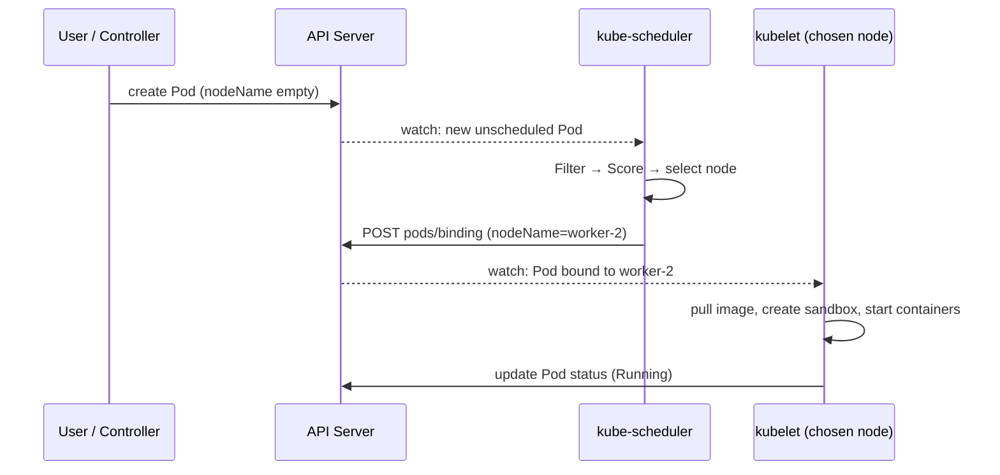
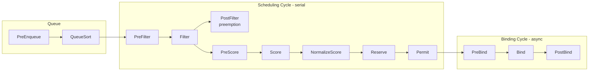
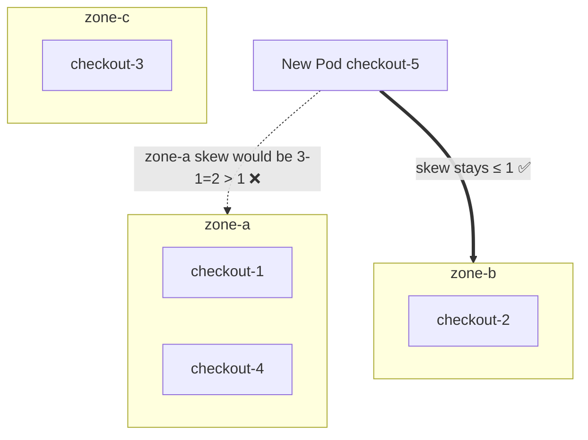

# Kubernetes Scheduling

## Learning Objectives
- Describe the scheduling cycle and binding cycle and the scheduling-framework extension points
- Use requests/limits, node selectors, affinity, taints/tolerations, and topology spread to place workloads
- Configure PriorityClasses and understand preemption
- Tune `kube-scheduler` with `KubeSchedulerConfiguration` profiles and scoring strategies
- Design platform-level placement policies (system pools, tenant pools, GPU pools, zone spreading)
- Diagnose `Pending` Pods from scheduler events

## Prerequisites
- [Kubernetes Architecture](./kubernetes-architecture.md) — scheduler overview and the custom-scheduler example
- [Controllers and Operators](./controllers-operators.md) — the scheduler is a specialized controller
- A multi-node cluster from [Lab 01: Cluster Setup](../../labs/lab-01-cluster-setup/README.md) (1 control-plane + 2+ workers)

---

## What the Scheduler Does (and Doesn't Do)

`kube-scheduler` watches for Pods with an empty `spec.nodeName` whose `spec.schedulerName` matches it
(`default-scheduler` by default), picks a node, and writes a **Binding**. That is all. It does not start
containers (kubelet does), it does not move running Pods (the descheduler or you do), and it does not add nodes
(Cluster Autoscaler / Karpenter do — see [Capacity Planning](../11-reliability/capacity-planning.md)).



The decision is **one Pod at a time** and **based only on requests**, not actual usage. A node at 5% CPU
utilization is "full" if the sum of CPU requests equals its allocatable CPU.

---

## The Scheduling Framework

Every scheduling attempt runs through a pipeline of **plugins** at well-defined **extension points**. The
architecture doc showed the simplified Filter → Score → Bind view; here is the full picture.



| Extension point | Purpose | Notable default plugins |
|-----------------|---------|-------------------------|
| PreEnqueue | Gate Pods before they enter the active queue | `SchedulingGates` |
| QueueSort | Order the queue | `PrioritySort` (higher priority first) |
| PreFilter / Filter | Eliminate infeasible nodes | `NodeResourcesFit`, `NodeAffinity`, `TaintToleration`, `NodePorts`, `NodeUnschedulable`, `PodTopologySpread`, `InterPodAffinity`, `VolumeBinding`, `VolumeZone`, `NodeVolumeLimits` |
| PostFilter | Runs only when no node fits | `DefaultPreemption` |
| PreScore / Score | Rank feasible nodes 0–100, weighted | `NodeResourcesFit` (strategy), `NodeResourcesBalancedAllocation`, `ImageLocality`, `InterPodAffinity`, `NodeAffinity` (preferred), `PodTopologySpread`, `TaintToleration` (PreferNoSchedule) |
| Reserve | Tentatively claim resources (e.g. volumes) | `VolumeBinding` |
| Permit | Approve, deny, or *wait* (gang scheduling) | (used by out-of-tree co-scheduling plugins) |
| PreBind / Bind | Provision volumes, write the Binding | `VolumeBinding`, `DefaultBinder` |

For large clusters the scheduler doesn't evaluate every node: `percentageOfNodesToScore` (adaptive by default,
roughly 50% at 100 nodes decreasing towards 5% at 5,000 nodes) stops filtering once enough feasible nodes are found.

---

## Resource Requests, Limits, and QoS

Requests drive placement; limits drive runtime enforcement.

```yaml
# deployment-with-resources.yaml
apiVersion: apps/v1
kind: Deployment
metadata:
  name: checkout
  namespace: team-a-prod
  labels:
    platform.mycompany.io/tenant: team-a
spec:
  replicas: 3
  selector:
    matchLabels: { app: checkout }
  template:
    metadata:
      labels: { app: checkout }
    spec:
      containers:
        - name: app
          image: ghcr.io/mycompany/checkout:1.8.2
          resources:
            requests:
              cpu: 250m        # scheduler reserves 0.25 core on the node
              memory: 256Mi    # scheduler reserves 256Mi
            limits:
              memory: 256Mi    # OOM-killed above this; equal to request avoids overcommit
              # no CPU limit: avoids CFS throttling; CPU is compressible
```

| QoS class | Rule | Eviction order under node pressure |
|-----------|------|-----------------------------------|
| `Guaranteed` | Every container has requests == limits for CPU and memory | Last |
| `Burstable` | At least one request or limit set, not Guaranteed | Middle (by usage above request) |
| `BestEffort` | No requests or limits at all | First |

Platform guidance: enforce requests via `LimitRange` defaults and `ResourceQuota` per tenant namespace (see
[Lab 07: Multi-Tenancy](../../labs/lab-07-multi-tenancy/)), and validate them with a policy engine
([Policy Engine](../12-security-compliance/policy-engine.md)).

```bash
# Requested vs allocatable per node — the numbers the scheduler actually uses
kubectl describe node <node> | sed -n '/Allocated resources/,/Events/p'
```

---

## Placement Controls

### Summary

| Mechanism | Expressed on | Hard / soft | Typical use |
|-----------|-------------|-------------|-------------|
| `nodeSelector` | Pod | Hard | Simple "run on nodes with label X" |
| Node affinity `required…` | Pod | Hard | Expressions (`In`, `NotIn`, `Exists`, `Gt`, `Lt`) |
| Node affinity `preferred…` | Pod | Soft (weighted) | "Prefer spot, fall back to on-demand" |
| Taints / tolerations | Node / Pod | Hard (`NoSchedule`, `NoExecute`) or soft (`PreferNoSchedule`) | Dedicate nodes; *repel* by default |
| Pod affinity / anti-affinity | Pod | Hard or soft | Co-locate with cache; spread replicas across hosts |
| Topology spread constraints | Pod | Hard (`DoNotSchedule`) or soft (`ScheduleAnyway`) | Even spread across zones/nodes |
| `nodeName` | Pod | Bypasses scheduler | Debugging only; avoid |

Well-known node labels: `kubernetes.io/hostname`, `kubernetes.io/arch`, `kubernetes.io/os`,
`topology.kubernetes.io/zone`, `topology.kubernetes.io/region`, `node.kubernetes.io/instance-type`.

### Node Affinity

```yaml
# pod-node-affinity.yaml (excerpt from a Pod template)
spec:
  affinity:
    nodeAffinity:
      requiredDuringSchedulingIgnoredDuringExecution:
        nodeSelectorTerms:              # terms are ORed
          - matchExpressions:           # expressions within a term are ANDed
              - key: kubernetes.io/arch
                operator: In
                values: [amd64, arm64]
              - key: platform.mycompany.io/pool
                operator: In
                values: [general]
      preferredDuringSchedulingIgnoredDuringExecution:
        - weight: 80                    # 1-100, added to the node's score
          preference:
            matchExpressions:
              - key: platform.mycompany.io/capacity-type
                operator: In
                values: [spot]
```

`IgnoredDuringExecution` means relabeling a node later does **not** evict Pods already running there.

### Taints and Tolerations

Taints are the inverse of affinity: a node *repels* every Pod that doesn't tolerate the taint.

| Effect | New Pods without toleration | Running Pods without toleration |
|--------|-----------------------------|---------------------------------|
| `PreferNoSchedule` | Avoided if possible | Unaffected |
| `NoSchedule` | Rejected | Unaffected |
| `NoExecute` | Rejected | Evicted (after `tolerationSeconds` if set) |

```bash
# Dedicate a node pool to GPU workloads
kubectl taint nodes gpu-node-1 platform.mycompany.io/dedicated=gpu:NoSchedule
kubectl label nodes gpu-node-1 platform.mycompany.io/pool=gpu
```

```yaml
# gpu-job.yaml (Pod template excerpt)
spec:
  tolerations:
    - key: platform.mycompany.io/dedicated
      operator: Equal
      value: gpu
      effect: NoSchedule
  nodeSelector:
    platform.mycompany.io/pool: gpu     # toleration *allows*; selector *requires*
  containers:
    - name: train
      image: ghcr.io/mycompany/trainer:2.3.0
      resources:
        limits:
          nvidia.com/gpu: 1              # extended resource advertised by the device plugin
```

> **Toleration ≠ attraction.** A toleration only permits scheduling on the tainted node. To *dedicate* a pool,
> combine a taint (keep others out) with a node selector/affinity (keep these in).

The node lifecycle controller adds `NoExecute` taints such as `node.kubernetes.io/not-ready` and
`node.kubernetes.io/unreachable`; Pods get a default toleration of 300s for each, which is why Pods on a dead
node take ~5 minutes to be evicted.

### Pod Affinity and Anti-Affinity

```yaml
# web-anti-affinity.yaml (Pod template excerpt)
spec:
  affinity:
    podAntiAffinity:
      # Hard: never two replicas on the same node
      requiredDuringSchedulingIgnoredDuringExecution:
        - labelSelector:
            matchLabels: { app: checkout }
          topologyKey: kubernetes.io/hostname
    podAffinity:
      # Soft: prefer the same zone as the Redis cache
      preferredDuringSchedulingIgnoredDuringExecution:
        - weight: 50
          podAffinityTerm:
            labelSelector:
              matchLabels: { app: redis, platform.mycompany.io/tenant: team-a }
            topologyKey: topology.kubernetes.io/zone
```

Inter-pod affinity is the most expensive scheduling feature (it must examine Pods on all nodes). Prefer
topology spread constraints for spreading; reserve anti-affinity for hard "never co-locate" rules.

### Topology Spread Constraints

```yaml
# checkout-spread.yaml (Pod template excerpt)
spec:
  topologySpreadConstraints:
    - maxSkew: 1                               # max difference in matching Pods between domains
      topologyKey: topology.kubernetes.io/zone
      whenUnsatisfiable: DoNotSchedule         # hard constraint
      labelSelector:
        matchLabels: { app: checkout }
      matchLabelKeys: [pod-template-hash]      # count only Pods of the same rollout revision
      minDomains: 3                            # treat <3 zones as skew (forces autoscaler to add zones)
    - maxSkew: 2
      topologyKey: kubernetes.io/hostname
      whenUnsatisfiable: ScheduleAnyway        # soft: becomes a scoring preference
      labelSelector:
        matchLabels: { app: checkout }
```



If a Pod defines no constraints, the scheduler applies **cluster-level defaults**: soft spreading across
`kubernetes.io/hostname` (maxSkew 3) and `topology.kubernetes.io/zone` (maxSkew 5). You can override these in
the `PodTopologySpread` plugin args.

### Scheduling Gates

`spec.schedulingGates` (GA in 1.30) keeps a Pod out of the scheduling queue until every gate is removed. Useful for
quota-aware admission (Kueue) or "wait until the platform has provisioned the tenant's secrets".

```yaml
# gated-pod.yaml
apiVersion: v1
kind: Pod
metadata:
  name: batch-step
  namespace: team-a-dev
spec:
  schedulingGates:
    - name: platform.mycompany.io/quota-approved   # removed by a platform controller
  containers:
    - name: step
      image: busybox:1.36
      command: ["sh", "-c", "echo done"]
```

```bash
kubectl get pod batch-step   # STATUS: SchedulingGated
kubectl patch pod batch-step --type=json -p '[{"op":"remove","path":"/spec/schedulingGates"}]'
```

---

## Priority and Preemption

When no node fits, the `DefaultPreemption` PostFilter plugin looks for a node where evicting **lower-priority**
Pods would make room. Victims get graceful termination; the preemptor is marked with `status.nominatedNodeName`
and scheduled once space frees up.

```yaml
# priorityclasses.yaml
apiVersion: scheduling.k8s.io/v1
kind: PriorityClass
metadata:
  name: platform-critical
value: 1000000                      # user-defined classes must be ≤ 1,000,000,000
globalDefault: false
description: "Platform add-ons: ingress, CNI agents' helpers, policy webhooks"
---
apiVersion: scheduling.k8s.io/v1
kind: PriorityClass
metadata:
  name: tenant-production
value: 10000
description: "Tenant production workloads"
---
apiVersion: scheduling.k8s.io/v1
kind: PriorityClass
metadata:
  name: tenant-batch
value: 100
preemptionPolicy: Never             # queue ahead of others but never evict anyone
description: "Batch/CI work; may be preempted"
---
apiVersion: scheduling.k8s.io/v1
kind: PriorityClass
metadata:
  name: tenant-default
value: 1000
globalDefault: true                 # applied to Pods that don't set priorityClassName
description: "Default for tenant workloads"
```

Built-in classes `system-cluster-critical` (2,000,000,000) and `system-node-critical` (2,000,001,000) are
reserved for core components.

| Consideration | Guidance |
|---------------|----------|
| Who can use high priorities? | Restrict with `ResourceQuota` `scopeSelector` on `PriorityClass`, or a policy rule |
| PodDisruptionBudgets | Preemption *tries* to respect PDBs but may violate them as a last resort |
| Batch vs. services | `preemptionPolicy: Never` for batch so it doesn't kill services |

```yaml
# quota-limit-critical.yaml — tenants may not run platform-critical Pods
apiVersion: v1
kind: ResourceQuota
metadata:
  name: no-platform-critical
  namespace: team-a-prod
spec:
  hard:
    pods: "0"
  scopeSelector:
    matchExpressions:
      - scopeName: PriorityClass
        operator: In
        values: [platform-critical, system-cluster-critical, system-node-critical]
```

---

## Configuring kube-scheduler

`kube-scheduler` is configured with `KubeSchedulerConfiguration` (`kubescheduler.config.k8s.io/v1`, GA since 1.25)
passed via `--config`. One scheduler process can serve multiple **profiles**, each with its own
`schedulerName`.

```yaml
# kube-scheduler-config.yaml
apiVersion: kubescheduler.config.k8s.io/v1
kind: KubeSchedulerConfiguration
clientConnection:
  kubeconfig: /etc/kubernetes/scheduler.conf
leaderElection:
  leaderElect: true
profiles:
  # Profile 1: default behavior, spreading (LeastAllocated)
  - schedulerName: default-scheduler
    pluginConfig:
      - name: PodTopologySpread
        args:
          defaultingType: List
          defaultConstraints:
            - maxSkew: 1
              topologyKey: topology.kubernetes.io/zone
              whenUnsatisfiable: ScheduleAnyway

  # Profile 2: bin-packing for batch — fill nodes so the autoscaler can remove empty ones
  - schedulerName: bin-packing-scheduler
    plugins:
      score:
        disabled:
          - name: NodeResourcesBalancedAllocation
    pluginConfig:
      - name: NodeResourcesFit
        args:
          scoringStrategy:
            type: MostAllocated
            resources:
              - name: cpu
                weight: 1
              - name: memory
                weight: 1
```

```yaml
# batch-pod.yaml
apiVersion: v1
kind: Pod
metadata:
  name: report-generator
  namespace: team-a-dev
spec:
  schedulerName: bin-packing-scheduler   # selects profile 2
  priorityClassName: tenant-batch
  containers:
    - name: gen
      image: busybox:1.36
      command: ["sh", "-c", "sleep 30"]
      resources:
        requests: { cpu: 500m, memory: 128Mi }
```

| Scoring strategy (`NodeResourcesFit`) | Effect | Good for |
|---------------------------------------|--------|----------|
| `LeastAllocated` (default) | Prefer emptier nodes | Spreading, headroom for bursts |
| `MostAllocated` | Prefer fuller nodes | Bin-packing, cost, autoscaler scale-down |
| `RequestedToCapacityRatio` | Custom utilization→score curve | Fine-grained tuning, extended resources |

On managed clusters (EKS, GKE, AKS) you usually can't change the default scheduler's config; run a second
scheduler instead (see the custom-scheduler example in [Kubernetes Architecture](./kubernetes-architecture.md#deploy-a-custom-scheduler)).

### Beyond the Default Scheduler

| Need | Tool |
|------|------|
| Batch job queueing, fair sharing, quotas across teams | [Kueue](https://kueue.sigs.k8s.io/) (works with the default scheduler via scheduling gates/suspend) |
| Gang / co-scheduling, capacity scheduling | [scheduler-plugins](https://github.com/kubernetes-sigs/scheduler-plugins) (out-of-tree plugins built into a custom scheduler) |
| HPC/AI batch scheduling | Volcano, YuniKorn |
| Rebalancing already-running Pods | [Descheduler](https://github.com/kubernetes-sigs/descheduler) |
| GPU partitioning and sharing | Dynamic Resource Allocation (`resource.k8s.io`, GA in 1.34) + vendor DRA drivers |

---

## Platform Placement Patterns

A typical platform splits nodes into pools, enforced by taints and labels and applied to tenants automatically.

```mermaid
graph TB
    subgraph system pool - taint CriticalAddonsOnly
        S1[ingress, CNI operators, policy engine, Argo CD]
    end
    subgraph general pool - no taint
        G1[tenant services]
    end
    subgraph gpu pool - taint dedicated=gpu
        P1["ML training / inference"]
    end
    subgraph tenant-dedicated pool - taint tenant=team-b
        T1[team-b regulated workloads]
    end
```

| Pool | Node taint | Node labels | Who gets the toleration |
|------|-----------|-------------|-------------------------|
| system | `CriticalAddonsOnly=true:NoSchedule` | `platform.mycompany.io/pool=system` | Platform Helm charts |
| general | — | `platform.mycompany.io/pool=general` | Everyone (default) |
| gpu | `platform.mycompany.io/dedicated=gpu:NoSchedule` | `platform.mycompany.io/pool=gpu` | Workloads requesting `nvidia.com/gpu` |
| tenant-dedicated | `platform.mycompany.io/tenant=team-b:NoSchedule` | `platform.mycompany.io/tenant=team-b` | Injected for team-b namespaces only |

Injection of tolerations and node selectors per tenant is best done with a mutating policy rather than trusting
each team's manifests. A Kyverno example:

```yaml
# kyverno-tenant-placement.yaml
apiVersion: kyverno.io/v1
kind: ClusterPolicy
metadata:
  name: tenant-dedicated-placement
spec:
  rules:
    - name: pin-team-b-to-dedicated-pool
      match:
        any:
          - resources:
              kinds: [Pod]
              namespaceSelector:
                matchLabels:
                  platform.mycompany.io/tenant: team-b
      mutate:
        patchStrategicMerge:
          spec:
            nodeSelector:
              platform.mycompany.io/tenant: team-b
            tolerations:
              - key: platform.mycompany.io/tenant
                operator: Equal
                value: team-b
                effect: NoSchedule
```

The `Tenant` and `Workload` CRDs in this repo expose placement as a high-level knob (e.g. `tier: dedicated`) and
let the operator/policy translate it — developers never write tolerations by hand.

---

## Hands-On Exercises

Uses the kind cluster from [Lab 01](../../labs/lab-01-cluster-setup/README.md) (workers labeled
`node-type=worker`).

### Exercise 1: Read Scheduler Decisions

```bash
# 1. Create something unschedulable: request more CPU than any node has
kubectl create namespace sched-lab
kubectl -n sched-lab run greedy --image=nginx:1.27 \
  --overrides='{"spec":{"containers":[{"name":"greedy","image":"nginx:1.27","resources":{"requests":{"cpu":"64"}}}]}}'

# 2. Read the reason
kubectl -n sched-lab describe pod greedy | sed -n '/Events/,$p'
# Warning  FailedScheduling  0/3 nodes are available: 1 node(s) had untolerated taint
#   {node-role.kubernetes.io/control-plane: }, 2 Insufficient cpu. preemption: 0/3 nodes are available: ...

kubectl -n sched-lab delete pod greedy
```

### Exercise 2: Taints and Dedicated Pools

```bash
# Pick one worker and dedicate it
W1=$(kubectl get nodes -l node-type=worker -o jsonpath='{.items[0].metadata.name}')
kubectl taint node "$W1" platform.mycompany.io/dedicated=gpu:NoSchedule
kubectl label node "$W1" platform.mycompany.io/pool=gpu

# Regular Deployment avoids the tainted node
kubectl -n sched-lab create deployment general --image=nginx:1.27 --replicas=4
kubectl -n sched-lab get pods -o wide        # none on $W1

# Tolerating + selecting Pod lands on it
cat <<EOF | kubectl apply -f -
apiVersion: v1
kind: Pod
metadata:
  name: gpu-sim
  namespace: sched-lab
spec:
  nodeSelector: { platform.mycompany.io/pool: gpu }
  tolerations:
    - { key: platform.mycompany.io/dedicated, operator: Equal, value: gpu, effect: NoSchedule }
  containers:
    - { name: app, image: nginx:1.27 }
EOF
kubectl -n sched-lab get pod gpu-sim -o wide   # NODE = $W1

# NoExecute evicts running, non-tolerating Pods
kubectl taint node "$W1" maintenance=true:NoExecute
kubectl -n sched-lab get pods -o wide -w       # gpu-sim is evicted (no NoExecute toleration)
```

### Exercise 3: Topology Spread

```bash
# Simulate zones on kind
WORKERS=$(kubectl get nodes -l node-type=worker -o name)
i=0; for n in $WORKERS; do kubectl label "$n" topology.kubernetes.io/zone=zone-$i --overwrite; i=$((i+1)); done
kubectl taint node "$W1" maintenance- platform.mycompany.io/dedicated-   # remove taints

cat <<EOF | kubectl apply -f -
apiVersion: apps/v1
kind: Deployment
metadata: { name: spread, namespace: sched-lab }
spec:
  replicas: 6
  selector: { matchLabels: { app: spread } }
  template:
    metadata: { labels: { app: spread } }
    spec:
      topologySpreadConstraints:
        - maxSkew: 1
          topologyKey: topology.kubernetes.io/zone
          whenUnsatisfiable: DoNotSchedule
          labelSelector: { matchLabels: { app: spread } }
      containers:
        - { name: app, image: nginx:1.27, resources: { requests: { cpu: 10m } } }
EOF
kubectl -n sched-lab get pods -l app=spread \
  -o custom-columns=POD:.metadata.name,NODE:.spec.nodeName
```

### Exercise 4: Preemption

```bash
kubectl apply -f priorityclasses.yaml       # from the section above

# Fill the cluster with low-priority Pods...
kubectl -n sched-lab create deployment filler --image=nginx:1.27 --replicas=20
kubectl -n sched-lab patch deployment filler --type=json -p '[
  {"op":"add","path":"/spec/template/spec/priorityClassName","value":"tenant-batch"},
  {"op":"add","path":"/spec/template/spec/containers/0/resources","value":{"requests":{"cpu":"500m"}}}]'

# ...then submit a high-priority Pod and watch victims get preempted
kubectl -n sched-lab run vip --image=nginx:1.27 \
  --overrides='{"spec":{"priorityClassName":"tenant-production","containers":[{"name":"vip","image":"nginx:1.27","resources":{"requests":{"cpu":"1"}}}]}}'
kubectl -n sched-lab get events --field-selector reason=Preempted

# Cleanup
kubectl delete namespace sched-lab
kubectl delete priorityclass platform-critical tenant-production tenant-batch tenant-default
```

---

## Troubleshooting

### Decoding `FailedScheduling` Messages

| Message fragment | Meaning | Fix |
|------------------|---------|-----|
| `Insufficient cpu` / `Insufficient memory` | Sum of requests exceeds allocatable | Lower requests, add nodes, check autoscaler |
| `had untolerated taint {k: v}` | Node tainted, Pod lacks toleration | Add toleration (if intended) or target other nodes |
| `didn't match Pod's node affinity/selector` | No node has the required labels | Check labels: `kubectl get nodes --show-labels` |
| `didn't match pod topology spread constraints` | Placing would exceed `maxSkew` | Add capacity in the lagging domain or use `ScheduleAnyway` |
| `didn't match pod anti-affinity rules` | Hard anti-affinity + too few nodes | More nodes, or switch to `preferred` |
| `node(s) had volume node affinity conflict` | PV is zonal and in another zone | Use `WaitForFirstConsumer` (see [Storage](./storage.md)) |
| `node(s) didn't have free ports for the requested pod ports` | `hostPort` collision | Avoid `hostPort` |
| `Too many pods` | Node at `maxPods` | Larger nodes / higher `maxPods` / prefix delegation in CNI |
| Status `SchedulingGated` | Gates not removed | Check the controller responsible for the gate |

### Pods Pending but No Events

```bash
# Is the Pod waiting for a non-existent scheduler?
kubectl get pod <pod> -o jsonpath='{.spec.schedulerName}{"\n"}'

# Is the scheduler healthy and leading?
kubectl -n kube-system get pods -l component=kube-scheduler
kubectl -n kube-system get lease kube-scheduler -o jsonpath='{.spec.holderIdentity}{"\n"}'
```

### Uneven Distribution After Scale-Up or Node Replacement

The scheduler never moves running Pods. After adding a new zone or node, existing Pods stay put. Use a rollout
(`kubectl rollout restart deploy/<name>`) or run the descheduler with `RemovePodsViolatingTopologySpreadConstraint`.

### Pending Pods While Nodes Look Idle

Requests, not usage, determine fit. Compare:

```bash
kubectl top nodes                                   # actual usage (needs metrics-server)
kubectl describe nodes | grep -A5 "Allocated resources"   # requested
```

Over-requesting is a platform-wide cost problem — surface it via VPA recommendations
([Capacity Planning](../11-reliability/capacity-planning.md)).

---

## Further Reading

### Official Documentation
- [Kubernetes Scheduler](https://kubernetes.io/docs/concepts/scheduling-eviction/kube-scheduler/)
- [Scheduling Framework](https://kubernetes.io/docs/concepts/scheduling-eviction/scheduling-framework/)
- [Assigning Pods to Nodes](https://kubernetes.io/docs/concepts/scheduling-eviction/assign-pod-node/)
- [Taints and Tolerations](https://kubernetes.io/docs/concepts/scheduling-eviction/taint-and-toleration/)
- [Pod Topology Spread Constraints](https://kubernetes.io/docs/concepts/scheduling-eviction/topology-spread-constraints/)
- [Pod Priority and Preemption](https://kubernetes.io/docs/concepts/scheduling-eviction/pod-priority-preemption/)
- [Scheduler Configuration](https://kubernetes.io/docs/reference/scheduling/config/)
- [Pod Scheduling Readiness (scheduling gates)](https://kubernetes.io/docs/concepts/scheduling-eviction/pod-scheduling-readiness/)

### Ecosystem
- [Kueue](https://kueue.sigs.k8s.io/) — job queueing
- [scheduler-plugins](https://github.com/kubernetes-sigs/scheduler-plugins) — out-of-tree plugins
- [Descheduler](https://github.com/kubernetes-sigs/descheduler)
- [Karpenter](https://karpenter.sh/) — node provisioning that understands scheduling constraints

---

## Next Steps

1. **Read**: [Storage](./storage.md) — volume topology is a major scheduling input
2. **Read**: [Capacity Planning](../11-reliability/capacity-planning.md) — HPA, VPA, Cluster Autoscaler, Karpenter
3. **Practice**: [Lab 07: Multi-Tenancy](../../labs/lab-07-multi-tenancy/) — quotas, priorities, and dedicated pools per tenant
4. **Explore**: [Runtime Classes](../02-container-runtime/runtime-classes.md) — `RuntimeClass.scheduling` adds node selectors/tolerations automatically
