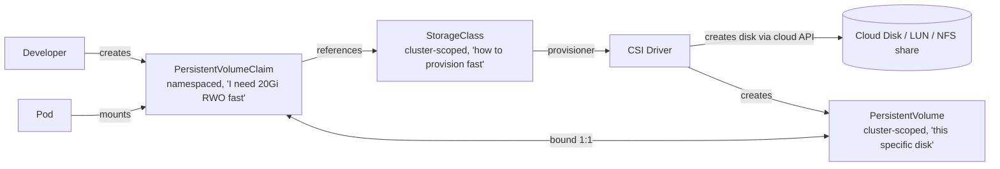
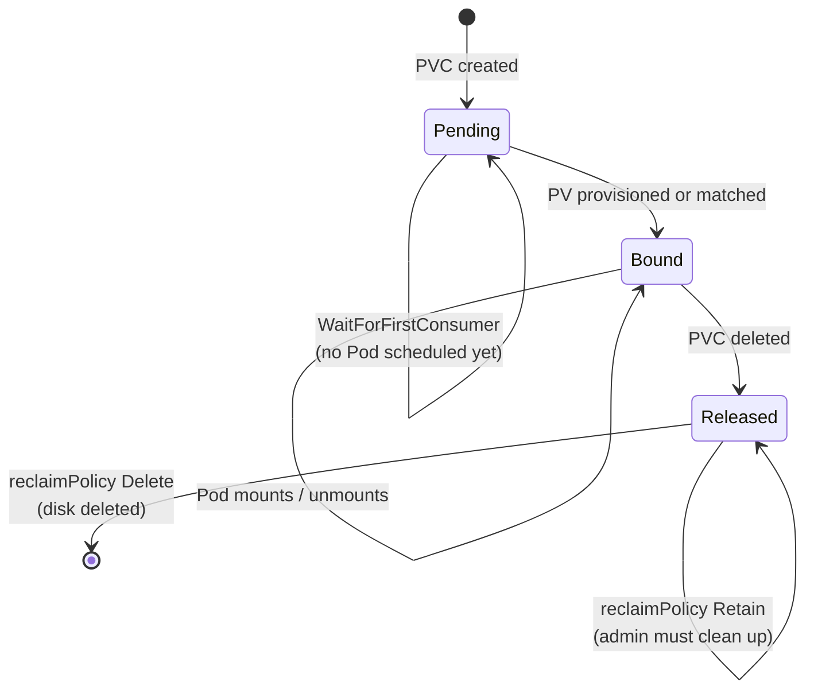
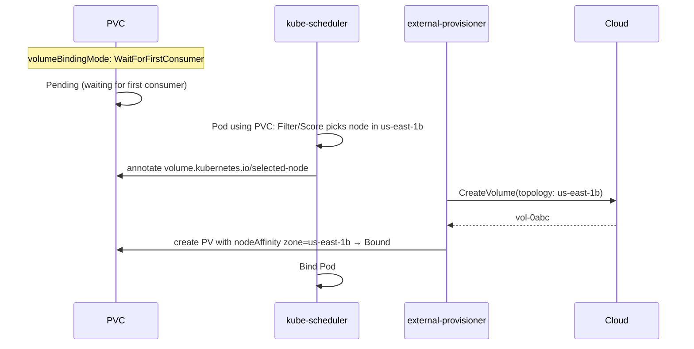
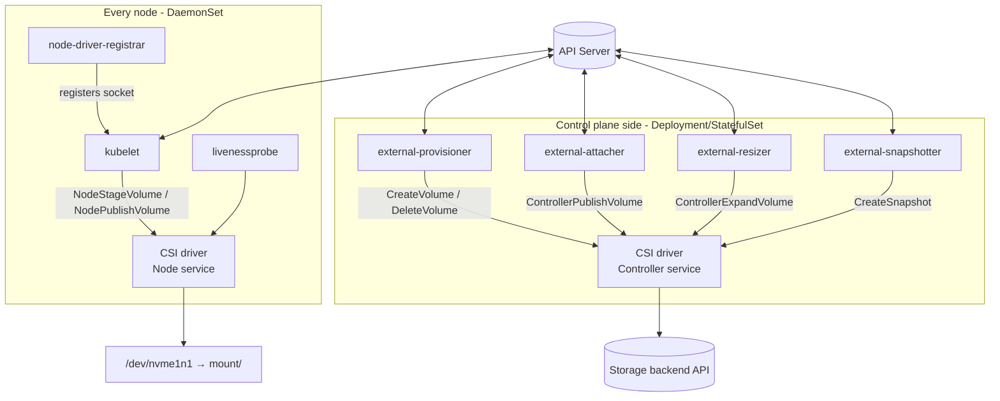

# Kubernetes Storage

## Learning Objectives
- Distinguish ephemeral volumes, PersistentVolumes (PV), and PersistentVolumeClaims (PVC)
- Understand access modes, reclaim policies, and the PV/PVC binding lifecycle
- Design StorageClasses for a platform (tiers, topology, expansion, encryption)
- Explain the Container Storage Interface (CSI) architecture and its sidecars
- Use volume snapshots, expansion, and StatefulSet volume claim templates
- Troubleshoot Pending PVCs, attach/mount failures, and zone conflicts

## Prerequisites
- [Kubernetes Architecture](./kubernetes-architecture.md) — kubelet and controller manager
- [Controllers and Operators](./controllers-operators.md) — CSI sidecars are controllers
- [Scheduling](./scheduling.md) — volume topology influences placement
- A cluster from [Lab 01: Cluster Setup](../../labs/lab-01-cluster-setup/README.md) (kind ships the `local-path` provisioner as StorageClass `standard`)

---

## The Storage Model at a Glance



| Object | Scope | Owned by | Represents |
|--------|-------|----------|------------|
| `PersistentVolumeClaim` | Namespace | App team | A *request* for storage |
| `PersistentVolume` | Cluster | Platform / provisioner | A *piece* of real storage |
| `StorageClass` | Cluster | Platform team | A *recipe* for dynamically creating PVs |
| `VolumeSnapshotClass` / `VolumeSnapshot` | Cluster / Namespace | Platform / App team | Point-in-time copies |
| `CSIDriver`, `CSINode` | Cluster | CSI driver install | Driver capabilities and per-node info |
| `VolumeAttachment` | Cluster | attach/detach controller | "Disk X is attached to node Y" |

This separation is the classic platform abstraction: developers ask for *what* (size, access mode, class), the
platform decides *how* (backend, encryption, IOPS).

---

## Volume Types

| Category | Examples | Lifetime | Use for |
|----------|---------|----------|---------|
| Ephemeral, node-local | `emptyDir` (disk or `medium: Memory`) | Pod | Scratch space, caches |
| Projected config | `configMap`, `secret`, `downwardAPI`, `projected`, `serviceAccountToken` | Pod | Config and credentials |
| Generic ephemeral | `ephemeral.volumeClaimTemplate` | Pod (but provisioned via a StorageClass) | Large scratch space with CSI features |
| CSI ephemeral | `csi:` inline (e.g. Secrets Store CSI) | Pod | Driver-provided per-Pod data |
| Persistent | `persistentVolumeClaim` | Independent of Pod | Databases, queues, user uploads |
| Node path | `hostPath` | Node | System agents only — block via [Pod Security](../12-security-compliance/pod-security.md) |
| Image | `image` volume (OCI artifact mounted read-only; beta in recent releases) | Pod | Models, static datasets shipped as OCI artifacts |

```yaml
# pod-ephemeral-volumes.yaml
apiVersion: v1
kind: Pod
metadata:
  name: builder
  namespace: team-a-dev
spec:
  containers:
    - name: build
      image: ghcr.io/mycompany/builder:3.1.0
      volumeMounts:
        - { name: scratch, mountPath: /tmp }
        - { name: workspace, mountPath: /workspace }
      resources:
        requests:
          ephemeral-storage: 1Gi        # counts emptyDir + logs + writable layer toward eviction
        limits:
          ephemeral-storage: 2Gi
  volumes:
    - name: scratch
      emptyDir:
        sizeLimit: 500Mi                # Pod evicted if exceeded
    - name: workspace
      ephemeral:                        # PVC created with the Pod, deleted with the Pod
        volumeClaimTemplate:
          metadata:
            labels:
              platform.mycompany.io/tenant: team-a
          spec:
            accessModes: [ReadWriteOnce]
            storageClassName: standard
            resources:
              requests:
                storage: 10Gi
```

---

## PersistentVolumes and Claims

### Access Modes

| Mode | Short | Meaning | Typical backends |
|------|-------|---------|------------------|
| `ReadWriteOnce` | RWO | Read-write by Pods on **one node** | Block disks (EBS, PD, Azure Disk), Ceph RBD |
| `ReadWriteOncePod` | RWOP | Read-write by **one Pod** cluster-wide (GA 1.29) | CSI drivers that support it |
| `ReadOnlyMany` | ROX | Read-only by many nodes | NFS, CephFS, pre-populated disks |
| `ReadWriteMany` | RWX | Read-write by many nodes | NFS, EFS, Azure Files, Filestore, CephFS |

RWO is a **node-level** guarantee: two Pods on the same node can both mount an RWO volume. Use RWOP when the
application cannot tolerate concurrent writers (e.g. a single-writer database).

### Volume Modes

`volumeMode: Filesystem` (default) formats and mounts the device; `volumeMode: Block` exposes a raw block device
via `volumeDevices` — used by some databases and VM workloads (KubeVirt).

### Lifecycle and Binding



| Reclaim policy | On PVC deletion | Use when |
|----------------|-----------------|----------|
| `Delete` | PV and backing disk deleted | Default for dynamic provisioning; ephemeral environments |
| `Retain` | PV goes `Released`; disk kept | Production data; manual recovery possible |
| `Recycle` | *Deprecated* — don't use | — |

Protection finalizers prevent accidents: `kubernetes.io/pvc-protection` keeps a PVC alive while a Pod uses it, and
`kubernetes.io/pv-protection` keeps a PV alive while bound.

### Static Provisioning (Pre-existing Storage)

```yaml
# static-pv.yaml — import an existing NFS export
apiVersion: v1
kind: PersistentVolume
metadata:
  name: shared-assets
  labels:
    platform.mycompany.io/dataset: shared-assets
spec:
  capacity:
    storage: 100Gi
  accessModes: [ReadWriteMany]
  persistentVolumeReclaimPolicy: Retain
  storageClassName: ""                  # empty: never dynamically provisioned
  mountOptions: [nfsvers=4.1]
  nfs:
    server: nfs.storage.mycompany.internal
    path: /exports/shared-assets
---
apiVersion: v1
kind: PersistentVolumeClaim
metadata:
  name: shared-assets
  namespace: team-a-prod
spec:
  accessModes: [ReadWriteMany]
  storageClassName: ""
  volumeName: shared-assets             # pre-bind to this specific PV
  resources:
    requests:
      storage: 100Gi
```

---

## StorageClasses: The Platform's Storage Menu

A StorageClass names a provisioner and its parameters. Its `metadata.name` is effectively a **platform API** —
choose names by *intent* (`fast`, `standard`, `shared`) rather than vendor (`gp3`), so manifests are portable
across clouds.

```yaml
# storageclasses-aws.yaml
apiVersion: storage.k8s.io/v1
kind: StorageClass
metadata:
  name: standard
  annotations:
    storageclass.kubernetes.io/is-default-class: "true"   # used when PVC omits storageClassName
  labels:
    platform.mycompany.io/tier: standard
provisioner: ebs.csi.aws.com
parameters:
  type: gp3
  encrypted: "true"
  # kmsKeyId: arn:aws:kms:...           # customer-managed key if required by compliance
reclaimPolicy: Delete
volumeBindingMode: WaitForFirstConsumer  # create the disk in the zone the Pod lands in
allowVolumeExpansion: true
---
apiVersion: storage.k8s.io/v1
kind: StorageClass
metadata:
  name: fast
  labels:
    platform.mycompany.io/tier: fast
provisioner: ebs.csi.aws.com
parameters:
  type: gp3
  iops: "6000"
  throughput: "500"
  encrypted: "true"
reclaimPolicy: Retain                    # production databases: keep the disk
volumeBindingMode: WaitForFirstConsumer
allowVolumeExpansion: true
---
apiVersion: storage.k8s.io/v1
kind: StorageClass
metadata:
  name: shared
  labels:
    platform.mycompany.io/tier: shared
provisioner: efs.csi.aws.com             # RWX
parameters:
  provisioningMode: efs-ap
  fileSystemId: fs-0123456789abcdef0
  directoryPerms: "700"
reclaimPolicy: Delete
volumeBindingMode: Immediate             # regional filesystem: no zone constraint
```

The same intent-based names on other clouds:

| Class | AWS | GCP | Azure | On-prem |
|-------|-----|-----|-------|---------|
| `standard` | `ebs.csi.aws.com` `type: gp3` | `pd.csi.storage.gke.io` `type: pd-balanced` | `disk.csi.azure.com` `skuName: StandardSSD_LRS` | Ceph RBD (`rbd.csi.ceph.com`) |
| `fast` | gp3 with IOPS / io2 | `pd-ssd` or Hyperdisk | `Premium_LRS` / `PremiumV2_LRS` | Ceph RBD on NVMe pool, Portworx, Longhorn |
| `shared` (RWX) | `efs.csi.aws.com` | `filestore.csi.storage.gke.io` | `file.csi.azure.com` | CephFS, NFS CSI |

### Why `WaitForFirstConsumer` Matters

With `Immediate` binding, the disk is created as soon as the PVC exists — in an arbitrary zone. If the scheduler
then needs to place the Pod in another zone (for anti-affinity or capacity), it can't: block disks are zonal.



Rule of thumb: **every zonal StorageClass should use `WaitForFirstConsumer`.**

### Tuning Volumes After Creation: VolumeAttributesClass

`VolumeAttributesClass` (`storage.k8s.io`, beta in 1.31, GA in 1.34) lets a PVC switch mutable parameters such
as IOPS/throughput without recreating the volume, if the CSI driver supports `ModifyVolume`. Check your driver's
docs and cluster version before offering it as a platform feature.

---

## The Container Storage Interface (CSI)

CSI is a gRPC spec that lets storage vendors ship drivers out-of-tree. In-tree cloud volume plugins have been
migrated to CSI and removed; on modern clusters, **all dynamic provisioning goes through CSI**.



| Sidecar | Watches | Calls (CSI RPC) |
|---------|---------|-----------------|
| `external-provisioner` | PVCs | `CreateVolume`, `DeleteVolume` |
| `external-attacher` | `VolumeAttachment` | `ControllerPublishVolume` / `ControllerUnpublishVolume` |
| `external-resizer` | PVC size changes | `ControllerExpandVolume` |
| `external-snapshotter` + snapshot-controller | `VolumeSnapshot(Content)` | `CreateSnapshot`, `DeleteSnapshot` |
| `node-driver-registrar` | — | Registers the driver socket with kubelet |
| kubelet (not a sidecar) | Pods on its node | `NodeStageVolume` (format/mount globally), `NodePublishVolume` (bind-mount into Pod) |

The full path when a Pod with a new PVC starts:

1. **Provision** — external-provisioner creates the disk and the PV.
2. **Attach** — attach/detach controller creates a `VolumeAttachment`; external-attacher attaches the disk to the node.
3. **Stage** — kubelet calls `NodeStageVolume` (format if needed, mount to a staging path).
4. **Publish** — kubelet calls `NodePublishVolume` (bind-mount into the Pod's volume dir).
5. Containers start with the mount.

```bash
# Inspect what drivers can do
kubectl get csidrivers
kubectl get csidriver ebs.csi.aws.com -o yaml   # attachRequired, podInfoOnMount, fsGroupPolicy...
kubectl get csinode <node> -o yaml               # per-node driver info incl. max attachable volumes
kubectl get volumeattachments
```

---

## Day-2 Operations

### Volume Expansion

```bash
# StorageClass must have allowVolumeExpansion: true
kubectl -n team-a-prod patch pvc data-postgres-0 \
  -p '{"spec":{"resources":{"requests":{"storage":"50Gi"}}}}'
kubectl -n team-a-prod get pvc data-postgres-0 -o jsonpath='{.status.conditions}' | jq
# FileSystemResizePending → filesystem grows when kubelet next processes the volume (online for most drivers)
```

Shrinking is not supported. Recovering from a failed expansion (requesting a smaller size again) is supported in
recent Kubernetes versions via `RecoverVolumeExpansionFailure`.

### Volume Snapshots

Snapshot CRDs and the snapshot controller are **not** part of core Kubernetes; install them from
[external-snapshotter](https://github.com/kubernetes-csi/external-snapshotter) (managed clusters often pre-install them).

```yaml
# volumesnapshotclass.yaml
apiVersion: snapshot.storage.k8s.io/v1
kind: VolumeSnapshotClass
metadata:
  name: standard-snapshots
  annotations:
    snapshot.storage.kubernetes.io/is-default-class: "true"
driver: ebs.csi.aws.com
deletionPolicy: Retain          # keep the cloud snapshot even if the VolumeSnapshot object is deleted
---
# snapshot-and-restore.yaml
apiVersion: snapshot.storage.k8s.io/v1
kind: VolumeSnapshot
metadata:
  name: postgres-pre-upgrade
  namespace: team-a-prod
spec:
  volumeSnapshotClassName: standard-snapshots
  source:
    persistentVolumeClaimName: data-postgres-0
---
apiVersion: v1
kind: PersistentVolumeClaim
metadata:
  name: data-postgres-restore
  namespace: team-a-prod
spec:
  storageClassName: fast
  accessModes: [ReadWriteOnce]
  dataSource:                     # provision a new volume pre-populated from the snapshot
    apiGroup: snapshot.storage.k8s.io
    kind: VolumeSnapshot
    name: postgres-pre-upgrade
  resources:
    requests:
      storage: 50Gi
```

Snapshots are crash-consistent, not application-consistent. For databases, quiesce or use the database's own
backup tooling; for cluster-wide backup/restore see [Disaster Recovery (Velero)](../11-reliability/disaster-recovery.md).

### StatefulSets and Volume Claim Templates

```yaml
# postgres-statefulset.yaml (excerpt)
apiVersion: apps/v1
kind: StatefulSet
metadata:
  name: postgres
  namespace: team-a-prod
spec:
  serviceName: postgres
  replicas: 3
  selector:
    matchLabels: { app: postgres }
  persistentVolumeClaimRetentionPolicy:
    whenDeleted: Retain      # keep PVCs if the StatefulSet is deleted
    whenScaled: Delete       # delete PVCs of removed ordinals on scale-down
  template:
    metadata:
      labels: { app: postgres }
    spec:
      containers:
        - name: postgres
          image: postgres:17
          volumeMounts:
            - { name: data, mountPath: /var/lib/postgresql/data }
  volumeClaimTemplates:          # one PVC per replica: data-postgres-0, data-postgres-1, ...
    - metadata:
        name: data
        labels:
          platform.mycompany.io/tenant: team-a
      spec:
        storageClassName: fast
        accessModes: [ReadWriteOncePod]
        resources:
          requests:
            storage: 20Gi
```

In practice, run production databases with an operator (CloudNativePG, Percona, Strimzi for Kafka) — see
[Controllers and Operators](./controllers-operators.md).

---

## Platform Guardrails for Storage

| Concern | Mechanism |
|---------|-----------|
| Cap total storage per tenant | `ResourceQuota` `requests.storage`, `persistentvolumeclaims` |
| Cap per StorageClass | `ResourceQuota` `<class>.storageclass.storage.k8s.io/requests.storage` |
| Forbid expensive classes for dev | Quota of `0` for `fast` in `*-dev` namespaces, or a policy rule |
| Forbid `hostPath` | Pod Security Standards `baseline`/`restricted` |
| Enforce encryption | Only offer encrypted StorageClasses; policy denies `storageClassName` not in allow-list |
| Label PVs for cost allocation | Policy/mutation adding `platform.mycompany.io/tenant` to PVC labels; CSI drivers can tag cloud volumes |

```yaml
# tenant-storage-quota.yaml
apiVersion: v1
kind: ResourceQuota
metadata:
  name: storage
  namespace: team-a-dev
spec:
  hard:
    persistentvolumeclaims: "20"
    requests.storage: 200Gi
    fast.storageclass.storage.k8s.io/requests.storage: "0"     # no fast tier in dev
    fast.storageclass.storage.k8s.io/persistentvolumeclaims: "0"
```

The `Environment` CRD in this repo stamps quotas like this per environment — see
[Lab 07: Multi-Tenancy](../../labs/lab-07-multi-tenancy/).

---

## Hands-On Exercises

Uses kind's built-in `standard` StorageClass (rancher local-path-provisioner, `WaitForFirstConsumer`).

### Exercise 1: Dynamic Provisioning and Binding Mode

```bash
kubectl create namespace storage-lab
kubectl get storageclass
kubectl get storageclass standard -o jsonpath='{.provisioner} {.volumeBindingMode}{"\n"}'

cat <<EOF | kubectl apply -f -
apiVersion: v1
kind: PersistentVolumeClaim
metadata: { name: data, namespace: storage-lab }
spec:
  accessModes: [ReadWriteOnce]
  resources: { requests: { storage: 1Gi } }
EOF

# Pending until a consumer appears (WaitForFirstConsumer)
kubectl -n storage-lab get pvc data
kubectl -n storage-lab describe pvc data | grep -i waiting

cat <<EOF | kubectl apply -f -
apiVersion: v1
kind: Pod
metadata: { name: writer, namespace: storage-lab }
spec:
  containers:
    - name: app
      image: busybox:1.36
      command: ["sh", "-c", "date >> /data/log.txt; sleep 3600"]
      volumeMounts: [{ name: data, mountPath: /data }]
  volumes:
    - name: data
      persistentVolumeClaim: { claimName: data }
EOF
kubectl -n storage-lab wait pod/writer --for=condition=Ready --timeout=60s
kubectl -n storage-lab get pvc data                       # Bound
PV=$(kubectl -n storage-lab get pvc data -o jsonpath='{.spec.volumeName}')
kubectl get pv "$PV" -o jsonpath='{.spec.nodeAffinity}{"\n"}'   # local volume pinned to a node
```

### Exercise 2: Data Survives Pod Deletion; Protection Finalizers

```bash
kubectl -n storage-lab delete pod writer
# Recreate the same Pod (re-run the apply above), then:
kubectl -n storage-lab exec writer -- cat /data/log.txt    # two timestamps

# Try deleting the PVC while in use
kubectl -n storage-lab delete pvc data --wait=false
kubectl -n storage-lab get pvc data                        # STATUS Terminating (pvc-protection)
kubectl -n storage-lab delete pod writer                   # now the PVC goes away
kubectl get pv "$PV"                                       # deleted too (reclaimPolicy Delete)
```

### Exercise 3: Retain Policy

```bash
cat <<EOF | kubectl apply -f -
apiVersion: storage.k8s.io/v1
kind: StorageClass
metadata: { name: standard-retain }
provisioner: rancher.io/local-path
reclaimPolicy: Retain
volumeBindingMode: WaitForFirstConsumer
EOF
# Repeat Exercise 1 with storageClassName: standard-retain, delete Pod and PVC, then:
kubectl get pv     # STATUS Released — disk kept, needs manual cleanup
```

### Exercise 4 (Optional): Snapshots with the CSI Hostpath Driver

```bash
# Install snapshot CRDs + controller, then the csi-driver-host-path demo driver
git clone https://github.com/kubernetes-csi/external-snapshotter.git
kubectl kustomize external-snapshotter/client/config/crd | kubectl create -f -
kubectl -n kube-system kustomize external-snapshotter/deploy/kubernetes/snapshot-controller | kubectl create -f -

git clone https://github.com/kubernetes-csi/csi-driver-host-path.git
./csi-driver-host-path/deploy/kubernetes-latest/deploy.sh
kubectl apply -f csi-driver-host-path/examples/csi-storageclass.yaml
# Then follow csi-driver-host-path/docs/example-snapshots-1.17-and-later.md to snapshot and restore a PVC
```

```bash
kubectl delete namespace storage-lab
kubectl delete storageclass standard-retain
kubectl get pv | grep Released | awk '{print $1}' | xargs -r kubectl delete pv
```

---

## Troubleshooting

### PVC Stuck in `Pending`

```bash
kubectl -n <ns> describe pvc <name>        # read Events first
```

| Event / symptom | Cause | Fix |
|-----------------|-------|-----|
| `waiting for first consumer to be created before binding` | Normal for `WaitForFirstConsumer` | Create the Pod |
| `no persistent volumes available for this claim and no storage class is set` | No default StorageClass | Set `storageClassName` or annotate a default class |
| `storageclass.storage.k8s.io "x" not found` | Typo / class not installed | `kubectl get sc` |
| `waiting for a volume to be created, either by external provisioner "..."` (persisting) | CSI controller not running or lacking cloud permissions | Check provisioner logs (below) |
| `exceeded quota` | Tenant ResourceQuota | Raise quota or clean up PVCs |

```bash
kubectl -n kube-system get pods -l app=ebs-csi-controller
kubectl -n kube-system logs deploy/ebs-csi-controller -c csi-provisioner --tail=50
```

### Pod Stuck in `ContainerCreating` with Volume Errors

| Event | Cause | Fix |
|-------|-------|-----|
| `Multi-Attach error for volume ... Volume is already exclusively attached to one node` | RWO disk still attached to the old node (e.g. after node failure) | Wait for detach (~6 min force-detach) or delete stale `VolumeAttachment` after confirming the node is gone |
| `AttachVolume.Attach failed ... volume node affinity conflict` | Zonal PV, Pod scheduled in another zone | Use `WaitForFirstConsumer`; pin Pod to the PV's zone |
| `MountVolume.MountDevice failed ... driver name X not found in the list of registered CSI drivers` | Node plugin DaemonSet not running on this node (taints!) | Add tolerations to the CSI node DaemonSet |
| `Unable to attach or mount volumes: timed out` | Node at its attach limit | Check `kubectl get csinode <node> -o yaml` `allocatable.count` |
| `fsGroup` slow startup | Recursive `chown` on large volumes | `securityContext.fsGroupChangePolicy: OnRootMismatch` |

### PV Stuck `Released` and Can't Be Reused

A `Released` PV still carries `spec.claimRef` to the deleted PVC. After verifying the data, either delete the PV
(and backing disk) or clear the claimRef to make it `Available`:

```bash
kubectl patch pv <pv> --type=json -p '[{"op":"remove","path":"/spec/claimRef"}]'
```

---

## Further Reading

### Official Documentation
- [Volumes](https://kubernetes.io/docs/concepts/storage/volumes/)
- [Persistent Volumes](https://kubernetes.io/docs/concepts/storage/persistent-volumes/)
- [Storage Classes](https://kubernetes.io/docs/concepts/storage/storage-classes/)
- [Volume Snapshots](https://kubernetes.io/docs/concepts/storage/volume-snapshots/)
- [Ephemeral Volumes](https://kubernetes.io/docs/concepts/storage/ephemeral-volumes/)
- [Volume Attributes Classes](https://kubernetes.io/docs/concepts/storage/volume-attributes-classes/)

### CSI
- [Kubernetes CSI Developer Documentation](https://kubernetes-csi.github.io/docs/)
- [CSI Spec](https://github.com/container-storage-interface/spec)
- [CSI drivers list](https://kubernetes-csi.github.io/docs/drivers.html)

### Ecosystem
- [Rook (Ceph)](https://rook.io/), [Longhorn](https://longhorn.io/), [OpenEBS](https://openebs.io/)
- [Velero](https://velero.io/) — backup and restore

---

## Next Steps

1. **Read**: [RBAC](./rbac.md) — control who can create StorageClasses and PVs
2. **Read**: [Disaster Recovery](../11-reliability/disaster-recovery.md) — Velero and snapshot-based backups
3. **Practice**: [Lab 01: Cluster Setup](../../labs/lab-01-cluster-setup/README.md) — install CSI components on your local cluster
4. **Explore**: [Terraform modules — addons](https://github.com/GitOpsHub/platform-engineering-on-kubernetes/tree/main/code/terraform-modules/) for installing cloud CSI drivers with IAM
