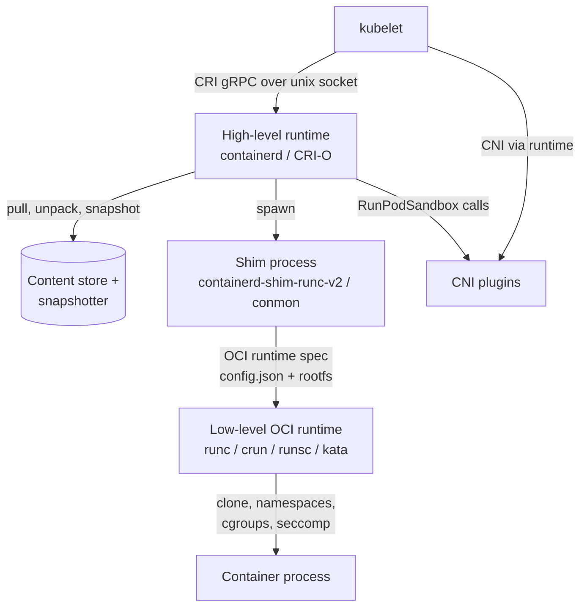
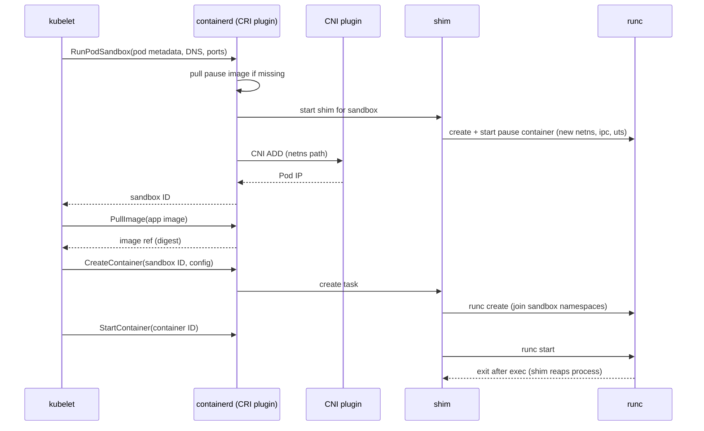
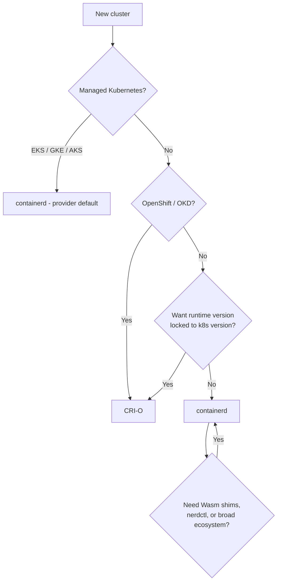

# Container Runtimes for Platform Engineers

## Learning Objectives
- Explain the layered runtime stack: kubelet → CRI → high-level runtime → shim → OCI runtime
- Compare containerd, CRI-O, and Docker Engine (via cri-dockerd) and know when each is the right choice
- Read and modify containerd 2.x (config `version = 3`) and CRI-O configuration safely
- Configure registry mirrors, cgroup drivers, and pause/sandbox images across a node fleet
- Debug pods at the runtime layer with `crictl`, `ctr`, and `nerdctl`
- Diagnose the most common runtime-level failures (`ImagePullBackOff`, `CreateContainerError`, sandbox failures)

## Prerequisites
- [Kubernetes Architecture](../01-kubernetes-fundamentals/kubernetes-architecture.md) — especially the kubelet and CRI sections
- Basic Linux knowledge: processes, namespaces, cgroups, systemd
- A running local cluster from [Lab 01: Cluster Setup](../../labs/lab-01-cluster-setup/README.md) (kind or k3d)
- `kubectl` ≥ 1.28 and Docker (to `docker exec` into kind nodes)

---

## Why Runtimes Matter to a Platform Team

Application developers rarely think about the container runtime — and that is exactly the point. The platform team owns this layer on behalf of everyone else, and decisions made here ripple upward:

| Decision | Who Feels It | Example Impact |
|----------|--------------|----------------|
| Runtime choice (containerd vs CRI-O) | Platform/SRE | Upgrade cadence, tooling, vendor support |
| cgroup driver | Everyone | Node instability, OOM kills under memory pressure if mismatched |
| Registry mirrors / pull-through caches | Developers, CI | Pull latency, Docker Hub rate limits, air-gapped installs |
| Sandbox (pause) image | Platform | Pods fail to start in air-gapped clusters if not mirrored |
| Low-level runtime (runc, crun, gVisor, Kata) | Security, tenants | Isolation strength vs performance — see [Runtime Classes](runtime-classes.md) |
| Image GC thresholds | Developers | Cold starts after nodes evict cached images |

The runtime is also where **images become processes**. Everything in [Image Spec](image-spec.md) and [Image Security](image-security.md) ultimately gets enforced or executed here.

---

## The Runtime Stack

"Container runtime" is an overloaded term. In Kubernetes there are at least four distinct layers:



| Layer | Examples | Responsibility | Spec / Interface |
|-------|----------|----------------|------------------|
| Orchestrator agent | kubelet | Decides *what* should run on the node | Kubernetes API |
| CRI implementation | containerd CRI plugin, CRI-O, cri-dockerd | Pod sandboxes, image pulls, container lifecycle | [CRI](https://github.com/kubernetes/cri-api) (`runtime.v1`) |
| Shim | `containerd-shim-runc-v2`, `conmon`/`conmon-rs` | Keeps stdio and exit status alive independently of the daemon | containerd shim API v2 / CRI-O internal |
| OCI runtime | runc, crun, youki, runsc (gVisor), kata-runtime | Creates the actual isolated process | [OCI Runtime Spec](https://github.com/opencontainers/runtime-spec) |

### The Container Runtime Interface (CRI)

The CRI is a gRPC API that the kubelet calls over a Unix socket. It has two services:

| Service | Key RPCs | Purpose |
|---------|----------|---------|
| `RuntimeService` | `RunPodSandbox`, `StopPodSandbox`, `RemovePodSandbox`, `CreateContainer`, `StartContainer`, `StopContainer`, `ExecSync`, `Exec`, `Attach`, `PortForward`, `ContainerStats`, `UpdateContainerResources` | Pod and container lifecycle |
| `ImageService` | `PullImage`, `ListImages`, `ImageStatus`, `RemoveImage`, `ImageFsInfo` | Image management on the node |

The kubelet finds the runtime through `containerRuntimeEndpoint`:

```yaml
# /var/lib/kubelet/config.yaml (excerpt)
apiVersion: kubelet.config.k8s.io/v1beta1
kind: KubeletConfiguration
containerRuntimeEndpoint: unix:///run/containerd/containerd.sock  # CRI-O: unix:///var/run/crio/crio.sock
cgroupDriver: systemd            # MUST match the runtime's cgroup driver
imageServiceEndpoint: ""         # empty = same socket as runtime
imageGCHighThresholdPercent: 85  # start image GC when image fs is 85% full
imageGCLowThresholdPercent: 80   # GC down to 80%
```

> `containerRuntimeEndpoint` became a KubeletConfiguration field in 1.27; older nodes used the `--container-runtime-endpoint` flag. Both point to the same socket.

### What Happens When a Pod Starts



Key observations:
1. **The pod sandbox comes first.** The pause container holds the network, IPC, and UTS namespaces. Every app container *joins* them. This is why containers in a Pod share `localhost`.
2. **The runtime, not the kubelet, calls CNI.** Network setup failures surface as `FailedCreatePodSandBox` events. See [CNI Overview](../03-networking-fundamentals/cni-overview.md).
3. **runc exits after starting the container.** The shim is the long-lived parent; this is what lets you restart containerd without killing workloads.

### The OCI Runtime Spec in Practice

A low-level runtime consumes an *OCI bundle*: a directory with `config.json` and a `rootfs/`. You can see one directly:

```bash
# Generate a default OCI runtime config to inspect its structure
mkdir -p /tmp/bundle/rootfs && cd /tmp/bundle
runc spec            # writes config.json
jq '{ociVersion, process: .process.args, namespaces: .linux.namespaces, caps: .process.capabilities.bounding}' config.json
```

Fields in `config.json` map almost 1:1 to Pod spec settings:

| Pod spec field | OCI `config.json` field |
|----------------|-------------------------|
| `command` / `args` | `process.args` |
| `securityContext.runAsUser` | `process.user.uid` |
| `securityContext.capabilities` | `process.capabilities.*` |
| `securityContext.seccompProfile` | `linux.seccomp` |
| `securityContext.readOnlyRootFilesystem` | `root.readonly` |
| `resources.limits.memory` | `linux.resources.memory.limit` |
| `resources.limits.cpu` | `linux.resources.cpu.quota` / `period` |
| `volumeMounts` | `mounts[]` |
| `hostUsers: false` | `linux.uidMappings` / `gidMappings` (user namespaces) |

---

## High-Level Runtimes Compared

| Aspect | containerd | CRI-O | Docker Engine + cri-dockerd |
|--------|-----------|-------|-----------------------------|
| Governance | CNCF graduated | CNCF graduated | Docker Inc. / Mirantis (cri-dockerd) |
| CRI support | Built-in plugin | Built-in (CRI is its only API) | External adapter (`cri-dockerd`) |
| Versioning | Independent (2.x line) | Tracks Kubernetes minor (CRI-O 1.N ↔ k8s 1.N) | Independent |
| Default shim | `containerd-shim-runc-v2` | `conmon` / `conmon-rs` | `containerd-shim-runc-v2` (Docker uses containerd underneath) |
| Default OCI runtime | runc | crun (recent releases) or runc | runc |
| Used by | EKS, GKE, AKS, kind, k3s, RKE2, most distros | OpenShift, many kubeadm/bare-metal shops | Legacy clusters, Mirantis Kubernetes Engine |
| Non-Kubernetes use | Yes (Docker, nerdctl, BuildKit) | No — Kubernetes only | Yes |
| Debug CLI | `crictl`, `ctr`, `nerdctl` | `crictl` | `docker`, `crictl` |
| Config | `/etc/containerd/config.toml` (TOML) | `/etc/crio/crio.conf` + `/etc/crio/crio.conf.d/*.conf` | `/etc/docker/daemon.json` + cri-dockerd flags |

### A Note on Docker and "dockershim"

The in-tree `dockershim` was **removed in Kubernetes 1.24**. Images built with `docker build` still run everywhere because they are OCI-compatible (see [Image Spec](image-spec.md)). Only clusters that use Docker Engine *as the node runtime* need [cri-dockerd](https://github.com/Mirantis/cri-dockerd). For new platforms there is no reason to choose this path: containerd is what Docker itself uses underneath.

### Choosing a Runtime



For most platform teams the answer is **containerd**, because it is the default on every major managed offering and on kind/k3s, so local and production stacks match.

---

## containerd 2.x Configuration

containerd 2.0 (released late 2024) introduced config **version 3** and split the CRI plugin into separate `runtime` and `images` plugins. containerd 2.x still reads version 2 configs and migrates them in memory, but new configs should be written as version 3.

```bash
# Dump the effective config (defaults + your overrides) - always start here
containerd config default > /tmp/default.toml
containerd config dump | less          # what the running daemon actually uses
containerd config migrate > /tmp/v3.toml  # convert an older v2 config to v3
```

### Annotated Config

```toml
# /etc/containerd/config.toml
version = 3

# Root dirs for persistent and runtime state
root  = "/var/lib/containerd"
state = "/run/containerd"

# Optional drop-in directory so config management can add runtimes
# without rewriting this file (e.g. gVisor, Kata - see runtime-classes.md)
imports = ["/etc/containerd/conf.d/*.toml"]

[grpc]
  address = "/run/containerd/containerd.sock"

# ---------------------------------------------------------------
# CRI runtime plugin: pod sandboxes, containers, runtime handlers
# ---------------------------------------------------------------
[plugins.'io.containerd.cri.v1.runtime']
  enable_selinux = false
  # Requires kernel + kubelet support; enables hostUsers: false pods
  # enable_unprivileged_ports = true
  # enable_unprivileged_icmp = true

  [plugins.'io.containerd.cri.v1.runtime'.containerd]
    default_runtime_name = "runc"

    # The handler name "runc" is what a RuntimeClass `handler:` refers to
    [plugins.'io.containerd.cri.v1.runtime'.containerd.runtimes.runc]
      runtime_type = "io.containerd.runc.v2"

      [plugins.'io.containerd.cri.v1.runtime'.containerd.runtimes.runc.options]
        SystemdCgroup = true          # MUST match kubelet cgroupDriver: systemd
        # BinaryName = "/usr/bin/crun" # swap the OCI runtime binary (runc-compatible CLI)

  # CNI configuration used when the runtime sets up the pod network
  [plugins.'io.containerd.cri.v1.runtime'.cni]
    bin_dirs = ["/opt/cni/bin"]
    conf_dir = "/etc/cni/net.d"

# ---------------------------------------------------------------
# CRI images plugin: pulls, registries, snapshotter, sandbox image
# ---------------------------------------------------------------
[plugins.'io.containerd.cri.v1.images']
  snapshotter = "overlayfs"
  # Pull layers in parallel and unpack as they arrive
  max_concurrent_downloads = 3

  # The pause image. Pinned images are never garbage-collected by kubelet.
  [plugins.'io.containerd.cri.v1.images'.pinned_images]
    sandbox = "registry.k8s.io/pause:3.10"

  # Per-registry hosts.toml files live under this directory
  [plugins.'io.containerd.cri.v1.images'.registry]
    config_path = "/etc/containerd/certs.d"
```

Apply changes with:

```bash
sudo systemctl restart containerd   # running containers survive: shims are independent
sudo crictl info | jq '.config.containerd.runtimes | keys'
```

### Version 2 vs Version 3 Plugin Paths

When reading older blog posts and vendor docs, translate section names:

| Setting | Config v2 (containerd 1.x) | Config v3 (containerd 2.x) |
|---------|----------------------------|----------------------------|
| Runtime handlers | `plugins."io.containerd.grpc.v1.cri".containerd.runtimes.<name>` | `plugins.'io.containerd.cri.v1.runtime'.containerd.runtimes.<name>` |
| CNI dirs | `plugins."io.containerd.grpc.v1.cri".cni` | `plugins.'io.containerd.cri.v1.runtime'.cni` |
| Sandbox image | `plugins."io.containerd.grpc.v1.cri".sandbox_image` | `plugins.'io.containerd.cri.v1.images'.pinned_images.sandbox` |
| Registry config path | `plugins."io.containerd.grpc.v1.cri".registry.config_path` | `plugins.'io.containerd.cri.v1.images'.registry.config_path` |
| Snapshotter | `plugins."io.containerd.grpc.v1.cri".containerd.snapshotter` | `plugins.'io.containerd.cri.v1.images'.snapshotter` |

### Registry Mirrors with `hosts.toml`

The legacy `registry.mirrors` table is deprecated. Use one directory per upstream registry under `config_path`:

```text
/etc/containerd/certs.d/
├── docker.io/
│   └── hosts.toml
├── ghcr.io/
│   └── hosts.toml
└── _default/              # fallback for any registry without its own directory
    └── hosts.toml
```

```toml
# /etc/containerd/certs.d/docker.io/hosts.toml
# Upstream used if all mirrors fail
server = "https://registry-1.docker.io"

# Internal pull-through cache (e.g. Harbor proxy project, Zot, distribution in proxy mode)
[host."https://mirror.platform.mycompany.io/v2/dockerhub"]
  capabilities = ["pull", "resolve"]
  ca = "/etc/containerd/certs.d/mirror-ca.crt"
  override_path = true   # the mirror path already includes /v2/...
```

```toml
# /etc/containerd/certs.d/_default/hosts.toml
# Send every other registry through the corporate cache first
[host."https://mirror.platform.mycompany.io"]
  capabilities = ["pull", "resolve"]
```

`hosts.toml` files are read on every pull — **no restart is needed** after editing them. Only the `config_path` setting itself requires a restart.

| Capability | Meaning |
|------------|---------|
| `pull` | Fetch blobs and manifests by digest |
| `resolve` | Resolve tags → digests (only grant to mirrors you trust to be current) |
| `push` | Push (rarely wanted on nodes) |

### Rolling Out Runtime Config Across a Fleet

Hand-editing nodes does not scale. Common patterns:

| Approach | When to Use |
|----------|-------------|
| Bake into node image (Packer, Bottlerocket settings, Talos machine config) | Immutable nodes; preferred |
| Cloud-provider node bootstrap (EKS `nodeadm` `NodeConfig`, GKE node system config) | Managed node groups |
| Karpenter `EC2NodeClass.userData` / Cluster API `KubeadmConfigTemplate` | Declarative fleet management — see [Capacity Planning](../11-reliability/capacity-planning.md) |
| Privileged DaemonSet that writes drop-ins under `conf.d/` then restarts containerd | Last resort; used by kata-deploy and some GPU operators |

---

## CRI-O Configuration

CRI-O is configured through TOML drop-ins. Version skew is simple: run CRI-O 1.N with Kubernetes 1.N.

```toml
# /etc/crio/crio.conf.d/10-platform.conf
[crio.runtime]
# Must match kubelet cgroupDriver
cgroup_manager = "systemd"
default_runtime = "crun"

# Handler name "crun" is what RuntimeClass.handler refers to
[crio.runtime.runtimes.crun]
runtime_path = "/usr/bin/crun"
runtime_type = "oci"
runtime_root = "/run/crun"
monitor_path = "/usr/libexec/crio/conmon"

[crio.runtime.runtimes.runc]
runtime_path = "/usr/bin/runc"
runtime_type = "oci"
runtime_root = "/run/runc"

[crio.image]
pause_image = "registry.k8s.io/pause:3.10"

[crio.network]
network_dir = "/etc/cni/net.d/"
plugin_dirs = ["/opt/cni/bin/"]
```

CRI-O uses the containers-image library, so registry mirrors are configured in `/etc/containers/registries.conf` (or `registries.conf.d/`):

```toml
# /etc/containers/registries.conf.d/50-mirror.conf
[[registry]]
prefix = "docker.io"
location = "registry-1.docker.io"

[[registry.mirror]]
location = "mirror.platform.mycompany.io/dockerhub"
```

Reload without restarting containers: `sudo systemctl reload crio` (re-reads registries and some runtime settings).

---

## Low-Level OCI Runtimes

| Runtime | Language | Isolation | Notes |
|---------|----------|-----------|-------|
| **runc** | Go | Namespaces + cgroups (shared kernel) | Reference implementation, default almost everywhere |
| **crun** | C | Namespaces + cgroups | Faster start, lower memory; CRI-O default on many distros; Wasm handlers via WasmEdge/wasmtime builds |
| **youki** | Rust | Namespaces + cgroups | Memory-safe runc alternative |
| **runsc** (gVisor) | Go | User-space kernel intercepts syscalls | Strong isolation, syscall overhead — see [Runtime Classes](runtime-classes.md) |
| **Kata Containers** | Go/Rust | Lightweight VM per pod | Hardware isolation, needs virtualization — see [Runtime Classes](runtime-classes.md) |
| **runwasi shims** | Rust | Wasm sandbox | `io.containerd.wasmtime.v1`, `io.containerd.spin.v2` — run Wasm modules as "containers" |

All of these are exposed to Kubernetes the same way: a named **handler** in the high-level runtime config, selected per-pod via a `RuntimeClass`.

---

## Cgroups and the Cgroup Driver

On cgroup v2 hosts (default on all current distributions), systemd owns the cgroup tree. If the kubelet and runtime disagree on who manages cgroups, you get two managers fighting over the same hierarchy, which manifests as unexplained OOMs and node instability under pressure.

| Component | Setting | Value |
|-----------|---------|-------|
| kubelet | `cgroupDriver` (KubeletConfiguration) | `systemd` |
| containerd | `runtimes.runc.options.SystemdCgroup` | `true` |
| CRI-O | `crio.runtime.cgroup_manager` | `systemd` |

Since Kubernetes 1.28 the kubelet can also ask the runtime which driver to use (`KubeletCgroupDriverFromCRI`, enabled by default from 1.31 with containerd 2.0+ / CRI-O 1.28+), which removes this class of misconfiguration.

```bash
# Check cgroup version on a node
stat -fc %T /sys/fs/cgroup/    # "cgroup2fs" = v2, "tmpfs" = v1

# Check what each side thinks
sudo crictl info | jq '.config.containerd.runtimes.runc.options.SystemdCgroup'
grep cgroupDriver /var/lib/kubelet/config.yaml
```

Kubernetes 1.31 moved cgroup v1 support into maintenance mode; plan for v2-only nodes.

---

## Debugging Tools

| Tool | Talks to | Namespace awareness | Best for |
|------|----------|---------------------|----------|
| `crictl` | CRI socket (any CRI runtime) | Shows Kubernetes pods/containers | Day-to-day node debugging — **use this first** |
| `ctr` | containerd native API | Must pass `-n k8s.io` for Kubernetes objects | Low-level containerd inspection; not user-friendly |
| `nerdctl` | containerd native API | `--namespace k8s.io` | Docker-like UX on containerd nodes |
| `docker` | Docker Engine | N/A | Only on Docker-runtime nodes or kind host |

### `crictl` Cheat Sheet

```bash
# /etc/crictl.yaml - point crictl at the runtime once
runtime-endpoint: unix:///run/containerd/containerd.sock
image-endpoint: unix:///run/containerd/containerd.sock
timeout: 10
```

```bash
crictl pods                                 # pod sandboxes on this node
crictl pods --namespace payments --name api # filter
crictl ps -a                                # containers, including exited
crictl inspectp <pod-id> | jq '.info.runtimeSpec.linux.namespaces'
crictl inspect <container-id> | jq '.info.pid, .status.state'
crictl logs --tail 50 <container-id>        # works even if the API server is down
crictl exec -it <container-id> sh
crictl images --digests                     # what's cached on the node
crictl pull ghcr.io/stefanprodan/podinfo:6.7.1
crictl rmi --prune                          # remove unused images
crictl stats                                # per-container CPU/mem
crictl info | jq '.status.conditions'       # RuntimeReady / NetworkReady
```

### `ctr` and `nerdctl`

```bash
# Kubernetes resources live in the "k8s.io" containerd namespace
sudo ctr namespaces ls
sudo ctr -n k8s.io images ls -q | head
sudo ctr -n k8s.io containers ls
sudo ctr -n k8s.io tasks ls           # running tasks + PIDs

# Import an image directly into the node cache (air-gapped testing)
sudo ctr -n k8s.io images import ./myimage.tar

# nerdctl gives a Docker-like interface
sudo nerdctl --namespace k8s.io ps
sudo nerdctl --namespace k8s.io inspect <container-id>
```

> Never `ctr ... rm` Kubernetes-managed containers: the kubelet will not know and will recreate or get confused. Make changes through the API server; use `ctr` read-only.

---

## Platform Concerns

### Image Pull Performance

| Technique | What It Does |
|-----------|--------------|
| Registry mirror / pull-through cache | Reduces latency and external rate limits |
| Pre-pulling (DaemonSet or node image bake) | Removes cold-start pulls for platform images |
| Lazy-pulling snapshotters (stargz, SOCI, Nydus) | Starts containers before all layers arrive |
| `serializeImagePulls: false` + `maxParallelImagePulls` (KubeletConfiguration) | Parallel pulls per node |
| Small images (distroless, multi-stage) | Fewer bytes to move — see [Image Security](image-security.md) |
| Image volumes (`volumes[].image`, beta since 1.33) | Mount an OCI artifact (models, data) without baking it into the app image |

### User Namespaces

`spec.hostUsers: false` maps container root to an unprivileged UID range on the host — a large defense-in-depth win for multi-tenant platforms. It requires Linux ≥ 6.3 with idmapped mounts on the filesystems in use, plus containerd 2.0+ or CRI-O 1.25+. It is beta and enabled by default from Kubernetes 1.33.

```yaml
# userns-pod.yaml
apiVersion: v1
kind: Pod
metadata:
  name: userns-demo
  labels:
    platform.mycompany.io/tenant: team-a
spec:
  hostUsers: false          # container UID 0 != host UID 0
  containers:
    - name: app
      image: busybox:1.36
      command: ["sh", "-c", "id && cat /proc/self/uid_map && sleep 3600"]
```

### Graceful Runtime Upgrades

Because shims are independent processes, restarting containerd does not restart workloads. A safe node-level upgrade:

```bash
kubectl cordon node-1
# optional: kubectl drain node-1 --ignore-daemonsets --delete-emptydir-data
sudo systemctl stop containerd
sudo <package-manager> upgrade containerd runc
sudo containerd config migrate > /tmp/cfg.toml && diff /etc/containerd/config.toml /tmp/cfg.toml
sudo systemctl start containerd
sudo crictl info | jq '.status.conditions'
kubectl uncordon node-1
```

For fleets, prefer replacing nodes over in-place upgrades — see [Lab 08: Platform Upgrade](../../labs/lab-08-platform-upgrade/).

---

## Hands-On Exercise

### Explore the Runtime Inside a kind Node

kind nodes are Docker containers running systemd, containerd, and the kubelet, so you can inspect a real runtime stack without a VM.

```bash
# 1. Use the cluster from Lab 01 (or create a throwaway one)
kind get clusters
NODE=$(kubectl get nodes -o jsonpath='{.items[1].metadata.name}')   # a worker
echo "$NODE"

# 2. Check the runtime version and socket the kubelet is using
kubectl get node "$NODE" -o jsonpath='{.status.nodeInfo.containerRuntimeVersion}{"\n"}'
docker exec "$NODE" grep -E 'containerRuntimeEndpoint|cgroupDriver' /var/lib/kubelet/config.yaml

# 3. Inspect the containerd config version and runc handler
docker exec "$NODE" head -5 /etc/containerd/config.toml
docker exec "$NODE" crictl info | jq '.config.containerd.runtimes | keys'
```

### Trace a Pod from API to Process

```bash
# 4. Start a pod pinned to that node
kubectl run trace-demo --image=nginx:1.27-alpine \
  --overrides="{\"spec\":{\"nodeName\":\"$NODE\"}}" \
  --labels=platform.mycompany.io/exercise=runtime
kubectl wait --for=condition=Ready pod/trace-demo --timeout=60s

# 5. Find the sandbox and container via CRI
docker exec "$NODE" crictl pods --name trace-demo
POD_ID=$(docker exec "$NODE" crictl pods --name trace-demo -q)
CTR_ID=$(docker exec "$NODE" crictl ps --pod "$POD_ID" -q)

# 6. Compare namespaces of the pause (sandbox) and app container
docker exec "$NODE" crictl inspectp "$POD_ID" | jq '.info.pid'
PID=$(docker exec "$NODE" crictl inspect "$CTR_ID" | jq '.info.pid')
SANDBOX_PID=$(docker exec "$NODE" crictl inspectp "$POD_ID" | jq '.info.pid')
docker exec "$NODE" readlink /proc/$PID/ns/net /proc/$SANDBOX_PID/ns/net   # identical
docker exec "$NODE" readlink /proc/$PID/ns/mnt /proc/$SANDBOX_PID/ns/mnt   # different

# 7. See the shim that owns the container
docker exec "$NODE" ps -o pid,ppid,cmd -e | grep -E 'containerd-shim|nginx: master'

# 8. Look at the generated OCI spec for the container
docker exec "$NODE" crictl inspect "$CTR_ID" | jq '.info.runtimeSpec.process.capabilities.bounding'
```

**Questions to answer:**
1. Which namespaces are shared between the sandbox and the app container, and which are not?
2. What is the parent PID of the nginx master process? Is it containerd?
3. Which capabilities does nginx get by default? Which would you drop?

### Restart the Runtime Without Killing Workloads

```bash
# 9. Restart containerd and confirm the pod keeps running
kubectl get pod trace-demo -o jsonpath='{.status.containerStatuses[0].restartCount}{"\n"}'
docker exec "$NODE" systemctl restart containerd
sleep 5
kubectl get pod trace-demo -o jsonpath='{.status.containerStatuses[0].restartCount}{"\n"}'  # unchanged
```

### Configure a Registry Mirror (No Restart Required)

```bash
# 10. kind's containerd config already sets config_path=/etc/containerd/certs.d
docker exec "$NODE" grep -n config_path /etc/containerd/config.toml

# 11. Run a local pull-through cache for Docker Hub on the kind network
docker run -d --name hub-mirror --network kind \
  -e REGISTRY_PROXY_REMOTEURL=https://registry-1.docker.io registry:2

# 12. Point the node at it
docker exec "$NODE" mkdir -p /etc/containerd/certs.d/docker.io
docker exec -i "$NODE" tee /etc/containerd/certs.d/docker.io/hosts.toml <<'EOF'
server = "https://registry-1.docker.io"

[host."http://hub-mirror:5000"]
  capabilities = ["pull", "resolve"]
EOF

# 13. Pull through the mirror and confirm it was cached
docker exec "$NODE" crictl pull docker.io/library/alpine:3.20
docker exec hub-mirror ls /var/lib/registry/docker/registry/v2/repositories/library
```

### Cleanup

```bash
kubectl delete pod trace-demo
docker exec "$NODE" rm -rf /etc/containerd/certs.d/docker.io
docker rm -f hub-mirror
```

---

## Troubleshooting

### Node `NotReady`: "container runtime network not ready" or "runtime not ready"

```bash
kubectl describe node <node> | grep -A5 Conditions
# On the node:
sudo crictl info | jq '.status.conditions'
sudo journalctl -u containerd --since "10 min ago" | tail -50
ls /etc/cni/net.d/                     # empty => CNI not installed yet
```
- `NetworkReady=false` → CNI config missing; install your CNI ([CNI Overview](../03-networking-fundamentals/cni-overview.md)).
- `RuntimeReady=false` → containerd not running or socket path mismatch with `containerRuntimeEndpoint`.

### `ImagePullBackOff` / `ErrImagePull`

```bash
kubectl describe pod <pod> | sed -n '/Events/,$p'
sudo crictl pull <image>                  # reproduce on the node with full error
sudo journalctl -u containerd | grep -i "pull\|resolve" | tail
```

| Error Text | Likely Cause | Fix |
|------------|--------------|-----|
| `not found` / `manifest unknown` | Wrong tag, or no manifest for node's platform | Check tag; check `crane manifest` for `linux/arm64` vs `amd64` ([Image Spec](image-spec.md)) |
| `401 Unauthorized` / `denied` | Missing or wrong `imagePullSecrets` | Verify secret type `kubernetes.io/dockerconfigjson` in the pod's namespace |
| `429 Too Many Requests` | Docker Hub rate limit | Configure a mirror (`hosts.toml`) |
| `x509: certificate signed by unknown authority` | Private registry CA not trusted | `ca = "..."` in `hosts.toml` |
| `context deadline exceeded` | Network/egress/proxy | Check node egress, `HTTPS_PROXY` in containerd systemd unit |

### `CreateContainerError` / `RunContainerError`

```bash
kubectl get pod <pod> -o jsonpath='{.status.containerStatuses[0].state}' | jq
sudo crictl ps -a --name <container>
sudo crictl inspect <container-id> | jq '.status.reason, .status.message'
```
Common causes: `exec: "x": executable file not found in $PATH` (bad command or distroless image without a shell), a missing ConfigMap/Secret key referenced by `subPath`, `readOnlyRootFilesystem` with an app that writes to `/tmp`, or seccomp/AppArmor profile not present on the node.

### `FailedCreatePodSandBox`

```text
Failed to create pod sandbox: rpc error: code = Unknown desc = failed to setup network for sandbox ...
```
This is almost always CNI (IPAM exhausted, CNI daemon not ready on that node) or the pause image failing to pull in an air-gapped cluster. Check `pinned_images.sandbox` points to a mirrored image. If the message mentions `no runtime for "<name>" is configured`, a RuntimeClass refers to a handler that is not in the node's runtime config — see [Runtime Classes](runtime-classes.md).

### Random OOM kills / pods restarting under load

Verify the cgroup driver matches on both sides (see [Cgroups and the Cgroup Driver](#cgroups-and-the-cgroup-driver)) and check `journalctl -k | grep -i oom` to distinguish container limit OOMs from node-level OOMs.

### Disk pressure from images

```bash
sudo crictl imagefsinfo
kubectl describe node <node> | grep -i pressure
sudo crictl rmi --prune
```
Tune `imageGCHighThresholdPercent`/`imageGCLowThresholdPercent`, and consider `imageMaximumGCAge` (KubeletConfiguration, beta in 1.30) to evict images unused for a given duration.

---

## Further Reading

### Specifications
- [Kubernetes CRI API](https://github.com/kubernetes/cri-api)
- [OCI Runtime Specification](https://github.com/opencontainers/runtime-spec)
- [Kubernetes: Container Runtimes](https://kubernetes.io/docs/setup/production-environment/container-runtimes/)

### Runtimes
- [containerd documentation](https://containerd.io/docs/) and [CRI config reference](https://github.com/containerd/containerd/blob/main/docs/cri/config.md)
- [containerd registry hosts configuration](https://github.com/containerd/containerd/blob/main/docs/hosts.md)
- [containerd 2.0 migration guide](https://github.com/containerd/containerd/blob/main/docs/containerd-2.0.md)
- [CRI-O](https://cri-o.io/) and [crio.conf(5)](https://github.com/cri-o/cri-o/blob/main/docs/crio.conf.5.md)
- [runc](https://github.com/opencontainers/runc), [crun](https://github.com/containers/crun), [youki](https://github.com/youki-dev/youki)
- [runwasi](https://github.com/containerd/runwasi)

### Tools
- [crictl user guide](https://github.com/kubernetes-sigs/cri-tools/blob/master/docs/crictl.md)
- [nerdctl](https://github.com/containerd/nerdctl)

### Background
- [Dockershim removal FAQ](https://kubernetes.io/blog/2022/02/17/dockershim-faq/)
- [User Namespaces in Kubernetes](https://kubernetes.io/docs/concepts/workloads/pods/user-namespaces/)

---

## Next Steps

1. **Read**: [OCI Image Spec](image-spec.md) — what the runtime actually pulls and unpacks
2. **Read**: [Runtime Classes](runtime-classes.md) — add gVisor or Kata handlers to the containerd config you just learned
3. **Practice**: Complete the registry-mirror exercise against your [Lab 01](../../labs/lab-01-cluster-setup/README.md) cluster
4. **Explore**: [CNI Overview](../03-networking-fundamentals/cni-overview.md) — the other half of `RunPodSandbox`
