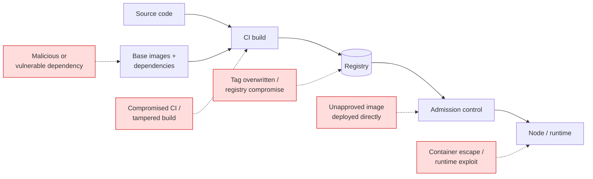
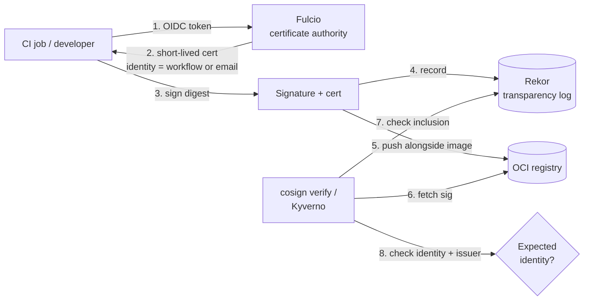
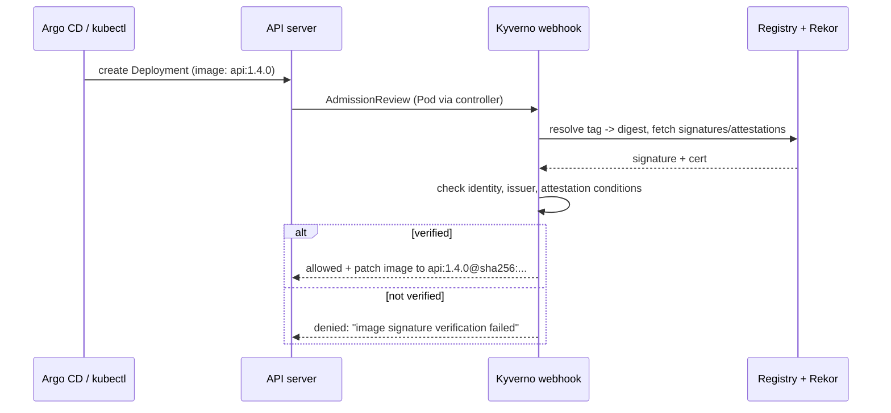

# Image Security: Signing, Scanning, and SBOMs

## Learning Objectives
- Map the threats to container images across build, registry, and deploy stages
- Sign images and attestations with Sigstore `cosign` (keyless and key-based) and verify them
- Generate SBOMs with `syft` and `trivy`, and attach them to images as attestations
- Scan images and SBOMs for vulnerabilities with `trivy` and `grype`, and manage noise with VEX and ignore files
- Enforce "only signed, scanned images from approved registries" at admission with Kyverno and ValidatingAdmissionPolicy
- Build a golden CI pipeline that produces signed, attested images by default

## Prerequisites
- [OCI Image Spec](image-spec.md) — digests, indexes, referrers
- [Container Runtimes](container-runtimes.md)
- A cluster from [Lab 01](../../labs/lab-01-cluster-setup/README.md) and Helm ≥ 3.12
- Tools: [`cosign`](https://docs.sigstore.dev/cosign/system_config/installation/) v2.x or later, [`trivy`](https://trivy.dev/), [`syft`](https://github.com/anchore/syft), [`grype`](https://github.com/anchore/grype), `crane`, `jq`

---

## The Image Threat Model



| Threat | Control | Tool | Covered In |
|--------|---------|------|------------|
| Known CVEs in OS packages / libraries | Vulnerability scanning, minimal base images | Trivy, Grype, distroless/Chainguard | This doc |
| Unknown contents ("what's in this image?") | Software Bill of Materials (SBOM) | Syft, Trivy, BuildKit | This doc |
| Tampered or substituted images | Signatures bound to digests | cosign, Notation | This doc |
| Untrusted build process | Provenance attestations (SLSA) | BuildKit, GitHub attestations, Tekton Chains | [Supply Chain](../12-security-compliance/supply-chain.md) |
| Images from unapproved sources | Admission policy | Kyverno, Gatekeeper, VAP | This doc + [Policy Engine](../12-security-compliance/policy-engine.md) |
| Leaked secrets in layers | Secret scanning, BuildKit secret mounts | Trivy, `--mount=type=secret` | This doc + [Image Spec](image-spec.md) |
| Running as root / excessive privileges | Pod Security Standards | PSA, Kyverno | [Pod Security](../12-security-compliance/pod-security.md) |
| Kernel-level escapes | Sandboxed runtimes | gVisor, Kata | [Runtime Classes](runtime-classes.md) |

The platform team's goal is to make the secure path the **default path**: a golden pipeline that signs, attests, and scans every image, and an admission layer that refuses anything that didn't go through it.

---

## Start with a Smaller Attack Surface

The cheapest vulnerability to fix is the one you never ship.

| Base Image | Approx. Size | Shell / Package Manager | Typical CVE Count | Use For |
|------------|--------------|-------------------------|-------------------|---------|
| `ubuntu:24.04` / `debian:12` | 30–80 MB | Yes / Yes | Dozens | Debugging images, legacy apps |
| `alpine:3.20` | ~4 MB | Yes / apk | Low, musl libc | Small images that need a shell |
| `gcr.io/distroless/static-debian12:nonroot` | ~2 MB | No / No | Near zero | Static Go/Rust binaries |
| `gcr.io/distroless/base-debian12:nonroot` | ~20 MB | No / No | Very low | Dynamically linked (glibc) binaries |
| `cgr.dev/chainguard/static` (and language images) | ~1–50 MB | No (`-dev` variants have one) | Near zero, rebuilt daily | Hardened production images |
| `scratch` | 0 | No / No | Zero | Fully static binaries, you add CA certs |

```dockerfile
# Dockerfile - hardened Go service
# syntax=docker/dockerfile:1
FROM --platform=$BUILDPLATFORM golang:1.23 AS build
ARG TARGETOS TARGETARCH
WORKDIR /src
COPY go.mod go.sum ./
RUN go mod download
COPY . .
RUN CGO_ENABLED=0 GOOS=$TARGETOS GOARCH=$TARGETARCH \
    go build -trimpath -ldflags="-s -w" -o /out/api ./cmd/api

# Pin the base by digest; let Renovate/Dependabot bump it
FROM gcr.io/distroless/static-debian12:nonroot@sha256:<digest>
COPY --from=build /out/api /app/api
USER 65532:65532            # numeric UID so runAsNonRoot can verify it
ENTRYPOINT ["/app/api"]
```

Pair this with a restrictive Pod `securityContext` (`runAsNonRoot`, `readOnlyRootFilesystem`, `allowPrivilegeEscalation: false`, `capabilities.drop: [ALL]`, `seccompProfile: RuntimeDefault`) — enforced via the `restricted` Pod Security Standard ([Pod Security](../12-security-compliance/pod-security.md)).

> Debugging distroless pods: use `kubectl debug -it <pod> --image=busybox:1.36 --target=<container>` to attach an ephemeral container with tools, instead of adding a shell to the production image.

---

## SBOMs: Know What You Ship

An SBOM lists every package in an image, with versions and licenses. It turns "are we affected by CVE-X?" from a rebuild-and-scan exercise into a database query.

| Format | Maintainer | Media Type | Notes |
|--------|------------|------------|-------|
| SPDX 2.3 / 3.0 | Linux Foundation (ISO/IEC 5962) | `application/spdx+json` | Strong license focus; common in compliance |
| CycloneDX 1.5 / 1.6 | OWASP (ECMA-424) | `application/vnd.cyclonedx+json` | Security focus; supports VEX natively |

### Generating SBOMs

```bash
IMG=ghcr.io/stefanprodan/podinfo:6.7.1

# Syft: multiple formats in one pass
syft scan "$IMG" \
  -o spdx-json=sbom.spdx.json \
  -o cyclonedx-json=sbom.cdx.json

# Trivy: CycloneDX or SPDX
trivy image --format cyclonedx --output sbom.cdx.json "$IMG"
trivy image --format spdx-json --output sbom.spdx.json "$IMG"

# BuildKit: generated during build and stored as an attestation in the image index
docker buildx build --sbom=true --provenance=mode=max -t ghcr.io/mycompany/api:1.4.0 --push .

# Quick look at what's inside
jq '[.packages[] | {name, versionInfo}] | length' sbom.spdx.json
jq -r '.components[] | "\(.name)@\(.version)"' sbom.cdx.json | head -20
```

### Scanning an SBOM Instead of an Image

Scanning an SBOM is fast and does not need registry access — ideal for continuously re-checking every deployed image against newly published CVEs.

```bash
trivy sbom sbom.cdx.json --severity HIGH,CRITICAL
grype sbom:./sbom.spdx.json --fail-on high
```

---

## Vulnerability Scanning

### Trivy Essentials

```bash
IMG=ghcr.io/stefanprodan/podinfo:6.7.1

# Human-readable report, only actionable findings
trivy image --severity HIGH,CRITICAL --ignore-unfixed "$IMG"

# CI gate: non-zero exit if any fixable HIGH/CRITICAL exists
trivy image --severity HIGH,CRITICAL --ignore-unfixed --exit-code 1 "$IMG"

# Also scan for embedded secrets and misconfigurations in the image
trivy image --scanners vuln,secret,misconfig "$IMG"

# Machine-readable outputs
trivy image --format json  --output trivy.json  "$IMG"
trivy image --format sarif --output trivy.sarif "$IMG"      # GitHub code scanning
trivy image --format cosign-vuln --output vuln.json "$IMG"  # cosign vuln predicate

# Scan source tree / IaC before building
trivy fs --scanners vuln,secret .
trivy config ./deploy/                                     # Kubernetes manifests, Dockerfiles, Terraform
```

### Severity Is Not Risk

A scanner reports what *could* matter. Platform teams should define a policy that developers can actually meet:

| Policy Element | Recommendation |
|----------------|----------------|
| Gate on | Fixable `CRITICAL` (and `HIGH` for internet-facing services) |
| Unfixed CVEs | Report, don't block; track until a fix ships |
| Exceptions | Time-boxed, reviewed, recorded in Git (`.trivyignore.yaml` or VEX) |
| Rescanning | Continuously, not just at build time — new CVEs appear daily |
| SLA | e.g. Critical: 7 days, High: 30 days, tracked per team |

```yaml
# .trivyignore.yaml - reviewed, expiring exceptions live in the repo
vulnerabilities:
  - id: CVE-2024-12345
    paths:
      - "usr/lib/libexample.so.1"
    statement: "Not reachable: feature disabled at build time (SEC-482)"
    expired_at: 2026-12-31
```

```bash
trivy image --ignorefile .trivyignore.yaml "$IMG"
```

### VEX: Machine-Readable "Not Affected"

**VEX** (Vulnerability Exploitability eXchange) lets the producer of an image state that a CVE does not affect it, with a justification. Trivy and Grype both consume OpenVEX and CycloneDX VEX:

```json
// api.openvex.json
{
  "@context": "https://openvex.dev/ns/v0.2.0",
  "@id": "https://platform.mycompany.io/vex/api-1.4.0",
  "author": "platform-security@mycompany.io",
  "timestamp": "2026-10-20T00:00:00Z",
  "version": 1,
  "statements": [
    {
      "vulnerability": {"name": "CVE-2024-12345"},
      "products": [{"@id": "pkg:oci/api@sha256%3Aaaa..."}],
      "status": "not_affected",
      "justification": "vulnerable_code_not_in_execute_path"
    }
  ]
}
```

```bash
trivy image --vex api.openvex.json "$IMG"
```

### In-Cluster Continuous Scanning

The [Trivy Operator](https://github.com/aquasecurity/trivy-operator) scans running workloads and stores results as CRDs, so platform dashboards and policies can query them:

```bash
helm repo add aqua https://aquasecurity.github.io/helm-charts/
helm repo update
helm install trivy-operator aqua/trivy-operator \
  --namespace trivy-system --create-namespace \
  --set trivy.ignoreUnfixed=true

kubectl get vulnerabilityreports -A -o wide
kubectl get configauditreports -A
kubectl get exposedsecretreports -A
```

The operator exports Prometheus metrics (e.g. `trivy_image_vulnerabilities`) you can alert on per namespace or tenant — see [Metrics Stack](../10-observability/metrics-stack.md).

---

## Signing with Sigstore

Scanning tells you *what* is in an image; signing tells you *who produced it* and that it hasn't changed since. A signature is bound to a **manifest digest**, never to a tag.

### Sigstore Components



| Component | Role |
|-----------|------|
| **cosign** | CLI to sign, verify, and attest OCI artifacts |
| **Fulcio** | Issues short-lived (~10 min) X.509 certs bound to an OIDC identity |
| **Rekor** | Append-only transparency log; proves the signature existed while the cert was valid |
| **TUF root** | Distributes trusted Fulcio/Rekor keys to clients |

### Keyless vs Key-Based Signing

| Aspect | Keyless (OIDC) | Key pair / KMS |
|--------|----------------|----------------|
| Secrets to manage | None | Private key or KMS key |
| Identity in signature | Workflow URL, email, SPIFFE ID | Just "holder of this key" |
| Works offline / air-gapped | Needs Fulcio + Rekor (public or private instance) | Yes (`--tlog-upload=false` possible) |
| Rotation | Automatic (certs expire in minutes) | Manual |
| Best for | CI on GitHub/GitLab/cloud with OIDC | Air-gapped, regulated, or legacy CI |

### Keyless Signing in CI

```bash
# Inside a CI job that has an OIDC token (e.g. GitHub Actions with id-token: write)
IMAGE=ghcr.io/mycompany/api
DIGEST=$(crane digest "$IMAGE:1.4.0")

# Always sign the digest - signing a tag signs whatever it points to *right now*
cosign sign --yes "$IMAGE@$DIGEST"
```

### Verifying a Keyless Signature

Verification must pin **both** the identity and the OIDC issuer; otherwise any Sigstore user could produce a "valid" signature.

```bash
cosign verify "$IMAGE@$DIGEST" \
  --certificate-identity "https://github.com/mycompany/api/.github/workflows/release.yaml@refs/heads/main" \
  --certificate-oidc-issuer "https://token.actions.githubusercontent.com" \
  | jq '.[0].optional | {Issuer, Subject}'

# Allow any workflow in the org's repos on main
cosign verify "$IMAGE@$DIGEST" \
  --certificate-identity-regexp '^https://github.com/mycompany/[^/]+/\.github/workflows/.+@refs/heads/main$' \
  --certificate-oidc-issuer https://token.actions.githubusercontent.com
```

### Key-Based Signing

```bash
# Generate a password-protected key pair (or use --kms awskms://..., gcpkms://..., hashivault://...)
cosign generate-key-pair             # writes cosign.key and cosign.pub

cosign sign --yes --key cosign.key "$IMAGE@$DIGEST"
cosign verify --key cosign.pub "$IMAGE@$DIGEST"
```

### Attestations: Signed Statements About an Image

An **attestation** is a signed [in-toto](https://in-toto.io/) statement whose subject is the image digest and whose *predicate* carries data — an SBOM, a vulnerability report, SLSA provenance, test results.

```bash
# Attach a signed SBOM
cosign attest --yes --type cyclonedx --predicate sbom.cdx.json "$IMAGE@$DIGEST"

# Attach a signed vulnerability scan result
trivy image --format cosign-vuln --output vuln.json "$IMAGE@$DIGEST"
cosign attest --yes --type vuln --predicate vuln.json "$IMAGE@$DIGEST"

# Verify and extract the SBOM predicate
cosign verify-attestation "$IMAGE@$DIGEST" --type cyclonedx \
  --certificate-identity-regexp '^https://github.com/mycompany/' \
  --certificate-oidc-issuer https://token.actions.githubusercontent.com \
  | jq -r '.payload' | base64 -d | jq '.predicate.components | length'

# See everything attached to the image
cosign tree "$IMAGE@$DIGEST"
```

| `--type` | Predicate | Typical Producer |
|----------|-----------|------------------|
| `slsaprovenance` / `slsaprovenance1` | SLSA build provenance | BuildKit, GitHub attestations, Tekton Chains |
| `spdxjson` | SPDX SBOM | Syft, Trivy |
| `cyclonedx` | CycloneDX SBOM | Syft, Trivy |
| `vuln` | Scan result | Trivy (`cosign-vuln` format) |
| `custom` / URI | Anything | Test reports, approvals |

> **Signature storage formats.** Older cosign releases store signatures as `sha256-<digest>.sig` tags; newer releases can (and recent major versions do by default) write the Sigstore bundle format as an OCI 1.1 referrer. Make sure your admission controller version understands the format your cosign version produces before you upgrade either one; check `cosign sign --help` for the bundle-format option during migrations.

### Notation (Notary Project)

[Notation](https://notaryproject.dev/) is the CNCF alternative using X.509 PKI and OCI referrers, common in Azure (ACR + Key Vault) and with the Ratify verifier for Gatekeeper. The concepts — sign a digest, verify against a trust policy — are the same; pick one per platform to keep policy simple.

---

## Enforcing at Admission

Signing is useless unless something refuses unsigned images. Enforcement belongs in admission control so that **every** path into the cluster — GitOps, `kubectl`, Helm, operators — is covered.



### Kyverno `verifyImages`

```yaml
# kyverno-verify-images.yaml
apiVersion: kyverno.io/v1
kind: ClusterPolicy
metadata:
  name: verify-platform-images
  annotations:
    policies.kyverno.io/title: Verify image signatures and SBOM attestations
    platform.mycompany.io/owner: platform-security
spec:
  webhookTimeoutSeconds: 30          # registry + Rekor round-trips take time
  background: false                  # verification happens at admission only
  rules:
    - name: require-signed-images
      match:
        any:
          - resources:
              kinds: [Pod]
              namespaceSelector:
                matchExpressions:
                  - key: platform.mycompany.io/tenant
                    operator: Exists        # only tenant namespaces, not kube-system
      verifyImages:
        - imageReferences:
            - "ghcr.io/mycompany/*"
            - "registry.platform.mycompany.io/*"
          failureAction: Enforce            # Audit while rolling out
          mutateDigest: true                # rewrite tag -> tag@digest in the Pod
          verifyDigest: true                # require digest after mutation
          required: true
          attestors:
            - entries:
                - keyless:
                    issuer: "https://token.actions.githubusercontent.com"
                    subject: "https://github.com/mycompany/*/.github/workflows/*@refs/heads/main"
                    rekor:
                      url: https://rekor.sigstore.dev
          attestations:
            # Require a signed CycloneDX SBOM from the same identity
            - type: https://cyclonedx.org/bom
              attestors:
                - entries:
                    - keyless:
                        issuer: "https://token.actions.githubusercontent.com"
                        subject: "https://github.com/mycompany/*/.github/workflows/*@refs/heads/main"
              conditions:
                - all:
                    - key: "{{ components[].name | length(@) }}"
                      operator: GreaterThan
                      value: 0
```

Key behaviors:
- Policies on `Pod` are auto-generated for Deployments, StatefulSets, Jobs, etc. (Kyverno autogen), so failures surface when the *controller* is created, not later.
- `mutateDigest` makes the running image immutable even if the tag is later overwritten.
- Kyverno caches verification results; tune `webhookTimeoutSeconds` for slow registries.
- Newer Kyverno releases also offer the CEL-based `ImageValidatingPolicy` kind for the same purpose; the `ClusterPolicy` form above remains supported. See [Policy Engine](../12-security-compliance/policy-engine.md) for choosing between them.

Alternatives: the Sigstore [policy-controller](https://docs.sigstore.dev/policy-controller/overview/) (`ClusterImagePolicy`), Ratify + Gatekeeper (Notation and cosign), and Connaisseur.

### Registry Allowlist and Digest Pinning with ValidatingAdmissionPolicy

Not everything needs a webhook. In-tree `ValidatingAdmissionPolicy` (`admissionregistration.k8s.io/v1`, GA in Kubernetes 1.30) can enforce simple string rules with CEL, with no extra component. It cannot verify signatures (no network calls), so use it *alongside* Kyverno.

```yaml
# vap-allowed-registries.yaml
apiVersion: admissionregistration.k8s.io/v1
kind: ValidatingAdmissionPolicy
metadata:
  name: platform-allowed-registries
spec:
  failurePolicy: Fail
  matchConstraints:
    resourceRules:
      - apiGroups: [""]
        apiVersions: ["v1"]
        operations: ["CREATE", "UPDATE"]
        resources: ["pods"]
  variables:
    - name: allContainers
      expression: >-
        object.spec.containers +
        (has(object.spec.initContainers) ? object.spec.initContainers : []) +
        (has(object.spec.ephemeralContainers) ? object.spec.ephemeralContainers : [])
  validations:
    - expression: >-
        variables.allContainers.all(c,
          c.image.startsWith('ghcr.io/mycompany/') ||
          c.image.startsWith('registry.platform.mycompany.io/'))
      message: "Images must come from ghcr.io/mycompany or registry.platform.mycompany.io"
    - expression: "variables.allContainers.all(c, c.image.contains('@sha256:'))"
      message: "Images must be pinned by digest (image@sha256:...)"
---
apiVersion: admissionregistration.k8s.io/v1
kind: ValidatingAdmissionPolicyBinding
metadata:
  name: platform-allowed-registries
spec:
  policyName: platform-allowed-registries
  validationActions: [Deny]          # use [Warn, Audit] during rollout
  matchResources:
    namespaceSelector:
      matchLabels:
        platform.mycompany.io/enforce-image-policy: "true"
```

> If Kyverno's `mutateDigest` runs first (mutating webhooks run before validating admission), the digest-pinning rule passes automatically for signed images.

---

## The Golden Pipeline

A reusable CI workflow that every service calls. Developers get signing, SBOMs, provenance, and scanning without writing any of it.

```yaml
# .github/workflows/release.yaml (or a reusable workflow in mycompany/platform-workflows)
name: release
on:
  push:
    branches: [main]

permissions:
  contents: read
  packages: write
  id-token: write          # OIDC token for keyless cosign + attestations
  attestations: write
  security-events: write   # upload SARIF

env:
  IMAGE: ghcr.io/${{ github.repository }}

jobs:
  build:
    runs-on: ubuntu-latest
    outputs:
      digest: ${{ steps.build.outputs.digest }}
    steps:
      - uses: actions/checkout@v4
      - uses: docker/setup-buildx-action@v3
      - uses: docker/login-action@v3
        with:
          registry: ghcr.io
          username: ${{ github.actor }}
          password: ${{ secrets.GITHUB_TOKEN }}

      - name: Build and push (multi-arch, BuildKit SBOM + provenance)
        id: build
        uses: docker/build-push-action@v6
        with:
          platforms: linux/amd64,linux/arm64
          push: true
          tags: ${{ env.IMAGE }}:${{ github.sha }}
          sbom: true
          provenance: mode=max
          labels: |
            org.opencontainers.image.source=${{ github.server_url }}/${{ github.repository }}
            org.opencontainers.image.revision=${{ github.sha }}

      - name: Scan (gate on fixable HIGH/CRITICAL)
        uses: aquasecurity/trivy-action@0.28.0   # pin to a commit SHA in production
        with:
          image-ref: ${{ env.IMAGE }}@${{ steps.build.outputs.digest }}
          severity: HIGH,CRITICAL
          ignore-unfixed: true
          exit-code: "1"
          format: sarif
          output: trivy.sarif

      - uses: github/codeql-action/upload-sarif@v3
        if: always()
        with:
          sarif_file: trivy.sarif

      - uses: sigstore/cosign-installer@v3
      - uses: anchore/sbom-action@v0
        with:
          image: ${{ env.IMAGE }}@${{ steps.build.outputs.digest }}
          format: cyclonedx-json
          output-file: sbom.cdx.json
          upload-artifact: false

      - name: Sign image and attest SBOM (keyless)
        env:
          REF: ${{ env.IMAGE }}@${{ steps.build.outputs.digest }}
        run: |
          cosign sign --yes "$REF"
          cosign attest --yes --type cyclonedx --predicate sbom.cdx.json "$REF"

      - name: GitHub build provenance (SLSA)
        uses: actions/attest-build-provenance@v2
        with:
          subject-name: ${{ env.IMAGE }}
          subject-digest: ${{ steps.build.outputs.digest }}
          push-to-registry: true
```

Then CI writes `image: ghcr.io/mycompany/api:<sha>@<digest>` into the GitOps repo ([GitOps Principles](../05-gitops/gitops-principles.md)). Consumers can verify GitHub provenance with:

```bash
gh attestation verify oci://ghcr.io/mycompany/api@sha256:aaa... --owner mycompany
```

---

## Hands-On Exercise

### Goal
Sign an image, attach an SBOM attestation, and have Kyverno block unsigned images in a tenant namespace. We use [ttl.sh](https://ttl.sh), an anonymous ephemeral registry, so no credentials are needed, and a key pair so no OIDC provider is needed.

### Part 1: Build, Push, and Sign

```bash
# 1. Push a uniquely named copy of an image to ttl.sh (expires after 1h)
export REPO=ttl.sh/platform-$(uuidgen | tr 'A-Z' 'a-z' | cut -c1-8)
crane copy ghcr.io/stefanprodan/podinfo:6.7.1 "$REPO/podinfo:1h"
export DIGEST=$(crane digest "$REPO/podinfo:1h")
export REF="$REPO/podinfo@$DIGEST"
echo "$REF"

# Also push an unsigned image for the negative test
crane copy ghcr.io/stefanprodan/podinfo:6.7.0 "$REPO/unsigned:1h"

# 2. Scan it
trivy image --severity HIGH,CRITICAL "$REF"

# 3. Create a key pair (empty password for the lab only)
export COSIGN_PASSWORD=""
cosign generate-key-pair

# 4. Sign the digest and attach a signed SBOM
cosign sign --yes --key cosign.key "$REF"
syft scan "$REF" -o cyclonedx-json=sbom.cdx.json
cosign attest --yes --key cosign.key --type cyclonedx --predicate sbom.cdx.json "$REF"

# 5. Verify locally
cosign verify --key cosign.pub "$REF" | jq '.[0].critical.image'
cosign verify-attestation --key cosign.pub --type cyclonedx "$REF" > /dev/null && echo "SBOM attestation OK"
cosign tree "$REF"
```

### Part 2: Enforce with Kyverno

```bash
# 6. Install Kyverno
helm repo add kyverno https://kyverno.github.io/kyverno/
helm repo update
helm install kyverno kyverno/kyverno -n kyverno --create-namespace --wait

# 7. Create a tenant namespace
kubectl create namespace team-a
kubectl label namespace team-a platform.mycompany.io/tenant=team-a
```

```bash
# 8. Create the policy using your public key
cat > verify-ttl.yaml <<EOF
apiVersion: kyverno.io/v1
kind: ClusterPolicy
metadata:
  name: verify-lab-images
spec:
  webhookTimeoutSeconds: 30
  background: false
  rules:
    - name: require-signature
      match:
        any:
          - resources:
              kinds: [Pod]
              namespaceSelector:
                matchLabels:
                  platform.mycompany.io/tenant: team-a
      verifyImages:
        - imageReferences: ["ttl.sh/*"]
          failureAction: Enforce
          mutateDigest: true
          attestors:
            - entries:
                - keys:
                    publicKeys: |-
$(sed 's/^/                      /' cosign.pub)
EOF
kubectl apply -f verify-ttl.yaml
kubectl get clusterpolicy verify-lab-images   # wait for READY=True
```

```bash
# 9. Signed image: allowed, and the tag is rewritten to a digest
kubectl -n team-a run signed --image="$REPO/podinfo:1h"
kubectl -n team-a get pod signed -o jsonpath='{.spec.containers[0].image}{"\n"}'

# 10. Unsigned image: denied
kubectl -n team-a run unsigned --image="$REPO/unsigned:1h"
# Expected: admission webhook "mutate.kyverno.svc-fail" denied the request ...
#           ... failed to verify image ... no signatures found

# 11. Same unsigned image in a non-tenant namespace: allowed (policy is scoped)
kubectl -n default run unsigned --image="$REPO/unsigned:1h"
```

**Questions to answer:**
1. What image reference does the `signed` Pod actually run? Why does this matter if someone re-pushes the `:1h` tag?
2. Change `failureAction` to `Audit` and retry step 10. Where does the violation show up? (`kubectl get policyreports -A`)
3. Extend the rule with an `attestations` block requiring the CycloneDX SBOM. What happens for an image that is signed but has no SBOM?

### Cleanup

```bash
kubectl delete pod -n default unsigned --ignore-not-found
kubectl delete namespace team-a
kubectl delete clusterpolicy verify-lab-images
helm uninstall kyverno -n kyverno
rm -f cosign.key cosign.pub sbom.cdx.json verify-ttl.yaml
```

For a fuller policy suite (registry allowlists, PSS, required labels), continue with [Lab 05: Policy Engine](../../labs/lab-05-policy-engine/README.md).

---

## Troubleshooting

### `cosign verify`: "no matching signatures"

```bash
cosign tree "$IMAGE@$DIGEST"                      # are there signatures at all?
cosign verify "$IMAGE@$DIGEST" --certificate-identity-regexp '.*' \
  --certificate-oidc-issuer-regexp '.*' | jq '.[].optional.Subject'   # who actually signed (debug only!)
```
- You signed a **different digest** (e.g. a single-platform manifest vs the index). Sign the digest you deploy.
- Identity mismatch: workflow path, branch (`refs/heads/main` vs `refs/tags/v1.4.0`), or a reusable workflow (the identity is the *called* workflow's path).
- The image was re-pushed or promoted without copying signatures (see [Image Spec](image-spec.md)).

### Kyverno: `context deadline exceeded` or webhook timeouts

Kyverno must reach the registry and Rekor. Check egress NetworkPolicies on the `kyverno` namespace ([Network Policies](../03-networking-fundamentals/network-policies.md)), proxy settings, and raise `webhookTimeoutSeconds`. For private registries, configure `imageRegistryCredentials.secrets` in the rule or Kyverno's `--imagePullSecrets` flag.

### Kyverno denies images in `kube-system` or platform namespaces

Scope policies with `namespaceSelector` or `exclude` blocks, and make sure platform add-ons themselves come from signed sources. Never let a verification policy fail closed on the namespaces that run the policy engine itself.

### Trivy reports "too many" vulnerabilities

- Add `--ignore-unfixed` and gate on severity.
- Switch to a distroless or Chainguard base image.
- Check whether findings come from the OS layer (fix by rebasing) or the app dependencies (fix by upgrading).
- Use VEX for justified not-affected findings, rather than blanket ignores.

### Trivy: "failed to download vulnerability DB"

In CI or air-gapped environments, mirror the DB: `trivy image --db-repository registry.platform.mycompany.io/aquasecurity/trivy-db ...` (and `--java-db-repository` for Java), or pre-download with `trivy image --download-db-only` and cache the directory.

### SBOM attestation verification fails but signature verification passes

The attestation `--type` must match: `cyclonedx` in cosign maps to predicate type `https://cyclonedx.org/bom`, which is what Kyverno's `attestations[].type` must use.

---

## Further Reading

### Sigstore and Signing
- [Sigstore documentation](https://docs.sigstore.dev/)
- [cosign: verifying signatures](https://docs.sigstore.dev/cosign/verifying/verify/)
- [Notary Project](https://notaryproject.dev/)

### Scanning and SBOMs
- [Trivy documentation](https://trivy.dev/latest/docs/)
- [Trivy Operator](https://aquasecurity.github.io/trivy-operator/latest/)
- [Syft](https://github.com/anchore/syft) and [Grype](https://github.com/anchore/grype)
- [OpenVEX specification](https://github.com/openvex/spec)
- [CISA SBOM resources](https://www.cisa.gov/sbom)

### Admission
- [Kyverno: Verify Images](https://kyverno.io/docs/writing-policies/verify-images/)
- [Sigstore policy-controller](https://docs.sigstore.dev/policy-controller/overview/)
- [ValidatingAdmissionPolicy](https://kubernetes.io/docs/reference/access-authn-authz/validating-admission-policy/)

### Base Images
- [Distroless](https://github.com/GoogleContainerTools/distroless)
- [Chainguard Images](https://images.chainguard.dev/)

---

## Next Steps

1. **Read**: [Supply Chain Security](../12-security-compliance/supply-chain.md) — SLSA levels, provenance, and in-toto in depth
2. **Read**: [Runtime Classes](runtime-classes.md) — isolate the images you *can't* fully trust
3. **Practice**: [Lab 05: Policy Engine](../../labs/lab-05-policy-engine/README.md) — combine image verification with Pod Security and tenant policies
4. **Explore**: [Pod Security](../12-security-compliance/pod-security.md) and [Policy Engine](../12-security-compliance/policy-engine.md)
