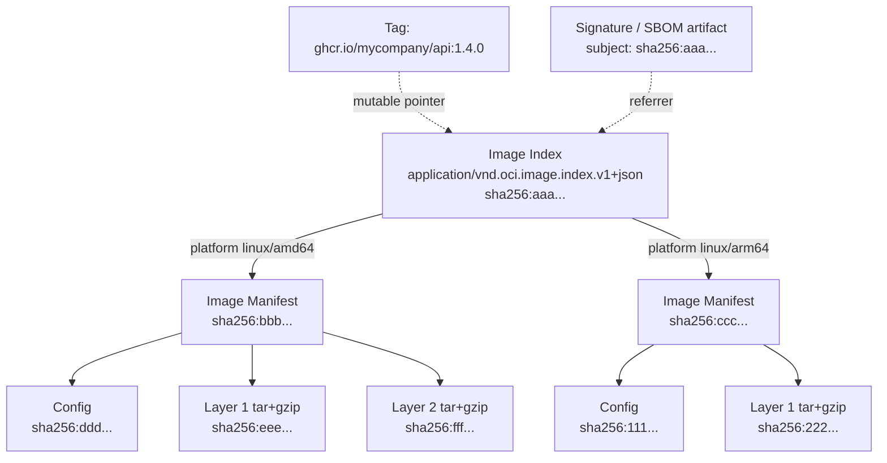
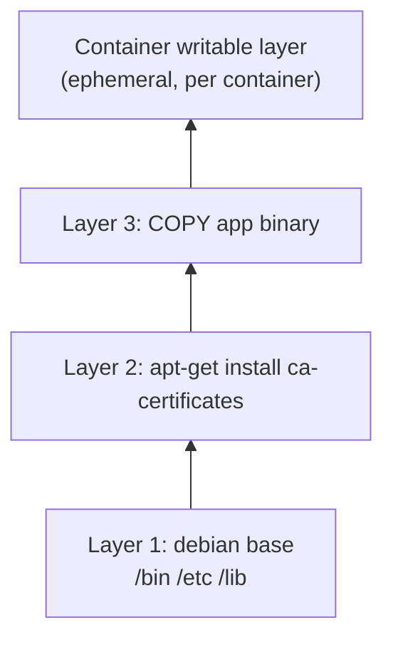
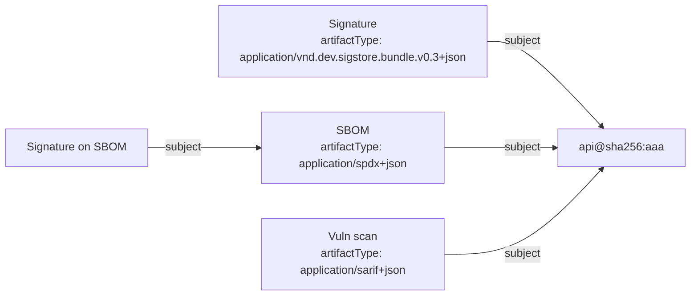

# OCI Image Specification

## Learning Objectives
- Describe the OCI image format: index, manifest, config, and layers — and how they link by digest
- Explain content addressability and why digests, not tags, are the unit of trust
- Build and inspect multi-architecture images and understand how a node picks its platform
- Use OCI 1.1 artifacts, `artifactType`, `subject`, and the referrers API to attach SBOMs and signatures
- Inspect and copy images with `crane`, `oras`, `skopeo`, and `docker buildx imagetools`
- Apply platform conventions: standard annotations, digest pinning, and promotion between registries

## Prerequisites
- [Container Runtimes](container-runtimes.md) — how the runtime pulls and unpacks images
- Familiarity with `docker build` / Dockerfiles
- Tools: [`crane`](https://github.com/google/go-containerregistry/tree/main/cmd/crane), [`oras`](https://oras.land/) ≥ 1.2, `jq`, Docker with Buildx

---

## Why Platform Engineers Need the Image Spec

An image is not a "file" — it is a small graph of JSON documents and tarballs stored in a registry and addressed by hash. Understanding that graph explains a lot of day-to-day platform behavior:

| Symptom / Question | Explained By |
|--------------------|--------------|
| "Same tag, different behavior on two nodes" | Tags are mutable pointers; digests are not |
| "Works on my Mac, `exec format error` in the cluster" | Multi-arch index vs single-platform manifest |
| "How do I attach an SBOM without rebuilding?" | OCI 1.1 `subject` + referrers API |
| "Why did promoting an image to prod change its digest?" | Re-pushing with different compression or re-building instead of copying |
| "Why does my 5 MB change cost 500 MB to pull?" | Layer ordering and cache invalidation |
| "How does admission verify a signature?" | Signature references the manifest digest ([Image Security](image-security.md)) |

The Open Container Initiative (OCI) maintains three specs:

| Spec | Defines | Current |
|------|---------|---------|
| **Image Spec** | Image format: index, manifest, config, layers | v1.1 |
| **Distribution Spec** | Registry HTTP API (`/v2/...`) | v1.1 |
| **Runtime Spec** | How a runtime executes an unpacked bundle | v1.2 — see [Container Runtimes](container-runtimes.md) |

---

## The Image Object Graph



Every arrow is a **descriptor**: a small JSON object with `mediaType`, `digest`, and `size`. Because each parent includes the digests of its children, the digest of the top-level object cryptographically commits to *every byte* of the image — a Merkle tree.

### Descriptors

```json
{
  "mediaType": "application/vnd.oci.image.layer.v1.tar+gzip",
  "digest": "sha256:9b2c1c...e41f",
  "size": 3623807,
  "annotations": {
    "org.opencontainers.image.title": "optional-human-name"
  }
}
```

| Field | Required | Purpose |
|-------|----------|---------|
| `mediaType` | Yes | How to interpret the referenced bytes |
| `digest` | Yes | `algorithm:hex` — content address (sha256 in practice) |
| `size` | Yes | Byte length; lets clients reject oversized/malicious blobs |
| `urls` | No | Alternate download locations (rarely used; "foreign layers") |
| `annotations` | No | Arbitrary string metadata |
| `platform` | Index entries only | `os`, `architecture`, `variant`, `os.version` |
| `artifactType` | No (1.1) | Type of an artifact manifest it points to |

### Media Types

| Media Type | Object |
|------------|--------|
| `application/vnd.oci.image.index.v1+json` | Image index (multi-platform list) |
| `application/vnd.oci.image.manifest.v1+json` | Image manifest |
| `application/vnd.oci.image.config.v1+json` | Image config |
| `application/vnd.oci.image.layer.v1.tar` | Uncompressed layer |
| `application/vnd.oci.image.layer.v1.tar+gzip` | gzip layer (most common) |
| `application/vnd.oci.image.layer.v1.tar+zstd` | zstd layer (faster decompression) |
| `application/vnd.oci.empty.v1+json` | The empty descriptor `{}` (used by artifacts) |
| `application/vnd.docker.distribution.manifest.v2+json` | Docker v2 schema 2 manifest (legacy, still common) |
| `application/vnd.docker.distribution.manifest.list.v2+json` | Docker manifest list (legacy index) |

Registries and runtimes accept both Docker and OCI media types; the structures are nearly identical. BuildKit can emit either (`oci-mediatypes=true` output option).

---

## The Image Manifest

A manifest describes **one image for one platform**:

```json
// manifest.json  (fetched with: crane manifest --platform linux/amd64 <image>)
{
  "schemaVersion": 2,
  "mediaType": "application/vnd.oci.image.manifest.v1+json",
  "config": {
    "mediaType": "application/vnd.oci.image.config.v1+json",
    "digest": "sha256:4a7c...",          // -> config blob
    "size": 1472
  },
  "layers": [                              // ordered: base first, top last
    {
      "mediaType": "application/vnd.oci.image.layer.v1.tar+gzip",
      "digest": "sha256:9b2c...",
      "size": 3623807
    },
    {
      "mediaType": "application/vnd.oci.image.layer.v1.tar+gzip",
      "digest": "sha256:51d0...",
      "size": 12044231
    }
  ],
  "annotations": {
    "org.opencontainers.image.source": "https://github.com/mycompany/api",
    "org.opencontainers.image.revision": "3f2a9c1",
    "org.opencontainers.image.created": "2026-10-20T14:03:11Z"
  }
}
```

The **manifest digest** (`sha256` of these exact bytes) is the image's identity. `image@sha256:...` always resolves to the same content, forever, on every registry.

## The Image Config

The config blob holds runtime defaults and build history:

```json
// config.json  (fetched with: crane config <image>)
{
  "architecture": "amd64",
  "os": "linux",
  "config": {
    "User": "65532:65532",                       // non-root by default
    "Env": ["PATH=/usr/local/bin:/usr/bin:/bin"],
    "Entrypoint": ["/app/api"],                  // -> Pod "command"
    "Cmd": ["--port=8080"],                      // -> Pod "args"
    "WorkingDir": "/app",
    "ExposedPorts": {"8080/tcp": {}},            // documentation only in Kubernetes
    "Labels": {"org.opencontainers.image.source": "https://github.com/mycompany/api"}
  },
  "rootfs": {
    "type": "layers",
    "diff_ids": [                                 // sha256 of *uncompressed* layers
      "sha256:7c1f...",
      "sha256:e0a9..."
    ]
  },
  "history": [
    {"created": "2026-10-01T00:00:00Z", "created_by": "BuildKit base", "empty_layer": false},
    {"created": "2026-10-20T14:03:10Z", "created_by": "COPY /out/api /app/api # buildkit"}
  ]
}
```

Two digests per layer is a frequent source of confusion:

| Digest | Where | Computed Over |
|--------|-------|---------------|
| Layer descriptor `digest` | Manifest `layers[]` | Compressed blob as stored in the registry |
| `diff_id` | Config `rootfs.diff_ids[]` | Uncompressed tar — what the snapshotter unpacks |

Re-compressing a layer (gzip → zstd, or a different gzip level) changes the manifest digest but not the `diff_id`s. This is why **promoting by re-pushing** can silently change image identity — and break signatures.

### How the Kubelet Merges Config with Pod Spec

| Image config | Pod spec | Result |
|--------------|----------|--------|
| `Entrypoint` + `Cmd` | neither set | Image defaults |
| `Entrypoint` + `Cmd` | `args` only | Image `Entrypoint` + Pod `args` |
| `Entrypoint` + `Cmd` | `command` only | Pod `command`, image `Cmd` **ignored** |
| `User` | `securityContext.runAsUser` | Pod wins |
| `Env` | `env` | Merged; Pod wins on conflicts |
| `ExposedPorts` | `ports` | Independent; neither restricts traffic |

---

## Layers and the Union Filesystem

Each layer is a tar archive of filesystem changes. The snapshotter (usually `overlayfs`) stacks them read-only and adds one writable layer per container.



Deletions are represented with **whiteout** files:

| Entry in layer tar | Meaning |
|--------------------|---------|
| `etc/.wh.secret.conf` | `etc/secret.conf` from a lower layer is deleted |
| `tmp/build/.wh..wh..opq` | Opaque dir: hide all lower-layer contents of `tmp/build/` |

**Security consequence:** a file deleted in a later layer is still present in the earlier layer's blob. `RUN rm .npmrc` does not remove a leaked token. Use multi-stage builds or BuildKit secret mounts:

```dockerfile
# Dockerfile - secret never lands in any layer
# syntax=docker/dockerfile:1
FROM node:22-alpine AS build
WORKDIR /src
COPY package*.json ./
RUN --mount=type=secret,id=npmrc,target=/root/.npmrc npm ci
COPY . .
RUN npm run build

FROM gcr.io/distroless/nodejs22-debian12:nonroot
COPY --from=build /src/dist /app
CMD ["/app/server.js"]
```

### Layer Ordering for Cache Efficiency

Order instructions from least- to most-frequently changing so that code changes only invalidate the top layer:

```dockerfile
# Dockerfile - Go service with cache-friendly ordering
# syntax=docker/dockerfile:1
FROM golang:1.23 AS build
WORKDIR /src
COPY go.mod go.sum ./                 # changes rarely
RUN --mount=type=cache,target=/go/pkg/mod go mod download
COPY . .                              # changes every commit
RUN --mount=type=cache,target=/go/pkg/mod \
    --mount=type=cache,target=/root/.cache/go-build \
    CGO_ENABLED=0 go build -trimpath -ldflags="-s -w" -o /out/api ./cmd/api

FROM gcr.io/distroless/static-debian12:nonroot
COPY --from=build /out/api /app/api
USER 65532:65532
ENTRYPOINT ["/app/api"]
```

---

## Multi-Architecture Images

An **image index** lists one manifest per platform. When a node pulls `api:1.4.0`, the runtime fetches the index, selects the entry matching its own `os/architecture[/variant]`, and pulls only that manifest's layers.

```json
// index.json  (fetched with: crane manifest <image>)
{
  "schemaVersion": 2,
  "mediaType": "application/vnd.oci.image.index.v1+json",
  "manifests": [
    {
      "mediaType": "application/vnd.oci.image.manifest.v1+json",
      "digest": "sha256:bbb...",
      "size": 1234,
      "platform": {"architecture": "amd64", "os": "linux"}
    },
    {
      "mediaType": "application/vnd.oci.image.manifest.v1+json",
      "digest": "sha256:ccc...",
      "size": 1234,
      "platform": {"architecture": "arm64", "os": "linux", "variant": "v8"}
    },
    {
      "mediaType": "application/vnd.oci.image.manifest.v1+json",
      "digest": "sha256:ddd...",
      "size": 840,
      "annotations": {
        "vnd.docker.reference.digest": "sha256:bbb...",
        "vnd.docker.reference.type": "attestation-manifest"
      },
      "platform": {"architecture": "unknown", "os": "unknown"}
    }
  ]
}
```

The third entry is a **BuildKit attestation manifest** (SBOM/provenance) stored inside the index with `unknown/unknown` platform. Runtimes skip it; tools like `docker buildx imagetools inspect` and Trivy can read it.

### Building Multi-Arch Images

```bash
# Create a builder that can emulate other architectures (QEMU) or use native nodes
docker buildx create --name platform-builder --driver docker-container --use
docker buildx inspect --bootstrap

# Build and push amd64 + arm64 with SBOM and max-mode provenance attestations
docker buildx build \
  --platform linux/amd64,linux/arm64 \
  --sbom=true \
  --provenance=mode=max \
  --label org.opencontainers.image.source=https://github.com/mycompany/api \
  --annotation "index:org.opencontainers.image.source=https://github.com/mycompany/api" \
  -t ghcr.io/mycompany/api:1.4.0 \
  --push .

# Inspect the result
docker buildx imagetools inspect ghcr.io/mycompany/api:1.4.0
docker buildx imagetools inspect ghcr.io/mycompany/api:1.4.0 --format '{{ json .SBOM }}' | head
```

For Go services, cross-compiling (`GOOS`/`GOARCH` with `FROM --platform=$BUILDPLATFORM`) is dramatically faster than QEMU emulation.

---

## Tags, Digests, and Immutability

| Reference Form | Example | Mutable? | Use For |
|----------------|---------|----------|---------|
| Tag | `api:1.4.0` | Yes (unless registry enforces immutability) | Humans, discovery |
| `latest` | `api:latest` | Yes, by convention | Never in manifests |
| Digest | `api@sha256:aaa...` | No | Deployments, signatures, policies |
| Tag + digest | `api:1.4.0@sha256:aaa...` | No (digest wins; tag ignored by runtime) | Readable *and* pinned — recommended |

Platform recommendations:
1. **Enable tag immutability** in your registry (ECR, Artifact Registry, Harbor, GHCR via rulesets) for release tags.
2. **Deploy by digest.** Have CI write `image: repo:tag@sha256:...` into GitOps manifests, or use Kyverno `mutateDigest` to resolve tags at admission ([Image Security](image-security.md)).
3. **Pin the index digest, not a platform manifest digest,** so the same reference works on mixed-architecture node pools.
4. **Copy, don't rebuild,** when promoting between registries or environments.

```bash
# Resolve a tag to its digest
crane digest ghcr.io/stefanprodan/podinfo:6.7.1

# Promote dev -> prod without changing a single byte (index, manifests, attestations)
crane copy registry.dev.mycompany.io/api:1.4.0 registry.prod.mycompany.io/api:1.4.0
crane digest registry.dev.mycompany.io/api:1.4.0
crane digest registry.prod.mycompany.io/api:1.4.0   # identical digest => signatures still valid
```

`crane copy` copies manifests and blobs but not referrers (signatures/SBOMs stored as separate artifacts). Use `oras cp -r` or `cosign copy` when you need those too.

---

## OCI 1.1: Artifacts and the Referrers API

Registries are generic content-addressed stores. OCI 1.1 formalized storing **non-image artifacts** — Helm charts, SBOMs, signatures, policy bundles, ML models — and linking them to images.

### Artifact Manifest Anatomy

```json
// sbom-artifact-manifest.json
{
  "schemaVersion": 2,
  "mediaType": "application/vnd.oci.image.manifest.v1+json",
  "artifactType": "application/spdx+json",          // what kind of artifact this is
  "config": {
    "mediaType": "application/vnd.oci.empty.v1+json",// no config needed
    "digest": "sha256:44136fa355b3678a1146ad16f7e8649e94fb4fc21fe77e8310c060f61caaff8a",
    "size": 2
  },
  "layers": [
    {
      "mediaType": "application/spdx+json",
      "digest": "sha256:5e1f...",
      "size": 48213,
      "annotations": {"org.opencontainers.image.title": "sbom.spdx.json"}
    }
  ],
  "subject": {                                        // the image this artifact is ABOUT
    "mediaType": "application/vnd.oci.image.index.v1+json",
    "digest": "sha256:aaa...",
    "size": 1621
  }
}
```

| Field | Purpose |
|-------|---------|
| `artifactType` | Lets clients filter (e.g. "give me only SBOMs") |
| `config` = empty descriptor | `{}` blob with a well-known digest; used when no config is meaningful |
| `subject` | Creates a "refers to" edge from the artifact to an existing manifest |

### Discovering Referrers

The Distribution Spec 1.1 adds `GET /v2/<name>/referrers/<digest>`, returning an index of all manifests whose `subject` is that digest (optionally filtered by `?artifactType=`). Registries that do not yet support it fall back to a **tag schema**: a tag named `sha256-<hex>` holding an index of referrers. Clients like ORAS and cosign handle both.



```bash
# Attach an SBOM to an existing image without touching the image
oras attach --artifact-type application/spdx+json \
  ghcr.io/mycompany/api@sha256:aaa... \
  sbom.spdx.json:application/spdx+json

# List everything attached, as a tree
oras discover --format tree ghcr.io/mycompany/api@sha256:aaa...

# Pull only the SBOM
oras discover --artifact-type application/spdx+json --format json \
  ghcr.io/mycompany/api@sha256:aaa... | jq -r '(.manifests // .referrers)[0].digest'
oras pull ghcr.io/mycompany/api@sha256:<sbom-manifest-digest> -o ./sbom/
```

### Other Artifacts in Registries

| Artifact | Tooling | Notes |
|----------|---------|-------|
| Helm charts | `helm push chart.tgz oci://ghcr.io/mycompany/charts` | OCI is now the recommended chart distribution |
| Flux sources | `flux push artifact` + `OCIRepository` | GitOps from registries — see [Flux Deep Dive](../05-gitops/flux-deep-dive.md) |
| Kyverno / OPA policy bundles | `kyverno` CLI, `oras push` | Versioned policy distribution |
| Wasm modules | `oras push`, runwasi | Runnable via [Runtime Classes](runtime-classes.md) |
| ML models / datasets | `oras push`, Kubernetes image volumes | Mounted read-only via `volumes[].image` |

---

## Inspecting Images: Tool Reference

| Task | Command |
|------|---------|
| List tags | `crane ls ghcr.io/stefanprodan/podinfo` |
| Get digest | `crane digest <ref>` |
| Raw manifest / index | `crane manifest <ref>` |
| Manifest for one platform | `crane manifest --platform linux/arm64 <ref>` |
| Config | `crane config <ref>` |
| Download a blob | `crane blob <repo>@sha256:<digest> > layer.tgz` |
| Flatten filesystem to tar | `crane export <ref> fs.tar` |
| Copy between registries | `crane copy <src> <dst>` / `skopeo copy docker://<src> docker://<dst>` |
| Raw manifest via skopeo | `skopeo inspect --raw docker://<ref>` |
| Pretty index + attestations | `docker buildx imagetools inspect <ref>` |
| Referrers | `oras discover --format tree <ref>` |
| Layer-by-layer file diff | [`dive <ref>`](https://github.com/wagoodman/dive) |

---

## Platform Conventions

### Standard Annotations

Require these on every image built through the platform's golden pipeline (enforceable with a policy — see [Policy Engine](../12-security-compliance/policy-engine.md)):

| Annotation | Example | Used By |
|------------|---------|---------|
| `org.opencontainers.image.source` | `https://github.com/mycompany/api` | GHCR repo linking, Renovate, scanners, incident response |
| `org.opencontainers.image.revision` | `3f2a9c1e...` | Trace image → commit |
| `org.opencontainers.image.created` | RFC 3339 timestamp | Age-based policies |
| `org.opencontainers.image.version` | `1.4.0` | Human readability |
| `org.opencontainers.image.licenses` | `Apache-2.0` | Compliance |
| `org.opencontainers.image.base.name` | `gcr.io/distroless/static-debian12:nonroot` | Base-image rebuild automation |
| `org.opencontainers.image.base.digest` | `sha256:...` | Detect stale bases |

Mirror the important ones as Kubernetes labels/annotations on the workload so they are queryable in-cluster:

```yaml
# deployment-excerpt.yaml
metadata:
  annotations:
    platform.mycompany.io/image-source: https://github.com/mycompany/api
    platform.mycompany.io/image-revision: 3f2a9c1e
spec:
  template:
    spec:
      containers:
        - name: api
          image: ghcr.io/mycompany/api:1.4.0@sha256:aaa...   # tag for humans, digest for machines
          imagePullPolicy: IfNotPresent                     # safe because digest-pinned
```

### Image Pull Policy and Credentials

| `imagePullPolicy` | Behavior | Recommendation |
|-------------------|----------|----------------|
| `IfNotPresent` | Pull only if not cached | Default for tagged images; ideal with digests |
| `Always` | Resolve tag → digest on every start; reuse layers if cached | Use for mutable tags or to force credential checks |
| `Never` | Only use cached images | Air-gapped/pre-loaded nodes |

> Note: with `IfNotPresent`, a pod in namespace B can use an image cached by a pod in namespace A **without** having pull credentials. On multi-tenant clusters, enable the `AlwaysPullImages` admission plugin, or on recent versions the kubelet's `KubeletEnsureSecretPulledImages` feature gate (KEP-2535), which re-verifies credentials for cached images — see [Lab 07: Multi-Tenancy](../../labs/lab-07-multi-tenancy/README.md).

Prefer **kubelet credential providers** (ECR, Artifact Registry, ACR) over long-lived `imagePullSecrets`:

```yaml
# /etc/kubernetes/credential-provider-config.yaml  (kubelet --image-credential-provider-config)
apiVersion: kubelet.config.k8s.io/v1
kind: CredentialProviderConfig
providers:
  - name: ecr-credential-provider
    matchImages:
      - "*.dkr.ecr.*.amazonaws.com"
    defaultCacheDuration: "12h"
    apiVersion: credentialprovider.kubelet.k8s.io/v1
```

---

## Hands-On Exercises

### Part 1: Dissect a Public Multi-Arch Image

```bash
IMG=ghcr.io/stefanprodan/podinfo:6.7.1

# 1. Is it an index or a single manifest?
crane manifest "$IMG" | jq '.mediaType, [.manifests[].platform]'

# 2. Index digest vs per-platform digests
crane digest "$IMG"
crane digest --platform linux/arm64 "$IMG"
crane digest --platform linux/amd64 "$IMG"

# 3. Walk down to one platform's manifest and config
crane manifest --platform linux/amd64 "$IMG" | jq '.layers[] | {size, digest}'
crane config   --platform linux/amd64 "$IMG" | jq '.config | {User, Entrypoint, Cmd, ExposedPorts}'

# 4. Compare compressed layer digests with uncompressed diff_ids
crane config --platform linux/amd64 "$IMG" | jq '.rootfs.diff_ids'

# 5. Verify content addressability yourself
crane manifest --platform linux/amd64 "$IMG" | sha256sum
crane digest --platform linux/amd64 "$IMG"     # same hex
```

### Part 2: Push an Image and Attach Artifacts to a Local Registry

```bash
# 6. Start a local OCI registry (distribution supports the referrers API)
docker run -d --name oci-registry -p 5001:5000 registry:2

# 7. Copy podinfo into it - every digest is preserved
crane copy --insecure ghcr.io/stefanprodan/podinfo:6.7.1 localhost:5001/podinfo:6.7.1
DIGEST=$(crane digest --insecure localhost:5001/podinfo:6.7.1)
echo "$DIGEST"

# 8. Create a tiny "SBOM" and a fake "test report" and attach both
echo '{"spdxVersion":"SPDX-2.3","name":"podinfo-demo"}' > sbom.spdx.json
echo '{"suite":"integration","passed":42,"failed":0}'    > test-report.json

oras attach --plain-http --artifact-type application/spdx+json \
  "localhost:5001/podinfo@${DIGEST}" sbom.spdx.json:application/spdx+json

oras attach --plain-http --artifact-type application/vnd.mycompany.test-report+json \
  --annotation "platform.mycompany.io/pipeline=ci-1234" \
  "localhost:5001/podinfo@${DIGEST}" test-report.json:application/json

# 9. Discover the graph
oras discover --plain-http --format tree "localhost:5001/podinfo@${DIGEST}"

# 10. Inspect the artifact manifest - find the subject and empty config
REF=$(oras discover --plain-http --format json \
  --artifact-type application/spdx+json "localhost:5001/podinfo@${DIGEST}" \
  | jq -r '(.manifests // .referrers)[0].digest')   # key name differs across ORAS versions
oras manifest fetch --plain-http "localhost:5001/podinfo@${REF}" | jq '{artifactType, config, subject}'
```

### Part 3: Prove That Re-Pushing Changes Identity

```bash
# 11. Pull to the local Docker store and push back under a new tag
docker pull localhost:5001/podinfo:6.7.1
docker tag  localhost:5001/podinfo:6.7.1 localhost:5001/podinfo:repushed
docker push localhost:5001/podinfo:repushed

crane digest --insecure localhost:5001/podinfo:6.7.1
crane digest --insecure localhost:5001/podinfo:repushed
```

**Questions to answer:**
1. Did the digest change? (Hint: the original was a multi-platform index; `docker pull` stored only your platform, unless Docker's containerd image store is enabled.)
2. Do the referrers from step 9 apply to the re-pushed image?
3. What does this imply for promoting signed images between environments?

### Cleanup

```bash
docker rm -f oci-registry
rm -f sbom.spdx.json test-report.json
```

---

## Troubleshooting

### `exec format error` / `no match for platform in manifest`

The node architecture is not in the index, or the image is single-platform:

```bash
kubectl get nodes -L kubernetes.io/arch
crane manifest <image> | jq '.manifests[]?.platform'
```
Fix by building multi-arch, or constrain scheduling with `nodeSelector: {kubernetes.io/arch: amd64}` ([Scheduling](../01-kubernetes-fundamentals/scheduling.md)).

### `manifest unknown` for an image that "exists"

- The tag exists but you're pulling a digest from a different registry/repo (digests are per-content, but blobs must exist in *that* repo).
- The registry garbage-collected an untagged manifest that was only referenced by digest. Keep release digests tagged, or configure retention to protect referenced digests.

### `unsupported media type` when pushing or pulling artifacts

Older or proxy registries may reject custom `artifactType` or zstd layers. Check registry OCI 1.1 support; fall back to the referrers tag schema (ORAS and cosign do this automatically) or gzip compression.

### Signatures "disappear" after promotion

The image was rebuilt or re-pushed (new digest) or copied with a tool that does not copy referrers. Use `crane copy` for the image *and* `cosign copy` / `oras cp -r` for attached artifacts, then confirm with `oras discover`.

### Image is much larger than expected

```bash
dive <image>                                   # find wasted space per layer
crane config <image> | jq '.history[] | .created_by'
```
Look for package caches, build toolchains in the final stage, and files deleted in later layers (whiteouts don't reclaim space).

---

## Further Reading

### Specifications
- [OCI Image Spec](https://github.com/opencontainers/image-spec) — especially [manifest.md](https://github.com/opencontainers/image-spec/blob/main/manifest.md) and [annotations.md](https://github.com/opencontainers/image-spec/blob/main/annotations.md)
- [OCI Distribution Spec](https://github.com/opencontainers/distribution-spec) — referrers API
- [OCI 1.1 release announcement](https://opencontainers.org/posts/blog/2024-03-13-image-and-distribution-1-1/)

### Tools
- [crane](https://github.com/google/go-containerregistry/blob/main/cmd/crane/doc/crane.md)
- [ORAS](https://oras.land/docs/)
- [skopeo](https://github.com/containers/skopeo)
- [Docker Buildx multi-platform](https://docs.docker.com/build/building/multi-platform/) and [attestations](https://docs.docker.com/build/metadata/attestations/)
- [dive](https://github.com/wagoodman/dive)

### Kubernetes
- [Images](https://kubernetes.io/docs/concepts/containers/images/)
- [Kubelet image credential providers](https://kubernetes.io/docs/tasks/administer-cluster/kubelet-credential-provider/)
- [Image volumes](https://kubernetes.io/docs/tasks/configure-pod-container/image-volumes/)

---

## Next Steps

1. **Read**: [Image Security](image-security.md) — sign the digests and scan the layers you inspected
2. **Read**: [Supply Chain Security](../12-security-compliance/supply-chain.md) — SLSA provenance built on these attestations
3. **Practice**: Add OCI annotations and `--provenance=mode=max` to a service build in your CI
4. **Explore**: [Flux Deep Dive](../05-gitops/flux-deep-dive.md) — `OCIRepository` for GitOps from registries
