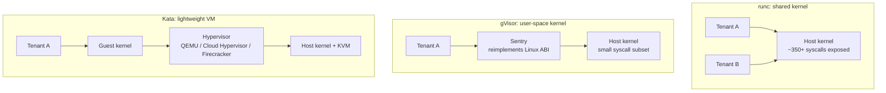
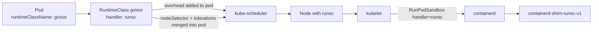
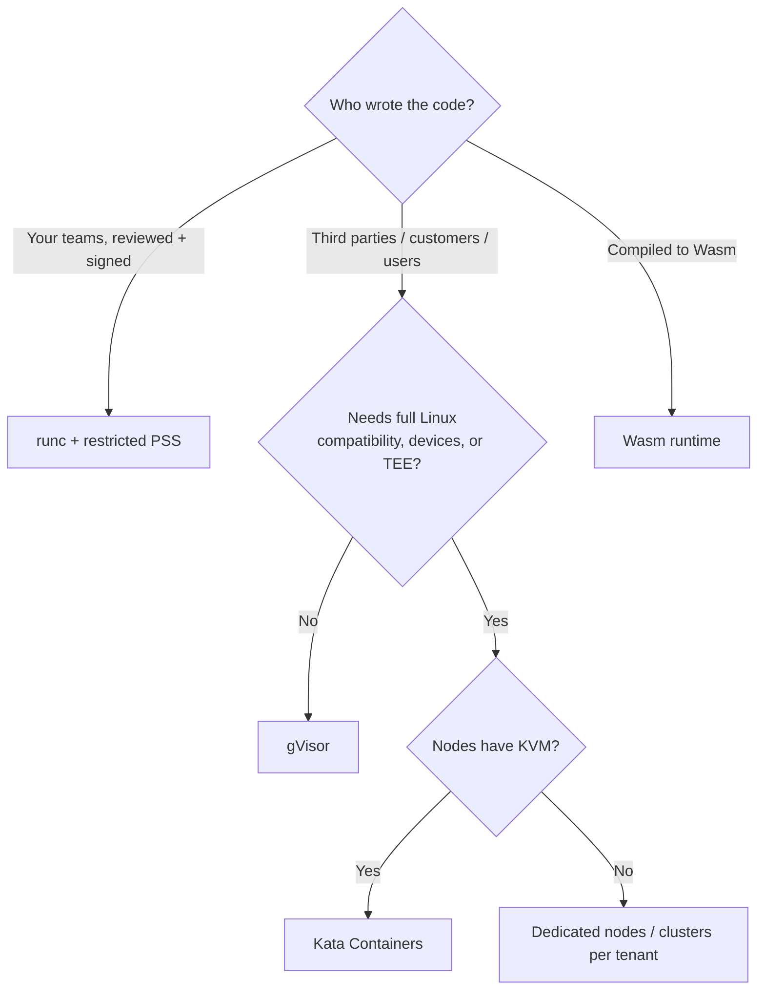

# RuntimeClass, gVisor, and Kata Containers

## Learning Objectives
- Explain why shared-kernel containers are a weak boundary for untrusted or multi-tenant workloads
- Configure `RuntimeClass` (`node.k8s.io/v1`) with `handler`, `overhead`, and `scheduling`
- Install and wire up gVisor (`runsc`) and Kata Containers as containerd runtime handlers
- Compare isolation, performance, and compatibility trade-offs of runc, gVisor, Kata, and Wasm runtimes
- Build a platform pattern that assigns sandboxed runtimes to tenants automatically via policy

## Prerequisites
- [Container Runtimes](container-runtimes.md) — containerd handlers and config v3
- [Scheduling](../01-kubernetes-fundamentals/scheduling.md) — node selectors, taints, tolerations
- A kind cluster from [Lab 01](../../labs/lab-01-cluster-setup/README.md) (for the gVisor exercise)
- For Kata: nodes with hardware virtualization (bare metal or VMs with nested virtualization enabled)

---

## Why Sandboxed Runtimes?

With runc, every container on a node shares **one Linux kernel**. Namespaces, cgroups, seccomp, capabilities, and LSMs (AppArmor/SELinux) reduce what a container can do, but a single kernel vulnerability (e.g. Dirty Pipe, CVE-2022-0847; or runc's own CVE-2019-5736 and CVE-2024-21626 "Leaky Vessels") can turn a compromised container into a compromised node — and every tenant on it.



Use a sandboxed runtime when you run:

| Workload | Why |
|----------|-----|
| Untrusted or customer-supplied code (CI runners, notebooks, plugins, serverless functions) | Attacker controls the code by design |
| Hard multi-tenancy on shared nodes | Kernel boundary between tenants ([Lab 07](../../labs/lab-07-multi-tenancy/README.md)) |
| Workloads processing untrusted input (image/video transcoding, PDF parsing) | Exploitable parsers |
| Regulated data that requires VM-level isolation | Compliance language often specifies "virtualization boundary" |
| Confidential computing (TEE: AMD SEV-SNP, Intel TDX) | Protect the workload *from the host* — Kata + Confidential Containers |

Sandboxing complements, not replaces, Pod Security Standards ([Pod Security](../12-security-compliance/pod-security.md)) and image verification ([Image Security](image-security.md)).

---

## The RuntimeClass API

`RuntimeClass` is a cluster-scoped resource (GA since 1.20 as `node.k8s.io/v1`) that maps a name Pods can request to a **handler** configured in the node's CRI runtime.



```yaml
# runtimeclass-gvisor.yaml
apiVersion: node.k8s.io/v1
kind: RuntimeClass
metadata:
  name: gvisor                       # what Pods reference in spec.runtimeClassName
  labels:
    platform.mycompany.io/isolation: sandboxed
handler: runsc                       # MUST equal the runtime name in containerd/CRI-O config
overhead:
  podFixed:                          # extra resources the sandbox itself consumes
    cpu: 100m
    memory: 64Mi
scheduling:
  nodeSelector:                      # merged into every Pod using this class
    platform.mycompany.io/runtime-gvisor: "true"
  tolerations:                       # appended to every Pod using this class
    - key: platform.mycompany.io/sandboxed
      operator: Equal
      value: "true"
      effect: NoSchedule
```

| Field | Effect |
|-------|--------|
| `handler` | Passed in the CRI `RunPodSandbox` request; immutable; must be a DNS label |
| `overhead.podFixed` | Added to `pod.spec.overhead` by the `RuntimeClass` admission controller; counted by the scheduler, ResourceQuota, and kubelet pod cgroup sizing |
| `scheduling.nodeSelector` | Merged into the Pod's `nodeSelector`; conflicting keys cause the Pod to be rejected |
| `scheduling.tolerations` | Appended to the Pod's tolerations |

### Using a RuntimeClass

```yaml
# sandboxed-pod.yaml
apiVersion: v1
kind: Pod
metadata:
  name: untrusted-job
  namespace: team-a
  labels:
    platform.mycompany.io/tenant: team-a
spec:
  runtimeClassName: gvisor           # the only change from a normal Pod
  containers:
    - name: app
      image: python:3.12-slim
      command: ["python", "-c", "import platform; print(platform.uname())"]
      resources:
        requests: {cpu: 250m, memory: 128Mi}
        limits: {memory: 256Mi}
```

After admission:

```bash
kubectl get pod untrusted-job -n team-a -o jsonpath='{.spec.overhead}{"\n"}{.spec.nodeSelector}{"\n"}'
# {"cpu":"100m","memory":"64Mi"}
# {"platform.mycompany.io/runtime-gvisor":"true"}
```

Effective scheduling request = container requests + overhead = 350m CPU / 192Mi memory. Remember this when sizing ResourceQuotas for tenants that default to sandboxed runtimes.

### Why `scheduling` Matters

Without `scheduling.nodeSelector`, a Pod requesting `gvisor` might land on a node that has no `runsc` handler, and fail at sandbox creation with `no runtime for "runsc" is configured`. The standard pattern is a **dedicated node pool**:

```bash
# Label and taint nodes that have the sandboxed runtime installed
kubectl label node worker-3 platform.mycompany.io/runtime-gvisor=true
kubectl taint node worker-3 platform.mycompany.io/sandboxed=true:NoSchedule
```

The taint keeps ordinary Pods off the pool; the RuntimeClass toleration lets sandboxed Pods on. In managed Kubernetes this is usually a node group/pool with labels and taints set at creation — GKE Sandbox, for example, provides a ready-made `gvisor` RuntimeClass and node pool type.

---

## Runtime Options Compared

| Runtime | Handler (typical) | Isolation Mechanism | Startup | Overhead | Compatibility | Needs Virtualization |
|---------|-------------------|---------------------|---------|----------|---------------|----------------------|
| runc | `runc` | Namespaces, cgroups, seccomp | ~100 ms | Minimal | Full | No |
| crun | `crun` | Same as runc | Faster than runc | Minimal | Full | No |
| gVisor | `runsc` | User-space kernel (Sentry) + seccomp-filtered host calls | ~150–300 ms | Low memory, syscall-heavy workloads slower | Most apps; some syscalls/ioctls, `/proc` and `/sys` details differ | No (KVM platform optional) |
| Kata Containers | `kata-qemu`, `kata-clh`, `kata-fc` | Lightweight VM with its own guest kernel | ~0.5–2 s | Guest kernel memory per pod (tens of MB) | Near-full Linux | Yes (KVM) |
| Kata + CoCo | `kata-qemu-snp`, `kata-qemu-tdx`, … | VM inside a hardware TEE | Seconds | Higher | Near-full | Yes + TEE hardware |
| Wasm (runwasi) | `wasmtime`, `spin` | Wasm sandbox | ~ms | Very low | Only Wasm modules | No |

### gVisor in Brief

gVisor's **Sentry** is a Go reimplementation of the Linux syscall interface running in user space. Application syscalls are intercepted and handled by the Sentry; only a narrow, seccomp-restricted set of host syscalls is ever made. File access goes through the **Gofer** (or directfs in newer releases), and networking can use gVisor's own netstack or host networking.

| gVisor Platform | How syscalls are intercepted | Notes |
|-----------------|------------------------------|-------|
| `systrap` | seccomp `SECCOMP_RET_TRAP` + optimized stubs | Default; works in any VM, no nested virt |
| `kvm` | Hardware virtualization | Faster on bare metal / nested-virt hosts |
| `ptrace` | `PTRACE_SYSEMU` | Legacy, slowest |

Good fits: HTTP services, batch jobs, language runtimes. Watch out for: workloads needing unusual syscalls or device ioctls (GPUs need explicit `nvproxy` support), heavy small-file I/O, and tools that inspect kernel internals.

### Kata Containers in Brief

Each Pod becomes a lightweight VM. The `containerd-shim-kata-v2` starts a hypervisor, boots a minimal guest kernel and the `kata-agent`, and the agent then creates containers inside the VM using standard runc-like logic. Because there is a real guest kernel, compatibility is excellent, and the hypervisor boundary is hardware-enforced.

| Kata Hypervisor | Handler (kata-deploy default name) | Trade-off |
|-----------------|-------------------------------------|-----------|
| QEMU | `kata-qemu` | Most features (device passthrough, CoCo) |
| Cloud Hypervisor | `kata-clh` | Rust, smaller, fast boot |
| Firecracker | `kata-fc` | Minimal device model; needs devmapper snapshotter |
| Dragonball | `kata-dragonball` | Built-in VMM in the Rust runtime |

Kata needs `/dev/kvm` on the node. Most cloud VMs only provide this on bare-metal instance types or instance families that support nested virtualization.

---

## Configuring Handlers in the Runtime

### containerd 2.x (config version 3)

Prefer a drop-in file under the `imports` directory so the main config stays owned by your node image (see [Container Runtimes](container-runtimes.md)):

```toml
# /etc/containerd/conf.d/50-sandboxed-runtimes.toml
version = 3

# gVisor: handler name "runsc"
[plugins.'io.containerd.cri.v1.runtime'.containerd.runtimes.runsc]
  runtime_type = "io.containerd.runsc.v1"          # binary: containerd-shim-runsc-v1
  [plugins.'io.containerd.cri.v1.runtime'.containerd.runtimes.runsc.options]
    TypeUrl = "io.containerd.runsc.v1.options"
    ConfigPath = "/etc/containerd/runsc.toml"       # runsc flags (platform, debug)

# Kata with Cloud Hypervisor: handler name "kata-clh"
[plugins.'io.containerd.cri.v1.runtime'.containerd.runtimes.kata-clh]
  runtime_type = "io.containerd.kata-clh.v2"        # binary: containerd-shim-kata-clh-v2
  privileged_without_host_devices = true            # don't pass host /dev into the VM
  pod_annotations = ["io.katacontainers.*"]         # allow per-pod Kata tuning annotations

# crun as an alternative runc-compatible OCI runtime: handler name "crun"
[plugins.'io.containerd.cri.v1.runtime'.containerd.runtimes.crun]
  runtime_type = "io.containerd.runc.v2"
  [plugins.'io.containerd.cri.v1.runtime'.containerd.runtimes.crun.options]
    BinaryName = "/usr/bin/crun"
    SystemdCgroup = true
```

```toml
# /etc/containerd/runsc.toml - options passed to runsc by the shim
[runsc_config]
  platform = "systrap"
  # debug = "true"
  # debug-log = "/var/log/runsc/%ID%/gvisor.%COMMAND%.log"
```

How containerd resolves `runtime_type`: `io.containerd.<name>.<version>` → binary `containerd-shim-<name>-<version>` on `$PATH`. So `io.containerd.runsc.v1` requires `containerd-shim-runsc-v1`, and `io.containerd.kata-clh.v2` requires `containerd-shim-kata-clh-v2` (kata-deploy installs per-hypervisor shim names; a plain install uses `io.containerd.kata.v2`).

If your nodes still use a **version 2** config, the table path is `plugins."io.containerd.grpc.v1.cri".containerd.runtimes.<handler>` instead — the keys inside are identical.

### CRI-O

```toml
# /etc/crio/crio.conf.d/50-sandboxed-runtimes.conf
[crio.runtime.runtimes.runsc]
runtime_path = "/usr/local/bin/runsc"
runtime_type = "oci"
runtime_root = "/run/runsc"

[crio.runtime.runtimes.kata]
runtime_path = "/usr/bin/containerd-shim-kata-v2"
runtime_type = "vm"                       # CRI-O speaks the shim v2 API for VM runtimes
runtime_root = "/run/vc"
privileged_without_host_devices = true
```

### Installing Kata with kata-deploy

On a cluster whose nodes support KVM, the [kata-deploy](https://github.com/kata-containers/kata-containers/tree/main/tools/packaging/kata-deploy) DaemonSet installs binaries, writes containerd/CRI-O drop-ins, restarts the runtime, labels nodes, and creates RuntimeClasses:

```bash
# Check the kata-containers releases for the current chart version and values
helm install kata-deploy \
  oci://ghcr.io/kata-containers/kata-deploy-charts/kata-deploy \
  --namespace kube-system --wait

kubectl get runtimeclass                         # kata-qemu, kata-clh, kata-fc, ...
kubectl get nodes -L katacontainers.io/kata-runtime
```

```yaml
# kata-pod.yaml
apiVersion: v1
kind: Pod
metadata:
  name: kata-demo
spec:
  runtimeClassName: kata-clh
  containers:
    - name: app
      image: busybox:1.36
      command: ["sh", "-c", "uname -r; sleep 3600"]   # prints the *guest* kernel version
```

Compare `uname -r` inside the Pod with `kubectl get node -o jsonpath='{.items[0].status.nodeInfo.kernelVersion}'` — they differ, because the Pod has its own kernel.

---

## Platform Patterns

### Pattern 1: Tenant-Tier Isolation by Policy

Developers shouldn't need to remember `runtimeClassName`. The platform decides based on the tenant's isolation tier, recorded as a namespace label by the [tenant operator](https://github.com/GitOpsHub/platform-engineering-on-kubernetes/tree/main/code/tenant-operator/):

```yaml
# tenant namespace (managed by the tenant-operator from a Tenant resource)
apiVersion: v1
kind: Namespace
metadata:
  name: customer-sandbox-42
  labels:
    platform.mycompany.io/tenant: customer-42
    platform.mycompany.io/isolation: sandboxed     # tiers: standard | sandboxed | vm
```

```yaml
# kyverno-assign-runtimeclass.yaml
apiVersion: kyverno.io/v1
kind: ClusterPolicy
metadata:
  name: assign-sandboxed-runtime
spec:
  rules:
    # 1. Mutate: default the runtime class from the namespace tier
    - name: default-gvisor-for-sandboxed-tier
      match:
        any:
          - resources:
              kinds: [Pod]
              namespaceSelector:
                matchLabels:
                  platform.mycompany.io/isolation: sandboxed
      mutate:
        patchStrategicMerge:
          spec:
            +(runtimeClassName): gvisor               # add only if not already set
    - name: default-kata-for-vm-tier
      match:
        any:
          - resources:
              kinds: [Pod]
              namespaceSelector:
                matchLabels:
                  platform.mycompany.io/isolation: vm
      mutate:
        patchStrategicMerge:
          spec:
            +(runtimeClassName): kata-clh
    # 2. Validate: tenants in sandboxed tiers cannot opt back into runc
    - name: forbid-runc-in-sandboxed-tiers
      match:
        any:
          - resources:
              kinds: [Pod]
              namespaceSelector:
                matchExpressions:
                  - key: platform.mycompany.io/isolation
                    operator: In
                    values: [sandboxed, vm]
      validate:
        failureAction: Enforce
        message: "Pods in sandboxed tenants must use the gvisor or kata-clh RuntimeClass."
        pattern:
          spec:
            runtimeClassName: "gvisor | kata-clh"
```

> `runtimeClassName` is immutable on a Pod, so it must be set at creation. The mutate rule handles that for Pods created by Deployments, Jobs, and other controllers.

### Pattern 2: Restrict Who Can Use Expensive Runtimes

VM-backed Pods cost more. Use a `ValidatingAdmissionPolicy` or Kyverno rule so only namespaces in the `vm` tier may request `kata-*` classes, and account for `overhead` in tenant ResourceQuotas.

### Pattern 3: Wasm Workloads

With a runwasi shim installed (e.g. via the [SpinKube](https://www.spinkube.dev/) `runtime-class-manager`), a RuntimeClass exposes Wasm as another runtime:

```yaml
# runtimeclass-wasmtime.yaml
apiVersion: node.k8s.io/v1
kind: RuntimeClass
metadata:
  name: wasmtime
handler: wasmtime                         # containerd: runtime_type = "io.containerd.wasmtime.v1"
scheduling:
  nodeSelector:
    platform.mycompany.io/runtime-wasm: "true"
```

### Decision Guide



---

## Hands-On Exercises

### Goal
Install gVisor into one kind worker node, expose it via a RuntimeClass, and observe the differences from runc. gVisor's `systrap` platform works inside a kind node container (on Linux hosts and in Docker Desktop's Linux VM); Kata is not covered here because it needs `/dev/kvm`.

### Step 1: Install `runsc` into a Worker Node

```bash
NODE=$(kubectl get nodes -o jsonpath='{.items[1].metadata.name}')
ARCH=$(docker exec "$NODE" uname -m)              # x86_64 or aarch64

# Download runsc and the containerd shim inside the node container
docker exec "$NODE" bash -c "
  set -e
  URL=https://storage.googleapis.com/gvisor/releases/release/latest/${ARCH}
  cd /usr/local/bin
  curl -fsSLO \${URL}/runsc
  curl -fsSLO \${URL}/runsc.sha512
  curl -fsSLO \${URL}/containerd-shim-runsc-v1
  curl -fsSLO \${URL}/containerd-shim-runsc-v1.sha512
  sha512sum -c runsc.sha512 -c containerd-shim-runsc-v1.sha512
  chmod a+rx runsc containerd-shim-runsc-v1
  runsc --version
"
```

### Step 2: Register the Handler with containerd

```bash
# Check which config version the node uses
docker exec "$NODE" grep -m1 '^version' /etc/containerd/config.toml
```

Append the block that matches the version:

```bash
# For "version = 3" (containerd 2.x native config)
docker exec -i "$NODE" bash -c 'cat >> /etc/containerd/config.toml' <<'EOF'

[plugins.'io.containerd.cri.v1.runtime'.containerd.runtimes.runsc]
  runtime_type = "io.containerd.runsc.v1"
EOF

# For "version = 2"
# docker exec -i "$NODE" bash -c 'cat >> /etc/containerd/config.toml' <<'EOF'
#
# [plugins."io.containerd.grpc.v1.cri".containerd.runtimes.runsc]
#   runtime_type = "io.containerd.runsc.v1"
# EOF
```

```bash
docker exec "$NODE" systemctl restart containerd
docker exec "$NODE" crictl info | jq '.config.containerd.runtimes | keys'   # should include "runsc"
```

### Step 3: Label, Taint, and Create the RuntimeClass

```bash
kubectl label node "$NODE" platform.mycompany.io/runtime-gvisor=true
kubectl taint node "$NODE" platform.mycompany.io/sandboxed=true:NoSchedule
kubectl apply -f runtimeclass-gvisor.yaml      # from the RuntimeClass section above
kubectl get runtimeclass gvisor
```

### Step 4: Compare runc and gVisor

```yaml
# compare-runtimes.yaml
apiVersion: v1
kind: Pod
metadata:
  name: on-runc
spec:
  containers:
    - name: c
      image: busybox:1.36
      command: ["sleep", "3600"]
---
apiVersion: v1
kind: Pod
metadata:
  name: on-gvisor
spec:
  runtimeClassName: gvisor
  containers:
    - name: c
      image: busybox:1.36
      command: ["sleep", "3600"]
```

```bash
kubectl apply -f compare-runtimes.yaml
kubectl wait --for=condition=Ready pod/on-runc pod/on-gvisor --timeout=120s

# Kernel identity: gVisor reports its own emulated kernel version
kubectl exec on-runc   -- uname -r
kubectl exec on-gvisor -- uname -r

# dmesg: denied/empty on runc, gVisor's own boot messages in the sandbox
kubectl exec on-runc   -- dmesg 2>&1 | head -3
kubectl exec on-gvisor -- dmesg | head -5        # "Starting gVisor..."

# Overhead and scheduling were injected by admission
kubectl get pod on-gvisor -o jsonpath='{.spec.overhead}{"\n"}{.spec.nodeName}{"\n"}'

# On the node: the container is supervised by runsc, not runc
docker exec "$NODE" ps -eo pid,cmd | grep -E 'runsc-sandbox|containerd-shim-runsc' | grep -v grep
```

**Questions to answer:**
1. What kernel version does each Pod report, and why?
2. How much CPU and memory does the scheduler account for `on-gvisor` versus `on-runc`?
3. Delete the toleration from the RuntimeClass and create a new gVisor Pod. What happens? Now delete the `nodeSelector` instead and schedule several gVisor Pods — where do they fail and with what event?

### Step 5 (Optional): Measure the Cost

```bash
# Syscall-heavy loop: compare wall time
for p in on-runc on-gvisor; do
  echo "== $p"; kubectl exec "$p" -- sh -c 'time (for i in $(seq 1 20000); do :; done; dd if=/dev/zero of=/tmp/f bs=4k count=20000 2>/dev/null)'
done
```

### Cleanup

```bash
kubectl delete -f compare-runtimes.yaml
kubectl delete runtimeclass gvisor
kubectl taint node "$NODE" platform.mycompany.io/sandboxed=true:NoSchedule-
kubectl label node "$NODE" platform.mycompany.io/runtime-gvisor-
```

---

## Troubleshooting

### Pod stuck in `ContainerCreating`: `no runtime for "runsc" is configured`

```bash
kubectl describe pod <pod> | grep -A3 FailedCreatePodSandBox
# On the node:
sudo crictl info | jq '.config.containerd.runtimes | keys'
sudo journalctl -u containerd | grep -i runsc | tail
```
- The node doesn't have the handler → fix `scheduling.nodeSelector` so Pods only land on prepared nodes.
- The handler is in the wrong config section for the config version (v2 vs v3 paths), or containerd wasn't restarted.
- Handler name mismatch: `RuntimeClass.handler` must exactly equal the runtime table key.

### `failed to start shim: ... containerd-shim-runsc-v1: executable file not found`

The shim binary is not on containerd's `$PATH` (`/usr/local/bin`, `/usr/bin`). The binary name is derived from `runtime_type`.

### Pod rejected: `RuntimeClass "gvisor" not found` or nodeSelector conflict

The RuntimeClass admission controller rejects Pods that reference a missing class, or whose own `nodeSelector` conflicts with `scheduling.nodeSelector`. Create the class first (GitOps sync waves help — [Argo CD Deep Dive](../05-gitops/argocd-deep-dive.md)).

### Application fails only under gVisor

```bash
# Enable debug logging on one node: add to /etc/containerd/runsc.toml
#   debug = "true"
#   debug-log = "/var/log/runsc/%ID%/gvisor.%COMMAND%.log"
#   strace = "true"
sudo grep -i "unsupported\|not implemented" /var/log/runsc/*/gvisor.boot.log | head
```
Look for unimplemented syscalls or ioctls. Options: upgrade gVisor, change the app's I/O pattern, or move that workload to Kata.

### Kata Pods fail: `/dev/kvm` not found or `QEMU: failed to initialize kvm`

The node lacks hardware virtualization. Check `ls -l /dev/kvm` and the CPU flags (`grep -cE 'vmx|svm' /proc/cpuinfo`). Use bare-metal or nested-virtualization-capable instances for Kata node pools.

### Quota exceeded unexpectedly for sandboxed tenants

`pod.spec.overhead` counts against `ResourceQuota` `requests.*` and `limits.*`. Add the per-Pod overhead × expected Pod count to tenant quotas, or lower `overhead.podFixed` after measuring real usage.

---

## Further Reading

### Kubernetes
- [Runtime Class](https://kubernetes.io/docs/concepts/containers/runtime-class/)
- [Pod Overhead](https://kubernetes.io/docs/concepts/scheduling-eviction/pod-overhead/)
- [RuntimeClass API reference](https://kubernetes.io/docs/reference/kubernetes-api/cluster-resources/runtime-class-v1/)

### gVisor
- [gVisor documentation](https://gvisor.dev/docs/)
- [gVisor installation](https://gvisor.dev/docs/user_guide/install/) and [containerd quick start](https://gvisor.dev/docs/user_guide/containerd/quick_start/)
- [gVisor platforms](https://gvisor.dev/docs/architecture_guide/platforms/)
- [GKE Sandbox](https://cloud.google.com/kubernetes-engine/docs/concepts/sandbox-pods)

### Kata Containers
- [Kata Containers documentation](https://katacontainers.io/docs/)
- [kata-deploy](https://github.com/kata-containers/kata-containers/tree/main/tools/packaging/kata-deploy)
- [Confidential Containers](https://confidentialcontainers.org/)

### Wasm
- [runwasi](https://github.com/containerd/runwasi)
- [SpinKube](https://www.spinkube.dev/)

---

## Next Steps

1. **Read**: [Pod Security](../12-security-compliance/pod-security.md) — the baseline every runtime should still enforce
2. **Practice**: [Lab 07: Multi-Tenancy](../../labs/lab-07-multi-tenancy/README.md) — add an isolation tier to tenant namespaces
3. **Read**: [Policy Engine](../12-security-compliance/policy-engine.md) — productionize the RuntimeClass assignment policy
4. **Continue**: [CNI Overview](../03-networking-fundamentals/cni-overview.md) — the networking side of pod sandboxes
