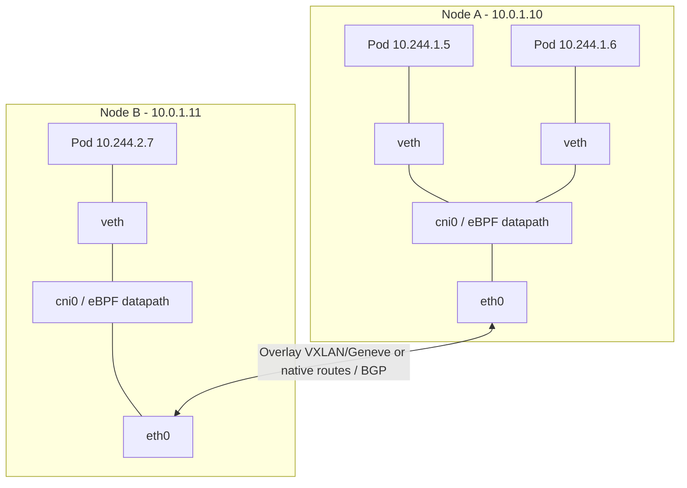
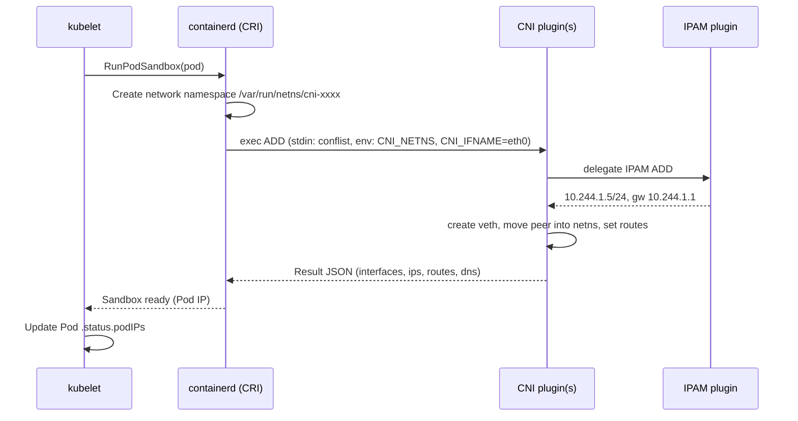
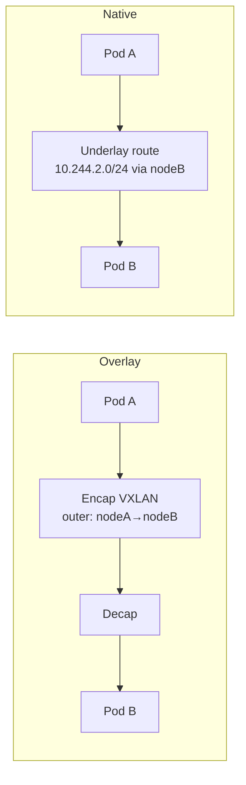
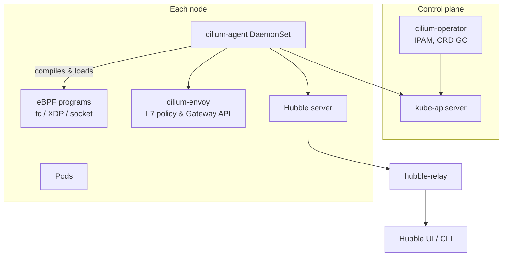
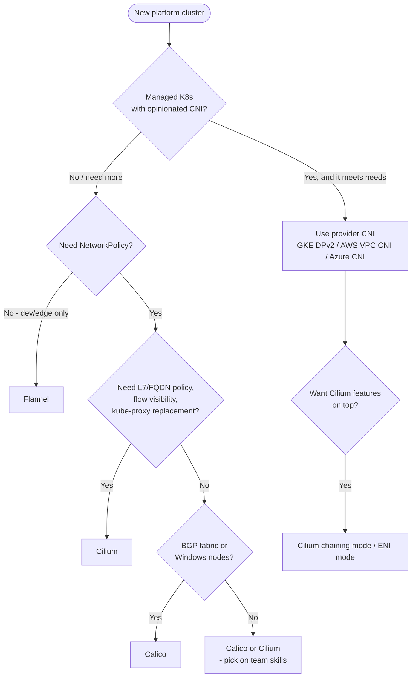

# Container Network Interface (CNI) for Platform Engineers

## Learning Objectives
- Explain the Kubernetes network model and the guarantees every CNI plugin must provide
- Understand the CNI specification: plugin binaries, network configuration, verbs, and chaining
- Trace what happens on the node when a Pod gets an IP address
- Compare the most common plugins (Flannel, Calico, Cilium) and pick one for a platform
- Configure overlay vs native routing, IPAM, encryption, and kube-proxy replacement
- Troubleshoot Pod networking failures from the kubelet down to the kernel

## Prerequisites
- [Kubernetes Architecture](../01-kubernetes-fundamentals/kubernetes-architecture.md) (kubelet, kube-proxy, CRI)
- [Container Runtimes](../02-container-runtime/container-runtimes.md) (how the runtime creates Pod sandboxes)
- Basic Linux networking: network namespaces, veth pairs, routing tables, iptables
- A local cluster from [Lab 01: Cluster Setup](../../labs/lab-01-cluster-setup/README.md) (kind with `disableDefaultCNI: true`)

---

## The Kubernetes Network Model

Kubernetes does not implement Pod networking itself. It defines a set of **requirements** and delegates the
implementation to a network plugin. Every conformant cluster must guarantee:

1. **Every Pod gets its own IP address** — containers in a Pod share a network namespace and talk over `localhost`.
2. **Pods can reach all other Pods on any node without NAT** — the source IP a receiver sees is the sender's Pod IP.
3. **Node agents (kubelet, system daemons) can reach all Pods on that node.**

Services, DNS, and NetworkPolicy are built *on top of* this flat L3 network.



### Who Does What

| Concern | Component | Notes |
|---------|-----------|-------|
| Pod sandbox / network namespace | Container runtime (containerd, CRI-O) | Creates netns, then calls CNI |
| Pod interface + IP | CNI plugin (`ADD`) | veth pair, IPAM, routes |
| Pod CIDR per node | kube-controller-manager (`--allocate-node-cidrs`) or CNI IPAM | Cilium/Calico can manage their own pools |
| Service virtual IPs | kube-proxy (iptables/IPVS/nftables) or CNI (eBPF) | Cilium can fully replace kube-proxy |
| DNS | CoreDNS | Runs as normal Pods |
| NetworkPolicy enforcement | CNI plugin | Flannel alone does **not** enforce policy |

> **Key insight:** "The CNI" in day-to-day speech usually means a *networking solution* (e.g. Cilium) that ships
> a CNI binary, a node agent DaemonSet, an operator, and CRDs. The CNI *spec* itself is much smaller.

---

## The CNI Specification

The [CNI spec](https://github.com/containernetworking/cni/blob/main/SPEC.md) (a CNCF project) defines a contract
between a **runtime** (containerd/CRI-O) and **plugins** (executables).

### Building Blocks

| Element | Location (default) | Purpose |
|---------|--------------------|---------|
| Network configuration list (`.conflist`) | `/etc/cni/net.d/` | JSON describing which plugins to run, in order |
| Plugin binaries | `/opt/cni/bin/` | Executables invoked by the runtime |
| Environment variables | `CNI_COMMAND`, `CNI_CONTAINERID`, `CNI_NETNS`, `CNI_IFNAME`, `CNI_PATH` | Per-invocation parameters |
| stdin / stdout | JSON | Config in, result (IPs, routes, DNS) out |

The runtime picks the **lexicographically first** config file in `/etc/cni/net.d/`. This is why CNI installers
name their files `05-cilium.conflist` or `10-calico.conflist` — and why a leftover file from a previous plugin
can silently hijack Pod networking.

### Verbs

| Verb | Since | Purpose |
|------|-------|---------|
| `ADD` | 0.1 | Attach the container to the network, return IPs |
| `DEL` | 0.1 | Detach and release resources (must be idempotent) |
| `CHECK` | 0.4 | Verify the attachment is still correct |
| `VERSION` | 0.1 | Report supported spec versions |
| `STATUS` | 1.1 | Report whether the plugin is ready to accept `ADD`s |
| `GC` | 1.1 | Clean up stale attachments not in a provided valid list |

### Pod Creation Sequence



### Example: A Minimal `.conflist`

The reference plugins (`bridge`, `host-local`, `portmap`, …) are enough to understand chaining:

```json
// /etc/cni/net.d/10-mynet.conflist  (comments for illustration only; real JSON has none)
{
  "cniVersion": "1.0.0",
  "name": "mynet",
  "plugins": [
    {
      "type": "bridge",              // binary /opt/cni/bin/bridge
      "bridge": "cni0",              // Linux bridge on the host
      "isGateway": true,             // assign gateway IP to the bridge
      "ipMasq": true,                // SNAT traffic leaving the node
      "ipam": {
        "type": "host-local",        // IPAM plugin: allocate from a local range
        "ranges": [[{ "subnet": "10.244.1.0/24" }]],
        "routes": [{ "dst": "0.0.0.0/0" }]
      }
    },
    {
      "type": "portmap",             // chained plugin: implements hostPort
      "capabilities": { "portMappings": true }
    },
    {
      "type": "bandwidth",           // chained plugin: ingress/egress shaping annotations
      "capabilities": { "bandwidth": true }
    }
  ]
}
```

Plugins run **in order** on `ADD` and **in reverse order** on `DEL`; each receives the previous plugin's result
as `prevResult`. Production CNIs use the same mechanism (e.g. Cilium in *chaining mode* on top of AWS VPC CNI).

### Invoking a Plugin by Hand

Running a plugin manually is the fastest way to demystify CNI:

```bash
# cni-manual-test.sh — run on a Linux host with reference plugins in /opt/cni/bin
sudo ip netns add demo

# The runtime would normally do this for you
sudo CNI_COMMAND=ADD \
     CNI_CONTAINERID=demo123 \
     CNI_NETNS=/var/run/netns/demo \
     CNI_IFNAME=eth0 \
     CNI_PATH=/opt/cni/bin \
     /opt/cni/bin/bridge < <(jq '.plugins[0] + {cniVersion: "1.0.0", name: "mynet"}' \
        /etc/cni/net.d/10-mynet.conflist)

sudo ip netns exec demo ip addr show eth0   # The "Pod" now has an IP
sudo ip netns exec demo ping -c1 10.244.1.1 # Gateway on cni0

# Clean up (DEL must succeed even if called twice)
sudo CNI_COMMAND=DEL CNI_CONTAINERID=demo123 CNI_NETNS=/var/run/netns/demo \
     CNI_IFNAME=eth0 CNI_PATH=/opt/cni/bin \
     /opt/cni/bin/bridge < <(jq '.plugins[0] + {cniVersion: "1.0.0", name: "mynet"}' \
        /etc/cni/net.d/10-mynet.conflist)
sudo ip netns del demo
```

---

## Data Plane Building Blocks

### Overlay vs Native Routing

| Mode | How cross-node traffic flows | Pros | Cons |
|------|-----------------------------|------|------|
| **Overlay (VXLAN / Geneve / IPIP)** | Pod packet encapsulated in a node-to-node UDP/IP packet | Works on any L3 network; no cloud/route integration | ~50 bytes MTU overhead; extra CPU; harder packet captures |
| **Native / direct routing** | Pod CIDRs are routable in the underlay (static routes, BGP, cloud route tables) | No encapsulation; best performance; Pod IPs visible to firewalls | Requires underlay cooperation; route table limits in clouds |
| **Cloud VPC-native (ENI/IPAM)** | Pods get real VPC IPs (AWS VPC CNI, Azure CNI, GKE VPC-native) | First-class cloud networking; security groups per Pod | Consumes VPC IP space; per-node Pod limits |



### IPAM Strategies

| Strategy | Example | Platform consideration |
|----------|---------|------------------------|
| Per-node CIDR from `node.spec.podCIDR` | Flannel, Cilium `ipam.mode=kubernetes` | Simple; size `--node-cidr-mask-size` for max Pods/node |
| Cluster-pool managed by CNI | Cilium `cluster-pool`, Calico IP pools | Can add pools later without recreating the cluster |
| Multi-pool / per-namespace pools | Cilium `multi-pool`, Calico IPPool with `namespaceSelector` | Useful for tenant egress firewalls |
| Cloud ENI | AWS VPC CNI, Cilium `eni`/`azure` modes | Plan subnet sizes and prefix delegation |

> **Sizing rule of thumb:** a `/24` per node gives ~250 Pod IPs; kubelet's default `maxPods` is 110.
> A `/16` Pod CIDR with `/24` per node caps you at 256 nodes — plan for growth before the first cluster ships.

### Where Services Fit

kube-proxy programs Service VIPs in one of these modes:

| Mode | Status (K8s 1.28+) | Notes |
|------|--------------------|-------|
| `iptables` | Default on Linux | O(n) rule chains; fine for most clusters |
| `ipvs` | Supported, but the project is steering users to nftables | Hash-based lookups; extra kernel modules |
| `nftables` | Alpha 1.29, beta 1.31, GA 1.33 | The long-term replacement for iptables mode |
| **eBPF (CNI replacement)** | Cilium `kubeProxyReplacement=true`, Calico eBPF dataplane | Removes kube-proxy entirely; socket-level load balancing; DSR, Maglev |

---

## Popular CNI Plugins

### Comparison

| Capability | Flannel | Calico | Cilium |
|------------|---------|--------|--------|
| Data plane | Linux bridge + VXLAN (or host-gw) | iptables/nftables, eBPF, or Windows HNS | eBPF |
| Routing | VXLAN, host-gw, WireGuard backend | BGP (native), IPIP, VXLAN | VXLAN, Geneve, native, BGP control plane |
| Kubernetes NetworkPolicy | ❌ (pair with Calico = "Canal") | ✅ | ✅ |
| Extended policy | — | `NetworkPolicy`/`GlobalNetworkPolicy` (`projectcalico.org/v3`), ordered + deny | `CiliumNetworkPolicy`/`CiliumClusterwideNetworkPolicy`, L7 + FQDN |
| kube-proxy replacement | ❌ | ✅ (eBPF dataplane) | ✅ |
| Transparent encryption | WireGuard backend | WireGuard | WireGuard, IPsec |
| Observability | — | Flow logs (more in commercial editions) | Hubble (flows, L7, service map, metrics) |
| Multi-cluster | — | Federation / BGP peering | Cluster Mesh |
| Ingress / Gateway API | — | Via separate controller | Built-in Gateway API + Ingress |
| Operational complexity | Lowest | Medium | Medium–High (kernel version matters) |
| Typical fit | Dev clusters, edge, simple k3s | Enterprises with BGP fabrics, hybrid Windows | Platforms wanting policy + observability + service LB in one |

### Flannel

Flannel is the simplest option: a `flanneld` DaemonSet that allocates a subnet per node and sets up VXLAN.
It is the default in k3s. It **does not enforce NetworkPolicy**, so it is a poor fit for multi-tenant platforms.

```bash
# install-flannel.sh — for a kind cluster with disableDefaultCNI: true and podSubnet 10.244.0.0/16
kubectl apply -f https://github.com/flannel-io/flannel/releases/latest/download/kube-flannel.yml
kubectl -n kube-flannel rollout status ds/kube-flannel-ds
```

### Calico

Calico is installed and managed by the **Tigera operator**, configured via an `Installation` resource.

```bash
# install-calico.sh
helm repo add projectcalico https://docs.tigera.io/calico/charts
helm repo update
helm install calico projectcalico/tigera-operator \
  --namespace tigera-operator --create-namespace \
  -f calico-values.yaml
```

```yaml
# calico-values.yaml
installation:
  calicoNetwork:
    bgp: Disabled                 # No BGP fabric in kind; use VXLAN overlay
    ipPools:
      - cidr: 10.244.0.0/16       # Must match the cluster's pod CIDR
        encapsulation: VXLAN      # VXLAN | IPIP | VXLANCrossSubnet | IPIPCrossSubnet | None
        natOutgoing: Enabled      # SNAT traffic leaving the pool
        nodeSelector: all()
        blockSize: 26             # Calico allocates IP blocks of /26 to nodes on demand
```

With `bgp: Enabled` and `encapsulation: None`, Calico peers with top-of-rack routers so Pod IPs are natively
routable — a common choice in on-prem data centers.

### Cilium

Cilium attaches eBPF programs to network devices and sockets, so it can implement routing, Service load
balancing, NetworkPolicy (L3–L7), encryption, and flow visibility without iptables. It is the CNI used in
[Lab 01](../../labs/lab-01-cluster-setup/README.md).



```yaml
# cilium-values.yaml — Helm values for a platform cluster
kubeProxyReplacement: true          # Replace kube-proxy with eBPF Service load balancing
k8sServiceHost: platform-engineering-control-plane  # Needed when kube-proxy is absent (kind node name)
k8sServicePort: 6443

ipam:
  mode: kubernetes                  # Use node.spec.podCIDR allocated by the controller manager

routingMode: tunnel                 # tunnel | native
tunnelProtocol: vxlan               # vxlan | geneve
# For native routing instead:
# routingMode: native
# ipv4NativeRoutingCIDR: 10.244.0.0/16
# autoDirectNodeRoutes: true        # Only when all nodes share an L2 segment

bpf:
  masquerade: true                  # eBPF-based SNAT instead of iptables

encryption:
  enabled: true
  type: wireguard                   # Transparent node-to-node encryption

hubble:
  enabled: true
  relay:
    enabled: true
  ui:
    enabled: true
  metrics:
    enabled:
      - dns
      - drop
      - tcp
      - flow
      - "httpV2:exemplars=true;labelsContext=source_namespace,destination_namespace"

gatewayAPI:
  enabled: true                     # Requires Gateway API CRDs installed first

operator:
  replicas: 2                       # 1 is fine for kind; 2 for HA in real clusters
```

```bash
# install-cilium.sh
helm repo add cilium https://helm.cilium.io/
helm repo update
helm upgrade --install cilium cilium/cilium \
  --version 1.18.0 \
  --namespace kube-system \
  -f cilium-values.yaml

cilium status --wait                # Requires the cilium CLI
cilium connectivity test            # End-to-end conformance-style checks (takes several minutes)
```

> **Kernel requirements:** Cilium needs a reasonably modern Linux kernel (check the
> [system requirements](https://docs.cilium.io/en/stable/operations/system_requirements/) for your version).
> Older enterprise distributions are the most common cause of failed rollouts.

### Specialized Plugins

| Plugin | Purpose |
|--------|---------|
| **Multus** | Meta-plugin: attach multiple interfaces to a Pod (`NetworkAttachmentDefinition`, `k8s.cni.cncf.io/v1`) — telco, storage networks |
| **AWS VPC CNI / Azure CNI / GKE Dataplane V2** | Cloud-native IPAM; GKE Dataplane V2 and Azure CNI powered by Cilium are Cilium-based |
| **kube-ovn / OVN-Kubernetes** | Open vSwitch-based; OVN-Kubernetes is the OpenShift default |
| **Whereabouts** | Cluster-wide IPAM plugin, commonly paired with Multus |

```yaml
# multus-storage-net.yaml — secondary interface for a storage network
apiVersion: k8s.cni.cncf.io/v1
kind: NetworkAttachmentDefinition
metadata:
  name: storage-net
  namespace: data
spec:
  config: |
    {
      "cniVersion": "1.0.0",
      "type": "macvlan",
      "master": "eth1",
      "mode": "bridge",
      "ipam": { "type": "whereabouts", "range": "192.168.50.0/24" }
    }
---
# Pod requesting the extra interface via annotation
apiVersion: v1
kind: Pod
metadata:
  name: db-0
  namespace: data
  annotations:
    k8s.v1.cni.cncf.io/networks: storage-net
spec:
  containers:
    - name: db
      image: postgres:16
```

---

## Choosing a CNI for Your Platform



### Platform Decision Checklist

| Question | Why it matters |
|----------|----------------|
| Does it enforce `networking.k8s.io/v1` NetworkPolicy? | Mandatory for [multi-tenancy](../../labs/lab-07-multi-tenancy/) |
| Can it run without kube-proxy? | Fewer moving parts, better Service performance at scale |
| How are Pod CIDRs sized and extended? | Re-IPing a cluster is effectively a rebuild |
| Encryption in transit between nodes? | Compliance (PCI, HIPAA) without a full mesh |
| Flow logs / observability? | Debugging "it's the network" tickets quickly |
| Multi-cluster story? | See [Multi-Cluster Networking](../13-multi-cluster/multi-cluster-networking.md) |
| Upgrade process and kernel constraints? | CNI upgrades touch every node's data plane |

---

## Operating a CNI as a Platform Component

### Manage It via GitOps — Carefully

The CNI is a **bootstrap dependency**: without it, nodes stay `NotReady` and no controller (including Argo CD
or Flux) can schedule. Common pattern:

1. Install the CNI imperatively (or via Terraform/cluster-provisioner) during cluster creation.
2. Have the GitOps tool **adopt** the same Helm release afterwards for day-2 changes
   (see [GitOps Principles](../05-gitops/gitops-principles.md)).
3. Never let GitOps prune the CNI — mark it with a sync-wave/prune-disabled annotation.

```yaml
# clusters/production/platform-core/cilium.yaml — Argo CD Application adopting Cilium
apiVersion: argoproj.io/v1alpha1
kind: Application
metadata:
  name: cilium
  namespace: argocd
  annotations:
    argocd.argoproj.io/sync-wave: "-10"      # Reconcile before anything else
  labels:
    platform.mycompany.io/component: cni
spec:
  project: platform
  source:
    repoURL: https://helm.cilium.io/
    chart: cilium
    targetRevision: 1.18.0
    helm:
      releaseName: cilium                    # Must match the bootstrap release name
      valueFiles: []
  destination:
    server: https://kubernetes.default.svc
    namespace: kube-system
  syncPolicy:
    automated:
      prune: false                           # Never auto-delete the CNI
      selfHeal: true
```

### Upgrades

- Read the upgrade notes for **every** minor version you cross; Cilium and Calico both publish pre-flight checks.
- Roll the agent DaemonSet with `maxUnavailable: 1` (or a small percentage) and watch drop metrics.
- Existing connections generally survive agent restarts in eBPF datapaths, but test this in staging.
- Keep the CNI version within the support matrix of your Kubernetes version.

### Metrics to Alert On

```yaml
# prometheus-rules-cni.yaml
groups:
  - name: cni
    rules:
      - alert: CiliumAgentNotReady
        expr: kube_daemonset_status_number_unavailable{daemonset="cilium"} > 0
        for: 10m
        labels:
          severity: critical
        annotations:
          summary: "Cilium agent unavailable on {{ $value }} node(s)"
      - alert: CiliumHighDropRate
        expr: sum(rate(hubble_drop_total[5m])) by (reason) > 50
        for: 10m
        labels:
          severity: warning
        annotations:
          summary: "High packet drop rate ({{ $labels.reason }})"
      - alert: IPAMExhaustionRisk
        expr: cilium_ipam_capacity - on(instance) cilium_ip_addresses{family="ipv4"} < 10
        for: 15m
        labels:
          severity: warning
        annotations:
          summary: "Node {{ $labels.instance }} is close to exhausting Pod IPs"
```

> Metric names vary across CNI versions — validate them against `/metrics` on your agents before relying on
> these rules.

---

## Hands-On Exercises

### Exercise 1: Inspect Pod Networking End to End

**Goal:** follow a Pod's network from the CNI config on the node to the veth pair, and confirm Pod-to-Pod traffic crosses nodes without NAT.

Use the kind cluster from [Lab 01](../../labs/lab-01-cluster-setup/README.md) with Cilium installed.

```bash
# 1. Confirm nodes became Ready only after the CNI was installed
kubectl get nodes
kubectl -n kube-system get ds cilium

# 2. Inspect the CNI config the runtime uses on a node
docker exec platform-engineering-worker ls /etc/cni/net.d/
docker exec platform-engineering-worker cat /etc/cni/net.d/05-cilium.conflist

# 3. List CNI binaries
docker exec platform-engineering-worker ls /opt/cni/bin/

# 4. Deploy two Pods on different nodes
kubectl create namespace net-lab
kubectl -n net-lab run a --image=nicolaka/netshoot --overrides='{"spec":{"nodeName":"platform-engineering-worker"}}' -- sleep infinity
kubectl -n net-lab run b --image=nicolaka/netshoot --overrides='{"spec":{"nodeName":"platform-engineering-worker2"}}' -- sleep infinity
kubectl -n net-lab wait --for=condition=Ready pod/a pod/b
kubectl -n net-lab get pods -o wide

# 5. Pod-to-Pod without NAT: b should see a's Pod IP as source
B_IP=$(kubectl -n net-lab get pod b -o jsonpath='{.status.podIP}')
kubectl -n net-lab exec b -- sh -c 'timeout 10 nc -l -p 8080 -v' &
sleep 2
kubectl -n net-lab exec a -- sh -c "echo hello | nc -w 2 $B_IP 8080"
wait

# 6. Look at the Pod side of the veth pair
kubectl -n net-lab exec a -- ip addr show eth0
kubectl -n net-lab exec a -- ip route

# 7. Ask Cilium about the endpoint and watch the flow
kubectl -n kube-system exec ds/cilium -c cilium-agent -- cilium-dbg endpoint list
cilium hubble port-forward &
hubble observe --namespace net-lab --last 20

# 8. Confirm kube-proxy is not running (kube-proxy replacement)
kubectl -n kube-system get ds kube-proxy || echo "kube-proxy not installed - eBPF handles Services"
kubectl -n kube-system exec ds/cilium -c cilium-agent -- cilium-dbg service list

# Cleanup
kubectl delete namespace net-lab
```

Expected output (abbreviated; IPs, ages and endpoint IDs vary):

```text
NAME                           STATUS   ROLES           ...
platform-engineering-worker    Ready    <none>          ...
05-cilium.conflist
...
hello
NAME   READY   STATUS    ...   IP            NODE
a      1/1     Running   ...   10.244.x.x    platform-engineering-worker
b      1/1     Running   ...   10.244.y.y    platform-engineering-worker2
kube-proxy not installed - eBPF handles Services
```

The `nc -v` listener in step 5 reports a connection from a's Pod IP, and `hello` is received.

**Check:**

- Step 1 shows every node `Ready` and the `cilium` DaemonSet fully available.
- `kubectl -n net-lab get pods -o wide` shows `a` and `b` on different nodes.
- The listener in step 5 prints a's Pod IP (not a node IP) as the source address.
- `kubectl -n kube-system get ds kube-proxy` returns `NotFound`.

### Stretch Goals
1. Switch Cilium to `tunnelProtocol: geneve` with `helm upgrade` and capture traffic on the node's `eth0` with
   `tcpdump -i eth0 udp port 6081` to see encapsulation.
2. Enable WireGuard and verify with `cilium-dbg encrypt status`.
3. Rebuild the cluster with Calico and compare `calicoctl`/`kubectl get ippools` output to Cilium's IPAM.

---

## Troubleshooting

### Nodes Stuck `NotReady` With "network plugin not initialized"
```bash
kubectl describe node <node> | grep -A3 -i "networkready\|NetworkUnavailable"
# No config in /etc/cni/net.d -> CNI DaemonSet not running yet
kubectl -n kube-system get pods -l k8s-app=cilium -o wide
kubectl -n kube-system logs ds/cilium -c cilium-agent --tail=100
```

### Pods Stuck in `ContainerCreating`
```bash
kubectl describe pod <pod> | tail -20
# Look for: "failed to setup network for sandbox" / "plugin type=... failed (add)"
# Common causes:
#  - CNI binary missing from /opt/cni/bin (init container failed)
#  - IPAM exhausted for the node's pod CIDR
#  - Leftover conflist from a previous CNI sorting first in /etc/cni/net.d
docker exec <node> ls -la /etc/cni/net.d/
```

### Cross-Node Traffic Fails, Same-Node Works
- Overlay port blocked between nodes (VXLAN UDP 8472 for Cilium/Flannel, Geneve UDP 6081, Calico VXLAN UDP 4789,
  BGP TCP 179, WireGuard UDP 51871 for Cilium).
- MTU mismatch: large requests hang while small ones succeed. Check `ip link` MTU on Pod vs node.
- Cloud source/destination checks enabled when using native routing.

```bash
cilium status --verbose | grep -i -A5 "encryption\|routing\|tunnel"
hubble observe --verdict DROPPED --last 50
```

### Services Unreachable but Pod IPs Work
```bash
kubectl get endpointslices -n <ns> -l kubernetes.io/service-name=<svc>
# kube-proxy mode:
kubectl -n kube-system logs ds/kube-proxy --tail=50
# Cilium KPR mode:
kubectl -n kube-system exec ds/cilium -c cilium-agent -- cilium-dbg service list | grep <ClusterIP>
```

### DNS Timeouts
- CoreDNS Pods healthy? `kubectl -n kube-system get pods -l k8s-app=kube-dns`
- A default-deny NetworkPolicy without a DNS egress rule — see [Network Policies](network-policies.md).

---

## Further Reading

### Official Documentation
- [Kubernetes Networking Model](https://kubernetes.io/docs/concepts/services-networking/#the-kubernetes-network-model)
- [CNI Specification](https://github.com/containernetworking/cni/blob/main/SPEC.md)
- [CNI Reference Plugins](https://www.cni.dev/plugins/current/)
- [Cilium Documentation](https://docs.cilium.io/)
- [Calico Documentation](https://docs.tigera.io/calico/latest/about/)
- [Flannel](https://github.com/flannel-io/flannel)
- [Multus CNI](https://github.com/k8snetworkplumbingwg/multus-cni)

### Deep Dives
- [Life of a Packet in Kubernetes (Cilium eBPF datapath)](https://docs.cilium.io/en/stable/network/ebpf/)
- [Virtual IPs and Service Proxies (kube-proxy modes)](https://kubernetes.io/docs/reference/networking/virtual-ips/)
- [eBPF.io](https://ebpf.io/)

---

## Next Steps

1. **Complete**: [Lab 01: Cluster Setup](../../labs/lab-01-cluster-setup/README.md) with Cilium and Hubble
2. **Read**: [Ingress Controllers & Gateway API](ingress-controllers.md) — getting traffic into the cluster
3. **Read**: [Network Policies](network-policies.md) — segmenting the flat Pod network
4. **Explore**: [Service Mesh](service-mesh.md) and [Multi-Cluster Networking](../13-multi-cluster/multi-cluster-networking.md)
