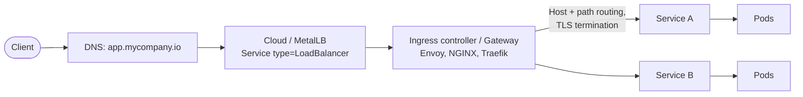
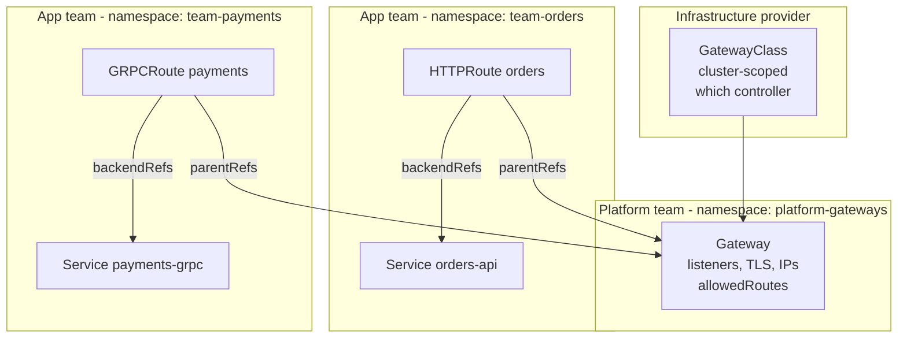
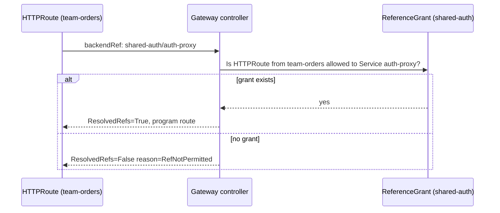
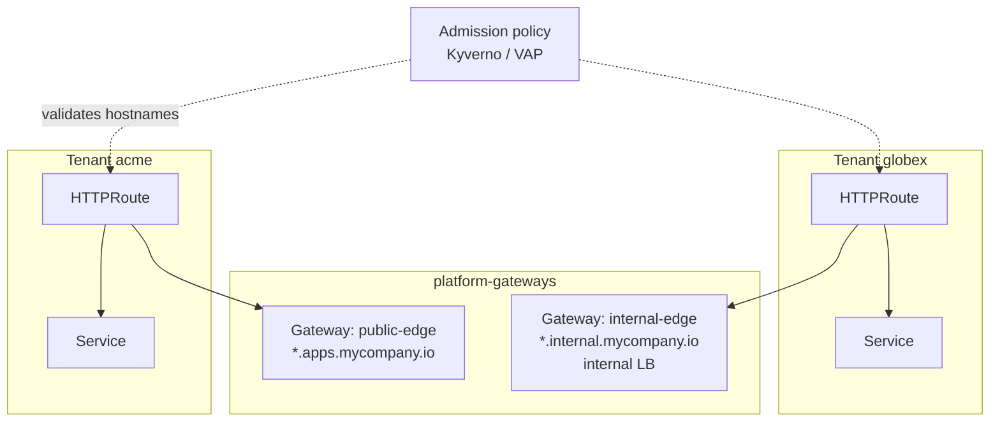

# Ingress Controllers and the Gateway API

## Learning Objectives
- Understand how north-south traffic reaches Pods: Service types, load balancers, and L7 proxies
- Use the `networking.k8s.io/v1` Ingress API and understand its limitations
- Compare popular controllers: ingress-nginx, F5 NGINX, Traefik, Envoy Gateway, Cilium, Istio
- Model traffic with the Gateway API v1 (`GatewayClass`, `Gateway`, `HTTPRoute`, `GRPCRoute`, `ReferenceGrant`)
- Design a role-oriented, multi-tenant ingress layer for a platform
- Plan a migration from Ingress to Gateway API

## Prerequisites
- [CNI Overview](cni-overview.md) — Pod networking and Service implementation
- [Kubernetes Architecture](../01-kubernetes-fundamentals/kubernetes-architecture.md) — kube-proxy and Services
- [RBAC](../01-kubernetes-fundamentals/rbac.md) — Gateway API's model relies on namespace-scoped permissions
- A cluster from [Lab 01](../../labs/lab-01-cluster-setup/README.md) with Helm installed

---

## Getting Traffic Into a Cluster



| Mechanism | Layer | Use case | Limitations |
|-----------|-------|----------|-------------|
| `Service type: NodePort` | L4 | Labs, bare metal behind external LB | Port range 30000–32767, one port per Service |
| `Service type: LoadBalancer` | L4 | Per-Service cloud LB, TCP/UDP workloads | One cloud LB per Service = cost; no host/path routing |
| **Ingress** | L7 HTTP(S) | Host/path routing, TLS termination | HTTP only; features hidden in annotations |
| **Gateway API** | L4 + L7 | HTTP, gRPC, TLS, TCP/UDP routing; role separation | Implementations vary in which optional features they support |

A platform team typically runs one (or a few) shared L7 entry points and lets application teams attach
routes to them — exactly the model Gateway API formalizes.

---

## The Ingress API (`networking.k8s.io/v1`)

### Anatomy

```yaml
# ingress-orders.yaml
apiVersion: networking.k8s.io/v1
kind: Ingress
metadata:
  name: orders
  namespace: team-orders
  labels:
    platform.mycompany.io/tenant: acme
  annotations:
    cert-manager.io/cluster-issuer: letsencrypt-prod     # cert-manager creates the TLS Secret
spec:
  ingressClassName: nginx            # Which controller handles this Ingress (replaces the old annotation)
  tls:
    - hosts:
        - orders.apps.mycompany.io
      secretName: orders-tls         # Secret in the same namespace
  rules:
    - host: orders.apps.mycompany.io
      http:
        paths:
          - path: /api
            pathType: Prefix         # Exact | Prefix | ImplementationSpecific
            backend:
              service:
                name: orders-api
                port:
                  number: 8080
          - path: /
            pathType: Prefix
            backend:
              service:
                name: orders-web
                port:
                  name: http
```

```yaml
# ingressclass-nginx.yaml
apiVersion: networking.k8s.io/v1
kind: IngressClass
metadata:
  name: nginx
  annotations:
    ingressclass.kubernetes.io/is-default-class: "true"  # Used when ingressClassName is omitted
spec:
  controller: k8s.io/ingress-nginx
```

### Why Ingress Is Not Enough for Platforms

| Problem | Consequence |
|---------|-------------|
| Only host + path matching | Header-, method-, query-based routing need vendor annotations |
| No traffic splitting in the spec | Canaries depend on controller-specific annotations |
| Single resource mixes infra & app concerns | App teams can change TLS, listeners, or hijack hosts |
| Annotations are untyped strings | No validation; not portable between controllers |
| Cross-namespace backends unsupported | Shared services require duplicate Ingresses |
| HTTP only | TCP/UDP/gRPC need ConfigMaps or CRDs |

The Ingress API is **stable but frozen** — no new features are being added. New functionality goes into the
Gateway API.

---

## Ingress Controllers

| Controller | Data plane | Ingress | Gateway API | Notes |
|------------|-----------|---------|-------------|-------|
| **ingress-nginx** (kubernetes/ingress-nginx) | NGINX + Lua | ✅ | ❌ | Retired by the Kubernetes project — see below |
| **F5 NGINX Ingress Controller** (nginx/kubernetes-ingress) | NGINX / NGINX Plus | ✅ | Via separate NGINX Gateway Fabric | Different project from ingress-nginx; own CRDs (`VirtualServer`) |
| **Traefik** | Traefik (Go) | ✅ | ✅ | Also `IngressRoute` CRDs (`traefik.io/v1alpha1`); default in k3s |
| **Envoy Gateway** | Envoy | ❌ (Gateway API first) | ✅ | CNCF Envoy project; extension CRDs for rate limiting, auth |
| **Cilium** | Envoy embedded in Cilium | ✅ | ✅ | No extra controller if Cilium is already the CNI |
| **Istio** | Envoy | ✅ | ✅ | Gateway API is Istio's recommended ingress API |
| **HAProxy, Kong, Contour, Emissary** | Various | ✅ | ✅ (most) | Check conformance reports |

### A Note on ingress-nginx

In late 2025 Kubernetes SIG Network announced the **retirement of the community `ingress-nginx` controller**,
with best-effort maintenance ending in March 2026 and no further releases or security fixes afterwards.
Existing installations keep running, but you should treat it as legacy:

- **Do not** choose ingress-nginx for new platforms.
- Inventory existing Ingresses and the `nginx.ingress.kubernetes.io/*` annotations they rely on.
- Migrate to a Gateway API implementation (or another maintained Ingress controller) — the
  [`ingress2gateway`](https://github.com/kubernetes-sigs/ingress2gateway) tool converts many common patterns.

> Always confirm the current status on the [Kubernetes blog](https://kubernetes.io/blog/) and the
> [ingress-nginx repository](https://github.com/kubernetes/ingress-nginx) before making decisions.
> [Lab 01](../../labs/lab-01-cluster-setup/README.md) installs NGINX Ingress for simplicity; the Gateway API
> exercise below is the recommended path for anything beyond a local sandbox.

### Traefik `IngressRoute` Example

```yaml
# traefik-ingressroute.yaml — Traefik v3 CRD
apiVersion: traefik.io/v1alpha1
kind: IngressRoute
metadata:
  name: orders
  namespace: team-orders
spec:
  entryPoints:
    - websecure
  routes:
    - match: Host(`orders.apps.mycompany.io`) && PathPrefix(`/api`)
      kind: Rule
      services:
        - name: orders-api
          port: 8080
      middlewares:
        - name: rate-limit
  tls:
    secretName: orders-tls
---
apiVersion: traefik.io/v1alpha1
kind: Middleware
metadata:
  name: rate-limit
  namespace: team-orders
spec:
  rateLimit:
    average: 100
    burst: 50
```

Vendor CRDs like this are powerful but lock you to one controller. Prefer Gateway API resources for the
portable parts and limit vendor CRDs to features Gateway API does not yet cover.

---

## Gateway API

The [Gateway API](https://gateway-api.sigs.k8s.io/) is an official Kubernetes SIG Network project delivered as
CRDs. Its core resources reached GA (`v1`) in Gateway API v1.0 (Oct 2023), and `GRPCRoute` went GA in v1.1.

### Role-Oriented Design



| Resource | API version | Scope | Owner | Purpose |
|----------|-------------|-------|-------|---------|
| `GatewayClass` | `gateway.networking.k8s.io/v1` | Cluster | Infra provider | Binds to a controller (`controllerName`) |
| `Gateway` | `gateway.networking.k8s.io/v1` | Namespace | Platform team | Listeners (port/protocol/hostname/TLS) and which routes may attach |
| `HTTPRoute` | `gateway.networking.k8s.io/v1` | Namespace | App team | HTTP matching, filters, weighted backends |
| `GRPCRoute` | `gateway.networking.k8s.io/v1` | Namespace | App team | gRPC service/method matching |
| `ReferenceGrant` | `gateway.networking.k8s.io/v1beta1` | Namespace | Target namespace owner | Allows cross-namespace references |
| `TLSRoute`, `TCPRoute`, `UDPRoute` | `v1alpha2` (experimental channel) | Namespace | App team | L4 routing; not in the standard channel at time of writing |

### Release Channels

- **Standard** — GA and beta resources/fields; what platforms should install by default.
- **Experimental** — alpha resources and fields; may change incompatibly.

Install CRDs **once per cluster** and manage them as a platform component (multiple controllers share them):

```bash
# install-gateway-api-crds.sh — pick the version your controller supports
GATEWAY_API_VERSION=v1.3.0
kubectl apply --server-side \
  -f https://github.com/kubernetes-sigs/gateway-api/releases/download/${GATEWAY_API_VERSION}/standard-install.yaml
kubectl get crd | grep gateway.networking.k8s.io
```

### GatewayClass and Gateway

```yaml
# gatewayclass.yaml — installed by the infra/platform team
apiVersion: gateway.networking.k8s.io/v1
kind: GatewayClass
metadata:
  name: envoy
spec:
  controllerName: gateway.envoyproxy.io/gatewayclass-controller   # Envoy Gateway
  # Cilium:  io.cilium/gateway-controller
  # Istio:   istio.io/gateway-controller
```

```yaml
# gateway-shared.yaml — shared edge gateway owned by the platform team
apiVersion: gateway.networking.k8s.io/v1
kind: Gateway
metadata:
  name: shared-edge
  namespace: platform-gateways
  annotations:
    cert-manager.io/cluster-issuer: letsencrypt-prod   # cert-manager issues certs per listener hostname
  labels:
    platform.mycompany.io/component: edge-gateway
spec:
  gatewayClassName: envoy
  listeners:
    - name: http
      protocol: HTTP
      port: 80
      allowedRoutes:
        namespaces:
          from: Same                    # Only the HTTP->HTTPS redirect route lives here
    - name: https-apps
      protocol: HTTPS
      port: 443
      hostname: "*.apps.mycompany.io"   # Wildcard listener for tenant apps
      tls:
        mode: Terminate
        certificateRefs:
          - kind: Secret
            name: wildcard-apps-tls
      allowedRoutes:
        namespaces:
          from: Selector                # Only namespaces opted in by the platform
          selector:
            matchLabels:
              platform.mycompany.io/edge-access: "true"
        kinds:
          - kind: HTTPRoute
          - kind: GRPCRoute
```

`allowedRoutes` is the platform's main guardrail: app teams can only attach to listeners whose policy admits
their namespace and route kind.

### HTTPRoute

```yaml
# httproute-redirect.yaml — force HTTPS (lives next to the Gateway)
apiVersion: gateway.networking.k8s.io/v1
kind: HTTPRoute
metadata:
  name: https-redirect
  namespace: platform-gateways
spec:
  parentRefs:
    - name: shared-edge
      sectionName: http                 # Attach only to the HTTP listener
  rules:
    - filters:
        - type: RequestRedirect
          requestRedirect:
            scheme: https
            statusCode: 301
```

```yaml
# httproute-orders.yaml — owned by the orders team
apiVersion: gateway.networking.k8s.io/v1
kind: HTTPRoute
metadata:
  name: orders
  namespace: team-orders
  labels:
    platform.mycompany.io/tenant: acme
spec:
  parentRefs:
    - name: shared-edge
      namespace: platform-gateways      # Cross-namespace attach allowed by allowedRoutes
      sectionName: https-apps
  hostnames:
    - orders.apps.mycompany.io          # Must fall within the listener's *.apps.mycompany.io
  rules:
    # 1. Header-based routing to a beta backend
    - matches:
        - path:
            type: PathPrefix
            value: /api
          headers:
            - name: x-beta-user
              value: "true"
      backendRefs:
        - name: orders-api-beta
          port: 8080

    # 2. Weighted canary: 90/10 split
    - matches:
        - path:
            type: PathPrefix
            value: /api
      filters:
        - type: RequestHeaderModifier
          requestHeaderModifier:
            add:
              - name: x-platform-route
                value: orders-api
      backendRefs:
        - name: orders-api
          port: 8080
          weight: 90
        - name: orders-api-canary
          port: 8080
          weight: 10
      timeouts:
        request: 10s                    # Overall request timeout (GA since Gateway API v1.2)

    # 3. Rewrite legacy paths
    - matches:
        - path:
            type: PathPrefix
            value: /v1/orders
      filters:
        - type: URLRewrite
          urlRewrite:
            path:
              type: ReplacePrefixMatch
              replacePrefixMatch: /api/orders
      backendRefs:
        - name: orders-api
          port: 8080

    # 4. Everything else -> web frontend
    - backendRefs:
        - name: orders-web
          port: 80
```

**Match precedence:** within a hostname, the more specific match wins (Exact path > longest prefix > more header
matches > more query param matches), regardless of rule order — this makes routes from different teams composable.

### GRPCRoute

```yaml
# grpcroute-payments.yaml
apiVersion: gateway.networking.k8s.io/v1
kind: GRPCRoute
metadata:
  name: payments
  namespace: team-payments
spec:
  parentRefs:
    - name: shared-edge
      namespace: platform-gateways
      sectionName: https-apps
  hostnames:
    - payments.apps.mycompany.io
  rules:
    - matches:
        - method:
            service: payments.v1.PaymentService   # Fully qualified gRPC service
            method: Authorize                      # Optional: specific method
      backendRefs:
        - name: payments-authz
          port: 9090
    - matches:
        - method:
            service: payments.v1.PaymentService
      backendRefs:
        - name: payments-grpc
          port: 9090
```

### ReferenceGrant: Cross-Namespace Backends and Secrets

Routes may only reference Services in **their own namespace** unless the target namespace grants access. The
same applies to a Gateway referencing a TLS Secret in another namespace.

```yaml
# referencegrant-shared-auth.yaml — created in the *target* namespace by its owner
apiVersion: gateway.networking.k8s.io/v1beta1
kind: ReferenceGrant
metadata:
  name: allow-orders-routes
  namespace: shared-auth                 # Namespace that owns the Service
spec:
  from:
    - group: gateway.networking.k8s.io
      kind: HTTPRoute
      namespace: team-orders             # Who may reference
  to:
    - group: ""                          # Core API group
      kind: Service
      name: auth-proxy                   # Optional: restrict to one Service
```



### Reading Status

Gateway API resources report detailed status conditions — the first place to look when something doesn't work:

```bash
kubectl get gateway -n platform-gateways shared-edge \
  -o jsonpath='{range .status.conditions[*]}{.type}={.status} ({.reason}){"\n"}{end}'
# Accepted=True (Accepted)
# Programmed=True (Programmed)

kubectl get httproute -n team-orders orders \
  -o jsonpath='{range .status.parents[*].conditions[*]}{.type}={.status} ({.reason}){"\n"}{end}'
# Accepted=True (Accepted)
# ResolvedRefs=True (ResolvedRefs)
```

| Condition | Resource | Common false reasons |
|-----------|----------|---------------------|
| `Accepted` | Gateway | `InvalidParameters`, `UnsupportedAddress` |
| `Programmed` | Gateway | `AddressNotAssigned` (no LoadBalancer IP), `Pending` |
| `Accepted` | Route | `NotAllowedByListeners`, `NoMatchingListenerHostname`, `NoMatchingParent` |
| `ResolvedRefs` | Route | `BackendNotFound`, `RefNotPermitted`, `InvalidKind` |

### Implementation Comparison

| Implementation | Gateway API conformance | Extension mechanism | Good fit when |
|----------------|------------------------|---------------------|---------------|
| Envoy Gateway | Core + many extended features | `EnvoyProxy`, `ClientTrafficPolicy`, `BackendTrafficPolicy`, `SecurityPolicy` (`gateway.envoyproxy.io/v1alpha1`) | Dedicated, feature-rich edge |
| Cilium | Core + several extended | `CiliumEnvoyConfig` | Cilium is already the CNI; minimal moving parts |
| Istio | Core + extended + mesh (GAMMA) | Istio CRDs, `EnvoyFilter` | You run Istio as a mesh anyway |
| Traefik | Core + extended | Middlewares | Teams already on Traefik |
| NGINX Gateway Fabric | Core + extended | NGINX-specific policies | NGINX operational familiarity |

Check the [official implementations page](https://gateway-api.sigs.k8s.io/implementations/) and per-version
conformance reports before choosing.

---

## Platform Design: Shared Edge, Self-Service Routes



Platform guardrails to add on top of Gateway API:

| Guardrail | Implementation |
|-----------|----------------|
| Tenants only use hostnames they own | Admission policy matching `spec.hostnames` against a `Tenant` annotation (see [Policy Engine](../12-security-compliance/policy-engine.md)) |
| Only opted-in namespaces attach to the public edge | `allowedRoutes.namespaces.selector` on the Gateway |
| Certificates automated | cert-manager Gateway API integration |
| Traffic to the Gateway Pods only from the LB | [NetworkPolicy](network-policies.md) on the gateway namespace |
| Separate blast radius for critical tenants | Dedicated `Gateway` per tenant/tier, same `GatewayClass` |
| Default timeouts, retries, rate limits | Implementation-specific policy CRDs attached to the Gateway |

The [Tenant operator](../../code/tenant-operator/) can stamp the `platform.mycompany.io/edge-access=true`
namespace label when a `Tenant` is approved for public ingress, making edge access a self-service capability.
For exposing *platform* APIs to consumers, see [API Gateway](../09-platform-apis/api-gateway.md).

### Migrating From Ingress

| Step | Action |
|------|--------|
| 1 | Install Gateway API CRDs and a controller alongside the existing Ingress controller |
| 2 | Create Gateways with a *new* LoadBalancer address |
| 3 | Convert Ingresses with `ingress2gateway print --providers ingress-nginx` and review the output |
| 4 | Re-implement annotation-only features (auth, rate limits) with route filters or implementation policies |
| 5 | Test via `curl --resolve` against the new address |
| 6 | Shift DNS gradually (weighted records), then remove old Ingresses |

---

## Hands-On Exercise

### Lab: Envoy Gateway With a Weighted Canary

```bash
# 1. Install Gateway API CRDs (standard channel). The Envoy Gateway chart also ships CRDs;
#    Helm skips CRDs that already exist, so platform-managed CRDs remain the source of truth.
kubectl apply --server-side \
  -f https://github.com/kubernetes-sigs/gateway-api/releases/download/v1.3.0/standard-install.yaml

# 2. Install Envoy Gateway (bundles compatible Gateway API CRDs; version shown is an example)
helm install eg oci://docker.io/envoyproxy/gateway-helm \
  --version v1.4.0 \
  -n envoy-gateway-system --create-namespace
kubectl -n envoy-gateway-system wait --for=condition=Available deploy/envoy-gateway --timeout=5m

# 3. Create the GatewayClass and a Gateway
kubectl apply -f - <<'EOF'
apiVersion: gateway.networking.k8s.io/v1
kind: GatewayClass
metadata:
  name: envoy
spec:
  controllerName: gateway.envoyproxy.io/gatewayclass-controller
---
apiVersion: v1
kind: Namespace
metadata:
  name: platform-gateways
---
apiVersion: gateway.networking.k8s.io/v1
kind: Gateway
metadata:
  name: lab-gw
  namespace: platform-gateways
spec:
  gatewayClassName: envoy
  listeners:
    - name: http
      protocol: HTTP
      port: 80
      allowedRoutes:
        namespaces:
          from: Selector
          selector:
            matchLabels:
              platform.mycompany.io/edge-access: "true"
EOF

# 4. Deploy two versions of an app in a tenant namespace
kubectl create namespace team-demo
kubectl label namespace team-demo platform.mycompany.io/edge-access=true
for v in v1 v2; do
  kubectl -n team-demo create deployment echo-$v --image=hashicorp/http-echo -- /http-echo -text="hello from $v" -listen=:5678
  kubectl -n team-demo expose deployment echo-$v --port=80 --target-port=5678
done

# 5. Attach a weighted HTTPRoute
kubectl apply -f - <<'EOF'
apiVersion: gateway.networking.k8s.io/v1
kind: HTTPRoute
metadata:
  name: echo
  namespace: team-demo
spec:
  parentRefs:
    - name: lab-gw
      namespace: platform-gateways
  hostnames: ["echo.local"]
  rules:
    - backendRefs:
        - name: echo-v1
          port: 80
          weight: 80
        - name: echo-v2
          port: 80
          weight: 20
EOF

# 6. Verify status
kubectl get gateway -n platform-gateways lab-gw
kubectl get httproute -n team-demo echo -o yaml | grep -A12 "parents:"

# 7. Send traffic (port-forward the Envoy Service that Envoy Gateway created)
ENVOY_SVC=$(kubectl -n envoy-gateway-system get svc \
  -l gateway.envoyproxy.io/owning-gateway-name=lab-gw \
  -o jsonpath='{.items[0].metadata.name}')
kubectl -n envoy-gateway-system port-forward svc/$ENVOY_SVC 8888:80 &
sleep 3
for i in $(seq 1 50); do curl -s -H "Host: echo.local" localhost:8888; done | sort | uniq -c
# Expect roughly 40 "hello from v1" and 10 "hello from v2"

# 8. Prove the guardrail: an unlabeled namespace cannot attach
kubectl create namespace rogue
kubectl -n rogue create deployment x --image=hashicorp/http-echo -- /http-echo -text=rogue -listen=:5678
kubectl -n rogue expose deployment x --port=80 --target-port=5678
kubectl apply -f - <<'EOF'
apiVersion: gateway.networking.k8s.io/v1
kind: HTTPRoute
metadata: {name: x, namespace: rogue}
spec:
  parentRefs: [{name: lab-gw, namespace: platform-gateways}]
  hostnames: ["rogue.local"]
  rules: [{backendRefs: [{name: x, port: 80}]}]
EOF
kubectl get httproute -n rogue x -o jsonpath='{.status.parents[0].conditions[?(@.type=="Accepted")]}'
# Expect status False with reason NotAllowedByListeners

# Cleanup
kill %1
kubectl delete namespace team-demo rogue platform-gateways
helm uninstall eg -n envoy-gateway-system
```

### Stretch Goals
1. Shift the weights to 0/100 and observe instant cut-over without Pod restarts.
2. Add an HTTPS listener with a self-signed cert and a `RequestRedirect` route on the HTTP listener.
3. Put a Service in another namespace as a backend; observe `RefNotPermitted`, then fix it with a `ReferenceGrant`.

---

## Troubleshooting

### Gateway Not `Programmed`
```bash
kubectl describe gateway -n platform-gateways shared-edge
# AddressNotAssigned: no LoadBalancer implementation (kind/bare metal) -> install MetalLB or cloud-provider-kind,
# or port-forward / use NodePort for labs
kubectl get svc -A -l gateway.envoyproxy.io/owning-gateway-name=shared-edge
```

### Route Not Attached (`Accepted=False`)
| Reason | Fix |
|--------|-----|
| `NotAllowedByListeners` | Label the namespace / check `allowedRoutes.kinds` |
| `NoMatchingListenerHostname` | Route hostname must intersect the listener hostname |
| `NoMatchingParent` | Wrong `sectionName` or `port` in `parentRefs` |

### 404 / 503 From the Proxy
- 404: no route matched — check `Host` header and path match type.
- 503: route matched but no healthy endpoints — `kubectl get endpointslices -l kubernetes.io/service-name=<svc>`.
- `ResolvedRefs=False BackendNotFound`: Service name/port typo, or the port is not declared on the Service.

### TLS Problems
```bash
# Is the certificate Secret where the Gateway expects it?
kubectl get secret -n platform-gateways wildcard-apps-tls
# Inspect served cert
openssl s_client -connect <LB_IP>:443 -servername orders.apps.mycompany.io </dev/null | openssl x509 -noout -subject -dates
```

### Ingress Ignored by Every Controller
- `spec.ingressClassName` missing and no default `IngressClass`.
- Two controllers both claiming the same class → flapping status addresses.

---

## Further Reading

### Official Documentation
- [Kubernetes Ingress](https://kubernetes.io/docs/concepts/services-networking/ingress/)
- [Gateway API](https://gateway-api.sigs.k8s.io/) and [API reference](https://gateway-api.sigs.k8s.io/reference/spec/)
- [Gateway API Implementations & Conformance](https://gateway-api.sigs.k8s.io/implementations/)
- [Envoy Gateway](https://gateway.envoyproxy.io/)
- [Cilium Gateway API Support](https://docs.cilium.io/en/stable/network/servicemesh/gateway-api/gateway-api/)
- [Traefik Kubernetes Providers](https://doc.traefik.io/traefik/providers/kubernetes-gateway/)
- [cert-manager Gateway API integration](https://cert-manager.io/docs/usage/gateway/)

### Migration
- [ingress2gateway](https://github.com/kubernetes-sigs/ingress2gateway)
- [Migrating from Ingress (Gateway API guide)](https://gateway-api.sigs.k8s.io/guides/migrating-from-ingress/)

---

## Next Steps

1. **Read**: [Network Policies](network-policies.md) — lock down which namespaces can reach the gateway and each other
2. **Read**: [Service Mesh](service-mesh.md) — Gateway API for east-west traffic (GAMMA)
3. **Explore**: [API Gateway for Platform APIs](../09-platform-apis/api-gateway.md)
4. **Practice**: Convert the Ingress from [Lab 01](../../labs/lab-01-cluster-setup/README.md) to an HTTPRoute
