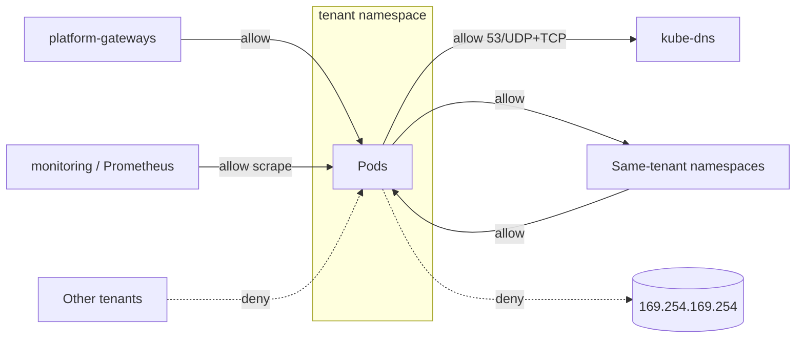
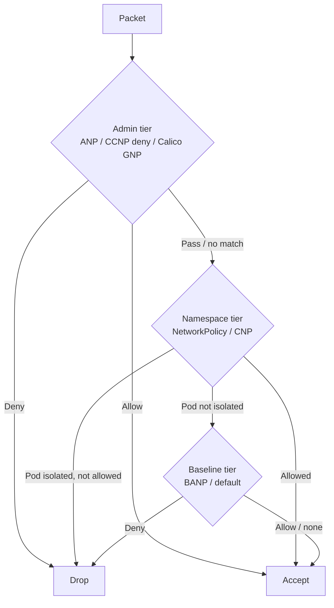

# Network Policies

## Learning Objectives
- Understand the semantics of `networking.k8s.io/v1` NetworkPolicy: isolation, additivity, and selectors
- Avoid the classic pitfalls (AND vs OR selectors, DNS egress, hostNetwork Pods, Service vs Pod ports)
- Build a default-deny, tenant-isolated baseline for a multi-tenant platform
- Use CiliumNetworkPolicy for L7, FQDN, entity-based, and deny rules
- Know where cluster-admin policies (Calico `GlobalNetworkPolicy`, `CiliumClusterwideNetworkPolicy`,
  alpha `AdminNetworkPolicy`) fit
- Test and observe policy decisions with Hubble and `kubectl`

## Prerequisites
- [CNI Overview](cni-overview.md) — your CNI must enforce NetworkPolicy (Flannel alone does not)
- [Kubernetes API Primer](../01-kubernetes-fundamentals/api-primer.md) — label selectors
- [RBAC](../01-kubernetes-fundamentals/rbac.md) — who may create/modify policies
- Cluster from [Lab 01](../../labs/lab-01-cluster-setup/README.md) with Cilium + Hubble

---

## Why Network Policies Matter for Platforms

By default the Kubernetes Pod network is **flat and allow-all**: any Pod can reach any other Pod in any
namespace. In a shared platform that means:

- A compromised workload in tenant A can scan and attack tenant B.
- Any Pod can reach the cloud metadata endpoint, internal databases, or the Kubernetes API.
- Compliance frameworks (PCI DSS, SOC 2) expect segmentation evidence.

NetworkPolicy is the Kubernetes-native firewall for Pods, enforced by the CNI on each node.

```mermaid
graph LR
    subgraph Before[Default: allow-all]
        A1[tenant-a/api] <--> B1[tenant-b/db]
        A1 <--> M1[(metadata<br/>169.254.169.254)]
    end
    subgraph After[With platform baseline]
        A2[tenant-a/api] -.x.- B2[tenant-b/db]
        A2 --> A3[tenant-a/db]
        A2 -.x.- M2[(metadata)]
        IG[ingress gateway] --> A2
    end
```

---

## NetworkPolicy Semantics

### The Five Rules to Remember

1. **Pods are non-isolated until selected.** A Pod becomes isolated for ingress (or egress) as soon as *any*
   policy with that `policyType` selects it.
2. **Policies are additive allow-lists.** There are no deny rules and no ordering; the allowed set is the
   union of all policies selecting the Pod.
3. **Both ends must allow.** For A → B to work, A's egress *and* B's ingress must permit it (if either side
   is isolated).
4. **Replies are implicitly allowed.** Enforcement is connection-tracked; you never write rules for return traffic.
5. **Policies are namespaced and select Pods by label** — not Services, not Deployments.

### Anatomy

```yaml
# networkpolicy-anatomy.yaml
apiVersion: networking.k8s.io/v1
kind: NetworkPolicy
metadata:
  name: api-allow
  namespace: team-orders
spec:
  podSelector:                     # Which Pods in THIS namespace the policy applies to ({} = all)
    matchLabels:
      app: orders-api
  policyTypes:                     # Which directions become isolated
    - Ingress
    - Egress
  ingress:
    - from:                        # Each list item is OR'ed
        - podSelector:             # Pods in the same namespace
            matchLabels:
              app: orders-web
        - namespaceSelector:       # All Pods in matching namespaces
            matchLabels:
              kubernetes.io/metadata.name: platform-gateways
      ports:                       # AND'ed with `from` within this rule
        - protocol: TCP
          port: 8080               # Target Pod (container) port, NOT the Service port
  egress:
    - to:
        - ipBlock:
            cidr: 10.20.0.0/16     # External/database CIDR
            except:
              - 10.20.99.0/24
      ports:
        - protocol: TCP
          port: 5432
        - protocol: TCP
          port: 30000
          endPort: 32767           # Port ranges (GA since 1.25)
```

### AND vs OR: The Most Common Bug

```yaml
# OR: two separate peers — Pods labeled role=client in this namespace,
#     OR any Pod in namespaces labeled team=frontend
ingress:
  - from:
      - podSelector:
          matchLabels: {role: client}
      - namespaceSelector:
          matchLabels: {team: frontend}
---
# AND: one peer — only Pods labeled role=client that are ALSO in namespaces labeled team=frontend
ingress:
  - from:
      - podSelector:
          matchLabels: {role: client}
        namespaceSelector:
          matchLabels: {team: frontend}
```

The only difference is a single `-`. Lint for this in CI and code review.

### Selector Cheat Sheet

| Selector | Meaning |
|----------|---------|
| `podSelector: {}` (top level) | All Pods in the policy's namespace |
| `from: [{podSelector: {}}]` | All Pods in the **same** namespace |
| `from: [{namespaceSelector: {}}]` | All Pods in **all** namespaces |
| `ingress: [{}]` | Allow all ingress (from anywhere, any port) |
| `ingress: []` or omitted + `policyTypes: [Ingress]` | Deny all ingress |
| `namespaceSelector: {matchLabels: {kubernetes.io/metadata.name: x}}` | A specific namespace — this label is set automatically on every namespace |

### What NetworkPolicy Cannot Do

| Limitation | Workaround |
|------------|-----------|
| No explicit deny / priorities | CNI CRDs (Cilium, Calico) or `AdminNetworkPolicy` (alpha) |
| No L7 (HTTP method/path) | `CiliumNetworkPolicy` L7 rules or a [service mesh](service-mesh.md) `AuthorizationPolicy` |
| No FQDN egress (`api.stripe.com`) | Cilium `toFQDNs`, Calico DNS policy, or an egress gateway |
| No cluster-wide policies | `CiliumClusterwideNetworkPolicy`, Calico `GlobalNetworkPolicy`, ANP |
| Doesn't apply to `hostNetwork: true` Pods | Host firewall features (Cilium host policies) |
| No logging of decisions | Hubble / Calico flow logs |
| Node/kubelet traffic handling is implementation-defined | Explicitly test probes and node-originated traffic |

---

## A Platform Baseline for Tenant Namespaces

Every tenant namespace created by the platform (for example by the [Tenant operator](../../code/tenant-operator/)
from a `Tenant` resource) should get the same baseline. The policies below assume namespaces carry
`platform.mycompany.io/tenant: <name>`.



```yaml
# baseline/00-default-deny.yaml — isolate all Pods in both directions
apiVersion: networking.k8s.io/v1
kind: NetworkPolicy
metadata:
  name: default-deny-all
  namespace: acme-dev
  labels:
    platform.mycompany.io/managed-by: tenant-operator
spec:
  podSelector: {}
  policyTypes:
    - Ingress
    - Egress
```

```yaml
# baseline/10-allow-dns.yaml — without this, everything "breaks" with DNS timeouts
apiVersion: networking.k8s.io/v1
kind: NetworkPolicy
metadata:
  name: allow-dns-egress
  namespace: acme-dev
spec:
  podSelector: {}
  policyTypes: [Egress]
  egress:
    - to:
        - namespaceSelector:
            matchLabels:
              kubernetes.io/metadata.name: kube-system
          podSelector:
            matchLabels:
              k8s-app: kube-dns         # AND: CoreDNS Pods in kube-system
      ports:
        - protocol: UDP
          port: 53
        - protocol: TCP
          port: 53
```

```yaml
# baseline/20-allow-same-tenant.yaml — tenant namespaces can talk to each other
apiVersion: networking.k8s.io/v1
kind: NetworkPolicy
metadata:
  name: allow-same-tenant
  namespace: acme-dev
spec:
  podSelector: {}
  policyTypes: [Ingress, Egress]
  ingress:
    - from:
        - namespaceSelector:
            matchLabels:
              platform.mycompany.io/tenant: acme
  egress:
    - to:
        - namespaceSelector:
            matchLabels:
              platform.mycompany.io/tenant: acme
```

```yaml
# baseline/30-allow-platform-ingress.yaml — gateway + metrics scraping
apiVersion: networking.k8s.io/v1
kind: NetworkPolicy
metadata:
  name: allow-platform-ingress
  namespace: acme-dev
spec:
  podSelector: {}
  policyTypes: [Ingress]
  ingress:
    - from:
        - namespaceSelector:
            matchLabels:
              kubernetes.io/metadata.name: platform-gateways
    - from:
        - namespaceSelector:
            matchLabels:
              kubernetes.io/metadata.name: monitoring
          podSelector:
            matchLabels:
              app.kubernetes.io/name: prometheus
      ports:
        - protocol: TCP
          port: 9090              # Convention: workloads expose metrics on a named port; adjust as needed
```

```yaml
# baseline/40-allow-internet-egress.yaml — optional, opt-in per namespace
apiVersion: networking.k8s.io/v1
kind: NetworkPolicy
metadata:
  name: allow-internet-egress
  namespace: acme-dev
spec:
  podSelector:
    matchLabels:
      platform.mycompany.io/egress: internet    # Only Pods that opt in
  policyTypes: [Egress]
  egress:
    - to:
        - ipBlock:
            cidr: 0.0.0.0/0
            except:
              - 10.0.0.0/8                    # Private ranges (cluster, VPC)
              - 172.16.0.0/12
              - 192.168.0.0/16
              - 169.254.169.254/32            # Cloud metadata endpoint
      ports:
        - protocol: TCP
          port: 443
```

> **Ownership:** tenants should be able to *add* NetworkPolicies but not delete the baseline. RBAC cannot
> restrict verbs by label, so either protect baseline objects with an admission policy (or have a controller /
> Kyverno `generate` with `synchronize: true` recreate them), or move the baseline to cluster-scoped CRDs that
> tenants can't touch — see below.
> Manifests for this baseline live in [Lab 07: Multi-Tenancy](../../labs/lab-07-multi-tenancy/) under `network-isolation/`.

---

## CiliumNetworkPolicy

Cilium enforces standard NetworkPolicy *and* its own CRDs (`cilium.io/v2`), which use **endpoint identities**
derived from labels rather than IPs.

### Comparison

| Feature | NetworkPolicy | CiliumNetworkPolicy (CNP) | CiliumClusterwideNetworkPolicy (CCNP) |
|---------|---------------|---------------------------|---------------------------------------|
| Scope | Namespace | Namespace | Cluster |
| L3/L4 allow | ✅ | ✅ | ✅ |
| Explicit deny (`ingressDeny`/`egressDeny`) | ❌ | ✅ | ✅ |
| L7 HTTP / gRPC / Kafka / DNS rules | ❌ | ✅ | ✅ |
| FQDN egress (`toFQDNs`) | ❌ | ✅ | ✅ |
| Entities (`world`, `kube-apiserver`, `host`, `cluster`) | ❌ | ✅ | ✅ |
| Node / host policies (`nodeSelector`) | ❌ | ❌ | ✅ |

### L7 HTTP Rules

```yaml
# cnp-orders-l7.yaml — only GET /api/orders* and POST /api/orders from the web tier
apiVersion: cilium.io/v2
kind: CiliumNetworkPolicy
metadata:
  name: orders-api-l7
  namespace: team-orders
spec:
  endpointSelector:
    matchLabels:
      app: orders-api
  ingress:
    - fromEndpoints:
        - matchLabels:
            app: orders-web
      toPorts:
        - ports:
            - port: "8080"
              protocol: TCP
          rules:
            http:                       # Traffic is redirected through the node's Envoy proxy
              - method: GET
                path: "/api/orders.*"   # Regex
              - method: POST
                path: "/api/orders"
                headers:
                  - "Content-Type: application/json"
```

Requests that match the L4 rule but not an L7 rule receive **HTTP 403** from the proxy (not a silent drop), which
makes debugging easier.

### FQDN-Based Egress

```yaml
# cnp-payments-fqdn.yaml — payments may only call Stripe over HTTPS
apiVersion: cilium.io/v2
kind: CiliumNetworkPolicy
metadata:
  name: payments-egress-stripe
  namespace: team-payments
spec:
  endpointSelector:
    matchLabels:
      app: payments
  egress:
    # 1. Allow DNS *through Cilium's DNS proxy* so it can learn name->IP mappings
    - toEndpoints:
        - matchLabels:
            k8s:io.kubernetes.pod.namespace: kube-system
            k8s-app: kube-dns
      toPorts:
        - ports:
            - port: "53"
              protocol: ANY
          rules:
            dns:
              - matchPattern: "*"
    # 2. Allow HTTPS only to IPs resolved for these names
    - toFQDNs:
        - matchName: api.stripe.com
        - matchPattern: "*.stripe.com"
      toPorts:
        - ports:
            - port: "443"
              protocol: TCP
```

> `toFQDNs` only works if the DNS rule with `rules.dns` is present; otherwise Cilium never sees the lookups
> and the FQDN policy matches nothing.

### Explicit Deny and Entities

```yaml
# ccnp-deny-metadata.yaml — cluster-wide: no workload may reach cloud metadata
apiVersion: cilium.io/v2
kind: CiliumClusterwideNetworkPolicy
metadata:
  name: deny-cloud-metadata
spec:
  endpointSelector:
    matchExpressions:
      - key: k8s:io.kubernetes.pod.namespace
        operator: NotIn
        values: [kube-system]            # Some system agents legitimately need IMDS
  enableDefaultDeny:                     # Don't flip selected Pods into default-deny just because of this policy
    egress: false
    ingress: false
  egressDeny:
    - toCIDR:
        - 169.254.169.254/32
```

Deny rules **take precedence over allow rules** from any policy, which makes them ideal for platform-owned
guardrails that tenants cannot override.

```yaml
# ccnp-tenant-isolation.yaml — cluster-wide tenant isolation, independent of tenant-editable policies
apiVersion: cilium.io/v2
kind: CiliumClusterwideNetworkPolicy
metadata:
  name: tenant-acme-isolation
  labels:
    platform.mycompany.io/tenant: acme
spec:
  endpointSelector:
    matchLabels:
      k8s:io.cilium.k8s.namespace.labels.platform.mycompany.io/tenant: acme
  enableDefaultDeny:
    ingress: false
    egress: false
  ingressDeny:
    - fromEndpoints:
        - matchExpressions:
            - key: k8s:io.cilium.k8s.namespace.labels.platform.mycompany.io/tenant
              operator: Exists
            - key: k8s:io.cilium.k8s.namespace.labels.platform.mycompany.io/tenant
              operator: NotIn
              values: [acme]
```

Namespace labels are available to Cilium selectors with the `io.cilium.k8s.namespace.labels.` prefix. Generating
one CCNP per `Tenant` is a natural job for a platform controller.

---

## Other Cluster-Admin Policy Models

### Calico `GlobalNetworkPolicy`

Calico offers ordered, cluster-scoped policies with `Allow`, `Deny`, `Log`, and `Pass` actions:

```yaml
# calico-gnp-deny-cross-tenant.yaml (projectcalico.org/v3 — applied via the Calico API server or calicoctl)
apiVersion: projectcalico.org/v3
kind: GlobalNetworkPolicy
metadata:
  name: deny-cross-tenant
spec:
  order: 100                         # Lower order = evaluated first
  namespaceSelector: has(platform.mycompany.io/tenant)
  types: [Ingress]
  ingress:
    - action: Pass                   # Traffic from tenant namespaces: defer to namespaced policies
      source:                        # (which enforce *same*-tenant via the baseline above)
        namespaceSelector: has(platform.mycompany.io/tenant)
    - action: Pass                   # Platform namespaces (gateways, monitoring) also deferred
      source:
        namespaceSelector: platform.mycompany.io/system == 'true'
    - action: Deny                   # Everything else is denied, whatever tenants write
```

### AdminNetworkPolicy (Alpha)

SIG Network's [network-policy-api](https://network-policy-api.sigs.k8s.io/) project defines cluster-admin policy
CRDs: `AdminNetworkPolicy` (ANP) and `BaselineAdminNetworkPolicy` (BANP) in
**`policy.networking.k8s.io/v1alpha1`**. They are **alpha, out-of-tree CRDs**, supported by only some CNIs
(e.g. OVN-Kubernetes, Calico, Antrea, kube-network-policies) and the API is still evolving — the project has
been working on a consolidated successor. Treat the example below as illustrative and do not depend on it for
production guardrails without checking your CNI's support.

```yaml
# anp-example.yaml — ALPHA API, illustrative only
apiVersion: policy.networking.k8s.io/v1alpha1
kind: AdminNetworkPolicy
metadata:
  name: allow-monitoring-deny-cross-tenant
spec:
  priority: 10                       # 0-1000, lower = higher precedence
  subject:
    namespaces:
      matchExpressions:
        - key: platform.mycompany.io/tenant
          operator: Exists
  ingress:
    - name: allow-monitoring         # Allow: cannot be overridden by tenant NetworkPolicies
      action: Allow
      from:
        - namespaces:
            matchLabels:
              kubernetes.io/metadata.name: monitoring
    - name: delegate-tenant-traffic  # Pass: let tenant NetworkPolicies decide
      action: Pass
      from:
        - namespaces:
            matchExpressions:
              - key: platform.mycompany.io/tenant
                operator: Exists
    - name: deny-sandbox             # Deny: cannot be overridden by tenant NetworkPolicies
      action: Deny
      from:
        - namespaces:
            matchLabels:
              platform.mycompany.io/zone: sandbox
```

### Evaluation Order (Conceptual)



---

## Policy as Code and Testing

| Practice | Tooling |
|----------|---------|
| Store baseline policies in Git, delivered by GitOps | [GitOps Principles](../05-gitops/gitops-principles.md) |
| Require a default-deny in every tenant namespace | Kyverno `generate` rules or [Policy Engine](../12-security-compliance/policy-engine.md) |
| Visualize & author | [Cilium Network Policy Editor](https://editor.networkpolicy.io/) |
| Verify behavior | Hubble (`hubble observe --verdict DROPPED`), `cilium connectivity test` |
| Unit-test intent | Run netshoot/curl probe Pods in CI against a kind cluster |

```yaml
# kyverno-generate-default-deny.yaml — auto-create the baseline for tenant namespaces
apiVersion: kyverno.io/v1
kind: ClusterPolicy
metadata:
  name: tenant-default-deny
spec:
  rules:
    - name: generate-default-deny
      match:
        any:
          - resources:
              kinds: [Namespace]
              selector:
                matchExpressions:
                  - key: platform.mycompany.io/tenant
                    operator: Exists
      generate:
        apiVersion: networking.k8s.io/v1
        kind: NetworkPolicy
        name: default-deny-all
        namespace: "{{request.object.metadata.name}}"
        synchronize: true            # Recreate if a tenant deletes it
        data:
          spec:
            podSelector: {}
            policyTypes: [Ingress, Egress]
```

---

## Hands-On Exercise

### Lab: Isolate Two Tenants and Observe Drops

```bash
# 1. Two tenants, each with a server and client
for t in acme globex; do
  kubectl create namespace $t
  kubectl label namespace $t platform.mycompany.io/tenant=$t
  kubectl -n $t run web --image=nginx:alpine --labels=app=web --port=80
  kubectl -n $t expose pod web --port=80
  kubectl -n $t run client --image=nicolaka/netshoot --labels=app=client -- sleep infinity
done
for t in acme globex; do kubectl -n $t wait --for=condition=Ready pod --all --timeout=2m; done

# 2. Baseline: everything is reachable
kubectl -n acme exec client -- curl -s -m 3 -o /dev/null -w "%{http_code}\n" web.globex.svc.cluster.local

# 3. Apply default deny in both tenants
for t in acme globex; do
kubectl apply -n $t -f - <<'EOF'
apiVersion: networking.k8s.io/v1
kind: NetworkPolicy
metadata: {name: default-deny-all}
spec:
  podSelector: {}
  policyTypes: [Ingress, Egress]
EOF
done
kubectl -n acme exec client -- curl -s -m 3 web.acme.svc.cluster.local || echo "blocked (even DNS fails)"

# 4. Add DNS + same-tenant rules (from the baseline above) to each tenant
for t in acme globex; do
kubectl apply -n $t -f - <<EOF
apiVersion: networking.k8s.io/v1
kind: NetworkPolicy
metadata: {name: allow-dns-egress}
spec:
  podSelector: {}
  policyTypes: [Egress]
  egress:
    - to:
        - namespaceSelector: {matchLabels: {kubernetes.io/metadata.name: kube-system}}
          podSelector: {matchLabels: {k8s-app: kube-dns}}
      ports: [{protocol: UDP, port: 53}, {protocol: TCP, port: 53}]
---
apiVersion: networking.k8s.io/v1
kind: NetworkPolicy
metadata: {name: allow-same-tenant}
spec:
  podSelector: {}
  policyTypes: [Ingress, Egress]
  ingress: [{from: [{namespaceSelector: {matchLabels: {platform.mycompany.io/tenant: $t}}}]}]
  egress:  [{to:   [{namespaceSelector: {matchLabels: {platform.mycompany.io/tenant: $t}}}]}]
EOF
done

# 5. Verify: same tenant works, cross tenant blocked
kubectl -n acme exec client -- curl -s -m 3 -o /dev/null -w "same-tenant: %{http_code}\n" web.acme.svc.cluster.local
kubectl -n acme exec client -- curl -s -m 3 -o /dev/null -w "cross-tenant: %{http_code}\n" web.globex.svc.cluster.local \
  || echo "cross-tenant: blocked"

# 6. Observe the drops with Hubble
cilium hubble port-forward &
hubble observe --namespace acme --verdict DROPPED --last 20
hubble observe --to-namespace globex --from-namespace acme --last 20

# 7. Add an L7 rule: acme clients may only GET /
kubectl apply -f - <<'EOF'
apiVersion: cilium.io/v2
kind: CiliumNetworkPolicy
metadata: {name: web-l7, namespace: acme}
spec:
  endpointSelector: {matchLabels: {app: web}}
  ingress:
    - fromEndpoints: [{matchLabels: {app: client}}]
      toPorts:
        - ports: [{port: "80", protocol: TCP}]
          rules:
            http: [{method: GET, path: "/"}]
EOF
kubectl -n acme exec client -- curl -s -o /dev/null -w "GET /: %{http_code}\n" web
kubectl -n acme exec client -- curl -s -o /dev/null -w "GET /secret: %{http_code}\n" web/secret   # 403
hubble observe --namespace acme --protocol http --last 10

# Cleanup
kill %1
kubectl delete namespace acme globex
```

### Stretch Goals
1. Convert the per-namespace baseline into a single `CiliumClusterwideNetworkPolicy` with `ingressDeny`.
2. Add a `toFQDNs` policy allowing the acme client to reach only `api.github.com`.
3. Install the Kyverno policy above and confirm deleting `default-deny-all` gets reverted.

---

## Troubleshooting

### "Everything Broke After Default Deny"
- Missing DNS egress rule (most common). Symptom: `could not resolve host`.
- Missing egress to the Kubernetes API for operators/controllers in the namespace. With Cilium use
  `toEntities: [kube-apiserver]`; with plain NetworkPolicy allow the API server endpoint IPs/port (often 6443 or 443).
- Readiness probes failing: kubelet → Pod traffic is usually allowed by the CNI, but verify with your CNI's docs.

### Policy Seems to Have No Effect
```bash
# Is the CNI enforcing policy at all? (Flannel alone does not)
kubectl -n kube-system get pods -o wide | grep -E "cilium|calico|flannel"
# Does the podSelector match?
kubectl get pods -n <ns> -l app=orders-api
# Are you targeting the Service port instead of the container port?
kubectl get svc <svc> -o jsonpath='{.spec.ports}'
# Is the Pod hostNetwork? NetworkPolicy does not apply.
kubectl get pod <pod> -o jsonpath='{.spec.hostNetwork}'
```

### Inspecting Cilium's View
```bash
kubectl -n kube-system exec ds/cilium -c cilium-agent -- cilium-dbg endpoint list
kubectl -n kube-system exec ds/cilium -c cilium-agent -- cilium-dbg policy get
kubectl get cnp,ccnp -A
hubble observe --verdict DROPPED --pod <ns>/<pod> -o jsonpb | jq '.flow.drop_reason_desc'
```

### Traffic Allowed That Should Be Denied
- Another policy (perhaps from a Helm chart) allows it — policies are additive: `kubectl get netpol -n <ns>`.
- AND/OR mistake in `from`/`to` (see above).
- `namespaceSelector: {}` used where a specific namespace was intended.

---

## Further Reading

### Official Documentation
- [Kubernetes Network Policies](https://kubernetes.io/docs/concepts/services-networking/network-policies/)
- [Cilium Network Policy](https://docs.cilium.io/en/stable/security/policy/)
- [Calico Network Policy](https://docs.tigera.io/calico/latest/network-policy/)
- [Network Policy API (ANP/BANP)](https://network-policy-api.sigs.k8s.io/)

### Tools & Guides
- [Network Policy Editor](https://editor.networkpolicy.io/)
- [Kubernetes Network Policy Recipes](https://github.com/ahmetb/kubernetes-network-policy-recipes)
- [Hubble](https://github.com/cilium/hubble)

---

## Next Steps

1. **Complete**: [Lab 07: Multi-Tenancy](../../labs/lab-07-multi-tenancy/) — network isolation per `Tenant`
2. **Read**: [Service Mesh](service-mesh.md) — identity-based (mTLS) authorization on top of L3/L4 policy
3. **Read**: [Policy Engine](../12-security-compliance/policy-engine.md) — enforcing that baselines exist
4. **Explore**: [Pod Security](../12-security-compliance/pod-security.md) — the other half of workload isolation
