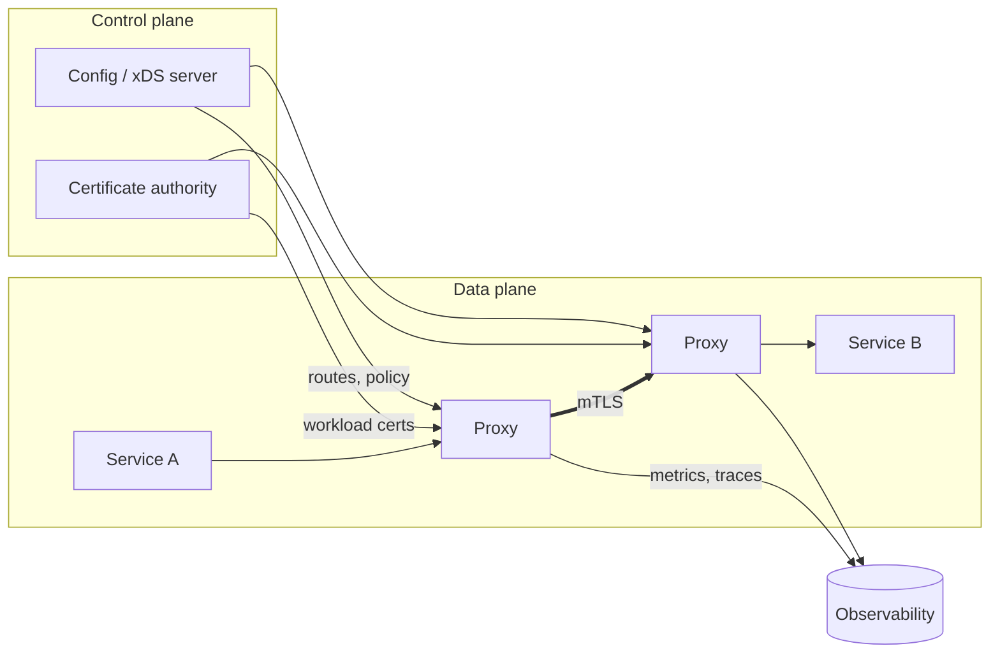
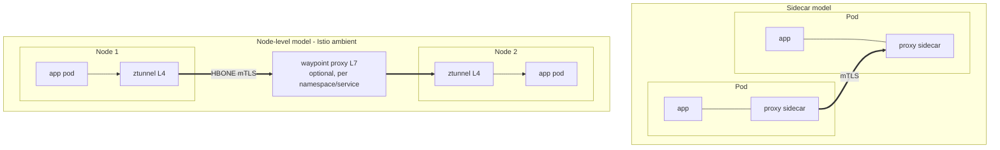
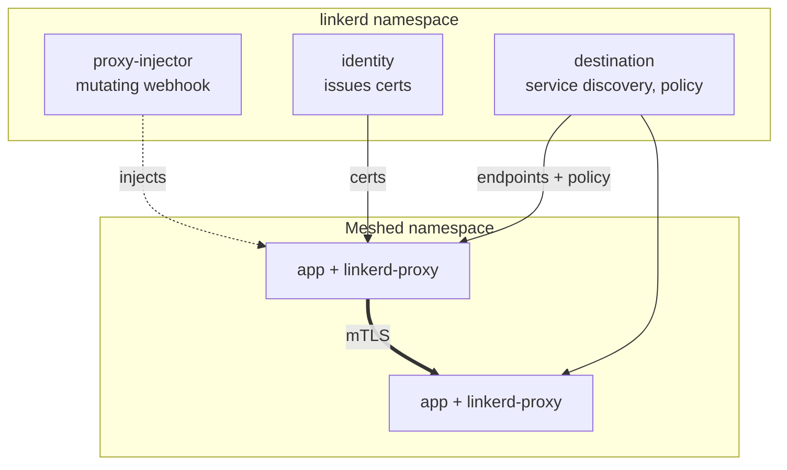
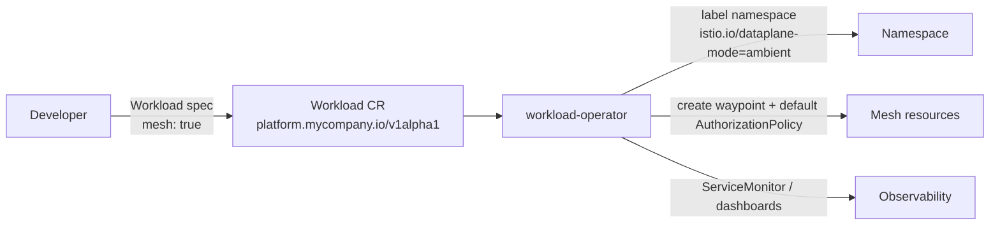

# Service Mesh for Platform Engineers

## Learning Objectives
- Explain what a service mesh adds on top of CNI networking and NetworkPolicy
- Compare data-plane architectures: sidecar, node-level (ambient / per-node proxy), and eBPF-assisted
- Install and operate Istio in **ambient mode**, and know when to use sidecars instead
- Configure mTLS, authorization, and traffic management with Istio `v1` APIs
- Understand Linkerd's model and policy resources
- Understand Cilium Service Mesh and the Gateway API GAMMA initiative for mesh routing
- Decide whether your platform needs a mesh at all

## Prerequisites
- [CNI Overview](cni-overview.md) and [Network Policies](network-policies.md)
- [Ingress Controllers & Gateway API](ingress-controllers.md) — Gateway API concepts are reused heavily
- [Container Runtimes](../02-container-runtime/container-runtimes.md) — sidecar containers and init containers
- Basic TLS/X.509 knowledge
- A kind cluster from [Lab 01](../../labs/lab-01-cluster-setup/README.md) (4 CPU / 8 GB RAM recommended)

---

## What a Service Mesh Provides

A service mesh moves cross-cutting **east-west** (service-to-service) concerns out of application code and into
infrastructure:

| Capability | Without a mesh | With a mesh |
|------------|----------------|-------------|
| Encryption in transit | Each app manages TLS certs | Automatic mutual TLS (mTLS) with rotated workload certs |
| Workload identity | IPs + labels (NetworkPolicy) | Cryptographic identity (SPIFFE IDs tied to ServiceAccounts) |
| Authorization | L3/L4 rules | L7 rules: "SA `orders` may `POST /payments`" |
| Retries, timeouts, circuit breaking | Per-language libraries | Uniform proxy config |
| Traffic shifting / canaries | Ingress only | Any service-to-service hop |
| Golden metrics (RED) & tracing | Per-app instrumentation | Uniform L7 telemetry; trace header propagation still needed in apps |



### Do You Need a Mesh?

| Requirement | Simpler alternative | Mesh justified when… |
|-------------|--------------------|----------------------|
| Encrypt pod-to-pod traffic | CNI WireGuard/IPsec ([CNI Overview](cni-overview.md)) | You also need identity-based authz or per-service mTLS evidence |
| Segment tenants | [NetworkPolicy](network-policies.md) | You need L7 or identity-aware rules |
| Canary releases | Gateway API at the edge, Argo Rollouts | Internal hops need weighted routing |
| Service metrics | OpenTelemetry SDKs / eBPF tooling (Hubble) | You want uniform L7 metrics without touching apps |

> **Platform rule of thumb:** offer the mesh as an **opt-in capability** per namespace/tenant, not a
> mandatory layer, until operational maturity is proven.

---

## Data-Plane Architectures



| Model | Examples | Pros | Cons |
|-------|----------|------|------|
| **Sidecar** | Istio (sidecar mode), Linkerd | Per-pod isolation; mature; full L7 everywhere | Resource overhead per pod; pod restarts to inject/upgrade; startup ordering issues |
| **Node-level L4 + optional L7** | Istio ambient (ztunnel + waypoints) | No app pod changes; pay for L7 only where needed; upgrades without restarting apps | Newer; L7 features require deploying waypoints |
| **Per-node Envoy + eBPF** | Cilium Service Mesh | Reuses CNI; no sidecars | L7 proxy shared per node; mutual auth model differs from classic mTLS |

Kubernetes native sidecar containers (`initContainers` with `restartPolicy: Always`, beta and on by default since
1.29) fix many sidecar lifecycle issues (startup order, Jobs that never complete). Istio and Linkerd can use them.

---

## Istio

Istio is a CNCF graduated project. `istiod` is the control plane (xDS config server + certificate authority).
Data plane is either **sidecar** Envoys or **ambient** mode (GA since Istio 1.24).

### API Surface

| API group | Kinds | Purpose |
|-----------|-------|---------|
| `networking.istio.io/v1` | `VirtualService`, `DestinationRule`, `Gateway`, `ServiceEntry`, `Sidecar`, `WorkloadEntry` | Traffic management (classic Istio APIs) |
| `security.istio.io/v1` | `PeerAuthentication`, `AuthorizationPolicy`, `RequestAuthentication` | mTLS mode, authz, JWT validation |
| `telemetry.istio.io/v1` | `Telemetry` | Metrics, access logs, tracing config |
| `gateway.networking.k8s.io/v1` | `Gateway`, `HTTPRoute`, `GRPCRoute` | Recommended for ingress, waypoints, and mesh routing |

> Istio recommends Gateway API for new configuration. In ambient mode, L7 routing is configured with
> `HTTPRoute`s attached to Services, and waypoints are Gateway resources.

### Ambient Mode Components

| Component | Runs as | Responsibility |
|-----------|---------|----------------|
| `istiod` | Deployment | Config, certificates (SPIFFE), xDS |
| `istio-cni` | DaemonSet | Redirects pod traffic into ztunnel (no init containers in app pods) |
| `ztunnel` | DaemonSet (Rust) | L4: mTLS (HBONE tunnels), L4 authz, TCP telemetry |
| Waypoint proxy | Deployment (Envoy), per namespace or service | L7: HTTP routing, retries, L7 authz, HTTP metrics |

### Installing Istio in Ambient Mode

```bash
# install-istio-ambient.sh
# 1. Gateway API CRDs (required for waypoints and recommended ingress)
kubectl apply --server-side \
  -f https://github.com/kubernetes-sigs/gateway-api/releases/download/v1.3.0/standard-install.yaml

# 2. istioctl (pin a version you have validated)
curl -L https://istio.io/downloadIstio | ISTIO_VERSION=1.27.0 sh -
export PATH="$PWD/istio-1.27.0/bin:$PATH"

# 3. Pre-flight checks and install the ambient profile
istioctl x precheck
istioctl install --set profile=ambient --skip-confirmation

kubectl -n istio-system get pods
# istiod-..., istio-cni-node-... (DaemonSet), ztunnel-... (DaemonSet)
```

For GitOps-managed installs use the Helm charts in order: `base` → `istiod` (with `profile=ambient`) →
`cni` → `ztunnel` (from `https://istio-release.storage.googleapis.com/charts`).

### Enrolling Workloads

```bash
# L4 mesh (mTLS + L4 authz) for a whole namespace — no pod restarts required
kubectl label namespace team-orders istio.io/dataplane-mode=ambient

# Deploy a waypoint for L7 features in that namespace, and enroll the namespace to use it
istioctl waypoint apply -n team-orders --enroll-namespace
kubectl -n team-orders get gateway waypoint
```

The waypoint created by `istioctl` is a plain Gateway API resource:

```yaml
# waypoint.yaml — equivalent of `istioctl waypoint apply -n team-orders`
apiVersion: gateway.networking.k8s.io/v1
kind: Gateway
metadata:
  name: waypoint
  namespace: team-orders
  labels:
    istio.io/waypoint-for: service       # Handle traffic addressed to Services (default)
spec:
  gatewayClassName: istio-waypoint
  listeners:
    - name: mesh
      port: 15008                          # HBONE port
      protocol: HBONE
```

Then label the namespace (or individual Services) with `istio.io/use-waypoint: waypoint`.

### Sidecar Mode (Alternative)

```bash
# Sidecar injection is namespace-label driven
kubectl label namespace legacy-app istio-injection=enabled
kubectl -n legacy-app rollout restart deployment   # Pods must restart to get a sidecar
```

Choose sidecars when you need features not yet available in ambient for your Istio version, or for VMs/multi-cluster
topologies that your version supports only in sidecar mode — check the
[ambient feature status](https://istio.io/latest/docs/ambient/overview/) for your release.

### mTLS: PeerAuthentication

```yaml
# peerauthentication-strict.yaml — mesh-wide strict mTLS (in the root namespace)
apiVersion: security.istio.io/v1
kind: PeerAuthentication
metadata:
  name: default
  namespace: istio-system            # Root namespace = mesh-wide
spec:
  mtls:
    mode: STRICT                     # Reject plaintext; PERMISSIVE accepts both during migration
```

Migration path: start `PERMISSIVE`, confirm via telemetry that all traffic is mTLS, then switch to `STRICT`
namespace by namespace. Ambient ztunnel always uses mTLS between meshed workloads.

### Authorization: AuthorizationPolicy

```yaml
# authz-payments.yaml — default deny for the namespace, then explicit allows
apiVersion: security.istio.io/v1
kind: AuthorizationPolicy
metadata:
  name: allow-nothing
  namespace: team-payments
spec: {}                              # Empty spec with ALLOW semantics = deny all
# Ambient caveat: this namespace-wide policy is also enforced by ztunnel at L4, so traffic arriving
# from the waypoint is denied too. Add an L4 ALLOW for the waypoint's identity
# (cluster.local/ns/team-payments/sa/waypoint) or scope deny-all policies with targetRefs.
---
apiVersion: security.istio.io/v1
kind: AuthorizationPolicy
metadata:
  name: payments-api
  namespace: team-payments
spec:
  targetRefs:                         # Ambient L7: attach to the Service; enforced by its waypoint
    - kind: Service
      group: ""
      name: payments-api
  action: ALLOW
  rules:
    - from:
        - source:
            principals:               # SPIFFE identity = trust domain / ns / service account
              - cluster.local/ns/team-orders/sa/orders-api
      to:
        - operation:
            methods: ["POST"]
            paths: ["/v1/payments", "/v1/payments/*"]
    - from:
        - source:
            namespaces: ["monitoring"]
      to:
        - operation:
            ports: ["15020"]
```

| Field | Enforced by (ambient) | Notes |
|-------|----------------------|-------|
| `principals`, `namespaces`, `ipBlocks`, `ports` | ztunnel (L4) when using `selector` | Works without a waypoint |
| `methods`, `paths`, `hosts`, `requestPrincipals`, headers | Waypoint (L7) with `targetRefs` | Requires a waypoint; L7 rules bound only to ztunnel are rejected/ineffective |

Action evaluation order: `CUSTOM` → `DENY` → `ALLOW`. If any `ALLOW` policy applies to a workload, requests not
matching an allow are denied.

### Traffic Management

```yaml
# httproute-mesh-canary.yaml — mesh (GAMMA) routing: parentRef is a Service, not a Gateway
apiVersion: gateway.networking.k8s.io/v1
kind: HTTPRoute
metadata:
  name: reviews
  namespace: team-orders
spec:
  parentRefs:
    - group: ""
      kind: Service
      name: reviews                   # Applies to traffic addressed to the reviews Service
      port: 9080
  rules:
    - backendRefs:
        - name: reviews-v1
          port: 9080
          weight: 90
        - name: reviews-v2
          port: 9080
          weight: 10
      timeouts:
        request: 5s
```

```yaml
# destinationrule-orders.yaml — connection pools & outlier detection (classic API, still current)
apiVersion: networking.istio.io/v1
kind: DestinationRule
metadata:
  name: orders-api
  namespace: team-orders
spec:
  host: orders-api.team-orders.svc.cluster.local
  trafficPolicy:
    connectionPool:
      tcp:
        maxConnections: 200
      http:
        http1MaxPendingRequests: 100
        maxRequestsPerConnection: 50
    outlierDetection:                 # Circuit breaking: eject failing endpoints
      consecutive5xxErrors: 5
      interval: 10s
      baseEjectionTime: 30s
      maxEjectionPercent: 50
```

```yaml
# serviceentry-stripe.yaml — make an external dependency a first-class mesh destination
apiVersion: networking.istio.io/v1
kind: ServiceEntry
metadata:
  name: stripe
  namespace: team-payments
spec:
  hosts: ["api.stripe.com"]
  location: MESH_EXTERNAL
  ports:
    - number: 443
      name: https
      protocol: TLS
  resolution: DNS
```

### Telemetry

```yaml
# telemetry-mesh.yaml — enable access logs and 10% trace sampling mesh-wide
apiVersion: telemetry.istio.io/v1
kind: Telemetry
metadata:
  name: mesh-default
  namespace: istio-system
spec:
  accessLogging:
    - providers:
        - name: envoy
  tracing:
    - providers:
        - name: otel-tracing           # Defined in meshConfig.extensionProviders
      randomSamplingPercentage: 10
```

Apps must still **propagate trace headers** (`traceparent`) for end-to-end traces — see
[Tracing Stack](../10-observability/tracing-stack.md).

---

## Linkerd

Linkerd (CNCF graduated) focuses on simplicity: a sidecar model using `linkerd2-proxy`, a purpose-built
**Rust micro-proxy** (not Envoy), with automatic mTLS on by default for meshed TCP traffic.

> **Release model:** the open-source project publishes **edge** releases; stable release artifacts are
> distributed by Buoyant (Buoyant Enterprise for Linkerd). Factor this into your support plan.

### Architecture



### Install and Mesh a Namespace

```bash
# install-linkerd.sh — CLI-based install (Helm charts are available for GitOps)
curl --proto '=https' --tlsv1.2 -sSfL https://run.linkerd.io/install-edge | sh
export PATH=$HOME/.linkerd2/bin:$PATH

linkerd check --pre
# Recent releases expect Gateway API CRDs to be present (install them as shown earlier)
linkerd install --crds | kubectl apply -f -
linkerd install | kubectl apply -f -
linkerd check

# Opt a namespace in; restart workloads to inject proxies
kubectl annotate namespace team-orders linkerd.io/inject=enabled
kubectl -n team-orders rollout restart deployment

# Observability extension (dashboard, tap, live metrics)
linkerd viz install | kubectl apply -f -
linkerd viz stat deploy -n team-orders
```

### Policy

Linkerd's authorization uses a **default policy** plus `Server` / `AuthorizationPolicy` resources:

```yaml
# linkerd-default-policy.yaml — set on a namespace (or workload) as an annotation
apiVersion: v1
kind: Namespace
metadata:
  name: team-payments
  annotations:
    linkerd.io/inject: enabled
    config.linkerd.io/default-inbound-policy: all-authenticated   # all-unauthenticated | all-authenticated |
                                                                  # cluster-authenticated | cluster-unauthenticated | deny
```

```yaml
# linkerd-payments-policy.yaml — only orders-api may call payments-api on its HTTP port
apiVersion: policy.linkerd.io/v1beta3
kind: Server
metadata:
  name: payments-http
  namespace: team-payments
spec:
  podSelector:
    matchLabels:
      app: payments-api
  port: http                         # Named container port
  proxyProtocol: HTTP/2
---
apiVersion: policy.linkerd.io/v1alpha1
kind: MeshTLSAuthentication
metadata:
  name: orders-identity
  namespace: team-payments
spec:
  identities:
    - "orders-api.team-orders.serviceaccount.identity.linkerd.cluster.local"
---
apiVersion: policy.linkerd.io/v1alpha1
kind: AuthorizationPolicy
metadata:
  name: payments-from-orders
  namespace: team-payments
spec:
  targetRef:
    group: policy.linkerd.io
    kind: Server
    name: payments-http
  requiredAuthenticationRefs:
    - name: orders-identity
      kind: MeshTLSAuthentication
      group: policy.linkerd.io
```

Linkerd also supports Gateway API `HTTPRoute`/`GRPCRoute` with Service `parentRefs` (GAMMA) for retries,
timeouts, and traffic splitting. Check the API versions served by your Linkerd release with
`kubectl api-resources --api-group=policy.linkerd.io`.

---

## Cilium Service Mesh

If Cilium is already your CNI ([CNI Overview](cni-overview.md)), it can provide mesh-like features without
sidecars:

| Feature | How Cilium implements it |
|---------|--------------------------|
| L7 traffic management | Per-node Envoy (`cilium-envoy` DaemonSet), Gateway API & GAMMA `HTTPRoute`, `CiliumEnvoyConfig` |
| Encryption | Transparent WireGuard or IPsec between nodes (not per-workload mTLS) |
| Mutual authentication | SPIFFE/SPIRE-based identity verification (check maturity status in your version) |
| L7 authorization | `CiliumNetworkPolicy` HTTP/gRPC rules ([Network Policies](network-policies.md)) |
| Observability | Hubble L7 flows and metrics |

```yaml
# cilium-values-mesh.yaml — enable mesh-related features in the Cilium Helm chart
kubeProxyReplacement: true
envoy:
  enabled: true                 # Run Envoy as a separate DaemonSet
gatewayAPI:
  enabled: true                 # Gateway API + GAMMA support
encryption:
  enabled: true
  type: wireguard
hubble:
  relay:
    enabled: true
```

---

## Comparison

| Aspect | Istio (ambient) | Istio (sidecar) | Linkerd | Cilium Service Mesh |
|--------|-----------------|-----------------|---------|---------------------|
| Proxy | ztunnel (Rust) + Envoy waypoints | Envoy per pod | linkerd2-proxy (Rust) per pod | Envoy per node + eBPF |
| mTLS | Automatic (L4) | Automatic | Automatic | Node-level encryption; SPIFFE mutual auth optional |
| L7 policy | Waypoint `AuthorizationPolicy` | Sidecar `AuthorizationPolicy` | `AuthorizationPolicy` + routes | `CiliumNetworkPolicy` L7 |
| Gateway API / GAMMA | ✅ | ✅ | ✅ | ✅ |
| Resource overhead | Low (per node) + waypoints | Highest | Low per pod | Lowest incremental if already on Cilium |
| App restart to join | No | Yes | Yes | No |
| Multi-cluster | ✅ (check ambient support per version) | ✅ Mature | ✅ | Cluster Mesh |
| Operational complexity | Medium–High | High | Low–Medium | Medium (tied to CNI) |

For cross-cluster meshes see [Multi-Cluster Networking](../13-multi-cluster/multi-cluster-networking.md).

---

## Offering a Mesh as a Platform Capability



```yaml
# workload-with-mesh.yaml — the developer-facing abstraction (illustrative spec)
apiVersion: platform.mycompany.io/v1alpha1
kind: Workload
metadata:
  name: payments-api
  namespace: team-payments
spec:
  image: registry.mycompany.io/payments/api:1.8.2
  port: 8080
  traits:
    mesh:
      enabled: true
      l7: true                      # Operator provisions a waypoint
      allowFrom:                    # Rendered to an AuthorizationPolicy
        - serviceAccount: orders-api
          namespace: team-orders
```

Platform responsibilities:

| Area | Recommendation |
|------|----------------|
| Root CA | Plug in an intermediate CA (cert-manager istio-csr or Vault) instead of self-signed `istiod` CA in production |
| Upgrades | Istio revisions/tags for canary control-plane upgrades; see [Lab 08](../../labs/lab-08-platform-upgrade/) |
| Defaults | Mesh-wide `STRICT` mTLS once adoption is complete; namespace `allow-nothing` + explicit allows |
| Guardrails | Admission policies preventing tenants from creating mesh-wide resources in `istio-system` |
| SLOs | Alert on control-plane push errors and proxy 5xx rates; see [Observability](../10-observability/tracing-stack.md) |
| Code | The [workload-operator](https://github.com/GitOpsHub/platform-engineering-on-kubernetes/tree/main/code/workload-operator/) traits are a natural place for mesh enablement |

---

## Hands-On Exercises

### Lab: Istio Ambient — mTLS and L7 Authorization Without Sidecars

```bash
# 1. Install Istio ambient (see "Installing Istio in Ambient Mode" above)
istioctl install --set profile=ambient --skip-confirmation

# 2. Deploy a server and two clients
kubectl create namespace mesh-lab
kubectl -n mesh-lab create deployment httpbin --image=mccutchen/go-httpbin --port=8080
kubectl -n mesh-lab expose deployment httpbin --port=80 --target-port=8080
for c in allowed denied; do
  kubectl -n mesh-lab create serviceaccount $c
  kubectl -n mesh-lab run $c --image=curlimages/curl --overrides="{\"spec\":{\"serviceAccountName\":\"$c\"}}" -- sleep infinity
done
kubectl -n mesh-lab wait --for=condition=Ready pod --all --timeout=2m

# 3. Enroll the namespace in ambient (no restarts)
kubectl label namespace mesh-lab istio.io/dataplane-mode=ambient
istioctl ztunnel-config workloads | grep mesh-lab     # Protocol should show HBONE

# 4. Add a waypoint for L7 features
istioctl waypoint apply -n mesh-lab --enroll-namespace --wait

# 5. Default deny + allow only SA "allowed" to GET /get
kubectl apply -f - <<'EOF'
apiVersion: security.istio.io/v1
kind: AuthorizationPolicy
metadata: {name: httpbin-authz, namespace: mesh-lab}
spec:
  targetRefs:
    - {kind: Service, group: "", name: httpbin}
  action: ALLOW
  rules:
    - from: [{source: {principals: ["cluster.local/ns/mesh-lab/sa/allowed"]}}]
      to:   [{operation: {methods: ["GET"], paths: ["/get"]}}]
EOF

# 6. Test
kubectl -n mesh-lab exec allowed -- curl -s -o /dev/null -w "allowed GET /get: %{http_code}\n" http://httpbin/get
kubectl -n mesh-lab exec allowed -- curl -s -o /dev/null -w "allowed POST /post: %{http_code}\n" -X POST http://httpbin/post
kubectl -n mesh-lab exec denied  -- curl -s -o /dev/null -w "denied GET /get: %{http_code}\n" http://httpbin/get
# Expect 200, 403, 403

# 7. Canary routing with GAMMA: split httpbin traffic to a v2 deployment
kubectl -n mesh-lab create deployment httpbin-v2 --image=mccutchen/go-httpbin --port=8080
kubectl -n mesh-lab expose deployment httpbin-v2 --port=80 --target-port=8080
kubectl apply -f - <<'EOF'
apiVersion: gateway.networking.k8s.io/v1
kind: HTTPRoute
metadata: {name: httpbin-split, namespace: mesh-lab}
spec:
  parentRefs: [{group: "", kind: Service, name: httpbin, port: 80}]
  rules:
    - backendRefs:
        - {name: httpbin, port: 80, weight: 50}
        - {name: httpbin-v2, port: 80, weight: 50}
EOF
kubectl -n mesh-lab exec allowed -- sh -c 'for i in $(seq 1 20); do curl -s http://httpbin/hostname; echo; done' | sort | uniq -c

# 8. Inspect identities and certificates
istioctl ztunnel-config certificates | head

# Cleanup
kubectl delete namespace mesh-lab
istioctl uninstall --purge -y
```

### Stretch Goals
1. Apply mesh-wide `PeerAuthentication` `STRICT` and verify a non-meshed namespace can no longer reach `httpbin`.
2. Install Linkerd in a fresh cluster and reproduce step 5 with `Server` + `AuthorizationPolicy`.
3. Send mesh traces to an OpenTelemetry Collector ([Tracing Stack](../10-observability/tracing-stack.md)).

---

## Troubleshooting

### Istio
```bash
istioctl analyze -A                                  # Static config validation
istioctl proxy-status                                # Are proxies/waypoints synced with istiod?
istioctl ztunnel-config workloads                    # Is the pod captured by ztunnel (HBONE)?
kubectl -n istio-system logs ds/ztunnel --tail=100   # L4 connection errors, RBAC denials
kubectl -n <ns> logs deploy/waypoint --tail=100      # L7 errors
```

| Symptom | Likely cause |
|---------|--------------|
| `RBAC: access denied` / 403 | `AuthorizationPolicy` allow list doesn't match principal/path |
| L7 policy ignored in ambient | No waypoint, or policy uses `selector` instead of `targetRefs` |
| Connection reset after enabling `STRICT` | Client not in mesh (plaintext) |
| Pods not captured in ambient | `istio-cni` not ready on node, or CNI conflist ordering issue |
| Sidecar not injected | Namespace label missing, or pod created before label (restart it) |

### Linkerd
```bash
linkerd check --proxy -n <ns>
linkerd viz edges deploy -n <ns>       # Which connections are mTLS'd
linkerd viz tap deploy/<name> -n <ns>  # Live request stream
linkerd diagnostics policy -n <ns> po/<pod> <port>
```

### General
- Mesh + NetworkPolicy: allow the mesh ports (e.g. Istio HBONE 15008, Linkerd proxy ports) in your
  [Network Policies](network-policies.md), or meshed traffic will be dropped by the CNI.
- Health probes: meshes rewrite or exempt kubelet probes; custom probe setups may need adjustment.

---

## Further Reading

### Official Documentation
- [Istio Ambient Mode](https://istio.io/latest/docs/ambient/)
- [Istio Security](https://istio.io/latest/docs/concepts/security/) and [AuthorizationPolicy reference](https://istio.io/latest/docs/reference/config/security/authorization-policy/)
- [Linkerd Documentation](https://linkerd.io/2/overview/) and [Authorization Policy](https://linkerd.io/2/features/server-policy/)
- [Cilium Service Mesh](https://docs.cilium.io/en/stable/network/servicemesh/)
- [Gateway API for Service Mesh (GAMMA)](https://gateway-api.sigs.k8s.io/mesh/)
- [SPIFFE](https://spiffe.io/)

### Articles
- [Sidecar Containers in Kubernetes](https://kubernetes.io/docs/concepts/workloads/pods/sidecar-containers/)

---

## Next Steps

1. **Read**: [Multi-Cluster Networking](../13-multi-cluster/multi-cluster-networking.md) — extending the mesh across clusters
2. **Read**: [Tracing Stack](../10-observability/tracing-stack.md) — using mesh telemetry with OpenTelemetry
3. **Read**: [API Gateway](../09-platform-apis/api-gateway.md) — north-south vs east-west responsibilities
4. **Practice**: Add a `mesh` trait to the [workload-operator](https://github.com/GitOpsHub/platform-engineering-on-kubernetes/tree/main/code/workload-operator/)
