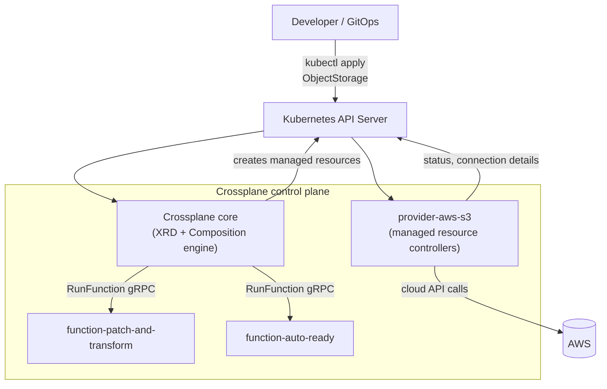
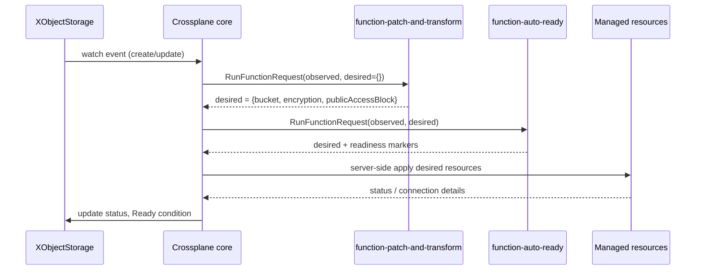

# Crossplane: Kubernetes-Native Infrastructure

## Learning Objectives
- Explain Crossplane's architecture: core, providers, managed resources, and composition
- Design a Composite Resource Definition (XRD) as a platform API
- Write Compositions in **Pipeline mode** using composition functions
- Understand the differences between Crossplane 1.x claim-based APIs and Crossplane 2.x namespaced composite resources
- Test compositions locally with `crossplane render` and debug live resources with `crossplane beta trace`
- Decide when Crossplane is a better fit than Terraform

## Prerequisites
- [Controllers and operators](../01-kubernetes-fundamentals/controllers-operators.md) — Crossplane is a set of controllers
- [Terraform for Kubernetes Platforms](./terraform-kubernetes.md) — for comparison
- A Kubernetes 1.28+ cluster (Kind is fine — [Lab 01](../../labs/lab-01-cluster-setup/README.md))
- `helm`, `kubectl`, and the `crossplane` CLI (`curl -sL "https://raw.githubusercontent.com/crossplane/crossplane/main/install.sh" | sh`)

---

## What Is Crossplane?

Crossplane turns the Kubernetes API server into a **universal control plane**. Instead of running `terraform apply`, you `kubectl apply` a resource describing a database, bucket, or entire environment, and controllers continuously reconcile the real cloud resources to match.



### Core Concepts

| Concept | What it is | Who writes it |
|---------|-----------|---------------|
| **Provider** | Package that installs CRDs + controllers for an external API (AWS, GCP, Azure, Helm, Kubernetes, GitHub...) | Platform team installs |
| **Managed Resource (MR)** | One external resource, 1:1 (e.g. an S3 `Bucket`) | Usually generated by compositions |
| **ProviderConfig** | Credentials/identity a provider uses | Platform team |
| **Composite Resource Definition (XRD)** | Defines a *new* API (schema) — like a CRD | Platform team |
| **Composite Resource (XR)** | An instance of the XRD's API | Developers or GitOps |
| **Claim** (1.x / legacy) | Namespaced proxy for a cluster-scoped XR | Developers |
| **Composition** | How an XR maps to MRs — a pipeline of functions | Platform team |
| **Function** | Package that runs a step of composition logic (templating, patching, readiness) | Platform team installs |

### Crossplane vs Terraform

| Aspect | Terraform | Crossplane |
|--------|-----------|------------|
| Reconciliation | On apply | Continuous (default poll ~1 min per MR, configurable) |
| Interface | HCL + CLI | Kubernetes API (kubectl, GitOps, RBAC, admission policy) |
| State | State file | etcd (the resource objects themselves) |
| Self-service API | Wrappers (modules, TFC no-code) | First-class (XRDs) |
| Drift correction | Manual re-apply | Automatic |
| Ecosystem breadth | Very large | Large (many providers are generated from Terraform providers via Upjet) |
| Debugging | Plan output | Events, conditions, `crossplane beta trace` |
| Bootstrapping the cluster it runs on | Natural | Chicken-and-egg (needs a cluster first) |

Many platforms use **both**: Terraform for the management cluster, Crossplane inside it for tenant-requested infrastructure. See [GitOps Tool Comparison](./gitops-tool-comparison.md).

---

## Crossplane 1.x vs 2.x

Crossplane 2.0 (2025) reshaped the composition model. You will meet both styles in the wild.

| Topic | Crossplane 1.x style | Crossplane 2.x style |
|-------|---------------------|----------------------|
| XRD API | `apiextensions.crossplane.io/v1` | `apiextensions.crossplane.io/v2` (v1 still served) |
| XR scope | Cluster-scoped, accessed via namespaced **claims** | `spec.scope: Namespaced` (default), `Cluster`, or `LegacyCluster` |
| Claims | Core feature | Only for `LegacyCluster` XRs (v1 XRDs) |
| Composition modes | `Resources` (native P&T) or `Pipeline` | **Pipeline only** |
| Managed resources | Cluster-scoped (`s3.aws.upbound.io`) | Namespaced variants (`s3.aws.m.upbound.io`) alongside legacy |
| What can be composed | Managed resources | Any Kubernetes resource (Deployments, ConfigMaps, other XRs...) |

**This repo's approach:** compositions are always written in **Pipeline mode**, which works on Crossplane ≥ 1.14 and 2.x. The main walkthrough uses an `apiextensions.crossplane.io/v1` XRD with a claim (portable across both majors), followed by the 2.x namespaced equivalent. The code lives in [`code/crossplane-compositions/`](../../code/crossplane-compositions/) (`xrd/`, `compositions/`, `functions/`, `claims/`).

---

## Installing Crossplane

```bash
# Install Crossplane core
helm repo add crossplane-stable https://charts.crossplane.io/stable
helm repo update

helm install crossplane crossplane-stable/crossplane \
  --namespace crossplane-system --create-namespace \
  --wait

kubectl get pods -n crossplane-system
kubectl api-resources | grep crossplane.io
```

In production, install Crossplane via GitOps like any other add-on (an Argo CD `Application` or Flux `HelmRelease`), and pin the chart version.

### Installing Providers and Functions

```yaml
# crossplane-packages.yaml
apiVersion: pkg.crossplane.io/v1
kind: Provider
metadata:
  name: provider-aws-s3
spec:
  # Pin to a specific release; check the registry for the latest
  package: xpkg.crossplane.io/crossplane-contrib/provider-aws-s3:v2.0.0
  runtimeConfigRef:
    name: aws-irsa
---
apiVersion: pkg.crossplane.io/v1
kind: Function
metadata:
  name: function-patch-and-transform
spec:
  package: xpkg.crossplane.io/crossplane-contrib/function-patch-and-transform:v0.8.2
---
apiVersion: pkg.crossplane.io/v1
kind: Function
metadata:
  name: function-auto-ready
spec:
  package: xpkg.crossplane.io/crossplane-contrib/function-auto-ready:v0.5.0
---
# Attach an IRSA role to the provider's ServiceAccount (EKS)
apiVersion: pkg.crossplane.io/v1beta1
kind: DeploymentRuntimeConfig
metadata:
  name: aws-irsa
spec:
  serviceAccountTemplate:
    metadata:
      annotations:
        eks.amazonaws.com/role-arn: arn:aws:iam::123456789012:role/crossplane-provider-aws
```

> **Package versions.** The versions above are illustrative. Check the [Upbound Marketplace](https://marketplace.upbound.io) or the GitHub releases for each package before pinning. Upjet-based AWS providers are split into *family* packages (`provider-aws-s3`, `provider-aws-rds`, ...) that share a `provider-family-aws` dependency — install only the services you need to keep CRD count (and API server memory) down.

```bash
kubectl get providers,functions
# NAME                                    INSTALLED   HEALTHY   PACKAGE
# provider.pkg.crossplane.io/provider-aws-s3   True    True    xpkg.crossplane.io/...
```

### ProviderConfig

```yaml
# providerconfig-aws.yaml
apiVersion: aws.upbound.io/v1beta1
kind: ProviderConfig
metadata:
  name: default
spec:
  credentials:
    source: IRSA   # use the pod identity configured above; no static keys
```

---

## Designing the Platform API (XRD)

Think of an XRD as a **product interface**: expose the few knobs developers care about, hide the 40 provider fields they don't. For a platform object-storage offering:

```yaml
# code/crossplane-compositions/xrd/objectstorage.yaml
apiVersion: apiextensions.crossplane.io/v1
kind: CompositeResourceDefinition
metadata:
  name: xobjectstorages.storage.platform.mycompany.io
spec:
  group: storage.platform.mycompany.io
  names:
    kind: XObjectStorage
    plural: xobjectstorages
  claimNames:               # developers use the namespaced claim
    kind: ObjectStorage
    plural: objectstorages
  defaultCompositionRef:
    name: objectstorage-aws
  connectionSecretKeys:
    - bucketName
    - region
  versions:
    - name: v1alpha1
      served: true
      referenceable: true   # exactly one version is referenceable
      additionalPrinterColumns:
        - name: Bucket
          type: string
          jsonPath: .status.bucketName
      schema:
        openAPIV3Schema:
          type: object
          properties:
            spec:
              type: object
              properties:
                region:
                  type: string
                  default: us-east-1
                  enum: [us-east-1, eu-west-1]
                versioning:
                  type: boolean
                  default: true
                retentionDays:
                  type: integer
                  minimum: 1
                  maximum: 3650
                  description: Expire non-current object versions after N days
                tenant:
                  type: string
                  description: Owning platform Tenant (platform.mycompany.io/v1alpha1)
              required: [tenant]
              x-kubernetes-validations:
                - rule: "!has(self.retentionDays) || self.versioning"
                  message: retentionDays requires versioning=true
            status:
              type: object
              properties:
                bucketName:
                  type: string
                arn:
                  type: string
```

Design tips:

- **Version the API** (`v1alpha1` → `v1beta1` → `v1`) the same way you would a CRD ([CRD design](../09-platform-apis/kubernetes-crds.md)).
- **Use enums and CEL validation** (`x-kubernetes-validations`) to reject bad input at admission, before any cloud call.
- **Link to the tenancy model**: requiring `spec.tenant` lets policies (see [Policy Engine](../12-security-compliance/policy-engine.md)) verify that the claim's namespace belongs to that `Tenant`.

---

## Writing a Composition (Pipeline Mode)

A Pipeline Composition is an ordered list of function calls. Each function receives the *observed* state (XR + composed resources) and the *desired* state so far, and returns an updated desired state.



```yaml
# code/crossplane-compositions/compositions/objectstorage-aws.yaml
apiVersion: apiextensions.crossplane.io/v1
kind: Composition
metadata:
  name: objectstorage-aws
  labels:
    platform.mycompany.io/provider: aws
spec:
  compositeTypeRef:
    apiVersion: storage.platform.mycompany.io/v1alpha1
    kind: XObjectStorage
  writeConnectionSecretsToNamespace: crossplane-system
  mode: Pipeline
  pipeline:
    - step: patch-and-transform
      functionRef:
        name: function-patch-and-transform
      input:
        apiVersion: pt.fn.crossplane.io/v1beta1
        kind: Resources
        resources:
          - name: bucket
            base:
              apiVersion: s3.aws.upbound.io/v1beta1
              kind: Bucket
              spec:
                forProvider:
                  region: us-east-1
                  tags:
                    platform.mycompany.io/managed-by: crossplane
            patches:
              - type: FromCompositeFieldPath
                fromFieldPath: spec.region
                toFieldPath: spec.forProvider.region
              - type: FromCompositeFieldPath
                fromFieldPath: spec.tenant
                toFieldPath: spec.forProvider.tags[platform.mycompany.io/tenant]
              - type: ToCompositeFieldPath
                fromFieldPath: metadata.annotations[crossplane.io/external-name]
                toFieldPath: status.bucketName
              - type: ToCompositeFieldPath
                fromFieldPath: status.atProvider.arn
                toFieldPath: status.arn
            connectionDetails:
              - name: bucketName
                type: FromFieldPath
                fromFieldPath: metadata.annotations[crossplane.io/external-name]
              - name: region
                type: FromFieldPath
                fromFieldPath: spec.forProvider.region

          - name: encryption
            base:
              apiVersion: s3.aws.upbound.io/v1beta1
              kind: BucketServerSideEncryptionConfiguration
              spec:
                forProvider:
                  bucketSelector:
                    matchControllerRef: true   # select the bucket composed by this XR
                  rule:
                    - applyServerSideEncryptionByDefault:
                        - sseAlgorithm: aws:kms
            patches:
              - type: FromCompositeFieldPath
                fromFieldPath: spec.region
                toFieldPath: spec.forProvider.region

          - name: public-access-block
            base:
              apiVersion: s3.aws.upbound.io/v1beta1
              kind: BucketPublicAccessBlock
              spec:
                forProvider:
                  bucketSelector:
                    matchControllerRef: true
                  blockPublicAcls: true
                  blockPublicPolicy: true
                  ignorePublicAcls: true
                  restrictPublicBuckets: true
            patches:
              - type: FromCompositeFieldPath
                fromFieldPath: spec.region
                toFieldPath: spec.forProvider.region

    - step: automatically-detect-ready
      functionRef:
        name: function-auto-ready
```

### Common Patch Types

| Patch type | Direction | Example use |
|------------|-----------|-------------|
| `FromCompositeFieldPath` | XR → MR | Copy `spec.region` into the bucket |
| `ToCompositeFieldPath` | MR → XR | Surface ARN in XR status |
| `CombineFromComposite` | XR (multiple fields) → MR | Build a name from `tenant` + `environment` |
| `FromEnvironmentFieldPath` / `ToEnvironmentFieldPath` | Environment ↔ MR | Per-cluster defaults (VPC ID, KMS key) |
| `PatchSet` | reusable group | Shared tagging patches |

Transforms (`map`, `match`, `string` (Format/Convert/Regexp), `math`, `convert`) modify values in flight:

```yaml
# Map a t-shirt size to an instance class
- type: FromCompositeFieldPath
  fromFieldPath: spec.size
  toFieldPath: spec.forProvider.instanceClass
  transforms:
    - type: map
      map:
        small: db.t4g.small
        medium: db.m7g.large
        large: db.m7g.2xlarge
```

### Templating Instead of Patching

For complex logic (loops, conditionals), `function-go-templating` renders resources from Go templates. Each rendered resource needs a `gotemplating.fn.crossplane.io/composition-resource-name` annotation so Crossplane can track it across reconciles.

```yaml
# pipeline step using function-go-templating
- step: render-buckets-per-region
  functionRef:
    name: function-go-templating
  input:
    apiVersion: gotemplating.fn.crossplane.io/v1beta1
    kind: GoTemplate
    source: Inline
    inline:
      template: |
        {{- $xr := .observed.composite.resource }}
        {{- range $i, $region := $xr.spec.replicaRegions }}
        ---
        apiVersion: s3.aws.upbound.io/v1beta1
        kind: Bucket
        metadata:
          annotations:
            gotemplating.fn.crossplane.io/composition-resource-name: replica-{{ $region }}
        spec:
          forProvider:
            region: {{ $region }}
            tags:
              platform.mycompany.io/tenant: {{ $xr.spec.tenant }}
        {{- end }}
```

Other useful functions: `function-kcl`, `function-cel-filter`, `function-environment-configs`, and functions you write yourself in Go or Python with the function SDKs — see [`code/crossplane-compositions/functions/`](../../code/crossplane-compositions/functions/).

---

## Consuming the API (Claims)

Developers create a namespaced claim. They never see `Bucket` or IAM.

```yaml
# code/crossplane-compositions/claims/team-payments-artifacts.yaml
apiVersion: storage.platform.mycompany.io/v1alpha1
kind: ObjectStorage
metadata:
  name: artifacts
  namespace: payments-dev
  labels:
    platform.mycompany.io/tenant: payments
spec:
  tenant: payments
  region: eu-west-1
  versioning: true
  retentionDays: 30
  writeConnectionSecretToRef:
    name: artifacts-bucket      # Secret created in payments-dev
```

```bash
kubectl apply -f team-payments-artifacts.yaml
kubectl get objectstorage -n payments-dev
# NAME        SYNCED   READY   CONNECTION-SECRET   AGE
# artifacts   True     True    artifacts-bucket    2m

crossplane beta trace objectstorage artifacts -n payments-dev
# NAME                                       SYNCED   READY   STATUS
# ObjectStorage/artifacts (payments-dev)     True     True    Available
# └─ XObjectStorage/artifacts-7x2kq          True     True    Available
#    ├─ Bucket/artifacts-7x2kq-abcde         True     True    Available
#    ├─ BucketServerSideEncryption...        True     True    Available
#    └─ BucketPublicAccessBlock/...          True     True    Available
```

---

## Crossplane 2.x: Namespaced Composite Resources

On Crossplane 2.x, the same API can be published without claims. The XR itself lives in the developer's namespace, and so do its composed resources.

```yaml
# xrd-objectstorage-v2.yaml
apiVersion: apiextensions.crossplane.io/v2
kind: CompositeResourceDefinition
metadata:
  name: objectstorages.storage.platform.mycompany.io
spec:
  scope: Namespaced            # default in v2
  group: storage.platform.mycompany.io
  names:
    kind: ObjectStorage
    plural: objectstorages
  versions:
    - name: v1alpha1
      served: true
      referenceable: true
      schema:
        openAPIV3Schema:
          type: object
          properties:
            spec:
              type: object
              properties:
                region:
                  type: string
                tenant:
                  type: string
              required: [tenant]
```

Key differences in the matching Composition:

- Compose **namespaced managed resources** (e.g. `s3.aws.m.upbound.io/v1beta1` `Bucket`) whose `spec.providerConfigRef` points to a namespaced `ProviderConfig` or a `ClusterProviderConfig`.
- Connection details are no longer published by the XR machinery; compose a `Secret` explicitly if consumers need one.
- XR-level fields such as `compositionRef`, `writeConnectionSecretToRef`, and `resourceRefs` move under `spec.crossplane`.

**Why it matters for multi-tenancy:** namespaced XRs and MRs mean ordinary Kubernetes RBAC and namespace-scoped policy apply directly — a tenant can only see and touch their own infrastructure. This pairs naturally with the `Tenant` → namespaces model in [Lab 07](../../labs/lab-07-multi-tenancy/README.md).

---

## Operating Crossplane

### Composition Revisions and Safe Rollouts

Every change to a Composition creates an immutable `CompositionRevision`. XRs choose how to follow updates:

```yaml
# On a claim (1.x) or under spec.crossplane on a v2 XR
spec:
  compositionUpdatePolicy: Manual          # default: Automatic
  compositionRevisionRef:
    name: objectstorage-aws-8f3c2d1
```

Roll out changes like an application: label revisions with a channel and use `compositionRevisionSelector`, moving dev claims first, then prod.

```bash
kubectl get compositionrevisions -l crossplane.io/composition-name=objectstorage-aws
```

### Deletion Protection

| Mechanism | Effect |
|-----------|--------|
| `spec.deletionPolicy: Orphan` on an MR | Deleting the MR leaves the cloud resource in place |
| `spec.managementPolicies: ["Observe"]` | Read-only import of an existing resource |
| `Usage` (`apiextensions.crossplane.io/v1beta1`, `protection.crossplane.io` in 2.x) | Block deletion of a resource while something uses it |

```yaml
# Import an existing bucket read-only, then take over management later
apiVersion: s3.aws.upbound.io/v1beta1
kind: Bucket
metadata:
  name: legacy-logs
  annotations:
    crossplane.io/external-name: mycompany-legacy-logs   # real bucket name
spec:
  managementPolicies: ["Observe"]
  forProvider:
    region: us-east-1
```

### Observability

```bash
# Crossplane exposes Prometheus metrics; key signals:
#   crossplane_managed_resource_ready / _synced     (gauge by GVK)
#   crossplane_composition_run_function_seconds     (function latency)
#   controller_runtime_reconcile_errors_total
kubectl -n crossplane-system port-forward deploy/crossplane 8080
curl -s localhost:8080/metrics | grep crossplane_
```

Alert on MRs that stay `Synced=False` or `Ready=False` for more than a few minutes — these are usually credential or quota problems at the cloud provider. See [Drift Detection](./drift-detection.md) for how Crossplane's continuous reconciliation interacts with drift.

---

## Testing Compositions Locally

`crossplane render` runs your pipeline locally (functions run in Docker) without a cluster:

```bash
# Files: xr.yaml (an XObjectStorage), composition.yaml, functions.yaml (Function objects)
crossplane render xr.yaml composition.yaml functions.yaml

# Include observed resources to simulate a later reconcile
crossplane render xr.yaml composition.yaml functions.yaml \
  --observed-resources=observed/ --include-full-xr
```

> Older CLI releases expose this as `crossplane beta render`.

Combine with CI:

```yaml
# .github/workflows/crossplane.yaml (excerpt)
- name: Render compositions
  run: |
    for xr in code/crossplane-compositions/examples/*.yaml; do
      crossplane render "$xr" \
        code/crossplane-compositions/compositions/objectstorage-aws.yaml \
        code/crossplane-compositions/functions/functions.yaml > /dev/null
    done
- name: Validate rendered output against provider schemas
  run: crossplane beta validate code/crossplane-compositions/schemas rendered/
```

---

## Hands-On Exercise

### Compose Kubernetes Resources Without a Cloud Account

You don't need AWS to learn composition. Use `provider-kubernetes` to compose in-cluster objects: a "team space" API that creates a namespace with a quota.

```bash
# 1. Install Crossplane (see above), then provider-kubernetes and functions
cat <<'EOF' | kubectl apply -f -
apiVersion: pkg.crossplane.io/v1
kind: Provider
metadata:
  name: provider-kubernetes
spec:
  package: xpkg.crossplane.io/crossplane-contrib/provider-kubernetes:v1.0.0
---
apiVersion: pkg.crossplane.io/v1
kind: Function
metadata:
  name: function-patch-and-transform
spec:
  package: xpkg.crossplane.io/crossplane-contrib/function-patch-and-transform:v0.8.2
EOF
kubectl wait provider/provider-kubernetes --for=condition=Healthy --timeout=5m

# 2. Give the provider in-cluster permissions (lab only - scope this down in real life)
SA=$(kubectl -n crossplane-system get sa -o name | grep provider-kubernetes | cut -d/ -f2)
kubectl create clusterrolebinding provider-kubernetes-admin \
  --clusterrole=cluster-admin --serviceaccount=crossplane-system:${SA}

cat <<'EOF' | kubectl apply -f -
apiVersion: kubernetes.crossplane.io/v1alpha1
kind: ProviderConfig
metadata:
  name: default
spec:
  credentials:
    source: InjectedIdentity
EOF
```

3. Write an XRD `XTeamSpace` (group `lab.platform.mycompany.io`, claim `TeamSpace`) with fields `spec.cpu` and `spec.memory`.
4. Write a Pipeline Composition that composes two `kubernetes.crossplane.io/v1alpha2` `Object` resources: a `Namespace` named after the claim, and a `ResourceQuota` in it with `hard.requests.cpu`/`hard.requests.memory` patched from the XR.
5. Apply a claim, then run `crossplane beta trace teamspace <name> -n default`.
6. Delete the `ResourceQuota` by hand with `kubectl delete resourcequota ...` and watch Crossplane recreate it within the poll interval. That is continuous reconciliation, which Terraform doesn't do.
7. Change the Composition (e.g. add a `LimitRange`) and look at the new `CompositionRevision`.

**Stretch:** Run step 4 through `crossplane render` before applying it.

---

## Troubleshooting

| Symptom | Likely Cause | Fix |
|---------|--------------|-----|
| Provider `HEALTHY=False` | Package pull failure, missing dependency, or CRD conflict | `kubectl describe provider <name>`; check `providerrevision` events |
| XR stuck `Synced=False` with `cannot compose resources` | Function not installed/healthy, or invalid input | `kubectl get functions`; `kubectl describe xobjectstorage <name>` |
| `cannot find composition` | No `defaultCompositionRef`/selector match | Set `compositionRef` or fix labels |
| MR `Synced=False`, `ReconcileError` with 403 | Cloud IAM permissions | Check ProviderConfig identity and the provider pod's ServiceAccount annotations |
| Patch silently does nothing | Wrong field path (paths are not validated) | `crossplane render` and diff the output; check `spec.forProvider` structure in provider CRD docs |
| Resources recreated on every reconcile (go-templating) | Missing `composition-resource-name` annotation | Add a stable annotation per resource |
| Claim deleted but cloud resource remains | `deletionPolicy: Orphan` or stuck finalizer | Inspect MR finalizers; check provider logs |
| API server slow / high memory after installing a provider | Thousands of CRDs from a monolithic provider | Use family providers; install only needed services; consider `ManagedResourceActivationPolicy` on 2.x |

```bash
# Debugging toolkit
crossplane beta trace <kind> <name> -n <ns> -o wide
kubectl get managed                         # all managed resources
kubectl get composite                       # all XRs
kubectl -n crossplane-system logs deploy/crossplane -f
kubectl -n crossplane-system logs -l pkg.crossplane.io/provider=provider-aws-s3 -f
kubectl get events --field-selector involvedObject.kind=XObjectStorage
```

---

## Best Practices

- **Small, opinionated APIs.** Expose intent (`size: medium`), not provider fields.
- **Pipeline mode only.** Native patch-and-transform (`mode: Resources`) is removed in 2.x.
- **Pin package versions** and roll them out via GitOps like any other dependency.
- **Use composition revisions** to stage changes across environments.
- **Least-privilege provider identities** per ProviderConfig (and per tenant, where you can).
- **Test with `crossplane render`** in CI. Treat compositions as code.
- **Protect stateful resources** with `deletionPolicy: Orphan` and `Usage`.

---

## Further Reading

- [Crossplane documentation](https://docs.crossplane.io/)
- [What's new in Crossplane v2](https://docs.crossplane.io/latest/whats-new/)
- [Composition functions](https://docs.crossplane.io/latest/composition/compositions/)
- [function-patch-and-transform guide](https://docs.crossplane.io/latest/guides/function-patch-and-transform/)
- [Upbound Marketplace](https://marketplace.upbound.io)
- [crossplane-contrib on GitHub](https://github.com/crossplane-contrib)

---

## Next Steps

1. **Read**: [GitOps Tool Comparison](./gitops-tool-comparison.md) — delivering XRDs and claims through Git
2. **Read**: [Drift Detection](./drift-detection.md)
3. **Explore code**: [`code/crossplane-compositions/`](../../code/crossplane-compositions/)
4. **Lab**: [Lab 03 - Platform API](../../labs/lab-03-platform-api/README.md) — compare a hand-written operator with a Crossplane composition
