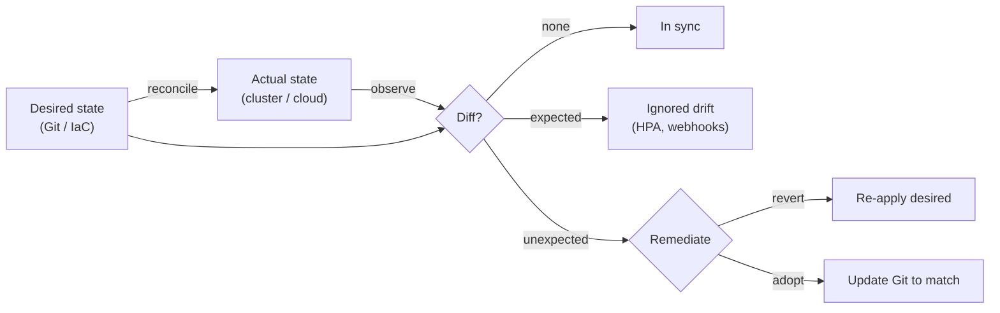
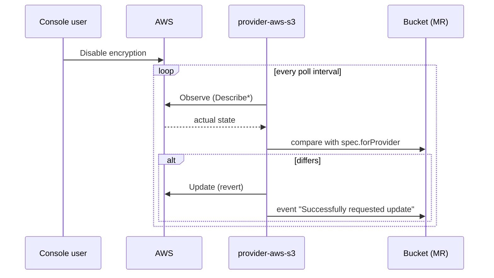
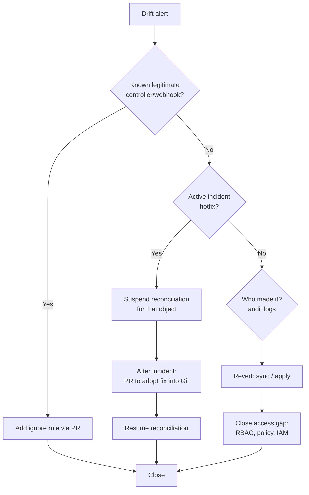

# Drift Detection and Remediation

## Learning Objectives
- Define drift precisely and classify its sources (manual change, controller mutation, upstream change, partial apply)
- Detect drift in Terraform, Argo CD, Flux, and Crossplane, and know what each one *cannot* see
- Tell legitimate drift (HPA replicas, injected sidecars) from real drift, and configure tools to ignore the legitimate kind
- Build a drift-response workflow: alert, triage, then either revert or adopt
- Prevent drift with admission control and access restrictions

## Prerequisites
- [GitOps Principles](../05-gitops/gitops-principles.md) (introduces basic `argocd app diff` / `flux diff`)
- [Terraform for Kubernetes](./terraform-kubernetes.md) and [Crossplane](./crossplane.md)
- Understanding of server-side apply and managed fields ([API Primer](../01-kubernetes-fundamentals/api-primer.md))

---

## What Is Drift?

**Drift** is any difference between the *desired state* (declared in Git or IaC) and the *actual state* (what the API, whether Kubernetes or cloud, reports).



### Sources of Drift

| Source | Example | Typical response |
|--------|---------|------------------|
| Manual change | `kubectl edit`, console click in AWS | Revert (and find out why it happened) |
| Emergency fix | Hotfix during an incident | **Adopt** into Git after the incident |
| Controller mutation | HPA sets `replicas`; VPA sets requests | Ignore that field |
| Admission mutation | Istio/Linkerd sidecar injection, Kyverno mutate, defaults | Ignore, or use server-side diff |
| Upstream change | Cloud provider adds a default tag; chart `latest` moves | Pin versions; adopt or ignore |
| Partial apply | Terraform apply interrupted; sync failed mid-way | Re-run reconcile |
| Out-of-band automation | Scripts, other operators, another GitOps tool | Single-owner rule; policy |

Drift is a **symptom**. A drift alert should lead to both remediating the change and asking why someone or something could make it.

---

## Detection Capabilities by Tool

| Tool | How it detects | Frequency | Blind spots |
|------|---------------|-----------|-------------|
| Terraform | `plan` refreshes state from APIs, compares to config | When you run it | Resources not in state; fields the provider doesn't read; in-cluster objects behind a `helm_release` |
| Argo CD | Compares rendered manifests with live objects (cached watches) | Continuous (watches) + periodic refresh of Git (default 3 min) | Objects it doesn't manage; ignored fields; resources excluded via `resource.exclusions` |
| Flux kustomize-controller | Server-side apply dry-run on each `interval` | Every `interval` | Objects outside the Kustomization inventory |
| Flux helm-controller | Optional `driftDetection` compares release manifest with cluster | Every `interval` (when enabled) | Disabled by default |
| Crossplane | Provider observes external resource on each poll | Poll interval (default ~1 min; `--poll-interval`) | Fields not modeled in `forProvider`; resources it doesn't manage |

Note the layering: a Terraform `helm_release` only knows the *release metadata*. If someone edits a Deployment from that chart, Terraform won't notice, but Argo CD or Flux with drift detection will.

---

## Terraform Drift

### Detection

```bash
# Refresh-only plan: shows drift without proposing config changes
terraform plan -refresh-only

# Machine-readable exit code for automation
#   0 = no changes, 1 = error, 2 = changes present (drift or pending config change)
terraform plan -detailed-exitcode -input=false -lock=false
```

### Scheduled Drift Job

```yaml
# .github/workflows/terraform-drift.yaml
name: terraform-drift
on:
  schedule:
    - cron: "0 */6 * * *"   # every 6 hours
  workflow_dispatch: {}

permissions:
  id-token: write
  contents: read
  issues: write

jobs:
  drift:
    runs-on: ubuntu-latest
    strategy:
      fail-fast: false
      matrix:
        stack: [10-network, 20-cluster, 30-bootstrap]
    defaults:
      run:
        working-directory: infra/stacks/${{ matrix.stack }}
    steps:
      - uses: actions/checkout@v4
      - uses: hashicorp/setup-terraform@v3
      - uses: aws-actions/configure-aws-credentials@v4
        with:
          role-to-assume: arn:aws:iam::123456789012:role/platform-terraform-readonly
          aws-region: us-east-1
      - run: terraform init -input=false
      - id: plan
        run: |
          set +e
          terraform plan -refresh-only -detailed-exitcode -input=false -lock=false -no-color > plan.txt
          echo "exitcode=$?" >> "$GITHUB_OUTPUT"
      - if: steps.plan.outputs.exitcode == '2'
        uses: actions/github-script@v7
        with:
          script: |
            const fs = require('fs');
            const body = fs.readFileSync('infra/stacks/${{ matrix.stack }}/plan.txt', 'utf8').slice(-60000);
            await github.rest.issues.create({
              owner: context.repo.owner, repo: context.repo.repo,
              title: `Drift detected in ${{ matrix.stack }}`,
              labels: ['drift', 'platform'],
              body: '```\n' + body + '\n```'
            });
      - if: steps.plan.outputs.exitcode == '1'
        run: exit 1
```

HCP Terraform and most Terraform automation platforms (Spacelift, env0, Scalr) offer built-in scheduled drift detection with the same idea.

### Remediation Options

| Situation | Command |
|-----------|---------|
| Revert the cloud to match config | `terraform apply` |
| Accept the real value into state *and* update config | `terraform apply -refresh-only`, then edit HCL to match |
| Resource was created outside Terraform | `import` block (Terraform ≥ 1.5) then plan |
| Field legitimately managed elsewhere | `lifecycle { ignore_changes = [tags["LastScanned"]] }` |

```hcl
# import.tf - adopt a bucket someone created by hand
import {
  to = aws_s3_bucket.audit_logs
  id = "mycompany-audit-logs"
}

# terraform plan -generate-config-out=generated.tf  # scaffold the HCL
```

---

## Argo CD Drift

Argo CD compares every managed resource continuously, which `gitops-principles.md` introduced. This section covers the details that make drift signals trustworthy.

### Server-Side Diff

Client-side diffs often report false drift caused by defaulting and mutating webhooks. Server-side diff asks the API server for a dry-run apply and compares the result:

```yaml
# argocd-cmd-params-cm (controller-wide) - or per-app annotation below
apiVersion: v1
kind: ConfigMap
metadata:
  name: argocd-cmd-params-cm
  namespace: argocd
data:
  controller.diff.server.side: "true"
```

```yaml
# Per Application
metadata:
  annotations:
    argocd.argoproj.io/compare-options: ServerSideDiff=true,IncludeMutationWebhook=true
```

### Ignoring Legitimate Drift (System-Wide)

`argocd-deep-dive.md` shows per-Application `ignoreDifferences`. For platform-wide rules, use `argocd-cm`:

```yaml
# argocd-cm.yaml (excerpt)
apiVersion: v1
kind: ConfigMap
metadata:
  name: argocd-cm
  namespace: argocd
data:
  # HPA owns replicas everywhere
  resource.customizations.ignoreDifferences.apps_Deployment: |
    jsonPointers:
      - /spec/replicas
  # Ignore any field owned by these field managers (server-side apply)
  resource.customizations.ignoreDifferences.all: |
    managedFieldsManagers:
      - kube-controller-manager
      - vpa-recommender
  # Webhook CA bundles injected by cert-manager
  resource.customizations.ignoreDifferences.admissionregistration.k8s.io_ValidatingWebhookConfiguration: |
    jqPathExpressions:
      - .webhooks[]?.clientConfig.caBundle
```

Pair with `RespectIgnoreDifferences=true` in `syncOptions` so a sync doesn't overwrite the ignored fields.

### Remediation Modes

| Mode | Config | Behavior |
|------|--------|----------|
| Detect only | No `automated` | App goes `OutOfSync`; humans sync |
| Auto-sync on Git change | `automated: {}` | Applies new commits; does **not** revert live edits |
| Self-heal | `automated: { selfHeal: true }` | Reverts live edits (after `--self-heal-timeout-seconds`, default 5s) |
| Prune | `automated: { prune: true }` | Deletes resources removed from Git |

### Alerting

```yaml
# argocd-notifications-cm (excerpt)
apiVersion: v1
kind: ConfigMap
metadata:
  name: argocd-notifications-cm
  namespace: argocd
data:
  trigger.on-drift: |
    - when: app.status.sync.status == 'OutOfSync' and app.status.operationState.phase in ['Succeeded']
      send: [drift-detected]
  template.drift-detected: |
    message: |
      :warning: {{.app.metadata.name}} drifted from Git ({{.app.spec.source.targetRevision}}).
      {{.context.argocdUrl}}/applications/{{.app.metadata.name}}?view=tree&resource=&diff=true
  service.slack: |
    token: $slack-token
```

```yaml
# Subscribe an Application (or set defaults for all)
metadata:
  annotations:
    notifications.argoproj.io/subscribe.on-drift.slack: platform-alerts
```

---

## Flux Drift

### Kustomizations: Always Corrected

kustomize-controller performs a server-side apply on every `interval`, so drift in fields declared in Git is **always** reverted. There is no detect-only mode. To pause correction, suspend:

```bash
flux suspend kustomization payments-api -n flux-system   # freeze for incident work
flux diff kustomization payments-api --path ./clusters/prod/payments-api
flux resume kustomization payments-api -n flux-system
```

Fields **not** declared in Git (e.g. `replicas` omitted from the manifest) are left alone, because server-side apply only owns what you send. The cleanest way to "ignore" HPA-managed replicas in Flux is to **not set `spec.replicas`** in the manifest.

To make the controller skip an object entirely during incident work:

```yaml
metadata:
  annotations:
    kustomize.toolkit.fluxcd.io/reconcile: disabled
```

### HelmReleases: Opt-In Drift Detection

```yaml
# helmrelease-with-drift.yaml
apiVersion: helm.toolkit.fluxcd.io/v2
kind: HelmRelease
metadata:
  name: ingress-nginx
  namespace: ingress-nginx
spec:
  interval: 10m
  chart:
    spec:
      chart: ingress-nginx
      version: 4.12.1
      sourceRef:
        kind: HelmRepository
        name: ingress-nginx
        namespace: flux-system
  driftDetection:
    mode: enabled        # "warn" = detect + emit event only; "enabled" = correct
    ignore:
      - paths: ["/spec/replicas"]
        target:
          kind: Deployment
```

Start with `mode: warn` on existing releases to see how noisy they are, then switch to `enabled`.

### Alerting

```yaml
# flux-drift-alert.yaml
apiVersion: notification.toolkit.fluxcd.io/v1beta3
kind: Alert
metadata:
  name: drift
  namespace: flux-system
spec:
  providerRef:
    name: slack-platform
  eventSeverity: info
  eventSources:
    - kind: HelmRelease
      name: "*"
      namespace: "*"
    - kind: Kustomization
      name: "*"
  inclusionList:
    - ".*drift.*"
    - ".*configured.*"   # SSA reports objects it had to correct as "configured"
```

---

## Crossplane Drift

Crossplane reconciles each managed resource against the external API on a poll interval. If someone changes an S3 bucket's encryption in the console, the provider reverts it on the next poll.



Controls:

| Need | Mechanism |
|------|-----------|
| Detect but don't correct | `spec.managementPolicies: ["Observe"]`, or omit `"Update"` from the policies |
| Let something else own a field | `spec.initProvider` (set only at create, then ignored) |
| Tune detection latency vs API cost | Provider `--poll-interval` (via `DeploymentRuntimeConfig` args) |
| Pause a resource | Annotation `crossplane.io/paused: "true"` |

```yaml
# Let an autoscaler own node count after creation
apiVersion: eks.aws.upbound.io/v1beta1
kind: NodeGroup
metadata:
  name: tenant-pool
spec:
  initProvider:
    scalingConfig:
      - desiredSize: 3        # set once at create; later changes are not drift
  forProvider:
    region: us-east-1
    scalingConfig:
      - minSize: 2
        maxSize: 10
```

---

## Drift Response Workflow



### Finding Who Changed It

```bash
# Kubernetes: which manager last touched a field
kubectl get deploy payments-api -n payments-prod -o yaml --show-managed-fields \
  | yq '.metadata.managedFields[] | {"manager": .manager, "operation": .operation, "time": .time}'

# Kubernetes audit logs (managed clusters ship these to the cloud log service)
# e.g. CloudWatch Logs Insights for EKS:
#   fields @timestamp, user.username, verb, objectRef.resource, objectRef.name
#   | filter objectRef.name = "payments-api" and verb in ["update","patch"]

# AWS: who changed the bucket
aws cloudtrail lookup-events \
  --lookup-attributes AttributeKey=ResourceName,AttributeValue=mycompany-artifacts \
  --max-results 20
```

A manager like `kubectl-edit` or `kubectl-client-side-apply` in `managedFields` is a strong sign of a human change.

---

## Preventing Drift

Detection is a safety net. Prevention is cheaper.

1. **Remove write access.** Humans get read-only RBAC in production; write access comes through break-glass groups with audit.
2. **Block out-of-band writes with admission policy.** Allow writes to GitOps-managed objects only from the GitOps controllers' ServiceAccounts:

```yaml
# vap-gitops-only.yaml - ValidatingAdmissionPolicy (GA in Kubernetes 1.30)
apiVersion: admissionregistration.k8s.io/v1
kind: ValidatingAdmissionPolicy
metadata:
  name: gitops-managed-objects-are-read-only
spec:
  failurePolicy: Fail
  matchConstraints:
    resourceRules:
      - apiGroups: ["apps"]
        apiVersions: ["v1"]
        operations: ["UPDATE", "DELETE"]
        resources: ["deployments", "statefulsets", "daemonsets"]
  matchConditions:
    - name: is-gitops-managed
      expression: >-
        has(oldObject.metadata.labels) &&
        'platform.mycompany.io/managed-by' in oldObject.metadata.labels
  validations:
    - expression: >-
        request.userInfo.username in [
          'system:serviceaccount:argocd:argocd-application-controller',
          'system:serviceaccount:flux-system:kustomize-controller',
          'system:serviceaccount:flux-system:helm-controller'
        ] ||
        request.userInfo.username.startsWith('system:serviceaccount:kube-system:') ||
        'platform:break-glass' in request.userInfo.groups
      message: "Object is managed by GitOps; change it via a pull request (or use break-glass)."
---
apiVersion: admissionregistration.k8s.io/v1
kind: ValidatingAdmissionPolicyBinding
metadata:
  name: gitops-managed-objects-are-read-only
spec:
  policyName: gitops-managed-objects-are-read-only
  validationActions: ["Deny"]   # start with ["Audit"] or ["Warn"] to measure impact
```

> Controllers like HPA update the `scale` subresource, which is a separate resource (`deployments/scale`) that the rule above doesn't match. Test any such policy in `Audit` mode first and check that the controllers you rely on (rollout restarts, VPA, etc.) still work. See [Policy Engine](../12-security-compliance/policy-engine.md) and [Lab 05](../../labs/lab-05-policy-engine/README.md) for Kyverno/Gatekeeper equivalents.

3. **Cloud guardrails.** AWS SCPs / Azure Policy / GCP Org Policy to deny console changes to tagged resources (`platform.mycompany.io/managed-by`).
4. **Pin versions.** Chart `version: 4.12.1`, not `*`; image digests where possible.
5. **One owner per object.** Ownership labels and policy enforcement prevent two tools from fighting.

---

## Measuring Drift

Track drift as a platform health metric (see [Measuring Success](../14-platform-evolution/measuring-success.md)):

```yaml
# prometheus-rules-drift.yaml
groups:
  - name: drift
    rules:
      - alert: ArgoCDAppOutOfSyncTooLong
        expr: argocd_app_info{sync_status="OutOfSync"} == 1
        for: 30m
        labels: { severity: warning }
        annotations:
          summary: "{{ $labels.name }} has been OutOfSync for 30m"

      - alert: FluxReconciliationNotReady
        expr: max by (exported_namespace, name, kind) (gotk_resource_info{ready="False"}) == 1
        for: 15m
        labels: { severity: warning }
        annotations:
          summary: "Flux {{ $labels.kind }} {{ $labels.name }} not Ready for 15m"

      - alert: CrossplaneManagedResourceNotSynced
        expr: sum by (gvk) (crossplane_managed_resource_synced{status="False"}) > 0
        for: 15m
        labels: { severity: warning }
        annotations:
          summary: "Crossplane MRs of {{ $labels.gvk }} not synced"
```

> Flux's `gotk_resource_info` metric is produced by kube-state-metrics custom resource state configuration, as documented in the Flux monitoring guide. Metric and label names depend on that config and on your Crossplane version, so check them against what your Prometheus actually scrapes.

Useful SLOs: *"95% of drift events are remediated within 1 hour"* and *"zero untracked manual changes in production per month"*.

---

## Hands-On Exercise

### Create, Detect, and Remediate Drift Three Ways

Use the Kind cluster with Argo CD and Flux from the [GitOps Tool Comparison](./gitops-tool-comparison.md) exercise.

```bash
# --- Argo CD ---------------------------------------------------------------
# 1. Turn off self-heal to observe detection only
kubectl -n argocd patch application podinfo-argo --type merge \
  -p '{"spec":{"syncPolicy":{"automated":{"selfHeal":false}}}}'

# 2. Introduce drift
kubectl -n demo-argo set env deploy/podinfo PODINFO_UI_MESSAGE="hand-edited"

# 3. Detect
argocd app get podinfo-argo --refresh   # Sync Status: OutOfSync
argocd app diff podinfo-argo

# 4. Find the culprit
kubectl -n demo-argo get deploy podinfo -o yaml --show-managed-fields | grep -A2 "manager:"

# 5. Remediate by re-enabling self-heal and watch it revert
kubectl -n argocd patch application podinfo-argo --type merge \
  -p '{"spec":{"syncPolicy":{"automated":{"selfHeal":true}}}}'

# --- Flux HelmRelease -------------------------------------------------------
# 6. Switch drift detection to warn, introduce drift, look for the event
kubectl -n demo-flux patch helmrelease podinfo --type merge \
  -p '{"spec":{"driftDetection":{"mode":"warn"}}}'
kubectl -n demo-flux set env deploy/podinfo PODINFO_UI_MESSAGE="hand-edited"
flux reconcile hr podinfo -n demo-flux
kubectl -n demo-flux get events --field-selector involvedObject.kind=HelmRelease | grep -i drift

# 7. Switch to enabled and reconcile; the env var disappears
kubectl -n demo-flux patch helmrelease podinfo --type merge \
  -p '{"spec":{"driftDetection":{"mode":"enabled"}}}'
flux reconcile hr podinfo -n demo-flux
kubectl -n demo-flux get deploy podinfo -o jsonpath='{.spec.template.spec.containers[0].env}'
```

**Stretch goals:**
1. Apply the `ValidatingAdmissionPolicy` above with `validationActions: ["Warn"]`, label the podinfo Deployments with `platform.mycompany.io/managed-by`, and repeat step 2. What warning do you get?
2. Add an HPA for podinfo and configure each tool to ignore `/spec/replicas` without false drift.

---

## Troubleshooting

| Symptom | Likely Cause | Fix |
|---------|--------------|-----|
| Argo CD app permanently `OutOfSync` with no visible diff | Defaulted fields / CRD schema pruning | Enable server-side diff (`ServerSideDiff=true`); compare `argocd app manifests --source live` with `--source git` |
| Constant flapping between two values | Two controllers own the same field | Inspect `managedFields`; remove one owner or add ignore rule |
| Self-heal doesn't revert a change | Field covered by `ignoreDifferences`, or `RespectIgnoreDifferences` absent during sync | Review ignore rules; verify `automated.selfHeal: true` |
| Flux doesn't revert an edited field | Field not present in Git manifest (SSA doesn't own it) | Declare the field in Git if it should be enforced |
| HelmRelease drift detection noisy | Chart has mutated fields (webhooks, generated certs) | `driftDetection.ignore` paths; start with `mode: warn` |
| `terraform plan` shows drift on every run | Provider normalizes values (JSON policy ordering, tags) | Normalize in HCL (`jsonencode`), `ignore_changes`, or upgrade provider |
| Crossplane keeps "updating" a resource | `forProvider` value the API normalizes differently (late-initialization loop) | Match the API's canonical format; use `initProvider` |
| VAP blocks legitimate controller | Controller SA not in allow-list | Add it; test with `Audit` before `Deny` |

---

## Further Reading

- [Argo CD diffing customization](https://argo-cd.readthedocs.io/en/stable/user-guide/diffing/)
- [Argo CD server-side diff](https://argo-cd.readthedocs.io/en/stable/user-guide/diff-strategies/)
- [Flux HelmRelease drift detection](https://fluxcd.io/flux/components/helm/helmreleases/#drift-detection)
- [Crossplane management policies](https://docs.crossplane.io/latest/managed-resources/managed-resources/)
- [Terraform refresh-only mode](https://developer.hashicorp.com/terraform/cli/commands/plan#planning-modes)
- [ValidatingAdmissionPolicy](https://kubernetes.io/docs/reference/access-authn-authz/validating-admission-policy/)

---

## Next Steps

1. **Read**: [Multi-Cluster GitOps](../05-gitops/multi-cluster-gitops.md) — drift across a fleet
2. **Read**: [Policy Engine](../12-security-compliance/policy-engine.md) — preventing out-of-band changes
3. **Lab**: [Lab 05 - Policy Engine](../../labs/lab-05-policy-engine/README.md)
