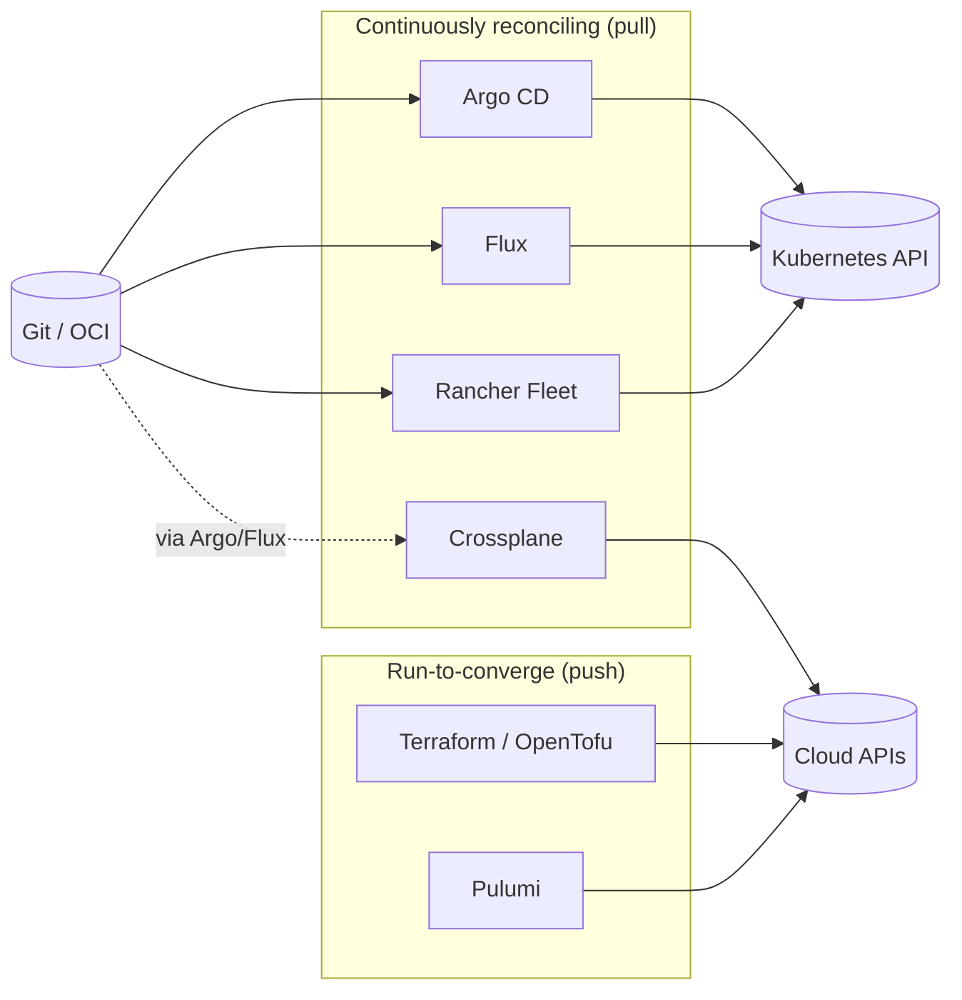
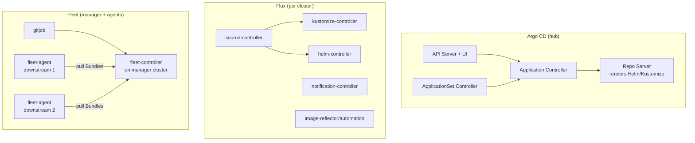
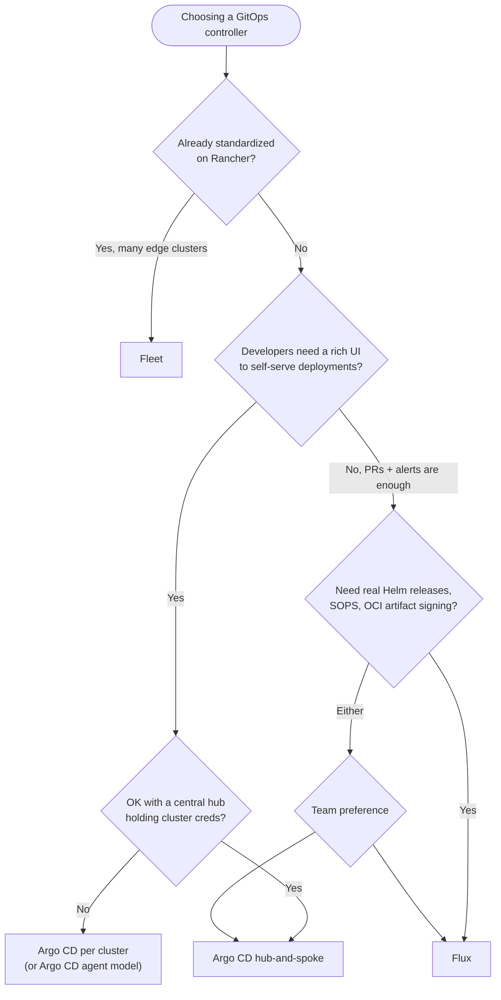

# GitOps Tool Comparison: Argo CD vs Flux vs Fleet

## Learning Objectives
- Compare Argo CD, Flux, and Rancher Fleet on architecture, tenancy, multi-cluster, and operations
- Express the same deployment in all three tools and see how their models differ
- Understand where Terraform and Crossplane sit relative to GitOps controllers
- Use a decision framework to pick a tool (or combination) for your platform
- Know the migration paths between tools

## Prerequisites
- [GitOps Principles](../05-gitops/gitops-principles.md)
- Helpful: [Argo CD Deep Dive](../05-gitops/argocd-deep-dive.md) and [Flux Deep Dive](../05-gitops/flux-deep-dive.md). This document compares the tools; it doesn't teach each one from scratch
- [Terraform for Kubernetes](./terraform-kubernetes.md) and [Crossplane](./crossplane.md) for the IaC context

---

## The Landscape

"Infrastructure as Code" and "GitOps" overlap. It helps to classify tools by **what they reconcile** and **when**.



| Tool | Reconciles | Source of truth | Typical role in a platform |
|------|-----------|-----------------|----------------------------|
| Terraform / OpenTofu | Cloud + K8s, on apply | Git + state file | Foundation: network, IAM, clusters |
| Crossplane | Cloud + K8s, continuously | Kubernetes objects (delivered from Git) | Self-service infra APIs |
| **Argo CD** | Kubernetes manifests | Git, Helm repos, OCI | App + add-on delivery, UI-centric |
| **Flux** | Kubernetes manifests | Git, Helm repos, OCI, S3 buckets | App + add-on delivery, API-centric |
| **Fleet** | Kubernetes manifests (as Bundles) | Git | Fleet-scale delivery, Rancher integration |

The rest of this document compares the three GitOps controllers.

---

## Architecture at a Glance



| Dimension | Argo CD | Flux | Fleet |
|-----------|---------|------|-------|
| Project | CNCF Graduated | CNCF Graduated | SUSE/Rancher (open source) |
| Core model | `Application` = source + destination | Composable controllers: Source → Kustomization/HelmRelease | `GitRepo` → `Bundle` → `BundleDeployment` per cluster |
| Rendering | Repo server renders, controller applies | Each controller renders and applies with server-side apply | Manager renders Bundles, agents deploy as Helm releases |
| Default topology | Hub-and-spoke (central Argo pushes to remote API servers) | One Flux per cluster (or a hub using `kubeConfig`) | Manager + agent per downstream cluster (agents pull) |
| Helm handling | `helm template` then apply (no Helm release objects) | Real Helm releases (`helm list` works, hooks honored) | Everything becomes a Helm release, including raw YAML |
| UI | Rich, built-in | None built-in (Flux Operator web UI, Headlamp plugin, Weave GitOps community fork) | Rancher UI |
| CLI | `argocd` | `flux` | `fleet` (limited); mostly kubectl/Rancher |
| Tenancy | `AppProject` + Argo RBAC (Casbin) + SSO | Kubernetes RBAC + per-Kustomization `serviceAccountName` | Workspaces (namespaces) + `GitRepoRestriction` |
| Drift correction | `selfHeal` (opt-in) | Always reconciles on `interval`; drift is corrected | Drift correction opt-in (`correctDrift`) |
| Image automation | Argo CD Image Updater (separate project) | Built-in image-reflector + image-automation controllers | Image scan feature (experimental) |
| Notifications | Argo CD Notifications (built-in) | notification-controller (`Provider`, `Alert`, `Receiver`) | Via Rancher / Kubernetes events |
| Progressive delivery pairing | Argo Rollouts | Flagger | Either, as workloads |

---

## Same Deployment, Three Tools

Deploy `ingress-nginx` from its Helm chart, with production values, to every cluster labeled `platform.mycompany.io/tier=production`.

### Argo CD

```yaml
# argocd/ingress-nginx-appset.yaml
apiVersion: argoproj.io/v1alpha1
kind: ApplicationSet
metadata:
  name: ingress-nginx
  namespace: argocd
spec:
  goTemplate: true
  goTemplateOptions: ["missingkey=error"]
  generators:
    - clusters:
        selector:
          matchLabels:
            platform.mycompany.io/tier: production
  template:
    metadata:
      name: 'ingress-nginx-{{ .name }}'
    spec:
      project: platform-addons
      sources:
        - repoURL: https://kubernetes.github.io/ingress-nginx
          chart: ingress-nginx
          targetRevision: 4.12.1
          helm:
            valueFiles:
              - $values/addons/ingress-nginx/values-production.yaml
        - repoURL: https://github.com/myorg/platform-config
          targetRevision: main
          ref: values            # multi-source: values file from our repo
      destination:
        server: '{{ .server }}'
        namespace: ingress-nginx
      syncPolicy:
        automated:
          prune: true
          selfHeal: true
        syncOptions:
          - CreateNamespace=true
          - ServerSideApply=true
```

**Model:** one hub generates one `Application` per matching cluster Secret and pushes manifests to each cluster's API server.

### Flux

```yaml
# clusters/prod-eu-1/addons/ingress-nginx.yaml  (one copy per cluster, often via Kustomize overlays)
apiVersion: source.toolkit.fluxcd.io/v1
kind: HelmRepository
metadata:
  name: ingress-nginx
  namespace: flux-system
spec:
  interval: 1h
  url: https://kubernetes.github.io/ingress-nginx
---
apiVersion: helm.toolkit.fluxcd.io/v2
kind: HelmRelease
metadata:
  name: ingress-nginx
  namespace: ingress-nginx
spec:
  interval: 30m
  chart:
    spec:
      chart: ingress-nginx
      version: 4.12.1
      sourceRef:
        kind: HelmRepository
        name: ingress-nginx
        namespace: flux-system
  install:
    createNamespace: true
    remediation:
      retries: 3
  upgrade:
    remediation:
      retries: 3
      remediateLastFailure: true
  driftDetection:
    mode: enabled          # correct in-cluster drift against the Helm release
  valuesFrom:
    - kind: ConfigMap
      name: ingress-nginx-values   # generated by Kustomize configMapGenerator
```

**Model:** each cluster runs Flux and pulls its own path (`clusters/prod-eu-1`). Cluster selection is a repository layout decision, not a label selector. See [Multi-Cluster GitOps](../05-gitops/multi-cluster-gitops.md).

### Fleet

```yaml
# fleet/gitrepo.yaml - applied to the Fleet manager cluster
apiVersion: fleet.cattle.io/v1alpha1
kind: GitRepo
metadata:
  name: platform-addons
  namespace: fleet-default        # workspace
spec:
  repo: https://github.com/myorg/platform-config
  branch: main
  paths:
    - addons/ingress-nginx
  targets:
    - name: production
      clusterSelector:
        matchLabels:
          platform.mycompany.io/tier: production
```

```yaml
# addons/ingress-nginx/fleet.yaml - lives in the Git repo next to values
defaultNamespace: ingress-nginx
helm:
  repo: https://kubernetes.github.io/ingress-nginx
  chart: ingress-nginx
  version: 4.12.1
  releaseName: ingress-nginx
  valuesFiles:
    - values-production.yaml
correctDrift:
  enabled: true
targetCustomizations:
  - name: eu
    clusterSelector:
      matchLabels:
        platform.mycompany.io/region: eu
    helm:
      values:
        controller:
          replicaCount: 3
```

**Model:** the manager turns the path into a `Bundle`; agents in matching clusters pull and install it as a Helm release. Per-cluster overrides live in `targetCustomizations`.

### Takeaways

| Question | Argo CD | Flux | Fleet |
|----------|---------|------|-------|
| Where is cluster targeting expressed? | ApplicationSet generators (labels on cluster Secrets) | Repo layout (`clusters/<name>/`) + per-cluster Flux | `targets` / `targetCustomizations` (labels on Cluster objects) |
| Who holds remote cluster credentials? | The hub | Nobody (each cluster pulls) — unless you use a Flux hub | Agents register with the manager; the manager has no push creds |
| Is a Helm release created? | No (rendered + applied) | Yes | Yes |
| How is a failed upgrade handled? | Sync fails; retry policy; manual rollback in UI | `remediation` (rollback/uninstall) automatically | Bundle shows error; Helm rollback semantics |

---

## Deep Comparison

### Multi-Tenancy

| Concern | Argo CD | Flux | Fleet |
|---------|---------|------|-------|
| Restrict source repos | `AppProject.spec.sourceRepos` | Policy (Kyverno) + `--no-cross-namespace-refs` | `GitRepoRestriction.allowedRepoPatterns` |
| Restrict destinations | `AppProject.spec.destinations` | `serviceAccountName` per Kustomization (impersonation) | Workspaces + cluster groups |
| Restrict resource kinds | `cluster/namespaceResourceWhitelist` | Kubernetes RBAC of the impersonated SA | `GitRepoRestriction` + RBAC |
| Human access | SSO + Argo RBAC (`argocd-rbac-cm`) | Kubernetes RBAC on Flux CRDs | Rancher RBAC |
| Lockdown flags | `applicationsetcontroller.policy`, `server.rbac` | `--no-cross-namespace-refs`, `--default-service-account`, `--no-remote-bases` | — |

For this repo's `Tenant` model, both Argo CD and Flux work well. Argo CD maps a `Tenant` to an `AppProject`; Flux maps it to a namespace, a ServiceAccount, and a `Kustomization` with `serviceAccountName`. The [tenant operator](../../code/tenant-operator/) can generate either.

### Scale

| Concern | Argo CD | Flux | Fleet |
|---------|---------|------|-------|
| Bottleneck | Application controller memory (caches every managed cluster) | Per-cluster, scales horizontally by nature | Manager + Bundle count |
| Scaling knobs | Controller sharding (`ARGOCD_CONTROLLER_REPLICAS`, sharding algorithms), repo-server replicas | `--concurrent`, `--requeue-dependency`, sharding via labels | Designed for very large fleets (thousands of clusters) |
| Practical sweet spot | Tens to low hundreds of clusters per instance | Any number (one instance per cluster) | Hundreds to thousands of edge clusters |

### Security Posture

| Concern | Argo CD | Flux | Fleet |
|---------|---------|------|-------|
| Credential concentration | Hub holds admin-equivalent creds for all clusters | No central cluster creds | Agent-initiated connections |
| Exposed surface | API server + UI (needs SSO, network controls) | No inbound API (webhook `Receiver` optional) | Rancher/manager API |
| Artifact verification | GPG commit verification; OCI/Helm signature verification evolving | cosign / Notation verification on `OCIRepository`, Git commit signature verification | — |
| Secret decryption | Plugins / ESO | Native SOPS decryption in kustomize-controller | ESO / external |

### Developer Experience

- **Argo CD** wins on visibility: the resource tree, diff view, and sync buttons are why many teams choose it. Developers can self-serve within their `AppProject`.
- **Flux** is "just Kubernetes": status lives in CR conditions, works with any Kubernetes UI, and fits teams that drive everything through PRs and alerts.
- **Fleet** is best when you already run Rancher: cluster registration, grouping, and UI come for free.

---

## Decision Framework



Common combinations in production:

| Combination | Why |
|-------------|-----|
| Terraform (clusters) + Argo CD (everything in-cluster) | Most common; clear split; good UI |
| Terraform + Flux + Crossplane | Fully API-driven; Flux delivers XRDs and claims; Crossplane provisions cloud |
| Flux for platform add-ons + Argo CD for app teams | Platform team gets Helm-native, low-surface Flux; app teams get the UI |
| Rancher + Fleet | Edge/retail with thousands of small clusters |

> Running two controllers is fine **as long as each object has exactly one owner**. Label ownership explicitly (e.g. `platform.mycompany.io/managed-by: flux`) and use policy to stop the other controller from touching those objects.

---

## Migration Notes

### Flux → Argo CD (or vice versa)

1. Freeze changes for the scope being migrated.
2. Suspend the old controller's object (`flux suspend kustomization X` or remove `automated` from the Argo CD `Application`). Don't delete it yet, because deleting with prune enabled deletes the workloads.
3. Create the new controller's object pointing at the **same** manifests. Argo CD adopts existing resources; for Helm, you must decide whether to keep the Helm release (Flux/Fleet) or let Argo CD take over rendered resources (Helm release Secrets become orphaned metadata).
4. Verify the new controller shows "in sync" with no pending creates or deletes.
5. Delete the old object **with pruning disabled** (`spec.prune: false` in Flux first; non-cascading delete in Argo CD: `argocd app delete X --cascade=false`).
6. Remove ownership labels and annotations the old tool left behind (`kustomize.toolkit.fluxcd.io/*`, `argocd.argoproj.io/tracking-id`).

### Terraform-managed add-ons → GitOps

1. Create the GitOps object for the add-on with identical chart version and values.
2. `terraform state rm helm_release.X` so Terraform forgets it without destroying anything.
3. Let the GitOps tool adopt it (Flux `HelmRelease` with the same release name and namespace adopts the existing Helm release).
4. Delete the Terraform code.

---

## Hands-On Exercise

### Side-by-Side: Argo CD and Flux on One Kind Cluster

**Goal:** Feel the operational differences by deploying the same `podinfo` chart with both tools into separate namespaces.

```bash
# 1. Cluster from Lab 01
kind create cluster --name gitops-compare

# 2. Install Argo CD
kubectl create namespace argocd
kubectl apply -n argocd --server-side \
  -f https://raw.githubusercontent.com/argoproj/argo-cd/stable/manifests/install.yaml

# 3. Install Flux (no Git bootstrap needed for this exercise)
flux install

# 4. Argo CD Application for podinfo
cat <<'EOF' | kubectl apply -f -
apiVersion: argoproj.io/v1alpha1
kind: Application
metadata:
  name: podinfo-argo
  namespace: argocd
spec:
  project: default
  source:
    repoURL: https://stefanprodan.github.io/podinfo
    chart: podinfo
    targetRevision: 6.*
  destination:
    server: https://kubernetes.default.svc
    namespace: demo-argo
  syncPolicy:
    automated: { prune: true, selfHeal: true }
    syncOptions: [CreateNamespace=true]
EOF

# 5. Flux HelmRelease for podinfo
kubectl create namespace demo-flux
cat <<'EOF' | kubectl apply -f -
apiVersion: source.toolkit.fluxcd.io/v1
kind: HelmRepository
metadata:
  name: podinfo
  namespace: demo-flux
spec:
  interval: 1h
  url: https://stefanprodan.github.io/podinfo
---
apiVersion: helm.toolkit.fluxcd.io/v2
kind: HelmRelease
metadata:
  name: podinfo
  namespace: demo-flux
spec:
  interval: 5m
  chart:
    spec:
      chart: podinfo
      version: "6.x"
      sourceRef: { kind: HelmRepository, name: podinfo }
  driftDetection:
    mode: enabled
EOF
```

**Compare and record:**

| Experiment | Command | What happens in Argo CD? | What happens in Flux? |
|------------|---------|--------------------------|-----------------------|
| Helm release visibility | `helm list -A` | | |
| Manual drift | `kubectl -n demo-X scale deploy podinfo --replicas=5` | | |
| Delete a resource | `kubectl -n demo-X delete svc podinfo` | | |
| Status inspection | `argocd app get` vs `flux get hr -A` | | |
| Pause reconciliation | disable automated sync vs `flux suspend hr` | | |

```bash
# Cleanup
kind delete cluster --name gitops-compare
```

---

## Troubleshooting

| Symptom | Tool | Likely Cause | Fix |
|---------|------|--------------|-----|
| Two controllers fight (resource flaps) | Any | Same object owned by two tools | Pick one owner; remove from the other with prune disabled |
| Resources deleted during migration | Any | Old object deleted with prune/cascade | Always suspend → set prune false → delete |
| Argo CD shows `OutOfSync` for Helm hooks | Argo CD | Hooks rendered as regular resources or vice versa | Use Argo CD hook annotations, or `helm.skipHooks` where appropriate |
| Flux `HelmRelease` stuck `upgrade retries exhausted` | Flux | Failed upgrade with remediation disabled or exhausted | Fix values; `flux reconcile hr X --force` or `flux suspend/resume` |
| Fleet Bundle `ErrApplied` | Fleet | Rendering or install error on target | `kubectl get bundledeployments -A`; check `fleet-agent` logs on downstream cluster |
| Argo CD controller OOMKilled | Argo CD | Too many clusters/resources per shard | Enable controller sharding; exclude noisy resource kinds via `resource.exclusions` |
| Labels of the "other" tool left behind | Any | Migration leftovers | Strip tracking labels and annotations after migration |

---

## Further Reading

- [Argo CD documentation](https://argo-cd.readthedocs.io/)
- [Flux documentation](https://fluxcd.io/flux/)
- [Fleet documentation](https://fleet.rancher.io/)
- [OpenGitOps principles](https://opengitops.dev/)
- [Flux Operator](https://fluxcd.control-plane.io/operator/)
- [Argo CD controller sharding](https://argo-cd.readthedocs.io/en/stable/operator-manual/high_availability/)

---

## Next Steps

1. **Read**: [Drift Detection](./drift-detection.md) — how each tool detects and corrects drift
2. **Read**: [Multi-Cluster GitOps](../05-gitops/multi-cluster-gitops.md)
3. **Lab**: [Lab 02 - GitOps Bootstrap](../../labs/lab-02-gitops-bootstrap/README.md)
