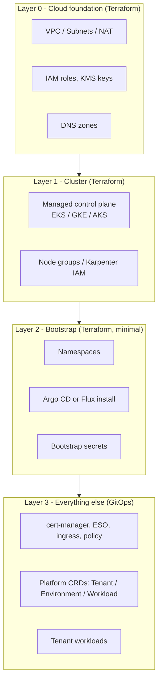
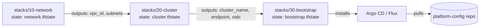

# Terraform for Kubernetes Platforms

## Learning Objectives
- Understand where Terraform fits (and where it does not) in a Kubernetes platform stack
- Configure the `hashicorp/kubernetes` and `hashicorp/helm` providers safely, including the Helm provider 3.x syntax
- Avoid the classic "provider depends on a resource in the same apply" trap by splitting state into layers
- Provision a managed cluster, install platform add-ons, and hand off to GitOps
- Manage CRD-backed objects with `kubernetes_manifest` and understand its plan-time limitations
- Test, lint, and secure Terraform code for platform modules

## Prerequisites
- Kubernetes fundamentals ([Architecture](../01-kubernetes-fundamentals/kubernetes-architecture.md), [API Primer](../01-kubernetes-fundamentals/api-primer.md))
- Terraform or OpenTofu ≥ 1.6 installed (`terraform version`)
- Basic familiarity with Helm charts
- Optional: an AWS/GCP/Azure account for the managed-cluster examples, or a local Kind cluster ([Lab 01](../../labs/lab-01-cluster-setup/README.md))

---

## Why Terraform in a Kubernetes Platform?

Kubernetes has its own declarative API and reconciliation loop. Terraform also has a declarative model, but it reconciles **only when you run `terraform apply`**. That difference decides where each tool belongs.



| Concern | Terraform | GitOps controller (Argo CD / Flux) |
|---------|-----------|------------------------------------|
| Reconciliation | On `apply` only | Continuous |
| Cloud resources (VPC, IAM, KMS) | Excellent | Possible via Crossplane/ACK, more moving parts |
| Cluster creation | Excellent | Possible (Cluster API, Crossplane) |
| In-cluster add-ons | Works, but drifts silently between applies | Excellent, self-healing |
| Dependency ordering | Explicit graph (`depends_on`, references) | Sync waves / `dependsOn` |
| Secret handling | Secrets land in state | Secrets referenced, not stored |
| Blast radius | Whole state file per apply | Per Application/Kustomization |

**Rule of thumb used throughout this repo:** Terraform builds the *ground* (cloud + cluster + the GitOps agent). From there, GitOps owns everything inside the cluster. See [GitOps Tool Comparison](./gitops-tool-comparison.md) and [Crossplane](./crossplane.md) for the alternatives.

---

## The Providers

### Provider Overview

| Provider | Source | Use for | Notes |
|----------|--------|---------|-------|
| Kubernetes | `hashicorp/kubernetes` | Namespaces, RBAC, Secrets, arbitrary manifests | Typed resources use `_v1` suffix (e.g. `kubernetes_namespace_v1`) |
| Helm | `hashicorp/helm` | Installing charts (`helm_release`) | **3.x changed block syntax to nested attributes** |
| Flux | `fluxcd/flux` | `flux_bootstrap_git` | Bootstraps Flux and commits manifests to Git |
| kubectl (community) | `alekc/kubectl` | Raw YAML without plan-time CRD lookup | Use when `kubernetes_manifest` is too strict |

### Version Pinning

```hcl
# versions.tf
terraform {
  required_version = ">= 1.6.0"

  required_providers {
    aws = {
      source  = "hashicorp/aws"
      version = "~> 6.0"
    }
    kubernetes = {
      source  = "hashicorp/kubernetes"
      version = "~> 2.38"
    }
    helm = {
      source  = "hashicorp/helm"
      version = "~> 3.0" # 3.x = Plugin Framework rewrite, new syntax
    }
  }
}
```

Commit `.terraform.lock.hcl` so every engineer and CI job resolves the same provider builds.

### Authenticating to the Cluster

There are three common ways to give the providers credentials. **Prefer short-lived exec-based tokens** over static kubeconfigs.

```hcl
# providers.tf - EKS with exec auth (token refreshed on every call)
data "aws_eks_cluster" "this" {
  name = var.cluster_name
}

provider "kubernetes" {
  host                   = data.aws_eks_cluster.this.endpoint
  cluster_ca_certificate = base64decode(data.aws_eks_cluster.this.certificate_authority[0].data)

  exec {
    api_version = "client.authentication.k8s.io/v1beta1"
    command     = "aws"
    args        = ["eks", "get-token", "--cluster-name", var.cluster_name]
  }
}

# Helm provider 3.x: `kubernetes` is a nested ATTRIBUTE (note the `=`)
provider "helm" {
  kubernetes = {
    host                   = data.aws_eks_cluster.this.endpoint
    cluster_ca_certificate = base64decode(data.aws_eks_cluster.this.certificate_authority[0].data)
    exec = {
      api_version = "client.authentication.k8s.io/v1beta1"
      command     = "aws"
      args        = ["eks", "get-token", "--cluster-name", var.cluster_name]
    }
  }
}
```

```hcl
# providers-local.tf - Kind / k3d for labs
provider "kubernetes" {
  config_path    = "~/.kube/config"
  config_context = "kind-platform"
}

provider "helm" {
  kubernetes = {
    config_path    = "~/.kube/config"
    config_context = "kind-platform"
  }
}
```

| Method | Pros | Cons |
|--------|------|------|
| `exec` plugin (`aws eks get-token`, `gke-gcloud-auth-plugin`, `kubelogin`) | Short-lived, no secrets in state | CLI must exist on runner |
| `token` from a data source | No CLI needed | Token may expire mid-apply on long runs |
| `config_path` | Simple for local dev | Implicit dependency on the operator's machine |

> **Helm provider 2.x → 3.x migration.** In 3.x, `kubernetes { ... }` becomes `kubernetes = { ... }`, repeatable `set { ... }` blocks become a single `set = [ { name = ..., value = ... } ]` list, and `registry` blocks become a `registries = [...]` list. A version bump without rewriting HCL fails to plan. Upgrade one root module at a time and read the provider's upgrade guide.

---

## The Layering Problem

The most common Terraform-on-Kubernetes failure is configuring the `kubernetes`/`helm` providers from attributes of a cluster **created in the same configuration**.

```hcl
# ANTI-PATTERN - do not do this
resource "aws_eks_cluster" "this" { ... }

provider "kubernetes" {
  host = aws_eks_cluster.this.endpoint   # unknown during the first plan
  ...
}

resource "helm_release" "argocd" { ... } # planned against an unknown provider
```

Why this hurts:

1. On the first plan, the provider configuration is **unknown**; some providers fall back to defaults (e.g. `localhost`) and the plan is wrong.
2. When the cluster is replaced, Terraform tries to refresh in-cluster resources against a cluster that no longer exists.
3. Destroy ordering becomes fragile.

### The Fix: Separate Root Modules (Stacks)



```text
infra/
├── modules/                     # reusable modules (see code/terraform-modules)
└── stacks/
    ├── 10-network/
    │   ├── main.tf
    │   └── backend.tf
    ├── 20-cluster/
    │   ├── main.tf              # uses module "eks"
    │   ├── outputs.tf
    │   └── backend.tf
    └── 30-bootstrap/
        ├── providers.tf         # kubernetes + helm configured from data sources
        ├── argocd.tf
        └── backend.tf
```

Each stack reads upstream outputs through `terraform_remote_state` or, better, through **data sources** looked up by name (looser coupling):

```hcl
# stacks/30-bootstrap/data.tf
# Look up by name instead of reading another stack's state file
data "aws_eks_cluster" "this" {
  name = "platform-${var.environment}"
}
```

Orchestration tools (Terragrunt, Terramate, HCP Terraform Stacks, Spacelift/Atlantis) automate running stacks in order, but plain CI jobs with `needs:` work fine.

### Remote State and Locking

```hcl
# stacks/20-cluster/backend.tf
terraform {
  backend "s3" {
    bucket       = "mycompany-platform-tfstate"
    key          = "prod/20-cluster.tfstate"
    region       = "us-east-1"
    encrypt      = true
    use_lockfile = true # native S3 locking (Terraform >= 1.10); no DynamoDB table needed
  }
}
```

State contains every attribute of every resource, **including Secret data and Helm values**. Encrypt the bucket with KMS, restrict IAM access to CI and break-glass roles, and enable versioning.

---

## Provisioning the Cluster (Layer 1)

The repo's reusable modules live in [`code/terraform-modules/`](https://github.com/GitOpsHub/platform-engineering-on-kubernetes/tree/main/code/terraform-modules/) (`eks/`, `gke/`, `aks/`, `networking/`, `addons/`). The example below uses the community `terraform-aws-modules/eks` module to show the shape.

```hcl
# stacks/20-cluster/main.tf
module "eks" {
  source  = "terraform-aws-modules/eks/aws"
  version = "~> 21.0"

  name               = "platform-${var.environment}"
  kubernetes_version = "1.33"

  vpc_id     = data.terraform_remote_state.network.outputs.vpc_id
  subnet_ids = data.terraform_remote_state.network.outputs.private_subnet_ids

  # Use EKS access entries instead of the legacy aws-auth ConfigMap
  enable_cluster_creator_admin_permissions = false
  access_entries = {
    platform_admins = {
      principal_arn = var.platform_admin_role_arn
      policy_associations = {
        admin = {
          policy_arn   = "arn:aws:eks::aws:cluster-access-policy/AmazonEKSClusterAdminPolicy"
          access_scope = { type = "cluster" }
        }
      }
    }
  }

  eks_managed_node_groups = {
    system = {
      instance_types = ["m6i.large"]
      min_size       = 2
      max_size       = 4
      desired_size   = 3
      labels = {
        "platform.mycompany.io/node-role" = "system"
      }
      taints = {
        system = {
          key    = "platform.mycompany.io/system"
          value  = "true"
          effect = "NO_SCHEDULE"
        }
      }
    }
  }

  tags = {
    "platform.mycompany.io/environment" = var.environment
    "platform.mycompany.io/managed-by"  = "terraform"
  }
}

output "cluster_name" {
  value = module.eks.cluster_name
}
```

> Module input names change between major versions (v21 renamed several `cluster_*` inputs). Always check the module's upgrade notes when bumping the major version.

---

## Bootstrapping In-Cluster (Layer 2)

Keep Layer 2 **small**: a namespace or two, the GitOps agent, and the one secret it needs to read Git. Everything else is declared in the GitOps repo.

### Typed Kubernetes Resources

```hcl
# stacks/30-bootstrap/namespaces.tf
resource "kubernetes_namespace_v1" "argocd" {
  metadata {
    name = "argocd"
    labels = {
      "platform.mycompany.io/managed-by"          = "terraform"
      "pod-security.kubernetes.io/enforce"        = "baseline"
    }
  }
}
```

### Installing Argo CD with `helm_release` (Helm provider 3.x)

```hcl
# stacks/30-bootstrap/argocd.tf
resource "helm_release" "argocd" {
  name       = "argocd"
  namespace  = kubernetes_namespace_v1.argocd.metadata[0].name
  repository = "https://argoproj.github.io/argo-helm"
  chart      = "argo-cd"
  version    = var.argocd_chart_version # pin it; bump via PR

  atomic          = true  # roll back on failure
  cleanup_on_fail = true
  wait            = true
  timeout         = 600

  values = [
    templatefile("${path.module}/values/argocd.yaml.tftpl", {
      domain = "argocd.${var.base_domain}"
    })
  ]

  # 3.x syntax: a list of objects, not repeated blocks
  set = [
    {
      name  = "configs.params.server\\.insecure"
      value = "true"
    },
    {
      name  = "global.nodeSelector.platform\\.mycompany\\.io/node-role"
      value = "system"
    }
  ]
}
```

### Seeding the Root Application

The GitOps agent needs *one* object pointing at the platform-config repo. You can create it with `kubernetes_manifest` (see the caveats below) or ship it in a tiny companion chart such as `argocd-apps`.

```hcl
# stacks/30-bootstrap/root-app.tf
resource "helm_release" "argocd_root" {
  name       = "argocd-root"
  namespace  = "argocd"
  repository = "https://argoproj.github.io/argo-helm"
  chart      = "argocd-apps"
  version    = var.argocd_apps_chart_version

  values = [yamlencode({
    applications = {
      platform-root = {
        namespace = "argocd"
        project   = "default"
        source = {
          repoURL        = "https://github.com/myorg/platform-config"
          targetRevision = "main"
          path           = "clusters/${var.environment}/root"
        }
        destination = {
          server    = "https://kubernetes.default.svc"
          namespace = "argocd"
        }
        syncPolicy = {
          automated = { prune = true, selfHeal = true }
        }
      }
    }
  })]

  depends_on = [helm_release.argocd] # CRDs must exist first
}
```

From this point on, Argo CD manages itself and every add-on (see [Argo CD Deep Dive](../05-gitops/argocd-deep-dive.md)). Configure Argo CD to **ignore or adopt** the Helm release Terraform created — the common pattern is to have an Argo CD `Application` that manages the same `argo-cd` chart and then stop changing it in Terraform (`lifecycle { ignore_changes = all }` on `helm_release.argocd`).

### Alternative: Bootstrapping Flux

```hcl
# stacks/30-bootstrap/flux.tf
terraform {
  required_providers {
    flux   = { source = "fluxcd/flux", version = "~> 1.6" }
    github = { source = "integrations/github", version = "~> 6.0" }
  }
}

provider "flux" {
  kubernetes = {
    config_path = "~/.kube/config"
  }
  git = {
    url = "ssh://git@github.com/myorg/platform-config.git"
    ssh = {
      username    = "git"
      private_key = tls_private_key.flux.private_key_pem
    }
  }
}

resource "tls_private_key" "flux" {
  algorithm   = "ECDSA"
  ecdsa_curve = "P256"
}

resource "github_repository_deploy_key" "flux" {
  repository = "platform-config"
  title      = "flux-${var.environment}"
  key        = tls_private_key.flux.public_key_openssh
  read_only  = false
}

resource "flux_bootstrap_git" "this" {
  path       = "clusters/${var.environment}"
  depends_on = [github_repository_deploy_key.flux]
}
```

`flux_bootstrap_git` installs the controllers and commits `gotk-components.yaml` and `gotk-sync.yaml` to the repo, so Flux then upgrades itself from Git. See [Flux Deep Dive](../05-gitops/flux-deep-dive.md).

---

## Managing CRD-Backed Objects with `kubernetes_manifest`

`kubernetes_manifest` can manage any object, including custom resources such as this repo's platform API:

```hcl
# tenants.tf
resource "kubernetes_manifest" "tenant_payments" {
  manifest = {
    apiVersion = "platform.mycompany.io/v1alpha1"
    kind       = "Tenant" # cluster-scoped
    metadata = {
      name = "payments"
      labels = {
        "platform.mycompany.io/cost-center" = "cc-1234"
      }
    }
    spec = {
      owners = ["group:payments-eng"]
      quota = {
        cpu    = "40"
        memory = "160Gi"
      }
    }
  }

  field_manager {
    name            = "terraform"
    force_conflicts = false
  }

  # Fields the controller fills in - don't treat them as drift
  computed_fields = ["metadata.annotations", "metadata.labels"]

  wait {
    condition {
      type   = "Ready"
      status = "True"
    }
  }

  timeouts {
    create = "5m"
  }
}
```

### Caveats

| Issue | Cause | Mitigation |
|-------|-------|------------|
| `no matches for kind "Tenant"` at **plan** time | Provider fetches the OpenAPI schema during plan; CRD isn't installed yet | Install CRDs in an earlier stack, or use `alekc/kubectl` |
| Perpetual diff on defaulted fields | API server/webhook adds defaults | Add paths to `computed_fields`, or specify the defaults explicitly |
| Conflicts with a controller | Server-side apply field ownership | Distinct `field_manager.name`; avoid managing fields a controller owns |
| Large YAML bundles | One resource per object | Use `helm_release` for bundles; reserve `kubernetes_manifest` for a few objects |

**Platform guidance:** don't manage tenant-level CRs (Tenant, Environment, Workload) in Terraform at scale. They belong in Git and reconcile through GitOps, where tenants can submit PRs. Terraform is fine for a handful of bootstrap objects.

---

## Secrets and Terraform

Anything Terraform reads or writes ends up in state. Patterns, from worst to best:

1. `kubernetes_secret_v1` with literal values in `.tfvars` → secrets in Git **and** state. Avoid.
2. Values from a secrets manager data source → secrets only in state. Acceptable for bootstrap.
3. **Ephemeral values** (Terraform ≥ 1.10 ephemeral resources, ≥ 1.11 write-only `*_wo` arguments where providers support them) → not persisted in state.
4. Terraform creates the *store* and IAM (KMS key, Vault mount, IRSA/Workload Identity role); the cluster pulls secrets via [External Secrets](../06-secrets-management/external-secrets.md) or [Vault](../06-secrets-management/vault-integration.md). **Preferred.**

```hcl
# irsa-external-secrets.tf - Terraform owns identity, not secret values
module "eso_irsa" {
  source  = "terraform-aws-modules/iam/aws//modules/iam-role-for-service-accounts"
  version = "~> 6.0"

  name = "external-secrets-${var.environment}"
  attach_external_secrets_policy        = true
  external_secrets_secrets_manager_arns = ["arn:aws:secretsmanager:*:*:secret:platform/*"]

  oidc_providers = {
    main = {
      provider_arn               = data.terraform_remote_state.cluster.outputs.oidc_provider_arn
      namespace_service_accounts = ["external-secrets:external-secrets"]
    }
  }
}
```

> Module input names differ between major versions of `terraform-aws-modules/iam`; check the version you pin.

---

## Testing and Quality Gates

### Static Checks

```bash
# ci/terraform-checks.sh
terraform fmt -check -recursive
terraform init -backend=false
terraform validate
tflint --recursive                 # provider-aware linting
trivy config --severity HIGH,CRITICAL .   # misconfiguration scanning (formerly tfsec)
```

### Native Tests (`terraform test`)

```hcl
# modules/namespace/tests/labels.tftest.hcl
variables {
  name        = "team-a"
  environment = "dev"
}

run "namespace_has_platform_labels" {
  command = plan

  assert {
    condition     = kubernetes_namespace_v1.this.metadata[0].labels["platform.mycompany.io/environment"] == "dev"
    error_message = "Namespace must carry the environment label"
  }
}
```

Run with `terraform test`. Use `mock_provider "kubernetes" {}` in the test file to test module logic without a live cluster.

### Plan in PRs, Apply on Merge

```yaml
# .github/workflows/terraform.yaml
name: terraform
on:
  pull_request:
    paths: ["infra/**"]
  push:
    branches: [main]
    paths: ["infra/**"]

permissions:
  id-token: write   # OIDC to the cloud; no static keys
  contents: read
  pull-requests: write

jobs:
  plan:
    runs-on: ubuntu-latest
    strategy:
      matrix:
        stack: [10-network, 20-cluster, 30-bootstrap]
      max-parallel: 1
    defaults:
      run:
        working-directory: infra/stacks/${{ matrix.stack }}
    steps:
      - uses: actions/checkout@v4
      - uses: hashicorp/setup-terraform@v3
      - uses: aws-actions/configure-aws-credentials@v4
        with:
          role-to-assume: arn:aws:iam::123456789012:role/platform-terraform-plan
          aws-region: us-east-1
      - run: terraform init -input=false
      - run: terraform plan -input=false -lock-timeout=5m -out=tfplan
      # On main, a separate job with an apply role runs `terraform apply tfplan`
```

---

## Hands-On Exercise

### Bootstrap Argo CD on Kind with Terraform

**Goal:** Use the Helm provider 3.x syntax to install Argo CD and a root app into the Kind cluster from [Lab 01](../../labs/lab-01-cluster-setup/README.md), then prove that GitOps — not Terraform — owns the add-ons.

```bash
# 1. Create a working directory
mkdir -p ~/tf-bootstrap && cd ~/tf-bootstrap

# 2. Write versions + providers
cat > main.tf <<'EOF'
terraform {
  required_version = ">= 1.6.0"
  required_providers {
    kubernetes = { source = "hashicorp/kubernetes", version = "~> 2.38" }
    helm       = { source = "hashicorp/helm",       version = "~> 3.0" }
  }
}

variable "context" { default = "kind-platform" }

provider "kubernetes" {
  config_path    = "~/.kube/config"
  config_context = var.context
}

provider "helm" {
  kubernetes = {
    config_path    = "~/.kube/config"
    config_context = var.context
  }
}

resource "kubernetes_namespace_v1" "argocd" {
  metadata {
    name   = "argocd"
    labels = { "platform.mycompany.io/managed-by" = "terraform" }
  }
}

resource "helm_release" "argocd" {
  name       = "argocd"
  namespace  = kubernetes_namespace_v1.argocd.metadata[0].name
  repository = "https://argoproj.github.io/argo-helm"
  chart      = "argo-cd"
  atomic     = true
  set = [
    { name = "configs.params.server\\.insecure", value = "true" },
    { name = "dex.enabled", value = "false" }
  ]
}
EOF

# 3. Plan and apply
terraform init
terraform plan -out=tfplan
terraform apply tfplan

# 4. Verify
kubectl -n argocd get pods
helm -n argocd list

# 5. Observe the "drift gap": change something by hand...
kubectl -n argocd scale deploy argocd-server --replicas=0
# ...Terraform does not notice until the next plan:
terraform plan   # Helm release reports no change: replicas are not in the release values

# 6. Clean up
terraform destroy
```

**Questions to answer:**
1. Why did step 5 show no diff? (Hint: Terraform tracks the Helm *release*, not the live Deployment.) Compare with Argo CD `selfHeal` in [Drift Detection](./drift-detection.md).
2. Move the provider configuration so it reads from a `kind` cluster created in the same config. What breaks on `terraform destroy`?

---

## Troubleshooting

| Symptom | Likely Cause | Fix |
|---------|--------------|-----|
| `Error: Kubernetes cluster unreachable: invalid configuration` | Provider configured from unknown values (same-apply cluster) | Split into stacks; configure from data sources |
| `Unsupported block type "kubernetes"` in `provider "helm"` | Helm provider 3.x expects an attribute | Change `kubernetes {` to `kubernetes = {`; convert `set {}` blocks to `set = [ ... ]` |
| `cannot create REST client: no client config` during plan | `kubernetes_manifest` needs API access at plan | Ensure cluster exists and creds work before planning that stack |
| `no matches for kind "X" in group "Y"` | CRD not yet installed | Install CRDs in a prior stack, or use `alekc/kubectl` |
| `cannot re-use a name that is still in use` | Orphaned Helm release (previous failed install) | `helm -n <ns> uninstall <name>` or `terraform import helm_release.x <ns>/<name>` |
| Token expired mid-apply | Static token from a data source | Switch to `exec` auth |
| Perpetual diff on annotations | Controller or webhook mutates the object | `computed_fields`, or `lifecycle { ignore_changes = [...] }` |
| State lock never released | Crashed CI job | Confirm nothing is running, then `terraform force-unlock <LOCK_ID>` |

```bash
# Debugging helpers
TF_LOG=DEBUG terraform plan 2> tf-debug.log     # provider-level logs
terraform state list | grep helm_release
terraform state show helm_release.argocd
terraform providers                              # see resolved provider tree
```

---

## Best Practices

- **Terraform for the ground, GitOps for the house.** Keep in-cluster Terraform to the bootstrap minimum.
- **One state per layer and environment.** Smaller blast radius, faster plans.
- **Pin everything** (Terraform, providers, modules, charts) and bump via PR with a plan attached.
- **No long-lived cloud keys in CI.** Use OIDC federation.
- **Treat state as secret.** Encrypt, restrict, version.
- **Label all cloud and cluster resources** with `platform.mycompany.io/managed-by=terraform` so drift tooling and humans know who owns them.

---

## Further Reading

- [Terraform Kubernetes provider docs](https://registry.terraform.io/providers/hashicorp/kubernetes/latest/docs)
- [Terraform Helm provider docs and v3 upgrade guide](https://registry.terraform.io/providers/hashicorp/helm/latest/docs)
- [Flux Terraform provider](https://registry.terraform.io/providers/fluxcd/flux/latest/docs)
- [terraform-aws-modules/eks](https://registry.terraform.io/modules/terraform-aws-modules/eks/aws/latest)
- [Terraform tests](https://developer.hashicorp.com/terraform/language/tests)
- [OpenTofu](https://opentofu.org/docs/)

---

## Next Steps

1. **Read**: [Crossplane](./crossplane.md) — manage cloud infrastructure with Kubernetes-native reconciliation
2. **Compare**: [GitOps Tool Comparison](./gitops-tool-comparison.md)
3. **Explore code**: [`code/terraform-modules/`](https://github.com/GitOpsHub/platform-engineering-on-kubernetes/tree/main/code/terraform-modules/)
4. **Lab**: [Lab 02 - GitOps Bootstrap](../../labs/lab-02-gitops-bootstrap/README.md)
