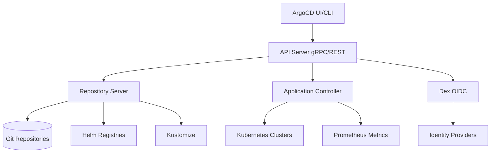

# ArgoCD Deep Dive

## Learning Objectives
- Master ArgoCD architecture and components
- Implement App of Apps and ApplicationSet patterns
- Configure RBAC, projects, and multi-tenancy
- Handle secrets, Helm/Kustomize, and health checks
- Troubleshoot common issues

## Prerequisites
- GitOps principles understanding
- Kubernetes fundamentals
- Helm and Kustomize basics

---

## Architecture

### Components


### Component Roles
| Component | Role | Scaling |
|-----------|------|---------|
| API Server | gRPC/REST API, auth, RBAC | Horizontal (stateless) |
| Repository Server | Git/Helm/Kustomize caching | Horizontal (cache sharding) |
| Application Controller | Reconciliation, health assessment | Vertical (leader election) |
| Dex | OIDC authentication | Horizontal |
| Redis | Repository server cache | Sentinel/Cluster |

---

## Installation

### Production Installation
```bash
# Create namespace
kubectl create namespace argocd

# Install with HA values
helm repo add argo https://argoproj.github.io/argo-helm
helm repo update

helm upgrade --install argocd argo/argo-cd \
  --namespace argocd \
  --version 5.51.0 \
  --values - <<EOF
global:
  domain: argocd.mycompany.com
  
server:
  replicas: 2
  ingress:
    enabled: true
    ingressClassName: nginx
    hosts:
      - argocd.mycompany.com
  config:
    url: https://argocd.mycompany.com
    oidc.config: |
      name: OIDC
      issuer: https://dex.mycompany.com
      clientID: argocd
      clientSecret: $OIDC_CLIENT_SECRET
      requestedScopes: ["openid", "profile", "email", "groups"]
    accounts.admin: apiKey,login
    accounts.platform-team: apiKey,login
    
repoServer:
  replicas: 2
  resources:
    limits:
      cpu: 1000m
      memory: 1Gi
    requests:
      cpu: 250m
      memory: 256Mi
      
applicationController:
  replicas: 1
  resources:
    limits:
      cpu: 2000m
      memory: 2Gi
    requests:
      cpu: 500m
      memory: 512Mi
  config:
    # Increase parallelism
    statusProcessors: 20
    operationProcessors: 10
    # Resource overrides for health
    resourceCustomizations: |
      argoproj.io/Application:
        health.lua: |
          hs = {}
          hs.status = "Progressing"
          hs.message = ""
          if obj.status ~= nil then
            if obj.status.health ~= nil then
              hs.status = obj.status.health.status
              hs.message = obj.status.health.message
            end
          end
          return hs

dex:
  enabled: true
  config: |
    connectors:
      - type: github
        id: github
        name: GitHub
        config:
          clientID: $GITHUB_CLIENT_ID
          clientSecret: $GITHUB_CLIENT_SECRET
          orgs:
            - name: myorg
              teams:
                - platform-team

redis:
  enabled: true
  ha:
    enabled: true
    
controller:
  metrics:
    enabled: true
    serviceMonitor:
      enabled: true
      
EOF
```

---

## Core Concepts

### Application
```yaml
# Full Application spec
apiVersion: argoproj.io/v1alpha1
kind: Application
metadata:
  name: myapp
  namespace: argocd
  finalizers:
    - resources-finalizer.argocd.argoproj.io  # Cascade delete
spec:
  project: production
  source:
    repoURL: https://github.com/myorg/platform-config
    targetRevision: main
    path: clusters/production/services/myapp
    # Helm specific
    helm:
      valueFiles:
        - values.yaml
        - values-prod.yaml
      parameters:
        - name: image.tag
          value: "v1.2.3"
      skipCrds: false
    # Kustomize specific
    kustomize:
      version: v4.5.7
      images:
        - myapp=myregistry/myapp:v1.2.3
      commonLabels:
        app.kubernetes.io/managed-by: argocd
  destination:
    server: https://kubernetes.default.svc  # In-cluster
    namespace: production
  syncPolicy:
    automated:
      prune: true
      selfHeal: true
      allowEmpty: false
    syncOptions:
      - CreateNamespace=true
      - PrunePropagationPolicy=foreground
      - PruneLast=true
      - RespectIgnoreDifferences=true
      - ApplyOutOfSyncOnly=true
    retry:
      limit: 5
      backoff:
        duration: 5s
        factor: 2
        maxDuration: 3m
  ignoreDifferences:
    - group: apps
      kind: Deployment
      jsonPointers:
        - /spec/replicas  # Ignore HPA changes
    - group: ""
      kind: Secret
      jqPathExpressions:
        - .data  # Ignore secret data changes
  info:
    - name: "Repository"
      value: "https://github.com/myorg/platform-config"
    - name: "Slack Channel"
      value: "#platform-alerts"
```

### AppProject (Multi-tenancy)
```yaml
apiVersion: argoproj.io/v1alpha1
kind: AppProject
metadata:
  name: platform-team
  namespace: argocd
spec:
  description: Platform team managed applications
  
  # Allowed source repositories
  sourceRepos:
    - https://github.com/myorg/platform-config
    - https://github.com/myorg/services-*
    - https://charts.mycompany.io
  
  # Allowed destinations
  destinations:
    - namespace: platform-*
      server: https://kubernetes.default.svc
    - namespace: monitoring
      server: https://kubernetes.default.svc
    - namespace: ingress-nginx
      server: https://kubernetes.default.svc
  
  # Allowed cluster-scoped resources
  clusterResourceWhitelist:
    - group: ''
      kind: Namespace
    - group: rbac.authorization.k8s.io
      kind: ClusterRole
    - group: rbac.authorization.k8s.io
      kind: ClusterRoleBinding
    - group: admissionregistration.k8s.io
      kind: ValidatingWebhookConfiguration
  
  # Allowed namespace-scoped resources
  namespaceResourceWhitelist:
    - group: '*'
      kind: '*'
  
  # Denylist (optional)
  clusterResourceBlacklist:
    - group: ''
      kind: Node
  
  # Roles for RBAC
  roles:
    - name: developer
      description: Read-only access to applications
      policies:
        - p, proj:platform-team:developer, applications, get, platform-team/*, allow
        - p, proj:platform-team:developer, repositories, get, *, allow
      groups:
        - platform-developers
        - platform-viewers
    
    - name: operator
      description: Sync and manage applications
      policies:
        - p, proj:platform-team:operator, applications, *, platform-team/*, allow
        - p, proj:platform-team:operator, repositories, *, *, allow
      groups:
        - platform-operators
    
    - name: admin
      description: Full project access
      policies:
        - p, proj:platform-team:admin, *, *, platform-team/*, allow
      groups:
        - platform-admins
```

---

## ApplicationSet (Multi-cluster/Monorepo)

### Generator Types

#### Git Directory Generator
```yaml
apiVersion: argoproj.io/v1alpha1
kind: ApplicationSet
metadata:
  name: platform-services
  namespace: argocd
spec:
  generators:
    - git:
        repoURL: https://github.com/myorg/platform-config
        revision: main
        directories:
          - path: services/*/*
  template:
    metadata:
      name: '{{path.basename}}'
      namespace: argocd
      labels:
        app.kubernetes.io/part-of: platform
        platform.mycompany.io/team: '{{path[1]}}'
    spec:
      project: '{{path[1]}}'
      source:
        repoURL: https://github.com/myorg/platform-config
        targetRevision: main
        path: '{{path}}'
      destination:
        server: '{{server}}'
        namespace: '{{namespace}}'
      syncPolicy:
        automated:
          prune: true
          selfHeal: true
```

#### Cluster Generator (Multi-cluster)
```yaml
apiVersion: argoproj.io/v1alpha1
kind: ApplicationSet
metadata:
  name: platform-core-multicluster
  namespace: argocd
spec:
  generators:
    - clusters:
        selector:
          matchLabels:
            platform.mycompany.io/managed: "true"
  template:
    metadata:
      name: 'platform-core-{{name}}'
      namespace: argocd
    spec:
      project: platform-core
      source:
        repoURL: https://github.com/myorg/platform-config
        targetRevision: main
        path: clusters/{{name}}/platform-core
      destination:
        server: '{{server}}'
        namespace: platform-system
      syncPolicy:
        automated:
          prune: true
          selfHeal: true
```

#### Matrix Generator (Multi-cluster x Multi-service)
```yaml
apiVersion: argoproj.io/v1alpha1
kind: ApplicationSet
metadata:
  name: services-matrix
  namespace: argocd
spec:
  generators:
    - matrix:
        generators:
          - clusters:
              selector:
                matchLabels:
                  environment: production
          - git:
              repoURL: https://github.com/myorg/platform-config
              revision: main
              directories:
                - path: services/*
  template:
    metadata:
      name: '{{path.basename}}-{{name}}'
      namespace: argocd
    spec:
      project: '{{path.basename}}'
      source:
        repoURL: https://github.com/myorg/platform-config
        targetRevision: main
        path: '{{path}}'
      destination:
        server: '{{server}}'
        namespace: '{{path.basename}}'
      syncPolicy:
        automated:
          prune: true
          selfHeal: true
```

---

## Advanced Patterns

### Progressive Delivery with Rollout
```yaml
# Argo Rollouts integration
apiVersion: argoproj.io/v1alpha1
kind: Application
metadata:
  name: myapp-canary
  namespace: argocd
spec:
  source:
    repoURL: https://github.com/myorg/platform-config
    path: clusters/production/services/myapp
    plugin:
      name: argocd-rollouts-plugin
  syncPolicy:
    automated:
      prune: true
      selfHeal: true
    syncOptions:
      - Replace=true  # Required for Rollout CRD
```

### Wave-based Sync (Dependencies)
```yaml
# Pre-sync hook for database migration
apiVersion: argoproj.io/v1alpha1
kind: Application
metadata:
  name: myapp
  namespace: argocd
spec:
  syncPolicy:
    syncOptions:
      - ApplyOutOfSyncOnly=true
  # Waves ensure order: 0 -> 1 -> 2
  # Wave 0: Namespace, CRDs
  # Wave 1: ConfigMaps, Secrets
  # Wave 2: Deployments, Services
```

### Ignore Differences (Drift Tolerance)
```yaml
ignoreDifferences:
  # Ignore HPA replica changes
  - group: autoscaling
    kind: HorizontalPodAutoscaler
    jsonPointers:
      - /spec/minReplicas
      - /spec/maxReplicas
  
  # Ignore image digest changes (tag-based)
  - group: apps
    kind: Deployment
    jqPathExpressions:
      - .spec.template.spec.containers[].image | select(contains("@sha256:")) | split("@")[0]
  
  # Ignore annotation changes
  - group: ""
    kind: Pod
    jqPathExpressions:
      - .metadata.annotations."kubectl.kubernetes.io/restartedAt"
```

---

## RBAC Configuration

### Built-in Roles
| Role | Permissions |
|------|-------------|
| admin | Full access to all resources |
| readonly | Read-only access to applications |

### Custom RBAC (argocd-rbac-cm)
```yaml
# argocd-rbac-cm ConfigMap
apiVersion: v1
kind: ConfigMap
metadata:
  name: argocd-rbac-cm
  namespace: argocd
data:
  policy.default: role:readonly
  policy.csv: |
    # Platform admins
    p, group:platform-admins, applications, *, */*, allow
    p, group:platform-admins, projects, *, *, allow
    p, group:platform-admins, repositories, *, *, allow
    p, group:platform-admins, clusters, *, *, allow
    p, group:platform-admins, certificates, *, *, allow
    
    # Platform operators
    p, group:platform-operators, applications, *, platform/*, allow
    p, group:platform-operators, applications, sync, platform/*, allow
    p, group:platform-operators, applications, override, platform/*, allow
    p, group:platform-operators, repositories, get, *, allow
    
    # Developers (self-service)
    p, group:platform-developers, applications, get, platform/*, allow
    p, group:platform-developers, applications, sync, platform/developers/*, allow
    p, group:platform-developers, repositories, get, *, allow
    
    # Read-only viewers
    p, group:platform-viewers, applications, get, */*, allow
    p, group:platform-viewers, repositories, get, *, allow
    
    # Service accounts for CI/CD
    p, system:serviceaccount:ci-cd:argocd-bot, applications, sync, platform/*, allow
    p, system:serviceaccount:ci-cd:argocd-bot, repositories, get, *, allow
  scopes: '[groups, email, profile]'
```

---

## Health Assessment

### Custom Health Checks (Lua)
```lua
-- Custom health for Database CRD
hs = {}
if obj.status ~= nil then
  if obj.status.phase == "Ready" then
    hs.status = "Healthy"
    hs.message = "Database is ready"
  elseif obj.status.phase == "Creating" then
    hs.status = "Progressing"
    hs.message = "Database is being created"
  elseif obj.status.phase == "Failed" then
    hs.status = "Degraded"
    hs.message = "Database creation failed: " .. (obj.status.message or "unknown")
  else
    hs.status = "Progressing"
    hs.message = "Unknown phase: " .. obj.status.phase
  end
else
  hs.status = "Progressing"
  hs.message = "Waiting for status"
end
return hs
```

### Health Check Configuration
```yaml
# In ApplicationController config
resourceCustomizations: |
  platform.mycompany.io/Database:
    health.lua: |
      -- (lua script above)
  
  # Override Deployment health
  apps/Deployment:
    health.lua: |
      hs = {}
      if obj.status ~= nil then
        if obj.status.updatedReplicas == obj.spec.replicas and
           obj.status.readyReplicas == obj.spec.replicas then
          hs.status = "Healthy"
        else
          hs.status = "Progressing"
        end
      else
        hs.status = "Progressing"
      end
      return hs
```

---

## Troubleshooting

### Common Issues

#### Application Stuck in Progressing
```bash
# Check application status
argocd app get myapp

# View live manifest vs target
argocd app diff myapp

# Check controller logs
kubectl logs -n argocd -l app.kubernetes.io/name=argocd-application-controller

# Force refresh
argocd app sync myapp --force
```

#### Repository Server Issues
```bash
# Check repo server logs
kubectl logs -n argocd -l app.kubernetes.io/name=argocd-repo-server

# Test repository access
argocd repo list
argocd repo get https://github.com/myorg/platform-config

# Clear repo cache
kubectl delete pod -n argocd -l app.kubernetes.io/name=argocd-repo-server
```

#### Sync Fails with "Comparison Error"
```bash
# Check ignored differences
argocd app get myapp -o json | jq '.spec.ignoreDifferences'

# View detailed diff
argocd app diff myapp --local=live --remote=target

# Check resource hooks
kubectl get -n argocd application myapp -o yaml | grep -A 20 "operationState"
```

### Debug Commands
```bash
# Get all applications across projects
argocd app list -A

# Get application tree
argocd app get myapp --show-tree

# Export application
argocd app export myapp > myapp-backup.yaml

# Rollback
argocd app rollback myapp 3

# History
argocd app history myapp
```

---

## Monitoring & Metrics

### Key Metrics to Alert On
```yaml
# Prometheus alerts
groups:
  - name: argocd
    rules:
      - alert: ArgoCDApplicationOutOfSync
        expr: argocd_application_info{sync_status!="Synced"} == 1
        for: 5m
        labels:
          severity: warning
        annotations:
          summary: "ArgoCD Application {{ $labels.name }} out of sync"
          
      - alert: ArgoCDApplicationDegraded
        expr: argocd_application_info{health_status="Degraded"} == 1
        for: 1m
        labels:
          severity: critical
        annotations:
          summary: "ArgoCD Application {{ $labels.name }} degraded"
          
      - alert: ArgoCDRepoServerDown
        expr: up{job="argocd-repo-server"} == 0
        for: 2m
        labels:
          severity: critical
        annotations:
          summary: "ArgoCD Repo Server down"
          
      - alert: ArgoCDControllerDown
        expr: up{job="argocd-application-controller"} == 0
        for: 1m
        labels:
          severity: critical
        annotations:
          summary: "ArgoCD Application Controller down"
          
      - alert: ArgoCDSyncFailures
        expr: increase(argocd_application_sync_total{status="failed"}[5m]) > 0
        for: 1m
        labels:
          severity: warning
        annotations:
          summary: "ArgoCD sync failing for {{ $labels.name }}"
```

---

## Hands-On Exercise

**Goal**: Install Argo CD, register a project-scoped Application, and watch it self-heal drift.

```bash
# 1. Install Argo CD into a local cluster (any kind cluster from Lab 01 works)
kubectl create namespace argocd
kubectl apply -n argocd -f https://raw.githubusercontent.com/argoproj/argo-cd/stable/manifests/install.yaml
kubectl -n argocd rollout status deploy/argocd-server

# 2. Get the initial admin password and port-forward the API server
kubectl -n argocd get secret argocd-initial-admin-secret -o jsonpath='{.data.password}' | base64 -d; echo
kubectl -n argocd port-forward svc/argocd-server 8080:443 &

# 3. Apply a project and an Application that tracks a Git path
kubectl apply -f - <<'EOF'
# argocd-exercise.yaml
apiVersion: argoproj.io/v1alpha1
kind: Application
metadata:
  name: guestbook
  namespace: argocd
spec:
  project: default
  source:
    repoURL: https://github.com/argoproj/argocd-example-apps.git
    targetRevision: HEAD
    path: guestbook
  destination:
    server: https://kubernetes.default.svc
    namespace: guestbook
  syncPolicy:
    automated:
      prune: true
      selfHeal: true
    syncOptions:
      - CreateNamespace=true
EOF

# 4. Check status
kubectl -n argocd get applications
```

**Verify**:
1. `kubectl -n argocd get application guestbook` reports `Synced` and `Healthy`.
2. Scale the Deployment by hand (`kubectl -n guestbook scale deploy/guestbook-ui --replicas=5`) and confirm Argo CD restores the replica count from Git within a few minutes (`selfHeal: true`).
3. Remove the `automated` block, repeat step 2, and observe that the drift is reported as `OutOfSync` but not corrected. This is the difference between detection and remediation.

**Cleanup**: `kubectl -n argocd delete application guestbook` and `kubectl delete namespace guestbook`.

---

## Further Reading

- [ArgoCD Documentation](https://argo-cd.readthedocs.io/)
- [ArgoCD Operator](https://github.com/argoproj-labs/argocd-operator)
- [Argo Rollouts](https://argoproj.github.io/argo-rollouts/)
- [ApplicationSet Controller](https://github.com/argoproj/applicationset)

---

## Next Steps

1. **Complete Lab 02**: [GitOps Bootstrap](../../labs/lab-02-gitops-bootstrap/README.md) with App of Apps
2. **Compare**: [Flux Deep Dive](./flux-deep-dive.md) for the pull-based alternative
3. **Scale out**: [Multi-Cluster GitOps](./multi-cluster-gitops.md) for ApplicationSets across a fleet
