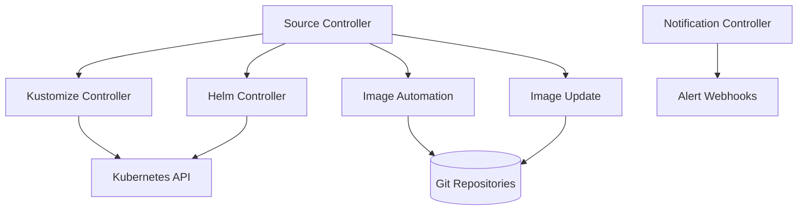

# Flux Deep Dive

## Learning Objectives
- Understand Flux architecture and components
- Master GitRepository, Kustomization, HelmRelease, Image Automation
- Implement multi-tenancy and multi-cluster with Flux
- Configure image automation and policy-based updates

## Prerequisites
- GitOps principles
- Kubernetes fundamentals
- Helm and Kustomize basics

---

## Architecture

### Components


### Component Roles
| Component | Role | CRDs |
|-----------|------|------|
| Source Controller | Git/Helm/OCI sources | GitRepository, HelmRepository, Bucket, OCIRepository |
| Kustomize Controller | Kustomize builds | Kustomization |
| Helm Controller | Helm releases | HelmRelease, HelmChart |
| Image Automation | Image scanning/updates | ImageRepository, ImagePolicy, ImageUpdateAutomation |
| Notification Controller | Event notifications | Alert, Provider, Receiver |

---

## Installation

### Install Flux
```bash
# Install Flux CLI
curl -s https://fluxcd.io/install.sh | sudo bash

# Check prerequisites
flux check --pre

# Install Flux components
flux install \
  --namespace=flux-system \
  --version=v2.2.0 \
  --network-policy=false \
  --components=source-controller,kustomize-controller,helm-controller,notification-controller,image-automation-controller,image-reflector-controller

# Verify
flux check
```

### Bootstrap Flux (GitOps)
```bash
# Bootstrap with GitHub
flux bootstrap github \
  --owner=YOUR_ORG \
  --repository=platform-config \
  --branch=main \
  --path=clusters/production \
  --personal \
  --token-auth

# Or GitLab
flux bootstrap gitlab \
  --owner=YOUR_GROUP \
  --repository=platform-config \
  --branch=main \
  --path=clusters/production \
  --token-auth
```

---

## Core Concepts

### GitRepository (Source)
```yaml
# flux-gitrepository.yaml
apiVersion: source.toolkit.fluxcd.io/v1beta2
kind: GitRepository
metadata:
  name: platform-config
  namespace: flux-system
spec:
  interval: 1m
  url: https://github.com/myorg/platform-config
  ref:
    branch: main
    # tag: v1.0.0
    # semver: ">=1.0.0 <2.0.0"
    # commit: abc123
  secretRef:
    name: git-credentials
  ignore: |
    # Exclude directories
    /clusters/staging/
    /clusters/dev/
    # Exclude files
    *.md
    .gitignore
  # Verify commits (requires cosign)
  verify:
    mode: cosign
    cosign:
      publicKey: |
        -----BEGIN PUBLIC KEY-----
        ...
        -----END PUBLIC KEY-----
```

### HelmRepository (Source)
```yaml
# flux-helmrepository.yaml
apiVersion: source.toolkit.fluxcd.io/v1beta2
kind: HelmRepository
metadata:
  name: prometheus-community
  namespace: flux-system
spec:
  interval: 10m
  url: https://prometheus-community.github.io/helm-charts
  secretRef:
    name: helm-credentials
  # For private registries
  type: oci
  # Pass credentials for OCI
  passCredentials: true
```

### Kustomization
```yaml
# flux-kustomization.yaml
apiVersion: kustomize.toolkit.fluxcd.io/v1beta2
kind: Kustomization
metadata:
  name: platform-core
  namespace: flux-system
spec:
  interval: 10m
  path: ./clusters/production/platform-core
  prune: true
  sourceRef:
    kind: GitRepository
    name: platform-config
  validation: client
  healthChecks:
    - apiVersion: apps/v1
      kind: Deployment
      name: cert-manager
      namespace: cert-manager
    - apiVersion: v1
      kind: Namespace
      name: platform-system
  postBuild:
    substitute:
      CLUSTER_NAME: production
      DOMAIN: platform.mycompany.com
      ENVIRONMENT: production
    substituteFrom:
      - kind: ConfigMap
        name: platform-config
        optional: false
      - kind: Secret
        name: platform-secrets
        optional: true
  patches:
    - patch: |
        - op: replace
          path: /spec/replicas
          value: 5
      target:
        kind: Deployment
        labelSelector: "app=myapp"
  dependsOn:
    - name: cert-manager
    - name: external-secrets
```

### HelmRelease
```yaml
# flux-helmrelease.yaml
apiVersion: helm.toolkit.fluxcd.io/v2beta1
kind: HelmRelease
metadata:
  name: prometheus
  namespace: monitoring
spec:
  interval: 10m
  chart:
    spec:
      chart: kube-prometheus-stack
      version: "45.0.0"
      sourceRef:
        kind: HelmRepository
        name: prometheus-community
        namespace: flux-system
      interval: 10m
  values:
    prometheus:
      prometheusSpec:
        retention: 30d
        storageSpec:
          volumeClaimTemplate:
            spec:
              storageClassName: fast-ssd
              resources:
                requests:
                  storage: 100Gi
        additionalScrapeConfigs:
          - job_name: 'platform-services'
            kubernetes_sd_configs:
              - role: pod
    grafana:
      enabled: true
      persistence:
        enabled: true
        size: 10Gi
      dashboardProviders:
        dashboardproviders.yaml:
          apiVersion: 1
          providers:
            - name: 'default'
              orgId: 1
              folder: ''
              type: file
              disableDeletion: false
              updateIntervalMinutes: 10
              allowUiUpdates: true
              options:
                path: /var/lib/grafana/dashboards/default
  valuesFrom:
    - kind: ConfigMap
      name: prometheus-config
      optional: true
    - kind: Secret
      name: prometheus-secrets
      optional: true
  test:
    enable: true
  rollback:
    retry: true
    timeout: 5m
```

---

## Image Automation

### ImageRepository (Scan Registry)
```yaml
# flux-imagerepository.yaml
apiVersion: image.toolkit.fluxcd.io/v1beta2
kind: ImageRepository
metadata:
  name: myapp
  namespace: flux-system
spec:
  image: ghcr.io/myorg/myapp
  interval: 5m
  secretRef:
    name: ghcr-credentials
  # Filter tags
  filterTags:
    pattern: '^v[0-9]+\.[0-9]+\.[0-9]+$'
```

### ImagePolicy (Select Version)
```yaml
# flux-imagepolicy.yaml
apiVersion: image.toolkit.fluxcd.io/v1beta2
kind: ImagePolicy
metadata:
  name: myapp-semver
  namespace: flux-system
spec:
  imageRepositoryRef:
    name: myapp
  policy:
    semver:
      range: ">=1.0.0 <2.0.0"
  filterTags:
    pattern: '^v[0-9]+\.[0-9]+\.[0-9]+$'
  # Or use alphabetical
  # policy:
  #   alphabetical:
  #     order: asc
  # filterTags:
  #   pattern: '^release-'
```

### ImageUpdateAutomation (Update Git)
```yaml
# flux-imageupdateautomation.yaml
apiVersion: image.toolkit.fluxcd.io/v1beta2
kind: ImageUpdateAutomation
metadata:
  name: myapp-update
  namespace: flux-system
spec:
  interval: 10m
  sourceRef:
    kind: GitRepository
    name: platform-config
  git:
    checkout:
      ref:
        branch: main
    commit:
      author:
        email: flux-bot@mycompany.com
        name: flux-bot
      messageTemplate: |
        {{range .Updated.Images}}{{println .}}{{end}}
        {{range .Updated.Images}}{{println "Image: " .}}{{end}}
        Automated image update by Flux
    push:
      branch: main
  update:
    path: ./clusters/production/services/myapp
    strategy: Setters
    # Or for Kustomize images
    # strategy: Kustomize
```

### Using Image Updates in Kustomization
```yaml
# In your kustomization.yaml
apiVersion: kustomize.config.k8s.io/v1beta1
kind: Kustomization
resources:
  - deployment.yaml
images:
  - name: myapp
    newName: ghcr.io/myorg/myapp
    newTag: v1.0.0  # Will be updated by Flux
```

### Using Image Updates in HelmRelease
```yaml
# In HelmRelease values
values:
  image:
    repository: ghcr.io/myorg/myapp
    tag: v1.0.0  # Will be updated by Flux
```

---

## Multi-Tenancy

### Tenant Isolation with Namespaces
```yaml
# flux-tenant.yaml
apiVersion: v1
kind: Namespace
metadata:
  name: tenant-a
  labels:
    flux.weave.works/tenant: "true"
---
apiVersion: rbac.authorization.k8s.io/v1
kind: Role
metadata:
  name: flux-tenant-a
  namespace: tenant-a
rules:
  - apiGroups: ["source.toolkit.fluxcd.io"]
    resources: ["gitrepositories", "helmrepositories", "buckets"]
    verbs: ["get", "list", "watch", "create", "update", "patch", "delete"]
  - apiGroups: ["kustomize.toolkit.fluxcd.io"]
    resources: ["kustomizations"]
    verbs: ["get", "list", "watch", "create", "update", "patch", "delete"]
  - apiGroups: ["helm.toolkit.fluxcd.io"]
    resources: ["helmreleases", "helmcharts"]
    verbs: ["get", "list", "watch", "create", "update", "patch", "delete"]
  - apiGroups: ["image.toolkit.fluxcd.io"]
    resources: ["imagerepositories", "imagepolicies", "imageupdateautomations"]
    verbs: ["get", "list", "watch", "create", "update", "patch", "delete"]
---
apiVersion: rbac.authorization.k8s.io/v1
kind: RoleBinding
metadata:
  name: flux-tenant-a-binding
  namespace: tenant-a
subjects:
  - kind: Group
    name: tenant-a-admins
    apiGroup: rbac.authorization.k8s.io
roleRef:
  kind: Role
  name: flux-tenant-a
  apiGroup: rbac.authorization.k8s.io
```

---

## Multi-Cluster

### Cluster Setup
```bash
# Add cluster to Flux
flux create kubeconfig cluster-a > cluster-a.kubeconfig

# Create secret with kubeconfig
kubectl create secret generic cluster-a-kubeconfig \
  --from-file=kubeconfig=cluster-a.kubeconfig \
  -n flux-system

# Reference in Kustomization
apiVersion: kustomize.toolkit.fluxcd.io/v1beta2
kind: Kustomization
metadata:
  name: platform-core-cluster-a
  namespace: flux-system
spec:
  interval: 10m
  path: ./clusters/production/platform-core
  sourceRef:
    kind: GitRepository
    name: platform-config
  kubeConfig:
    secretRef:
      name: cluster-a-kubeconfig
```

---

## Notifications

### Alert Configuration
```yaml
# flux-alert.yaml
apiVersion: notification.toolkit.fluxcd.io/v1beta3
kind: Alert
metadata:
  name: kustomization-failed
  namespace: flux-system
spec:
  eventSeverity: error
  eventSources:
    - kind: Kustomization
      name: '*'
  providerRef:
    name: slack
  inclusionList:
    - "Kustomization/*"
  exclusionList:
    - "Kustomization/flux-system"
---
apiVersion: notification.toolkit.fluxcd.io/v1beta3
kind: Provider
metadata:
  name: slack
  namespace: flux-system
spec:
  type: slack
  channel: platform-alerts
  username: flux-bot
  secretRef:
    name: slack-webhook-url
```

---

## Repository Structure for Flux

```
platform-config/
├── clusters/
│   └── production/
│       ├── flux-system/           # Flux components
│       │   ├── gotk-components.yaml
│       │   ├── gotk-sync.yaml
│       │   └── sources.yaml
│       ├── platform-core/
│       │   ├── kustomization.yaml
│       │   ├── cert-manager.yaml
│       │   ├── external-secrets.yaml
│       │   └── sealed-secrets.yaml
│       ├── monitoring/
│       │   ├── kustomization.yaml
│       │   ├── prometheus.yaml
│       │   ├── loki.yaml
│       │   └── tempo.yaml
│       ├── networking/
│       │   ├── kustomization.yaml
│       │   └── ingress-nginx.yaml
│       └── services/
│           ├── service-a/
│           │   ├── kustomization.yaml
│           │   ├── deployment.yaml
│           │   └── service.yaml
│           └── service-b/
│               ├── kustomization.yaml
│               ├── deployment.yaml
│               └── service.yaml
└── components/
    ├── cert-manager/
    ├── external-secrets/
    └── ingress-nginx/
```

---

## Flux vs ArgoCD Comparison

| Feature | ArgoCD | Flux |
|---------|--------|------|
| UI | Full-featured | Basic (Weave GitOps) |
| CLI | argocd | flux |
| Multi-cluster | Native | Via kubeconfig secrets |
| Helm Support | Native | Native (HelmController) |
| Kustomize | Native | Native (KustomizeController) |
| Image Automation | ArgoCD Image Updater | Built-in Image Automation |
| RBAC | Projects + RBAC | Kubernetes RBAC |
| Notifications | Built-in | Notification Controller |
| Disaster Recovery | App of Apps | GitRepository + Kustomization |
| Learning Curve | Moderate | Moderate |

---

## Troubleshooting

### Check Flux Status
```bash
# All resources
flux get all -A

# Specific resource
flux get kustomizations -A
flux get helmreleases -A
flux get sources git -A
flux get images all -A

# Watch reconciliation
flux get kustomizations -A --watch
```

### Debug Reconciliation
```bash
# View logs
flux logs --kind=Kustomization --name=platform-core -n flux-system
flux logs --kind=HelmRelease --name=prometheus -n monitoring

# Force reconcile
flux reconcile kustomization platform-core -n flux-system --with-source
flux reconcile helmrelease prometheus -n monitoring --with-source

# Suspend/resume
flux suspend kustomization platform-core -n flux-system
flux resume kustomization platform-core -n flux-system
```

### Check Differences
```bash
# Show diff
flux diff kustomization platform-core -n flux-system
flux diff helmrelease prometheus -n monitoring
```

---

## Hands-On Exercise

**Goal**: Bootstrap Flux against a Git repository, add a Kustomization, and observe reconciliation.

```bash
# 1. Install the Flux CLI and pre-check the cluster
flux check --pre

# 2. Bootstrap Flux into a Git repo (creates the repo layout and commits it)
export GITHUB_USER=<your-user>
flux bootstrap github \
  --owner=$GITHUB_USER \
  --repository=flux-exercise \
  --branch=main \
  --path=clusters/local \
  --personal

# 3. Add a Kustomization that reconciles a podinfo overlay (run inside the cloned repo)
cd flux-exercise
cat <<'EOF' > clusters/local/podinfo.yaml
# clusters/local/podinfo.yaml
apiVersion: source.toolkit.fluxcd.io/v1
kind: GitRepository
metadata:
  name: podinfo
  namespace: flux-system
spec:
  interval: 5m
  url: https://github.com/stefanprodan/podinfo
  ref:
    branch: master
---
apiVersion: kustomize.toolkit.fluxcd.io/v1
kind: Kustomization
metadata:
  name: podinfo
  namespace: flux-system
spec:
  interval: 10m
  prune: true
  sourceRef:
    kind: GitRepository
    name: podinfo
  path: ./kustomize
  targetNamespace: podinfo
  createNamespace: true
EOF
git add clusters/local/podinfo.yaml && git commit -m "Add podinfo" && git push

# 4. Watch reconciliation
flux get sources git
flux get kustomizations
```

**Verify**:
1. `flux get kustomizations` shows `podinfo` as `Ready=True` after the first interval.
2. Change `replicaCount` in the upstream overlay (or a local patch) and confirm the cluster converges on the next reconcile.
3. Run `flux reconcile kustomization podinfo --with-source` to force an immediate sync and compare the timestamps.

**Cleanup**: `flux uninstall --namespace=flux-system` after removing the bootstrap repo.

---

## Further Reading

- [Flux Documentation](https://fluxcd.io/docs/)
- [Flux GitOps Toolkit](https://toolkit.fluxcd.io/)
- [Image Automation](https://fluxcd.io/docs/guides/image-update/)
- [Multi-tenancy](https://fluxcd.io/docs/guides/multi-tenancy/)

---

## Next Steps

1. **Complete Lab 02**: [GitOps Bootstrap](../../labs/lab-02-gitops-bootstrap/README.md) with Flux or Argo CD
2. **Compare**: [Argo CD Deep Dive](./argocd-deep-dive.md) against the same workload
3. **Scale out**: [Multi-Cluster GitOps](./multi-cluster-gitops.md) for fleet-level Flux patterns
