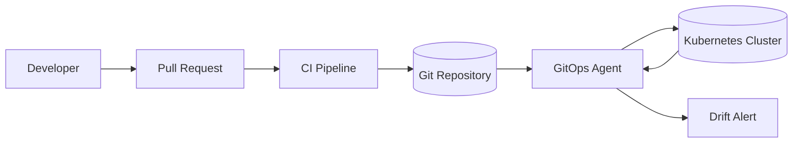
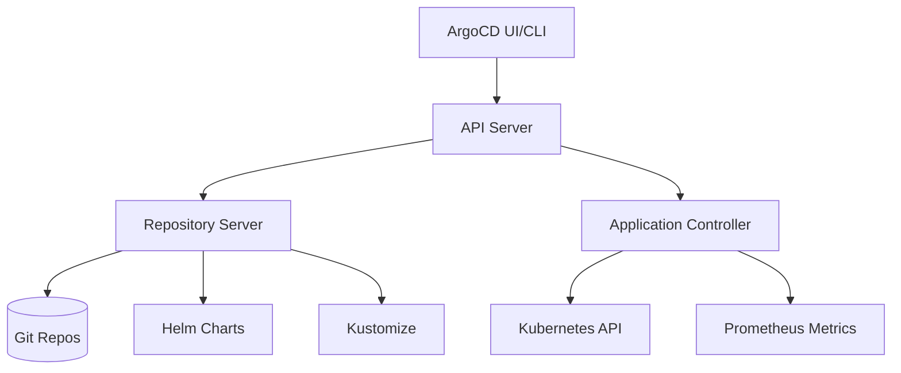
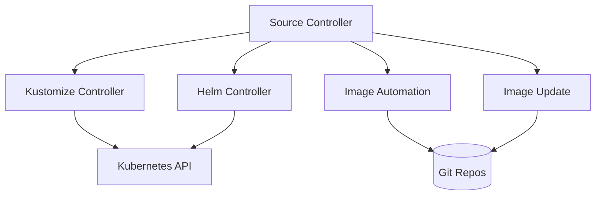

# GitOps Principles and Patterns

## Learning Objectives
- Understand GitOps principles and why they matter for platform engineering
- Learn the difference between push-based and pull-based deployment
- Master ArgoCD and Flux - the two leading GitOps tools
- Implement App of Apps pattern for platform bootstrapping
- Handle secrets, multi-cluster, and drift detection

## Prerequisites
- Kubernetes fundamentals (Phase 1)
- Git and CI/CD basics
- Helm/Kustomize familiarity

---

## What is GitOps?

**GitOps** is a paradigm for continuous deployment where:
- **Git is the single source of truth** for desired state
- **Changes are made via pull requests** (audit trail, reviews)
- **Automated agents reconcile** cluster state with Git
- **Drift detection** alerts when reality diverges from desired state



### Core Principles
1. **Declarative**: Describe *what* not *how*
2. **Versioned**: Immutable history in Git
3. **Automated**: No manual `kubectl apply`
4. **Observable**: Continuous reconciliation status

---

## Push vs Pull Deployment

| Aspect | Push-Based (Traditional CI/CD) | Pull-Based (GitOps) |
|--------|-------------------------------|---------------------|
| Trigger | CI pipeline pushes to cluster | Agent pulls from Git |
| Credentials | Cluster creds in CI | Agent has cluster creds |
| Drift Detection | Manual/Periodic | Continuous |
| Rollback | Re-run pipeline | `git revert` |
| Audit Trail | CI logs | Git history |
| Multi-cluster | Complex | Natural fit |

---

## ArgoCD Deep Dive

### Architecture


### Key Concepts

#### Application
```yaml
# argocd-application.yaml
apiVersion: argoproj.io/v1alpha1
kind: Application
metadata:
  name: platform-core
  namespace: argocd
  finalizers:
    - resources-finalizer.argocd.argoproj.io
spec:
  project: platform
  source:
    repoURL: https://github.com/myorg/platform-config
    targetRevision: main
    path: clusters/production/platform-core
    helm:
      valueFiles:
        - values.yaml
        - values-prod.yaml
  destination:
    server: https://kubernetes.default.svc
    namespace: platform-system
  syncPolicy:
    automated:
      prune: true
      selfHeal: true
      allowEmpty: false
    syncOptions:
      - CreateNamespace=true
      - PrunePropagationPolicy=foreground
      - PruneLast=true
    retry:
      limit: 5
      backoff:
        duration: 5s
        factor: 2
        maxDuration: 3m
  ignoreDifferences:
    - group: apps
      kind: Deployment
      jsonPointers:
        - /spec/replicas
```

#### AppProject (Multi-tenancy)
```yaml
# argocd-project.yaml
apiVersion: argoproj.io/v1alpha1
kind: AppProject
metadata:
  name: platform
  namespace: argocd
spec:
  description: Platform team projects
  sourceRepos:
    - https://github.com/myorg/platform-config
    - https://charts.myorg.io
  destinations:
    - namespace: platform-system
      server: https://kubernetes.default.svc
    - namespace: monitoring
      server: https://kubernetes.default.svc
  clusterResourceWhitelist:
    - group: ''
      kind: Namespace
    - group: rbac.authorization.k8s.io
      kind: ClusterRole
  namespaceResourceWhitelist:
    - group: ''
      kind: ConfigMap
    - group: apps
      kind: Deployment
  roles:
    - name: developer
      description: Read-only access
      policies:
        - p, proj:platform:developer, applications, get, platform/*, allow
      groups:
        - platform-developers
```

#### ApplicationSet (Multi-cluster/Monorepo)
```yaml
# argocd-applicationset.yaml
apiVersion: argoproj.io/v1alpha1
kind: ApplicationSet
metadata:
  name: platform-services
  namespace: argocd
spec:
  generators:
    - git:
        repoURL: https://github.com/myorg/platform-config
        revision: main
        directories:
          - path: services/*
  template:
    metadata:
      name: '{{path.basename}}'
      namespace: argocd
    spec:
      project: platform
      source:
        repoURL: https://github.com/myorg/platform-config
        targetRevision: main
        path: '{{path}}'
      destination:
        server: '{{server}}'
        namespace: '{{namespace}}'
      syncPolicy:
        automated:
          prune: true
          selfHeal: true
```

### App of Apps Pattern

Bootstrap the entire platform with a single Application:

```yaml
# root-app.yaml - The "App of Apps"
apiVersion: argoproj.io/v1alpha1
kind: Application
metadata:
  name: platform-root
  namespace: argocd
spec:
  project: platform
  source:
    repoURL: https://github.com/myorg/platform-config
    targetRevision: main
    path: clusters/production/root
  destination:
    server: https://kubernetes.default.svc
    namespace: argocd
  syncPolicy:
    automated:
      prune: true
      selfHeal: true
```

Directory structure:
```
clusters/production/
├── root/
│   ├── argocd-projects.yaml
│   ├── platform-core.yaml
│   ├── monitoring.yaml
│   ├── ingress.yaml
│   └── security.yaml
├── platform-core/
│   ├── kustomization.yaml
│   ├── cert-manager.yaml
│   ├── external-secrets.yaml
│   └── sealed-secrets.yaml
├── monitoring/
│   ├── kustomization.yaml
│   ├── prometheus.yaml
│   ├── loki.yaml
│   └── tempo.yaml
└── services/
    ├── service-a/
    │   ├── kustomization.yaml
    │   ├── deployment.yaml
    │   └── service.yaml
    └── service-b/
        ├── kustomization.yaml
        ├── deployment.yaml
        └── service.yaml
```

---

## Flux Deep Dive

### Architecture


### Flux Components

#### GitRepository (Source)
```yaml
# flux-gitrepository.yaml
apiVersion: source.toolkit.fluxcd.io/v1beta2
kind: GitRepository
metadata:
  name: platform-config
  namespace: flux-system
spec:
  interval: 1m
  url: https://github.com/myorg/platform-config
  ref:
    branch: main
  secretRef:
    name: git-credentials
  ignore: |
    # Exclude directories
    /clusters/staging/
    /clusters/dev/
    # Exclude files
    *.md
    .gitignore
```

#### Kustomization
```yaml
# flux-kustomization.yaml
apiVersion: kustomize.toolkit.fluxcd.io/v1beta2
kind: Kustomization
metadata:
  name: platform-core
  namespace: flux-system
spec:
  interval: 10m
  path: ./clusters/production/platform-core
  prune: true
  sourceRef:
    kind: GitRepository
    name: platform-config
  validation: client
  healthChecks:
    - apiVersion: apps/v1
      kind: Deployment
      name: cert-manager
      namespace: cert-manager
  postBuild:
    substitute:
      CLUSTER_NAME: production
      DOMAIN: platform.mycompany.com
    substituteFrom:
      - kind: ConfigMap
        name: platform-config
        optional: false
```

#### HelmRelease
```yaml
# flux-helmrelease.yaml
apiVersion: helm.toolkit.fluxcd.io/v2beta1
kind: HelmRelease
metadata:
  name: prometheus
  namespace: monitoring
spec:
  interval: 10m
  chart:
    spec:
      chart: kube-prometheus-stack
      version: "45.0.0"
      sourceRef:
        kind: HelmRepository
        name: prometheus-community
        namespace: flux-system
  values:
    prometheus:
      prometheusSpec:
        retention: 30d
        storageSpec:
          volumeClaimTemplate:
            spec:
              storageClassName: fast-ssd
              resources:
                requests:
                  storage: 100Gi
    grafana:
      enabled: true
      persistence:
        enabled: true
        size: 10Gi
```

#### Image Automation
```yaml
# flux-image-automation.yaml
apiVersion: image.toolkit.fluxcd.io/v1beta2
kind: ImageRepository
metadata:
  name: myapp
  namespace: flux-system
spec:
  image: ghcr.io/myorg/myapp
  interval: 5m
  secretRef:
    name: ghcr-credentials
---
apiVersion: image.toolkit.fluxcd.io/v1beta2
kind: ImagePolicy
metadata:
  name: myapp-semver
  namespace: flux-system
spec:
  imageRepositoryRef:
    name: myapp
  policy:
    semver:
      range: ">=1.0.0 <2.0.0"
  filterTags:
    pattern: '^v[0-9]+\.[0-9]+\.[0-9]+$'
---
apiVersion: image.toolkit.fluxcd.io/v1beta2
kind: ImageUpdateAutomation
metadata:
  name: myapp-update
  namespace: flux-system
spec:
  interval: 10m
  sourceRef:
    kind: GitRepository
    name: platform-config
  git:
    checkout:
      ref:
        branch: main
    commit:
      author:
        email: flux-bot@mycompany.com
        name: flux-bot
    push:
      branch: main
  update:
    path: ./clusters/production/services/myapp
    strategy: Setters
```

---

## Secrets Management in GitOps

### Problem: Secrets in Git?

**Never commit secrets to Git!** Use these patterns instead:

### Pattern 1: Sealed Secrets (Bitnami)
```bash
# Install controller
kubectl apply -f https://github.com/bitnami-labs/sealed-secrets/releases/download/v0.24.0/controller.yaml

# Seal a secret
echo -n "my-password" | kubectl create secret generic db-password \
  --dry-run=client --from-file=password=/dev/stdin -o yaml | \
  kubeseal -o yaml > sealed-secret.yaml
```

```yaml
# sealed-secret.yaml (safe to commit)
apiVersion: bitnami.com/v1alpha1
kind: SealedSecret
metadata:
  name: db-password
  namespace: production
spec:
  encryptedData:
    password: AgBy3i4... # Encrypted with cluster public key
  template:
    metadata:
      name: db-password
      namespace: production
    type: kubernetes.io/opaque
```

### Pattern 2: External Secrets Operator
```yaml
# externalsecret.yaml
apiVersion: external-secrets.io/v1beta1
kind: ExternalSecret
metadata:
  name: database-credentials
  namespace: production
spec:
  refreshInterval: 1h
  secretStoreRef:
    name: vault-backend
    kind: ClusterSecretStore
  target:
    name: database-credentials
    creationPolicy: Owner
  data:
    - secretKey: username
      remoteRef:
        key: database/production
        property: username
    - secretKey: password
      remoteRef:
        key: database/production
        property: password
```

```yaml
# clustersecretstore.yaml
apiVersion: external-secrets.io/v1beta1
kind: ClusterSecretStore
metadata:
  name: vault-backend
spec:
  provider:
    vault:
      server: "https://vault.mycompany.com"
      path: "secret"
      version: "v2"
      auth:
        kubernetes:
          mountPath: "kubernetes"
          role: "external-secrets"
```

### Pattern 3: SOPS (Mozilla)
```bash
# Encrypt
sops --encrypt --kms arn:aws:kms:us-east-1:123456789:key/abcdef \
  secrets.yaml > secrets.enc.yaml

# Decrypt (in CI/CD)
sops --decrypt secrets.enc.yaml | kubectl apply -f -
```

---

## Drift Detection & Remediation

### ArgoCD Drift Detection
```bash
# Check sync status
argocd app get platform-core

# View diff
argocd app diff platform-core

# Manual sync with prune
argocd app sync platform-core --prune
```

### Flux Drift Detection
```bash
# Check reconciliation status
flux get kustomizations -A

# View diff
flux diff kustomization platform-core -n flux-system

# Force reconciliation
flux reconcile kustomization platform-core -n flux-system --with-source
```

### Automated Drift Remediation
```yaml
# ArgoCD: Auto-heal with selfHeal
syncPolicy:
  automated:
    selfHeal: true  # Automatically revert manual changes
    prune: true     # Remove resources not in Git

# Flux: Suspend on drift (manual intervention)
spec:
  suspend: false    # Set to true to pause reconciliation
```

---

## Multi-Cluster GitOps

### ArgoCD Multi-Cluster
```yaml
# Register cluster
argocd cluster add <context> --name production-east

# Cluster secret (auto-created)
# Contains: kubeconfig with restricted permissions
```

```yaml
# Application targeting specific cluster
apiVersion: argoproj.io/v1alpha1
kind: Application
metadata:
  name: platform-core-east
  namespace: argocd
spec:
  destination:
    name: production-east  # Cluster name in ArgoCD
    namespace: platform-system
```

### Flux Multi-Cluster
```yaml
# flux-multi-cluster.yaml
apiVersion: kustomize.toolkit.fluxcd.io/v1beta2
kind: Kustomization
metadata:
  name: platform-core-east
  namespace: flux-system
spec:
  interval: 10m
  path: ./clusters/production-east/platform-core
  sourceRef:
    kind: GitRepository
    name: platform-config
  targetNamespace: platform-system
  # Deploy to specific cluster via kubeconfig context
  # Uses --kubeconfig flag or KUBECONFIG env var
```

---

## Hands-On Exercise

### Lab: Bootstrap ArgoCD with App of Apps

**Prerequisites:**
- Kubernetes cluster (Kind/k3d)
- kubectl, argocd CLI
- GitHub repo for platform config

**Steps:**

```bash
# 1. Install ArgoCD
kubectl create namespace argocd
kubectl apply -n argocd -f https://raw.githubusercontent.com/argoproj/argo-cd/stable/manifests/install.yaml

# 2. Expose ArgoCD (port-forward for dev)
kubectl port-forward -n argocd svc/argocd-server 8080:443

# 3. Login
argocd login localhost:8080 --username admin --password <from-secret>

# 4. Create platform repo structure
mkdir -p platform-config/clusters/production/root
mkdir -p platform-config/clusters/production/platform-core

# 5. Create root Application
cat > platform-config/clusters/production/root/root-app.yaml <<EOF
apiVersion: argoproj.io/v1alpha1
kind: Application
metadata:
  name: platform-root
  namespace: argocd
spec:
  project: default
  source:
    repoURL: https://github.com/YOUR_ORG/platform-config
    targetRevision: main
    path: clusters/production/root
  destination:
    server: https://kubernetes.default.svc
    namespace: argocd
  syncPolicy:
    automated:
      prune: true
      selfHeal: true
EOF

# 6. Create platform-core Application
cat > platform-config/clusters/production/root/platform-core.yaml <<EOF
apiVersion: argoproj.io/v1alpha1
kind: Application
metadata:
  name: platform-core
  namespace: argocd
spec:
  project: default
  source:
    repoURL: https://github.com/YOUR_ORG/platform-config
    targetRevision: main
    path: clusters/production/platform-core
  destination:
    server: https://kubernetes.default.svc
    namespace: platform-system
  syncPolicy:
    automated:
      prune: true
      selfHeal: true
    syncOptions:
      - CreateNamespace=true
EOF

# 7. Add sample component (cert-manager)
mkdir -p platform-config/clusters/production/platform-core
cat > platform-config/clusters/production/platform-core/cert-manager.yaml <<EOF
apiVersion: source.toolkit.fluxcd.io/v1beta2
kind: HelmRepository
metadata:
  name: jetstack
  namespace: flux-system
spec:
  interval: 10m
  url: https://charts.jetstack.io
---
apiVersion: helm.toolkit.fluxcd.io/v2beta1
kind: HelmRelease
metadata:
  name: cert-manager
  namespace: cert-manager
spec:
  interval: 10m
  chart:
    spec:
      chart: cert-manager
      version: v1.13.0
      sourceRef:
        kind: HelmRepository
        name: jetstack
  values:
    installCRDs: true
EOF

# 8. Commit and push
git add platform-config
git commit -m "Add platform root and core"
git push origin main

# 9. Apply root application
kubectl apply -f platform-config/clusters/production/root/root-app.yaml

# 10. Watch reconciliation
argocd app get platform-root
argocd app get platform-core
```

---

## Best Practices

### Repository Structure
```
platform-config/
├── clusters/
│   ├── production/
│   │   ├── root/
│   │   ├── platform-core/
│   │   ├── monitoring/
│   │   └── services/
│   ├── staging/
│   └── development/
├── components/
│   ├── cert-manager/
│   ├── external-secrets/
│   └── ingress-nginx/
└── services/
    ├── service-a/
    └── service-b/
```

### Pull Request Workflow
```yaml
# .github/workflows/gitops-validation.yaml
name: GitOps Validation
on:
  pull_request:
    paths:
      - 'clusters/**'
      - 'components/**'
      - 'services/**'
jobs:
  validate:
    runs-on: ubuntu-latest
    steps:
      - uses: actions/checkout@v4
      - name: Install kustomize
        run: curl -s "https://raw.githubusercontent.com/kubernetes-sigs/kustomize/master/hack/install_kustomize.sh" | bash
      - name: Validate kustomizations
        run: |
          for dir in clusters/*/*/; do
            ./kustomize build "$dir" > /dev/null || exit 1
          done
      - name: Validate Helm charts
        run: |
          for chart in components/*/Chart.yaml; do
            helm lint "$(dirname "$chart")" || exit 1
          done
```

### Monitoring GitOps Health
```yaml
# Prometheus alerts for GitOps
groups:
  - name: gitops
    rules:
      - alert: ArgoCDApplicationOutOfSync
        expr: argocd_application_info{sync_status!="Synced"} == 1
        for: 5m
        labels:
          severity: warning
        annotations:
          summary: "ArgoCD Application {{ $labels.name }} out of sync"
      
      - alert: FluxKustomizationSuspended
        expr: flux_kustomization_suspended == 1
        for: 1m
        labels:
          severity: critical
        annotations:
          summary: "Flux Kustomization {{ $labels.name }} suspended"
      
      - alert: GitOpsReconciliationFailure
        expr: increase(argocd_application_reconcile_total{status="error"}[5m]) > 0
        for: 1m
        labels:
          severity: critical
        annotations:
          summary: "GitOps reconciliation failing for {{ $labels.name }}"
```

---

## Further Reading

### Official Documentation
- [ArgoCD Documentation](https://argo-cd.readthedocs.io/)
- [Flux Documentation](https://fluxcd.io/docs/)
- [GitOps Working Group](https://github.com/open-gitops)

### Books & Articles
- "GitOps: Continuous Delivery for Kubernetes" - Christian Hernandez
- "Continuous Delivery with GitOps" - Weaveworks
- [GitOps Principles](https://opengitops.dev/)

### Tools Comparison
- [ArgoCD vs Flux](https://www.cncf.io/blog/2022/03/02/argo-cd-vs-flux-a-comprehensive-comparison/)
- [GitOps Tool Matrix](https://gitops.tech/tool-matrix/)

---

## Next Steps

1. **Complete Lab 02**: Bootstrap ArgoCD with App of Apps
2. **Read**: [Secrets Management](../06-secrets-management/external-secrets.md)
3. **Practice**: Set up Flux alongside ArgoCD for comparison
4. **Explore**: [Multi-cluster GitOps](../05-gitops/multi-cluster-gitops.md)