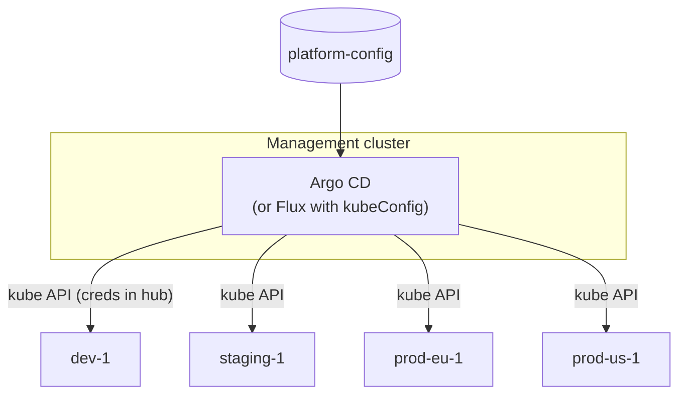
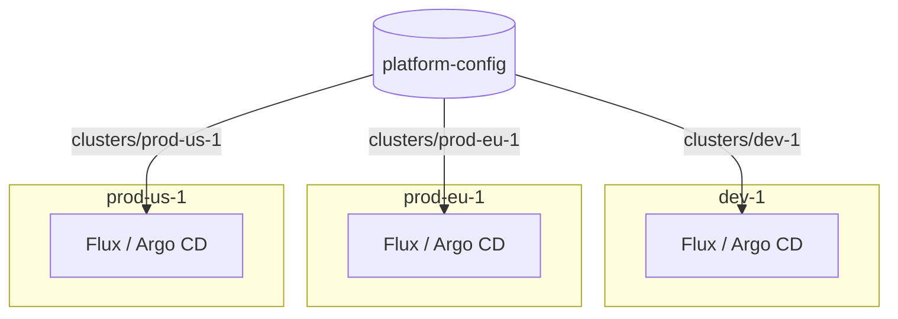
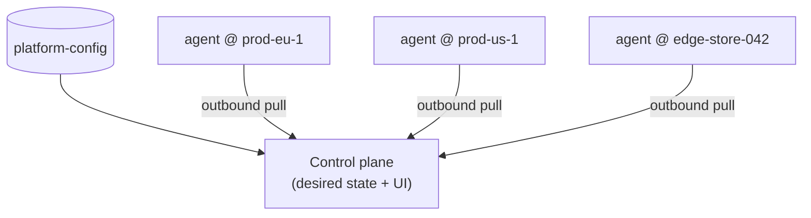
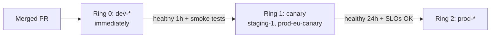
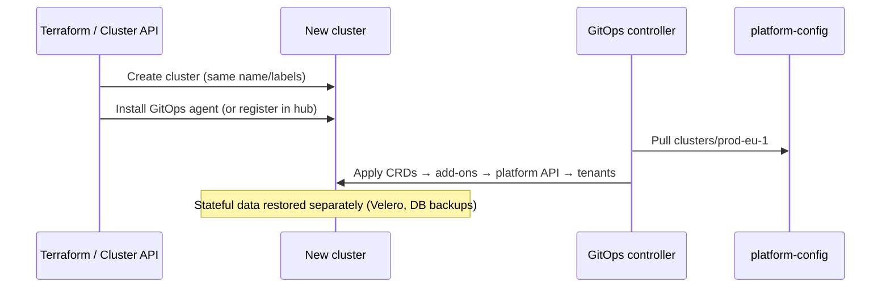

# Multi-Cluster GitOps

## Learning Objectives
- Compare hub-and-spoke, standalone (per-cluster), and agent-based GitOps topologies
- Design a repository layout that scales from 3 to 300 clusters without copy-paste
- Register clusters declaratively, with workload identity instead of long-lived kubeconfigs
- Inject per-cluster configuration (region, environment, cloud account) into shared manifests
- Roll changes progressively across clusters in rings (dev → canary → prod)
- Rebuild a cluster from Git as a disaster-recovery strategy

## Prerequisites
- [GitOps Principles](./gitops-principles.md)
- [Argo CD Deep Dive](./argocd-deep-dive.md) — especially the cluster and matrix ApplicationSet generators
- [Flux Deep Dive](./flux-deep-dive.md) — especially `kubeConfig.secretRef` on Kustomizations
- [GitOps Tool Comparison](../04-infrastructure-as-code/gitops-tool-comparison.md)
- Two or more clusters (Kind works — see the exercise below)

> **Scope.** This document covers how *GitOps delivery* works across many clusters. For federation, cross-cluster scheduling, and networking, see [Cluster Federation](../13-multi-cluster/cluster-federation.md), [Multi-Cluster Networking](../13-multi-cluster/multi-cluster-networking.md), and [Workload Distribution](../13-multi-cluster/workload-distribution.md).

---

## Why Multi-Cluster?

| Driver | Example |
|--------|---------|
| Environment isolation | Separate dev, staging, prod clusters |
| Blast radius | A bad control-plane upgrade affects one cluster, not all tenants |
| Regionality / latency | `prod-eu-1`, `prod-us-1` close to users |
| Compliance / data residency | EU data stays in EU clusters |
| Tenant isolation | Dedicated clusters for regulated tenants |
| Scale limits | etcd size, API server load, node count |

Without a deliberate design, N clusters means N copies of manifests, N drifting configurations, and N times the upgrade effort. Multi-cluster GitOps aims for **one change, many clusters, controlled rollout**.

---

## Topologies

### 1. Hub-and-Spoke (Central Push)

A single management cluster runs the GitOps controller, which holds credentials to every workload cluster and applies to their API servers.



### 2. Standalone (Pull per Cluster)

Each cluster runs its own controller and pulls its own path from Git.



### 3. Agent-Based (Central Control, Local Apply)

A central plane holds the desired state and UI. Lightweight agents in each cluster pull work and apply it locally, so no inbound access to workload API servers is needed. Examples: Rancher Fleet, the Argo CD Agent project (`argoproj-labs/argocd-agent`), and Flux hub setups that use the Flux Operator.



### Choosing

| Criterion | Hub-and-spoke | Standalone | Agent-based |
|-----------|---------------|------------|-------------|
| Single pane of glass | Yes | Needs aggregation (metrics, Flux Operator UI, Headlamp) | Yes |
| Credential concentration | **High**: hub can write to every cluster | None | Low (agent-initiated) |
| Network requirements | Hub → every API server | Cluster → Git only | Cluster → control plane |
| Hub outage impact | No deployments anywhere (running workloads unaffected) | None | No new deployments |
| Bootstrap new cluster | Register a Secret in the hub | Install controller + point at path | Install agent |
| Controller resource cost | Concentrated in hub; sharding needed at scale | Small per cluster | Small per cluster + control plane |
| Good for | Tens of clusters, strong central team | Strong isolation, regulated, many clusters | Large fleets, edge, restricted networks |

**This repo's reference design:** a **management cluster running Argo CD** in hub-and-spoke mode for platform add-ons in non-production and production, with **Flux standalone** as the documented alternative for teams that want no central credentials. Both read the same `platform-config` repository.

---

## Repository Layout

The layout is the most important decision. It should make the common change (bump an add-on everywhere) a one-line PR and the rare change (one cluster is special) possible without forking.

```text
platform-config/
├── clusters/                         # one directory per cluster: thin, mostly references
│   ├── dev-1/
│   │   ├── cluster.yaml              # cluster metadata (labels, values) - consumed by tooling
│   │   └── kustomization.yaml        # (Flux) which addon sets + overlays apply
│   ├── staging-1/
│   ├── prod-eu-1/
│   └── prod-us-1/
├── fleets/                           # rings / groups of clusters
│   ├── dev/kustomization.yaml
│   ├── canary/kustomization.yaml
│   └── prod/kustomization.yaml
├── addons/                           # one directory per platform component
│   ├── cert-manager/
│   │   ├── base/                     # HelmRelease / Application, default values
│   │   └── overlays/
│   │       ├── dev/
│   │       └── prod/
│   ├── external-secrets/
│   ├── ingress-nginx/
│   └── kyverno/
├── platform-api/                     # Tenant/Environment/Workload CRDs + operators
└── tenants/                          # Tenant CRs, rendered per cluster by the tenant operator
    ├── payments.yaml
    └── search.yaml
```

Principles:

1. **Clusters are data, not code.** A cluster directory says *which* fleet and overlays it uses and supplies variables. It shouldn't contain copied manifests.
2. **Compose by reference.** Fleets list add-ons; clusters list fleets. Kustomize `resources:` or ApplicationSet generators do the composition.
3. **Variables over overlays** for per-cluster scalars (region, account ID, domain). Use overlays for structural differences only.
4. **Separate platform from tenant repos** when tenants need write access. The platform repo then points at tenant repos (Argo CD `AppProject` / Flux `GitRepository` per tenant).

### Monorepo vs Polyrepo

| | Monorepo (`platform-config`) | Repo per cluster/environment |
|-|------------------------------|------------------------------|
| Fleet-wide change | One PR | N PRs (automate with bots) |
| Access control | CODEOWNERS per path | Repo permissions |
| Promotion | Path/branch/tag based | Merge/cherry-pick across repos |
| Blast radius of a bad merge | Larger (mitigated by rings) | Smaller |

Most platform teams start with a monorepo plus CODEOWNERS and rings.

---

## Registering Clusters Declaratively

### Argo CD: Cluster Secrets with Labels

`argocd cluster add` is convenient, but it creates a ServiceAccount with a long-lived token. In production, create the cluster Secret declaratively (from Terraform or GitOps) and use **cloud workload identity**.

```yaml
# clusters/prod-eu-1/argocd-cluster-secret.yaml  (applied to the management cluster)
apiVersion: v1
kind: Secret
metadata:
  name: cluster-prod-eu-1
  namespace: argocd
  labels:
    argocd.argoproj.io/secret-type: cluster
    # Labels drive ApplicationSet cluster generators
    platform.mycompany.io/environment: prod
    platform.mycompany.io/ring: prod
    platform.mycompany.io/region: eu-west-1
    platform.mycompany.io/cloud: aws
  annotations:
    # Annotations carry values that templates can use
    platform.mycompany.io/base-domain: eu.apps.mycompany.io
    platform.mycompany.io/aws-account-id: "210987654321"
type: Opaque
stringData:
  name: prod-eu-1
  server: https://ABCDEF1234567890.gr7.eu-west-1.eks.amazonaws.com
  config: |
    {
      "awsAuthConfig": {
        "clusterName": "prod-eu-1",
        "roleARN": "arn:aws:iam::210987654321:role/argocd-deployer"
      },
      "tlsClientConfig": {
        "insecure": false,
        "caData": "LS0tLS1CRUdJTi..."
      }
    }
```

The Argo CD controller's own identity (IRSA / EKS Pod Identity) assumes `argocd-deployer` in each account, and an EKS access entry maps that role to a Kubernetes group with only the permissions Argo CD needs. GKE and AKS have equivalents via `execProviderConfig` with `gke-gcloud-auth-plugin` or `kubelogin`.

> Commit only the Secret's *shape* to Git if it contains a CA bundle and no credentials, as above. If it contains tokens, generate it from Terraform or deliver it through [External Secrets](../06-secrets-management/external-secrets.md).

### Flux: Remote Clusters from a Hub

Standalone Flux needs no registration: each cluster bootstraps itself. For a Flux hub, each remote target is a `Kustomization` with `kubeConfig`. Flux 2.6+ can authenticate with cloud workload identity instead of a static kubeconfig Secret:

```yaml
# hub: flux-system/remote-prod-eu-1.yaml
apiVersion: v1
kind: ConfigMap
metadata:
  name: prod-eu-1-kubeconfig
  namespace: flux-system
data:
  provider: aws
  cluster: arn:aws:eks:eu-west-1:210987654321:cluster/prod-eu-1
---
apiVersion: kustomize.toolkit.fluxcd.io/v1
kind: Kustomization
metadata:
  name: prod-eu-1-addons
  namespace: flux-system
spec:
  interval: 10m
  path: ./clusters/prod-eu-1
  prune: true
  sourceRef:
    kind: GitRepository
    name: platform-config
  kubeConfig:
    configMapRef:
      name: prod-eu-1-kubeconfig      # secretless; hub identity assumes access via cloud IAM
  postBuild:
    substituteFrom:
      - kind: ConfigMap
        name: prod-eu-1-vars
```

On older Flux versions, use `kubeConfig.secretRef` with a kubeconfig Secret instead, as shown in [Flux Deep Dive](./flux-deep-dive.md).

---

## Per-Cluster Configuration

Shared manifests need cluster-specific values. Each tool has a mechanism.

### Argo CD: Go Templates from Cluster Metadata

```yaml
# addons/external-dns/applicationset.yaml
apiVersion: argoproj.io/v1alpha1
kind: ApplicationSet
metadata:
  name: external-dns
  namespace: argocd
spec:
  goTemplate: true
  goTemplateOptions: ["missingkey=error"]   # fail loudly if a cluster lacks an annotation
  generators:
    - clusters:
        selector:
          matchExpressions:
            - key: platform.mycompany.io/cloud
              operator: In
              values: [aws]
  template:
    metadata:
      name: 'external-dns-{{ .name }}'
      labels:
        platform.mycompany.io/addon: external-dns
    spec:
      project: platform-addons
      source:
        repoURL: https://kubernetes-sigs.github.io/external-dns
        chart: external-dns
        targetRevision: 1.16.1
        helm:
          valuesObject:
            domainFilters:
              - '{{ index .metadata.annotations "platform.mycompany.io/base-domain" }}'
            txtOwnerId: '{{ .name }}'
            serviceAccount:
              annotations:
                eks.amazonaws.com/role-arn: 'arn:aws:iam::{{ index .metadata.annotations "platform.mycompany.io/aws-account-id" }}:role/external-dns'
      destination:
        server: '{{ .server }}'
        namespace: external-dns
      syncPolicy:
        automated: { prune: true, selfHeal: true }
        syncOptions: [CreateNamespace=true]
```

### Flux: Kustomize Overlays + `postBuild` Substitution

```yaml
# clusters/prod-eu-1/kustomization.yaml (plain Kustomize, built by Flux)
apiVersion: kustomize.config.k8s.io/v1beta1
kind: Kustomization
resources:
  - ../../fleets/prod
configMapGenerator:
  - name: cluster-vars
    namespace: flux-system
    literals:
      - CLUSTER_NAME=prod-eu-1
      - REGION=eu-west-1
      - BASE_DOMAIN=eu.apps.mycompany.io
      - AWS_ACCOUNT_ID=210987654321
generatorOptions:
  disableNameSuffixHash: true
```

```yaml
# addons/external-dns/base/helmrelease.yaml (uses ${VAR} placeholders)
apiVersion: helm.toolkit.fluxcd.io/v2
kind: HelmRelease
metadata:
  name: external-dns
  namespace: external-dns
spec:
  interval: 30m
  chart:
    spec:
      chart: external-dns
      version: 1.16.1
      sourceRef:
        kind: HelmRepository
        name: external-dns
        namespace: flux-system
  values:
    domainFilters: ["${BASE_DOMAIN}"]
    txtOwnerId: "${CLUSTER_NAME}"
    serviceAccount:
      annotations:
        eks.amazonaws.com/role-arn: "arn:aws:iam::${AWS_ACCOUNT_ID}:role/external-dns"
```

```yaml
# The Flux Kustomization that applies addons substitutes from cluster-vars
apiVersion: kustomize.toolkit.fluxcd.io/v1
kind: Kustomization
metadata:
  name: addons
  namespace: flux-system
spec:
  interval: 10m
  path: ./addons-for-this-cluster
  prune: true
  sourceRef:
    kind: GitRepository
    name: platform-config
  dependsOn:
    - name: cluster-vars
  postBuild:
    substituteFrom:
      - kind: ConfigMap
        name: cluster-vars
```

> **Pitfall:** `postBuild` substitution touches *every* `${...}` in the rendered output, including shell scripts in ConfigMaps. Escape literal dollars as `$${VAR}`, or disable substitution on an object with the annotation `kustomize.toolkit.fluxcd.io/substitute: disabled`.

---

## Progressive Rollout Across Clusters

A change to `addons/` hits every cluster at once unless you design for rings.



### Pattern A: Pin Versions per Ring (Works Everywhere)

Each ring references a different revision of the add-on. Promotion is a PR that bumps a ring's pin.

```yaml
# fleets/canary/versions.yaml - consumed by ApplicationSet list/git generators or Kustomize
addons:
  cert-manager: v1.18.2
  external-secrets: 0.19.2
  ingress-nginx: 4.12.1
```

Automate promotion with a bot (Renovate rules per ring, or a GitHub Action) that opens the next ring's PR after the previous ring has been healthy for N hours.

### Pattern B: Git Refs per Ring (Flux OCI Artifacts)

Publish the platform config as OCI artifacts and let each ring follow a different tag:

```bash
# CI: push the rendered config as an OCI artifact on every merge
flux push artifact oci://ghcr.io/myorg/platform-config:$(git rev-parse --short HEAD) \
  --path=./addons --source="$(git config --get remote.origin.url)" \
  --revision="main@sha1:$(git rev-parse HEAD)"

# Promote a build to a ring by moving its tag
flux tag artifact oci://ghcr.io/myorg/platform-config:abc1234 --tag canary
```

```yaml
# clusters/staging-1/source.yaml
apiVersion: source.toolkit.fluxcd.io/v1
kind: OCIRepository
metadata:
  name: platform-addons
  namespace: flux-system
spec:
  interval: 5m
  url: oci://ghcr.io/myorg/platform-config
  ref:
    tag: canary            # prod clusters use tag: prod
  verify:
    provider: cosign       # only apply signed artifacts
```

### Pattern C: Argo CD Progressive Syncs

ApplicationSet's `RollingSync` strategy updates generated Applications in steps selected by label. It is an **alpha** feature: it must be enabled on the ApplicationSet controller (`applicationsetcontroller.enable.progressive.syncs: "true"` in `argocd-cmd-params-cm`) and the generated Applications must not use automated sync.

```yaml
# addons/kyverno/applicationset.yaml (excerpt)
spec:
  goTemplate: true
  generators:
    - clusters:
        selector:
          matchLabels:
            platform.mycompany.io/managed: "true"
  strategy:
    type: RollingSync
    rollingSync:
      steps:
        - matchExpressions:
            - key: platform.mycompany.io/ring
              operator: In
              values: [dev]
        - matchExpressions:
            - key: platform.mycompany.io/ring
              operator: In
              values: [canary]
          maxUpdate: 1
        - matchExpressions:
            - key: platform.mycompany.io/ring
              operator: In
              values: [prod]
          maxUpdate: 25%
  template:
    metadata:
      name: 'kyverno-{{ .name }}'
      labels:
        platform.mycompany.io/ring: '{{ index .metadata.labels "platform.mycompany.io/ring" }}'
    spec:
      # ... source/destination; no syncPolicy.automated
```

Each step waits until the previous step's Applications are Healthy before syncing the next.

### Which Pattern?

| Pattern | Pros | Cons |
|---------|------|------|
| Version pins per ring | Explicit, auditable, tool-agnostic | Promotion PR churn (automate it) |
| OCI tags per ring | Immutable artifacts, signing, fast | Requires CI publishing; tags are mutable pointers (audit tag moves) |
| Argo CD RollingSync | Native, no repo changes | Alpha; no automated sync; health only, no metric analysis |

For analysis-driven rollout (SLOs, error rates) between rings, gate promotion PRs on queries to your metrics stack ([SLOs and SLIs](../11-reliability/slos-slis.md)). [Lab 08](../../labs/lab-08-platform-upgrade/) uses this for platform upgrades.

---

## Tenants Across Clusters

With the platform API, a `Tenant` (cluster-scoped) can be placed on several clusters. A common pattern is for the management cluster to hold the canonical `Tenant` objects, while an ApplicationSet distributes them to the clusters selected in the Tenant's spec:

```yaml
# tenants/payments.yaml
apiVersion: platform.mycompany.io/v1alpha1
kind: Tenant
metadata:
  name: payments
  labels:
    platform.mycompany.io/tier: regulated
spec:
  owners: ["group:payments-eng"]
  placement:
    clusterSelector:
      matchLabels:
        platform.mycompany.io/environment: prod
        platform.mycompany.io/region: eu-west-1
```

```yaml
# tenants/applicationset.yaml - one Application per (tenant x matching cluster)
apiVersion: argoproj.io/v1alpha1
kind: ApplicationSet
metadata:
  name: tenants
  namespace: argocd
spec:
  goTemplate: true
  generators:
    - matrix:
        generators:
          - git:
              repoURL: https://github.com/myorg/platform-config
              revision: main
              files:
                - path: tenants/*/placement.json   # rendered by CI from Tenant specs
          - clusters:
              selector:
                matchLabels:
                  platform.mycompany.io/environment: '{{ .environment }}'
                  platform.mycompany.io/region: '{{ .region }}'
  template:
    metadata:
      name: 'tenant-{{ .tenant }}-{{ .name }}'
    spec:
      project: tenants
      source:
        repoURL: https://github.com/myorg/platform-config
        targetRevision: main
        path: 'tenants/{{ .tenant }}'
      destination:
        server: '{{ .server }}'
      syncPolicy:
        automated: { prune: false, selfHeal: true }   # never auto-delete tenant namespaces
```

The tenant operator in each cluster ([`code/tenant-operator/`](https://github.com/GitOpsHub/platform-engineering-on-kubernetes/tree/main/code/tenant-operator/)) then expands the `Tenant` into namespaces, quotas, RBAC, and network policies. See [Lab 07](../../labs/lab-07-multi-tenancy/README.md).

---

## Disaster Recovery: Clusters as Cattle

When every cluster's state is in Git, rebuilding a cluster comes down to three steps:



Requirements for this to work:

| Requirement | How |
|-------------|-----|
| Ordering (CRDs before CRs) | Argo CD sync waves; Flux `dependsOn` between Kustomizations |
| Secrets available on day 0 | Bootstrap only the ESO/Vault identity; everything else syncs ([Secrets](../06-secrets-management/external-secrets.md)) |
| Sealed Secrets keys | Back up and restore controller keys, or re-seal (see [Sealed Secrets](../06-secrets-management/sealed-secrets.md)) |
| Data | Velero / database-native backup ([Disaster Recovery](../11-reliability/disaster-recovery.md)) |
| DNS / external IDs stable | Keep cluster name consistent; `txtOwnerId` for external-dns |

Test it: rebuild a non-production cluster from scratch every quarter and measure time-to-ready.

---

## Observability for a Fleet

| Signal | Argo CD hub | Flux standalone |
|--------|-------------|-----------------|
| Sync/health per app per cluster | `argocd_app_info{dest_server=...}` | `gotk_reconcile_condition` / kube-state-metrics custom resource state per cluster |
| Aggregation | Single Prometheus scrape | Remote-write each cluster to central Thanos/Mimir ([Metrics Stack](../10-observability/metrics-stack.md)) |
| Notifications | Argo CD Notifications | notification-controller per cluster → shared Slack/webhook |
| "What version is where?" | UI + `argocd app list -l platform.mycompany.io/addon=X` | Query `HelmRelease` status across clusters, or Flux Operator reports |

```promql
# Clusters where any platform add-on is not healthy (Argo CD)
count by (dest_server) (argocd_app_info{health_status!="Healthy", project="platform-addons"})
```

---

## Hands-On Exercises

### Exercise 1: Hub-and-Spoke Argo CD with Two Kind Clusters and Rings

```bash
# 1. Create a hub and two spokes on a shared Docker network
kind create cluster --name hub
kind create cluster --name spoke-dev
kind create cluster --name spoke-prod

# 2. Install Argo CD in the hub
kubectl config use-context kind-hub
kubectl create namespace argocd
kubectl apply -n argocd --server-side \
  -f https://raw.githubusercontent.com/argoproj/argo-cd/stable/manifests/install.yaml
kubectl -n argocd rollout status deploy/argocd-server

# 3. Register spokes using the internal Docker address (Kind API servers listen on 6443)
argocd login --core
kubectl config set-context --current --namespace=argocd
for c in spoke-dev spoke-prod; do
  IP=$(docker inspect -f '{{range .NetworkSettings.Networks}}{{.IPAddress}}{{end}}' ${c}-control-plane)
  kubectl config set-cluster kind-${c} --server=https://${IP}:6443
  argocd cluster add kind-${c} --name ${c} --yes \
    --label platform.mycompany.io/managed=true \
    --label platform.mycompany.io/ring=$( [ $c = spoke-dev ] && echo dev || echo prod )
done
argocd cluster list
```

> Changing the kubeconfig server to the container IP makes the spokes reachable from the hub's pods, but breaks access from your laptop. Run `kind export kubeconfig --name <spoke>` afterwards to restore it.

```bash
# 4. Deploy podinfo to all managed clusters, with a ring-specific replica count
cat <<'EOF' | kubectl --context kind-hub apply -f -
apiVersion: argoproj.io/v1alpha1
kind: ApplicationSet
metadata:
  name: podinfo
  namespace: argocd
spec:
  goTemplate: true
  goTemplateOptions: ["missingkey=error"]
  generators:
    - clusters:
        selector:
          matchLabels:
            platform.mycompany.io/managed: "true"
  template:
    metadata:
      name: 'podinfo-{{ .name }}'
    spec:
      project: default
      source:
        repoURL: https://stefanprodan.github.io/podinfo
        chart: podinfo
        targetRevision: 6.*
        helm:
          valuesObject:
            replicaCount: '{{ if eq (index .metadata.labels "platform.mycompany.io/ring") "prod" }}3{{ else }}1{{ end }}'
            ui:
              message: 'Hello from {{ .name }}'
      destination:
        server: '{{ .server }}'
        namespace: podinfo
      syncPolicy:
        automated: { prune: true, selfHeal: true }
        syncOptions: [CreateNamespace=true]
EOF

# 5. Verify
argocd app list
kubectl --context kind-spoke-prod -n podinfo get deploy podinfo
```

**Extend it:**
1. Add a third cluster labeled `ring=canary`, enable progressive syncs, and convert the ApplicationSet to `RollingSync` with dev → canary → prod steps.
2. Replace `argocd cluster add` with a declarative cluster Secret (as shown earlier) and commit it to a test repo.
3. Repeat the setup with standalone Flux in each spoke (`flux install`, plus a `GitRepository` and `Kustomization` per cluster path) and compare the two setups.

```bash
# Cleanup
kind delete cluster --name hub; kind delete cluster --name spoke-dev; kind delete cluster --name spoke-prod
```

---

## Troubleshooting

### Argo CD cluster `Unknown` / `connection refused`

**Cause:** Hub can't reach spoke API server (network, private endpoint)  
**Fix:** Check routing, security groups, private link; for Kind, use container IP

### `the server has asked for the client to provide credentials`

**Cause:** Expired token or wrong IAM role mapping  
**Fix:** Use workload identity (`awsAuthConfig`/exec); verify EKS access entry for the role

### ApplicationSet generates nothing

**Cause:** Selector labels don't match cluster Secret labels; the in-cluster cluster has no Secret by default  
**Fix:** `kubectl -n argocd get secret -l argocd.argoproj.io/secret-type=cluster --show-labels`

### `map has no entry for key` in ApplicationSet

**Cause:** Cluster lacks an annotation used in a template (with `missingkey=error`)  
**Fix:** Add the annotation, or use `default` in the template

### Flux `${VAR}` left literally in manifests

**Cause:** Missing `postBuild.substituteFrom` or ConfigMap not found  
**Fix:** Check Kustomization status; ensure the vars ConfigMap exists before reconcile (`dependsOn`)

### Flux corrupts scripts containing `$`

**Cause:** `postBuild` substituted shell variables  
**Fix:** Escape as `$${VAR}` or annotate with `kustomize.toolkit.fluxcd.io/substitute: disabled`

### Hub controller OOM / slow syncs

**Cause:** Too many clusters per controller shard  
**Fix:** Enable sharding (`replicas` + `ARGOCD_CONTROLLER_REPLICAS`), exclude noisy kinds

### Change rolled to all clusters at once

**Cause:** No ring design  
**Fix:** Adopt version pins, OCI tags, or RollingSync

### Rebuilt cluster stuck: CRs before CRDs

**Cause:** Missing ordering  
**Fix:** Sync waves / `dependsOn`; split CRDs into their own Application/Kustomization

---

## Further Reading

- [Argo CD declarative cluster setup](https://argo-cd.readthedocs.io/en/stable/operator-manual/declarative-setup/#clusters)
- [ApplicationSet progressive syncs](https://argo-cd.readthedocs.io/en/stable/operator-manual/applicationset/Progressive-Syncs/)
- [Argo CD Agent](https://github.com/argoproj-labs/argocd-agent)
- [Flux multi-cluster / multi-tenancy repo structure](https://fluxcd.io/flux/guides/repository-structure/)
- [Flux OCI artifacts](https://fluxcd.io/flux/cheatsheets/oci-artifacts/)
- [Rancher Fleet](https://fleet.rancher.io/)

---

## Next Steps

1. **Read**: [Cluster Federation](../13-multi-cluster/cluster-federation.md) — Karmada, Cluster API, and Fleet beyond delivery
2. **Read**: [Secrets Management with Vault](../06-secrets-management/vault-integration.md) — secrets that follow workloads across clusters
3. **Lab**: [Lab 07 - Multi-Tenancy](../../labs/lab-07-multi-tenancy/README.md) and [Lab 08 - Platform Upgrade](../../labs/lab-08-platform-upgrade/)
