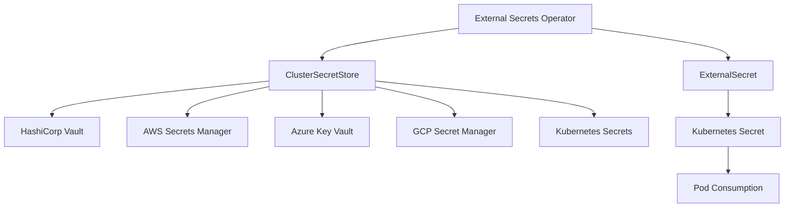

# External Secrets Operator

## Learning Objectives
- Understand External Secrets Operator architecture
- Integrate with secret stores (Vault, AWS Secrets Manager, Azure Key Vault, GCP Secret Manager)
- Create ClusterSecretStore and ExternalSecret resources
- Implement secret rotation and templating

## Prerequisites
- Kubernetes fundamentals
- GitOps principles
- Access to a secret store (Vault, AWS, Azure, GCP)

---

## Architecture



---

## Installation

```bash
# Add Helm repo
helm repo add external-secrets https://charts.external-secrets.io
helm repo update

# Install
helm upgrade --install external-secrets external-secrets/external-secrets \
  --namespace external-secrets --create-namespace \
  --set installCRDs=true \
  --set webhook.port=9443 \
  --set certController.enabled=true

# Verify
kubectl get pods -n external-secrets
kubectl get crd | grep external-secrets
```

---

## Secret Store Providers

### HashiCorp Vault

#### ClusterSecretStore (Cluster-scoped)
```yaml
# clustersecretstore-vault.yaml
apiVersion: external-secrets.io/v1
kind: ClusterSecretStore
metadata:
  name: vault-backend
spec:
  provider:
    vault:
      server: "https://vault.mycompany.com"
      path: "secret"
      version: "v2"
      auth:
        # Kubernetes auth (recommended)
        kubernetes:
          mountPath: "kubernetes"
          role: "external-secrets"
          serviceAccountRef:
            name: external-secrets
            namespace: external-secrets
        # Or token auth
        # tokenSecretRef:
        #   name: vault-token
        #   key: token
        #   namespace: external-secrets
      # Namespace (for Enterprise)
      # namespace: "platform"
      # TLS configuration
      caProvider:
        type: Secret
        name: vault-ca
        key: ca.crt
```

#### Vault Policy for ESO
```hcl
# vault-policy.hcl
path "secret/data/platform/*" {
  capabilities = ["read", "list"]
}

path "secret/metadata/platform/*" {
  capabilities = ["read", "list"]
}

# For specific tenant isolation
path "secret/data/tenant/{{identity.entity.aliases.auth_kubernetes_*.metadata.service_account_name}}/*" {
  capabilities = ["read", "list", "create", "update", "delete"]
}
```

#### Kubernetes Auth Role
```bash
# Create Vault role for ESO
vault write auth/kubernetes/role/external-secrets \
  bound_service_account_names=external-secrets \
  bound_service_account_namespaces=external-secrets \
  policies=platform-secrets \
  ttl=24h
```

### AWS Secrets Manager

```yaml
# clustersecretstore-aws.yaml
apiVersion: external-secrets.io/v1
kind: ClusterSecretStore
metadata:
  name: aws-secretsmanager
spec:
  provider:
    aws:
      service: SecretsManager
      region: us-east-1
      auth:
        # IRSA (recommended)
        jwt:
          serviceAccountRef:
            name: external-secrets
            namespace: external-secrets
        # Or static credentials
        # secretRef:
        #   accessKeyIDSecretRef:
        #     name: aws-credentials
        #     key: access-key-id
        #   secretAccessKeySecretRef:
        #     name: aws-credentials
        #     key: secret-access-key
```

#### IAM Policy for ESO
```json
{
  "Version": "2012-10-17",
  "Statement": [
    {
      "Effect": "Allow",
      "Action": [
        "secretsmanager:GetSecretValue",
        "secretsmanager:ListSecrets"
      ],
      "Resource": [
        "arn:aws:secretsmanager:us-east-1:123456789:secret:platform/*"
      ]
    }
  ]
}
```

### Azure Key Vault

```yaml
# clustersecretstore-azure.yaml
apiVersion: external-secrets.io/v1
kind: ClusterSecretStore
metadata:
  name: azure-keyvault
spec:
  provider:
    azurekv:
      authType: WorkloadIdentity
      vaultUrl: "https://myvault.vault.azure.net"
      serviceAccountRef:
        name: external-secrets
        namespace: external-secrets
```

### Google Secret Manager

```yaml
# clustersecretstore-gcp.yaml
apiVersion: external-secrets.io/v1
kind: ClusterSecretStore
metadata:
  name: gcp-secretsmanager
spec:
  provider:
    gcpsm:
      projectID: "my-project-id"
      auth:
        workloadIdentity:
          serviceAccountRef:
            name: external-secrets
            namespace: external-secrets
```

---

## ExternalSecret Resources

### Basic ExternalSecret
```yaml
# externalsecret-basic.yaml
apiVersion: external-secrets.io/v1
kind: ExternalSecret
metadata:
  name: database-credentials
  namespace: production
spec:
  refreshInterval: 1h
  secretStoreRef:
    name: vault-backend
    kind: ClusterSecretStore
  target:
    name: database-credentials
    creationPolicy: Owner
    deletionPolicy: Delete
    template:
      engineVersion: v2
      data:
        # Transform secret values
        connection_string: "{{ .username }}:{{ .password }}@{{ .host }}:{{ .port }}/{{ .database }}"
        # Or use as-is
        username: "{{ .username }}"
        password: "{{ .password }}"
  data:
    - secretKey: username
      remoteRef:
        key: database/production
        property: username
    - secretKey: password
      remoteRef:
        key: database/production
        property: password
    - secretKey: host
      remoteRef:
        key: database/production
        property: host
    - secretKey: port
      remoteRef:
        key: database/production
        property: port
    - secretKey: database
      remoteRef:
        key: database/production
        property: database
```

### ExternalSecret with Multiple Keys
```yaml
# externalsecret-multi.yaml
apiVersion: external-secrets.io/v1
kind: ExternalSecret
metadata:
  name: tls-certificates
  namespace: production
spec:
  refreshInterval: 1h
  secretStoreRef:
    name: vault-backend
    kind: ClusterSecretStore
  target:
    name: tls-certificates
    creationPolicy: Owner
    template:
      type: kubernetes.io/tls
      engineVersion: v2
      data:
        tls.crt: "{{ .cert | b64enc }}"
        tls.key: "{{ .key | b64enc }}"
        ca.crt: "{{ .ca | b64enc }}"
  data:
    - secretKey: cert
      remoteRef:
        key: tls/production/myapp
        property: certificate
    - secretKey: key
      remoteRef:
        key: tls/production/myapp
        property: private_key
    - secretKey: ca
      remoteRef:
        key: tls/production/myapp
        property: ca_chain
```

### ExternalSecret with JSON Data
```yaml
# externalsecret-json.yaml
apiVersion: external-secrets.io/v1
kind: ExternalSecret
metadata:
  name: app-config
  namespace: production
spec:
  refreshInterval: 30m
  secretStoreRef:
    name: vault-backend
    kind: ClusterSecretStore
  target:
    name: app-config
    creationPolicy: Owner
    template:
      engineVersion: v2
      data:
        config.json: |
          {
            "database": {
              "host": "{{ .host }}",
              "port": {{ .port }},
              "ssl": {{ .ssl }}
            },
            "features": {
              "new_ui": {{ .new_ui }},
              "beta_access": {{ .beta_access }}
            }
          }
  dataFrom:
    - extract:
        key: config/production/myapp
        property: config_json
```

### ExternalSecret with Find (Dynamic Keys)
```yaml
# externalsecret-find.yaml
apiVersion: external-secrets.io/v1
kind: ExternalSecret
metadata:
  name: microservices-secrets
  namespace: production
spec:
  refreshInterval: 1h
  secretStoreRef:
    name: vault-backend
    kind: ClusterSecretStore
  target:
    name: microservices-secrets
    creationPolicy: Owner
  dataFrom:
    - find:
        name:
          regexp: "^microservice-.*"
        tags:
          environment: "production"
          team: "platform"
      rewrite:
        - regexp:
            source: "microservice-(.*)"
            target: "$1"
```

---

## Advanced Features

### Secret Templates (v2)
```yaml
# Template functions available:
# - base64enc, base64dec
# - toJSON, fromJSON
# - toYAML, fromYAML
# - sha256, sha512
# - randAlphaNum, randAlpha, randNumeric
# - date, dateInZone
# - env (read from env vars)

apiVersion: external-secrets.io/v1
kind: ExternalSecret
metadata:
  name: templated-secret
  namespace: production
spec:
  target:
    template:
      engineVersion: v2
      data:
        # Generate random password if not in vault
        password: "{{ .password | default (randAlphaNum 32) }}"
        # Hash value
        api_key_hash: "{{ .api_key | sha256 }}"
        # JSON encode
        config_json: "{{ .config | toJSON }}"
        # Conditional
        debug_mode: "{{ if eq .environment \"development\" }}true{{ else }}false{{ end }}"
```

### PushSecret (Write to External Store)
```yaml
# pushsecret.yaml
apiVersion: external-secrets.io/v1
kind: PushSecret
metadata:
  name: push-to-vault
  namespace: production
spec:
  secretStoreRef:
    name: vault-backend
    kind: ClusterSecretStore
  refreshInterval: 10m
  deletionPolicy: Delete
  selector:
    matchLabels:
      push-to-vault: "true"
  data:
    - match:
        secretKey: password
      remoteRef:
        remoteKey: generated/platform/password
        property: password
```

### Secret Rotation
```yaml
# Rotation via ClusterSecretStore refreshInterval
apiVersion: external-secrets.io/v1
kind: ClusterSecretStore
metadata:
  name: vault-backend
spec:
  provider:
    vault:
      server: "https://vault.mycompany.com"
      # ... auth config
  # Refresh interval for all ExternalSecrets using this store
  refreshInterval: 15m
```

```yaml
# Per-ExternalSecret override
apiVersion: external-secrets.io/v1
kind: ExternalSecret
metadata:
  name: rotated-secret
spec:
  refreshInterval: 5m  # Override cluster store
  # ...
```

---

## GitOps Integration

### Managing ExternalSecrets with Flux
```yaml
# flux-externalsecret.yaml
apiVersion: kustomize.toolkit.fluxcd.io/v1
kind: Kustomization
metadata:
  name: external-secrets
  namespace: flux-system
spec:
  interval: 10m
  path: ./clusters/production/external-secrets
  sourceRef:
    kind: GitRepository
    name: platform-config
  prune: true
```

### ExternalSecret in Git (No Secrets!)
```yaml
# clusters/production/external-secrets/database.yaml
# SAFE TO COMMIT - no actual secrets!
apiVersion: external-secrets.io/v1
kind: ExternalSecret
metadata:
  name: database-credentials
  namespace: production
spec:
  refreshInterval: 1h
  secretStoreRef:
    name: vault-backend
    kind: ClusterSecretStore
  target:
    name: database-credentials
    creationPolicy: Owner
  data:
    - secretKey: username
      remoteRef:
        key: database/production
        property: username
    - secretKey: password
      remoteRef:
        key: database/production
        property: password
```

---

## Monitoring & Troubleshooting

### Metrics
```bash
# Prometheus metrics
kubectl get --raw=/metrics | grep external_secrets

# Key metrics:
# external_secrets_controller_reconcile_total
# external_secrets_controller_reconcile_errors_total
# external_secrets_store_health
```

### Common Issues

#### Secret Not Synced
```bash
# Check ExternalSecret status
kubectl get externalsecret database-credentials -n production -o yaml

# Check ClusterSecretStore status
kubectl get clustersecretstore vault-backend -o yaml

# Check controller logs
kubectl logs -n external-secrets -l app=external-secrets
```

#### Permission Denied
```bash
# Check Vault token/role
vault token lookup

# Check Kubernetes auth
vault read auth/kubernetes/role/external-secrets

# Check service account token
kubectl exec -n external-secrets deploy/external-secrets -- cat /var/run/secrets/kubernetes.io/serviceaccount/token
```

#### Refresh Not Working
```bash
# Force refresh
kubectl annotate externalsecret database-credentials -n production \
  reconcile.external-secrets.io/force="$(date +%s)" --overwrite

# Check refresh interval
kubectl get externalsecret database-credentials -n production -o jsonpath='{.spec.refreshInterval}'
```

---

## Hands-On Exercise

**Goal**: Sync a Vault KV v2 secret into a Kubernetes Secret, rotate the source value, and confirm the Secret follows.

```bash
# 1. Start a dev-mode Vault in the cluster (lab use only; dev mode is not persistent)
helm repo add hashicorp https://helm.releases.hashicorp.com
helm upgrade --install vault hashicorp/vault \
  --namespace vault --create-namespace \
  --set "server.dev.enabled=true" \
  --set "server.dev.devRootToken=root"

# 2. Write a secret into KV v2
kubectl -n vault exec vault-0 -- sh -c \
  'VAULT_TOKEN=root vault kv put secret/platform/db username=app password=initial'

# 3. Create the ClusterSecretStore and an ExternalSecret (token auth keeps the lab short)
kubectl apply -f - <<'EOF'
# exercise-store.yaml
apiVersion: v1
kind: Secret
metadata:
  name: vault-root-token
  namespace: external-secrets
stringData:
  token: root
---
apiVersion: external-secrets.io/v1
kind: ClusterSecretStore
metadata:
  name: vault-dev
spec:
  provider:
    vault:
      server: "http://vault.vault.svc:8200"
      path: "secret"
      version: "v2"
      auth:
        tokenSecretRef:
          name: vault-root-token
          key: token
          namespace: external-secrets
---
apiVersion: external-secrets.io/v1
kind: ExternalSecret
metadata:
  name: db-credentials
  namespace: default
spec:
  refreshInterval: 1m
  secretStoreRef:
    kind: ClusterSecretStore
    name: vault-dev
  target:
    name: db-credentials
    creationPolicy: Owner
  dataFrom:
    - extract:
        key: platform/db
EOF

# 4. Check sync status and read the result
kubectl -n default get externalsecret db-credentials
kubectl -n default get secret db-credentials -o jsonpath='{.data.password}' | base64 -d; echo
```

**Verify**:
1. The ExternalSecret reports `SecretSynced` with `Ready=True`.
2. Update the Vault value (`vault kv put secret/platform/db username=app password=rotated`), wait one `refreshInterval`, and confirm the Kubernetes Secret changes without any manual action.
3. Break the store on purpose (wrong `server`) and read the `status.conditions` to see how the failure is reported.

**Cleanup**: `kubectl delete externalsecret db-credentials -n default`, `kubectl delete clustersecretstore vault-dev`, and `helm uninstall vault -n vault`.

---

## Best Practices

1. **Use ClusterSecretStore** for cluster-wide secret stores
2. **Separate by environment** with different paths in Vault
3. **Use templates** to transform secrets for consumption
4. **Set appropriate refreshInterval** (1h default, 5m for rotation)
5. **Enable metrics** for monitoring
6. **Use IRSA/Workload Identity** for cloud providers
7. **Never commit actual secrets** to Git - only ExternalSecret specs

---

## Further Reading

- [External Secrets Documentation](https://external-secrets.io/)
- [Provider Specific Guides](https://external-secrets.io/latest/provider/)
- [API Reference](https://external-secrets.io/latest/api/)

---

## Next Steps

1. **Compare**: [Vault Integration](./vault-integration.md) for pod-level injection and the CSI provider
2. **Pair with GitOps**: [Sealed Secrets](./sealed-secrets.md) when you need encrypted secrets that live in Git
3. **Plan rotation**: [Secrets Rotation](./secrets-rotation.md) for refresh intervals, dynamic credentials, and reloads
