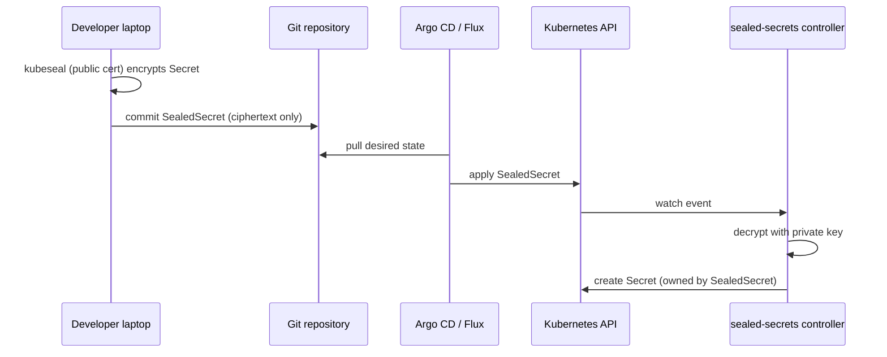

# Sealed Secrets: Encrypted Secrets You Can Commit

## Learning Objectives
- Explain how Bitnami Sealed Secrets encrypts a Secret for Git and who holds the decryption key
- Seal Secrets with `kubeseal` and choose the right scope (strict, namespace-wide, cluster-wide)
- Deliver SealedSecrets through a GitOps pipeline without exposing plaintext
- Operate the controller's key lifecycle: renewal, backup, restore, and re-encryption
- Decide when Sealed Secrets is the right tool and when External Secrets or Vault is the better fit

## Prerequisites
- Kubernetes fundamentals and [GitOps principles](../05-gitops/gitops-principles.md)
- Helm 3 and `kubectl`
- Install `kubeseal` (the CLI) to match the controller version you deploy
- A cluster to test against (see [Lab 01: Cluster Setup](../../labs/lab-01-cluster-setup/README.md))

---

## Overview

Sealed Secrets solves one narrow problem very well: **a Kubernetes `Secret` is only base64-encoded, so it
cannot be committed to Git, but a GitOps workflow wants every change in Git.** The project, maintained
under the `bitnami-labs` organization, lets you encrypt a Secret on a laptop with a public key and only
the controller in the target cluster can decrypt it.

The result is a custom resource, `SealedSecret`, that is safe to store in a repository, review in pull
requests, and apply through Argo CD or Flux. The controller turns it into an ordinary `Secret` in the
same namespace.



### How the Cryptography Works

- The controller generates an **RSA key pair** on first start and stores the private key in a Secret in its
  own namespace, labeled `sealedsecrets.bitnami.com/sealed-secrets-key`.
- The public half is distributed as a certificate. `kubeseal` fetches it or reads it from a file.
- Each value is encrypted with a fresh AES session key, and that session key is encrypted with RSA. This is
  a hybrid scheme, so large values are fine.
- Encryption is bound to the **name and namespace** of the target Secret by default. The controller refuses
  to decrypt a ciphertext that was sealed for a different name or namespace. This is the "scope" behavior
  covered below.

The private key never leaves the cluster unless an operator exports it deliberately, which is why key
backup is a first-class part of operating the tool.

---

## Installing the Controller

```bash
helm repo add sealed-secrets https://bitnami-labs.github.io/sealed-secrets
helm repo update

helm upgrade --install sealed-secrets sealed-secrets/sealed-secrets \
  --namespace kube-system \
  --set-string fullnameOverride=sealed-secrets-controller

kubectl -n kube-system rollout status deploy/sealed-secrets-controller
```

Two details matter for everything that follows:

- The controller **name** and **namespace** are what `kubeseal` needs to fetch the certificate. Record them in
  your repository's README so that every engineer uses the same values.
- Install into `kube-system` (or another locked-down namespace) so that only platform operators can read the
  key Secret.

Install the CLI with your package manager or from the project's GitHub releases, then verify both sides agree:

```bash
kubeseal --version
kubeseal --fetch-cert \
  --controller-name=sealed-secrets-controller \
  --controller-namespace=kube-system > pub-cert.pem

# The certificate is public. It is safe to commit so that CI can seal secrets without cluster access.
head -1 pub-cert.pem   # -----BEGIN CERTIFICATE-----
```

---

## Sealing a Secret

Start from a normal Secret manifest. Never commit this file. Use a temporary path and delete it after sealing:

```yaml
# db-credentials.secret.yaml   (DO NOT COMMIT - plaintext)
apiVersion: v1
kind: Secret
metadata:
  name: db-credentials
  namespace: team-billing
type: Opaque
stringData:
  username: billing_app
  password: change-me-in-vault-later
```

```bash
# Seal with the committed public certificate
kubeseal --format yaml \
  --cert pub-cert.pem \
  < db-credentials.secret.yaml > db-credentials.sealed.yaml

# Destroy the plaintext
shred -u db-credentials.secret.yaml 2>/dev/null || rm -f db-credentials.secret.yaml
```

The output is a `SealedSecret` (API group `bitnami.com/v1alpha1`):

```yaml
# db-credentials.sealed.yaml
apiVersion: bitnami.com/v1alpha1
kind: SealedSecret
metadata:
  name: db-credentials
  namespace: team-billing
spec:
  encryptedData:
    username: AgBy8hK3...          # ciphertext, truncated
    password: AgCt9Qe1...          # ciphertext, truncated
  template:
    metadata:
      labels:
        platform.mycompany.io/tenant: billing
    type: Opaque
```

`spec.template` controls what the generated `Secret` looks like. Labels and type set there are copied to the
output, which is how platform labels reach the decrypted object.

### Sealing Single Values

For one value, such as a token that a chart reads from `values.yaml`, use `--raw` and avoid creating a
manifest at all:

```bash
# Note the -n: without it, the trailing newline is part of the secret value.
printf '%s' "$GITHUB_TOKEN" | kubeseal --raw \
  --from-file=/dev/stdin \
  --name ci-token \
  --namespace team-billing \
  --cert pub-cert.pem
```

Paste the output into `spec.encryptedData` under a key of your choice. The `--name` and `--namespace` values
must match the `SealedSecret` they will be placed in.

---

## Scopes: Who Can Use a Ciphertext

The scope determines where a sealed value can be used. Strict scope is the default and the safest.

| Scope | How to Set | Ciphertext Bound To | Typical Use |
|-------|-----------|---------------------|-------------|
| `strict` (default) | Nothing | Name **and** namespace | Almost everything |
| `namespace-wide` | `sealedsecrets.bitnami.com/namespace-wide: "true"` annotation | Namespace only; the name can change | Renaming a Secret without re-sealing |
| `cluster-wide` | `sealedsecrets.bitnami.com/cluster-wide: "true"` annotation | Nothing; any namespace | Rare. Shared values such as a registry pull secret reused across namespaces |

```bash
kubeseal --format yaml --cert pub-cert.pem --scope namespace-wide \
  < db-credentials.secret.yaml > db-credentials.sealed.yaml
```

**Platform guidance**: keep the default `strict` scope for tenant secrets. A `cluster-wide` ciphertext can be
copied into any namespace, including one owned by another tenant, by anyone with write access to Git. Reserve
it for values that are intentionally shared, and review those in pull requests.

---

## Using SealedSecrets in a GitOps Repository

### Repository Layout

```text
platform-config/
├── clusters/
│   └── prod/
│       ├── kustomization.yaml
│       └── team-billing/
│           ├── namespace.yaml
│           ├── db-credentials.sealed.yaml
│           └── billing-api.yaml
└── keys/
    └── prod-pub-cert.pem        # public certificate, safe to commit
```

Keep the public certificate per cluster in `keys/`. A ciphertext sealed for `prod` will not decrypt on
`staging`, because each cluster has its own private key. That is a feature: a leaked staging ciphertext
never works against production.

### Flux Kustomization

```yaml
# clusters/prod/team-billing-kustomization.yaml
apiVersion: kustomize.toolkit.fluxcd.io/v1
kind: Kustomization
metadata:
  name: team-billing
  namespace: flux-system
spec:
  interval: 10m
  path: ./clusters/prod/team-billing
  prune: true
  sourceRef:
    kind: GitRepository
    name: platform-config
```

### Argo CD Application

```yaml
# argocd-team-billing.yaml
apiVersion: argoproj.io/v1alpha1
kind: Application
metadata:
  name: team-billing
  namespace: argocd
spec:
  project: tenants
  source:
    repoURL: https://github.com/myorg/platform-config
    targetRevision: main
    path: clusters/prod/team-billing
  destination:
    server: https://kubernetes.default.svc
    namespace: team-billing
  syncPolicy:
    automated:
      prune: true
      selfHeal: true
```

Both tools apply the `SealedSecret` like any other object. The generated `Secret` is owned by the
`SealedSecret`, so pruning the `SealedSecret` removes the `Secret` as well.

### Guardrails

Add an admission policy so that plaintext Secrets cannot be applied by the GitOps pipeline. A Kyverno
rule in the [policy engine](../12-security-compliance/policy-engine.md) style looks like this:

```yaml
# require-sealed-secrets.yaml
apiVersion: kyverno.io/v1
kind: ClusterPolicy
metadata:
  name: deny-plaintext-secret-in-tenants
spec:
  validationFailureAction: Enforce
  rules:
    - name: no-plaintext-secrets
      match:
        any:
          - resources:
              kinds: ["Secret"]
              namespaceSelector:
                matchExpressions:
                  - key: platform.mycompany.io/tenant
                    operator: Exists
      exclude:
        any:
          # The controller writes the decrypted Secret, so it must be allowed through
          - subjects:
              - kind: ServiceAccount
                name: sealed-secrets-controller
                namespace: kube-system
      validate:
        message: "Tenant namespaces accept SealedSecret only. Seal this Secret with kubeseal."
        deny:
          conditions:
            any:
              - key: "{{ request.operation }}"
                operator: AnyIn
                values: ["CREATE", "UPDATE"]
```

Add any other platform-owned exceptions explicitly rather than widening the policy. Also add a repository check (pre-commit or CI) that rejects any manifest with
`kind: Secret` under `clusters/`.

---

## Key Lifecycle

### Renewal

By default the controller generates a **new active key every 30 days** and keeps the previous keys so that
existing `SealedSecret` resources continue to decrypt. The period is controlled by the controller's
`--key-renew-period` flag, which the Helm chart exposes as a value.

```bash
# List every sealing key the controller holds, oldest first
kubectl -n kube-system get secret \
  -l sealedsecrets.bitnami.com/sealed-secrets-key \
  -o custom-columns=NAME:.metadata.name,CREATED:.metadata.creationTimestamp
```

Renewal does not invalidate existing ciphertexts. It changes what **new** seals use. Your Git history will
therefore contain a mix of key generations, and that is expected.

### Re-encrypting Under the Latest Key

Old keys are a long-term liability: anyone who obtains an old private key can decrypt ciphertexts sealed
under it, including ones still in your Git history. Re-encrypting moves a ciphertext to the active key:

```bash
# Re-encrypt one SealedSecret in place, using the controller's current certificate
kubeseal --re-encrypt --format yaml < clusters/prod/team-billing/db-credentials.sealed.yaml \
  > /tmp/db-credentials.resealed.yaml && mv /tmp/db-credentials.resealed.yaml \
  clusters/prod/team-billing/db-credentials.sealed.yaml
```

`--re-encrypt` decrypts server-side and re-seals without you ever seeing the plaintext, so it can run in a
CI job that has access to the cluster's controller. Commit the result and let GitOps apply it.

Re-encryption does **not** change the secret value. If the underlying credential might be compromised,
rotate the credential at its source (the database, the API provider) and seal the new value.

### Backing Up the Key

The controller key is the single point of recovery for every SealedSecret in the cluster. Back it up on
creation and after each renewal, and store the backup encrypted in your secrets vault:

```bash
kubectl -n kube-system get secret \
  -l sealedsecrets.bitnami.com/sealed-secrets-key \
  -o yaml > sealed-secrets-keys.backup.yaml

# Store the file in an encrypted location (for example, an offline vault item). Do not commit it.
```

### Restoring After a Cluster Rebuild

To restore into a new cluster **before** the controller starts for the first time:

```bash
kubectl -n kube-system apply -f sealed-secrets-keys.backup.yaml
kubectl -n kube-system delete pod -l app.kubernetes.io/name=sealed-secrets
```

Restarting the controller makes it load the restored keys. Existing SealedSecret resources in Git then decrypt
without re-sealing. If the controller had already generated a fresh key, restore the old key Secrets alongside
it; the controller treats all labeled keys as candidates.

---

## Sealed Secrets vs. External Secrets vs. Vault

| Concern | Sealed Secrets | External Secrets Operator | Vault (direct) |
|---------|----------------|---------------------------|----------------|
| Source of truth | Git (ciphertext) | External store | Vault |
| Needs a running external service | No | Yes | Yes |
| Secret values change without a Git commit | No | Yes (`refreshInterval`) | Yes |
| Dynamic or short-lived credentials | No | Partial (refresh only) | Yes (leases) |
| Multi-cluster | One key per cluster; re-seal per cluster | One store reference per cluster | Natural fit |
| Recovery risk | Losing the controller key | Losing store access | Losing unseal keys or the auth path |
| Best for | Small platforms, bootstrap secrets, air-gapped setups | Teams already on a cloud secret manager or Vault | Dynamic credentials and central policy |

Sealed Secrets is a good **bootstrap** tool: it can carry the one credential needed to reach Vault, for example
the AppRole secret ID or the ESO store token, without a chicken-and-egg problem. Once a platform has a
working secret store, move application secrets there and keep only bootstrap values sealed.

---

## Hands-On Exercise

**Goal**: Seal a Secret, commit it to a Git repository, apply it through the cluster, and then prove that
the ciphertext is useless in another cluster.

```bash
# 1. Two kind clusters from Lab 01 (names are examples)
kind create cluster --name seal-a
kind create cluster --name seal-b

# 2. Install the controller in both clusters
for c in seal-a seal-b; do
  helm --kube-context kind-$c upgrade --install sealed-secrets sealed-secrets/sealed-secrets \
    --namespace kube-system --set-string fullnameOverride=sealed-secrets-controller
done

# 3. Fetch the public certificate for cluster A only
kubeseal --fetch-cert --context kind-seal-a \
  --controller-name=sealed-secrets-controller --controller-namespace=kube-system > seal-a.pem

# 4. Create and seal a Secret
kubectl --context kind-seal-a create namespace team-billing
cat <<'EOF' > plain.secret.yaml
apiVersion: v1
kind: Secret
metadata:
  name: db-credentials
  namespace: team-billing
stringData:
  password: s3cret-lab-value
EOF
kubeseal --format yaml --cert seal-a.pem < plain.secret.yaml > db-credentials.sealed.yaml
rm plain.secret.yaml

# 5. Apply the SealedSecret to cluster A and read the decrypted value
kubectl --context kind-seal-a apply -f db-credentials.sealed.yaml
kubectl --context kind-seal-a -n team-billing get secret db-credentials \
  -o jsonpath='{.data.password}' | base64 -d; echo

# 6. Apply the same file to cluster B and observe that nothing decrypts
kubectl --context kind-seal-b create namespace team-billing
kubectl --context kind-seal-b apply -f db-credentials.sealed.yaml
kubectl --context kind-seal-b -n team-billing get events --sort-by=.lastTimestamp | tail -5
```

**Verify**:
1. Cluster A has a `Secret` named `db-credentials` whose decoded value is `s3cret-lab-value`.
2. `db-credentials.sealed.yaml` contains no plaintext; `grep -c s3cret db-credentials.sealed.yaml` returns `0`.
3. In cluster B, the controller logs `unseal failed` or equivalent for the object, and no `Secret` appears:
   `kubectl --context kind-seal-b -n team-billing get secret db-credentials` returns NotFound.
4. Change the namespace in the SealedSecret to `default` and apply it to cluster A. Confirm that no Secret is
   created in `default`, which demonstrates strict scope.

**Cleanup**: `kind delete cluster --name seal-a && kind delete cluster --name seal-b`, then delete the
generated `seal-a.pem` and `db-credentials.sealed.yaml` files.

---

## Troubleshooting

| Symptom | Likely Cause | Diagnose | Fix |
|---------|--------------|----------|-----|
| `no key could decrypt secret` in controller logs | Sealed against a different cluster's certificate, or the key was rotated out | `kubectl -n kube-system logs deploy/sealed-secrets-controller` | Re-seal with the cluster's current certificate, or restore the old key backup |
| `kubeseal` cannot fetch the cert | Controller name or namespace mismatch | `kubectl -n kube-system get deploy` | Pass the actual `--controller-name` and `--controller-namespace` |
| Generated `Secret` missing; SealedSecret exists | Name or namespace in the SealedSecret differs from the sealed metadata | Compare `metadata.name` and `namespace` with the values used in `kubeseal` | Re-seal with the correct name and namespace, or use `namespace-wide` scope if only the name changed |
| Value has a trailing newline | `echo` used instead of `printf '%s'` in `--raw` mode | Decode the Secret and check the last byte | Re-seal with `printf '%s'` |
| Argo CD shows SealedSecret `OutOfSync` forever | Controller rewrites `metadata` (for example, adds annotations) | `argocd app diff team-billing` | Add `ignoreDifferences` for the annotations, or accept the drift |
| Secret value changed in Git but not in cluster | Commit landed but GitOps sync is suspended or failed | `flux get kustomizations` or Argo CD app status | Resume or fix the sync; the controller only acts on applied objects |
| Restored cluster cannot decrypt anything | Key backup from a different cluster, or taken after key rotation without all generations | Count key Secrets in `kube-system` against the backup | Restore every key generation from the same cluster's backup |
| Deleted the controller namespace and lost keys | No backup existed | No recovery path | Re-create every secret from the source of truth and re-seal. This is why backup comes first |

---

## Further Reading

- [Sealed Secrets project](https://github.com/bitnami-labs/sealed-secrets)
- [Sealed Secrets README: installation and usage](https://github.com/bitnami-labs/sealed-secrets#readme)
- [Sealed Secrets: Scopes](https://github.com/bitnami-labs/sealed-secrets#scopes)
- [Kubernetes Secrets concepts](https://kubernetes.io/docs/concepts/configuration/secret/)
- [Argo CD: Diffing customization](https://argo-cd.readthedocs.io/en/stable/user-guide/diffing/)

---

## Next Steps

1. **Compare**: [External Secrets Operator](./external-secrets.md) for secrets that change without a Git commit
2. **Rotate**: [Secrets Rotation](./secrets-rotation.md) to plan how sealed values are replaced over time
3. **Harden**: [Vault Integration](./vault-integration.md) to move application secrets off Git entirely
4. **Enforce**: [Policy Engine](../12-security-compliance/policy-engine.md) for the admission rules that block plaintext Secrets
