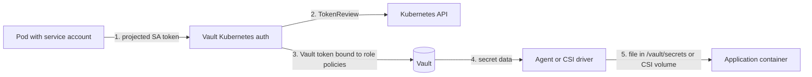
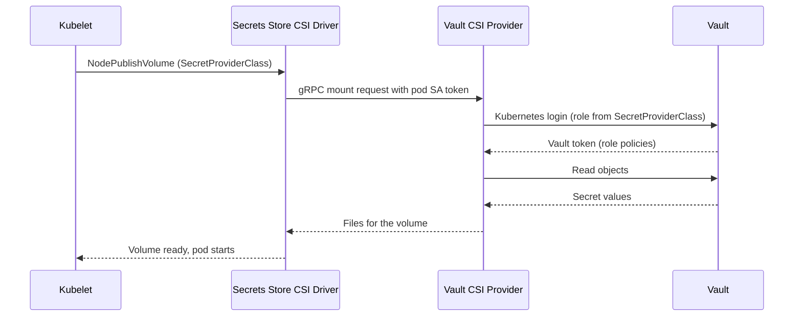
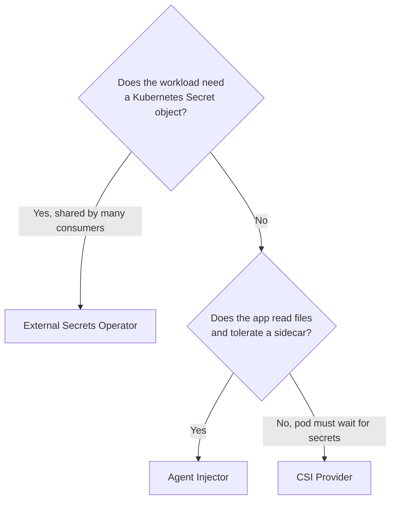

# Vault Integration: Agent Injector, CSI Provider, and Kubernetes Auth

## Learning Objectives
- Explain how a workload proves its identity to Vault with its Kubernetes service account
- Inject secrets into pods with the Vault Agent Injector and render them with templates
- Mount secrets through the Vault CSI provider and the Secrets Store CSI Driver
- Choose between injection, CSI, and External Secrets Operator for a given workload
- Model Vault policies and Kubernetes auth roles as tenant-scoped platform resources

## Prerequisites
- Kubernetes fundamentals, especially [service accounts and RBAC](../01-kubernetes-fundamentals/rbac.md)
- Helm 3 and a working cluster (see [Lab 01: Cluster Setup](../../labs/lab-01-cluster-setup/README.md))
- Basic Vault concepts: secrets engines, policies, auth methods, and tokens
- Read [External Secrets Operator](./external-secrets.md) first if you have not decided between sync and injection

---

## Overview

HashiCorp Vault is the system of record for secrets in many platforms. Kubernetes workloads need those
secrets in one of three shapes:

| Delivery Model | Mechanism | Secret Lands As | Best For |
|----------------|-----------|-----------------|----------|
| Agent Injector | Sidecar renders templates into a shared in-memory volume | Files in the pod | Apps that read config files, and apps that must not have a Kubernetes `Secret` object |
| CSI Provider | Secrets Store CSI Driver mounts secrets through a CSI volume | Files in the pod, optionally synced to a `Secret` | Pods that must start only after secrets exist, and per-pod mounts |
| External Secrets Operator | Controller syncs Vault data into a `Secret` | A Kubernetes `Secret` | Many consumers, GitOps-friendly declarations, and env-var consumers |

All three rely on the same trust anchor: the pod's Kubernetes service account token, exchanged with Vault
through the **Kubernetes auth method**. No long-lived Vault token is stored in the cluster.



The Vault server validates the token by calling the Kubernetes `TokenReview` API. Vault never needs to
hold a kubeconfig for every cluster, but it does need credentials that let it perform token reviews.

---

## Kubernetes Auth Method

### Enabling and Configuring the Auth Method

```bash
# setup-kubernetes-auth.sh
# Run against Vault with an admin token. Replace placeholders for your environment.

vault auth enable -path=kubernetes/prod-cluster kubernetes

# Vault running outside the cluster needs a reviewer JWT and the cluster CA.
vault write auth/kubernetes/prod-cluster/config \
  kubernetes_host="https://prod.k8s.mycompany.io:6443" \
  kubernetes_ca_cert=@/etc/vault/k8s-ca.crt \
  token_reviewer_jwt="${REVIEWER_JWT}"

# A dedicated, least-privilege reviewer service account (see below) produces REVIEWER_JWT.
```

Use a **per-cluster mount path** (`kubernetes/prod-cluster`, `kubernetes/staging`) so one Vault can serve
many clusters without roles colliding. The `-path` argument is what your workloads reference through
`vault.hashicorp.com/auth-path` or the ESO `mountPath` field.

### Reviewer Service Account

Vault needs permission to call `TokenReview`. Create a dedicated service account with only that permission:

```yaml
# vault-reviewer.yaml
apiVersion: v1
kind: ServiceAccount
metadata:
  name: vault-token-reviewer
  namespace: vault-system
  labels:
    platform.mycompany.io/owner: security-platform
---
apiVersion: rbac.authorization.k8s.io/v1
kind: ClusterRoleBinding
metadata:
  name: vault-token-reviewer
  labels:
    platform.mycompany.io/owner: security-platform
roleRef:
  apiGroup: rbac.authorization.k8s.io
  kind: ClusterRole
  name: system:auth-delegator
subjects:
  - kind: ServiceAccount
    name: vault-token-reviewer
    namespace: vault-system
---
# Long-lived token for the reviewer. Kubernetes 1.24+ does not auto-create these,
# so request one explicitly and rotate it with your Vault maintenance runbook.
apiVersion: v1
kind: Secret
metadata:
  name: vault-token-reviewer-token
  namespace: vault-system
  annotations:
    kubernetes.io/service-account.name: vault-token-reviewer
type: kubernetes.io/service-account-token
```

`system:auth-delegator` is the built-in ClusterRole that grants `tokenreviews.create` and
`subjectaccessreviews.create`. Do not grant broader cluster rights to the reviewer.

### Roles Bind Service Accounts to Policies

A Vault role says which service accounts in which namespaces may log in, and which policies their tokens
receive:

```bash
# billing-vault-role.sh
vault write auth/kubernetes/prod-cluster/role/billing \
  bound_service_account_names=billing-api \
  bound_service_account_namespaces=team-billing \
  token_policies=billing-read \
  token_ttl=1h \
  token_max_ttl=4h \
  audience=vault
```

Keep `bound_service_account_names` and `bound_service_account_namespaces` as narrow as possible. A wildcard
(`*`) is a common mistake that lets any service account in a namespace obtain the role's policies.

### Policies Scoped to Tenants

```hcl
# billing-read.hcl
# Read-only access to the billing tenant's KV v2 path.
path "secret/data/tenants/billing/*" {
  capabilities = ["read"]
}

path "secret/metadata/tenants/billing/*" {
  capabilities = ["list", "read"]
}
```

```bash
vault policy write billing-read billing-read.hcl
```

Map one policy per tenant, and generate them from the platform's `Tenant` resource rather than writing
them by hand. A `Tenant` named `billing` produces the `billing-read` policy, the `billing` role, and the
`tenants/billing/` path prefix. This keeps the mapping in one place and makes offboarding a single
deletion.

---

## Vault Agent Injector

The Agent Injector is a mutating admission webhook shipped with the official `hashicorp/vault` Helm chart.
When a pod carries the injection annotations, the webhook adds:

- an **init container** (`vault-agent-init`) that authenticates and renders templates once before the app starts
- a **sidecar container** (`vault-agent`) that keeps the secrets fresh while the pod runs
- a shared `emptyDir` volume mounted at `/vault/secrets` with `Memory` medium, so secret files never touch node disk

### Installing the Injector

```yaml
# vault-values.yaml
# Helm values for the hashicorp/vault chart, injector-only mode.
global:
  enabled: false
injector:
  enabled: true
  externalVaultAddr: "https://vault.mycompany.io:8200"
  replicas: 2
  resources:
    requests:
      cpu: 50m
      memory: 64Mi
    limits:
      memory: 256Mi
  affinity: |
    podAntiAffinity:
      requiredDuringSchedulingIgnoredDuringExecution:
        - labelSelector:
            matchLabels:
              app.kubernetes.io/name: vault-agent-injector
          topologyKey: kubernetes.io/hostname
```

```bash
helm repo add hashicorp https://helm.releases.hashicorp.com
helm upgrade --install vault-injector hashicorp/vault \
  --namespace vault-system --create-namespace \
  --values vault-values.yaml

kubectl -n vault-system get pods -l app.kubernetes.io/name=vault-agent-injector
```

Setting `injector.externalVaultAddr` points the injector at a Vault that runs outside the cluster, which is
the common case for a shared, centrally operated Vault.

### Annotating a Workload

```yaml
# billing-api-deployment.yaml
apiVersion: apps/v1
kind: Deployment
metadata:
  name: billing-api
  namespace: team-billing
  labels:
    platform.mycompany.io/tenant: billing
spec:
  replicas: 3
  selector:
    matchLabels:
      app: billing-api
  template:
    metadata:
      labels:
        app: billing-api
      annotations:
        vault.hashicorp.com/agent-inject: "true"
        vault.hashicorp.com/role: "billing"
        vault.hashicorp.com/auth-path: "auth/kubernetes/prod-cluster"
        vault.hashicorp.com/agent-inject-secret-db.env: "secret/data/tenants/billing/db"
        vault.hashicorp.com/agent-inject-template-db.env: |
          {{- with secret "secret/data/tenants/billing/db" -}}
          export DB_USER="{{ .Data.data.username }}"
          export DB_PASSWORD="{{ .Data.data.password }}"
          {{- end -}}
        vault.hashicorp.com/agent-pre-populate-only: "false"
    spec:
      serviceAccountName: billing-api
      containers:
        - name: api
          image: registry.mycompany.io/billing/api:1.4.2
          command: ["/bin/sh", "-c"]
          # Source the rendered file before starting the real process.
          args: [". /vault/secrets/db.env && exec /app/server"]
```

Annotation reference used above:

| Annotation | Purpose |
|------------|---------|
| `vault.hashicorp.com/agent-inject` | Enables injection for the pod |
| `vault.hashicorp.com/role` | Kubernetes auth role to log in with |
| `vault.hashicorp.com/auth-path` | Mount path of the Kubernetes auth method (defaults to `auth/kubernetes`) |
| `vault.hashicorp.com/agent-inject-secret-<name>` | Vault path to read; the file is written to `/vault/secrets/<name>` |
| `vault.hashicorp.com/agent-inject-template-<name>` | consul-template body that renders the file |
| `vault.hashicorp.com/agent-pre-populate-only` | `"true"` keeps only the init container (no sidecar); useful for batch jobs |

Because the agent sidecar renders templates continuously, a rotated database password appears in
`/vault/secrets/db.env` without a pod restart. The application still has to re-read the file. Environment
variables are read once at process start, so the `args` above only sources the file at boot. See
[Secrets Rotation](./secrets-rotation.md) for how to handle that.

### Template Patterns

Templates use consul-template syntax. Three patterns cover most cases:

```yaml
# Template patterns for vault.hashicorp.com/agent-inject-template-* annotations

# 1. JSON document for an app that reads a config file
vault.hashicorp.com/agent-inject-template-config.json: |
  {{- with secret "secret/data/tenants/billing/api" -}}
  {
    "apiKey": "{{ .Data.data.apiKey }}",
    "webhookSecret": "{{ .Data.data.webhookSecret }}"
  }
  {{- end -}}

# 2. A TLS certificate issued by the Vault PKI engine
vault.hashicorp.com/agent-inject-secret-tls.crt: "pki/issue/billing"
vault.hashicorp.com/agent-inject-template-tls.crt: |
  {{- with secret "pki/issue/billing" "common_name=api.billing.svc" "ttl=24h" -}}
  {{ .Data.certificate }}
  {{- end -}}

# 3. Iterate over every key in a KV path
vault.hashicorp.com/agent-inject-template-features.env: |
  {{- with secret "secret/data/tenants/billing/features" -}}
  {{- range $k, $v := .Data.data }}
  export {{ $k }}="{{ $v }}"
  {{- end }}
  {{- end -}}
```

---

## Vault CSI Provider

The CSI path mounts secrets as a volume through the **Secrets Store CSI Driver**
(`secrets-store.csi.x-k8s.io`), with Vault as a pluggable provider. Compared with injection:

- No sidecar is added, so the pod's resource footprint and the startup sequence are simpler.
- The pod cannot start until the volume is mounted, which means secrets must exist before the app runs.
- Secrets can be optionally synced into a Kubernetes `Secret` for environment-variable consumers.
- Rotation is driven by the driver's poll interval rather than by a sidecar.



### Installing the Driver and Provider

```bash
# Secrets Store CSI Driver (upstream sig-storage project)
helm repo add secrets-store-csi-driver https://kubernetes-sigs.github.io/secrets-store-csi-driver/charts
helm upgrade --install csi-secrets-store secrets-store-csi-driver/secrets-store-csi-driver \
  --namespace kube-system \
  --set syncSecret.enabled=true \
  --set enableSecretRotation=true \
  --set rotationPollInterval=2m

# Vault CSI provider, from the hashicorp/vault chart
helm upgrade --install vault-csi hashicorp/vault \
  --namespace vault-system \
  --set server.enabled=false \
  --set injector.enabled=false \
  --set csi.enabled=true
```

`syncSecret.enabled` lets the driver create Kubernetes `Secret` objects from the mounted values, and
`enableSecretRotation` makes it poll for changes. Both are driver-level settings, so they apply to every
`SecretProviderClass` in the cluster.

### SecretProviderClass

```yaml
# billing-spc.yaml
apiVersion: secrets-store.csi.x-k8s.io/v1
kind: SecretProviderClass
metadata:
  name: billing-vault
  namespace: team-billing
  labels:
    platform.mycompany.io/tenant: billing
spec:
  provider: vault
  parameters:
    vaultAddress: "https://vault.mycompany.io:8200"
    vaultCACertPath: "/etc/ssl/vault/ca.crt"
    roleName: "billing"
    objects: |
      - objectName: "db-password"
        secretPath: "secret/data/tenants/billing/db"
        secretKey: "password"
      - objectName: "db-username"
        secretPath: "secret/data/tenants/billing/db"
        secretKey: "username"
  # Optional: sync selected objects into a Kubernetes Secret
  secretObjects:
    - secretName: billing-db
      type: Opaque
      data:
        - objectName: db-password
          key: password
        - objectName: db-username
          key: username
```

The `objects` list is a YAML string inside `parameters`. Each entry maps one Vault path and key to a file
name in the volume. `secretObjects` is the optional sync step that produces a named `Secret`.

### Mounting the Volume

```yaml
# billing-api-csi-pod.yaml (pod template excerpt)
spec:
  serviceAccountName: billing-api
  containers:
    - name: api
      image: registry.mycompany.io/billing/api:1.4.2
      env:
        - name: DB_PASSWORD
          valueFrom:
            secretKeyRef:
              name: billing-db      # created by secretObjects sync
              key: password
      volumeMounts:
        - name: vault-secrets
          mountPath: /mnt/secrets
          readOnly: true
  volumes:
    - name: vault-secrets
      csi:
        driver: secrets-store.csi.x-k8s.io
        readOnly: true
        volumeAttributes:
          secretProviderClass: billing-vault
```

A pod that references a `secretKeyRef` to a synced `Secret` will not see that `Secret` until the CSI volume
has been mounted at least once, because the sync happens during volume mount. Mount the volume in every
pod that depends on the synced `Secret`, even if the app reads only environment variables.

---

## Choosing Between Injection, CSI, and ESO



| Concern | Agent Injector | CSI Provider | External Secrets Operator |
|---------|---------------|--------------|---------------------------|
| Extra container per pod | Yes (sidecar and init) | No | No |
| Secret stored as K8s `Secret` | No (memory-backed files) | Optional (`secretObjects`) | Yes |
| Cluster component on the delivery path | Admission webhook | Driver DaemonSet | Operator controller |
| Rotation trigger | Agent re-renders template | Driver poll interval | `refreshInterval` |
| Failure mode | Pod stuck in `Init` | Pod stuck in `ContainerCreating` | Secret stale, status condition set |
| Good GitOps fit | Annotations in manifests | SecretProviderClass in Git | Excellent (ExternalSecret in Git) |

For a platform, the recommendation that works for most teams is:

1. **ESO** for shared, long-lived credentials consumed by several workloads or by charts that expect a `Secret`.
2. **Agent Injector** for applications that want file-based secrets and a dynamic Vault lease, without
   adding a `Secret` object to the cluster.
3. **CSI** where a platform team already runs the Secrets Store driver for other providers, or where
   startup must block until secrets are present.

Do not mix all three for the same secret. Pick one delivery path per secret so that the rotation behavior
is predictable.

---

## Tenant Isolation Model

Vault and Kubernetes each have an isolation boundary, and the two must line up:

| Layer | Boundary | Enforced By |
|-------|----------|-------------|
| Cluster | Which cluster may log in | Separate auth mount per cluster |
| Namespace | Which namespaces may request a role | `bound_service_account_namespaces` |
| Service account | Which identity may request a role | `bound_service_account_names` |
| Secret path | Which KV paths the token may read | Vault policy path prefix |
| Audience | Which token audience Vault accepts | `audience` on the role, projected token audience |

A `Tenant` resource in the platform API (group `platform.mycompany.io`, version `v1alpha1`, cluster-scoped)
is the natural place to declare these bindings. A controller can reconcile:

- the Vault policy `<tenant>-read` with the tenant's path prefix,
- the Kubernetes auth role `<tenant>` bound to the tenant's service accounts and namespaces,
- and a `SecretProviderClass` or `ExternalSecret` template for each environment.

Keep tenant-specific data paths under `secret/data/tenants/<tenant>/`, and never grant a tenant a policy
with a wildcard over `secret/data/tenants/*`.

---

## Hands-On Exercise

**Goal**: Inject a KV v2 secret into a pod using the Agent Injector, then confirm that a Vault policy
change takes effect without redeploying.

**Setup**: a kind cluster from Lab 01 and a Vault server you can reach. For a lab, run Vault in dev mode
inside the cluster; do not use dev mode for anything real.

```bash
# 1. Vault in dev mode with the injector enabled
helm upgrade --install vault hashicorp/vault \
  --namespace vault-system --create-namespace \
  --set "server.dev.enabled=true" \
  --set "server.dev.devRootToken=root" \
  --set "injector.enabled=true"

kubectl -n vault-system wait --for=condition=Ready pod/vault-0 --timeout=120s

# 2. Enable Kubernetes auth and point it at the cluster
kubectl -n vault-system exec vault-0 -- sh -c '
  export VAULT_TOKEN=root
  vault auth enable -path=kubernetes/prod-cluster kubernetes
  vault write auth/kubernetes/prod-cluster/config \
    kubernetes_host="https://kubernetes.default.svc:443"
'

# 3. Seed a secret and a read-only policy (the mount path matches the workload's auth-path annotation)
kubectl -n vault-system exec vault-0 -- sh -c '
  export VAULT_TOKEN=root
  vault kv put secret/tenants/billing/db username=app password=v1
  printf "%s\n" "path \"secret/data/tenants/billing/*\" { capabilities = [\"read\"] }" > /tmp/billing-read.hcl
  vault policy write billing-read /tmp/billing-read.hcl
  vault write auth/kubernetes/prod-cluster/role/billing \
    bound_service_account_names=billing-api \
    bound_service_account_namespaces=team-billing \
    token_policies=billing-read ttl=1h
'

# 4. Deploy the namespace, service account, and annotated workload
#    Save the Deployment from "Annotating a Workload" as billing-api-deployment.yaml first.
kubectl create namespace team-billing
kubectl -n team-billing create serviceaccount billing-api
kubectl -n team-billing apply -f billing-api-deployment.yaml
```

**Verify**:

1. `kubectl -n team-billing get pod -l app=billing-api` shows pods running with two containers
   (`api` and `vault-agent`) after init completes.
2. `kubectl -n team-billing exec deploy/billing-api -c api -- cat /vault/secrets/db.env` prints the
   exported values.
3. Update the secret (`vault kv put secret/tenants/billing/db username=app password=v2`) and re-run the
   `cat`. The file reflects `v2` within the agent's poll window, while the pod's restart count stays at zero.
4. Remove the `read` capability from `billing-read` and watch the agent log for permission denied errors on
   the next render: `kubectl -n team-billing logs deploy/billing-api -c vault-agent`.

**Stretch**: Replace the injector with the CSI provider for the same secret. Compare the time to first
successful start and what happens when the Vault server is unreachable at pod creation.

**Cleanup**: `kubectl delete namespace team-billing` and `helm uninstall vault -n vault-system`.

---

## Troubleshooting

| Symptom | Likely Cause | Diagnose | Fix |
|---------|--------------|----------|-----|
| Pod stuck in `Init:0/1` | `vault-agent-init` cannot log in | `kubectl logs <pod> -c vault-agent-init` shows `permission denied` or `403` | Check role name, bound service account, and namespace |
| `permission denied` on `auth/kubernetes/login` | Service account not in `bound_service_account_*` | `vault read auth/kubernetes/role/billing` | Correct the role bindings; recreate the pod after changing annotations |
| `service account name not authorized` | Pod uses the `default` service account | `kubectl -n <ns> get pod <pod> -o jsonpath='{.spec.serviceAccountName}'` | Set `serviceAccountName` explicitly |
| `lookup ... no such host` in agent logs | `vault.hashicorp.com/service` or `vaultAddress` wrong | Agent log line shows the address it dialed | Correct the Vault address; check DNS from inside the namespace |
| Token review fails with `403` | Reviewer SA lacks `system:auth-delegator` | `kubectl auth can-i create tokenreviews --as=system:serviceaccount:vault-system:vault-token-reviewer` | Bind `system:auth-delegator` to the reviewer |
| Secret file never updates | Template reads a path the policy does not allow, or the agent is pre-populate-only | Agent log; check `vault.hashicorp.com/agent-pre-populate-only` | Grant read on the path; set the annotation to `"false"` |
| CSI pod stuck in `ContainerCreating` with `MountVolume` errors | Driver cannot reach the provider socket or Vault | `kubectl describe pod`, then driver and provider pod logs | Check that the provider DaemonSet runs on the node; check `vaultAddress` and CA |
| Synced `Secret` missing | Volume never mounted, so sync never ran | `kubectl get secret billing-db` | Mount the CSI volume in the pod that needs the `Secret` |
| Reviewer token rejected after cluster upgrade | Cluster CA rotated or the reviewer token was deleted | `vault read auth/kubernetes/prod-cluster/config` | Update `kubernetes_ca_cert` and the reviewer JWT |

---

## Further Reading

- [Vault Kubernetes Auth Method](https://developer.hashicorp.com/vault/docs/auth/kubernetes)
- [Vault Agent Injector](https://developer.hashicorp.com/vault/docs/platform/k8s/injector)
- [Vault Agent Injector Annotations](https://developer.hashicorp.com/vault/docs/platform/k8s/injector/annotations)
- [Vault CSI Provider](https://developer.hashicorp.com/vault/docs/platform/k8s/csi)
- [Secrets Store CSI Driver](https://secrets-store-csi-driver.sigs.k8s.io/)
- [Kubernetes Projected Service Account Tokens](https://kubernetes.io/docs/concepts/storage/projected-volumes/#serviceaccounttoken)
- [consul-template Syntax](https://github.com/hashicorp/consul-template#secret)

---

## Next Steps

1. **Compare**: [External Secrets Operator](./external-secrets.md) for the sync-to-`Secret` model
2. **Rotate**: [Secrets Rotation](./secrets-rotation.md) for dynamic database credentials and reload strategies
3. **Lab**: [Lab 07: Multi-Tenancy](../../labs/lab-07-multi-tenancy/README.md) to generate per-tenant Vault roles from the `Tenant` resource
4. **Continue**: [Sealed Secrets](./sealed-secrets.md) for secrets that must live in Git without a running Vault
