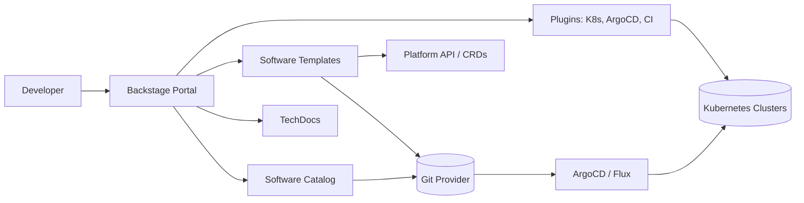
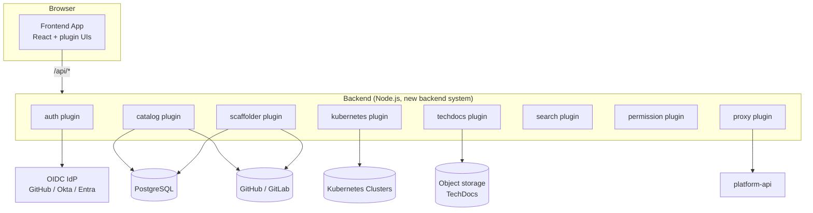
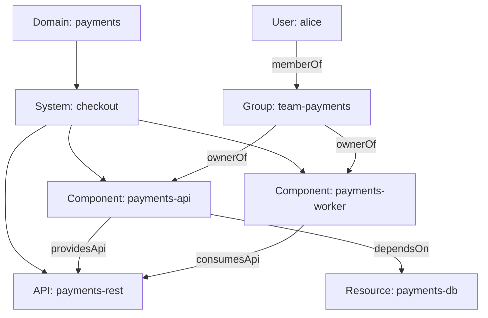
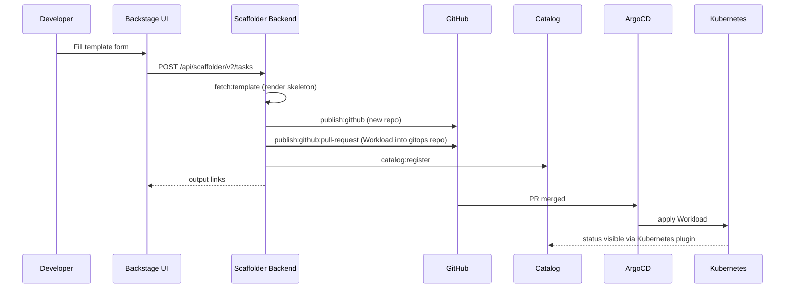
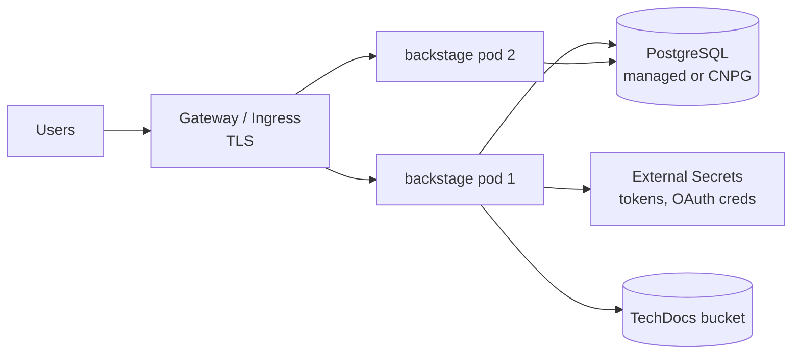

# Backstage: The Open-Source Developer Portal Framework

## Learning Objectives
- Understand Backstage's architecture: frontend app, backend plugins, and the Software Catalog
- Model your organization with catalog entities (Component, API, System, Domain, Resource, Group, User)
- Write Software Templates that scaffold services *and* create platform resources (`Workload`, `Environment`)
- Connect Backstage to Kubernetes so developers see their `Workload` objects and pods in the portal
- Extend Backstage with the new backend system: custom scaffolder actions and backend modules
- Run Backstage in production on Kubernetes (auth, database, scaling, upgrades)

## Prerequisites
- Kubernetes fundamentals and the [Kubernetes API primer](../01-kubernetes-fundamentals/api-primer.md)
- Basic TypeScript/Node.js (Node 20 or 22 LTS, Yarn 4)
- Familiarity with the platform CRDs (`Tenant`, `Environment`, `Workload`) from [Kubernetes CRDs](../09-platform-apis/kubernetes-crds.md)
- GitOps basics from [GitOps Principles](../05-gitops/gitops-principles.md)

---

## What is Backstage?

**Backstage** is an open framework for building developer portals, created at Spotify and donated to the CNCF (Incubating). It is *not* a finished product — it is a toolkit you assemble into **your** portal. That distinction drives most of the trade-offs discussed in this document and in [Port](port.md) and [Custom Portals](custom-portal.md).

Backstage ships three core features and a large plugin ecosystem:

| Core Feature | What it does | Platform value |
|--------------|--------------|----------------|
| **Software Catalog** | Inventory of everything you own: services, APIs, resources, teams | Ownership, discoverability, dependency graph |
| **Software Templates (Scaffolder)** | Parameterized workflows that create repos, PRs, and resources | Golden paths, self-service |
| **TechDocs** | Docs-as-code (MkDocs) rendered inside the portal | Docs live next to code, found via catalog |
| **Search** | Unified search across catalog, docs, and plugins | One place to look |
| **Plugins** | Kubernetes, ArgoCD, PagerDuty, GitHub Actions, cost, scorecards… | A single pane of glass |



> **Key idea:** Backstage is the *front door* of the platform. It should not own state that belongs to Kubernetes or Git. The catalog *mirrors* reality; the scaffolder *requests* changes through Git or the platform API; controllers do the actual work.

---

## Architecture

### Components



| Piece | Responsibility | Notes |
|-------|----------------|-------|
| Frontend app (`packages/app`) | React SPA, routes, entity pages | Each plugin contributes pages/cards |
| Backend (`packages/backend`) | Hosts backend plugins in one process | Can be split into multiple deployments later |
| PostgreSQL | Catalog, scaffolder tasks, search index (pg engine) | SQLite only for local dev |
| Entity providers / processors | Ingest and validate catalog entities | Pull from Git, LDAP, Kubernetes, custom APIs |
| Permission framework | Fine-grained authz on catalog, scaffolder | Policy written in TypeScript |

### The New Backend System

Since Backstage 1.24 the **new backend system** is the default. Plugins are registered declaratively; you no longer hand-wire routers.

```typescript
// packages/backend/src/index.ts
import { createBackend } from '@backstage/backend-defaults';

const backend = createBackend();

// Core features
backend.add(import('@backstage/plugin-app-backend'));
backend.add(import('@backstage/plugin-proxy-backend'));

// Auth: OIDC/GitHub providers + guest for local dev
backend.add(import('@backstage/plugin-auth-backend'));
backend.add(import('@backstage/plugin-auth-backend-module-github-provider'));

// Software Catalog + GitHub discovery
backend.add(import('@backstage/plugin-catalog-backend'));
backend.add(import('@backstage/plugin-catalog-backend-module-github'));
backend.add(import('@backstage/plugin-catalog-backend-module-scaffolder-entity-model'));

// Scaffolder + GitHub actions (publish:github, github:actions:dispatch, ...)
backend.add(import('@backstage/plugin-scaffolder-backend'));
backend.add(import('@backstage/plugin-scaffolder-backend-module-github'));

// Kubernetes, TechDocs, Search, Permissions
backend.add(import('@backstage/plugin-kubernetes-backend'));
backend.add(import('@backstage/plugin-techdocs-backend'));
backend.add(import('@backstage/plugin-search-backend'));
backend.add(import('@backstage/plugin-search-backend-module-catalog'));
backend.add(import('@backstage/plugin-search-backend-module-techdocs'));
backend.add(import('@backstage/plugin-permission-backend'));
backend.add(import('@backstage/plugin-permission-backend-module-allow-all-policy'));

// Our own platform module (custom scaffolder actions, see below)
backend.add(import('./modules/platform'));

backend.start();
```

---

## The Software Catalog

### Entity Model

Every catalog entity follows the same Kubernetes-like envelope: `apiVersion`, `kind`, `metadata`, `spec`, and optional `relations`/`status` computed by Backstage.



| Kind | Represents | Typical `spec` fields |
|------|------------|-----------------------|
| `Component` | A deployable piece of software | `type` (service, website, library), `lifecycle`, `owner`, `system`, `providesApis` |
| `API` | An interface boundary | `type` (openapi, grpc, asyncapi, graphql), `definition` |
| `Resource` | Infrastructure a component needs | `type` (database, s3-bucket, queue), `dependencyOf` |
| `System` | A collection of components and APIs | `owner`, `domain` |
| `Domain` | A business area | `owner` |
| `Group` / `User` | Org structure | `children`, `members`, `memberOf` |
| `Template` | A Software Template | `parameters`, `steps`, `output` |
| `Location` | Pointer to more entity files | `targets` |

### A Complete `catalog-info.yaml`

```yaml
# catalog-info.yaml (lives at the root of the payments-api repo)
apiVersion: backstage.io/v1alpha1
kind: Component
metadata:
  name: payments-api
  title: Payments API
  description: Handles card authorization and capture
  tags: [go, grpc, pci]
  links:
    - url: https://grafana.mycompany.io/d/payments
      title: Grafana dashboard
      icon: dashboard
  annotations:
    # Source location -> enables GitHub Actions, PRs, CODEOWNERS plugins
    github.com/project-slug: myorg/payments-api
    # TechDocs: build docs from ./docs + mkdocs.yml in this repo
    backstage.io/techdocs-ref: dir:.
    # Kubernetes plugin: find objects carrying this label value
    backstage.io/kubernetes-id: payments-api
    # ArgoCD plugin (community plugin) - app name in ArgoCD
    argocd/app-name: payments-api-prod
    # Platform-specific: which Tenant owns this component
    platform.mycompany.io/tenant: payments
spec:
  type: service
  lifecycle: production          # experimental | production | deprecated
  owner: group:team-payments
  system: checkout
  providesApis:
    - payments-rest
  dependsOn:
    - resource:payments-db
---
apiVersion: backstage.io/v1alpha1
kind: API
metadata:
  name: payments-rest
  description: Public REST API for payments
spec:
  type: openapi
  lifecycle: production
  owner: group:team-payments
  system: checkout
  definition:
    $text: ./api/openapi.yaml    # resolved relative to this file
---
apiVersion: backstage.io/v1alpha1
kind: Resource
metadata:
  name: payments-db
  description: PostgreSQL provisioned via Crossplane claim
spec:
  type: database
  owner: group:team-payments
  system: checkout
```

### Ingestion: Locations, Discovery, and Providers

Entities enter the catalog in three ways:

1. **Static locations** in `app-config.yaml` (good for org data and templates)
2. **Discovery providers** that scan Git orgs for `catalog-info.yaml`
3. **Custom entity providers** that pull from any system (e.g., your `Tenant` CRDs)

```yaml
# app-config.yaml (catalog section)
catalog:
  rules:
    - allow: [Component, System, API, Resource, Location, Domain, Group, User, Template]
  locations:
    # Org structure maintained by the platform team
    - type: url
      target: https://github.com/myorg/platform-catalog/blob/main/org/teams.yaml
      rules:
        - allow: [Group, User]
    # Golden-path templates
    - type: url
      target: https://github.com/myorg/platform-templates/blob/main/all-templates.yaml
      rules:
        - allow: [Template, Location]
  providers:
    github:
      # Scans every repo in the org for catalog-info.yaml on the default branch
      myorg:
        organization: myorg
        catalogPath: /catalog-info.yaml
        filters:
          branch: main
          repository: '.*'
        schedule:
          frequency: { minutes: 30 }
          timeout: { minutes: 3 }
```

> **Tip:** Prefer discovery over manually registered locations. Manual registration does not scale and leaves orphaned entities when repos are archived.

### Custom Entity Provider: Tenants as Groups

Platform `Tenant` objects are the source of truth for team ownership in this repo. An entity provider can mirror them into the catalog so ownership in Backstage always matches the cluster.

```typescript
// packages/backend/src/modules/platform/TenantEntityProvider.ts
import {
  EntityProvider,
  EntityProviderConnection,
} from '@backstage/plugin-catalog-node';
import { KubeConfig, CustomObjectsApi } from '@kubernetes/client-node';
import { Entity } from '@backstage/catalog-model';

export class TenantEntityProvider implements EntityProvider {
  private connection?: EntityProviderConnection;
  private readonly api: CustomObjectsApi;

  constructor() {
    const kc = new KubeConfig();
    kc.loadFromDefault(); // in-cluster SA token when running in Kubernetes
    this.api = kc.makeApiClient(CustomObjectsApi);
  }

  getProviderName() {
    return 'platform-tenants';
  }

  async connect(connection: EntityProviderConnection) {
    this.connection = connection;
  }

  // Called on a schedule (see module registration)
  async run() {
    if (!this.connection) throw new Error('Not initialized');
    const res: any = await this.api.listClusterCustomObject({
      group: 'platform.mycompany.io',
      version: 'v1alpha1',
      plural: 'tenants',
    });

    const entities: Entity[] = res.items.map((t: any) => ({
      apiVersion: 'backstage.io/v1alpha1',
      kind: 'Group',
      metadata: {
        name: `team-${t.metadata.name}`,
        title: t.spec.displayName,
        description: t.spec.description,
        annotations: {
          // Required so Backstage can tell which provider owns the entity
          'backstage.io/managed-by-location': `platform-tenant:${t.metadata.name}`,
          'backstage.io/managed-by-origin-location': `platform-tenant:${t.metadata.name}`,
          'platform.mycompany.io/tenant': t.metadata.name,
        },
      },
      spec: {
        type: 'team',
        profile: { email: t.spec.email },
        children: [],
      },
    }));

    // 'full' mutation = this provider owns exactly this set; removed tenants disappear
    await this.connection.applyMutation({
      type: 'full',
      entities: entities.map(entity => ({
        entity,
        locationKey: 'platform-tenants',
      })),
    });
  }
}
```

---

## Software Templates (the Scaffolder)

Templates are catalog entities of kind `Template` (`scaffolder.backstage.io/v1beta3`). They have three parts:

- **`parameters`** — JSON Schema forms rendered by react-jsonschema-form
- **`steps`** — ordered actions (`fetch:template`, `publish:github`, `catalog:register`, custom actions)
- **`output`** — links and text shown to the user when the run completes



### Golden-Path Template: Go Service on the Platform

```yaml
# platform-templates/go-service/template.yaml
apiVersion: scaffolder.backstage.io/v1beta3
kind: Template
metadata:
  name: go-grpc-service
  title: Go gRPC Service
  description: Production-ready Go service with CI, Workload manifest, and dashboards
  tags: [go, grpc, recommended]
spec:
  owner: group:team-platform
  type: service

  parameters:
    - title: Service details
      required: [name, owner, tenant]
      properties:
        name:
          title: Name
          type: string
          pattern: '^[a-z][a-z0-9-]{2,30}[a-z0-9]$'
          ui:autofocus: true
          ui:help: 'Lowercase, DNS-compatible (used as repo and Workload name)'
        description:
          title: Description
          type: string
        owner:
          title: Owner
          type: string
          ui:field: OwnerPicker          # built-in field extension
          ui:options:
            catalogFilter:
              kind: Group
        tenant:
          title: Platform tenant
          type: string
          enum: [payments, search, identity]
    - title: Runtime
      properties:
        size:
          title: Workload size
          type: string
          enum: [small, medium, large]
          default: small
        public:
          title: Expose publicly?
          type: boolean
          default: false
    - title: Repository
      required: [repoUrl]
      properties:
        repoUrl:
          title: Repository location
          type: string
          ui:field: RepoUrlPicker
          ui:options:
            allowedHosts: [github.com]
            allowedOwners: [myorg]

  steps:
    # 1. Render the skeleton (Nunjucks templating: ${{ values.name }})
    - id: fetch
      name: Render skeleton
      action: fetch:template
      input:
        url: ./skeleton
        values:
          name: ${{ parameters.name }}
          description: ${{ parameters.description }}
          owner: ${{ parameters.owner }}
          tenant: ${{ parameters.tenant }}

    # 2. Create the application repo
    - id: publish
      name: Publish repository
      action: publish:github
      input:
        repoUrl: ${{ parameters.repoUrl }}
        description: ${{ parameters.description }}
        defaultBranch: main
        repoVisibility: internal
        protectDefaultBranch: true

    # 3. Render the Workload manifest into a separate workspace directory
    - id: fetch-workload
      name: Render Workload manifest
      action: fetch:template
      input:
        url: ./workload
        targetPath: ./gitops
        values:
          name: ${{ parameters.name }}
          tenant: ${{ parameters.tenant }}
          size: ${{ parameters.size }}
          public: ${{ parameters.public }}

    # 4. Open a PR against the GitOps repo (ArgoCD picks it up after merge)
    - id: gitops-pr
      name: Open GitOps PR
      action: publish:github:pull-request
      input:
        repoUrl: github.com?owner=myorg&repo=platform-gitops
        branchName: add-${{ parameters.name }}
        title: 'feat: onboard ${{ parameters.name }}'
        description: Created by Backstage template go-grpc-service
        sourcePath: ./gitops
        targetPath: tenants/${{ parameters.tenant }}/workloads/${{ parameters.name }}

    # 5. Register the new component in the catalog
    - id: register
      name: Register in catalog
      action: catalog:register
      input:
        repoContentsUrl: ${{ steps.publish.output.repoContentsUrl }}
        catalogInfoPath: /catalog-info.yaml

  output:
    links:
      - title: Repository
        url: ${{ steps.publish.output.remoteUrl }}
      - title: GitOps pull request
        url: ${{ steps['gitops-pr'].output.remoteUrl }}
      - title: Open in catalog
        icon: catalog
        entityRef: ${{ steps.register.output.entityRef }}
```

The `workload/` directory in the template contains the platform resource. The scaffolder renders it with Nunjucks:

```yaml
# platform-templates/go-service/workload/workload.yaml
apiVersion: platform.mycompany.io/v1alpha1
kind: Workload
metadata:
  name: ${{ values.name }}
  namespace: ${{ values.tenant }}-dev
  labels:
    platform.mycompany.io/tenant: ${{ values.tenant }}
    platform.mycompany.io/environment: dev
    backstage.io/kubernetes-id: ${{ values.name }}
spec:
  image: ghcr.io/myorg/${{ values.name }}:latest
  port: 8080
  size: ${{ values.size }}
  expose:
    public: ${{ values.public }}
```

> **Why a PR instead of `kubectl apply`?** The scaffolder should not hold cluster-admin credentials. Going through Git keeps the GitOps audit trail and lets policy (CODEOWNERS, CI checks, [policy engine](../12-security-compliance/policy-engine.md)) gate every change. Use direct API calls only for resources that must exist *before* Git (e.g., a `Tenant` request handled by the [platform API](../09-platform-apis/platform-api-design.md)).

---

## Custom Scaffolder Actions

Built-in actions cover Git and catalog operations. For platform-specific operations — such as asking the platform API to create an `Environment` — write a custom action and register it via a backend module.

```typescript
// packages/backend/src/modules/platform/actions/createEnvironment.ts
import { createTemplateAction } from '@backstage/plugin-scaffolder-node';

export function createEnvironmentAction(opts: { platformApiUrl: string }) {
  return createTemplateAction({
    id: 'platform:environment:create',
    description: 'Request an Environment from the platform API',
    // Recent Backstage versions accept zod schemas via callback functions.
    schema: {
      input: {
        tenant: z => z.string().describe('Tenant that owns the environment'),
        name: z => z.string().regex(/^[a-z0-9-]+$/),
        type: z => z.enum(['ephemeral', 'persistent']).default('ephemeral'),
        ttl: z => z.string().optional().describe('e.g. 72h, ephemeral only'),
      },
      output: {
        url: z => z.string(),
      },
    },
    async handler(ctx) {
      const { tenant, name, type, ttl } = ctx.input;
      ctx.logger.info(`Requesting ${type} environment ${tenant}/${name}`);

      // The initiating user's Backstage token; platform-api can verify it
      // (or exchange it) and enforce its own tenant RBAC.
      const token = ctx.secrets?.backstageToken;

      const res = await fetch(`${opts.platformApiUrl}/api/v1/environments`, {
        method: 'POST',
        headers: {
          'Content-Type': 'application/json',
          'Idempotency-Key': ctx.taskId ?? `${tenant}-${name}`,
          ...(token ? { Authorization: `Bearer ${token}` } : {}),
        },
        body: JSON.stringify({ tenant, name, type, ttl }),
      });
      if (!res.ok) {
        throw new Error(`platform-api returned ${res.status}: ${await res.text()}`);
      }
      const body = await res.json();
      ctx.output('url', body.status?.url ?? '');
    },
  });
}
```

```typescript
// packages/backend/src/modules/platform/index.ts
import {
  coreServices,
  createBackendModule,
} from '@backstage/backend-plugin-api';
import { scaffolderActionsExtensionPoint } from '@backstage/plugin-scaffolder-node/alpha';
import { catalogProcessingExtensionPoint } from '@backstage/plugin-catalog-node/alpha';
import { createEnvironmentAction } from './actions/createEnvironment';
import { TenantEntityProvider } from './TenantEntityProvider';

export const scaffolderPlatformModule = createBackendModule({
  pluginId: 'scaffolder',
  moduleId: 'platform-actions',
  register(env) {
    env.registerInit({
      deps: {
        scaffolder: scaffolderActionsExtensionPoint,
        config: coreServices.rootConfig,
      },
      async init({ scaffolder, config }) {
        scaffolder.addActions(
          createEnvironmentAction({
            platformApiUrl: config.getString('platform.apiUrl'),
          }),
        );
      },
    });
  },
});

export const catalogPlatformModule = createBackendModule({
  pluginId: 'catalog',
  moduleId: 'platform-tenants',
  register(env) {
    env.registerInit({
      deps: {
        catalog: catalogProcessingExtensionPoint,
        scheduler: coreServices.scheduler,
      },
      async init({ catalog, scheduler }) {
        const provider = new TenantEntityProvider();
        catalog.addEntityProvider(provider);
        await scheduler.scheduleTask({
          id: 'platform-tenants-refresh',
          frequency: { minutes: 5 },
          timeout: { minutes: 1 },
          fn: () => provider.run(),
        });
      },
    });
  },
});

export default [scaffolderPlatformModule, catalogPlatformModule];
```

> **Note:** Some extension points have graduated from `/alpha` to the main package entry in recent releases. If your IDE flags the import, check the plugin's changelog — the symbol name is the same.

---

## Kubernetes Integration

The Kubernetes plugin shows pods, deployments, and **custom resources** for an entity. It finds objects by the `backstage.io/kubernetes-id` label (or a custom label selector annotation).

```yaml
# app-config.production.yaml (kubernetes section)
kubernetes:
  serviceLocatorMethod:
    type: multiTenant           # query all configured clusters
  clusterLocatorMethods:
    - type: config
      clusters:
        - name: prod-eu-1
          url: https://prod-eu-1.k8s.mycompany.io
          authProvider: serviceAccount
          serviceAccountToken: ${K8S_PROD_EU_1_TOKEN}
          caData: ${K8S_PROD_EU_1_CA}
        - name: dev
          url: https://dev.k8s.mycompany.io
          authProvider: serviceAccount
          serviceAccountToken: ${K8S_DEV_TOKEN}
          caData: ${K8S_DEV_CA}
  # Show our platform CRDs on the entity's Kubernetes tab
  customResources:
    - group: platform.mycompany.io
      apiVersion: v1alpha1
      plural: workloads
    - group: platform.mycompany.io
      apiVersion: v1alpha1
      plural: environments
```

The service account Backstage uses needs **read-only** access. Give it exactly what the plugin lists. Note what this identity is: a single, shared, read-only inventory reader for the catalog's Kubernetes tab. It is not impersonation, and it must never receive an `impersonate` rule. Because it is shared, every Backstage user sees the objects it can read; the tab does not filter by who is looking. Actions that change anything (scaffolding, environment creation, scaling) go through [platform-api](../09-platform-apis/platform-api-design.md), which acts as the signed-in user via impersonation. Keep the two identities separate, and keep secret reads out of the reader role.

```yaml
# backstage-k8s-reader.yaml
apiVersion: rbac.authorization.k8s.io/v1
kind: ClusterRole
metadata:
  name: backstage-reader
rules:
  - apiGroups: ['']
    resources: [pods, pods/log, services, configmaps, limitranges, resourcequotas]
    verbs: [get, list, watch]
  - apiGroups: [apps]
    resources: [deployments, replicasets, statefulsets, daemonsets]
    verbs: [get, list, watch]
  - apiGroups: [autoscaling]
    resources: [horizontalpodautoscalers]
    verbs: [get, list, watch]
  - apiGroups: [networking.k8s.io]
    resources: [ingresses]
    verbs: [get, list, watch]
  - apiGroups: [batch]
    resources: [jobs, cronjobs]
    verbs: [get, list, watch]
  - apiGroups: [platform.mycompany.io]
    resources: [workloads, environments, tenants]
    verbs: [get, list, watch]
  - apiGroups: [metrics.k8s.io]
    resources: [pods]
    verbs: [get, list]
---
apiVersion: rbac.authorization.k8s.io/v1
kind: ClusterRoleBinding
metadata:
  name: backstage-reader
roleRef:
  apiGroup: rbac.authorization.k8s.io
  kind: ClusterRole
  name: backstage-reader
subjects:
  - kind: ServiceAccount
    name: backstage
    namespace: backstage
```

The `workload-operator` should propagate `backstage.io/kubernetes-id` from the `Workload` to the Deployment, Service, and Pods it creates so the plugin can correlate them (see [controller-runtime](../09-platform-apis/controller-runtime.md)).

---

## Running Backstage in Production

### Configuration Layering

```bash
# Backstage merges config files left to right; later files win
node packages/backend --config app-config.yaml --config app-config.production.yaml
```

```yaml
# app-config.production.yaml (selected sections)
app:
  baseUrl: https://portal.mycompany.io
backend:
  baseUrl: https://portal.mycompany.io
  listen:
    port: 7007
  database:
    client: pg
    connection:
      host: ${POSTGRES_HOST}
      port: ${POSTGRES_PORT}
      user: ${POSTGRES_USER}
      password: ${POSTGRES_PASSWORD}
  auth:
    # Service-to-service tokens for external callers (e.g. CI registering entities)
    externalAccess:
      - type: static
        options:
          token: ${CI_CATALOG_TOKEN}
          subject: ci-pipeline
auth:
  environment: production
  providers:
    github:
      production:
        clientId: ${AUTH_GITHUB_CLIENT_ID}
        clientSecret: ${AUTH_GITHUB_CLIENT_SECRET}
        signIn:
          resolvers:
            # Map GitHub login -> User entity with matching name
            - resolver: usernameMatchingUserEntityName
techdocs:
  builder: external            # CI builds docs; Backstage only serves them
  publisher:
    type: awsS3
    awsS3:
      bucketName: mycompany-techdocs
platform:
  apiUrl: http://platform-api.platform-system.svc.cluster.local:8080
```

### Deployment Topology



```yaml
# backstage-deployment.yaml (abridged)
apiVersion: apps/v1
kind: Deployment
metadata:
  name: backstage
  namespace: backstage
spec:
  replicas: 2
  selector:
    matchLabels: { app: backstage }
  template:
    metadata:
      labels: { app: backstage }
    spec:
      serviceAccountName: backstage
      containers:
        - name: backstage
          image: ghcr.io/myorg/backstage:2026.10.1
          ports:
            - containerPort: 7007
          envFrom:
            - secretRef:
                name: backstage-secrets   # synced by External Secrets Operator
          readinessProbe:
            httpGet: { path: /.backstage/health/v1/readiness, port: 7007 }
          livenessProbe:
            httpGet: { path: /.backstage/health/v1/liveness, port: 7007 }
          resources:
            requests: { cpu: 500m, memory: 1Gi }
            limits: { memory: 2Gi }
```

### Operational Checklist

| Concern | Recommendation |
|---------|----------------|
| Database | PostgreSQL 15+; one database per plugin is created automatically (`pluginDivisionMode: database`) |
| Secrets | Inject via [External Secrets](../06-secrets-management/external-secrets.md), never bake into images |
| Upgrades | Run `yarn backstage-cli versions:bump` monthly; skipping many releases makes upgrades painful |
| Scaling | Stateless backend; scale horizontally. Split scaffolder into its own deployment if tasks are heavy |
| Auth | Disable guest provider in production; use `auth.environment: production` |
| Permissions | Replace `allow-all-policy` with a real policy before onboarding many teams |
| Observability | Backstage emits OpenTelemetry metrics; scrape and dashboard catalog processing errors |

---

## Hands-On Exercise

### Lab: Local Backstage with a Platform Template

This exercise is the short version of [Lab 04: Service Catalog](../../labs/lab-04-service-catalog/README.md).

#### Step 1: Create the app

```bash
# Requires Node 20/22 and corepack-enabled Yarn
npx @backstage/create-app@latest --path ./portal
cd portal
yarn start          # frontend :3000, backend :7007
```

#### Step 2: Register org data and a component

```bash
mkdir -p catalog
cat > catalog/org.yaml <<'EOF'
apiVersion: backstage.io/v1alpha1
kind: Group
metadata:
  name: team-payments
spec:
  type: team
  children: []
---
apiVersion: backstage.io/v1alpha1
kind: User
metadata:
  name: guest
spec:
  memberOf: [team-payments]
EOF
```

Add to `app-config.local.yaml`:

```yaml
catalog:
  locations:
    - type: file
      target: ../../catalog/org.yaml
      rules:
        - allow: [Group, User]
```

#### Step 3: Add the Go service template

Copy the template from this doc into `templates/go-service/template.yaml`, create a minimal `skeleton/catalog-info.yaml` and `workload/workload.yaml`, then register it:

```yaml
catalog:
  locations:
    - type: file
      target: ../../templates/go-service/template.yaml
      rules:
        - allow: [Template]
```

#### Step 4: Dry-run the template

Open `http://localhost:3000/create`, choose **Go gRPC Service**, and use the **Template Editor** (`/create/edit`) to dry-run it. Inspect the rendered `workload.yaml` and confirm it validates against the CRD:

```bash
kubectl apply --dry-run=server -f rendered/workload.yaml
```

#### Step 5: Wire up the Kubernetes plugin

Point `kubernetes.clusterLocatorMethods` at your kind cluster from [Lab 01](../../labs/lab-01-cluster-setup/README.md) and apply a `Workload` with the label `backstage.io/kubernetes-id: payments-api`. The entity page's **Kubernetes** tab should list the Workload and its pods.

#### Verification
- [ ] Catalog shows `team-payments` and at least one Component owned by it
- [ ] Template dry-run produces a valid `Workload`
- [ ] Kubernetes tab shows pods for the component

---

## Troubleshooting

| Symptom | Likely Cause | Fix |
|---------|--------------|-----|
| Entity stuck "processing" or missing | YAML error or rule disallows kind | Check `catalog.rules`; inspect the entity's **Inspect entity → Ancestry/Errors** |
| `NotAllowedError: Location type ... not allowed` | Missing `rules` on the location | Add `rules: [{ allow: [...] }]` to the location |
| Kubernetes tab empty | Label/annotation mismatch | Pod labels must contain `backstage.io/kubernetes-id: <entity-name>` |
| Kubernetes tab shows `403` | Service account lacks RBAC | Apply the `backstage-reader` ClusterRole above |
| `publish:github` fails with 404 | GitHub App/token lacks repo creation scope | Configure `integrations.github` with a GitHub App that has `Administration: write` |
| Template parameters not rendering | Wrong syntax | Use `${{ parameters.x }}` in `template.yaml`, `${{ values.x }}` in skeleton files |
| Users can sign in but own nothing | Sign-in resolver can't map identity | Ensure `User` entities exist and names match the resolver |
| Slow catalog after growth | Single process doing everything | Tune `catalog.processingInterval`, scale replicas, split plugins into separate deployments |

```bash
# Useful backend debug commands
kubectl -n backstage logs deploy/backstage | grep -i 'catalog\|scaffolder' | tail -50

# Query the catalog API directly
curl -s -H "Authorization: Bearer $TOKEN" \
  "https://portal.mycompany.io/api/catalog/entities/by-query?filter=kind=component,spec.owner=group:default/team-payments" | jq '.items[].metadata.name'
```

---

## Further Reading

- [Backstage Documentation](https://backstage.io/docs/)
- [Software Templates](https://backstage.io/docs/features/software-templates/)
- [Backend System](https://backstage.io/docs/backend-system/)
- [Kubernetes plugin](https://backstage.io/docs/features/kubernetes/)
- [Backstage Plugin Directory](https://backstage.io/plugins)
- [Descriptor Format of Catalog Entities](https://backstage.io/docs/features/software-catalog/descriptor-format)
- [Spotify's Backstage journey](../15-case-studies/spotify.md)

---

## Next Steps

1. **Compare**: [Port](port.md) — a SaaS portal with a different data model
2. **Build**: [Custom Portal](custom-portal.md) — when neither fits
3. **Define**: [Platform Capabilities](platform-capabilities.md) — what the portal should expose
4. **Practice**: [Lab 04: Service Catalog](../../labs/lab-04-service-catalog/README.md)
