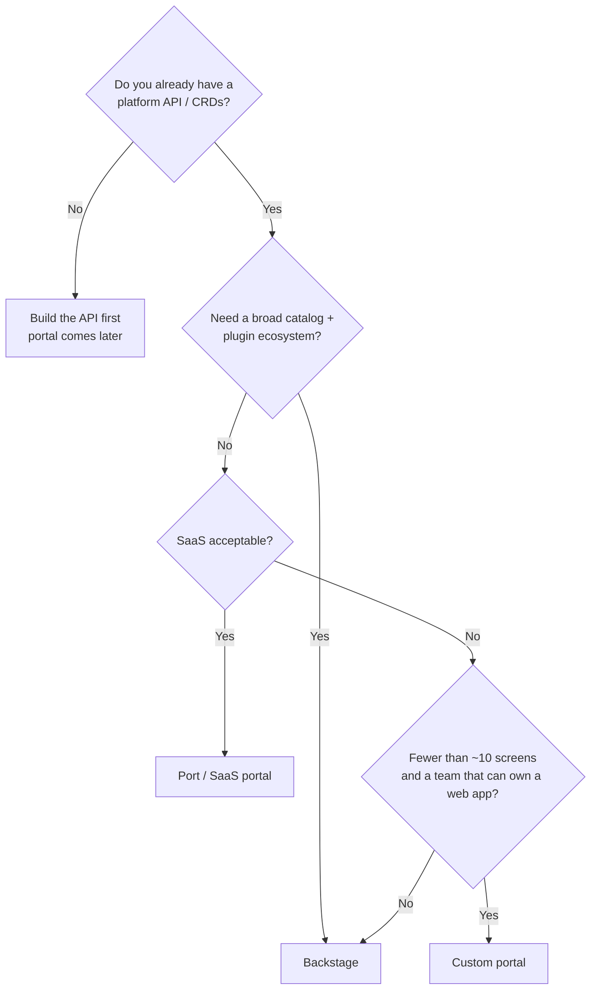
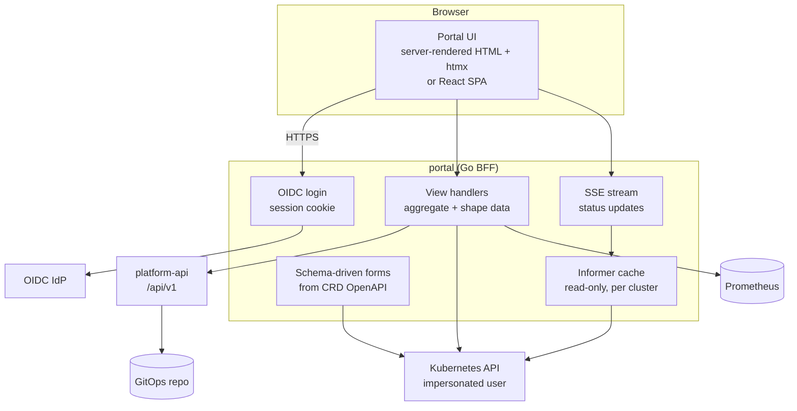
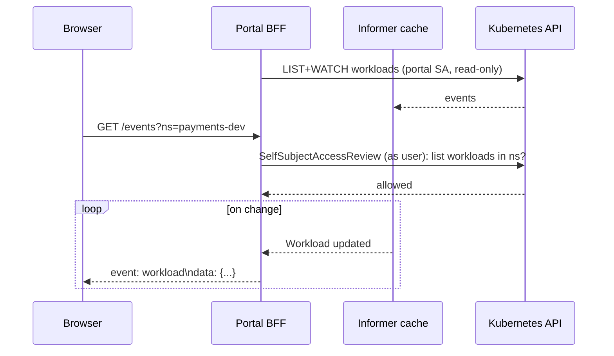

# Building a Custom Developer Portal

## Learning Objectives
- Decide when building a portal beats adopting [Backstage](backstage.md) or [Port](port.md)
- Design a portal architecture with a **Backend-for-Frontend (BFF)** over the platform API and Kubernetes
- Authenticate users with OIDC and authorize them with Kubernetes **impersonation** so RBAC stays the source of truth
- Stream live `Workload` and `Environment` status to the browser with watches and Server-Sent Events
- Generate forms from CRD OpenAPI schemas instead of hand-coding them
- Operate the portal: caching, rate limits, audit, and testing

## Prerequisites
- [Kubernetes API primer](../01-kubernetes-fundamentals/api-primer.md) and [RBAC](../01-kubernetes-fundamentals/rbac.md)
- Go 1.22+ and basic frontend knowledge (HTML, a bit of JavaScript)
- The platform CRDs from [Kubernetes CRDs](../09-platform-apis/kubernetes-crds.md)
- [Platform API Design](../09-platform-apis/platform-api-design.md) (recommended)

---

## Build vs Buy vs Assemble

Most organizations should **not** build a portal from scratch. A custom portal is justified when the portal is a thin, opinionated view over a strong platform API and the off-the-shelf options add more weight than value.

| Signal | Points toward |
|--------|---------------|
| Need catalog, docs, plugins ecosystem, 100+ teams | Backstage |
| Want a portal in weeks, OK with SaaS, small platform team | Port (or similar SaaS) |
| Platform is already API-first (CRDs + platform API); portal needs ~5 screens | **Custom** |
| Air-gapped / strict data residency / very small footprint | **Custom** or self-hosted Backstage |
| Unique workflow (e.g., regulated change approval) dominates UX | **Custom**, or a custom Backstage plugin |
| No frontend skills on the team | Port, or a CLI-first platform ([platform-cli](../../code/platform-cli/)) |



> **The portal is the least important layer.** If self-service only works through the portal, the platform is not self-service — it is click-ops. Every portal action must also be available via API, CLI, and GitOps. A custom portal makes that easy to enforce because it is a pure client of those APIs.

---

## Reference Architecture



| Layer | Responsibility | Anti-pattern to avoid |
|-------|----------------|----------------------|
| UI | Render, collect input, show status | Business rules in JavaScript |
| BFF | AuthN, aggregation, shaping responses for screens | Its own database of platform state |
| platform-api | Validation, tenancy, orchestration, writes | Being bypassed by the portal |
| Kubernetes API | Source of truth for resources and RBAC | Portal using a cluster-admin token |

### Design Principles

1. **Stateless BFF.** All state lives in Kubernetes, Git, or the platform API. The portal can be deleted and redeployed without data loss.
2. **User identity end-to-end.** Calls carry the user's identity (OIDC token to platform-api, impersonation to Kubernetes). Authorization happens where the data lives.
3. **Schema-driven UI.** Forms come from the CRD's `openAPIV3Schema`, so adding a field to the CRD adds it to the portal.
4. **Read from caches, write through APIs.** Informers serve fast reads; writes go to platform-api or Kubernetes with the user's identity.

---

## Authentication: OIDC Login

The BFF uses the authorization-code flow and stores the ID token in an encrypted, HTTP-only session cookie.

```go
// cmd/portal/auth.go
package main

import (
	"context"
	"crypto/rand"
	"encoding/base64"
	"net/http"

	"github.com/coreos/go-oidc/v3/oidc"
	"golang.org/x/oauth2"
)

type Auth struct {
	provider *oidc.Provider
	verifier *oidc.IDTokenVerifier
	oauth    oauth2.Config
	sessions SessionStore // encrypted cookie store (e.g. gorilla/securecookie)
}

// Claims we rely on. "groups" must be configured as a claim in the IdP.
type Claims struct {
	Email  string   `json:"email"`
	Groups []string `json:"groups"`
}

func NewAuth(ctx context.Context, issuer, clientID, clientSecret, redirectURL string, s SessionStore) (*Auth, error) {
	p, err := oidc.NewProvider(ctx, issuer)
	if err != nil {
		return nil, err
	}
	return &Auth{
		provider: p,
		verifier: p.Verifier(&oidc.Config{ClientID: clientID}),
		oauth: oauth2.Config{
			ClientID:     clientID,
			ClientSecret: clientSecret,
			RedirectURL:  redirectURL,
			Endpoint:     p.Endpoint(),
			Scopes:       []string{oidc.ScopeOpenID, "email", "groups"},
		},
		sessions: s,
	}, nil
}

func (a *Auth) Login(w http.ResponseWriter, r *http.Request) {
	state := randomString()
	a.sessions.SetFlash(w, "oauth_state", state)
	http.Redirect(w, r, a.oauth.AuthCodeURL(state), http.StatusFound)
}

func (a *Auth) Callback(w http.ResponseWriter, r *http.Request) {
	if r.URL.Query().Get("state") != a.sessions.GetFlash(r, "oauth_state") {
		http.Error(w, "invalid state", http.StatusBadRequest)
		return
	}
	tok, err := a.oauth.Exchange(r.Context(), r.URL.Query().Get("code"))
	if err != nil {
		http.Error(w, "exchange failed", http.StatusUnauthorized)
		return
	}
	rawID, ok := tok.Extra("id_token").(string)
	if !ok {
		http.Error(w, "no id_token", http.StatusUnauthorized)
		return
	}
	idt, err := a.verifier.Verify(r.Context(), rawID)
	if err != nil {
		http.Error(w, "invalid id_token", http.StatusUnauthorized)
		return
	}
	var c Claims
	if err := idt.Claims(&c); err != nil {
		http.Error(w, "bad claims", http.StatusUnauthorized)
		return
	}
	a.sessions.Save(w, Session{Email: c.Email, Groups: c.Groups, IDToken: rawID, Expiry: idt.Expiry})
	http.Redirect(w, r, "/", http.StatusFound)
}

// Middleware: attach the session user to the request context or redirect to login.
func (a *Auth) Require(next http.Handler) http.Handler {
	return http.HandlerFunc(func(w http.ResponseWriter, r *http.Request) {
		s, ok := a.sessions.Load(r)
		if !ok || s.Expired() {
			http.Redirect(w, r, "/login", http.StatusFound)
			return
		}
		next.ServeHTTP(w, r.WithContext(withUser(r.Context(), s)))
	})
}

func randomString() string {
	b := make([]byte, 32)
	_, _ = rand.Read(b)
	return base64.RawURLEncoding.EncodeToString(b)
}
```

---

## Authorization: Kubernetes Impersonation

The portal's service account gets **only** the `impersonate` permission. Every Kubernetes call is made *as the user*, so existing tenant RBAC (created by the `tenant-operator`) decides what they can see and do.

```yaml
# portal-impersonator-rbac.yaml
apiVersion: rbac.authorization.k8s.io/v1
kind: ClusterRole
metadata:
  name: portal-impersonator
rules:
  # Allowed to impersonate users and groups, nothing else
  - apiGroups: ['']
    resources: [users, groups]
    verbs: [impersonate]
  # Optional: restrict impersonatable groups with resourceNames
  # - apiGroups: ['']
  #   resources: [groups]
  #   verbs: [impersonate]
  #   resourceNames: [tenant-payments-developers, tenant-search-developers]
---
apiVersion: rbac.authorization.k8s.io/v1
kind: ClusterRoleBinding
metadata:
  name: portal-impersonator
roleRef:
  apiGroup: rbac.authorization.k8s.io
  kind: ClusterRole
  name: portal-impersonator
subjects:
  - kind: ServiceAccount
    name: portal
    namespace: platform-portal
```

```go
// cmd/portal/kube.go
package main

import (
	"context"

	"k8s.io/client-go/rest"
	"sigs.k8s.io/controller-runtime/pkg/client"

	platformv1alpha1 "github.com/myorg/workload-operator/api/v1alpha1"
)

// ClientFor returns a controller-runtime client that acts as the given user.
// Creating clients per request is cheap relative to an HTTP round trip, but you
// can cache them per user with a short TTL if needed.
func (k *Kube) ClientFor(u Session) (client.Client, error) {
	cfg := rest.CopyConfig(k.base) // in-cluster config of the portal SA
	cfg.Impersonate = rest.ImpersonationConfig{
		UserName: u.Email,
		Groups:   u.Groups, // IdP groups -> must match RoleBinding subjects
	}
	return client.New(cfg, client.Options{Scheme: k.scheme})
}

// ListWorkloads returns the Workloads the user may see in a namespace.
func (k *Kube) ListWorkloads(ctx context.Context, u Session, ns string) (*platformv1alpha1.WorkloadList, error) {
	c, err := k.ClientFor(u)
	if err != nil {
		return nil, err
	}
	var list platformv1alpha1.WorkloadList
	err = c.List(ctx, &list, client.InNamespace(ns))
	return &list, err // a 403 here is the correct answer, not a bug
}
```

The `tenant-operator` binds IdP groups to tenant namespaces:

```yaml
# Created by tenant-operator for Tenant "payments" in each tenant namespace
apiVersion: rbac.authorization.k8s.io/v1
kind: RoleBinding
metadata:
  name: tenant-developers
  namespace: payments-dev
  labels:
    platform.mycompany.io/tenant: payments
roleRef:
  apiGroup: rbac.authorization.k8s.io
  kind: ClusterRole
  name: platform-developer     # get/list/watch/create/update Workloads, read pods/logs
subjects:
  - kind: Group
    name: tenant-payments-developers
    apiGroup: rbac.authorization.k8s.io
```

> **Why not just use the user's token?** If your cluster's API server trusts the same OIDC issuer (`--oidc-issuer-url` or structured `AuthenticationConfiguration`), you can forward the ID token directly instead of impersonating. Impersonation is simpler when clusters are managed (EKS/GKE/AKS) and you can't change API server flags, or when you have many clusters.

To render "can I?" buttons without trial-and-error, ask the API server:

```go
// Can the user create Workloads in this namespace? (SelfSubjectAccessReview as the user)
func (k *Kube) CanCreateWorkload(ctx context.Context, u Session, ns string) (bool, error) {
	c, err := k.ClientFor(u)
	if err != nil {
		return false, err
	}
	ssar := &authorizationv1.SelfSubjectAccessReview{
		Spec: authorizationv1.SelfSubjectAccessReviewSpec{
			ResourceAttributes: &authorizationv1.ResourceAttributes{
				Namespace: ns,
				Verb:      "create",
				Group:     "platform.mycompany.io",
				Resource:  "workloads",
			},
		},
	}
	if err := c.Create(ctx, ssar); err != nil {
		return false, err
	}
	return ssar.Status.Allowed, nil
}
```

---

## Live Status with Informers and Server-Sent Events

Polling the API from every browser tab does not scale. The BFF runs **one** shared informer per resource type (using its own read-only identity), and streams changes to browsers — filtered by what each user is allowed to see.



```go
// cmd/portal/events.go
package main

import (
	"context"
	"encoding/json"
	"fmt"
	"net/http"

	toolscache "k8s.io/client-go/tools/cache"
	"sigs.k8s.io/controller-runtime/pkg/cache"

	platformv1alpha1 "github.com/myorg/workload-operator/api/v1alpha1"
)

type WorkloadEvent struct {
	Name      string `json:"name"`
	Namespace string `json:"namespace"`
	Phase     string `json:"phase"`
	Ready     string `json:"ready"`
	URL       string `json:"url,omitempty"`
}

// Hub fans informer events out to subscribed SSE connections.
type Hub struct {
	subscribe   chan subscription
	unsubscribe chan subscription
	broadcast   chan WorkloadEvent
}

type subscription struct {
	namespace string
	ch        chan WorkloadEvent
}

func (h *Hub) Run() {
	subs := map[subscription]struct{}{}
	for {
		select {
		case s := <-h.subscribe:
			subs[s] = struct{}{}
		case s := <-h.unsubscribe:
			delete(subs, s)
			close(s.ch)
		case ev := <-h.broadcast:
			for s := range subs {
				if s.namespace == ev.Namespace {
					select {
					case s.ch <- ev:
					default: // slow client: drop rather than block the hub
					}
				}
			}
		}
	}
}

// Wire the controller-runtime cache informer into the hub.
func (h *Hub) Attach(ctx context.Context, c cache.Cache) error {
	inf, err := c.GetInformer(ctx, &platformv1alpha1.Workload{})
	if err != nil {
		return err
	}
	_, err = inf.AddEventHandler(toolscache.ResourceEventHandlerFuncs{
		AddFunc:    func(obj any) { h.emit(obj) },
		UpdateFunc: func(_, obj any) { h.emit(obj) },
	})
	return err
}

func (h *Hub) emit(obj any) {
	w, ok := obj.(*platformv1alpha1.Workload)
	if !ok {
		return
	}
	h.broadcast <- WorkloadEvent{
		Name:      w.Name,
		Namespace: w.Namespace,
		Phase:     string(w.Status.Phase),
		Ready:     fmt.Sprintf("%d/%d", w.Status.ReadyReplicas, w.Spec.Replicas),
		URL:       w.Status.URL,
	}
}

// GET /events?ns=payments-dev
func (s *Server) Events(w http.ResponseWriter, r *http.Request) {
	u := userFrom(r.Context())
	ns := r.URL.Query().Get("ns")

	// Authorize the stream once, as the user
	if ok, err := s.kube.Can(r.Context(), u, ns, "list", "workloads"); err != nil || !ok {
		http.Error(w, "forbidden", http.StatusForbidden)
		return
	}

	flusher, ok := w.(http.Flusher)
	if !ok {
		http.Error(w, "streaming unsupported", http.StatusInternalServerError)
		return
	}
	w.Header().Set("Content-Type", "text/event-stream")
	w.Header().Set("Cache-Control", "no-cache")
	w.Header().Set("X-Accel-Buffering", "no") // disable proxy buffering (nginx)

	sub := subscription{namespace: ns, ch: make(chan WorkloadEvent, 16)}
	s.hub.subscribe <- sub
	defer func() { s.hub.unsubscribe <- sub }()

	for {
		select {
		case <-r.Context().Done():
			return
		case ev := <-sub.ch:
			b, _ := json.Marshal(ev)
			fmt.Fprintf(w, "event: workload\ndata: %s\n\n", b)
			flusher.Flush()
		}
	}
}
```

The frontend can stay tiny. With **htmx** and its SSE extension, a status row updates itself with no build step:

```html
<!-- templates/workloads.html (Go html/template) -->
<!-- In production, vendor these files into the portal image or add integrity="sha384-..."
     crossorigin="anonymous" (Subresource Integrity) so a CDN compromise can't inject code. -->
<script src="https://unpkg.com/htmx.org@2.0.4"></script>
<script src="https://unpkg.com/htmx-ext-sse@2.2.2/sse.js"></script>

<table hx-ext="sse" sse-connect="/events?ns={{ .Namespace }}">
  <thead><tr><th>Workload</th><th>Phase</th><th>Ready</th><th>URL</th></tr></thead>
  <tbody>
  {{ range .Workloads }}
    <tr id="wl-{{ .Name }}">
      <td>{{ .Name }}</td>
      <td class="phase-{{ .Status.Phase }}">{{ .Status.Phase }}</td>
      <td>{{ .Status.ReadyReplicas }}/{{ .Spec.Replicas }}</td>
      <td>{{ with .Status.URL }}<a href="{{ . }}">{{ . }}</a>{{ end }}</td>
    </tr>
  {{ end }}
  </tbody>
</table>
```

> For htmx's `sse-swap`, the BFF would emit pre-rendered HTML fragments rather than JSON. JSON is shown above because it also serves a React/Vue frontend; pick one format per endpoint.

---

## Schema-Driven Forms

The CRD already contains a full OpenAPI v3 schema, including enums, defaults, and descriptions. Render forms from it so the portal never drifts from the API.

```go
// cmd/portal/schema.go
// Fetch the Workload schema from the CRD and hand it to a JSON-schema form library
// (e.g. @rjsf/core in React, or a server-side renderer).
func (k *Kube) WorkloadSchema(ctx context.Context) (map[string]any, error) {
	var crd apiextensionsv1.CustomResourceDefinition
	if err := k.reader.Get(ctx, client.ObjectKey{Name: "workloads.platform.mycompany.io"}, &crd); err != nil {
		return nil, err
	}
	for _, v := range crd.Spec.Versions {
		if v.Served && v.Storage {
			spec := v.Schema.OpenAPIV3Schema.Properties["spec"]
			b, _ := json.Marshal(spec)
			var out map[string]any
			return out, json.Unmarshal(b, &out)
		}
	}
	return nil, fmt.Errorf("no storage version found")
}
```

Validation still happens server-side: when the user submits, create the object as the user with **dry-run** first to surface CEL and webhook errors inline:

```go
// Validate with the real API server (CEL rules, admission webhooks, policies) but persist nothing.
err := c.Create(ctx, workload, client.DryRunAll)
if apierrors.IsInvalid(err) {
	// StatusError.ErrStatus.Details.Causes has per-field messages -> render next to inputs
}
```

| UI element | Schema source |
|------------|---------------|
| Dropdown | `enum` |
| Default value | `default` |
| Help text | `description` (from Go doc comments via controller-gen) |
| Required marker | `required` |
| Inline error | `x-kubernetes-validations[].message` returned on dry-run |

---

## Operating the Portal

### Deployment

```yaml
# portal-deployment.yaml (abridged)
apiVersion: apps/v1
kind: Deployment
metadata:
  name: portal
  namespace: platform-portal
spec:
  replicas: 2
  selector:
    matchLabels: { app.kubernetes.io/name: portal }
  template:
    metadata:
      labels: { app.kubernetes.io/name: portal }
    spec:
      serviceAccountName: portal
      securityContext:
        runAsNonRoot: true
        seccompProfile: { type: RuntimeDefault }
      containers:
        - name: portal
          image: ghcr.io/myorg/portal:0.9.0
          args:
            - --oidc-issuer=https://login.mycompany.io
            - --platform-api=http://platform-api.platform-system.svc:8080
          envFrom:
            - secretRef: { name: portal-oidc }
          ports:
            - containerPort: 8080
          readinessProbe:
            httpGet: { path: /readyz, port: 8080 }
          resources:
            requests: { cpu: 100m, memory: 128Mi }
            limits: { memory: 256Mi }
          securityContext:
            allowPrivilegeEscalation: false
            readOnlyRootFilesystem: true
            capabilities: { drop: [ALL] }
```

### Checklist

| Concern | Practice |
|---------|----------|
| Audit | Kubernetes audit logs record `impersonatedUser`; platform-api logs the OIDC subject |
| Rate limiting | Put the portal behind the [platform gateway](../09-platform-apis/api-gateway.md); per-user limits on write endpoints |
| Caching | Informers for lists; never cache authorization decisions longer than a few seconds |
| SSE through proxies | Disable buffering; set idle timeouts > heartbeat interval; send `: ping` comments every 15–30s |
| Multi-cluster | One informer set per cluster; namespace → cluster mapping comes from `Tenant`/`Environment` status |
| Testing | `envtest` for Kubernetes interactions; Playwright for critical flows |
| Accessibility | Semantic HTML, keyboard navigation; server-rendered pages help here |

---

## Hands-On Exercise

### Lab: A Minimal Portal over the Workload API

**Goal:** Build a two-page portal (workload list + create form) with impersonation and live status.

1. **Prepare the cluster** using [Lab 03](../../labs/lab-03-platform-api/README.md) so the `Workload` CRD and operator are running.
2. **Create test identities** (no IdP needed for the lab — hardcode a dev session):
   ```bash
   kubectl create namespace payments-dev
   kubectl create rolebinding alice-dev -n payments-dev \
     --clusterrole=edit --user=alice@mycompany.io
   ```
3. **Verify impersonation** works before writing code:
   ```bash
   kubectl get workloads -n payments-dev --as=alice@mycompany.io     # allowed
   kubectl get workloads -n search-dev   --as=alice@mycompany.io     # Forbidden
   kubectl auth can-i create workloads.platform.mycompany.io -n payments-dev --as=alice@mycompany.io
   ```
4. **Implement** `ClientFor`, `ListWorkloads`, and the `/events` SSE handler from this doc. Run locally with `go run ./cmd/portal` using your kubeconfig as the "portal SA".
5. **Watch updates:** in another terminal, scale a workload and confirm the browser row updates:
   ```bash
   kubectl patch workload payments-api -n payments-dev --type=merge -p '{"spec":{"replicas":3}}'
   ```
6. **Dry-run validation:** submit an invalid size (e.g. `xl`) and display the API server's error message beside the field.

#### Verification
- [ ] Alice sees `payments-dev` workloads and gets a clear "no access" message for `search-dev`
- [ ] Status updates appear without page reload
- [ ] Invalid input shows the CRD's CEL/enum error message

---

## Troubleshooting

| Symptom | Likely Cause | Fix |
|---------|--------------|-----|
| `users "x" is forbidden: User "system:serviceaccount:..." cannot impersonate` | Missing impersonate RBAC | Apply `portal-impersonator` ClusterRole/Binding |
| User sees nothing despite group membership | IdP `groups` claim absent or differently named | Inspect the ID token; map claim names; check RoleBinding subject names |
| SSE connection closes every 60s | Proxy/gateway idle timeout | Send heartbeat comments; raise timeout on the route |
| Events arrive in bursts | Response buffering | `X-Accel-Buffering: no`, flush after each event, disable compression on `/events` |
| High API server load | Per-request LIST calls | Serve lists from informer cache; only authorize per request |
| Form missing new CRD field | Schema cached at startup | Re-read CRD on change (watch CRDs) or on a short interval |
| `no matches for kind "Workload"` | Scheme not registered / CRD not installed | `platformv1alpha1.AddToScheme(scheme)`; `kubectl get crd workloads.platform.mycompany.io` |

---

## Further Reading

- [Kubernetes User Impersonation](https://kubernetes.io/docs/reference/access-authn-authz/authentication/#user-impersonation)
- [SelfSubjectAccessReview](https://kubernetes.io/docs/reference/access-authn-authz/authorization/#checking-api-access)
- [go-oidc](https://github.com/coreos/go-oidc)
- [htmx SSE extension](https://htmx.org/extensions/sse/)
- [react-jsonschema-form](https://rjsf-team.github.io/react-jsonschema-form/)
- [Backend for Frontend pattern](https://samnewman.io/patterns/architectural/bff/)

---

## Next Steps

1. **Decide what the portal exposes**: [Platform Capabilities](platform-capabilities.md)
2. **Back it with a solid API**: [Platform API Design](../09-platform-apis/platform-api-design.md)
3. **Put it behind the gateway**: [API Gateway](../09-platform-apis/api-gateway.md)
4. **Measure if it helps**: [Developer Experience](../08-self-service/developer-experience.md)
