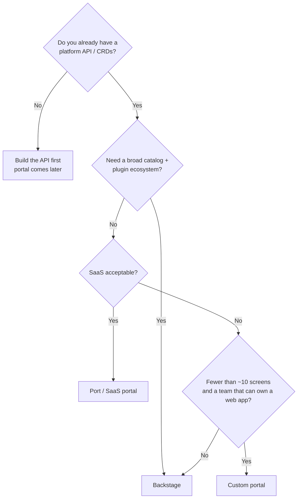
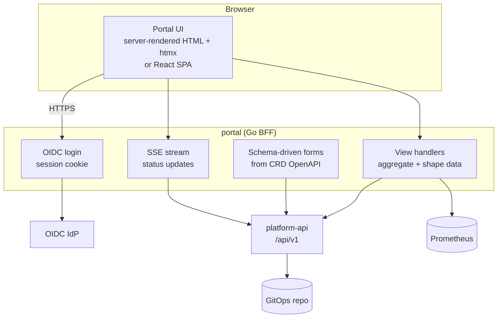
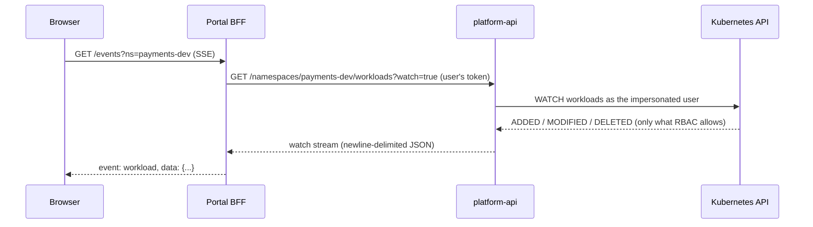

# Building a Custom Developer Portal

## Learning Objectives
- Decide when building a portal beats adopting [Backstage](backstage.md) or [Port](port.md)
- Design a portal architecture with a **Backend-for-Frontend (BFF)** over the platform API
- Authenticate users with OIDC and have platform-api act as them through Kubernetes **impersonation**, so RBAC stays the source of truth and the portal holds no cluster permissions
- Stream live `Workload` and `Environment` status to the browser with watches and Server-Sent Events
- Generate forms from CRD OpenAPI schemas instead of hand-coding them
- Operate the portal: caching, rate limits, audit, and testing

## Prerequisites
- [Kubernetes API primer](../01-kubernetes-fundamentals/api-primer.md) and [RBAC](../01-kubernetes-fundamentals/rbac.md)
- Go 1.22+ and basic frontend knowledge (HTML, a bit of JavaScript)
- The platform CRDs from [Kubernetes CRDs](../09-platform-apis/kubernetes-crds.md)
- [Platform API Design](../09-platform-apis/platform-api-design.md) (recommended)

---

## Build vs Buy vs Assemble

Most organizations should **not** build a portal from scratch. A custom portal is justified when the portal is a thin, opinionated view over a strong platform API and the off-the-shelf options add more weight than value.

| Signal | Points toward |
|--------|---------------|
| Need catalog, docs, plugins ecosystem, 100+ teams | Backstage |
| Want a portal in weeks, OK with SaaS, small platform team | Port (or similar SaaS) |
| Platform is already API-first (CRDs + platform API); portal needs ~5 screens | **Custom** |
| Air-gapped / strict data residency / very small footprint | **Custom** or self-hosted Backstage |
| Unique workflow (e.g., regulated change approval) dominates UX | **Custom**, or a custom Backstage plugin |
| No frontend skills on the team | Port, or a CLI-first platform ([platform-cli](https://github.com/GitOpsHub/platform-engineering-on-kubernetes/tree/main/code/platform-cli/)) |



> **The portal is the least important layer.** If self-service only works through the portal, the platform is not self-service — it is click-ops. Every portal action must also be available via API, CLI, and GitOps. A custom portal makes that easy to enforce because it is a pure client of those APIs.

---

## Reference Architecture



| Layer | Responsibility | Anti-pattern to avoid |
|-------|----------------|----------------------|
| UI | Render, collect input, show status | Business rules in JavaScript |
| BFF | AuthN, aggregation, shaping responses for screens | Its own database of platform state |
| platform-api | Validation, tenancy, orchestration, writes | Being bypassed by the portal |
| Kubernetes API | Source of truth for resources and RBAC | Portal or browser holding any cluster credential |

### Design Principles

1. **Stateless BFF.** All state lives in Kubernetes, Git, or the platform API. The portal can be deleted and redeployed without data loss.
2. **User identity end-to-end.** The browser's session becomes the user's OIDC token on every call to platform-api, which impersonates that user against Kubernetes. The portal never holds cluster credentials.
3. **Schema-driven UI.** Forms come from the CRD's `openAPIV3Schema`, so adding a field to the CRD adds it to the portal.
4. **One path to the cluster.** Reads, writes, permission checks, and watches all go through platform-api, so group filtering, audit, and RBAC are enforced in one place.

---

## Authentication: OIDC Login

The BFF uses the authorization-code flow and stores the ID token in an encrypted, HTTP-only session cookie.

```go
// cmd/portal/auth.go
package main

import (
	"context"
	"crypto/rand"
	"encoding/base64"
	"net/http"

	"github.com/coreos/go-oidc/v3/oidc"
	"golang.org/x/oauth2"
)

type Auth struct {
	provider *oidc.Provider
	verifier *oidc.IDTokenVerifier
	oauth    oauth2.Config
	sessions SessionStore // encrypted cookie store (e.g. gorilla/securecookie)
}

// Claims we rely on. "groups" must be configured as a claim in the IdP.
type Claims struct {
	Email  string   `json:"email"`
	Groups []string `json:"groups"`
}

func NewAuth(ctx context.Context, issuer, clientID, clientSecret, redirectURL string, s SessionStore) (*Auth, error) {
	p, err := oidc.NewProvider(ctx, issuer)
	if err != nil {
		return nil, err
	}
	return &Auth{
		provider: p,
		verifier: p.Verifier(&oidc.Config{ClientID: clientID}),
		oauth: oauth2.Config{
			ClientID:     clientID,
			ClientSecret: clientSecret,
			RedirectURL:  redirectURL,
			Endpoint:     p.Endpoint(),
			Scopes:       []string{oidc.ScopeOpenID, "email", "groups"},
		},
		sessions: s,
	}, nil
}

func (a *Auth) Login(w http.ResponseWriter, r *http.Request) {
	state := randomString()
	a.sessions.SetFlash(w, "oauth_state", state)
	http.Redirect(w, r, a.oauth.AuthCodeURL(state), http.StatusFound)
}

func (a *Auth) Callback(w http.ResponseWriter, r *http.Request) {
	if r.URL.Query().Get("state") != a.sessions.GetFlash(r, "oauth_state") {
		http.Error(w, "invalid state", http.StatusBadRequest)
		return
	}
	tok, err := a.oauth.Exchange(r.Context(), r.URL.Query().Get("code"))
	if err != nil {
		http.Error(w, "exchange failed", http.StatusUnauthorized)
		return
	}
	rawID, ok := tok.Extra("id_token").(string)
	if !ok {
		http.Error(w, "no id_token", http.StatusUnauthorized)
		return
	}
	idt, err := a.verifier.Verify(r.Context(), rawID)
	if err != nil {
		http.Error(w, "invalid id_token", http.StatusUnauthorized)
		return
	}
	var c Claims
	if err := idt.Claims(&c); err != nil {
		http.Error(w, "bad claims", http.StatusUnauthorized)
		return
	}
	a.sessions.Save(w, Session{Email: c.Email, Groups: c.Groups, IDToken: rawID, Expiry: idt.Expiry})
	http.Redirect(w, r, "/", http.StatusFound)
}

// Middleware: attach the session user to the request context or redirect to login.
func (a *Auth) Require(next http.Handler) http.Handler {
	return http.HandlerFunc(func(w http.ResponseWriter, r *http.Request) {
		s, ok := a.sessions.Load(r)
		if !ok || s.Expired() {
			http.Redirect(w, r, "/login", http.StatusFound)
			return
		}
		next.ServeHTTP(w, r.WithContext(withUser(r.Context(), s)))
	})
}

func randomString() string {
	b := make([]byte, 32)
	_, _ = rand.Read(b)
	return base64.RawURLEncoding.EncodeToString(b)
}
```

---

## Authorization: Impersonation Through platform-api

The portal holds **no cluster permissions of its own**. It has an OIDC client secret and a session key, and nothing else. It never calls the Kubernetes API directly. Every read and write goes to [platform-api](../09-platform-apis/platform-api-design.md), which authenticates the caller's bearer token and then acts as that user through Kubernetes impersonation. Cluster RBAC decides what the user can see or change, so the answer is the same whether the request came from the portal, the CLI, or CI.

```mermaid
sequenceDiagram
    participant B as Browser
    participant P as Portal BFF
    participant A as platform-api
    participant K as Kubernetes API
    B->>P: request (session cookie)
    P->>A: request + user's OIDC bearer token
    A->>A: verify token; map subject and groups
    A->>K: request with Impersonate-User and Impersonate-Group headers
    K->>K: RBAC evaluated for the user
    K-->>A: allowed (or 403)
    A-->>P: response or problem+json
    P-->>B: rendered view or error
```

### What platform-api is allowed to impersonate

Impersonation is the one powerful permission in this design, so it is scoped to the minimum. The platform-api ServiceAccount receives a ClusterRole with two rules:

```yaml
# platform-api-impersonator-rbac.yaml (target model)
apiVersion: rbac.authorization.k8s.io/v1
kind: ClusterRole
metadata:
  name: platform-api-impersonator
rules:
  # Impersonate only the tenant groups the platform manages. resourceNames is an
  # explicit allowlist; a group not on it cannot be impersonated.
  - apiGroups: [""]
    resources: ["groups"]
    verbs: ["impersonate"]
    resourceNames:
      - tenant-payments-developers
      - tenant-payments-admins
      - tenant-search-developers
  # Impersonating a user requires the users verb. Kubernetes cannot restrict this
  # to a dynamic set of users, so this is the one rule that cannot be allowlisted.
  # Its safety comes from platform-api only ever setting the subject it verified.
  - apiGroups: [""]
    resources: ["users"]
    verbs: ["impersonate"]
---
apiVersion: rbac.authorization.k8s.io/v1
kind: ClusterRoleBinding
metadata:
  name: platform-api-impersonator
roleRef:
  apiGroup: rbac.authorization.k8s.io
  kind: ClusterRole
  name: platform-api-impersonator
subjects:
  - kind: ServiceAccount
    name: platform-api
    namespace: platform-system
```

Three rules keep this model honest:

1. **Never a broad group grant.** Do not write `resources: [groups]` with no `resourceNames`. That lets the server act as any group, including `system:masters`. Keep the group list in the same place as the tenant-operator's group bindings, and extend it per tenant.
2. **platform-api filters groups before impersonating.** RBAC `resourceNames` cannot express a prefix, so platform-api rejects any group beginning with `system:` and drops any group that is not an allowed tenant group. It never forwards an IdP group verbatim. A token carrying `system:masters` gets a `403` at the edge, not an impersonation.
3. **Protect the platform-api token.** Because the `users` rule cannot be narrowed, anyone who obtains the platform-api ServiceAccount token can act as any user. Treat that token like a cluster credential: short-lived projected token, no copies in config files, and access audited.

The `impersonate` verb on `users` is the residual broad permission. The design accepts it because the alternative (the portal or every tenant holding its own credentials) is worse. Document it in the platform's threat model.

### How platform-api builds the caller's client

platform-api verifies the bearer token, filters the groups, and builds a per-request client that impersonates the verified subject. The portal never supplies a username or group list.

```go
// platform-api: main.go (excerpt; the server's real implementation lives in code/platform-api)
package main

import (
	"strings"

	"k8s.io/client-go/rest"
)

// allowedGroup is the allowlist mirrored from the platform-api-impersonator ClusterRole.
// Keep the two in sync; the ClusterRole is the enforcement, this is the early reject.
var allowedGroup = map[string]bool{
	"tenant-payments-developers": true,
	"tenant-payments-admins":     true,
	"tenant-search-developers":   true,
}

// impersonationFor returns a copy of base that acts as the verified caller.
// Groups outside the allowlist, and any system: group, are dropped.
func impersonationFor(base *rest.Config, subject string, idpGroups []string) *rest.Config {
	groups := make([]string, 0, len(idpGroups))
	for _, g := range idpGroups {
		if strings.HasPrefix(g, "system:") || !allowedGroup[g] {
			continue
		}
		groups = append(groups, g)
	}

	c := rest.CopyConfig(base) // base is platform-api's own config; never mutate it
	c.Impersonate = rest.ImpersonationConfig{
		UserName: subject,
		Groups:   groups,
	}
	return c
}
```

Reject requests whose subject is empty before this function runs. A request with no verified principal never reaches Kubernetes (see [Platform API Design](../09-platform-apis/platform-api-design.md#authentication-and-authorization)).

### Portal side: forward the user's token

The portal forwards the user's OIDC access token to platform-api from the session, and never adds identity headers of its own:

```go
// cmd/portal/platform.go
package main

import (
	"context"
	"fmt"
	"io"
	"net/http"
)

// PlatformClient calls platform-api as the logged-in user.
type PlatformClient struct {
	baseURL string // http://platform-api.platform-system.svc:8080
	http    *http.Client
}

func (p *PlatformClient) Do(ctx context.Context, s Session, method, path string, body io.Reader) (*http.Response, error) {
	req, err := http.NewRequestWithContext(ctx, method, p.baseURL+path, body)
	if err != nil {
		return nil, err
	}
	req.Header.Set("Authorization", "Bearer "+s.AccessToken) // the user's token, not the portal's
	req.Header.Set("Accept", "application/json")
	return p.http.Do(req)
}

// ListWorkloads returns the Workloads the user may see. A 403 is the correct answer, not a bug.
func (p *PlatformClient) ListWorkloads(ctx context.Context, s Session, ns string) (*http.Response, error) {
	return p.Do(ctx, s, http.MethodGet, fmt.Sprintf("/api/v1alpha1/namespaces/%s/workloads", ns), nil)
}
```

The session stores the access token (or the ID token if platform-api verifies ID tokens, which is what the OIDC seam in platform-api expects). Pick one and state it in the platform-api configuration; mixing them causes `401` storms.

### "Can I?" buttons

Ask the API server as the user, not the portal. Expose this through platform-api rather than having the portal create `SelfSubjectAccessReview` objects itself, so every permission check goes through the same impersonation path:

```http
POST /api/v1alpha1/access-reviews
Content-Type: application/json

{ "verb": "create", "group": "platform.mycompany.io", "resource": "workloads", "namespace": "payments-dev" }
```

```json
{ "allowed": true, "denied": false, "reason": "" }
```

platform-api answers by creating a `SelfSubjectAccessReview` with the caller's impersonated client, so the result is Kubernetes RBAC's answer for that user.

> **Why not forward the user's token straight to Kubernetes?** If the API server trusts the same OIDC issuer (structured `AuthenticationConfiguration`), the portal could send the user's token directly and skip impersonation. That is the cleanest option when you control the API server. Impersonation through platform-api is the model here because it works on managed clusters (EKS, GKE, AKS) where API server flags are not yours, and because it keeps one enforcement point for group filtering and audit across many clusters.


---

## Live Status with Server-Sent Events

Polling the API from every browser tab does not scale, but a shared informer would need to run under an identity, and any identity that reads everything is a cross-tenant leak. So the portal does not run an informer. It subscribes to a **per-user watch** exposed by platform-api, which evaluates RBAC as the subscriber and streams only the objects that user may see.



Two notes on the model:

- **Authorization happens once, at the watch.** If the user's RBAC changes, the existing stream keeps running until it is closed. Set a maximum stream lifetime (for example, 10 minutes) and let the browser reconnect, which re-evaluates RBAC.
- **The watch is opened with `?watch=true`**, the same convention Kubernetes uses. platform-api streams newline-delimited JSON, one `{"type": ..., "object": {...}}` per line, as described in [Platform API Design](../09-platform-apis/platform-api-design.md).

```go
// cmd/portal/events.go
package main

import (
	"bufio"
	"encoding/json"
	"fmt"
	"net/http"
	"time"
)

// WorkloadEvent is the shape the browser receives. It is a view model, not the raw CR.
type WorkloadEvent struct {
	Type      string `json:"type"` // ADDED, MODIFIED, DELETED
	Name      string `json:"name"`
	Namespace string `json:"namespace"`
	Phase     string `json:"phase"`
	Ready     string `json:"ready"`
	URL       string `json:"url,omitempty"`
}

// GET /events?ns=payments-dev
func (s *Server) Events(w http.ResponseWriter, r *http.Request) {
	sess := sessionFrom(r.Context())
	ns := r.URL.Query().Get("ns")

	flusher, ok := w.(http.Flusher)
	if !ok {
		http.Error(w, "streaming unsupported", http.StatusInternalServerError)
		return
	}

	// The watch is opened as the user. A 403 from platform-api is returned to the browser as-is.
	resp, err := s.platform.Do(r.Context(), sess, http.MethodGet,
		fmt.Sprintf("/api/v1alpha1/namespaces/%s/workloads?watch=true", ns), nil)
	if err != nil {
		http.Error(w, "upstream unavailable", http.StatusBadGateway)
		return
	}
	defer resp.Body.Close()
	if resp.StatusCode != http.StatusOK {
		http.Error(w, http.StatusText(resp.StatusCode), resp.StatusCode)
		return
	}

	w.Header().Set("Content-Type", "text/event-stream")
	w.Header().Set("Cache-Control", "no-cache")
	w.Header().Set("X-Accel-Buffering", "no") // disable proxy buffering (nginx)

	// Stop after a bounded lifetime so RBAC changes take effect on reconnect.
	deadline := time.NewTimer(10 * time.Minute)
	defer deadline.Stop()

	lines := bufio.NewScanner(resp.Body)
	heartbeat := time.NewTicker(20 * time.Second)
	defer heartbeat.Stop()

	events := make(chan WorkloadEvent)
	go func() {
		defer close(events)
		for lines.Scan() {
			var ev WorkloadEvent
			if json.Unmarshal(lines.Bytes(), &ev) == nil {
				events <- ev
			}
		}
	}()

	for {
		select {
		case <-r.Context().Done():
			return
		case <-deadline.C:
			return
		case <-heartbeat.C:
			fmt.Fprint(w, ": ping\n\n") // keeps proxies from closing idle streams
			flusher.Flush()
		case ev, open := <-events:
			if !open {
				return
			}
			b, _ := json.Marshal(ev)
			fmt.Fprintf(w, "event: workload\ndata: %s\n\n", b)
			flusher.Flush()
		}
	}
}
```

The frontend can stay tiny. With **htmx** and its SSE extension, a status row updates itself with no build step:

```html
<!-- templates/workloads.html (Go html/template) -->
<!-- In production, vendor these files into the portal image or add integrity="sha384-..."
     crossorigin="anonymous" (Subresource Integrity) so a CDN compromise can't inject code. -->
<script src="https://unpkg.com/htmx.org@2.0.4"></script>
<script src="https://unpkg.com/htmx-ext-sse@2.2.2/sse.js"></script>

<table hx-ext="sse" sse-connect="/events?ns={{ .Namespace }}">
  <thead><tr><th>Workload</th><th>Phase</th><th>Ready</th><th>URL</th></tr></thead>
  <tbody>
  {{ range .Workloads }}
    <tr id="wl-{{ .Name }}">
      <td>{{ .Name }}</td>
      <td class="phase-{{ .Status.Phase }}">{{ .Status.Phase }}</td>
      <td>{{ .Status.ReadyReplicas }}/{{ .Spec.Replicas }}</td>
      <td>{{ with .Status.URL }}<a href="{{ . }}">{{ . }}</a>{{ end }}</td>
    </tr>
  {{ end }}
  </tbody>
</table>
```

> For htmx's `sse-swap`, the BFF would emit pre-rendered HTML fragments rather than JSON. JSON is shown above because it also serves a React/Vue frontend; pick one format per endpoint.

---

## Schema-Driven Forms

The CRD already contains a full OpenAPI v3 schema, including enums, defaults, and descriptions. Render forms from it so the portal never drifts from the API.

```go
// cmd/portal/schema.go
// Fetch the Workload schema from the CRD and hand it to a JSON-schema form library
// (e.g. @rjsf/core in React, or a server-side renderer).
func (k *Kube) WorkloadSchema(ctx context.Context) (map[string]any, error) {
	var crd apiextensionsv1.CustomResourceDefinition
	if err := k.reader.Get(ctx, client.ObjectKey{Name: "workloads.platform.mycompany.io"}, &crd); err != nil {
		return nil, err
	}
	for _, v := range crd.Spec.Versions {
		if v.Served && v.Storage {
			spec := v.Schema.OpenAPIV3Schema.Properties["spec"]
			b, _ := json.Marshal(spec)
			var out map[string]any
			return out, json.Unmarshal(b, &out)
		}
	}
	return nil, fmt.Errorf("no storage version found")
}
```

Validation still happens server-side: when the user submits, create the object as the user with **dry-run** first to surface CEL and webhook errors inline:

```go
// Validate with the real API server (CEL rules, admission webhooks, policies) but persist nothing.
err := c.Create(ctx, workload, client.DryRunAll)
if apierrors.IsInvalid(err) {
	// StatusError.ErrStatus.Details.Causes has per-field messages -> render next to inputs
}
```

| UI element | Schema source |
|------------|---------------|
| Dropdown | `enum` |
| Default value | `default` |
| Help text | `description` (from Go doc comments via controller-gen) |
| Required marker | `required` |
| Inline error | `x-kubernetes-validations[].message` returned on dry-run |

---

## Operating the Portal

### Deployment

```yaml
# portal-deployment.yaml (abridged)
apiVersion: apps/v1
kind: Deployment
metadata:
  name: portal
  namespace: platform-portal
spec:
  replicas: 2
  selector:
    matchLabels: { app.kubernetes.io/name: portal }
  template:
    metadata:
      labels: { app.kubernetes.io/name: portal }
    spec:
      serviceAccountName: portal
      securityContext:
        runAsNonRoot: true
        seccompProfile: { type: RuntimeDefault }
      containers:
        - name: portal
          image: ghcr.io/myorg/portal:0.9.0
          args:
            - --oidc-issuer=https://login.mycompany.io
            - --platform-api=http://platform-api.platform-system.svc:8080
          envFrom:
            - secretRef: { name: portal-oidc }
          ports:
            - containerPort: 8080
          readinessProbe:
            httpGet: { path: /readyz, port: 8080 }
          resources:
            requests: { cpu: 100m, memory: 128Mi }
            limits: { memory: 256Mi }
          securityContext:
            allowPrivilegeEscalation: false
            readOnlyRootFilesystem: true
            capabilities: { drop: [ALL] }
```

### Checklist

| Concern | Practice |
|---------|----------|
| Audit | Kubernetes audit logs record `impersonatedUser`; platform-api logs the OIDC subject |
| Rate limiting | Put the portal behind the [platform gateway](../09-platform-apis/api-gateway.md); per-user limits on write endpoints |
| Caching | Cache lists briefly in platform-api, keyed by user; never cache authorization decisions longer than a few seconds |
| SSE through proxies | Disable buffering; set idle timeouts > heartbeat interval; send `: ping` comments every 15–30s |
| Multi-cluster | platform-api routes each request to the right cluster; namespace → cluster mapping comes from `Tenant`/`Environment` status |
| Testing | `envtest` for Kubernetes interactions; Playwright for critical flows |
| Accessibility | Semantic HTML, keyboard navigation; server-rendered pages help here |

---

## Hands-On Exercises

### Exercise 1: A minimal portal over the Workload API

**Goal:** Build a two-page portal (workload list and create form) that calls the cluster as the signed-in user and shows live status.

**Before you start:** the kind cluster from [Lab 01](../../labs/lab-01-cluster-setup/README.md), and Go 1.22 or later.

**Step 1: Install the Workload CRD.** Lab 03 builds a different API (`WebApp`), so install the `Workload` CRD from its operator project instead:

```bash
kubectl config use-context kind-platform-engineering
make -C code/workload-operator install
kubectl get crd workloads.platform.mycompany.io
```

Expected output:

```text
NAME                                CREATED AT
workloads.platform.mycompany.io     2026-10-24T09:12:41Z
```

**Step 2: Create a test identity.** The lab needs no IdP; hardcode a dev session for `alice@mycompany.io`:

```bash
kubectl create namespace payments-dev
kubectl create namespace search-dev
kubectl create rolebinding alice-dev -n payments-dev --clusterrole=edit --user=alice@mycompany.io
```

**Step 3: Verify the RBAC the user will get** before writing code. Run these as an admin who can impersonate:

```bash
kubectl get workloads -n payments-dev --as=alice@mycompany.io
kubectl get workloads -n search-dev --as=alice@mycompany.io
kubectl auth can-i create workloads.platform.mycompany.io -n payments-dev --as=alice@mycompany.io
```

Expected output:

```text
No resources found in payments-dev namespace.
Error from server (Forbidden): workloads.platform.mycompany.io is forbidden: User "alice@mycompany.io" cannot list resource "workloads" in API group "platform.mycompany.io" in the namespace "search-dev"
yes
```

**Step 4: Implement** `PlatformClient`, `ListWorkloads`, and the `/events` SSE handler from this page. Run platform-api locally against your kubeconfig (see [`code/platform-api`](https://github.com/GitOpsHub/platform-engineering-on-kubernetes/tree/main/code/platform-api/)) and point the portal at it.

**Step 5: Watch live updates.** Create a workload, open the list page, then scale it from a second terminal:

```bash
kubectl patch workload payments-api -n payments-dev --type=merge -p '{"spec":{"replicas":3}}'
```

Expected output: `workload.platform.mycompany.io/payments-api patched`, and the replica count in the browser row changes without a page reload.

**Step 6: Check server-side validation.** Submit an invalid size such as `xl` in the create form. The form shows the API server's error beside the field.

**Check:**

- [ ] Alice sees `payments-dev` workloads and gets a clear "no access" message for `search-dev`.
- [ ] Status updates appear without a page reload.
- [ ] Invalid input shows the CRD's CEL or enum error message.

---

## Troubleshooting

### platform-api returns `500` and logs `cannot impersonate`

**Cause:** platform-api ServiceAccount lacks the impersonate rule, or the group is missing from `resourceNames`

**Fix:** Check `platform-api-impersonator` ClusterRole; add the group to the allowlist only after the tenant-operator creates it

### Requests for a user's group are silently missing

**Cause:** Group is not in the platform-api allowlist (filtered on purpose)

**Fix:** Confirm the group is a tenant group in the allowlist; do not add `system:*` groups

### User sees nothing despite group membership

**Cause:** IdP `groups` claim absent or differently named

**Fix:** Inspect the ID token; map claim names; check RoleBinding subject names

### SSE connection closes every 60s

**Cause:** Proxy/gateway idle timeout

**Fix:** Send heartbeat comments; raise timeout on the route

### Events arrive in bursts

**Cause:** Response buffering

**Fix:** `X-Accel-Buffering: no`, flush after each event, disable compression on `/events`

### High API server load

**Cause:** Per-request LIST calls from many tabs

**Fix:** Coalesce and cache lists in platform-api per user for a few seconds; use watches for live views

### Form missing new CRD field

**Cause:** Schema cached at startup

**Fix:** Re-read CRD on change (watch CRDs) or on a short interval

### `no matches for kind "Workload"`

**Cause:** Scheme not registered / CRD not installed

**Fix:** `platformv1alpha1.AddToScheme(scheme)`; `kubectl get crd workloads.platform.mycompany.io`


---

## Further Reading

- [Kubernetes User Impersonation](https://kubernetes.io/docs/reference/access-authn-authz/authentication/#user-impersonation)
- [SelfSubjectAccessReview](https://kubernetes.io/docs/reference/access-authn-authz/authorization/#checking-api-access)
- [go-oidc](https://github.com/coreos/go-oidc)
- [htmx SSE extension](https://htmx.org/extensions/sse/)
- [react-jsonschema-form](https://rjsf-team.github.io/react-jsonschema-form/)
- [Backend for Frontend pattern](https://samnewman.io/patterns/architectural/bff/)

---

## Next Steps

1. **Decide what the portal exposes**: [Platform Capabilities](platform-capabilities.md)
2. **Back it with a solid API**: [Platform API Design](../09-platform-apis/platform-api-design.md)
3. **Put it behind the gateway**: [API Gateway](../09-platform-apis/api-gateway.md)
4. **Measure if it helps**: [Developer Experience](../08-self-service/developer-experience.md)
