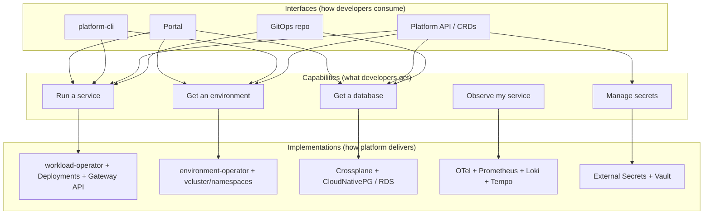
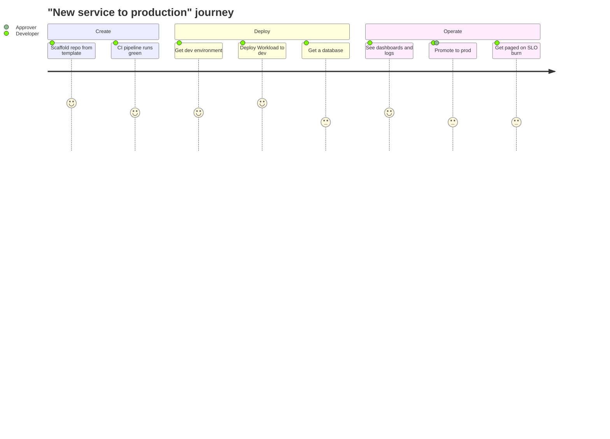
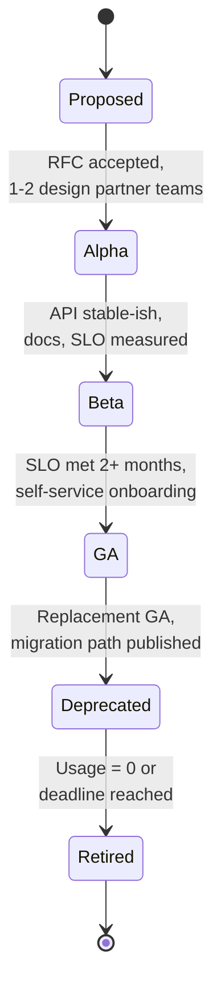
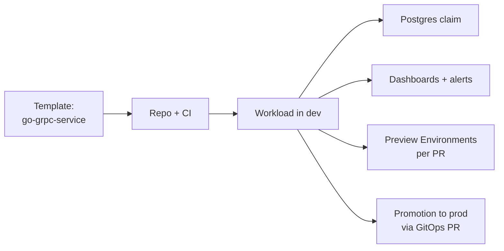

# Defining Platform Capabilities

## Learning Objectives
- Define what a **platform capability** is and how it differs from a tool or a component
- Build a **capability map** for your internal developer platform using the CNCF capability model
- Specify each capability's **interfaces** (API, CLI, portal, GitOps), **SLOs**, **ownership**, and **lifecycle**
- Express capabilities as Kubernetes APIs (`Tenant`, `Environment`, `Workload`) and compositions
- Design **golden paths** that compose capabilities into opinionated workflows
- Prioritize capabilities with a "thinnest viable platform" mindset

## Prerequisites
- Read [Backstage](backstage.md) or [Port](port.md) for how capabilities surface to users
- [Kubernetes CRDs](../09-platform-apis/kubernetes-crds.md) (for the API representation)
- Familiarity with [Team Topologies](../14-platform-evolution/team-topologies.md) and [Platform as a Product](../14-platform-evolution/platform-product.md) is helpful

---

## What is a Platform Capability?

A **platform capability** is an outcome a developer can obtain *on their own*, through a stable interface, with guarantees the platform team stands behind.

| Term | Example | Is it a capability? |
|------|---------|---------------------|
| Tool | ArgoCD, Vault, Crossplane | No — implementation detail |
| Component | `cert-manager` deployment in `platform-system` | No — part of an implementation |
| Feature | "ArgoCD auto-sync" | No — a knob on a tool |
| **Capability** | "Deploy a containerized service to any environment with HTTPS" | **Yes** |
| **Capability** | "Get a PostgreSQL database with backups and credentials in your namespace" | **Yes** |

A useful test: *can you swap the underlying tool without changing what developers do?* If yes, you have defined a capability. If developers must learn ArgoCD to deploy, ArgoCD is leaking through.



---

## A Capability Map

The [CNCF Platforms White Paper](https://tag-app-delivery.cncf.io/whitepapers/platforms/) lists capability domains common to most platforms. Use it as a checklist, not a mandate.

| CNCF capability domain | Example capability in this repo | Interface | Implementation |
|------------------------|---------------------------------|-----------|----------------|
| Web portals | Discover services, request resources | Backstage / Port | [backstage.md](backstage.md) |
| APIs for provisioning | Declarative platform resources | `platform.mycompany.io/v1alpha1` | [kubernetes-crds.md](../09-platform-apis/kubernetes-crds.md) |
| Golden path templates & docs | Scaffold a production-ready service | Software templates | [scaffolding.md](../08-self-service/scaffolding.md) |
| Automation for building & testing | CI pipelines from templates | Reusable workflows | GitHub Actions |
| Automation for delivery & verification | GitOps deploy, progressive rollout | `Workload` + ArgoCD | [gitops-principles.md](../05-gitops/gitops-principles.md) |
| Development environments | Ephemeral preview environments | `Environment` | [environment-provisioning.md](../08-self-service/environment-provisioning.md) |
| Application observability | Metrics, logs, traces by default | Labels + dashboards | [metrics-stack.md](../10-observability/metrics-stack.md) |
| Infrastructure services | Compute, network, storage | `Workload` traits | `workload-operator` |
| Data services | Databases, caches | Crossplane claims | [crossplane.md](../04-infrastructure-as-code/crossplane.md) |
| Messaging & event services | Queues, topics | Crossplane claims | Kafka / SQS compositions |
| Identity & secret services | Workload identity, secrets | `ExternalSecret` | [external-secrets.md](../06-secrets-management/external-secrets.md) |
| Security services | Policy, scanning, signing | Admission policies | [policy-engine.md](../12-security-compliance/policy-engine.md) |
| Artifact storage | Images, charts, SBOMs | OCI registry | Harbor / GHCR |

### Mapping Capabilities to Developer Journeys

Capabilities only matter when they serve a journey. Start from the journeys:



Each low score (3) is a capability gap or a friction point — your roadmap input.

---

## Specifying a Capability

Treat each capability like a product with a spec. Store these specs in Git next to the platform code; render them in the portal.

```yaml
# capabilities/run-a-service.yaml
apiVersion: platform.mycompany.io/v1alpha1
kind: CapabilitySpec          # documentation schema, not a served CRD
metadata:
  name: run-a-service
spec:
  summary: Deploy a containerized HTTP/gRPC service with TLS, autoscaling, and telemetry.
  owner: team-platform-runtime
  lifecycle: ga               # alpha | beta | ga | deprecated
  audience: all-tenants
  interfaces:
    api:
      group: platform.mycompany.io
      kind: Workload
      versions: [v1alpha1]
    cli: platform-cli -n <namespace> workload create
    portal: Backstage template "go-grpc-service", entity page "Kubernetes" tab
    gitops: tenants/<tenant>/workloads/<name>/workload.yaml
  guarantees:
    slo:
      - name: reconcile-latency
        objective: "99% of Workload spec changes reflected in a Ready Deployment within 2 minutes"
      - name: control-plane-availability
        objective: "99.9% of Workload API requests succeed over 30 days"
    support: "Business hours via #platform-help; P1 incidents 24/7"
  constraints:
    - Container must run as non-root
    - Images must be signed (cosign) and come from ghcr.io/myorg
    - Max size "large" (4 CPU / 8Gi) without exception approval
  dependencies:
    - capability: manage-secrets
    - capability: observe-a-service
  docs: https://portal.mycompany.io/docs/default/component/workload-operator
```

### Required Fields and Why

| Field | Why it matters |
|-------|----------------|
| `owner` | One team is accountable; capabilities without owners rot |
| `lifecycle` | Sets expectations: alpha may break, GA has deprecation policy |
| `interfaces` | Ensures parity across portal, CLI, API, and GitOps |
| `guarantees.slo` | Makes reliability explicit; enables error-budget conversations (see [SLOs](../11-reliability/slos-slis.md)) |
| `constraints` | Encodes guardrails users must know before adopting |
| `dependencies` | Shows blast radius and composition |

### Capability Lifecycle



| Stage | API version | Support | Breaking changes |
|-------|-------------|---------|------------------|
| Alpha | `v1alpha1` | Best effort, design partners only | Allowed with notice |
| Beta | `v1beta1` | Business hours | With conversion + 1 release notice |
| GA | `v1` | Full SLO | Only via new version + deprecation window (e.g. 6 months) |
| Deprecated | old version still served | Full SLO until retirement | None; migration tooling provided |

This mirrors the [Kubernetes deprecation policy](https://kubernetes.io/docs/reference/using-api/deprecation-policy/) and the API versioning guidance in [Platform API Design](../09-platform-apis/platform-api-design.md).

---

## Capabilities as Kubernetes APIs

The most durable interface for a capability is a Kubernetes API. Portals, CLIs, and GitOps all speak it, and controllers make it self-healing.

| Capability | Platform API | Scope | Controller |
|------------|--------------|-------|------------|
| Tenant onboarding | `Tenant` | Cluster | `tenant-operator` |
| Get an environment | `Environment` | Namespaced | `environment-operator` |
| Run a service | `Workload` | Namespaced | `workload-operator` |
| Get a database | `PostgreSQLInstance` (claim) | Namespaced | Crossplane |

### Tenant: Onboarding as a Capability

```yaml
# tenants/payments/tenant.yaml
apiVersion: platform.mycompany.io/v1alpha1
kind: Tenant
metadata:
  name: payments
  labels:
    platform.mycompany.io/cost-center: cc-1042
spec:
  displayName: Payments Team
  owner: team-payments
  email: payments-team@mycompany.io
  description: Card authorization, capture, and refunds
  quota:
    cpu: "40"
    memory: 80Gi
    storage: 500Gi
    environments: 10
    loadBalancers: 0
  namespaces:
    environments: [dev, staging, prod]
    labels:
      platform.mycompany.io/tenant: payments
```

One object yields: namespaces, RBAC bindings, quotas, limit ranges, default network policies, a catalog Group, and an ArgoCD AppProject. That *bundle* is the capability.

### Workload: Hiding the Kubernetes Surface Area

```yaml
# tenants/payments/workloads/payments-api/workload.yaml
apiVersion: platform.mycompany.io/v1alpha1
kind: Workload
metadata:
  name: payments-api
  namespace: payments-prod
  labels:
    platform.mycompany.io/tenant: payments
    platform.mycompany.io/environment: prod
spec:
  image: ghcr.io/myorg/payments-api:1.14.2
  port: 8080
  replicas: 3
  size: medium                 # platform-defined t-shirt size -> requests/limits
  expose:
    public: true
    host: payments.mycompany.io
  autoscaling:
    minReplicas: 3
    maxReplicas: 12
    targetCPUUtilization: 70
  env:
    - name: LOG_LEVEL
      value: info
  secrets:
    - name: payments-db-credentials   # ExternalSecret-managed
```

The `workload-operator` expands this into ~8 Kubernetes objects (Deployment, Service, HTTPRoute, HPA, PodDisruptionBudget, ServiceMonitor, NetworkPolicy, ServiceAccount). Developers learn **one** schema; the platform encodes best practice in the controller.

| Raw Kubernetes | `Workload` field | Platform decision encoded |
|----------------|------------------|---------------------------|
| `resources.requests/limits` | `size` | Right-sizing, bin-packing, cost tiers |
| `Service` + `HTTPRoute` + TLS | `expose.public/host` | Gateway, cert issuer, DNS |
| `HorizontalPodAutoscaler` | `autoscaling` | Metric choice, stabilization windows |
| `PodDisruptionBudget` | *(implicit)* | Always `minAvailable: 1` when replicas > 1 |
| `securityContext` | *(implicit)* | Restricted Pod Security Standard |
| `ServiceMonitor` | *(implicit)* | Metrics on `:9090/metrics` by convention |

> **Abstraction budget:** Every hidden field must have a documented escape hatch (e.g., a `spec.overrides` patch reviewed by the platform team, or graduating to raw manifests). Abstractions without escape hatches get bypassed in ways you can't see.

---

## Golden Paths: Composing Capabilities

A **golden path** is an opinionated, supported sequence of capabilities for a common job. It is paved, not fenced: teams may leave it, but they then own the consequences.



| Golden path | Capabilities composed | Time-to-value target |
|-------------|----------------------|---------------------|
| New Go/Java/Node service | scaffold, run-a-service, observe, secrets | First deploy to dev < 30 min |
| Add a database | data-service, secrets | Credentials in namespace < 15 min |
| Preview environment per PR | get-an-environment, run-a-service | Env URL in PR comment < 10 min |
| Onboard a new team | tenant onboarding, portal, catalog | Team productive < 1 day |

Golden paths live as [software templates](../08-self-service/scaffolding.md) plus documentation, and their success is measured in [Developer Experience](../08-self-service/developer-experience.md).

---

## Prioritizing: The Thinnest Viable Platform

Start with the smallest set of capabilities that removes the most cognitive load. A common sequence:

| Phase | Capabilities | Interface | Signal to move on |
|-------|--------------|-----------|-------------------|
| 0 — Wiki | Documented "how we deploy" | Docs | Teams copy-paste successfully |
| 1 — Paved road | Templates + GitOps | Git | >50% of new services use template |
| 2 — APIs | `Tenant`, `Workload` CRDs | kubectl / GitOps | Raw Deployment usage declining |
| 3 — Self-service | `Environment`, data services | API + CLI + portal | Tickets to platform team drop |
| 4 — Optimization | Scorecards, cost, policy feedback | Portal | DX metrics stable/improving |

Score candidate capabilities to choose what's next:

| Candidate | Teams affected | Tickets/month today | Cognitive load removed (1–5) | Build effort (1–5) | Score = teams × load ÷ effort |
|-----------|---------------|---------------------|------------------------------|-------------------|-------------------------------|
| Preview environments | 25 | 40 | 4 | 3 | 33 |
| Managed Postgres | 18 | 22 | 5 | 4 | 22 |
| Feature flags | 10 | 5 | 2 | 2 | 10 |

> See [Maturity Model](../14-platform-evolution/maturity-model.md) for where each phase sits on a broader platform maturity scale.

---

## Hands-On Exercises

### Exercise 1: Write a capability map for your platform

**Goal:** Produce a capability map, two capability specs, and one measurable SLO for a platform you know. You need a text editor; step 4 needs the cluster from [Lab 01](../../labs/lab-01-cluster-setup/README.md) and the `Workload` CRD (`make -C code/workload-operator install`).

1. **List journeys.** Interview (or role-play) three developers and write their top three journeys, for example "ship a hotfix" or "add a queue".
2. **Map capabilities.** For each journey step, name the capability, its interface, and its implementation. Mark the gaps.
3. **Write two capability specs** using the `CapabilitySpec` format above: one existing (`run-a-service`) and one gap (`get-an-environment`).
4. **Verify interface parity.** For `run-a-service`, confirm each interface works. Replace `<workload-file>` with the path of any `Workload` manifest, for example the one you rendered in [Scaffolding](../08-self-service/scaffolding.md):

   ```bash
   kubectl apply --dry-run=server -f <workload-file>
   ```

   Expected output:

   ```text
   workload.platform.mycompany.io/payments-api created (server dry run)
   ```

   Then repeat for the other interfaces your platform offers (CLI through [`platform-cli`](https://github.com/GitOpsHub/platform-engineering-on-kubernetes/tree/main/code/platform-cli/), and a GitOps repository path).
5. **Define an SLO** for one capability and write the PromQL that measures it. This example uses reconcile latency from controller-runtime metrics:

   ```promql
   histogram_quantile(0.99,
     sum by (le) (rate(controller_runtime_reconcile_time_seconds_bucket{controller="workload"}[30m])))
   ```

6. **Prioritize** your gaps with the scoring table and pick the next capability.

**Check:**

- [ ] Each capability has exactly one owning team.
- [ ] Every GA capability is reachable through the API and at least one of CLI, portal, or GitOps.
- [ ] At least one capability has an SLO with a query that returns a value.

---

## Troubleshooting

### Teams bypass the platform

**Cause:** Capability doesn't fit real needs, or no escape hatch

**Fix:** Interview bypassing teams; add overrides or a new capability

### Portal and CLI behave differently

**Cause:** Interfaces implemented separately

**Fix:** Make portal and CLI thin clients of the same API

### Capability list keeps growing, nothing is GA

**Cause:** No lifecycle discipline

**Fix:** Cap alpha capabilities; require SLO + docs for GA

### "Platform" is a list of tools

**Cause:** Capabilities defined bottom-up

**Fix:** Rewrite from journeys: "developer can ___ without ___"

### Breaking changes anger users

**Cause:** No versioning/deprecation policy

**Fix:** Adopt alpha/beta/GA semantics with conversion webhooks

### Ownership disputes

**Cause:** Capability spans teams

**Fix:** Split into smaller capabilities or name a single DRI


---

## Further Reading

- [CNCF Platforms White Paper](https://tag-app-delivery.cncf.io/whitepapers/platforms/)
- [CNCF Platform Engineering Maturity Model](https://tag-app-delivery.cncf.io/whitepapers/platform-eng-maturity-model/)
- *Team Topologies* — Matthew Skelton & Manuel Pais (Thinnest Viable Platform)
- [What I Talk About When I Talk About Platforms](https://martinfowler.com/articles/talk-about-platforms.html) — Evan Bottcher
- [Kubernetes Deprecation Policy](https://kubernetes.io/docs/reference/using-api/deprecation-policy/)

---

## Next Steps

1. **Expose capabilities in a catalog**: [Service Catalog](../08-self-service/service-catalog.md)
2. **Turn golden paths into templates**: [Scaffolding](../08-self-service/scaffolding.md)
3. **Implement the APIs**: [Kubernetes CRDs](../09-platform-apis/kubernetes-crds.md)
4. **Treat it as a product**: [Platform as a Product](../14-platform-evolution/platform-product.md)
