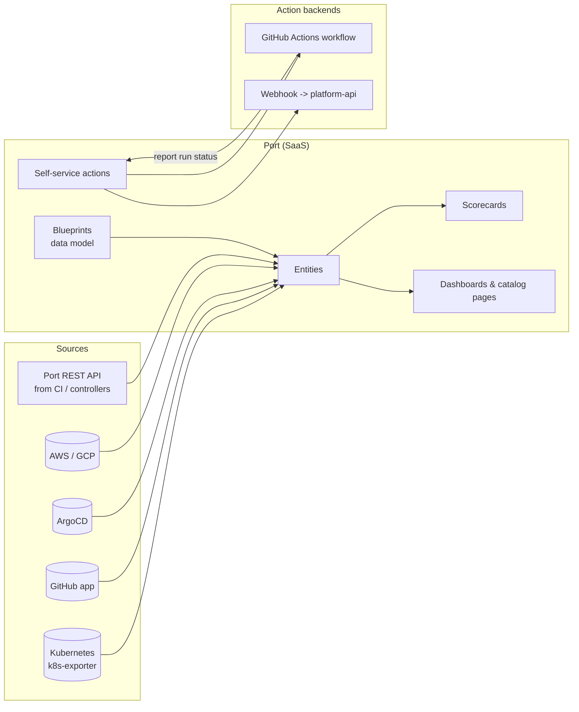
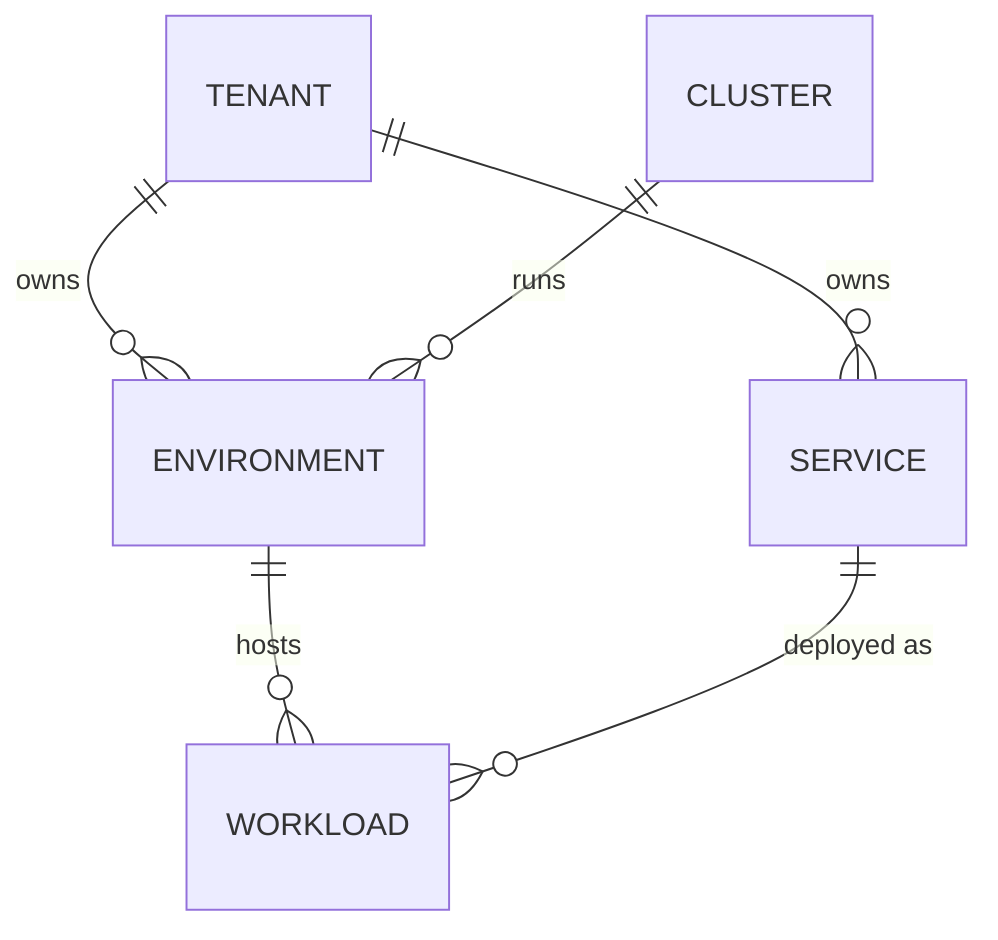
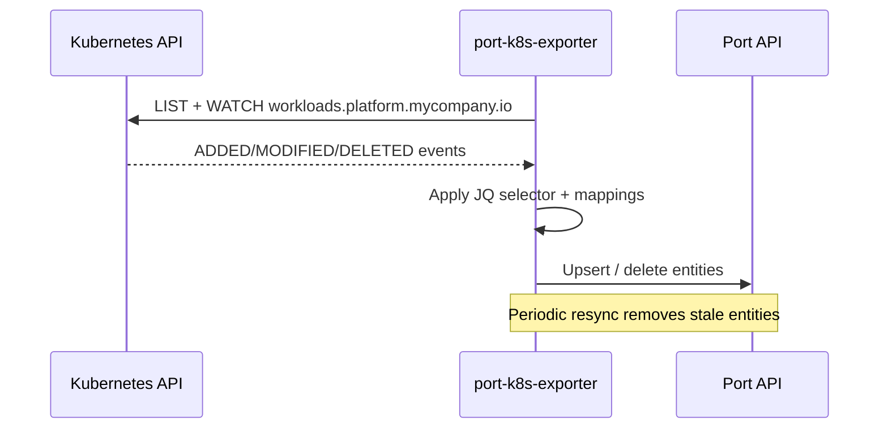

# Port: A SaaS Internal Developer Portal

## Learning Objectives
- Understand Port's data model: **blueprints**, **entities**, **relations**, and **scorecards**
- Model the platform's `Tenant`, `Environment`, and `Workload` resources as Port blueprints
- Ingest live Kubernetes state with the Port Kubernetes exporter and JQ mappings
- Build **self-service actions** backed by GitHub Actions or webhooks that call the platform API
- Manage Port configuration as code with the Terraform provider
- Decide when a SaaS portal beats a framework like [Backstage](backstage.md)

## Prerequisites
- [Backstage](backstage.md) (for comparison of concepts)
- Kubernetes CRDs: [Kubernetes CRDs](../09-platform-apis/kubernetes-crds.md)
- Helm, GitHub Actions basics
- `jq` familiarity (Port mappings are JQ expressions)

---

## What is Port?

**Port** (getport.io) is a commercial, SaaS-hosted internal developer portal. Where Backstage gives you a framework and a fixed entity model you extend with code, Port gives you a **hosted UI** and a **user-defined data model**. You describe *what kinds of things exist* (blueprints), feed in data from integrations, and configure self-service actions and scorecards without writing frontend code.



### Backstage vs Port at a Glance

| Dimension | Backstage | Port |
|-----------|-----------|------|
| Delivery | Self-hosted framework (TypeScript) | SaaS (with self-hosted integrations/agents) |
| Data model | Fixed core kinds + annotations; custom kinds possible but code-heavy | Fully user-defined blueprints and relations |
| UI customization | React plugins (unlimited, but you write code) | Configurable pages, widgets, dashboards (no code) |
| Self-service | Scaffolder templates (Node.js actions) | Actions with forms; backends are GitHub/GitLab/webhook/Kafka |
| Scorecards | Community/commercial plugins | Built-in |
| Kubernetes data | Live query via plugin | Exported into entities via k8s-exporter |
| Team needed | Dedicated portal engineers (1–3 FTE typical) | Platform team configures; less engineering |
| Cost | Infra + engineering time | Per-seat license |
| Data residency | Fully in your control | Metadata stored in Port's cloud |

> **Rule of thumb:** If your differentiation is the *portal itself* (deep custom UX, on-prem/air-gapped requirements), Backstage or a [custom portal](custom-portal.md) wins. If you want a portal in weeks and your differentiation is the *platform behind it*, Port is often faster.

---

## Data Model: Blueprints, Entities, Relations

A **blueprint** is a schema (like a CRD) with typed properties and relations. An **entity** is an instance (like a CR). Relations connect blueprints into a graph.



### Blueprint Definitions

Blueprints can be created in the UI, via the REST API, or with Terraform. JSON is the canonical form:

```json
{
  "identifier": "workload",
  "title": "Workload",
  "icon": "Deployment",
  "schema": {
    "properties": {
      "image": { "type": "string", "title": "Image" },
      "replicas": { "type": "number", "title": "Desired replicas" },
      "readyReplicas": { "type": "number", "title": "Ready replicas" },
      "size": {
        "type": "string",
        "title": "Size",
        "enum": ["small", "medium", "large"],
        "enumColors": { "small": "green", "medium": "blue", "large": "orange" }
      },
      "phase": {
        "type": "string",
        "title": "Phase",
        "enum": ["Pending", "Ready", "Degraded", "Failed"]
      },
      "url": { "type": "string", "format": "url", "title": "URL" },
      "lastReconciled": { "type": "string", "format": "date-time" }
    },
    "required": ["image"]
  },
  "calculationProperties": {
    "healthy": {
      "title": "Healthy",
      "type": "boolean",
      "calculation": ".properties.readyReplicas >= .properties.replicas"
    }
  },
  "relations": {
    "environment": {
      "title": "Environment",
      "target": "environment",
      "required": true,
      "many": false
    },
    "service": {
      "title": "Service",
      "target": "service",
      "required": false,
      "many": false
    }
  }
}
```

| Blueprint feature | Purpose | Kubernetes analogy |
|-------------------|---------|--------------------|
| `schema.properties` | Typed fields (string, number, boolean, array, object, url, date-time, user, team) | `openAPIV3Schema` |
| `calculationProperties` | JQ computed at read time | Printer columns / CEL |
| `mirrorProperties` | Copy a property from a related entity | Denormalized labels |
| `aggregationProperties` | Count/sum over related entities | Status rollups |
| `relations` | Typed links to other blueprints | `ownerReferences` / refs |
| `ownership` | Which team owns entities (direct or inherited via relation) | `platform.mycompany.io/tenant` label |

### Creating Entities via API

Controllers, CI pipelines, or scripts can upsert entities directly:

```bash
#!/usr/bin/env bash
# port-upsert-workload.sh - push a Workload into Port from CI
set -euo pipefail

# 1. Exchange client credentials for an access token
PORT_TOKEN=$(curl -s -X POST https://api.getport.io/v1/auth/access_token \
  -H 'Content-Type: application/json' \
  -d "{\"clientId\":\"${PORT_CLIENT_ID}\",\"clientSecret\":\"${PORT_CLIENT_SECRET}\"}" \
  | jq -r '.accessToken')

# 2. Upsert the entity (create or replace by identifier)
curl -s -X POST "https://api.getport.io/v1/blueprints/workload/entities?upsert=true&merge=true" \
  -H "Authorization: Bearer ${PORT_TOKEN}" \
  -H 'Content-Type: application/json' \
  -d @- <<EOF
{
  "identifier": "payments-dev-payments-api",
  "title": "payments-api (dev)",
  "properties": {
    "image": "ghcr.io/myorg/payments-api:${GIT_SHA}",
    "size": "small"
  },
  "relations": {
    "environment": "payments-dev",
    "service": "payments-api"
  }
}
EOF
```

> **Note:** EU-hosted Port organizations use `https://api.port.io` / region-specific hosts. Check your organization's API base URL in **Settings → Credentials**.

---

## Ingesting Kubernetes with the Exporter

Rather than pushing data from every controller, run the **Port Kubernetes exporter** in each cluster. It watches resources (including CRDs) and maps them into entities using JQ.



### Exporter Configuration

```yaml
# port-k8s-exporter-config.yaml
# Each resource block: which kind to watch, which objects to keep, how to map them.
deleteDependents: false
createMissingRelatedEntities: true   # create placeholder Environment if not yet seen
resources:
  # Tenants (cluster-scoped CRD)
  - kind: platform.mycompany.io/v1alpha1/tenants
    selector:
      query: 'true'
    port:
      entity:
        mappings:
          - identifier: .metadata.name
            title: .spec.displayName
            blueprint: '"tenant"'
            properties:
              owner: .spec.owner
              email: .spec.email
              phase: .status.phase
              namespaces: .status.namespaces

  # Environments (namespaced CRD)
  - kind: platform.mycompany.io/v1alpha1/environments
    selector:
      query: .metadata.namespace | startswith("kube-") | not
    port:
      entity:
        mappings:
          - identifier: .metadata.namespace + "-" + .metadata.name
            title: .metadata.name
            blueprint: '"environment"'
            properties:
              type: .spec.type
              ttl: .spec.ttl
              expiresAt: .status.expiresAt
              url: .status.url
              phase: .status.phase
            relations:
              tenant: .spec.tenantRef
              cluster: env.CLUSTER_NAME   # injected via exporter env

  # Workloads (namespaced CRD)
  - kind: platform.mycompany.io/v1alpha1/workloads
    selector:
      query: .metadata.labels["platform.mycompany.io/tenant"] != null
    port:
      entity:
        mappings:
          - identifier: .metadata.namespace + "-" + .metadata.name
            title: .metadata.name + " (" + .metadata.labels["platform.mycompany.io/environment"] + ")"
            blueprint: '"workload"'
            properties:
              image: .spec.image
              replicas: .spec.replicas
              readyReplicas: .status.readyReplicas
              size: .spec.size
              phase: .status.phase
              url: .status.url
              lastReconciled: .status.lastReconcileTime
            relations:
              environment: .metadata.namespace
              service: .metadata.labels["app.kubernetes.io/name"]
```

### Installing the Exporter

```bash
helm repo add port-labs https://port-labs.github.io/helm-charts
helm repo update

# The exporter reads its mapping from Port (configured in the UI's data source)
# or from a local config file. Here we pass the file explicitly.
helm upgrade --install port-k8s-exporter port-labs/port-k8s-exporter \
  --namespace port-k8s-exporter --create-namespace \
  --set secret.secrets.portClientId="${PORT_CLIENT_ID}" \
  --set secret.secrets.portClientSecret="${PORT_CLIENT_SECRET}" \
  --set stateKey="prod-eu-1" \
  --set extraEnv[0].name=CLUSTER_NAME \
  --set extraEnv[0].value=prod-eu-1 \
  --set-file configMap.config=port-k8s-exporter-config.yaml
```

The exporter needs RBAC to `list`/`watch` every kind in the mapping. The chart creates a ClusterRole for core kinds; extend it for CRDs:

```yaml
# port-exporter-platform-crds-rbac.yaml
apiVersion: rbac.authorization.k8s.io/v1
kind: ClusterRole
metadata:
  name: port-exporter-platform-crds
rules:
  - apiGroups: [platform.mycompany.io]
    resources: [tenants, environments, workloads]
    verbs: [get, list, watch]
---
apiVersion: rbac.authorization.k8s.io/v1
kind: ClusterRoleBinding
metadata:
  name: port-exporter-platform-crds
roleRef:
  apiGroup: rbac.authorization.k8s.io
  kind: ClusterRole
  name: port-exporter-platform-crds
subjects:
  - kind: ServiceAccount
    name: port-k8s-exporter
    namespace: port-k8s-exporter
```

> **Tip:** Set a unique `stateKey` per cluster. The exporter uses it to know which entities it owns, so it only deletes entities it created.

---

## Self-Service Actions

An **action** attaches a form to a blueprint and routes the submitted inputs to a backend. Port never touches your cluster directly — the backend does.

| Operation | Meaning | Example |
|-----------|---------|---------|
| `CREATE` | Creates a new entity of the blueprint | "Request preview environment" |
| `DAY-2` | Runs on an existing entity | "Scale workload", "Extend TTL" |
| `DELETE` | Removes an entity | "Destroy environment" |

| Invocation method | How it runs | Best for |
|-------------------|-------------|----------|
| `GITHUB` | Dispatches a GitHub Actions workflow via Port's GitHub app | GitOps PRs, Terraform |
| `GITLAB` | Triggers a GitLab pipeline | GitLab shops |
| `WEBHOOK` | HTTPS POST to your endpoint (can be agent-proxied) | Calling platform-api directly |
| `KAFKA` | Publishes to a Port-managed Kafka topic | Private networks, async workers |

### Action: Request a Preview Environment (GitHub backend)

```json
{
  "identifier": "request_preview_environment",
  "title": "Request preview environment",
  "icon": "Environment",
  "trigger": {
    "type": "self-service",
    "operation": "CREATE",
    "blueprintIdentifier": "environment",
    "userInputs": {
      "properties": {
        "tenant": {
          "type": "string",
          "title": "Tenant",
          "format": "entity",
          "blueprint": "tenant"
        },
        "name": {
          "type": "string",
          "title": "Environment name",
          "pattern": "^[a-z0-9-]{3,30}$"
        },
        "ttl": {
          "type": "string",
          "title": "Time to live",
          "enum": ["8h", "24h", "72h"],
          "default": "24h"
        }
      },
      "required": ["tenant", "name"],
      "order": ["tenant", "name", "ttl"]
    }
  },
  "invocationMethod": {
    "type": "GITHUB",
    "org": "myorg",
    "repo": "platform-gitops",
    "workflow": "request-environment.yaml",
    "workflowInputs": {
      "tenant": "{{ .inputs.tenant.identifier }}",
      "name": "{{ .inputs.name }}",
      "ttl": "{{ .inputs.ttl }}",
      "requested_by": "{{ .trigger.by.user.email }}",
      "port_run_id": "{{ .run.id }}"
    },
    "reportWorkflowStatus": true
  },
  "requiredApproval": false
}
```

The workflow commits an `Environment` manifest to the GitOps repo and reports progress back to the Port run:

```yaml
# .github/workflows/request-environment.yaml
name: Request environment
on:
  workflow_dispatch:
    inputs:
      tenant: { required: true, type: string }
      name: { required: true, type: string }
      ttl: { required: true, type: string }
      requested_by: { required: true, type: string }
      port_run_id: { required: true, type: string }

permissions:
  contents: write
  pull-requests: write

jobs:
  create:
    runs-on: ubuntu-latest
    steps:
      - uses: actions/checkout@v4

      - name: Render Environment manifest
        run: |
          mkdir -p tenants/${{ inputs.tenant }}/environments
          cat > tenants/${{ inputs.tenant }}/environments/${{ inputs.name }}.yaml <<EOF
          apiVersion: platform.mycompany.io/v1alpha1
          kind: Environment
          metadata:
            name: ${{ inputs.name }}
            namespace: ${{ inputs.tenant }}
            labels:
              platform.mycompany.io/tenant: ${{ inputs.tenant }}
            annotations:
              platform.mycompany.io/requested-by: ${{ inputs.requested_by }}
          spec:
            tenantRef: ${{ inputs.tenant }}
            type: ephemeral
            ttl: ${{ inputs.ttl }}
            template: preview
          EOF

      - name: Log progress to Port
        uses: port-labs/port-github-action@v1
        with:
          clientId: ${{ secrets.PORT_CLIENT_ID }}
          clientSecret: ${{ secrets.PORT_CLIENT_SECRET }}
          operation: PATCH_RUN
          runId: ${{ inputs.port_run_id }}
          logMessage: "Rendered Environment manifest, opening PR"

      - name: Open PR
        id: pr
        uses: peter-evans/create-pull-request@v7
        with:
          branch: env/${{ inputs.tenant }}-${{ inputs.name }}
          title: "env: ${{ inputs.tenant }}/${{ inputs.name }} (ttl ${{ inputs.ttl }})"
          labels: auto-merge,environment-request

      - name: Link PR in Port run
        uses: port-labs/port-github-action@v1
        with:
          clientId: ${{ secrets.PORT_CLIENT_ID }}
          clientSecret: ${{ secrets.PORT_CLIENT_SECRET }}
          operation: PATCH_RUN
          runId: ${{ inputs.port_run_id }}
          link: '["${{ steps.pr.outputs.pull-request-url }}"]'
          logMessage: "PR opened; environment will appear once ArgoCD syncs"
```

Once ArgoCD applies the manifest and the `environment-operator` reconciles it, the exporter pushes the live `Environment` back into Port — closing the loop.

### Action: Scale a Workload (Webhook backend)

For fast day-2 operations, a webhook straight to the [platform API](../09-platform-apis/platform-api-design.md) avoids the PR round-trip. Port signs webhook requests so you can verify them.

```json
{
  "identifier": "scale_workload",
  "title": "Scale workload",
  "trigger": {
    "type": "self-service",
    "operation": "DAY-2",
    "blueprintIdentifier": "workload",
    "userInputs": {
      "properties": {
        "replicas": { "type": "number", "minimum": 0, "maximum": 20, "title": "Replicas" }
      },
      "required": ["replicas"]
    }
  },
  "invocationMethod": {
    "type": "WEBHOOK",
    "url": "https://platform-api.mycompany.io/api/v1/integrations/port/scale",
    "synchronized": true,
    "method": "POST",
    "body": {
      "workload": "{{ .entity.identifier }}",
      "replicas": "{{ .inputs.replicas }}",
      "user": "{{ .trigger.by.user.email }}"
    }
  },
  "requiredApproval": {
    "type": "ANY"
  }
}
```

> **Security:** Treat inbound webhooks as untrusted. Verify Port's signature header with the shared secret, map the Port user to a platform identity, and enforce tenant RBAC in the platform API — never trust the `user` field alone. For clusters without public ingress, use the **Port Agent** (Kafka-based) so traffic is outbound-only.

---

## Scorecards

Scorecards grade entities against rules — the portal's way of nudging teams toward standards (see [Developer Experience](../08-self-service/developer-experience.md)).

```json
{
  "identifier": "production_readiness",
  "title": "Production readiness",
  "levels": [
    { "title": "Basic", "color": "paleBlue" },
    { "title": "Bronze", "color": "bronze" },
    { "title": "Silver", "color": "silver" },
    { "title": "Gold", "color": "gold" }
  ],
  "rules": [
    {
      "identifier": "has_owner",
      "title": "Has an owning team",
      "level": "Bronze",
      "query": {
        "combinator": "and",
        "conditions": [{ "property": "$team", "operator": "isNotEmpty" }]
      }
    },
    {
      "identifier": "multi_replica",
      "title": "Runs >= 2 replicas",
      "level": "Silver",
      "query": {
        "combinator": "and",
        "conditions": [{ "property": "replicas", "operator": ">=", "value": 2 }]
      }
    },
    {
      "identifier": "pinned_image",
      "title": "Image is not :latest",
      "level": "Silver",
      "query": {
        "combinator": "and",
        "conditions": [{ "property": "image", "operator": "doesNotContains", "value": ":latest" }]
      }
    },
    {
      "identifier": "healthy",
      "title": "All replicas ready",
      "level": "Gold",
      "query": {
        "combinator": "and",
        "conditions": [{ "property": "healthy", "operator": "=", "value": true }]
      }
    }
  ]
}
```

---

## Configuration as Code with Terraform

Clicking around a SaaS UI does not scale or review well. The `port-labs/port` Terraform provider manages blueprints, actions, and scorecards:

```hcl
# port/main.tf
terraform {
  required_providers {
    port = {
      source  = "port-labs/port"
      version = "~> 2.0"
    }
  }
}

provider "port" {
  client_id = var.port_client_id     # or PORT_CLIENT_ID env var
  secret    = var.port_client_secret # or PORT_CLIENT_SECRET env var
}

resource "port_blueprint" "tenant" {
  identifier = "tenant"
  title      = "Tenant"
  icon       = "Team"

  properties = {
    string_props = {
      owner = { title = "Owner" }
      email = { title = "Email", format = "email" }
      phase = {
        title = "Phase"
        enum  = ["Pending", "Ready", "Deleting", "Failed"]
      }
    }
  }
}

resource "port_blueprint" "environment" {
  identifier = "environment"
  title      = "Environment"
  icon       = "Environment"

  properties = {
    string_props = {
      type      = { title = "Type", enum = ["ephemeral", "persistent"] }
      ttl       = { title = "TTL" }
      expiresAt = { title = "Expires at", format = "date-time" }
      url       = { title = "URL", format = "url" }
    }
  }

  relations = {
    tenant = {
      title    = "Tenant"
      target   = port_blueprint.tenant.identifier
      required = true
    }
  }
}
```

```bash
cd port/
terraform init
terraform plan -out tf.plan
terraform apply tf.plan
```

> **Tip:** Keep blueprint identifiers stable. Renaming an identifier is a destructive change (entities are keyed by blueprint), like renaming a CRD group.

---

## Hands-On Exercises

### Exercise 1: Model the platform in Port

**Goal:** Ingest the platform's Kubernetes resources into Port, score them, and trigger one self-service action.

**Before you start:** a Port organization (the free tier is enough), the kind cluster from [Lab 01](../../labs/lab-01-cluster-setup/README.md), and the platform CRDs:

```bash
kubectl config use-context kind-platform-engineering
for op in tenant-operator environment-operator workload-operator; do make -C code/$op install; done
```

1. **Create the blueprints** `tenant`, `environment`, and `workload` with the Terraform above or in the Port UI.
2. **Install the exporter** with the mapping in this page. Confirm the source objects exist, then open the Workloads catalog page in Port:

   ```bash
   kubectl get tenants,environments.platform.mycompany.io,workloads -A
   ```

   Expected output: the three resource lists print without `error: the server doesn't have a resource type`. Entities appear in Port within a minute.
3. **Add the scorecard** `production_readiness` and note which workloads fail `pinned_image`.
4. **Create the `request_preview_environment` action** against a test repository, using the workflow above. Run it from the UI and follow the run log.
5. **Merge the generated PR** and watch the new `Environment` appear in Port after Argo CD syncs.

**Check:**

- [ ] The entity graph shows Tenant, Environment, and Workload relations.
- [ ] Scorecard levels compute for each Workload.
- [ ] The action run shows log messages and a link to the PR.

---

## Troubleshooting

### Exporter logs `forbidden`

**Cause:** Missing RBAC for CRDs

**Fix:** Apply the extra ClusterRole for `platform.mycompany.io`

### Entities missing relations

**Cause:** Target entity identifier mismatch

**Fix:** Ensure relation JQ produces the *exact* target identifier; enable `createMissingRelatedEntities`

### Duplicate entities across clusters

**Cause:** Identifiers not cluster-unique

**Fix:** Prefix identifiers with cluster or namespace

### Entities deleted unexpectedly

**Cause:** Two exporters share a `stateKey`

**Fix:** Give each cluster a unique `stateKey`

### Action run stuck "In progress"

**Cause:** Workflow never reports status

**Fix:** Set `reportWorkflowStatus: true` or PATCH the run to `SUCCESS`/`FAILURE`

### Webhook `401` from platform-api

**Cause:** Signature or auth mismatch

**Fix:** Verify the signing secret; check clock skew on timestamp validation

### JQ mapping error in logs

**Cause:** Null fields

**Fix:** Use `// ""` defaults, e.g. `.status.phase // "Pending"`


```bash
# Inspect exporter logs for mapping errors
kubectl -n port-k8s-exporter logs deploy/port-k8s-exporter | grep -i 'error\|jq' | tail -20

# Test a JQ mapping locally against a real object
kubectl get workload payments-api -n payments-dev -o json \
  | jq '.metadata.namespace + "-" + .metadata.name, (.status.phase // "Pending")'
```

---

## Further Reading

- [Port Documentation](https://docs.port.io/)
- [Port Kubernetes exporter](https://docs.port.io/build-your-software-catalog/sync-data-to-catalog/kubernetes-stack/kubernetes/)
- [Self-service actions](https://docs.port.io/actions-and-automations/create-self-service-experiences/)
- [Port Terraform provider](https://registry.terraform.io/providers/port-labs/port/latest/docs)
- [CNCF Platforms White Paper](https://tag-app-delivery.cncf.io/whitepapers/platforms/)

---

## Next Steps

1. **Build your own**: [Custom Portal](custom-portal.md)
2. **Decide what to expose**: [Platform Capabilities](platform-capabilities.md)
3. **Self-service patterns**: [Service Catalog](../08-self-service/service-catalog.md)
4. **Back the actions with a real API**: [Platform API Design](../09-platform-apis/platform-api-design.md)
