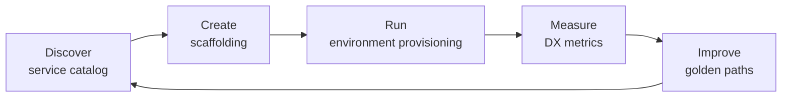

# 08 — Self-Service

How developers discover, create, and operate the things the platform offers without filing a ticket: the catalog of what exists, the templates that start new work, the environments that run it, and the metrics that show whether all of this actually helps.

## Reading Order

| # | Document | Summary |
|---|----------|---------|
| 1 | [Service Catalog](service-catalog.md) | Two catalogs (inventory and offerings), entity models, JSON Schema for offerings, and quality metrics |
| 2 | [Scaffolding](scaffolding.md) | Template engines, Copier updates for day-2 drift, a Go scaffolder, and CI tests for templates |
| 3 | [Environment Provisioning](environment-provisioning.md) | Preview and long-lived environments, the `Environment` API with TTLs, Argo CD PR generators, vCluster, and cost guardrails |
| 4 | [Developer Experience](developer-experience.md) | Feedback loops, DORA, SPACE, and DevEx, instrumenting the platform, and surveys that lead to decisions |

> The sequence matters. Catalog says *what can be requested*; scaffolding creates *the starting point*; environments give it *somewhere to run*; DX metrics tell you *whether the path is working*.

## The Self-Service Loop

## Scope and Boundaries

- **In scope:** catalog, templates, preview and long-lived environment lifecycle, feedback loop and DX measurement.
- **Defined elsewhere:** the portal UI ([07 — Internal Developer Platform](../07-internal-developer-platform/README.md)), the API that backs every action ([09 — Platform APIs](../09-platform-apis/README.md)), and policies that gate what self-service may create ([Policy Engine](../12-security-compliance/policy-engine.md)).

## Related Labs

- [Lab 04: Service Catalog](../../labs/lab-04-service-catalog/README.md) — scaffold services from the catalog templates
- [Lab 07: Multi-Tenancy](../../labs/lab-07-multi-tenancy/README.md) — tenant namespaces and quotas that environments draw from

## Related Code

- [`code/service-catalog/`](https://github.com/GitOpsHub/platform-engineering-on-kubernetes/tree/main/code/service-catalog/) — the template scaffolder (`catalog list`, `describe`, `scaffold`)
- [`code/environment-operator/`](https://github.com/GitOpsHub/platform-engineering-on-kubernetes/tree/main/code/environment-operator/) — the `Environment` reconciler with TTL expiry (its `cmd/` entry point is not in the repository yet)

## Where This Leads

- Previous section: [07 — Internal Developer Platform](../07-internal-developer-platform/README.md)

---

## Next Section

➡️ [09 — Platform APIs](../09-platform-apis/README.md)
