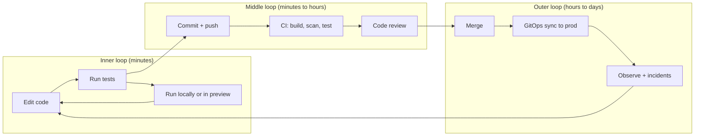

# Developer Experience: Metrics, Feedback Loops, and Surveys

## Learning Objectives
- Define developer experience (DX) in terms a platform team can act on, and separate it from developer productivity
- Apply the DORA metrics, the SPACE framework, and the DevEx framework to a platform, knowing what each one measures and misses
- Map feedback loops (inner, middle, outer) and find the slowest one in your own delivery path
- Design a developer survey that is short, anonymous, and tied to decisions
- Instrument the platform itself (Argo CD, CI, the portal, and the environment service) so metrics come from events, not opinions
- Avoid Goodhart's law: pick metrics that reward outcomes and cannot be gamed cheaply

## Prerequisites
- [Environment Provisioning](environment-provisioning.md) and [Scaffolding](scaffolding.md) — the paths whose experience you will measure
- [Measuring Success](../14-platform-evolution/measuring-success.md) — the platform-level outcome framework this document feeds into
- [Metrics Stack](../10-observability/metrics-stack.md) — Prometheus basics for the queries used below
- Basic statistics: medians, percentiles, and why averages mislead on skewed durations

---

## What Developer Experience Means

Developer experience is how it feels, and how much it costs, for an engineer to go from an idea to a change running in production and to keep it running. It covers the tools, the platform, the processes, and the people around them.

Three common confusions:

| Confusion | Reality |
|-----------|---------|
| "DX is developer happiness" | Happiness matters, but it is an outcome and a signal. Speed, friction, and cognitive load are the levers. |
| "DX is productivity" | Lines of code, commits, and story points measure activity, not value. Productivity is poorly defined at the individual level. |
| "DX is the portal" | The portal is one surface. Most DX lives in the inner loop (build, test, run locally) and in CI/CD. |

The platform's job is to make the **default path fast, safe, and boring**, and to make the non-default path possible. Measure both.



---

## Feedback Loops

A feedback loop is the time between an action and the signal that tells the developer whether the action was right. Shorter loops mean fewer context switches and fewer changes that pile up before anyone notices a problem.

| Loop | Typical signal | Target (guideline) | Platform levers |
|------|----------------|--------------------|-----------------|
| Inner: edit to test result | Unit tests, lint, type check | Under 30 s for the affected package | Test caching, cached dev containers, fast local runners |
| Inner: change to running service | Local dev server, hot reload, preview | Under 1 min | Telepresence-style dev loops, preview environments |
| Middle: push to CI verdict | Build, test, scan, sign | Under 10 min for PR feedback | Reusable workflows, build caches, parallel test shards |
| Middle: PR to review | Human review | Under 1 working day for first response | Ownership files, review bots, stale PR nudges |
| Outer: merge to production | GitOps sync and rollout | Under 30 min for a standard service | Automated promotion, progressive delivery, pre-merge checks |
| Outer: production change to signal | Dashboards, alerts, traces | Under 5 min to a usable graph | Standard telemetry from the golden path |

### Find the Slowest Loop

Teams often guess which loop is slow. Measure the median and p90 of each stage for the last 30 days, then fix the largest contributor.

```mermaid
gantt
    title Typical PR-to-production path (illustrative, p50)
    dateFormat  HH:mm
    axisFormat  %H:%M
    section Inner
    Local tests          :a1, 09:00, 3m
    section Middle
    CI build + test      :a2, after a1, 14m
    Waiting for review   :a3, after a2, 6h
    section Outer
    Merge to sync        :a4, after a3, 4m
    Rollout + bake       :a5, after a4, 25m
```



In this example the bottleneck is not CI; it is the six-hour review wait. A faster CI pipeline would save minutes; a review SLO saves hours. Platform teams often over-invest in the tooling the developers complain least about.

---

## The Frameworks

Three frameworks are commonly used. They answer different questions, so use more than one, and do not mix their numbers into a single score.

### DORA: Delivery Performance

The DORA (DevOps Research and Assessment) metrics measure the health of the software delivery system. They are the most widely used delivery metrics and have the strongest evidence linking them to organizational outcomes.

| Metric | Definition | Measure from |
|--------|-----------|--------------|
| Deployment frequency | How often production changes are deployed | Argo CD sync events, deploy records |
| Lead time for changes | Time from commit to running in production | Commit timestamp to successful production sync |
| Change failure rate | Share of deployments that cause a degraded service needing remediation | Deploy records joined with incidents or rollbacks |
| Time to restore service | Time from incident start to recovery | Incident tool or alert timeline |

Since 2021, DORA has also tracked **reliability** as a capability alongside these four. Treat it as a separate dimension rather than folding it into the others.

DORA is a **system** measure. Do not use it to rank individual engineers or teams against each other; the reports are explicit that cross-team comparison without context is misleading.

### SPACE: A Multi-Dimensional Model

SPACE (Forsgren, Storey, and colleagues, 2021) argues that productivity has five dimensions and that no single metric captures it:

| Dimension | Question | Example signals |
|-----------|----------|-----------------|
| **S**atisfaction and well-being | Do developers feel good about their work and tools? | Survey scores, retention, burnout indicators |
| **P**erformance | Are outcomes good? | Reliability, customer impact, quality |
| **A**ctivity | What is happening? | Deploys, PRs, reviews (counts; use with care) |
| **C**ommunication and collaboration | How well do people work together? | Review turnaround, cross-team PRs, documentation use |
| **E**fficiency and flow | Can people make progress without interruption? | Wait time, interruptions, time in build queues |

Activity metrics are the easiest to collect and the easiest to game. SPACE exists partly to stop teams from stopping at them.

### DevEx: Developer Experience Dimensions

The DevEx framework (Noda, Storey, Forsgren, and Greiler, 2023) focuses on the experience itself. It identifies three dimensions:

| Dimension | Meaning | Platform examples |
|-----------|---------|-------------------|
| **Feedback loops** | How quickly developers learn whether a change works | CI time, preview readiness, test speed |
| **Cognitive load** | How much must a developer hold in mind to do a task | Golden paths, one way to deploy, clear errors |
| **Flow state** | Whether developers can work uninterrupted | Fewer manual approvals, self-service access, fewer alerts |

The DevEx paper recommends pairing perceived measures (surveys) with system measures (telemetry). When they disagree, investigate: a team that reports slow CI but shows fast CI times may be waiting on approvals.

### DX Core 4

The DX team proposed a consolidated set of four metrics in 2024 that combine elements of the above: **speed** (diff-based throughput and lead time), **effectiveness** (developer-reported), **quality** (change failure rate and rework), and **impact** (time spent on work that matters). Use it as a summary only if your organization already has the underlying data. Otherwise start with DORA plus a short survey.

| Framework | Best for | Weakness |
|-----------|----------|----------|
| DORA | Comparing delivery health across systems | Says little about individual experience |
| SPACE | Balancing numbers with perception | Broad; hard to pick a small set |
| DevEx | Choosing platform investments | Survey-heavy if used alone |
| DX Core 4 | Executive summaries | Depends on a data pipeline you may not have |

---

## Instrumenting the Platform

Good DX metrics are a by-product of the platform's own events. If a developer must fill in a form to be counted, the numbers are wrong.

### Sources of Truth

| Source | Events worth recording | Notes |
|--------|------------------------|-------|
| Git provider | PR opened, first review, approved, merged | Use webhook or API; timestamps are the basis for lead time |
| CI system | Pipeline start, end, status, stage durations | Record queue time separately from run time |
| Argo CD | Sync start, sync result, health changes | `argocd_app_sync_total` is exposed on the Argo CD metrics endpoint |
| Environment service | Provisioning start, ready, expired, failed | Feeds the preview experience numbers |
| Portal and CLI | Actions taken, failures, time to first success | Use OpenTelemetry; no personal data in labels |
| Incident tool | Alert fired, acknowledged, resolved | Required for time to restore |

### Deployment Frequency and Change Failure Rate with PromQL

Argo CD's sync counter gives a good proxy for deployment frequency when every production change goes through GitOps.

```promql
# Successful production syncs per day, per tenant (label set depends on your Argo CD config)
sum by (name) (
  increase(argocd_app_sync_total{namespace="argocd", phase="Succeeded", dest_server="https://kubernetes.default.svc"}[1d])
)
```

Change failure rate needs rollback or incident data. A common proxy is "syncs followed by a rollback sync within one hour":

```promql
# Rollbacks as a share of successful syncs over 7 days (illustrative; rollbacks must be labelled)
sum(increase(platform_deploy_rollbacks_total[7d]))
/
sum(increase(argocd_app_sync_total{phase="Succeeded"}[7d]))
```

> Metric names above are examples. Check your exporter's actual names with `/metrics` before building dashboards on them. `platform_deploy_rollbacks_total` is not a built-in; you would emit it from your rollback automation.

### Computing Lead Time in Go

Lead time is the one DORA metric platform teams most often get wrong, because it needs two different timestamps from two different systems. Compute it from a joined record, not from averages of averages.

```go
// code/platform-cli/analytics/leadtime.go (illustrative)
package analytics

import (
	"sort"
	"time"
)

// Change links a merged commit to the production sync that shipped it.
type Change struct {
	CommittedAt time.Time // first commit on the PR branch, or the merge commit
	DeployedAt  time.Time // successful production sync that contains the commit
}

// LeadTimeStats summarizes lead time for a window of changes.
type LeadTimeStats struct {
	Count  int
	Median time.Duration
	P90    time.Duration
}

// LeadTime computes median and p90 lead time. Changes with a deploy before
// the commit (clock skew, backfill) are dropped rather than counted as zero.
func LeadTime(changes []Change) LeadTimeStats {
	durations := make([]time.Duration, 0, len(changes))
	for _, c := range changes {
		d := c.DeployedAt.Sub(c.CommittedAt)
		if d < 0 {
			continue
		}
		durations = append(durations, d)
	}
	if len(durations) == 0 {
		return LeadTimeStats{}
	}
	sort.Slice(durations, func(i, j int) bool { return durations[i] < durations[j] })

	return LeadTimeStats{
		Count:  len(durations),
		Median: percentile(durations, 0.50),
		P90:    percentile(durations, 0.90),
	}
}

// percentile uses nearest-rank on a sorted slice.
func percentile(sorted []time.Duration, p float64) time.Duration {
	idx := int(float64(len(sorted))*p+0.5) - 1
	if idx < 0 {
		idx = 0
	}
	if idx >= len(sorted) {
		idx = len(sorted) - 1
	}
	return sorted[idx]
}
```

Why medians and percentiles: lead times are heavily skewed. A single 40-day change averages in with twenty 1-hour changes and makes the mean useless. Report p50 and p90 and show the distribution.

---

## Surveys That Lead to Decisions

Telemetry tells you what happened. Surveys tell you why, and what developers think is hard. Both are needed.

### Principles

1. **Short.** Ten questions or fewer, answerable in under three minutes. Quarterly full survey; monthly one-question pulse.
2. **Anonymous, with a minimum group size.** Do not report results for groups below 5 or 10 respondents; they identify individuals.
3. **Tied to decisions.** Every question should map to a platform capability or a stated action. If you cannot say what you would do with the answer, drop the question.
4. **Closed loop.** Publish results and the actions taken within a month. Surveys that vanish into a void lower future response rates.
5. **Consistent wording.** Keep core questions identical across quarters so trends are meaningful.

### Example Core Questions

Use a 5-point agreement scale unless noted.

| # | Question | Dimension | Decision it informs |
|---|----------|-----------|---------------------|
| 1 | I can get a change from my laptop to a running environment without asking anyone for help. | Flow / cognitive load | Self-service gaps |
| 2 | I understand how to deploy and roll back my service. | Cognitive load | Documentation and golden paths |
| 3 | Waiting for CI or builds interrupts my work. | Feedback loops | CI investment |
| 4 | When something breaks in production, I can find the cause within a reasonable time. | Performance | Observability investment |
| 5 | The platform's errors tell me what to do next. | Cognitive load | Error message and CLI work |
| 6 | I can focus on my main work without frequent interruptions. | Flow state | Alert noise, approval steps |
| 7 | How many hours did you spend last week on tooling problems unrelated to your main task? (number) | Efficiency | Prioritizing friction work |
| 8 | What is the one thing that slows you down most? (free text, optional) | All | Backlog discovery |

Question 8 is the most valuable and the hardest to analyze. Tag the free-text answers into categories each quarter and count them; do not let the loudest answer set the roadmap.

### Survey Pitfalls

- **Leading questions.** "How much do you love the new portal?" produces inflated scores. Ask about the task, not the tool.
- **Survey fatigue.** A survey every week is ignored within a month.
- **Only asking developers who use the platform.** People who gave up on the platform are the most important respondents. Include a "I work around the platform" option.
- **Using one score as a target.** A satisfaction score of 4.2 that becomes a KPI will be inflated by managers. See Goodhart below.

---

## Goodhart's Law and Metric Design

"When a measure becomes a target, it ceases to be a good measure." Every DX metric can be gamed:

| Metric | How it gets gamed | Mitigation |
|--------|-------------------|------------|
| Deployment frequency | Split changes into tiny deploys with no value | Pair with change failure rate and lead time |
| Lead time | Commit late, after work is done offline | Measure from the first commit on the branch, not from PR open |
| Survey satisfaction | Managers coach responses | Anonymous, minimum group size, trend over absolute score |
| Preview count | Create previews nobody uses | Measure preview-hours with real traffic |
| Golden path adoption | Templates used but heavily modified | Measure drift from the template, not just use |

Practical rules:

1. **Use balanced sets.** At least one speed, one quality, and one perception metric.
2. **Measure teams and systems, not individuals.** Individual rankings destroy collaboration and invite gaming.
3. **Watch the distribution, not the mean.**
4. **Review metrics for perverse incentives** every quarter, the same way you review code.

---

## Putting It Together: A Quarterly DX Review

A repeatable review keeps the numbers useful:

1. **Pull the telemetry**: DORA-style delivery metrics, feedback loop medians and p90s, environment provisioning time, failed provisioning rate.
2. **Pull the survey**: core questions with trends, and the categorized free-text themes.
3. **Join them**: where a number moved, did the survey move? Where the survey complained, did telemetry show it?
4. **Pick two investments**: one from the slowest loop, one from the lowest-scoring survey dimension. Write the expected change before starting.
5. **Close the loop**: publish a one-page summary to developers with the actions and the expected measurement.

| Signal | Likely interpretation | First investment |
|--------|----------------------|------------------|
| CI p90 rising, survey "waiting" score low | Pipeline is the bottleneck | Build caching, test sharding |
| Lead time high, CI fast | Review or approval wait | Review SLOs, ownership, auto-merge rules |
| Deploys frequent, change failure rate rising | Rushing or weak tests | Progressive delivery, better pre-merge checks |
| Provisioning fast, preview usage low | Previews not useful for testing | Seeded data, faster feedback in the PR |
| Survey "cognitive load" low, docs traffic high | Golden path unclear | Better templates, error messages, one-page guides |

---

## Hands-On Exercise

Goal: produce a one-page DX baseline for one tenant.

1. **Pick a tenant and a 30-day window.** Choose a team with at least 10 production changes in the window.
2. **Collect lead times.** Export commit and sync timestamps (from your Git provider and Argo CD). Feed them to the `LeadTime` function above and record count, p50, and p90.
3. **Measure deployment frequency.** Use the PromQL above, adjusted to your label names, to get daily production syncs for the tenant.
4. **Measure one feedback loop.** Pull CI run durations for the last 30 days and report p50 and p90, separating queue time from run time.
5. **Run a 5-question pulse survey.** Use questions 1, 3, 5, 6, and 8 from the example set. Report results only if at least 5 people responded.
6. **Write the summary.** One page: three numbers, one trend, the slowest loop, and one proposed investment with the metric you expect to move.

**Success criteria:** every number has a stated source and window; the proposed investment names the metric it should move; nothing in the summary ranks individuals.

---

## Troubleshooting

| Symptom | Likely Cause | Fix |
|---------|--------------|-----|
| Lead times look impossibly short | Measured from merge, not first commit | Use the first commit on the branch; keep the merge timestamp as a separate field |
| Lead times negative for some changes | Backfilled deploys or clock skew across systems | Drop and count them; investigate if more than a few percent |
| Deployment frequency spikes on one day | Argo CD resync or drift correction counted as deploys | Count only syncs with a new revision, not refresh-only syncs |
| Survey response rate below 20% | Survey too long, or no visible follow-up from last time | Shorten to 5 questions; publish last quarter's actions first |
| Survey scores look too good | Managers present results, or groups are too small to be anonymous | Anonymous collection, minimum group size, third-party collection |
| Dashboards disagree with interviews | Telemetry measures a different path than developers use | Trace one real change end to end and compare |
| Metric improved after a target was announced | Goodhart: the measure was gamed | Add a balancing metric; reset the target |

---

## Further Reading

- [DORA: Four Key Metrics](https://dora.dev/guides/dora-metrics-four-keys/)
- [DORA State of DevOps reports](https://dora.dev/research/)
- Forsgren, Storey, Maddila, Zimmermann, Houck, Butler — [The SPACE of Developer Productivity (ACM Queue, 2021)](https://queue.acm.org/detail.cfm?id=3454124)
- Noda, Storey, Forsgren, Greiler — [DevEx: What Actually Drives Productivity (ACM Queue, 2023)](https://queue.acm.org/detail.cfm?id=3595878)
- [Argo CD metrics](https://argo-cd.readthedocs.io/en/stable/operator-manual/metrics/)
- [Accelerate: The Science of Lean Software and DevOps](https://itrevolution.com/product/accelerate/) — Forsgren, Humble, Kim
- [CNCF Platform Engineering Maturity Model](https://tag-app-delivery.cncf.io/whitepapers/platform-eng-maturity-model/)

---

## Next Steps

1. **Connect metrics to the platform's strategy**: [Measuring Success](../14-platform-evolution/measuring-success.md) and [Platform as a Product](../14-platform-evolution/platform-product.md)
2. **Improve the slowest loop**: [Scaffolding](scaffolding.md) for fast starts, [Environment Provisioning](environment-provisioning.md) for fast feedback
3. **Instrument what you run**: [Metrics Stack](../10-observability/metrics-stack.md) and [Tracing Stack](../10-observability/tracing-stack.md)
4. **Back the numbers with a catalog**: [Service Catalog](service-catalog.md) for ownership and scorecards
