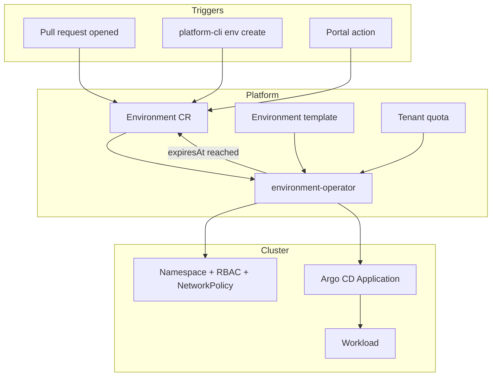
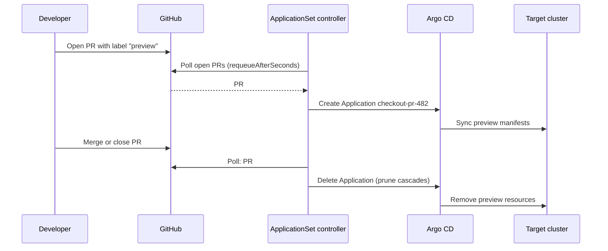

# Environment Provisioning: Ephemeral, Preview, and Long-Lived Environments

## Learning Objectives
- Distinguish long-lived (dev, staging, prod) environments from ephemeral (preview) environments and know when each is the right tool
- Model an environment as a Kubernetes API object (`Environment`) with a type, a TTL, and status the developer can read
- Implement TTL expiry with a controller that requeues at the exact expiry time instead of polling
- Generate one Argo CD `Application` per pull request with the ApplicationSet pull request generator
- Compare isolation levels: namespace, vCluster, and separate cluster, and choose by cost, risk, and blast radius
- Enforce cost guardrails (quotas, TTL caps, idle detection) so self-service does not become a cloud bill surprise

## Prerequisites
- [Service Catalog](service-catalog.md) — environments are offered as catalog items
- [Scaffolding](scaffolding.md) — new services arrive with a `Workload` and a preview manifest already in place
- [Argo CD Deep Dive](../05-gitops/argocd-deep-dive.md) — Applications, ApplicationSets, and sync policies
- [Kubernetes CRDs](../09-platform-apis/kubernetes-crds.md) and [Controller Runtime](../09-platform-apis/controller-runtime.md) — the `Environment` API and its controller are built there
- Kubernetes RBAC and ResourceQuota basics ([RBAC](../01-kubernetes-fundamentals/rbac.md))

---

## Why Environments Are a Platform Problem

Developers need somewhere to run code that is not their laptop and not production. Without a platform, that somewhere is a shared `dev` namespace that everyone overwrites, a staging cluster that drifts from production, or a ticket queue to a platform team that is the bottleneck for every test.

Self-service environment provisioning turns that into an API call or a pull request. The platform owns three things:

1. **Creation**: a consistent set of namespaces, RBAC, quotas, network policies, and GitOps wiring from a template
2. **Lifecycle**: when an environment expires, how it is updated, and what happens when its pull request closes
3. **Cost**: who pays for it, how long it may live, and how idle capacity is reclaimed



---

## Environment Types

| Type | Lifetime | Typical Owner | Data | Who can deploy | Isolation |
|------|----------|---------------|------|----------------|-----------|
| `preview` | Hours to days; tied to a PR | Feature author | Synthetic or seeded fixtures | Automation (CI on PR) | Namespace or vCluster |
| `dev` | Long-lived per team | Tenant team | Synthetic | Team members; GitOps | Namespace |
| `staging` | Long-lived; mirrors prod config | Tenant + platform | Anonymized snapshot | GitOps only | Namespace or dedicated cluster |
| `prod` | Long-lived | Tenant + platform | Real | GitOps only, with approvals | Dedicated cluster or namespace with strict policy |

The `type` field drives defaults: preview environments get the shortest TTL, the smallest quota, and no direct human write access; prod environments are never created through the preview path.

> **Rule of thumb:** ephemeral environments exist to answer "does this change work in a real cluster?" Long-lived environments exist to answer "does this work together with everything else?" Do not try to make one kind serve the other.

---

## The Environment API

The platform exposes environments as a namespaced custom resource in the shared API group `platform.mycompany.io/v1alpha1`. The developer writes `spec`; the controller writes `status`.

```yaml
# environment-checkout-pr-482.yaml
apiVersion: platform.mycompany.io/v1alpha1
kind: Environment
metadata:
  name: checkout-pr-482
  namespace: team-payments            # the tenant's control namespace
  labels:
    platform.mycompany.io/tenant: payments
    platform.mycompany.io/environment: preview
spec:
  tenant: payments                    # must match an existing Tenant
  type: preview                       # dev | staging | prod | preview
  ttl: 72h                            # expiry relative to creation (no per-type cap in code/ yet)
  template: baseline                  # the only template set embedded in the operator
  cluster: dev-eu-1                   # target cluster from the fleet inventory
```

The reference operator embeds one template set, `baseline`, under [`code/environment-operator/templates/baseline/`](https://github.com/GitOpsHub/platform-engineering-on-kubernetes/tree/main/code/environment-operator/templates/baseline/), with a subdirectory per type (`dev`, `preview`, `staging`, `prod`). An unknown set name, such as the `standard-web` example below, puts the Environment in `Failed` with reason `UnknownTemplate`. The operator also verifies `spec.tenant` against the `platform.mycompany.io/tenant` label on the Environment's own namespace, so `team-payments` must carry `platform.mycompany.io/tenant: payments`.

What the controller reports back:

```yaml
# status (written by environment-operator, abbreviated)
status:
  phase: Ready                        # Pending | Ready | Failed | Expired | Terminating
  namespace: payments-checkout-pr-482 # <tenant>-<name>
  url: https://checkout-pr-482.payments.apps.example.internal   # <name>.<tenant>.<base-domain>
  expiresAt: "2026-10-27T10:00:00Z"
  conditions:
    - type: TenantVerified
      status: "True"
      reason: Verified
    - type: NamespaceReady
      status: "True"
      reason: Provisioned
    - type: TemplatesReady
      status: "True"
      reason: Applied
      message: 3 baseline object(s) applied
    - type: Ready
      status: "True"
      reason: Reconciled
      message: environment is ready
      lastTransitionTime: "2026-10-24T10:00:03Z"
```

Design decisions worth noting:

- **`ttl` is a duration, `expiresAt` is a timestamp.** Users reason in durations; controllers reason in absolute times. Converting once at creation (and storing the result in status) means a changed TTL policy does not silently move every existing expiry. Changing `ttl` is handled explicitly (see the controller below).
- **`phase` is a summary; `conditions` are the detail.** This follows the convention in [Kubernetes CRDs](../09-platform-apis/kubernetes-crds.md#status-and-conditions). A UI or CLI can show `phase` in a column and drill into `conditions` when something is wrong.
- **`namespace` in status, not spec.** The developer should not choose the namespace name; the platform derives it so that names are unique across tenants and conform to DNS-1123.

---

## Templates: What an Environment Contains

An environment is more than a namespace. The template is the reviewed, versioned definition of what gets created. It is stored in Git and referenced by name, so a platform team can change the template in one place.

!!! note "Design material"
    The `standard-web` template below is a design sketch. The operator in this repository embeds only the `baseline` set: one `configmap.yaml.tmpl`, `networkpolicy.yaml.tmpl` and `resourcequota.yaml.tmpl` per type under `code/environment-operator/templates/baseline/<type>/`. It does not create an Argo CD `Application` and does not check the tenant's remaining budget.

```yaml
# standard-web template (illustrative; the schema is a design sketch, not a shipped format)
name: standard-web
version: 3
owned:
  - kind: Namespace
    nameTemplate: env-{{ .Tenant }}-{{ .Name }}
    labels:
      platform.mycompany.io/tenant: "{{ .Tenant }}"
      platform.mycompany.io/environment: "{{ .Type }}"
  - kind: ResourceQuota
    spec:
      hard:
        requests.cpu: "2"
        requests.memory: 4Gi
        pods: "20"
  - kind: NetworkPolicy
    name: default-deny-ingress
  - apiVersion: argoproj.io/v1alpha1     # Argo CD Application
    kind: Application
    source: "gitops/previews/{{ .Name }}"
```

Two rules keep templates maintainable:

1. **Templates reference, they do not inline.** A template should point at a `Workload` or a Helm release in Git, not paste a full Deployment. Otherwise every template change becomes a fleet-wide migration.
2. **Quota comes from two places.** The tenant's total budget lives on the `Tenant` ([Lab 07](../../labs/lab-07-multi-tenancy/README.md)); the per-environment quota comes from the template. The controller rejects an environment that would exceed the tenant's remaining budget, with a condition explaining why.

---

## The Environment Controller

The controller is a standard reconcile loop built with controller-runtime (see [Controller Runtime](../09-platform-apis/controller-runtime.md)). Its job for TTL is narrow: make sure every environment is deleted at `expiresAt`, and no earlier.

The reconciler in this repository, [`code/environment-operator/internal/controller/environment_controller.go`](https://github.com/GitOpsHub/platform-engineering-on-kubernetes/blob/main/code/environment-operator/internal/controller/environment_controller.go), already implements TTL expiry, `status.expiresAt`, `RequeueAfter` at the deadline, a cleanup finalizer and annotation-based ownership of the namespace and child objects. Its controller entry point is not in the repository yet (`code/environment-operator/cmd/` is empty), so you can test the reconciler but not run it as a process.

!!! note "Design sketch"
    The excerpts below are a design sketch and differ from the code in `internal/controller/`:

    - The real `Spec.TTL` is a `*metav1.Duration`, not a string, so there is no `time.ParseDuration` step.
    - The real code expires any Environment that sets `ttl`, including `staging` and `prod`; it does not skip those types.
    - There is no `maxTTL` cap and no validating webhook.
    - The file paths (`controllers/ttl.go`, `controllers/environment_controller.go`) and the `reconcileOwned` and `setCondition` helpers do not exist; the real helpers are `reconcileEnvironment`, `ensureNamespace`, `ensureOwned` and `finalize`.

The important design choice is **requeue at the deadline**, not poll on an interval. A 1-minute poll across 2,000 environments is 2,000 reconciles per minute doing nothing; a `RequeueAfter` set to the time remaining is one reconcile per environment per lifetime, plus the event-driven ones.

```go
// design sketch: controllers/ttl.go (not in code/environment-operator)
package controllers

import (
	"fmt"
	"time"

	platformv1alpha1 "github.com/mycompany/environment-operator/api/v1alpha1"
	metav1 "k8s.io/apimachinery/pkg/apis/meta/v1"
)

// maxTTL caps how long each environment type may live. Enforced in the
// reconciler (and, separately, in a validating webhook) so a missing or
// oversized ttl cannot create a permanent preview.
var maxTTL = map[platformv1alpha1.EnvironmentType]time.Duration{
	platformv1alpha1.TypePreview: 7 * 24 * time.Hour,
	platformv1alpha1.TypeDev:     30 * 24 * time.Hour,
	// staging and prod have no TTL; they are not expiring types.
}

// computeExpiry returns the absolute expiry for an environment, or nil when
// the environment type does not expire.
func computeExpiry(env *platformv1alpha1.Environment) (*metav1.Time, error) {
	if env.Spec.Type == platformv1alpha1.TypeStaging || env.Spec.Type == platformv1alpha1.TypeProd {
		return nil, nil
	}

	ttl, err := time.ParseDuration(env.Spec.TTL)
	if err != nil {
		return nil, fmt.Errorf("invalid ttl %q: %w", env.Spec.TTL, err)
	}
	if ttl <= 0 {
		return nil, fmt.Errorf("ttl must be positive, got %s", ttl)
	}
	if limit, ok := maxTTL[env.Spec.Type]; ok && ttl > limit {
		return nil, fmt.Errorf("ttl %s exceeds the %s limit of %s", ttl, env.Spec.Type, limit)
	}

	// Anchor to creation time, not "now": a requeue or a controller restart
	// must never extend an environment's life.
	exp := metav1.NewTime(env.CreationTimestamp.Add(ttl))
	return &exp, nil
}
```

The reconcile method uses the expiry to decide whether to delete now or wait:

```go
// design sketch: controllers/environment_controller.go (see internal/controller/ for the real code)
func (r *EnvironmentReconciler) Reconcile(ctx context.Context, req ctrl.Request) (ctrl.Result, error) {
	var env platformv1alpha1.Environment
	if err := r.Get(ctx, req.NamespacedName, &env); err != nil {
		return ctrl.Result{}, client.IgnoreNotFound(err)
	}

	// Deletion in progress: finalizer cleanup happens elsewhere in this method.
	if !env.DeletionTimestamp.IsZero() {
		return r.finalize(ctx, &env)
	}

	expiry, err := computeExpiry(&env)
	if err != nil {
		r.setCondition(&env, "Ready", metav1.ConditionFalse, "InvalidSpec", err.Error())
		return ctrl.Result{}, r.Status().Update(ctx, &env)
	}

	if expiry != nil {
		env.Status.ExpiresAt = expiry
		if time.Now().After(expiry.Time) {
			// Expired: delete. The Environment's own deletion drives cleanup of
			// owned objects through owner references and the finalizer.
			if err := r.Delete(ctx, &env); err != nil {
				return ctrl.Result{}, err
			}
			return ctrl.Result{}, nil
		}
	}

	if err := r.reconcileOwned(ctx, &env); err != nil {
		return ctrl.Result{}, err
	}

	if err := r.Status().Update(ctx, &env); err != nil {
		return ctrl.Result{}, err
	}

	if expiry != nil {
		// Wake exactly at expiry. Any earlier event still triggers a reconcile.
		return ctrl.Result{RequeueAfter: time.Until(expiry.Time)}, nil
	}
	return ctrl.Result{}, nil
}
```

Notes on this sketch:

- **Owner references only reach so far.** The Namespace is cluster-scoped, and a cluster-scoped object cannot have a namespaced owner, so the controller must delete it explicitly in a finalizer, along with anything outside the cluster such as DNS records. The real operator records ownership in the `platform.mycompany.io/owner-uid` annotation instead of owner references, checks it before adopting or deleting anything, and deletes the namespace in its finalizer. See [Controller Runtime: Finalizers](../09-platform-apis/controller-runtime.md#finalizers).
- **`ttl` changes** are reflected because the reconciler recomputes `expiry` from the spec every time. Extending a TTL is an explicit spec change, so it appears in Git and in the audit log.
- **`setCondition` and `reconcileOwned`** are omitted for brevity. They render the template's `owned` list and write the `Ready` condition.

---

## Preview Environments from Pull Requests

Most teams want the preview to appear automatically when a PR opens and disappear when it closes. Argo CD's **ApplicationSet pull request generator** does exactly that: it polls the Git provider for open PRs matching a filter and renders one `Application` per PR.



```yaml
# applicationset-checkout-previews.yaml
apiVersion: argoproj.io/v1alpha1
kind: ApplicationSet
metadata:
  name: checkout-previews
  namespace: argocd
spec:
  goTemplate: true
  goTemplateOptions: ["missingkey=error"]   # typos fail loudly instead of rendering ""
  generators:
    - pullRequest:
        github:
          owner: myorg
          repo: checkout
          tokenRef:
            secretName: github-token        # read-only token; stored as a Secret, managed by External Secrets
            key: token
          labels:
            - preview                       # only PRs labelled "preview" get environments
        requeueAfterSeconds: 120
  template:
    metadata:
      name: "checkout-pr-{{ .number }}"
      labels:
        platform.mycompany.io/tenant: payments
        platform.mycompany.io/environment: preview
    spec:
      project: previews                     # restricted AppProject: preview namespaces only
      source:
        repoURL: https://github.com/myorg/checkout.git
        targetRevision: "{{ .head_sha }}"   # deploy the exact commit, not the branch
        path: deploy/preview
        helm:
          parameters:
            - name: image.tag
              value: "{{ .head_sha }}"
      destination:
        server: https://kubernetes.default.svc
        namespace: "preview-{{ .branch_slug }}"
      syncPolicy:
        automated:
          prune: true
          selfHeal: true
        syncOptions:
          - CreateNamespace=true
```

Things to get right:

- **Pin `targetRevision` to `head_sha`.** Tracking the branch name means a force-push silently changes what is deployed, and the preview no longer matches the commit being reviewed.
- **Use `branch_slug` for namespaces.** Branch names contain `/` and uppercase letters; the slug is DNS-1123 safe. Long branch names can still exceed 63 characters, so keep the slug length check in your CI.
- **Use a restricted `AppProject`.** Previews should be able to create only the namespaces and kinds listed for previews. A preview PR from an external contributor must not be able to create a `ClusterRoleBinding`.
- **Fork PRs are a security boundary.** Do not generate previews for PRs from forks without a maintainer label. Otherwise untrusted code runs in your cluster with access to whatever the preview can reach.
- **The generator does not know about TTL.** It removes the Application when the PR closes, but a PR that stays open forever keeps its preview forever. That is why the `Environment` resource with a TTL is still needed as the backstop.

### Two Ways to Create the Same Preview

| Approach | Creates | Good for | Weak spot |
|----------|---------|----------|-----------|
| ApplicationSet PR generator | Argo CD `Application` per PR | Teams already on Argo CD; app-level previews | No built-in TTL or cost accounting |
| `Environment` CR (created by CI or the CLI) | Namespace, quota, policies, and the Application | Platform-owned lifecycle, quotas, and expiry | More moving parts; needs the operator |

In practice, combine them: CI creates an `Environment` with `type: preview` and a TTL; the environment controller creates the `Application` (or the ApplicationSet does, selected by template); the PR-close event and the TTL both lead to deletion. Either path alone leaves a gap.

---

## Isolation Options

Choosing how much each preview shares with others is the most consequential decision in this area.

| Option | Isolation | Startup time | Cost per env | Cluster-scoped resources | Typical use |
|--------|-----------|--------------|--------------|--------------------------|-------------|
| Namespace on a shared cluster | Low: shared API server, CRDs, nodes | Seconds | Lowest | Shared; cannot test CRD changes | Most previews; app-only changes |
| [vCluster](https://www.vcluster.com/docs) virtual cluster | Medium: own API server and control plane; shares nodes | 30–90 s | Low to medium | Virtual; isolated per env | Testing CRDs, operators, or RBAC changes |
| Dedicated cluster | High | Minutes | High | Full | Load tests, upgrades, compliance-sensitive prod-like tests |

### vCluster Example

vCluster runs a lightweight Kubernetes control plane inside a namespace of the host cluster and syncs workloads to the host. Use it when a preview must install its own CRDs or cluster-scoped objects.

```bash
# Create a virtual cluster for one preview, using the official Helm chart.
helm repo add loft https://charts.loft.sh
helm repo update

helm upgrade --install preview-checkout-pr-482 loft/vcluster \
  --namespace preview-checkout-pr-482 \
  --create-namespace \
  --version <pinned-chart-version> \
  --values vcluster-preview-values.yaml   # keep values minimal; pin the chart version

# Connect to the virtual cluster (kubeconfig written to a local file).
vcluster connect preview-checkout-pr-482 -n preview-checkout-pr-482 --update-current=false
```

Pin the chart version explicitly. vCluster evolves quickly, and a floating version turns "the preview works" into a moving target. Have the environment controller record the chart version in the `Environment` status so a support request can be reproduced (the reference operator in `code/` does not do this).

---

## Cost Guardrails

Self-service without guardrails is a budget leak. The platform should bound cost by construction, not by policy documents.

| Guardrail | Mechanism | Where enforced |
|-----------|-----------|----------------|
| Max lifetime per type | `maxTTL` map plus validating webhook (design only; not in `code/`) | Controller and admission |
| Max size per environment | ResourceQuota from template | Kubernetes API server |
| Max total per tenant | Tenant quota and environment count check | Controller (rejects with condition) |
| Idle reclamation | Scale-to-zero after N hours without traffic | Scheduled job or KEDA `ScaledObject` |
| Node pool isolation | Preview node pool with spot instances and taints | Cluster autoscaler or Karpenter `NodePool` |
| Cost attribution | Labels on every object; cloud cost allocation tags | Labels from the template |

### Idle Reclamation

Long-running previews that nobody opens are the most common waste. Scale them to zero when idle rather than deleting them, so a developer who returns on Monday does not lose their setup. Deletion is for expiry; scale-to-zero is for idleness.

```yaml
# keda-idle-scaledobject.yaml (preview Workload scaled by request rate)
apiVersion: keda.sh/v1alpha1
kind: ScaledObject
metadata:
  name: checkout-pr-482
  namespace: preview-checkout-pr-482
spec:
  scaleTargetRef:
    name: checkout
  minReplicaCount: 0          # scale to zero when idle
  maxReplicaCount: 2
  cooldownPeriod: 900         # seconds with no traffic before scaling to zero
  triggers:
    - type: prometheus
      metadata:
        serverAddress: http://prometheus.monitoring.svc:9090
        query: sum(rate(http_requests_total{namespace="preview-checkout-pr-482"}[10m]))
        threshold: "0.01"
```

> Scale-to-zero with KEDA requires the `Workload`'s traffic to pass through something KEDA can observe. If the preview is only reached through an ingress, measure at the gateway (see [API Gateway](../09-platform-apis/api-gateway.md)) rather than inside the pod.

---

## Developer Experience of Provisioning

The provisioning path is part of the product. Three properties matter most:

1. **Visible progress.** The developer sees `Pending → Ready` (or `Failed`) and the conditions when something stalls. Silence during a 60-second create is where developers start asking in chat.
2. **A stable URL.** The preview URL is written to `status.url` and posted back to the PR as a comment or check run. Developers should never have to look up a hostname.
3. **Predictable teardown.** The PR comment should say when the preview expires and how to extend it. Surprise deletion destroys trust faster than any outage.

The platform CLI (`code/platform-cli`) exposes the same flow without a UI. Environments are namespaced, so every command takes the namespace with `-n` (or `$PLATFORM_NAMESPACE`); `env` is an alias for `environment`:

```bash
platform-cli -n team-payments env create checkout-pr-482 --tenant payments --type preview --ttl 72h \
  --template baseline --cluster dev-eu-1

platform-cli -n team-payments env get checkout-pr-482   # status, conditions, expiresAt
platform-cli -n team-payments env list
platform-cli env list                                   # without -n: all namespaces
```

Extending or deleting an environment is a spec change, not a status write. Until the CLI grows those verbs, use `kubectl patch environment checkout-pr-482 -n team-payments --type merge -p '{"spec":{"ttl":"24h"}}'` (or a commit to the GitOps repo if the Environment is GitOps-managed). If extension were a status write, the GitOps history would no longer explain why the environment still exists.

---

## Operating Model

| Responsibility | Owner |
|----------------|-------|
| Template content and version | Platform team |
| TTL caps, quotas, and node pools | Platform team |
| Which PRs get previews, and preview seed data | Tenant team |
| Preview health and failed provisioning | Tenant on-call first, then platform |
| Cost reports per tenant | Platform team, reviewed with tenant leads |

Track these metrics for the environment service (see [Measuring Success](../14-platform-evolution/measuring-success.md) for the wider framework):

- **Time to ready** (p50, p95) per template
- **Failed provisioning rate** per template and cluster
- **Expired-with-activity rate**: previews that expired while still receiving traffic. A rising number means the TTL default is too short.
- **Spend per preview-hour** per tenant

---

## Hands-On Exercises

### Exercise 1: Validate an Environment and Test TTL Expiry

**Goal:** Install the `Environment` CRD, confirm the API server accepts a valid spec and rejects an invalid one, and confirm the TTL, expiry and template behaviour in the reconciler's unit tests.

**Before you start:** the kind cluster from [Lab 01](../../labs/lab-01-cluster-setup/README.md) and Go 1.26 or later (`code/environment-operator/go.mod` declares `go 1.26.0`). The controller entry point is not in the repository yet: `code/environment-operator/cmd/` is empty, so `make run`, `make build` and `make docker-build` fail. This exercise uses the CRD and the unit tests in [`internal/controller/environment_controller_test.go`](https://github.com/GitOpsHub/platform-engineering-on-kubernetes/blob/main/code/environment-operator/internal/controller/environment_controller_test.go), which run against a fake client and need no running controller.

1. **Install the CRD.**

   ```bash
   kubectl config use-context kind-platform-engineering
   make -C code/environment-operator install
   kubectl get crd environments.platform.mycompany.io
   ```

   Expected output: one row named `environments.platform.mycompany.io`.

2. **Validate a good spec.** Save the `Environment` manifest from this page as `environment-checkout-pr-482.yaml` (with `type: preview` and `template: baseline`), set `ttl: 5m`, and apply it with a server-side dry run. Create the labelled `team-payments` namespace first:

   ```bash
   kubectl create namespace team-payments --dry-run=client -o yaml | kubectl apply -f -
   kubectl label namespace team-payments platform.mycompany.io/tenant=payments --overwrite
   kubectl apply --dry-run=server -f environment-checkout-pr-482.yaml
   ```

   Expected output: `environment.platform.mycompany.io/checkout-pr-482 created (server dry run)`.

3. **Break it on purpose.** Set `type: bogus` and repeat the dry run. The CRD enum rejects it before any controller sees it:

   ```bash
   kubectl apply --dry-run=server -f environment-checkout-pr-482.yaml
   ```

   Expected output: `Unsupported value: "bogus": supported values: "dev", "staging", "prod", "preview"`. Set `type` back to `preview`.

4. **Run the reconciler tests for TTL, expiry and templates.**

   ```bash
   cd code/environment-operator
   go test ./internal/controller/ -v \
     -run 'TestTTLRequeuesUntilExpiry|TestExpiredEnvironmentIsDeleted|TestUnknownTemplateSetFails|TestRenderBaselinePerType'
   ```

   Expected output: four `--- PASS` lines and a final `ok` line for the `internal/controller` package. `TestTTLRequeuesUntilExpiry` shows the `RequeueAfter` set to the time left until `expiresAt`; `TestExpiredEnvironmentIsDeleted` shows the delete once the TTL has elapsed; `TestUnknownTemplateSetFails` shows the `UnknownTemplate` reason for a template set that does not exist, which is what `template: standard-web` would get.

5. **Stretch.** Add the ApplicationSet from this page to a test Argo CD instance, open a pull request with the `preview` label, and close it. Confirm the Application is removed.

**Check:**

- [ ] The server-side dry run accepts the `baseline` preview spec and rejects `type: bogus`.
- [ ] The four reconciler tests pass, including the requeue at `expiresAt` rather than at a poll interval.
- [ ] You can name what is missing before the operator can run in a cluster (the `cmd/` entry point).

---

## Troubleshooting

### Environment in `Failed` or Stuck in `Pending`

**Cause:** The `Ready` condition reason says which step failed: `TenantMismatch` (the Environment's namespace has no matching `platform.mycompany.io/tenant` label), `UnknownTemplate` (the `template` set does not exist), `InvalidNamespace`, `NamespaceConflict` or `ObjectConflict` (an object exists that the operator does not own), or `RenderFailed`. A phase that stays `Pending` with no conditions means no controller is reconciling the Environment.

**Fix:** Read `kubectl get environment <name> -n <namespace> -o jsonpath='{.status.conditions}'` and fix the spec or the conflicting object

### Preview deleted before the PR closed

**Cause:** Shorter TTL than expected; `expiresAt` computed from creation

**Fix:** Extend `ttl`. There is no per-type `maxTTL` default in `code/`; the expiry is always `creationTimestamp + ttl`

### Preview survives past `expiresAt`

**Cause:** Finalizer blocks deletion; external resource cleanup failing

**Fix:** `kubectl describe` for finalizers; check operator logs for the external API error

### ApplicationSet does not create an app for a PR

**Cause:** Missing `preview` label, fork PR, or token lacks `pull_requests:read`

**Fix:** Check labels, token scope, and ApplicationSet controller logs

### Application created but never syncs

**Cause:** `targetRevision` is a SHA that is not in the repo the controller can fetch

**Fix:** Verify repo credentials; check the Argo CD repo server logs

### `namespace` name too long

**Cause:** Branch slug plus prefix exceeds 63 characters

**Fix:** Truncate the slug with a stable hash suffix in the template

### Preview scales to zero while in use

**Cause:** Cooldown too short, or traffic bypasses the measured path

**Fix:** Lengthen `cooldownPeriod`; measure at the gateway

### Cost spike from previews

**Cause:** No TTL cap, or many PRs labelled `preview`

**Fix:** Add a TTL cap (the `maxTTL` design above; not in `code/`); reduce the template's quota; check the label policy


---

## Further Reading

- [Argo CD ApplicationSet: Pull Request Generator](https://argo-cd.readthedocs.io/en/stable/operator-manual/applicationset/Generators-Pull-Request/)
- [Argo CD ApplicationSet: Go templates](https://argo-cd.readthedocs.io/en/stable/operator-manual/applicationset/GoTemplate/)
- [vCluster documentation](https://www.vcluster.com/docs)
- [KEDA: Prometheus scaler](https://keda.sh/docs/scalers/prometheus/)
- [Kubernetes Owner References and Garbage Collection](https://kubernetes.io/docs/concepts/architecture/garbage-collection/)
- [Namespace-as-a-Service pattern (Kubernetes multi-tenancy working group)](https://github.com/kubernetes-sigs/hierarchical-namespaces)
- [Lab 07: Multi-Tenancy](../../labs/lab-07-multi-tenancy/README.md)

---

## Next Steps

1. **Measure the experience**: [Developer Experience](developer-experience.md) — feedback loops and DX metrics for provisioning
2. **Build the API behind it**: [Kubernetes CRDs](../09-platform-apis/kubernetes-crds.md) and [Controller Runtime](../09-platform-apis/controller-runtime.md)
3. **Protect the namespaces**: [Network Policies](../03-networking-fundamentals/network-policies.md) and [Policy Engine](../12-security-compliance/policy-engine.md)
4. **Practice**: [Lab 03: Platform API](../../labs/lab-03-platform-api/README.md) (a CRD and controller walkthrough) and [Lab 07: Multi-Tenancy](../../labs/lab-07-multi-tenancy/README.md)
