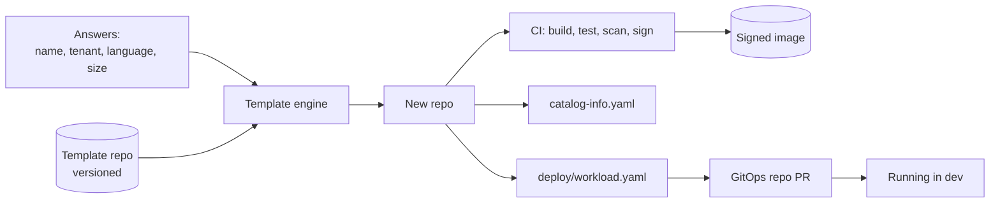
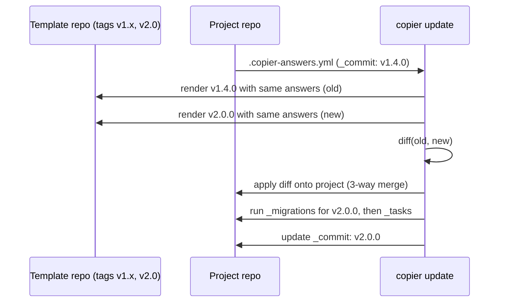
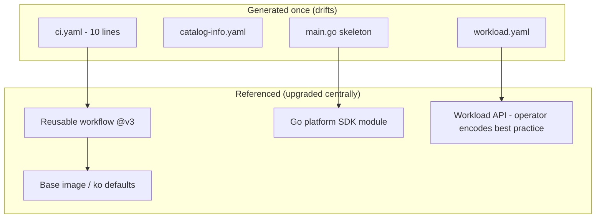

# Scaffolding: Templates, Engines, and Golden Paths

## Learning Objectives
- Understand what scaffolding should (and should not) generate for a platform golden path
- Compare template engines (Go `text/template`, Jinja2, Nunjucks) and tools (Cookiecutter, Copier, Backstage Scaffolder, `gonew`)
- Write a Copier template with questions, validation, tasks, and **updates** for day-2 drift
- Build a Go scaffolder (`code/service-catalog/templates`) that renders file trees from `embed.FS`
- Test templates in CI: render matrix, build, lint, and policy checks
- Minimize long-term drift by moving shared logic out of templates into versioned dependencies

## Prerequisites
- [Service Catalog](service-catalog.md)
- [Backstage Software Templates](../07-internal-developer-platform/backstage.md#software-templates-the-scaffolder)
- Go 1.22+; Python tooling via [uv](https://docs.astral.sh/uv/) for Copier/Cookiecutter
- Git and GitHub Actions basics

---

## What Scaffolding Is For

Scaffolding turns a few answers into a working starting point: a repo that builds, deploys to a dev environment, and is observable — on day one.



| Should generate | Should *not* generate (reference instead) |
|-----------------|-------------------------------------------|
| Service skeleton with health endpoints | Copies of shared libraries |
| `catalog-info.yaml` with owner and tenant | Full CI pipeline logic (use reusable workflows) |
| `deploy/workload.yaml` (a `Workload`, not raw Deployments) | Base Dockerfile logic (use a shared base image) |
| Minimal CI that *calls* shared workflows | Dashboards JSON (generate from labels) |
| `README.md`, `docs/`, `mkdocs.yml` | Org-wide lint config (reference a shared package) |
| `CODEOWNERS` | Secrets of any kind |

> **The day-2 problem:** a template is copied once, then the output diverges forever. Every line you generate is a line you can't upgrade centrally. Generate *references* to versioned things (reusable workflows, base images, libraries, the `Workload` API) rather than the things themselves.

---

## Template Engines

| Engine | Language | Used by | Strengths | Gotchas |
|--------|----------|---------|-----------|---------|
| Go `text/template` | Go | Helm, `code/service-catalog`, kubebuilder | Fast, no deps, strict `missingkey=error` | Clunky syntax, conflicts with `{{ }}` in Helm/GH Actions files |
| Jinja2 | Python | Cookiecutter, Copier, Ansible | Rich filters, inheritance | Python dependency; `{{ }}` conflicts too |
| Nunjucks | JavaScript | Backstage Scaffolder | Jinja-like; Backstage-native filters | Backstage uses `${{ }}` delimiters |
| Handlebars | JavaScript | Yeoman, Plop | Logic-less, simple | Limited logic |

### Delimiter Collisions

Generated files often contain their *own* templating (Helm charts, GitHub Actions `${{ }}`, Go templates). Handle it explicitly:

```yaml
# Jinja2 (Copier/Cookiecutter): wrap literal blocks in raw
# template/.github/workflows/ci.yaml.jinja
name: CI
on: [push, pull_request]
jobs:
  build:
    uses: myorg/platform-workflows/.github/workflows/go-service.yaml@v3
    with:
      service-name: {{ project_name }}

      image-tag: ${{ github.sha }}

```

```go
// Go text/template: change delimiters for a template that renders Helm/Go templates
t := template.New("chart").Delims("[[", "]]")
```

Backstage's Nunjucks uses `${{ values.x }}`, so `{{ }}` in skeleton files passes through untouched — but GitHub Actions' `${{ }}` does not. Use `copyWithoutTemplating` (or `copyWithoutRender` in older versions) in `fetch:template` for those paths.

---

## Tool Comparison

| Tool | Engine | Interactive prompts | Day-2 updates | Hooks | Best for |
|------|--------|---------------------|---------------|-------|----------|
| **Cookiecutter** | Jinja2 | Yes | Via `cruft` | pre/post gen (Python/shell) | Simple, widely known |
| **Copier** | Jinja2 | Yes, with validators | **Native `copier update`** (3-way merge) | `_tasks`, `_migrations` | Long-lived templates |
| **Backstage Scaffolder** | Nunjucks | Web forms | No (re-run produces PRs only via custom flows) | Steps/actions | Portal-driven golden paths |
| **`gonew`** | none (module rewrite) | No | No | No | Go starter from a module |
| **kubebuilder / operator-sdk** | Go | CLI flags | Partial (`kubebuilder alpha generate`) | Plugins | Operators |
| **Custom Go scaffolder** | `text/template` | Via CLI/API | Your design | Your design | Embedding in platform API/CLI |

A common combination: **Copier** owns the template content (testable, updatable), and the **Backstage Scaffolder** or `platform-cli` is the front-end that runs it.

---

## Copier: Templates That Can Be Updated

### Template Layout

```text
platform-templates/go-service/
├── copier.yml                     # questions, settings, tasks
├── template/                      # _subdirectory: what gets rendered
│   ├── {{_copier_conf.answers_file}}.jinja
│   ├── go.mod.jinja
│   ├── cmd/{{project_name}}/main.go.jinja
│   ├── internal/server/server.go
│   ├── catalog-info.yaml.jinja
│   ├── deploy/workload.yaml.jinja
│   ├── .github/workflows/ci.yaml.jinja
│   ├── CODEOWNERS.jinja
│   ├── docs/index.md.jinja
│   └── mkdocs.yml.jinja
└── tests/
    └── render_test.sh
```

### `copier.yml`

```yaml
# platform-templates/go-service/copier.yml
_min_copier_version: "9.0.0"
_subdirectory: template
_answers_file: .copier-answers.yml
_templates_suffix: .jinja

project_name:
  type: str
  help: Service name (DNS-compatible; used for repo, Workload, catalog)
  validator: >-
    
    Must be lowercase letters, digits, and dashes (4-32 chars)
    

tenant:
  type: str
  help: Platform tenant that owns this service
  choices: [payments, search, identity, platform]

owner_team:
  type: str
  default: "team-{{ tenant }}"

go_module:
  type: str
  default: "github.com/myorg/{{ project_name }}"

size:
  type: str
  help: Initial Workload size
  choices: [small, medium, large]
  default: small

public:
  type: bool
  help: Expose via the public gateway?
  default: false

# Run after copy and after update (inside the generated project)
_tasks:
  - "go mod tidy"
  - command: "git init -b main"
    when: "{{ _copier_operation == 'copy' }}"

# Migrations run during `copier update` when crossing versions
_migrations:
  - version: v2.0.0
    command: "rm -f Dockerfile"   # v2 moved to shared base image via ko
```

### Templated Files

```yaml
# template/deploy/workload.yaml.jinja
apiVersion: platform.mycompany.io/v1alpha1
kind: Workload
metadata:
  name: {{ project_name }}
  namespace: {{ tenant }}-dev
  labels:
    platform.mycompany.io/tenant: {{ tenant }}
    platform.mycompany.io/environment: dev
    backstage.io/kubernetes-id: {{ project_name }}
    app.kubernetes.io/name: {{ project_name }}
spec:
  image: ghcr.io/myorg/{{ project_name }}:latest   # CI pins the digest in the GitOps repo
  port: 8080
  size: {{ size }}
  expose:
    public: {{ public | lower }}

    host: {{ project_name }}.dev.mycompany.io

```

```yaml
# template/.github/workflows/ci.yaml.jinja
# Thin wrapper: all logic lives in the versioned reusable workflow
name: CI
on:
  push: { branches: [main] }
  pull_request:
jobs:
  service:
    uses: myorg/platform-workflows/.github/workflows/go-service.yaml@v3
    with:
      service-name: {{ project_name }}
      tenant: {{ tenant }}
    secrets: inherit
```

```yaml
# template/{{_copier_conf.answers_file}}.jinja
# Changes here will be overwritten by Copier; do not edit manually
{{ _copier_answers | to_nice_yaml }}
```

### Using It

```bash
# Generate (uvx runs Copier in an ephemeral environment)
uvx copier copy --trust gh:myorg/platform-templates/go-service ./orders-api \
  --data project_name=orders-api --data tenant=payments --data size=small

# Later: pull template improvements into the existing repo (3-way merge)
cd orders-api
uvx copier update --trust --skip-answered
git diff        # review; conflicts are left as inline markers or .rej files
```

> `--trust` is required because the template defines `_tasks` and `_migrations`. Only trust templates you control.



Automate updates with a scheduled workflow that opens PRs across all generated repos (or let Renovate handle the `copier` manager).

---

## Cookiecutter (for Comparison)

```json
// cookiecutter.json
{
  "project_name": "my-service",
  "tenant": ["payments", "search", "identity"],
  "size": ["small", "medium", "large"],
  "public": "n"
}
```

```python
# hooks/pre_gen_project.py - validate before rendering
import re
import sys

name = "{{ cookiecutter.project_name }}"
if not re.match(r"^[a-z][a-z0-9-]{2,30}[a-z0-9]$", name):
    print(f"ERROR: {name!r} is not a valid DNS-compatible service name")
    sys.exit(1)
```

```bash
uvx cookiecutter gh:myorg/cookiecutter-go-service --no-input project_name=orders-api tenant=payments
# Day-2 updates require cruft:
uvx cruft create gh:myorg/cookiecutter-go-service
uvx cruft update
```

---

## A Go Scaffolder for the Platform

When scaffolding must run inside the platform API or CLI (no Python, no Node), a small Go renderer over `embed.FS` is enough. It renders both file *contents* and file *paths*.

```go
// code/service-catalog/templates/scaffold.go
package templates

import (
	"bytes"
	"embed"
	"fmt"
	"io/fs"
	"os"
	"path/filepath"
	"strings"
	"text/template"

	"github.com/Masterminds/sprig/v3"
)

//go:embed all:go-service
var builtin embed.FS

// Values are the answers collected by CLI flags, API body, or portal form.
type Values map[string]any

// Scaffold renders template dir `name` into outDir.
// Files ending in .tmpl are rendered and the suffix stripped; others are copied verbatim.
// Path segments may contain templates too, e.g. cmd/{{ .name }}/main.go.tmpl
func Scaffold(name, outDir string, v Values) ([]string, error) {
	root, err := fs.Sub(builtin, name)
	if err != nil {
		return nil, err
	}
	funcs := sprig.TxtFuncMap() // upper, lower, kebabcase, default, ...
	var written []string

	err = fs.WalkDir(root, ".", func(p string, d fs.DirEntry, err error) error {
		if err != nil || d.IsDir() {
			return err
		}
		// 1. Render the path itself
		renderedPath, err := renderString("path:"+p, p, v, funcs)
		if err != nil {
			return err
		}
		dst := filepath.Join(outDir, filepath.FromSlash(strings.TrimSuffix(renderedPath, ".tmpl")))

		// 2. Prevent path traversal from malicious values (e.g. name="../../etc")
		if !strings.HasPrefix(filepath.Clean(dst), filepath.Clean(outDir)+string(os.PathSeparator)) {
			return fmt.Errorf("refusing to write outside %s: %s", outDir, dst)
		}

		raw, err := fs.ReadFile(root, p)
		if err != nil {
			return err
		}
		out := raw
		if strings.HasSuffix(p, ".tmpl") {
			s, err := renderString(p, string(raw), v, funcs)
			if err != nil {
				return err
			}
			out = []byte(s)
		}
		if err := os.MkdirAll(filepath.Dir(dst), 0o755); err != nil {
			return err
		}
		if err := os.WriteFile(dst, out, 0o644); err != nil {
			return err
		}
		written = append(written, dst)
		return nil
	})
	return written, err
}

func renderString(name, text string, v Values, funcs template.FuncMap) (string, error) {
	t, err := template.New(name).Funcs(funcs).Option("missingkey=error").Parse(text)
	if err != nil {
		return "", fmt.Errorf("parse %s: %w", name, err)
	}
	var buf bytes.Buffer
	if err := t.Execute(&buf, v); err != nil {
		return "", fmt.Errorf("render %s: %w", name, err)
	}
	return buf.String(), nil
}
```

> **Always validate inputs before rendering.** Use the offering's JSON Schema from [Service Catalog](service-catalog.md) — a regex on `name` is your first defense against path traversal and YAML injection.

```go
// code/service-catalog/templates/go-service/cmd/{{ .name }}/main.go.tmpl
package main

import (
	"log/slog"
	"net/http"
	"os"
)

func main() {
	logger := slog.New(slog.NewJSONHandler(os.Stdout, nil)).With("service", "{{ .name }}")
	mux := http.NewServeMux()
	mux.HandleFunc("GET /healthz", func(w http.ResponseWriter, _ *http.Request) { w.WriteHeader(http.StatusOK) })
	mux.HandleFunc("GET /readyz", func(w http.ResponseWriter, _ *http.Request) { w.WriteHeader(http.StatusOK) })
	mux.HandleFunc("GET /", func(w http.ResponseWriter, _ *http.Request) { _, _ = w.Write([]byte("hello from {{ .name }}\n")) })

	logger.Info("listening", "addr", ":8080")
	if err := http.ListenAndServe(":8080", mux); err != nil {
		logger.Error("server exited", "err", err)
		os.Exit(1)
	}
}
```

The CLI front-end is **planned**: `platform-cli` has no `service create` command yet, so this shows the intended interface:

```bash
platform-cli service create orders-api --tenant payments --size small --out ./orders-api   # planned
```

---

## Testing Templates in CI

Templates are code. Break them and every new service starts broken.

```yaml
# platform-templates/.github/workflows/test-templates.yaml
name: Test templates
on: [pull_request]
jobs:
  render:
    runs-on: ubuntu-latest
    strategy:
      matrix:
        tenant: [payments, search]
        size: [small, large]
        public: [true, false]
    steps:
      - uses: actions/checkout@v4
      - uses: astral-sh/setup-uv@v6
      - uses: actions/setup-go@v5
        with: { go-version: '1.23' }

      - name: Render
        run: |
          uvx copier copy --trust --defaults --vcs-ref HEAD . /tmp/out \
            --data project_name=ci-test-svc \
            --data tenant=${{ matrix.tenant }} \
            --data size=${{ matrix.size }} \
            --data public=${{ matrix.public }}

      - name: Build and test generated service
        working-directory: /tmp/out
        run: |
          go vet ./...
          go test ./...
          go build ./...

      - name: Validate manifests against platform CRDs
        run: |
          # kubeconform with CRD schemas generated from the operators' CRDs
          kubeconform -strict -summary \
            -schema-location default \
            -schema-location 'schemas/{{ .Group }}/{{ .ResourceKind }}_{{ .ResourceAPIVersion }}.json' \
            /tmp/out/deploy/

      - name: Policy check
        run: kyverno apply ./policies/ --resource /tmp/out/deploy/workload.yaml
```

| Test layer | Catches |
|------------|---------|
| Render matrix | Jinja/Go template errors for each answer combination |
| Build/test generated project | Broken code, missing deps |
| Schema validation (`kubeconform`) | `Workload` fields that don't exist in the CRD |
| Policy (`kyverno apply` / `conftest`) | Violations the admission controller would reject |
| Golden files | Unintended diffs in rendered output |

---

## Reducing Drift: Generate Less



| Strategy | Mechanism | Upgrade path |
|----------|-----------|--------------|
| Reusable CI | `uses: org/workflows/...@v3` | Bump tag (Renovate) |
| Shared libraries | Go module / npm package | Dependabot/Renovate |
| Platform API | `Workload` instead of Deployment YAML | Operator release; no repo changes |
| Template updates | `copier update` | Automated PRs |
| Scorecards | Detect old template versions via `.copier-answers.yml` `_commit` | Nudge owners |

---

## Hands-On Exercise

### Lab: Build, Test, and Update a Copier Template

1. **Create** the `go-service` Copier template from this doc in a scratch repo; tag it `v1.0.0`.
2. **Generate** a service:
   ```bash
   uvx copier copy --trust ./platform-templates/go-service ./orders-api \
     --data project_name=orders-api --data tenant=payments
   cd orders-api && go run ./cmd/orders-api &
   curl -s localhost:8080/healthz -o /dev/null -w '%{http_code}\n'   # 200
   ```
3. **Validate** the generated `Workload` against your cluster from [Lab 03](../../labs/lab-03-platform-api/README.md):
   ```bash
   kubectl apply --dry-run=server -f deploy/workload.yaml
   ```
4. **Evolve the template**: add a `readinessProbePath` question and use it in `main.go.jinja`; tag `v1.1.0`.
5. **Update** the generated project and resolve any conflicts:
   ```bash
   cd orders-api && git add -A && git commit -m "initial"
   uvx copier update --trust --skip-answered --data readinessProbePath=/readyz
   git diff
   ```
6. **Bonus**: implement the Go scaffolder and make the planned `platform-cli service create` produce the same output as Copier for the same answers (compare with `diff -r`).

#### Verification
- [ ] Generated service builds, runs, and serves `/healthz`
- [ ] `copier update` applies template changes without overwriting your local edits
- [ ] CI matrix renders all combinations successfully

---

## Troubleshooting

| Symptom | Likely Cause | Fix |
|---------|--------------|-----|
| `${{ github.sha }}` rendered as empty string | Jinja/Nunjucks consumed the expression | Wrap in `` or exclude path from templating |
| `copier update` says "no changes" | Answers file missing or `_commit` not a tag | Commit `.copier-answers.yml`; tag template releases |
| Many conflicts on update | Generated files heavily customized | Generate less; move logic into referenced workflows/libraries |
| Tasks don't run | `--trust` not passed | Pass `--trust` for templates you own |
| `map has no entry for key "name"` (Go) | Missing value with `missingkey=error` | Validate inputs against schema; supply defaults |
| Generated YAML invalid when value has `:` | Unquoted interpolation | Quote values or use a `toYaml`/`quote` filter |
| File written outside target dir | Unvalidated path input | Validate names; check rendered path prefix (see scaffolder) |

---

## Further Reading

- [Copier documentation](https://copier.readthedocs.io/)
- [Cookiecutter](https://cookiecutter.readthedocs.io/) and [cruft](https://cruft.github.io/cruft/)
- [Backstage Writing Templates](https://backstage.io/docs/features/software-templates/writing-templates)
- [Go text/template](https://pkg.go.dev/text/template) and [sprig](https://masterminds.github.io/sprig/)
- [gonew](https://go.dev/blog/gonew)
- [GitHub reusable workflows](https://docs.github.com/actions/using-workflows/reusing-workflows)

---

## Next Steps

1. **Give scaffolded services somewhere to run**: [Environment Provisioning](environment-provisioning.md)
2. **Measure golden path adoption**: [Developer Experience](developer-experience.md)
3. **Front it with a portal**: [Backstage](../07-internal-developer-platform/backstage.md)
4. **Practice**: [Lab 04: Service Catalog](../../labs/lab-04-service-catalog/README.md)
