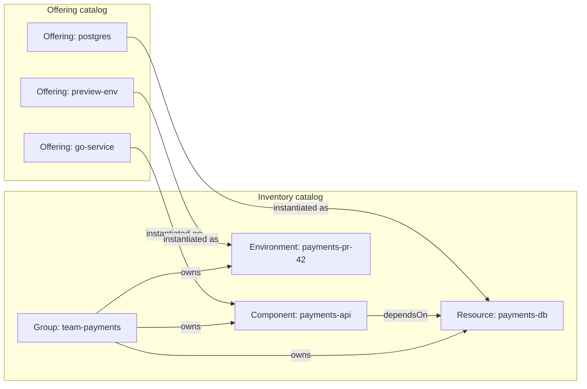
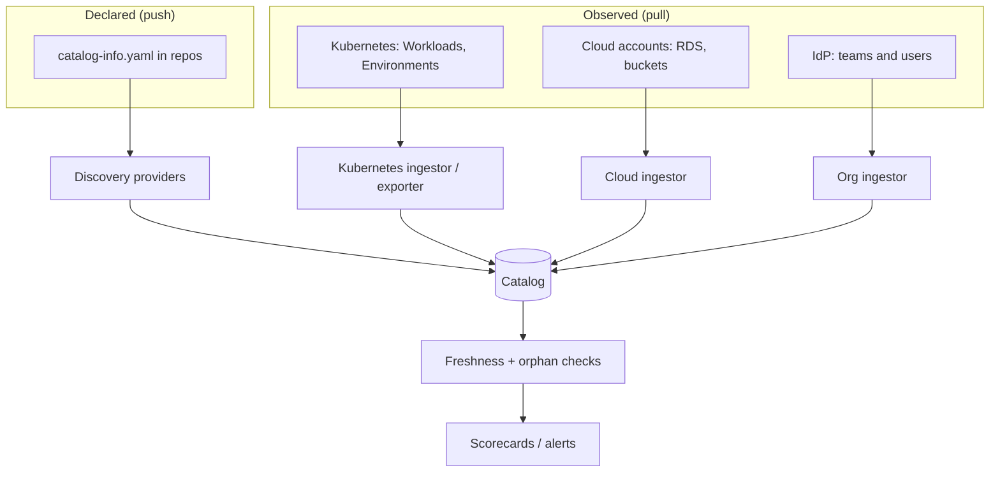
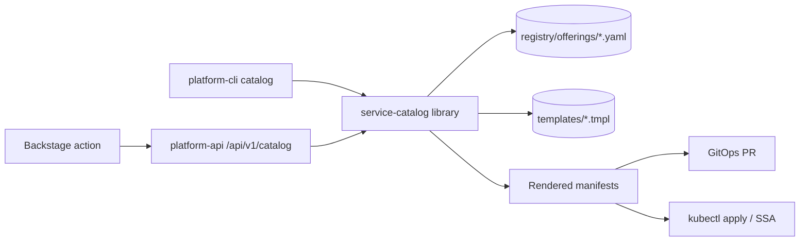

# Service Catalog Patterns

## Learning Objectives
- Distinguish the two catalogs every platform needs: an **inventory catalog** ("what exists, who owns it") and an **offering catalog** ("what can I request")
- Design a catalog entity model with ownership, lifecycle, and dependency relations
- Keep the catalog accurate with discovery, reconciliation from Kubernetes, and freshness checks
- Implement an offering catalog in Go (`code/service-catalog`) with JSON Schema inputs and rendered platform resources
- Expose offerings through Kubernetes-native APIs (CRDs, Crossplane claims) rather than tickets
- Measure catalog quality (coverage, ownership, freshness)

## Prerequisites
- [Backstage](../07-internal-developer-platform/backstage.md) (Software Catalog basics)
- [Platform Capabilities](../07-internal-developer-platform/platform-capabilities.md)
- Go 1.22+ for the code examples
- [Crossplane](../04-infrastructure-as-code/crossplane.md) (helpful for data-service offerings)

---

## Two Catalogs, One Graph

The term "service catalog" is overloaded. Platforms need both meanings:

| | Inventory catalog | Offering catalog |
|-|-------------------|------------------|
| Question answered | "What runs here, who owns it, what depends on it?" | "What can I get from the platform, and how?" |
| Entries | Components, APIs, Resources, Systems, Teams | Offerings: Postgres, Redis, preview env, new Go service |
| Source of truth | Git repos, Kubernetes, cloud accounts | Platform team's offering definitions |
| Consumers | On-call, security, architects, new joiners | Developers starting work |
| Example tools | Backstage catalog, Port, Cortex, OpsLevel | Backstage templates, Port actions, Crossplane XRDs |
| Failure mode | Stale, incomplete, orphaned entries | Ticket queue disguised as a form |



> **Key insight:** every offering instantiation should automatically appear in the inventory with the right owner. If someone has to register it manually afterwards, the inventory will drift.

---

## The Inventory Catalog

### Entity Model

Use the Backstage model (or an equivalent) even if you don't run Backstage — it is a well-tested vocabulary.

| Kind | Required metadata | Key relations |
|------|-------------------|---------------|
| `Component` | name, owner, lifecycle, type | `partOf` System, `providesApi`, `consumesApi`, `dependsOn` |
| `API` | name, owner, type, definition | `providedBy`, `consumedBy` |
| `Resource` | name, owner, type | `dependencyOf` |
| `System` | name, owner | `hasPart`, `partOf` Domain |
| `Group` | name, type, parent | `ownerOf`, `hasMember` |

### Ownership Rules

Ownership is the single most valuable field in the catalog. Enforce it:

1. **Owner is a team, never a person.** People leave; teams are reassigned.
2. **Owner must exist** as a `Group` entity (validated at ingestion).
3. **Owner must match the platform tenant.** A `Component` annotated `platform.mycompany.io/tenant: payments` must be owned by `group:team-payments` or a child group.

A Kyverno policy can enforce the tenant label on platform resources at admission (see [Policy Engine](../12-security-compliance/policy-engine.md)); CI can enforce it on `catalog-info.yaml`:

```bash
#!/usr/bin/env bash
# ci/validate-catalog-info.sh - fail the build if ownership is missing or inconsistent
set -euo pipefail
FILE=${1:-catalog-info.yaml}

# yq v4: iterate documents, check owner and tenant annotation
yq eval-all -e '
  select(.kind == "Component" or .kind == "Resource" or .kind == "API")
  | select(.spec.owner == null or (.spec.owner | test("^group:") | not))
' "$FILE" >/dev/null 2>&1 && {
  echo "ERROR: every Component/Resource/API needs spec.owner of the form group:<team>"
  exit 1
}

TENANT=$(yq eval 'select(.kind=="Component") | .metadata.annotations["platform.mycompany.io/tenant"]' "$FILE" | head -1)
OWNER=$(yq eval 'select(.kind=="Component") | .spec.owner' "$FILE" | head -1)
if [[ "$OWNER" != "group:team-${TENANT}"* ]]; then
  echo "ERROR: owner ${OWNER} does not match tenant ${TENANT}"
  exit 1
fi
echo "catalog-info.yaml OK"
```

### Keeping the Inventory Accurate



| Technique | Detects | Implementation |
|-----------|---------|----------------|
| Git discovery | New/archived repos | Backstage GitHub provider, scheduled |
| Kubernetes ingestion | Running Workloads without catalog entries | Entity provider over `workloads.platform.mycompany.io` |
| Org sync | Teams renamed/removed | Microsoft Graph / LDAP / GitHub org providers |
| Orphan check | Entities whose owner group no longer exists | Nightly job, scorecard rule |
| Freshness check | Entities not refreshed in N days | Compare `metadata.annotations["backstage.io/source-location"]` last refresh |

Cross-check that every running `Workload` is in the catalog:

```bash
# Workloads in the cluster
kubectl get workloads -A -o json \
  | jq -r '.items[] | .metadata.labels["backstage.io/kubernetes-id"] // .metadata.name' | sort -u > running.txt

# Components in the catalog
curl -s -H "Authorization: Bearer $BACKSTAGE_TOKEN" \
  "https://portal.mycompany.io/api/catalog/entities/by-query?filter=kind=component&fields=metadata.name" \
  | jq -r '.items[].metadata.name' | sort -u > catalog.txt

echo "Running but not in catalog:"; comm -23 running.txt catalog.txt
echo "In catalog but not running:"; comm -13 running.txt catalog.txt
```

---

## The Offering Catalog

An **offering** is a versioned, self-service product of the platform. Each offering has:

| Field | Purpose |
|-------|---------|
| `name`, `version` | Identity; versions let you evolve without breaking users |
| `inputs` (JSON Schema) | What the user provides; drives forms, CLI flags, validation |
| `outputs` | What the platform creates (resources, URLs, secrets) |
| `implementation` | How it's fulfilled: render CRs, Crossplane claim, template, workflow |
| `policy` | Who can request it, approval rules, quota cost |
| `lifecycle` | alpha / beta / ga / deprecated (see [capabilities](../07-internal-developer-platform/platform-capabilities.md)) |

### Fulfillment Patterns

| Pattern | How it works | Latency | Good for |
|---------|--------------|---------|----------|
| **Ticket** | Human picks up a request | Days | Nothing (anti-pattern beyond MVP) |
| **Workflow/script** | CI job runs Terraform/scripts | Minutes | Legacy infra, one-off actions |
| **Template → Git PR** | Render manifests, PR to GitOps repo | Minutes (+ review) | Anything that should be audited in Git |
| **Kubernetes API** | Create a CR; controller fulfills | Seconds–minutes | Namespaced platform resources |
| **Crossplane claim** | Create a claim; composition provisions cloud infra | Minutes | Databases, buckets, queues |

> **History note:** The Kubernetes Service Catalog project (Open Service Broker API) was archived in 2022. Its job — "request a managed service from inside Kubernetes" — is now usually done with Crossplane claims or operator CRDs.

### Offering Definition

```yaml
# code/service-catalog/registry/offerings/postgres.yaml
apiVersion: catalog.platform.mycompany.io/v1
kind: Offering
metadata:
  name: postgres
  version: 1.3.0
spec:
  title: PostgreSQL database
  description: Managed PostgreSQL with daily backups and credentials delivered as a Secret.
  owner: team-platform-data
  lifecycle: ga
  category: data
  inputs:
    type: object
    required: [name, tenant, environment]
    properties:
      name:
        type: string
        pattern: '^[a-z][a-z0-9-]{2,40}$'
      tenant:
        type: string
      environment:
        type: string
        enum: [dev, staging, prod]
      size:
        type: string
        enum: [small, medium, large]
        default: small
      version:
        type: string
        enum: ["15", "16", "17"]
        default: "16"
  policy:
    approval:
      required: false
      requiredFor: { environment: prod, size: large }
    quotaCost:
      storage: { small: 20Gi, medium: 100Gi, large: 500Gi }
  implementation:
    type: template
    template: postgres-claim.yaml.tmpl
```

The implementation template renders a Crossplane claim (namespaced, owned by the tenant):

```yaml
# code/service-catalog/templates/postgres-claim.yaml.tmpl
apiVersion: data.platform.mycompany.io/v1alpha1
kind: PostgreSQLInstance
metadata:
  name: {{ .name }}
  namespace: {{ .tenant }}-{{ .environment }}
  labels:
    platform.mycompany.io/tenant: {{ .tenant }}
    platform.mycompany.io/environment: {{ .environment }}
    platform.mycompany.io/offering: postgres
    platform.mycompany.io/offering-version: "{{ .offeringVersion }}"
spec:
  parameters:
    size: {{ .size }}
    version: "{{ .version }}"
  compositionSelector:
    matchLabels:
      provider: {{ if eq .environment "prod" }}aws-rds{{ else }}cnpg{{ end }}
  writeConnectionSecretToRef:
    name: {{ .name }}-credentials
```

---

## Implementing the Offering Catalog in Go

The repo's `code/service-catalog` provides the core: a registry of offerings, input validation, and rendering. The same library backs the platform API, the CLI, and Backstage/Port actions so behavior is identical everywhere.



```go
// code/service-catalog/catalog.go
package catalog

import (
	"bytes"
	"fmt"
	"io/fs"
	"path"
	"sort"
	"strings"
	"sync"
	"text/template"

	"github.com/Masterminds/semver/v3"
	"github.com/santhosh-tekuri/jsonschema/v6"
	"sigs.k8s.io/yaml"
)

// Offering is the parsed form of registry/offerings/*.yaml.
type Offering struct {
	APIVersion string `json:"apiVersion"`
	Kind       string `json:"kind"`
	Metadata   struct {
		Name    string `json:"name"`
		Version string `json:"version"`
	} `json:"metadata"`
	Spec OfferingSpec `json:"spec"`

	schema *jsonschema.Schema // compiled from Spec.Inputs
	tmpl   *template.Template
}

type OfferingSpec struct {
	Title          string         `json:"title"`
	Description    string         `json:"description"`
	Owner          string         `json:"owner"`
	Lifecycle      string         `json:"lifecycle"`
	Category       string         `json:"category"`
	Inputs         map[string]any `json:"inputs"`
	Implementation struct {
		Type     string `json:"type"`
		Template string `json:"template"`
	} `json:"implementation"`
}

// Catalog holds every version of every offering.
type Catalog struct {
	mu        sync.RWMutex
	offerings map[string][]*Offering // name -> versions, sorted descending
}

// Load reads offerings and templates from a filesystem (embed.FS in production).
func Load(fsys fs.FS) (*Catalog, error) {
	c := &Catalog{offerings: map[string][]*Offering{}}
	files, err := fs.Glob(fsys, "registry/offerings/*.yaml")
	if err != nil {
		return nil, err
	}
	for _, f := range files {
		raw, err := fs.ReadFile(fsys, f)
		if err != nil {
			return nil, err
		}
		var o Offering
		if err := yaml.Unmarshal(raw, &o); err != nil {
			return nil, fmt.Errorf("%s: %w", f, err)
		}
		if err := o.compile(fsys); err != nil {
			return nil, fmt.Errorf("%s: %w", f, err)
		}
		c.offerings[o.Metadata.Name] = append(c.offerings[o.Metadata.Name], &o)
	}
	for _, versions := range c.offerings {
		sort.Slice(versions, func(i, j int) bool {
			return semver.MustParse(versions[i].Metadata.Version).
				GreaterThan(semver.MustParse(versions[j].Metadata.Version))
		})
	}
	return c, nil
}

func (o *Offering) compile(fsys fs.FS) error {
	if _, err := semver.NewVersion(o.Metadata.Version); err != nil {
		return fmt.Errorf("invalid version %q: %w", o.Metadata.Version, err)
	}
	comp := jsonschema.NewCompiler()
	if err := comp.AddResource("inputs.json", o.Spec.Inputs); err != nil {
		return err
	}
	s, err := comp.Compile("inputs.json")
	if err != nil {
		return fmt.Errorf("compile inputs schema: %w", err)
	}
	o.schema = s

	tplPath := path.Join("templates", o.Spec.Implementation.Template)
	t, err := template.New(path.Base(tplPath)).
		Option("missingkey=error"). // fail loudly on typos in templates
		ParseFS(fsys, tplPath)
	if err != nil {
		return fmt.Errorf("parse template: %w", err)
	}
	o.tmpl = t
	return nil
}

// Get returns a specific version, or the latest non-deprecated one if version == "".
func (c *Catalog) Get(name, version string) (*Offering, error) {
	c.mu.RLock()
	defer c.mu.RUnlock()
	versions, ok := c.offerings[name]
	if !ok {
		return nil, fmt.Errorf("offering %q not found", name)
	}
	for _, o := range versions {
		if version == "" && o.Spec.Lifecycle != "deprecated" {
			return o, nil
		}
		if o.Metadata.Version == version {
			return o, nil
		}
	}
	return nil, fmt.Errorf("offering %s@%s not found", name, version)
}

// Render validates inputs, applies schema defaults, and renders manifests.
func (o *Offering) Render(inputs map[string]any) ([]byte, error) {
	withDefaults := applyDefaults(o.Spec.Inputs, inputs)
	if err := o.schema.Validate(toAny(withDefaults)); err != nil {
		return nil, &ValidationError{Offering: o.Metadata.Name, Err: err}
	}
	withDefaults["offeringVersion"] = o.Metadata.Version

	var buf bytes.Buffer
	if err := o.tmpl.Execute(&buf, withDefaults); err != nil {
		return nil, fmt.Errorf("render %s: %w", o.Metadata.Name, err)
	}
	return buf.Bytes(), nil
}

// applyDefaults copies top-level "default" values from the schema for missing keys.
func applyDefaults(schema map[string]any, in map[string]any) map[string]any {
	out := make(map[string]any, len(in))
	for k, v := range in {
		out[k] = v
	}
	props, _ := schema["properties"].(map[string]any)
	for name, p := range props {
		if _, set := out[name]; set {
			continue
		}
		if def, ok := p.(map[string]any)["default"]; ok {
			out[name] = def
		}
	}
	return out
}

// toAny converts to the generic form jsonschema expects (map[string]any, []any, ...).
func toAny(m map[string]any) any {
	b, _ := yaml.Marshal(m)
	var v any
	_ = yaml.Unmarshal(b, &v)
	return v
}

type ValidationError struct {
	Offering string
	Err      error
}

func (e *ValidationError) Error() string {
	return fmt.Sprintf("invalid inputs for %s: %s", e.Offering, strings.TrimSpace(e.Err.Error()))
}
```

Unit-test every offering against golden files so template changes are reviewed as diffs:

```go
// code/service-catalog/catalog_test.go
func TestRenderPostgres(t *testing.T) {
	c, err := catalog.Load(os.DirFS("."))
	require.NoError(t, err)

	o, err := c.Get("postgres", "")
	require.NoError(t, err)

	out, err := o.Render(map[string]any{
		"name": "payments-db", "tenant": "payments", "environment": "prod",
	})
	require.NoError(t, err)

	golden := filepath.Join("testdata", "postgres-prod.golden.yaml")
	if *update {
		require.NoError(t, os.WriteFile(golden, out, 0o644))
	}
	want, _ := os.ReadFile(golden)
	require.Equal(t, string(want), string(out))
}

func TestRenderRejectsBadName(t *testing.T) {
	c, _ := catalog.Load(os.DirFS("."))
	o, _ := c.Get("postgres", "")
	_, err := o.Render(map[string]any{"name": "Bad_Name", "tenant": "payments", "environment": "dev"})
	var verr *catalog.ValidationError
	require.ErrorAs(t, err, &verr)
}
```

### Exposing the Catalog

Serve the same library over HTTP in the platform API:

```text
GET  /api/v1/catalog/offerings                    -> list (name, latest version, lifecycle, category)
GET  /api/v1/catalog/offerings/{name}             -> detail + JSON Schema of inputs (drives forms)
GET  /api/v1/catalog/offerings/{name}/versions    -> all versions
POST /api/v1/catalog/offerings/{name}:render      -> dry-run: return manifests
POST /api/v1/catalog/offerings/{name}:provision   -> render + open GitOps PR or apply
```

And through the CLI (**planned**: `platform-cli` has no `catalog` command yet; these commands show the intended interface):

```bash
platform-cli catalog list
platform-cli catalog describe postgres
platform-cli catalog provision postgres \
  --set name=payments-db --set tenant=payments --set environment=dev --dry-run -o yaml
```

---

## Measuring Catalog Quality

A catalog nobody trusts is worse than none. Track:

| Metric | Definition | Target |
|--------|------------|--------|
| **Coverage** | Running Workloads with a catalog Component ÷ all Workloads | > 95% |
| **Ownership** | Entities with a valid, existing owner group ÷ all entities | 100% |
| **Freshness** | Entities refreshed in the last 24h ÷ all entities | > 99% |
| **API documentation** | Components providing an API with a `definition` ÷ API-providing components | > 80% |
| **Offering adoption** | Resources created via offerings ÷ all resources of that type | Rising |
| **Time to fulfill** | p50/p90 from offering request to Ready | Minutes, not days |

```yaml
# Prometheus recording rule: offering fulfillment latency (emitted by platform-api)
groups:
  - name: service-catalog
    rules:
      - record: catalog:fulfillment_seconds:p90
        expr: |
          histogram_quantile(0.9,
            sum by (le, offering) (rate(platform_catalog_fulfillment_seconds_bucket[1h])))
```

---

## Hands-On Exercise

### Lab: Build and Use an Offering Catalog

This exercise complements [Lab 04: Service Catalog](../../labs/lab-04-service-catalog/README.md).

1. **Create the registry** under `code/service-catalog/` with the `postgres` offering and template from this doc. Add a second offering, `redis`, with `size` and `persistence` inputs.
2. **Run the tests** and generate golden files:
   ```bash
   cd code/service-catalog
   go test ./... -run TestRender -update
   go test ./...
   ```
3. **Render via CLI** (planned command; `platform-cli catalog` does not exist yet) and validate against the cluster:
   ```bash
   platform-cli catalog provision postgres \
     --set name=orders-db --set tenant=payments --set environment=dev --dry-run -o yaml \
     | kubectl apply --dry-run=server -f -
   ```
4. **Publish a new version** `postgres@1.4.0` that adds a `backupRetentionDays` input. Confirm `Get("postgres", "")` returns 1.4.0 and `1.3.0` still renders.
5. **Run the coverage check** script above and register any running Workload missing from the catalog.

#### Verification
- [ ] Invalid inputs return a `ValidationError` with a field-level message
- [ ] Rendered resources carry `platform.mycompany.io/offering` and `offering-version` labels
- [ ] Coverage report lists zero running-but-uncataloged Workloads

---

## Troubleshooting

| Symptom | Likely Cause | Fix |
|---------|--------------|-----|
| Catalog shows services that were deleted months ago | No orphan cleanup; static locations | Use discovery providers; `full` mutations in entity providers |
| Owner shows as "unknown" | Owner group not ingested | Ingest org data first; validate `spec.owner` in CI |
| `map has no entry for key` when rendering | `missingkey=error` caught a template typo | Fix the key or add a default in the schema |
| Defaults not applied for nested objects | `applyDefaults` only handles top level | Use a schema-defaults library or flatten inputs |
| Offering provisioned but never appears in inventory | Labels/annotations missing on rendered resource | Add `backstage.io/kubernetes-id` / tenant labels in the template |
| Users keep filing tickets anyway | Offering doesn't cover their case | Add inputs or a new offering version; track ticket categories |

---

## Further Reading

- [Backstage Software Catalog](https://backstage.io/docs/features/software-catalog/)
- [System Model](https://backstage.io/docs/features/software-catalog/system-model)
- [Crossplane Composite Resources](https://docs.crossplane.io/latest/concepts/composite-resources/)
- [JSON Schema](https://json-schema.org/understanding-json-schema/)
- [santhosh-tekuri/jsonschema](https://github.com/santhosh-tekuri/jsonschema)

---

## Next Steps

1. **Generate code from offerings**: [Scaffolding](scaffolding.md)
2. **Offer environments**: [Environment Provisioning](environment-provisioning.md)
3. **Expose via API**: [Platform API Design](../09-platform-apis/platform-api-design.md)
4. **Practice**: [Lab 04: Service Catalog](../../labs/lab-04-service-catalog/README.md)
