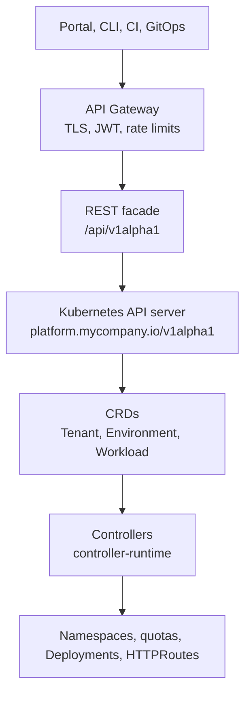

# 09 — Platform APIs

The contract layer of the platform: the Kubernetes-style APIs that hold desired state, the controllers that reconcile them, and the REST and gateway surfaces that expose them to developers, the portal, the CLI, and CI.

## Reading Order

| # | Document | Summary |
|---|----------|---------|
| 1 | [Platform API Design](platform-api-design.md) | REST vs gRPC vs Kubernetes-style APIs, resource modeling, versioning and deprecation, errors, pagination, and authorization |
| 2 | [Kubernetes CRDs](kubernetes-crds.md) | Spec and status design, structural schemas, CEL validation rules, versioning with conversion webhooks, and conditions |
| 3 | [Controller Runtime](controller-runtime.md) | Kubebuilder v4 scaffolding, the reconcile loop, owner references, finalizers, watches, and envtest |
| 4 | [API Gateway](api-gateway.md) | Gateway API v1 resources and worked examples with Envoy Gateway, plus Kong and Traefik; generated routes, rate limits, and observability |

> Read these in order. The API is the contract, the CRD makes it real in the cluster, the controller makes it true, and the gateway makes it reachable.

## The Platform API Stack

## The Contract

Every document in this section uses the same API contract, so examples compose:

| Resource | Scope | Spec | Status |
|----------|-------|------|--------|
| `Tenant` | Cluster | `displayName`, `owners[]`, `namespaces[]`, `quota{cpu,memory,storage,pods}`, `networkIsolation` | `phase`, `conditions`, `namespaces` |
| `Environment` | Namespaced | `tenant`, `type` (dev, staging, prod, preview), `ttl`, `template`, `cluster` | `phase`, `namespace`, `url`, `expiresAt`, `conditions` |
| `Workload` | Namespaced | `image`, `replicas`, `port`, `env`, `resources`, `traits[{type: ingress, autoscaling, pdb; config}]` | `phase`, `readyReplicas`, `conditions` |

Group: `platform.mycompany.io`. Version: `v1alpha1`.

## Code and Labs

| Area | Location |
|------|----------|
| REST contract | [`code/platform-api/openapi.yaml`](../../code/platform-api/openapi.yaml) |
| Tenant operator | [`code/tenant-operator/`](../../code/tenant-operator/) |
| Environment operator | [`code/environment-operator/`](../../code/environment-operator/) |
| Workload operator | [`code/workload-operator/`](../../code/workload-operator/) |
| CLI | [`code/platform-cli/`](../../code/platform-cli/) |
| Labs | [Lab 03: Platform API](../../labs/lab-03-platform-api/README.md), [Lab 07: Multi-Tenancy](../../labs/lab-07-multi-tenancy/README.md) |

## Related

- Previous section: [08 — Self-Service](../08-self-service/README.md)
- Portal that consumes this API: [07 — Internal Developer Platform](../07-internal-developer-platform/README.md)
- Platform-level outcomes: [Measuring Success](../14-platform-evolution/measuring-success.md)
- Next section: [10 — Observability](../10-observability/metrics-stack.md)
