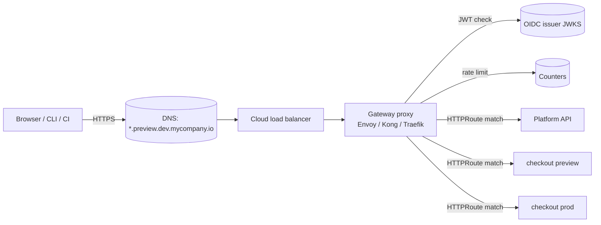
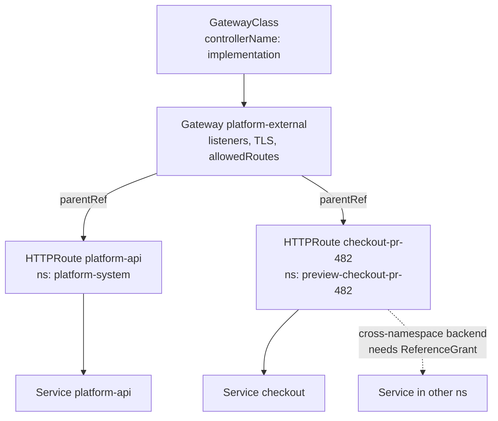

# API Gateway: Kong, Traefik, and Envoy Gateway on the Gateway API

## Learning Objectives
- Explain what a platform gateway owns (north-south entry, authentication, rate limits, routing) and what it should not own
- Model edge routing with the Gateway API v1 resources: `GatewayClass`, `Gateway`, `HTTPRoute`, and `ReferenceGrant`
- Compare Kong, Traefik, and Envoy Gateway on the criteria that matter for a platform team, including how each attaches policy
- Generate an `HTTPRoute` from a `Workload`'s `ingress` trait so developers never write routing YAML
- Enforce multi-tenant guardrails: hostname ownership, route attachment rules, and per-tenant rate limits
- Measure gateway health and tie it to the platform's SLOs

## Prerequisites
- [Ingress Controllers](../03-networking-fundamentals/ingress-controllers.md) — the older Ingress API and why Gateway API replaced it
- [Network Policies](../03-networking-fundamentals/network-policies.md) — what traffic is allowed inside the cluster
- [Platform API Design](platform-api-design.md) — the routes the gateway fronts
- [Workloads and Traits](kubernetes-crds.md) — the `Workload` resource whose `ingress` trait generates routes
- TLS basics and cert-manager familiarity

---

## What a Platform Gateway Is For

A gateway sits at the edge of the cluster and handles traffic coming in from outside: browsers, CI systems, partners, and developers calling the platform API. It is the one place where every external request passes, so it is the natural home for cross-cutting concerns that should not be reimplemented per service.



### In Scope for the Gateway

| Concern | Why at the edge |
|---------|-----------------|
| TLS termination and certificate rotation | One place to manage certificates; services stay plain HTTP inside the mesh or cluster |
| Routing by host and path | Provides one stable entry point for many services |
| Authentication of external callers | Validates tokens once; services receive identity headers or trust the proxy |
| Coarse rate limits and request size limits | Protects the platform from a single noisy client |
| Access logs and edge metrics | Gives a consistent view of every request, including ones that never reach a service |
| Timeouts and retries for external traffic | Keeps slow clients from holding resources |

### Out of Scope for the Gateway

| Concern | Better place |
|---------|--------------|
| Business authorization ("can this user change this environment?") | The platform API, using Kubernetes RBAC ([Platform API Design](platform-api-design.md#authentication-and-authorization)) |
| Service-to-service authentication and policy | A service mesh or network policies ([Service Mesh](../03-networking-fundamentals/service-mesh.md)) |
| Request-body validation for domain objects | The API and its CRDs ([Kubernetes CRDs](kubernetes-crds.md)) |
| Complex transformation logic | The service itself |

The gateway should be thin. Once it contains business logic, every change to the platform requires a gateway change, and the gateway becomes the bottleneck for every team.

---

## The Gateway API in Brief

The Gateway API replaces the `Ingress` resource, which could only express basic host and path routing and pushed everything else into controller-specific annotations. Its core resources reached **v1 (GA)** in October 2023. Use the `gateway.networking.k8s.io/v1` group for `GatewayClass`, `Gateway`, and `HTTPRoute`.

| Resource | Owned by | Purpose |
|----------|----------|---------|
| `GatewayClass` | Platform team (cluster-scoped) | Declares which controller implements gateways of this class |
| `Gateway` | Platform team | A listener: address, port, protocol, TLS, and which routes may attach |
| `HTTPRoute` | Tenant or platform, depending on the route | Matches requests and forwards them to backends |
| `ReferenceGrant` | Owner of the target namespace | Permits a route in one namespace to reference a backend or secret in another |
| `GRPCRoute` | Tenant | Routes for gRPC traffic (GA in the Gateway API) |

The ownership split is the point. The platform team owns *where traffic enters* (`Gateway`); tenants own *which paths reach their services* (`HTTPRoute`), and the `Gateway`'s `allowedRoutes` decides which namespaces may attach.



---

## Choosing an Implementation

All three projects implement the Gateway API and can run in the same cluster for different traffic classes. The question is which one your team can operate.

| Criterion | Kong (Kong Ingress Controller / Gateway) | Traefik (v3) | Envoy Gateway |
|-----------|------------------------------------------|--------------|---------------|
| Data plane | Kong Gateway (Nginx/OpenResty-based) | Traefik proxy (Go) | Envoy proxy |
| Gateway API support | Yes, via Kong Ingress Controller | Yes, via the Kubernetes Gateway provider | Yes, Envoy Gateway is built around it |
| Policy attachment | `KongPlugin` CRDs, referenced by filter | `Middleware` CRDs, referenced by filter | `BackendTrafficPolicy`, `SecurityPolicy`, `ClientTrafficPolicy` CRDs targeting routes or gateways |
| Auth | JWT and OIDC plugins (some features in the enterprise edition; check the current feature matrix) | ForwardAuth middleware, often with oauth2-proxy | JWT validation via `SecurityPolicy`; OIDC support in recent releases |
| Rate limiting | Rate-limiting plugin; local or Redis-backed | `rateLimit` middleware | Global and local rate limits via policy |
| Operational model | Familiar to teams that ran Kong as an API gateway | Simple to start; auto-discovery from providers | Pure Gateway API, Envoy under the hood; more concepts to learn |
| Best fit | Teams already running Kong, or needing its plugin ecosystem | Small platforms; teams that want Docker-like simplicity; mixed providers | Teams that want a standards-first, Envoy-based edge and will adopt Envoy's policy model |

### Practical Selection Advice

1. **Do not choose on features alone.** All three handle the routes in this document. Choose on the team that will operate it and the policy model you want to teach.
2. **Check the policy model.** The gateway's real API for platform teams is its policy CRDs. Two implementations with the same `HTTPRoute` can differ wildly in how rate limits and auth are configured.
3. **Verify conformance.** The Gateway API project publishes conformance reports for each implementation. Read the report for the version you intend to run rather than the marketing page.
4. **Pin the controller version** and the Gateway API CRD version together. Upgrade the CRDs first, following the implementation's compatibility table.

This document uses Envoy Gateway for the worked examples because its policy model maps most directly to Gateway API concepts. The same platform concepts apply to Kong and Traefik with their own policy CRDs.

---

## Worked Example: Envoy Gateway

### Install Shape

Envoy Gateway is installed with its Helm chart, which installs the controller and the Gateway API and Envoy Gateway CRDs. Pin the chart version to match the Gateway API version the chart documents. Check the Envoy Gateway compatibility matrix before upgrading either.

```bash
helm install eg oci://docker.io/envoyproxy/gateway-helm \
  --version <pinned-version> \
  --namespace envoy-gateway-system \
  --create-namespace
```

Replace `<pinned-version>` with the release listed in the Envoy Gateway documentation for your Kubernetes minor version. Do not guess it.

### GatewayClass and Gateway

The platform team owns these. The `Gateway` is the only place that defines a public listener, and it restricts which namespaces may attach routes.

```yaml
# gateway/platform-external.yaml
apiVersion: gateway.networking.k8s.io/v1
kind: GatewayClass
metadata:
  name: envoy
spec:
  controllerName: gateway.envoyproxy.io/gatewayclass-controller
---
apiVersion: gateway.networking.k8s.io/v1
kind: Gateway
metadata:
  name: platform-external
  namespace: platform-gateway
spec:
  gatewayClassName: envoy
  listeners:
    - name: https-platform-api
      protocol: HTTPS
      port: 443
      hostname: api.platform.mycompany.io
      tls:
        mode: Terminate
        certificateRefs:
          - kind: Secret
            name: platform-api-tls
      allowedRoutes:
        namespaces:
          from: Same                       # only routes in this namespace may attach
    - name: https-previews
      protocol: HTTPS
      port: 443
      hostname: "*.preview.dev.mycompany.io"
      tls:
        mode: Terminate
        certificateRefs:
          - kind: Secret
            name: wildcard-preview-tls     # issued by cert-manager; see below
      allowedRoutes:
        namespaces:
          from: Selector
          selector:
            matchLabels:
              platform.mycompany.io/gateway-access: "preview"   # opt-in per namespace
```

Key points:

- **`allowedRoutes` is the tenant boundary.** A route in a namespace that is not labelled `platform.mycompany.io/gateway-access: preview` cannot attach to the preview listener, even if it names the gateway. The label is applied by the namespace template, and only the platform team can grant it.
- **`hostname` on a listener** restricts what a route may claim. A route for `evil.example.com` will not attach to a listener scoped to `*.preview.dev.mycompany.io`.
- **Wildcards need a wildcard certificate**, or a certificate issued per host via cert-manager's Gateway API integration.

```yaml
# Issuing a wildcard certificate for the preview listener with cert-manager.
apiVersion: cert-manager.io/v1
kind: Certificate
metadata:
  name: wildcard-preview-tls
  namespace: platform-gateway
spec:
  secretName: wildcard-preview-tls
  dnsNames:
    - "*.preview.dev.mycompany.io"
  issuerRef:
    name: letsencrypt-dns01              # DNS-01 is required for wildcards
    kind: ClusterIssuer
```

### HTTPRoute for a Preview

The preview environment's namespace has the label, and its route attaches to the preview listener. Note the `backendRefs` and `timeouts` fields.

```yaml
# preview-checkout-pr-482/httproute.yaml
apiVersion: gateway.networking.k8s.io/v1
kind: HTTPRoute
metadata:
  name: checkout
  namespace: preview-checkout-pr-482
spec:
  parentRefs:
    - name: platform-external
      namespace: platform-gateway
      sectionName: https-previews        # attach only to the preview listener
  hostnames:
    - checkout-pr-482.preview.dev.mycompany.io
  rules:
    - matches:
        - path:
            type: PathPrefix
            value: /
      timeouts:
        request: 30s                     # end-to-end request budget
        backendRequest: 25s
      backendRefs:
        - name: checkout
          port: 8080
          weight: 100
```

### Routes to the Platform API, with a Route-Level Policy

The platform API is a route owned by the platform team, so it lives in `platform-system` and attaches to the API listener. Authentication is attached to the route, not implemented in the API.

```yaml
# platform-system/httproute-platform-api.yaml
apiVersion: gateway.networking.k8s.io/v1
kind: HTTPRoute
metadata:
  name: platform-api
  namespace: platform-system
spec:
  parentRefs:
    - name: platform-external
      namespace: platform-gateway
      sectionName: https-platform-api
  hostnames:
    - api.platform.mycompany.io
  rules:
    - matches:
        - path:
            type: PathPrefix
            value: /api/v1alpha1
      backendRefs:
        - name: platform-api
          port: 8080
---
# JWT validation for every request to the platform API.
# Envoy Gateway policy CRD; check the version in your installed release.
apiVersion: gateway.envoyproxy.io/v1alpha1
kind: SecurityPolicy
metadata:
  name: platform-api-jwt
  namespace: platform-system
spec:
  targetRefs:
    - group: gateway.networking.k8s.io
      kind: HTTPRoute
      name: platform-api
  jwt:
    providers:
      - name: corp-oidc
        issuer: https://login.mycompany.io/
        audiences:
          - platform-api
        remoteJWKS:
          uri: https://login.mycompany.io/.well-known/jwks.json
```

Two decisions here are worth stating:

- **The gateway validates the signature and expiry; the API validates authorization.** A valid token can reach the API; what it can do is decided by Kubernetes RBAC when the API calls the cluster as the user.
- **`audiences` must match what the issuer puts in `aud`.** A token minted for another application is rejected at the edge, which keeps tokens from being replayed across services.

---

## Cross-Namespace References

A route in `preview-checkout-pr-482` referring to a backend in another namespace needs a `ReferenceGrant` in the target namespace. Without it, the route is rejected with a `ResolvedRefs: False` condition. This is the right default: the owner of a namespace decides who may send traffic into it.

```yaml
# shared-services/referencegrant.yaml
# Allows HTTPRoutes in payments namespaces to send traffic to the shared auth service.
apiVersion: gateway.networking.k8s.io/v1beta1
kind: ReferenceGrant
metadata:
  name: allow-payments-to-auth
  namespace: shared-auth
spec:
  from:
    - group: gateway.networking.k8s.io
      kind: HTTPRoute
      namespace: team-payments
  to:
    - group: ""
      kind: Service
      name: auth
```

`ReferenceGrant` is served at `v1beta1`. Confirm the served versions on your cluster's Gateway API CRDs before copying the manifest.

---

## Generating Routes from Workload Traits

Developers should not write `HTTPRoute` objects. They declare the `ingress` trait on a `Workload`, and the workload-operator generates the route, the certificate reference, and the policy attachment. The trait's config is the contract:

```yaml
# Developer writes this (see the Workload contract in Platform API Design)
apiVersion: platform.mycompany.io/v1alpha1
kind: Workload
metadata:
  name: checkout
  namespace: team-payments
spec:
  image: registry.mycompany.io/payments/checkout:1.14.2
  replicas: 3
  port: 8080
  traits:
    - type: ingress
      config:
        host: checkout.payments.mycompany.io
        tls: true
        paths: ["/"]
        timeout: 30s
```

The operator produces the following, with an owner reference to the `Workload` so that deleting the workload removes the route:

```yaml
# Generated by workload-operator (ingress trait); do not edit by hand
apiVersion: gateway.networking.k8s.io/v1
kind: HTTPRoute
metadata:
  name: checkout
  namespace: team-payments
  labels:
    platform.mycompany.io/managed-by: workload-operator
  ownerReferences:
    - apiVersion: platform.mycompany.io/v1alpha1
      kind: Workload
      name: checkout
      uid: 3f2c0c7e-9d1b-4d5a-8a3e-0f9e8d7c6b5a
      controller: true
      blockOwnerDeletion: true
spec:
  parentRefs:
    - name: platform-external
      namespace: platform-gateway      # no sectionName: attaches to whichever listener matches the hostname
                                       # and admits this namespace (a tenant-domain listener, not shown above)
  hostnames:
    - checkout.payments.mycompany.io
  rules:
    - matches:
        - path:
            type: PathPrefix
            value: /
      timeouts:
        request: 30s
      backendRefs:
        - name: checkout
          port: 8080
```

### Guardrails for Generated Routes

The operator must validate the trait before generating anything:

| Check | Why | Where |
|-------|-----|-------|
| `host` falls within a domain the tenant owns | Stops tenants from claiming other tenants' hostnames | Admission or operator validation |
| No two `Workload`s claim the same host | Duplicate hostnames cause unpredictable routing | Controller, with a condition on the loser |
| `timeout` is within a platform maximum | Prevents long-held connections | CEL rule on the trait config schema |
| Path does not shadow `/api/v1alpha1` | Protects the platform API route | Operator validation |

Hostname ownership is the most important of these. The Gateway API does not stop two routes from claiming the same host in permitted namespaces; that conflict resolution is implementation-defined, so the platform must prevent it.

---

## Rate Limits and Protection

Rate limits belong at the gateway for coarse protection, and in the platform API for tenant-aware quotas. Gateway limits protect the platform from abuse; they are not a billing mechanism.

```yaml
# Envoy Gateway: a global rate limit attached to the platform API route.
apiVersion: gateway.envoyproxy.io/v1alpha1
kind: BackendTrafficPolicy
metadata:
  name: platform-api-ratelimit
  namespace: platform-system
spec:
  targetRefs:
    - group: gateway.networking.k8s.io
      kind: HTTPRoute
      name: platform-api
  rateLimit:
    type: Local                           # per-proxy counters; use Global with Redis for exact limits
    local:
      rules:
        - limit:
            requests: 300
            unit: Minute
```

For Kong, the same intent is a `KongPlugin` referenced from the route. For Traefik, it is a `Middleware` of type `rateLimit`:

```yaml
# Kong: KongPlugin attached to an HTTPRoute via an ExtensionRef filter
apiVersion: configuration.konghq.com/v1
kind: KongPlugin
metadata:
  name: rate-limit-platform-api
  namespace: platform-system
plugin: rate-limiting
config:
  minute: 300
  policy: local
---
# Traefik: Middleware attached to a route the same way
apiVersion: traefik.io/v1alpha1
kind: Middleware
metadata:
  name: rate-limit-platform-api
  namespace: platform-system
spec:
  rateLimit:
    average: 5          # requests per second, sustained
    burst: 20
```

### Limits That Matter

| Limit | Purpose | Typical starting point |
|-------|---------|------------------------|
| Requests per client per minute | Protects against scripts and runaway CI | Set per API client identity, not per IP behind a NAT |
| Maximum request body size | Prevents memory exhaustion on the proxy | 1 MiB for the API; larger for uploads routed elsewhere |
| Request timeout | Bounds how long a backend can hold a client | 30 s for API; longer only for explicit streaming routes |
| Max concurrent connections per listener | Protects the proxy from connection floods | Measured per environment |

---

## Observability

A gateway that you cannot observe is a blind spot for every service behind it. Collect three things:

1. **Access logs** with the route name, the matched hostname, the response code, the upstream latency, and the authenticated client identity (not the token). Route name is what lets you attribute errors to a team.
2. **Edge metrics** per listener and per route: request rate, error rate (5xx from the gateway and from upstreams separately), and latency percentiles.
3. **Auth metrics**: JWT rejections by reason and issuer. A spike in `invalid audience` is usually a misconfigured client, not an attack.

```promql
# 5xx ratio per route over five minutes (metric and label names vary by implementation; check your /metrics output)
sum by (route) (rate(envoy_http_downstream_rq_xx{envoy_response_code_class="5"}[5m]))
/
sum by (route) (rate(envoy_http_downstream_rq_total[5m]))
```

Tie these to the platform's SLOs (see [SLOs and SLIs](../11-reliability/slos-slis.md)). A useful SLI for the platform API is "fraction of requests that succeed at the gateway, excluding client errors (4xx)". Tenant workloads should have their own SLIs, measured where the tenant's traffic lands.

---

## Operating the Gateway

| Practice | Detail |
|----------|--------|
| Run at least two replicas across zones | The gateway is a shared dependency; a single replica is an outage |
| Separate gateways for distinct trust levels | Public ingress, internal platform API, and preview traffic should not share one listener set if their policies differ |
| Upgrade in this order | Gateway API CRDs, then the implementation's CRDs, then the controller, then the data plane |
| Canary gateway config with weights | `HTTPRoute` `backendRefs[].weight` splits traffic between two versions of a service during rollout |
| Store TLS keys in cert-manager | Never copy certificate secrets by hand; rotate by re-issue |
| Test routes in CI | Use a conformance-style test that applies the route and sends a request through the gateway |

### Canary Routing with Weights

```yaml
rules:
  - matches:
      - path:
          type: PathPrefix
          value: /
    backendRefs:
      - name: checkout-stable
        port: 8080
        weight: 90
      - name: checkout-canary
        port: 8080
        weight: 10
```

Weights are for traffic shifting between versions of one logical service. For full progressive delivery with automated analysis, pair the route with a progressive-delivery controller such as Argo Rollouts (see [Argo CD Deep Dive](../05-gitops/argocd-deep-dive.md) for the GitOps side).

---

## Hands-On Exercises

### Exercise 1: Expose a preview through the gateway and prove the guardrails

**Goal:** Serve a preview environment through a generated route, and show that each guardrail rejects what it should.

**Before you start:** a kind cluster with a load balancer such as cloud-provider-kind or MetalLB (see [Lab 01](../../labs/lab-01-cluster-setup/README.md)), Envoy Gateway installed as shown in the Worked Example, and `kubectl` 1.28 or later.

1. **Apply the gateway** manifest `gateway/platform-external.yaml` from this page and check that it is programmed:

   ```bash
   kubectl get gateway platform-external -n platform-gateway \
     -o jsonpath='{.status.conditions[?(@.type=="Programmed")].status}{"\n"}'
   ```

   Expected output: `True`.
2. **Attach a route from an unlabelled namespace.** Apply the preview `HTTPRoute` into a namespace that lacks `platform.mycompany.io/gateway-access: preview`, then read its parent status:

   ```bash
   kubectl get httproute <route-name> -n <namespace> \
     -o jsonpath='{.status.parents[0].conditions[?(@.type=="Accepted")].status}{"\n"}'
   ```

   Replace `<route-name>` and `<namespace>` with the route and namespace you applied. Expected output: `False`.
3. **Add the label** and repeat the command. Expected output: `True`. Check `ResolvedRefs` the same way; it should also be `True`.
4. **Test a cross-namespace reference.** Point the route at a Service in another namespace without a `ReferenceGrant`. Expected: `ResolvedRefs` is `False` with reason `RefNotPermitted`. Add the grant and confirm it becomes `True`.
5. **Test the JWT policy.** Replace `<gateway-address>` with the address from `kubectl get gateway platform-external -n platform-gateway`, and `<token>` with a valid token:

   ```bash
   curl -s -o /dev/null -w '%{http_code}\n' -H 'Host: api.platform.mycompany.io' \
     http://<gateway-address>/api/v1alpha1/tenants
   curl -s -o /dev/null -w '%{http_code}\n' -H 'Host: api.platform.mycompany.io' \
     -H 'Authorization: Bearer <token>' http://<gateway-address>/api/v1alpha1/tenants
   ```

   Expected output: `401` without a token, `401` with a token for a different audience, and the upstream's status (`200`) with a valid token.
6. **Break the hostname rule on purpose.** Create a route for `evil.example.com` and confirm its `Accepted` condition is `False`.

**Check:**

- [ ] Each rejection shows the expected condition or status code.
- [ ] The valid request reaches the platform API.
- [ ] The hostname guardrail holds.

---

## Troubleshooting

### Route status `Accepted: False`, reason `NotAllowedByListeners`

**Cause:** Namespace missing the `allowedRoutes` label, or `sectionName` points to a listener with a different hostname

**Fix:** Check the namespace labels and the listener's `hostname`

### `ResolvedRefs: False`, reason `RefNotPermitted`

**Cause:** Cross-namespace backend without a `ReferenceGrant`

**Fix:** Add a grant in the target namespace

### `Gateway` not `Programmed`

**Cause:** No load balancer address; GatewayClass controller not running; invalid TLS secret

**Fix:** Check the controller logs and `kubectl describe gateway`

### TLS handshake fails for the wildcard host

**Cause:** Certificate does not cover the hostname, or the secret name does not match `certificateRefs`

**Fix:** Check the cert-manager `Certificate` status and the SAN list

### `401` for valid tokens

**Cause:** Wrong `issuer` (trailing slash), audience mismatch, or JWKS unreachable from the proxy

**Fix:** Decode the token; compare `iss` and `aud`; check egress to the JWKS URL

### `429` from the platform API

**Cause:** Local rate limit reached

**Fix:** Confirm the client identity; raise the limit for that client, or fix the caller

### `504` on preview routes

**Cause:** Backend slower than `backendRequest`, or readiness not reached

**Fix:** Check the preview's pod readiness and the route timeouts

### Two routes claim the same host and one stops working

**Cause:** Conflicting hostnames in permitted namespaces

**Fix:** Enforce hostname ownership in the operator; remove the duplicate

### Gateway config changes do not take effect

**Cause:** Stale controller cache or a conflicting policy on the same target

**Fix:** Check policy status conditions; look for a second policy targeting the same route


---

## Further Reading

- [Gateway API documentation](https://gateway-api.sigs.k8s.io/)
- [Gateway API conformance reports](https://gateway-api.sigs.k8s.io/implementations/)
- [Gateway API v1.0 release announcement](https://kubernetes.io/blog/2023/10/31/gateway-api-ga/)
- [Envoy Gateway documentation](https://gateway.envoyproxy.io/docs/)
- [Kong Ingress Controller: Gateway API](https://docs.konghq.com/kubernetes-ingress-controller/)
- [Traefik Proxy: Kubernetes Gateway provider](https://doc.traefik.io/traefik/providers/kubernetes-gateway/)
- [cert-manager: Gateway API integration](https://cert-manager.io/docs/usage/gateway/)
- [RFC 9457: Problem Details for HTTP APIs](https://www.rfc-editor.org/rfc/rfc9457) — the error shape the API should return through the gateway

---

## Next Steps

1. **Harden the API behind it**: [Platform API Design](platform-api-design.md) — errors, versioning, and authorization
2. **Generate the routes from traits**: [Kubernetes CRDs](kubernetes-crds.md) and [Controller Runtime](controller-runtime.md) — the operator that writes `HTTPRoute`s
3. **Measure the edge**: [SLOs and SLIs](../11-reliability/slos-slis.md) and [Metrics Stack](../10-observability/metrics-stack.md)
4. **Practice**: [Lab 03: Platform API](../../labs/lab-03-platform-api/README.md)
