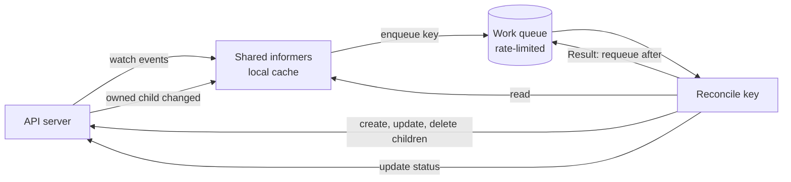

# Controller Runtime: Kubebuilder, Reconcile Loops, Finalizers, and envtest

## Learning Objectives
- Scaffold an operator with Kubebuilder v4 and explain what each generated file is for
- Write a reconciler that is level-triggered, idempotent, and safe to run concurrently with itself after a restart
- Own child objects with owner references and watch them with `Owns`, and know which ownership combinations the API server allows
- Implement finalizers for cleanup that the garbage collector cannot do
- Update status without fighting other writers, and emit Events for humans
- Test controllers with envtest against a real API server and CRDs, without a cluster

## Prerequisites
- [Controllers and Operators](../01-kubernetes-fundamentals/controllers-operators.md) — the controller pattern at a conceptual level
- [Kubernetes CRDs](kubernetes-crds.md) — the schemas, conditions, and versioning these controllers implement
- Go 1.22 or later; `make`, `docker` or `kind` for end-to-end runs
- Install Kubebuilder (v4 layout) from the [Kubebuilder releases page](https://book.kubebuilder.io/quick-start), and use `uv` only for any Python tooling you add around the project

> Version note: the examples target controller-runtime v0.19 or later. The `code/tenant-operator` module pins `sigs.k8s.io/controller-runtime v0.25.0`; check that module's `go.mod` before copying an import path, because minor releases occasionally change deprecated helpers.

---

## The Controller Pattern in controller-runtime

controller-runtime packages the pattern every Kubernetes controller uses:

1. A **watch** on the primary resource (and on owned children) feeds events into a **work queue** of object keys (`namespace/name`).
2. A **worker** pops a key and calls **`Reconcile`** with it.
3. `Reconcile` reads the *current* state of the object from the cache, reads the children it manages, and makes them match the spec. It writes status. It returns a result that says whether to run again and when.



The critical property is that **`Reconcile` never receives a delta**. It receives a key and must compute what to do from the current state. This is what makes controllers resilient: a missed event, a restart, or a duplicate event produces the same correct result.

### Level-Triggered, Not Edge-Triggered

Write reconcilers as "make the world match the spec now", never as "handle this specific change". Consider a `Tenant` whose quota changed from 4 CPU to 8 CPU while the controller was down. An edge-triggered controller would have to remember the change. A level-triggered controller reads the spec, sees 8 CPU, reads the ResourceQuota, sees 4 CPU, and fixes it. It does not matter how many changes happened.

---

## Scaffolding with Kubebuilder v4

Kubebuilder generates the boilerplate: a `main.go`, a manager, RBAC markers, the Makefile, and the Dockerfile. The repository's operators follow this layout.

```bash
mkdir tenant-operator && cd tenant-operator
kubebuilder init --domain mycompany.io --repo github.com/mycompany/tenant-operator

# Cluster-scoped API, group platform, version v1alpha1
kubebuilder create api --group platform --version v1alpha1 --kind Tenant --resource --controller

# Namespaced API for Environment
kubebuilder create api --group platform --version v1alpha1 --kind Environment --resource --controller
```

The generated tree (abridged):

```text
tenant-operator/
├── Dockerfile
├── Makefile                  # make manifests generate test run docker-build deploy
├── PROJECT                   # Kubebuilder's record of the resources it knows about
├── cmd/ or main.go           # manager setup: scheme, controllers, health probes
├── api/v1alpha1/
│   ├── groupversion_info.go  # GroupVersion and SchemeBuilder registration
│   ├── tenant_types.go       # Spec, Status, markers for CRD generation
│   └── zz_generated.deepcopy.go   # generated by controller-gen; never edit
├── internal/controller/      # or controllers/, depending on the layout chosen
│   ├── tenant_controller.go  # Reconcile and SetupWithManager
│   └── suite_test.go         # envtest bootstrap
├── config/
│   ├── crd/bases/            # generated CRD YAML
│   ├── rbac/                 # generated ClusterRole from RBAC markers
│   ├── manager/              # Deployment for the controller
│   └── samples/              # example CRs
└── test/e2e/                 # end-to-end tests with kind
```

The Makefile targets that matter:

| Target | What it does |
|--------|--------------|
| `make manifests` | Runs controller-gen to produce CRDs and RBAC from markers |
| `make generate` | Runs controller-gen to produce `zz_generated.deepcopy.go` |
| `make test` | Runs unit tests and envtest suites (sets `KUBEBUILDER_ASSETS`) |
| `make run` | Runs the controller against your current kubeconfig context |
| `make docker-build` / `deploy` | Builds the image and installs CRDs and the manager |

Run `make manifests generate` after every change to the types or markers. CI should fail if the generated files differ from what is committed.

---

## The API Types

Types are the source for the CRD schema, the deep-copy functions, and the Go client. Markers in comments drive generation (see [Kubernetes CRDs](kubernetes-crds.md)).

!!! note "Design sketch"
    The types below are a sketch of the target contract. The real types in [`code/environment-operator/api/v1alpha1/environment_types.go`](https://github.com/GitOpsHub/platform-engineering-on-kubernetes/blob/main/code/environment-operator/api/v1alpha1/environment_types.go) differ: `TTL` is a `*metav1.Duration`, `template` defaults to `baseline` and `cluster` is optional, the type constants are named `EnvironmentTypeDev` and so on, and the phases are `Pending`, `Ready`, `Failed`, `Expired` and `Terminating` (no enum marker).

```go
// api/v1alpha1/environment_types.go (sketch matching the contract)
package v1alpha1

import (
	metav1 "k8s.io/apimachinery/pkg/apis/meta/v1"
)

type EnvironmentType string

const (
	TypeDev     EnvironmentType = "dev"
	TypeStaging EnvironmentType = "staging"
	TypeProd    EnvironmentType = "prod"
	TypePreview EnvironmentType = "preview"
)

// EnvironmentSpec is the desired state. Clients write this.
type EnvironmentSpec struct {
	// Tenant that owns the environment. Must reference an existing Tenant.
	// +kubebuilder:validation:MinLength=1
	// +kubebuilder:validation:MaxLength=63
	Tenant string `json:"tenant"`

	// Type of environment; drives TTL caps and default quotas.
	// +kubebuilder:validation:Enum=dev;staging;prod;preview
	Type EnvironmentType `json:"type"`

	// TTL is a Go duration after creation. Required for non-prod types.
	// +optional
	// +kubebuilder:validation:Pattern=`^([0-9]+(\.[0-9]+)?(ns|us|µs|ms|s|m|h))+$`
	TTL string `json:"ttl,omitempty"`

	// Template selects the environment template in the platform catalog.
	// +kubebuilder:validation:MinLength=1
	// +kubebuilder:validation:MaxLength=63
	Template string `json:"template"`

	// Cluster is the target cluster name from the fleet inventory.
	// +kubebuilder:validation:MinLength=1
	Cluster string `json:"cluster"`
}

// EnvironmentStatus is the observed state. Only the controller writes this.
type EnvironmentStatus struct {
	// Phase is a summary derived from Conditions.
	// +kubebuilder:validation:Enum=Pending;Ready;Failed;Expired;Terminating
	// +optional
	Phase string `json:"phase,omitempty"`

	// Namespace created for this environment.
	// +optional
	Namespace string `json:"namespace,omitempty"`

	// URL where the environment is reachable, once routing is ready.
	// +optional
	URL string `json:"url,omitempty"`

	// ExpiresAt is the absolute time the environment will be deleted. Unset for prod.
	// +optional
	ExpiresAt *metav1.Time `json:"expiresAt,omitempty"`

	// +optional
	// +listType=map
	// +listMapKey=type
	Conditions []metav1.Condition `json:"conditions,omitempty"`
}

// +kubebuilder:object:root=true
// +kubebuilder:subresource:status
// +kubebuilder:resource:scope=Namespaced,shortName=env
// +kubebuilder:printcolumn:name="Type",type=string,JSONPath=`.spec.type`
// +kubebuilder:printcolumn:name="Phase",type=string,JSONPath=`.status.phase`
// +kubebuilder:printcolumn:name="Expires",type=date,JSONPath=`.status.expiresAt`

// Environment is a running instance of a service for a purpose.
type Environment struct {
	metav1.TypeMeta   `json:",inline"`
	metav1.ObjectMeta `json:"metadata,omitempty"`

	Spec   EnvironmentSpec   `json:"spec,omitempty"`
	Status EnvironmentStatus `json:"status,omitempty"`
}

// +kubebuilder:object:root=true

// EnvironmentList is the list type the API server returns for collections.
type EnvironmentList struct {
	metav1.TypeMeta `json:",inline"`
	metav1.ListMeta `json:"metadata,omitempty"`
	Items           []Environment `json:"items"`
}

func init() {
	SchemeBuilder.Register(&Environment{}, &EnvironmentList{})
}
```

Two details to note:

- **`ExpiresAt` is a pointer.** An absent value means "does not expire" (prod). A zero `metav1.Time` would serialize as a timestamp, which is wrong.
- **`+kubebuilder:subresource:status`** makes status a separate endpoint. Writes to `/status` do not bump `metadata.generation`, so spec-driven reconciles are not triggered by the controller's own status writes. This is the single most important performance property of the pattern.

---

## Writing the Reconciler

### The Shape of a Reconcile

Every reconciler follows the same steps. Deviating from this order is the most common source of bugs.

1. **Fetch** the primary object. If it is gone, return success.
2. **Handle deletion.** If `DeletionTimestamp` is set, run finalizer cleanup and remove the finalizer.
3. **Ensure the finalizer** is present before creating anything external.
4. **Validate** what cannot be expressed in schema, and set a condition if invalid.
5. **Reconcile children**: create or update each owned object, using `CreateOrUpdate` or server-side apply.
6. **Compute status** from children and write it with the status subresource.
7. **Return** a result: `Result{}` for event-driven, `RequeueAfter` for time-driven, or an error for exponential backoff.

```go
// internal/controller/environment_controller.go (sketch)
package controller

import (
	"context"
	"fmt"
	"time"

	corev1 "k8s.io/api/core/v1"
	apierrors "k8s.io/apimachinery/pkg/api/errors"
	metav1 "k8s.io/apimachinery/pkg/apis/meta/v1"
	"k8s.io/apimachinery/pkg/api/meta"
	"k8s.io/apimachinery/pkg/runtime"
	"k8s.io/client-go/tools/record"
	ctrl "sigs.k8s.io/controller-runtime"
	"sigs.k8s.io/controller-runtime/pkg/client"
	"sigs.k8s.io/controller-runtime/pkg/controller/controllerutil"
	"sigs.k8s.io/controller-runtime/pkg/log"

	platformv1alpha1 "github.com/mycompany/environment-operator/api/v1alpha1"
)

const environmentFinalizer = "platform.mycompany.io/environment-cleanup"

type EnvironmentReconciler struct {
	client.Client
	Scheme   *runtime.Scheme
	Recorder record.EventRecorder
	// DNS is an injected client for the external DNS provider (not shown).
	DNS interface {
		DeleteRecord(ctx context.Context, url string) error
	}
}

// +kubebuilder:rbac:groups=platform.mycompany.io,resources=environments,verbs=get;list;watch;create;update;patch;delete
// +kubebuilder:rbac:groups=platform.mycompany.io,resources=environments/status,verbs=get;update;patch
// +kubebuilder:rbac:groups=platform.mycompany.io,resources=environments/finalizers,verbs=update
// +kubebuilder:rbac:groups="",resources=namespaces,verbs=get;list;watch;create;delete
// +kubebuilder:rbac:groups="",resources=events,verbs=create;patch

func (r *EnvironmentReconciler) Reconcile(ctx context.Context, req ctrl.Request) (ctrl.Result, error) {
	logger := log.FromContext(ctx).WithValues("environment", req.NamespacedName)

	// 1. Fetch. Not found means it was deleted and cleanup already ran.
	var env platformv1alpha1.Environment
	if err := r.Get(ctx, req.NamespacedName, &env); err != nil {
		return ctrl.Result{}, client.IgnoreNotFound(err)
	}

	// 2. Deletion path.
	if !env.DeletionTimestamp.IsZero() {
		if controllerutil.ContainsFinalizer(&env, environmentFinalizer) {
			if err := r.cleanupExternal(ctx, &env); err != nil {
				return ctrl.Result{}, err // retried with backoff; finalizer stays
			}
			controllerutil.RemoveFinalizer(&env, environmentFinalizer)
			if err := r.Update(ctx, &env); err != nil {
				return ctrl.Result{}, err
			}
		}
		return ctrl.Result{}, nil
	}

	// 3. Ensure finalizer before creating anything outside the owner-reference graph.
	if controllerutil.AddFinalizer(&env, environmentFinalizer) {
		if err := r.Update(ctx, &env); err != nil {
			return ctrl.Result{}, err
		}
		// The Update bumps resourceVersion; the next reconcile sees the new object.
		return ctrl.Result{Requeue: true}, nil
	}

	// 4. Time-driven behavior: TTL.
	expiry, err := computeExpiry(&env)
	if err != nil {
		setCondition(&env, "Ready", metav1.ConditionFalse, "InvalidSpec", err.Error())
		return ctrl.Result{}, r.Status().Update(ctx, &env)
	}
	if expiry != nil && time.Now().After(expiry.Time) {
		logger.Info("environment expired; deleting")
		r.Recorder.Eventf(&env, corev1.EventTypeNormal, "Expired", "TTL reached at %s", expiry.Format(time.RFC3339))
		return ctrl.Result{}, client.IgnoreNotFound(r.Delete(ctx, &env))
	}

	// 5. Children.
	ns, err := r.ensureNamespace(ctx, &env)
	if err != nil {
		return ctrl.Result{}, fmt.Errorf("ensuring namespace: %w", err)
	}
	if err := r.ensureQuota(ctx, &env, ns.Name); err != nil {
		return ctrl.Result{}, fmt.Errorf("ensuring quota: %w", err)
	}

	// 6. Status, from observed children.
	env.Status.Namespace = ns.Name
	env.Status.ExpiresAt = expiry
	setCondition(&env, "Ready", metav1.ConditionTrue, "Provisioned", "all owned objects reconciled")
	env.Status.Phase = "Ready"
	if err := r.Status().Update(ctx, &env); err != nil {
		return ctrl.Result{}, err
	}

	// 7. Result: wake exactly at expiry if there is one.
	if expiry != nil {
		return ctrl.Result{RequeueAfter: time.Until(expiry.Time)}, nil
	}
	return ctrl.Result{}, nil
}

func setCondition(env *platformv1alpha1.Environment, t string, s metav1.ConditionStatus, reason, msg string) {
	meta.SetStatusCondition(&env.Status.Conditions, metav1.Condition{
		Type:               t,
		Status:             s,
		Reason:             reason,
		Message:            msg,
		ObservedGeneration: env.Generation,
	})
}
```

The `ensureNamespace`, `ensureQuota`, `cleanupExternal`, and `computeExpiry` helpers are described below and in [Environment Provisioning](../08-self-service/environment-provisioning.md#the-environment-controller).

### Idempotent Child Management

`ensureNamespace` must produce the same result whether it runs once or fifty times. Two approaches:

```go
// Approach A: CreateOrUpdate. Read, mutate in memory, write only if changed.
func (r *EnvironmentReconciler) ensureNamespace(ctx context.Context, env *platformv1alpha1.Environment) (*corev1.Namespace, error) {
	ns := &corev1.Namespace{ObjectMeta: metav1.ObjectMeta{Name: namespaceName(env)}}

	_, err := controllerutil.CreateOrUpdate(ctx, r.Client, ns, func() error {
		if ns.Labels == nil {
			ns.Labels = map[string]string{}
		}
		ns.Labels["platform.mycompany.io/tenant"] = env.Spec.Tenant
		ns.Labels["platform.mycompany.io/environment"] = string(env.Spec.Type)

		// A cluster-scoped Namespace cannot be owned by a namespaced Environment.
		// Ownership is recorded as a label for lookup; deletion goes through the finalizer.
		ns.Labels["platform.mycompany.io/owner-environment"] = env.Name
		return nil
	})
	return ns, err
}

func namespaceName(env *platformv1alpha1.Environment) string {
	return "env-" + env.Spec.Tenant + "-" + env.Name
}

// Approach B: server-side apply. Declare the desired object; the server merges.
// Preferred when several controllers share fields on one object.
func (r *EnvironmentReconciler) ensureQuota(ctx context.Context, env *platformv1alpha1.Environment, nsName string) error {
	quota := &corev1.ResourceQuota{
		TypeMeta: metav1.TypeMeta{APIVersion: "v1", Kind: "ResourceQuota"},
		ObjectMeta: metav1.ObjectMeta{
			Name:      "default",
			Namespace: nsName,
		},
	}
	// Owned by the Environment (same namespace is not required here because the
	// Environment is namespaced in the tenant's control namespace; see note below).
	quota.Spec.Hard = corev1.ResourceList{} // real values come from the environment template
	return r.Patch(ctx, quota, client.Apply, client.FieldOwner("environment-operator"), client.ForceOwnership)
}
```

Note on `ensureQuota`: the quota is not given an owner reference. The `Environment` lives in the tenant's control namespace and the quota lives in the environment namespace, and cross-namespace owner references are not permitted. Its lifecycle is therefore tied to its namespace, which the finalizer deletes. The sketch uses server-side apply with a field owner so that several controllers can share the object without overwriting each other's fields.

### Owner References: Who Owns What

Owner references let the garbage collector delete children when the owner is gone. Their rules are strict:

| Dependent scope | Owner scope | Allowed? | Practical example |
|-----------------|-------------|----------|-------------------|
| Namespaced | Namespaced, same namespace | Yes | `Workload` owns a `Deployment` in its namespace |
| Namespaced | Cluster-scoped | Yes | A `Tenant`-owned `ResourceQuota` in a tenant namespace |
| Cluster-scoped | Cluster-scoped | Yes | A `ClusterRoleBinding` owned by a `Tenant` |
| Cluster-scoped | Namespaced | **No** | A `Namespace` cannot be owned by an `Environment` |
| Namespaced | Namespaced, different namespace | **No** | A quota in one namespace cannot be owned by an environment in another |

Set owner references with `controllerutil.SetControllerReference(owner, child, r.Scheme)` for children in the same scope, and mark them as the controller so `Owns` can map child events back to the owner.

```go
// Workload owns its Deployment (same namespace): this is the normal, fully supported case.
if err := controllerutil.SetControllerReference(&workload, deploy, r.Scheme); err != nil {
	return ctrl.Result{}, err
}
```

### Finalizers

A finalizer is a string in `metadata.finalizers`. While it is present, the API server sets `deletionTimestamp` and keeps the object. The controller runs cleanup, removes the string, and the object is deleted.

Use a finalizer when cleanup touches anything the garbage collector cannot reach:

- Cluster-scoped objects that cannot have a namespaced owner (the `Namespace` above)
- External systems: DNS records, cloud load balancers, SaaS accounts
- Objects in other namespaces or clusters

```go
// internal/controller/cleanup.go (sketch)
func (r *EnvironmentReconciler) cleanupExternal(ctx context.Context, env *platformv1alpha1.Environment) error {
	// Delete the namespace (cluster-scoped, so the GC cannot do it).
	ns := &corev1.Namespace{ObjectMeta: metav1.ObjectMeta{Name: namespaceName(env)}}
	if err := r.Delete(ctx, ns); client.IgnoreNotFound(err) != nil {
		return err
	}

	// Remove the DNS record. Errors here keep the finalizer in place and retry.
	if err := r.DNS.DeleteRecord(ctx, env.Status.URL); err != nil {
		return fmt.Errorf("deleting DNS record: %w", err)
	}
	return nil
}
```

Rules for finalizers:

1. **Idempotent cleanup.** A cleanup may run several times after a partial failure. Treat "already gone" as success.
2. **Never block forever.** If an external system is permanently unreachable, decide on a timeout and an escape hatch (an annotation an operator sets to skip cleanup, recorded in an Event). A stuck `Terminating` object with a finalizer is a support ticket every time.
3. **Remove only your own finalizer.** Other controllers use their own strings.
4. **Add the finalizer before creating external resources.** Otherwise a crash between create and add leaks the resource.

---

## Watches and Predicates

`SetupWithManager` declares what the controller reacts to.

```go
func (r *EnvironmentReconciler) SetupWithManager(mgr ctrl.Manager) error {
	return ctrl.NewControllerManagedBy(mgr).
		For(&platformv1alpha1.Environment{}).
		// Owns: when a child changes, enqueue its controller owner.
		Owns(&corev1.ResourceQuota{}).
		// Watches with a mapping: when a Tenant changes, reconcile every environment of that tenant.
		Watches(
			&platformv1alpha1.Tenant{},
			handler.EnqueueRequestsFromMapFunc(r.environmentsForTenant),
		).
		WithOptions(controller.Options{MaxConcurrentReconciles: 4}).
		Complete(r)
}
```

Choices that matter:

- **`For`** the primary type. Each object gets one key in the queue regardless of how many events it produces, so bursts collapse.
- **`Owns`** only for children with a controller reference. Owning a type you do not create causes a reconcile storm when unrelated objects change.
- **`Watches` with a map function** for cross-object dependencies, such as a `Tenant` change affecting its environments.
- **Predicates** (`builder.WithPredicates(predicate.GenerationChangedPredicate{})`) drop events that do not change spec. Use them on the primary type when status churn would cause pointless reconciles. Do not use them when the controller must react to status or annotations.
- **`MaxConcurrentReconciles`** is per controller. Increase it only when reconciles are I/O-bound and independent. The reconcile for a single key is never run concurrently with itself.

### Requeue Semantics

| Return value | Meaning | When to use |
|--------------|---------|-------------|
| `Result{}, nil` | Done; wait for the next event | Steady state |
| `Result{Requeue: true}, nil` | Run again soon, with rate limiting | You wrote the object a moment ago and want to see the result |
| `Result{RequeueAfter: d}, nil` | Run again at a specific time | TTL expiry, scheduled rotation, external system polling |
| `Result{}, err` | Failed; retry with exponential backoff | Transient errors |

Do not return an error for conditions that will not change on retry, such as an invalid spec. Set a condition and return success. Errors on bad input produce log noise and a backoff that delays the fix.

---

## Status Without Conflicts

Status updates can conflict: another writer changed the object between your read and write. The API server rejects the write with `409 Conflict`, and controller-runtime returns that as an error, which triggers a retry. That is correct behavior. Two practices reduce the noise:

1. **Write status once per reconcile**, at the end, from a complete picture. Multiple status writes per pass cause multiple conflicts and multiple generations of watch events.
2. **Do not write status when nothing changed.** `meta.SetStatusCondition` returns whether the condition changed; use that to skip the update when there is nothing new. Writing identical status is still an API call and still shows up in audit logs.

```go
changed := meta.SetStatusCondition(&env.Status.Conditions, cond)
if changed || env.Status.Phase != desiredPhase {
	env.Status.Phase = desiredPhase
	if err := r.Status().Update(ctx, &env); err != nil {
		return ctrl.Result{}, err
	}
}
```

Use `r.Status().Patch` with a merge patch when several controllers write different status fields of one object.

### Events

Events are for humans reading `kubectl describe`. They are not a logging system and they are rate-limited by the API server. Emit one when something a human should know happens: provisioning failed, a TTL expired, a finalizer is blocked. Do not emit an Event on every reconcile.

```go
r.Recorder.Eventf(&env, corev1.EventTypeWarning, "QuotaExceeded",
	"tenant %s has %s CPU remaining; environment requests %s", env.Spec.Tenant, remaining, requested)
```

---

## Concurrency, Caching, and Cost

- **Reads come from the cache.** `r.Get` and `r.List` read the informer cache. This is fast and may be slightly stale. Two consequences: never rely on a read immediately after your own write (the next reconcile will see the new state), and use `APIReader` (uncached) for the rare read that must be fresh.
- **Create before you read back.** After `Create`, the object is not yet in the cache. Return and let the event trigger the next reconcile.
- **Scope the cache.** If the controller only cares about objects with a label, configure the cache with `cache.Options{ByObject: ...}` so it does not hold the whole cluster in memory.
- **Use field indexes for lookups.** `mgr.GetFieldIndexer().IndexField` lets you list "environments for this tenant" without scanning all environments.

---

## Metrics, Health, and Leader Election

The manager gives you the operational basics:

```go
mgr, err := ctrl.NewManager(ctrl.GetConfigOrDie(), ctrl.Options{
	Scheme:                 scheme,
	Metrics:                metricsserver.Options{BindAddress: ":8443"},
	HealthProbeBindAddress: ":8081",
	LeaderElection:         true,
	LeaderElectionID:       "environment-operator.platform.mycompany.io",
})
if err != nil {
	return err
}
_ = mgr.AddHealthzCheck("healthz", healthz.Ping)
_ = mgr.AddReadyzCheck("readyz", healthz.Ping)
```

- **Leader election** ensures one active replica reconciles at a time. Run two or three replicas for availability; only one works.
- **Metrics** include `controller_runtime_reconcile_total`, `controller_runtime_reconcile_errors_total`, and `controller_runtime_reconcile_time_seconds`. Alert on sustained error rates and on queue depth (`workqueue_depth`). A growing queue means reconciles are slower than events.
- **Health probes** should reflect whether the manager can talk to the API server, not whether a particular object is healthy.

---

## Testing with envtest

envtest starts a real `kube-apiserver` and `etcd` binary without kubelets or a scheduler. It is the right tool for controller tests: it validates CRD schemas and CEL rules, applies RBAC, and exercises finalizers exactly as the real server would. It is much faster than kind.

### Suite Setup

```go
// internal/controller/suite_test.go
package controller

import (
	"io"
	"os"
	"path/filepath"
	"testing"

	"k8s.io/apimachinery/pkg/runtime"
	clientgoscheme "k8s.io/client-go/kubernetes/scheme"
	"k8s.io/client-go/rest"
	"sigs.k8s.io/controller-runtime/pkg/client"
	"sigs.k8s.io/controller-runtime/pkg/envtest"
	logf "sigs.k8s.io/controller-runtime/pkg/log"
	"sigs.k8s.io/controller-runtime/pkg/log/zap"

	platformv1alpha1 "github.com/mycompany/environment-operator/api/v1alpha1"
)

var (
	testEnv   *envtest.Environment
	cfg       *rest.Config
	k8sClient client.Client
)

func TestMain(m *testing.M) {
	logf.SetLogger(zap.New(zap.WriteTo(io.Discard)))

	testEnv = &envtest.Environment{
		CRDDirectoryPaths:     []string{filepath.Join("..", "..", "config", "crd", "bases")},
		ErrorIfCRDPathMissing: true,
	}

	var err error
	cfg, err = testEnv.Start()
	if err != nil {
		panic(err)
	}

	scheme := runtime.NewScheme()
	_ = clientgoscheme.AddToScheme(scheme)
	_ = platformv1alpha1.AddToScheme(scheme)

	k8sClient, err = client.New(cfg, client.Options{Scheme: scheme})
	if err != nil {
		panic(err)
	}

	code := m.Run()
	_ = testEnv.Stop()
	os.Exit(code)
}
```

Run it with binaries installed by `setup-envtest`, which is shipped with controller-runtime's tooling:

```bash
go install sigs.k8s.io/controller-runtime/tools/setup-envtest@latest
export KUBEBUILDER_ASSETS="$(setup-envtest use -p path 1.34.x)"   # pin a recent Kubernetes minor
make test
```

### A Table-Free Test for Reconciliation

Assert on the cluster's state with a polling helper rather than sleeping. Envtest has no controller manager running unless your test starts one, so the example runs the reconciler directly.

```go
// internal/controller/environment_controller_test.go
package controller

import (
	"context"
	"testing"
	"time"

	metav1 "k8s.io/apimachinery/pkg/apis/meta/v1"
	"k8s.io/apimachinery/pkg/types"
	"k8s.io/client-go/tools/record"
	ctrl "sigs.k8s.io/controller-runtime"

	platformv1alpha1 "github.com/mycompany/environment-operator/api/v1alpha1"
)

func TestPreviewExpiresAtTTL(t *testing.T) {
	ctx := context.Background()
	env := &platformv1alpha1.Environment{
		ObjectMeta: metav1.ObjectMeta{Name: "checkout-pr-482", Namespace: "default"},
		Spec: platformv1alpha1.EnvironmentSpec{
			Tenant:   "payments",
			Type:     platformv1alpha1.TypePreview,
			TTL:      "5m",
			Template: "baseline",
			Cluster:  "dev-eu-1",
		},
	}
	if err := k8sClient.Create(ctx, env); err != nil {
		t.Fatalf("create: %v", err)
	}
	t.Cleanup(func() { _ = k8sClient.Delete(ctx, env) })

	r := &EnvironmentReconciler{Client: k8sClient, Scheme: k8sClient.Scheme(), Recorder: record.NewFakeRecorder(10)}
	key := types.NamespacedName{Name: env.Name, Namespace: env.Namespace}

	// Reconcile until the finalizer is in place and status is written.
	eventually(t, 10*time.Second, func() bool {
		_, err := r.Reconcile(ctx, ctrl.Request{NamespacedName: key})
		if err != nil {
			return false
		}
		var got platformv1alpha1.Environment
		if err := k8sClient.Get(ctx, key, &got); err != nil {
			return false
		}
		return got.Status.ExpiresAt != nil && got.Status.Phase == "Ready"
	})

	var got platformv1alpha1.Environment
	if err := k8sClient.Get(ctx, key, &got); err != nil {
		t.Fatal(err)
	}
	want := got.CreationTimestamp.Add(5 * time.Minute)
	if d := got.Status.ExpiresAt.Time.Sub(want); d > time.Second || d < -time.Second {
		t.Errorf("expiresAt = %s, want about %s", got.Status.ExpiresAt.Time, want)
	}
}

// eventually polls f until it returns true or the timeout passes.
func eventually(t *testing.T, timeout time.Duration, f func() bool) {
	t.Helper()
	deadline := time.Now().Add(timeout)
	for time.Now().Before(deadline) {
		if f() {
			return
		}
		time.Sleep(100 * time.Millisecond)
	}
	t.Fatalf("condition not met within %s", timeout)
}
```

### What to Test with envtest

| Test | Why envtest is needed |
|------|------------------------|
| CRD schema and CEL rules reject bad input | Only the real API server validates them |
| Finalizer blocks deletion until cleanup | Deletion semantics are server-side |
| Owner references set correctly | Check `ownerReferences` on children |
| Status conditions and phase after reconcile | Checks the status subresource path |
| Conversion round trip between versions | Requires the real conversion webhook path (with a test server) |
| RBAC: the controller's service account can do what it needs | Use a user with a restricted ClusterRole in a separate test |

What envtest does **not** do: run pods, schedule workloads, or check kubelet behavior. Keep those in end-to-end tests on kind (Lab 03 builds and deploys a controller there: [Lab 03](../../labs/lab-03-platform-api/README.md)).

---

## Operating the Controller

- **Deploy with a PodDisruptionBudget** so node drains do not interrupt leader election more than necessary.
- **Pin the controller image digest** in the release manifests. Upgrades change reconcile behavior; a rollback must return to the exact previous image.
- **Upgrade CRDs before the controller.** A new controller reading a field that the old CRD does not serve will fail its reads.
- **Watch the reconcile error rate after each release.** A sudden rise usually means a schema change the controller does not expect.

---

## Hands-On Exercises

### Exercise 1: Add a Finalizer and a TTL, and Prove Both with envtest

**Goal:** Build a small `Environment` controller with a finalizer and TTL, and test both without waiting on the clock.

**Before you start:** Go 1.26 or later (the modules in `code/` declare `go 1.26.0`), [Kubebuilder v4](https://book.kubebuilder.io/quick-start), and `setup-envtest` (`go install sigs.k8s.io/controller-runtime/tools/setup-envtest@latest`). The closest reference is [`code/environment-operator`](https://github.com/GitOpsHub/platform-engineering-on-kubernetes/tree/main/code/environment-operator/): its reconciler has the finalizer and TTL, and its tests in `internal/controller/environment_controller_test.go` use the controller-runtime fake client rather than envtest. Its `cmd/` entry point is not in the repository yet, so `make run` and `make build` fail there.

1. **Scaffold.** Create a Kubebuilder project with an `Environment` kind as shown above, then generate the manifests:

   ```bash
   make manifests generate
   ls config/crd/bases
   ```

   Expected output: a file ending in `_environments.yaml`.
2. **Add the reconcile steps in order:** fetch, deletion path, finalizer, TTL, status. Use the sketch above as the reference.
3. **Write the envtest.** Create an `Environment` with `type: preview` and `ttl: 5m`, reconcile until `Ready`, and assert `status.expiresAt` is five minutes after creation.
4. **Test the finalizer.** Create an environment, reconcile once (the finalizer is added), delete it, and assert `deletionTimestamp` is set but the object still exists. Reconcile again and assert it is gone.
5. **Break the finalizer on purpose.** Make `cleanupExternal` return an error. The object stays in `Terminating` and the error appears in the logs with backoff. Clear the error and confirm the object is removed.
6. **Stretch.** Add a `Tenant` watch with a map function that reconciles all environments of a tenant when its quota changes, and test it.
7. **Run the suite:**

   ```bash
   export KUBEBUILDER_ASSETS="$(setup-envtest use -p path)"
   make test
   ```

   Expected output: `ok` for the controller package.

**Check:**

- [ ] `make test` passes.
- [ ] The finalizer test shows `Terminating` before the fix and deletion after.
- [ ] No test sleeps on the wall clock; the TTL test checks the computed value.

---

## Troubleshooting

### Object stuck in `Terminating`

**Cause:** Finalizer cleanup failing or the controller is not running

**Fix:** Check controller logs; check whether the external dependency is reachable; use the documented escape hatch only after confirming cleanup is safe

### `Owns` triggers reconciles for unrelated objects

**Cause:** Child lacks a controller reference, or the owner is matched too broadly

**Fix:** Set `SetControllerReference`; restrict the cache to labelled objects

### Reconcile loops forever

**Cause:** Each reconcile updates the object (for example, a timestamp in spec), which triggers the next

**Fix:** Update only when content changes; use status and `GenerationChangedPredicate`

### `the object has been modified; please apply your changes`

**Cause:** Status write from a stale copy

**Fix:** Expected occasionally; check that the error returns and triggers a retry, not a crash

### Creates fail with `AlreadyExists` after a restart

**Cause:** Create was not idempotent

**Fix:** Use `CreateOrUpdate` or server-side apply

### Owner reference rejected with `cluster-scoped resource must not have a namespace-scoped owner`

**Cause:** Cluster-scoped dependent, namespaced owner

**Fix:** Use a finalizer and explicit deletion instead

### envtest fails with `unable to start control plane`

**Cause:** Missing `KUBEBUILDER_ASSETS` or incompatible binaries

**Fix:** Set the variable with `setup-envtest use -p path`; match the Kubernetes minor

### Controller ignores changes to a CRD field

**Cause:** CRD not regenerated or redeployed

**Fix:** Run `make manifests`; apply `config/crd`; restart if the cache held an old schema

### Queue depth grows without bound

**Cause:** Reconciles slower than events, or a key failing forever

**Fix:** Profile the slow step; check error rate per key; add backoff


---

## Further Reading

- [Kubebuilder Book](https://book.kubebuilder.io/)
- [controller-runtime documentation](https://pkg.go.dev/sigs.k8s.io/controller-runtime)
- [controller-runtime FAQ: why level-triggered](https://github.com/kubernetes-sigs/controller-runtime/blob/main/FAQ.md)
- [Kubernetes Garbage Collection](https://kubernetes.io/docs/concepts/architecture/garbage-collection/)
- [Using Finalizers to Control Deletion](https://kubernetes.io/blog/2021/05/14/using-finalizers-to-control-deletion/)
- [Server-Side Apply](https://kubernetes.io/docs/reference/using-api/server-side-apply/)
- [controller-tools markers reference](https://book.kubebuilder.io/reference/markers)
- [Lab 03: Platform API](../../labs/lab-03-platform-api/README.md)

---

## Next Steps

1. **Define the schema first**: [Kubernetes CRDs](kubernetes-crds.md) — validation, versions, and conditions
2. **Expose the resources**: [Platform API Design](platform-api-design.md) — the REST facade and error model
3. **Route to what the controllers create**: [API Gateway](api-gateway.md)
4. **Build and run it**: [Lab 03: Platform API](../../labs/lab-03-platform-api/README.md) and [Lab 07: Multi-Tenancy](../../labs/lab-07-multi-tenancy/README.md)
