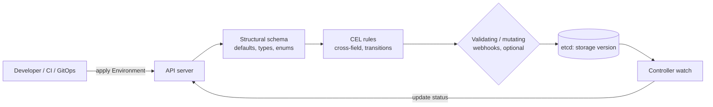

# Kubernetes CRDs: Design, Validation, Versioning, and Status

## Learning Objectives
- Design a custom resource's `spec` and `status` so that it expresses intent, reports observed state, and stays evolvable
- Write structural OpenAPI v3 schemas with defaults, enums, and bounds that the API server enforces
- Use CEL validation rules (`x-kubernetes-validations`) for cross-field and transition rules without a webhook
- Serve multiple versions of a CRD and write a conversion webhook when schemas differ
- Report status with `metav1.Condition` following the Kubernetes conventions, so `kubectl wait` and GitOps tools work
- Apply the platform's `platform.mycompany.io/v1alpha1` contract to `Tenant`, `Environment`, and `Workload`

## Prerequisites
- [Kubernetes API Primer](../01-kubernetes-fundamentals/api-primer.md) — API groups, versions, and verbs
- [Controllers and Operators](../01-kubernetes-fundamentals/controllers-operators.md) — the reconcile pattern
- [Platform API Design](platform-api-design.md) — why the Kubernetes-style API is the system of record
- Go basics; familiarity with JSON Schema helps but is not required

---

## What a CRD Is

A `CustomResourceDefinition` (CRD) teaches the API server a new kind of object. Once it is installed, `kubectl`, RBAC, admission, audit, watch, GitOps, and every client library work for it without extra code. That is the reason the platform uses CRDs as its API: you get the whole Kubernetes control surface for the cost of a schema.



The API server applies validation in order: structural schema (types, enums, bounds), defaulting, CEL rules, then any webhooks. Use the cheapest layer that expresses the rule. Schemas and CEL run in-process in the API server; webhooks add a network hop and a failure mode.

---

## Designing the Spec

The spec is the contract with users. Design it before the controller.

### Spec Rules

| Rule | Why | Example |
|------|-----|---------|
| Describe intent, not implementation | The controller can change how it fulfills intent without a new API version | `spec.type: preview`, not `spec.helmChart: ...` |
| Use enums for closed sets | Typos fail at apply time | `type: enum: [dev, staging, prod, preview]` |
| Bound every string and array | Protects etcd and the controller from unbounded input | `maxLength: 63`, `maxItems: 32` |
| Make optional fields defaultable | Users write less; the default is documented in one place | `replicas` defaults to `1` |
| Prefer typed fields over `x-kubernetes-preserve-unknown-fields` | Unknown structure is unvalidated structure | Avoid free-form `config: {}` unless the trait type defines a schema |
| Keep `spec` free of status | Status written by clients is overwritten or ignored | Observed replicas belong in `status` |

### The Environment Spec

The contract for `Environment` is `spec {tenant, type, ttl, template, cluster}` and `status {phase, namespace, url, expiresAt, conditions}`. The schema below is a target design that encodes the rules that matter.

!!! note "Target design, not yet in `code/environment-operator`"
    The [generated CRD in the repository](https://github.com/GitOpsHub/platform-engineering-on-kubernetes/blob/main/code/environment-operator/config/crd/bases/platform.mycompany.io_environments.yaml) is simpler. It requires only `tenant` and `type`, defaults `type` to `dev` and `template` to `baseline`, has no `ttl` pattern, no `status.phase` enum and no `x-kubernetes-validations` (CEL) rules. Its phases are `Pending`, `Ready`, `Failed`, `Expired` and `Terminating`. The CEL rules below are a proposal; to adopt them, add `+kubebuilder:validation:XValidation` markers to `api/v1alpha1/environment_types.go` and run `make manifests`.

```yaml
# target design (not the generated config/crd/bases/platform.mycompany.io_environments.yaml)
apiVersion: apiextensions.k8s.io/v1
kind: CustomResourceDefinition
metadata:
  name: environments.platform.mycompany.io
spec:
  group: platform.mycompany.io
  names:
    kind: Environment
    listKind: EnvironmentList
    plural: environments
    singular: environment
    shortNames: [env]
  scope: Namespaced
  versions:
    - name: v1alpha1
      served: true
      storage: true
      subresources:
        status: {}                         # separate endpoint for status writes
      additionalPrinterColumns:
        - name: Type
          type: string
          jsonPath: .spec.type
        - name: Phase
          type: string
          jsonPath: .status.phase
        - name: Expires
          type: date
          jsonPath: .status.expiresAt
      schema:
        openAPIV3Schema:
          type: object
          required: [spec]
          properties:
            spec:
              type: object
              required: [tenant, type, template, cluster]   # ttl is required by CEL for non-prod only
              properties:
                tenant:
                  type: string
                  minLength: 1
                  maxLength: 63
                  pattern: '^[a-z0-9]([-a-z0-9]*[a-z0-9])?$'
                type:
                  type: string
                  enum: [dev, staging, prod, preview]
                ttl:
                  type: string
                  pattern: '^([0-9]+(\.[0-9]+)?(ns|us|µs|ms|s|m|h))+$'
                  description: Go-style duration.
                template:
                  type: string
                  minLength: 1
                  maxLength: 63
                cluster:
                  type: string
                  minLength: 1
              x-kubernetes-validations:            # proposal: no CEL rules in code/ yet
                - rule: "self.type != 'prod' || !has(self.ttl)"
                  message: "prod environments do not expire; remove spec.ttl"
                - rule: "self.type == 'prod' || has(self.ttl)"
                  message: "spec.ttl is required for non-prod environments"
                - rule: "self.type != 'preview' || self.ttl.endsWith('h') || self.ttl.endsWith('m')"
                  message: "preview ttl must be expressed in hours or minutes"
                - rule: "self.tenant == oldSelf.tenant"
                  message: "spec.tenant is immutable"
                  reason: FieldValueForbidden
                - rule: "self.type == oldSelf.type"
                  message: "spec.type is immutable; create a new environment instead"
                  reason: FieldValueForbidden
            status:
              type: object
              properties:
                phase:
                  type: string
                  enum: [Pending, Ready, Failed, Expired, Terminating]   # the phases the operator writes
                namespace:
                  type: string
                url:
                  type: string
                expiresAt:
                  type: string
                  format: date-time
                conditions:
                  type: array
                  items:
                    type: object
                    required: [type, status, reason, lastTransitionTime]
                    properties:
                      type: { type: string, maxLength: 316 }
                      status: { type: string, enum: ["True", "False", "Unknown"] }
                      reason: { type: string, maxLength: 1024, pattern: '^[A-Za-z]([A-Za-z0-9_,:]*[A-Za-z0-9_])?$' }
                      message: { type: string, maxLength: 32768 }
                      lastTransitionTime: { type: string, format: date-time }
                      observedGeneration: { type: integer, format: int64, minimum: 0 }
```

A few details matter here:

- **Field-level `format: date-time` and `pattern` checks are enforced by the API server.** A malformed `ttl` never reaches the controller.
- **The `ttl` pattern accepts durations but not their values.** `ttl: 9999h` passes the schema. A cap belongs in the controller (or in a CEL rule with a `self.ttl` comparison, which requires parsing); the reference operator does not enforce one yet.
- **Transition rules** (`self == oldSelf || ...`) run on updates only and compare the old and new object. They replace a large class of validating webhooks.
- **Status fields are declared in the CRD** even though the controller writes them. This lets the API server validate what the controller writes and makes the status visible to `kubectl explain`.

The Go types that generate this schema are shown in [Controller Runtime](controller-runtime.md#the-api-types).

---

## Structural Schemas

A CRD is accepted only if its schema is **structural**. The rules are simple and enforced:

1. Every field in the schema has a `type` (except within `x-kubernetes-int-or-string` or `x-kubernetes-preserve-unknown-fields`, which should be rare).
2. Every field under `properties` or `items` is itself specified.
3. Forbidden at the top level of a field: `allOf`, `anyOf`, `oneOf`, `not`, and `$ref` (without an explicit structural form). Use `x-kubernetes-*` extensions for union-like behavior.
4. `metadata` may only restrict `name` and `generateName`.

Structural schemas are what make pruning and defaulting possible. **Pruning** removes fields that are not in the schema, so a misspelled `ttL` is silently dropped unless the API server is configured to reject it. **Defaulting** fills fields from `default:`.

```yaml
# Defaulting in the schema, applied on read and write
replicas:
  type: integer
  format: int32
  minimum: 0
  maximum: 100
  default: 1
```

### Pruning Is Silent by Default

Pruning means an unknown field is removed and the request still succeeds. For a platform API, that is dangerous: a typo in `ttl` yields an environment that never expires. Options:

| Option | Behavior | When to use |
|--------|----------|-------------|
| Accept and prune (default) | Unknown fields dropped silently | Only if clients are generated and version-locked |
| `kubectl apply --validate=strict` (client) | Client warns or fails on unknown fields | Developer workflows; CI |
| Server-side field validation (`fieldValidation=Strict`) | API server rejects unknown fields | Automation that applies many manifests |
| Your own admission webhook | Custom rules | Only when schemas cannot express the rule |

Make `fieldValidation=Strict` the CI default. A dry run catches typos before they reach the cluster:

```bash
kubectl apply --dry-run=server --field-validation=Strict -f environment-checkout-pr-482.yaml
```

---

## CEL Validation Rules

Common Expression Language (CEL) rules attach to a schema node with `x-kubernetes-validations`. They run in the API server with a cost budget. They replace many validating webhooks and run without a separate deployment to keep alive.

### Syntax

```yaml
x-kubernetes-validations:
  - rule: "self.minReplicas <= self.maxReplicas"   # self = this node's value
    message: "minReplicas must not exceed maxReplicas"
    messageExpression: "'minReplicas (' + string(self.minReplicas) + ') exceeds maxReplicas (' + string(self.maxReplicas) + ')'"
    reason: FieldValueInvalid
```

| Variable | Meaning |
|----------|---------|
| `self` | The value of the node the rule is attached to |
| `oldSelf` | The previous value, available only on updates; use it for transition rules |
| `has(self.field)` | Presence check for optional fields |

Rules on the **root** of `spec` see the whole spec. Rules on a list item see that item. Use `self.all(x, ...)` and `self.exists(x, ...)` for list checks.

### The Tenant Rules

The `Tenant` spec in this repository has a reserved-namespace rule. It is written as a marker on the spec type, so `controller-gen` emits it into the CRD:

```go
// code/tenant-operator/api/v1alpha1/tenant_types.go (excerpt)
// +kubebuilder:validation:XValidation:rule="!has(self.namespaces) || self.namespaces.all(n, !n.startsWith('kube-') && !(n in ['default', 'kube-system', 'kube-public', 'kube-node-lease']))",message="tenant namespaces must not use reserved names (default, kube-*)"
type TenantSpec struct {
	// ...
}
```

The equivalent YAML that ends up in the generated CRD:

```yaml
x-kubernetes-validations:
  - rule: "!has(self.namespaces) || self.namespaces.all(n, !n.startsWith('kube-') && !(n in ['default', 'kube-system', 'kube-public', 'kube-node-lease']))"
    message: "tenant namespaces must not use reserved names (default, kube-*)"
```

Two more rules a tenant should have:

```yaml
# Quota values must parse as quantities; the pattern in the schema catches most cases,
# and CEL can check that the quantity is positive.
x-kubernetes-validations:
  - rule: "!has(self.quota.cpu) || quantity(self.quota.cpu).isGreaterThan(quantity('0'))"
    message: "quota.cpu must be greater than zero"
  - rule: "!has(self.owners) || size(self.owners) <= 10"
    message: "a tenant may list at most 10 owners; use a group instead"
```

The `quantity()` function is available in current Kubernetes releases and is the right way to compare resource quantities in CEL.

### Transition Rules

Transition rules compare `self` and `oldSelf` and are the most valuable use of CEL. Two rules that prevent real incidents:

```yaml
# Immutable after creation
- rule: "self.tenant == oldSelf.tenant"
  message: "spec.tenant is immutable"

# Example policy: quota may grow freely but not shrink in one step. Whether a team
# wants this rule is a platform decision; it is shown here as a transition-rule pattern.
- rule: "!has(oldSelf.quota) || !has(self.quota) || quantity(self.quota.cpu).compareTo(quantity(oldSelf.quota.cpu)) >= 0"
  message: "quota.cpu may not decrease; scale down workloads first"
```

Transition rules apply only when `oldSelf` exists. For a rule that must also run on create, combine it with a `self == oldSelf || ...` guard as in the Environment example, or write the rule so it is true on create.

### Cost and Limits

CEL rules have a cost estimate. The API server rejects rules that could exceed the per-request budget. Practical limits:

- Prefer O(1) checks over `all()` on large lists. Keep `maxItems` small (the Tenant limits namespaces to 32 for this reason).
- A rule that iterates `self.all(...)` over an unbounded list fails the CRD install, not the object write, so run `kubectl apply` on the CRD in CI.
- Use `messageExpression` to make errors specific. Generic messages are the most common cause of support tickets about validation.

### Ratcheting

When you tighten a rule, existing objects may become invalid. Kubernetes supports **validation ratcheting** for some built-in and CRD validations so that unchanged fields are not re-validated on unrelated updates. Do not rely on it for your own rules without testing: write a migration plan for existing objects before tightening.

---

## Versioning

A CRD can serve several versions at once. Each version has its own schema. Exactly one version is the **storage version**, which determines how objects are persisted in etcd.

```yaml
versions:
  - name: v1alpha1
    served: true
    storage: true
    schema: { openAPIV3Schema: { ... } }
  - name: v1beta1
    served: true
    storage: false
    schema: { openAPIV3Schema: { ... } }
```

### When You Need a New Version

| Change | New version needed? |
|--------|---------------------|
| Add an optional field | No |
| Add an enum value | No, but document it |
| Rename or remove a field | Yes |
| Change a field's type | Yes |
| Change the meaning of a field | Yes |
| Tighten a validation that existing objects violate | Yes, or migrate the objects first |

### Conversion Between Versions

If two served versions have different schemas, the API server must convert objects between them. Two strategies:

| Strategy | How | Use when |
|----------|-----|----------|
| `None` | API server changes only `apiVersion`; fields must be identical | Versions differ only in metadata or in backward-compatible ways |
| `Webhook` | API server calls a conversion webhook over HTTPS | Fields are renamed, restructured, or need computed values |

For `Webhook`, the CRD references a service and a CA bundle:

```yaml
spec:
  conversion:
    strategy: Webhook
    webhook:
      conversionReviewVersions: ["v1"]
      clientConfig:
        service:
          namespace: platform-system
          name: environment-operator-webhook
          path: /convert
          port: 443
        caBundle: <base64 CA certificate>    # managed by cert-manager's cainjector in practice
```

A conversion webhook is a server in the controller binary (it can share the manager's HTTP server). It must be:

- **Lossless in both directions.** Store information that the target version cannot express in an annotation, so that a round trip returns the original object.
- **Fast and stateless.** Every read of an old version calls it.
- **Highly available.** If it is down, reads and writes of the converted versions fail.

### The Migration Recipe

When you introduce a new version with a breaking change:

1. **Add** the new version with `served: true` and `storage: false`. Add the conversion webhook.
2. **Deploy** the controller that understands both versions. Test round trips in envtest (see [Controller Runtime](controller-runtime.md#testing-with-envtest)).
3. **Migrate clients** to the new version. Measure usage by version with audit logs.
4. **Switch storage**: set the new version to `storage: true` and the old to `false`. Existing objects are converted on their next write, or you rewrite them with `kubectl get ... -o yaml | kubectl replace -f -` (run in a maintenance window, and only after the webhook is tested).
5. **Deprecate** the old version after the window in [Platform API Design](platform-api-design.md#deprecation-policy). Remove it from `versions` only when no stored objects and no clients use it.

> Step 4 is the one that causes incidents. Storage version changes do not rewrite existing objects immediately. Plan for objects to exist in both shapes until a rewrite completes.

---

## Status and Conditions

Status is where the controller reports what it observed. Two conventions make status useful: **conditions** for detail, and **phase** for a summary.

### Conditions

Use `metav1.Condition` from `k8s.io/apimachinery`, which has a fixed shape: `type`, `status` (`True`, `False`, `Unknown`), `reason` (a CamelCase machine-readable word), `message` (human text), `lastTransitionTime`, and `observedGeneration`.

| Field | Rule |
|-------|------|
| `type` | Positive, state-describing noun or adjective: `Ready`, `NamespacesReady`, `QuotaReady`. Avoid negatives like `NotReady` |
| `status` | `True` when the condition holds; `False` when it does not; `Unknown` when unsure |
| `reason` | Stable, machine-readable; clients may switch on it |
| `message` | Free text for humans; may change between releases |
| `observedGeneration` | The `metadata.generation` the condition was computed from |

The conditions in the repository's Tenant status (`Ready`, `NamespacesReady`, `QuotaReady`, `NetworkPolicyReady`, `RBACReady`) follow this pattern. A tenant is `Ready` only when every sub-condition is `True`.

```go
// code/tenant-operator/controllers/status.go (illustrative pattern)
package controllers

import (
	"k8s.io/apimachinery/pkg/api/meta"
	metav1 "k8s.io/apimachinery/pkg/apis/meta/v1"

	platformv1alpha1 "github.com/mycompany/tenant-operator/api/v1alpha1"
)

// setReady derives the aggregate Ready condition from its parts.
// It is the only place that decides Phase, so the two cannot disagree.
func setReady(t *platformv1alpha1.Tenant) {
	parts := []string{
		platformv1alpha1.ConditionNamespacesReady,
		platformv1alpha1.ConditionQuotaReady,
		platformv1alpha1.ConditionNetworkReady,
		platformv1alpha1.ConditionRBACReady,
	}

	for _, p := range parts {
		c := meta.FindStatusCondition(t.Status.Conditions, p)
		if c == nil || c.Status != metav1.ConditionTrue {
			meta.SetStatusCondition(&t.Status.Conditions, metav1.Condition{
				Type:               platformv1alpha1.ConditionReady,
				Status:             metav1.ConditionFalse,
				Reason:             "ComponentNotReady",
				Message:            p + " is not True",
				ObservedGeneration: t.Generation,
			})
			t.Status.Phase = platformv1alpha1.PhasePending
			return
		}
	}

	meta.SetStatusCondition(&t.Status.Conditions, metav1.Condition{
		Type:               platformv1alpha1.ConditionReady,
		Status:             metav1.ConditionTrue,
		Reason:             "AllComponentsReady",
		Message:            "all tenant components reconciled",
		ObservedGeneration: t.Generation,
	})
	t.Status.Phase = platformv1alpha1.PhaseReady
}
```

Notes:

- `meta.SetStatusCondition` only updates `lastTransitionTime` when the `status` changes. That is the behavior you want: a condition that stays `True` for a week should show the week-old transition time.
- `ObservedGeneration` lets a client tell whether the condition reflects the current spec. A `Ready` condition with `observedGeneration: 3` while `metadata.generation` is `4` means the controller has not caught up.
- Conditions are listed with `listType=map` and `listMapKey=type`. This makes merge patches on status safe for concurrent writers.

### Phase

`phase` is a single string for dashboards and simple checks (`kubectl get tenants` printer columns). It is derived from conditions, never set independently. The Tenant phases are `Pending`, `Ready`, `Failed`, and `Terminating`.

### What Clients Can Do With Conditions

```bash
# Block until the environment is ready (fails after 10 minutes)
kubectl wait environment/checkout-pr-482 -n team-payments \
  --for=condition=Ready --timeout=10m

# Check a specific condition with JSONPath
kubectl get environment checkout-pr-482 -n team-payments \
  -o jsonpath='{.status.conditions[?(@.type=="Ready")].message}'
```

Argo CD and Flux health checks read conditions, so getting `Ready` right has effects beyond your own tooling.

---

## Deletion, Finalizers, and Owner References

Two Kubernetes mechanisms control deletion, and CRDs use both.

- **Owner references** make the garbage collector delete dependents when the owner is deleted. A `Namespace` owned by a `Tenant` is removed when the tenant is deleted. A cluster-scoped dependent may have a cluster-scoped owner; a namespaced dependent may have a cluster-scoped owner. A cluster-scoped dependent cannot have a namespaced owner.
- **Finalizers** block deletion until the controller removes its entry. Use them when cleanup involves something the garbage collector cannot see, such as a DNS record or a cloud resource.

Details and code are in [Controller Runtime: Finalizers](controller-runtime.md#finalizers).

---

## Admission Webhooks: When You Really Need One

Prefer schema and CEL. Reach for a validating or mutating admission webhook only when the rule needs something CEL cannot do:

| Need | Use |
|------|-----|
| Check against another object (for example, the tenant's quota usage across all environments) | Webhook, or a controller that sets a condition |
| Call an external system (approval service, cost API) | Webhook, carefully: timeouts and failure policy matter |
| Set defaults that depend on other objects | Mutating webhook |
| Shape-only or cross-field checks on one object | CEL |

A webhook that fails closed (`failurePolicy: Fail`) makes the whole API unavailable for that resource when it is down. Use `Ignore` for non-critical checks and monitor the webhook's availability as a platform SLO.

---

## Hands-On Exercises

### Exercise 1: Add a Validated, Versioned Field and Prove It Round-Trips

**Goal:** Install the `Environment` CRD, test its validation, add a defaulted field, and (as a stretch) add a second version.

**Before you start:** the kind cluster from [Lab 01](../../labs/lab-01-cluster-setup/README.md).

1. **Install the CRD** and inspect it:

   ```bash
   kubectl config use-context kind-platform-engineering
   make -C code/environment-operator install
   kubectl explain environment.spec
   ```

   Expected output: the `spec` fields (`tenant`, `type`, `ttl`, and the rest) are listed.
2. **Test strict validation.** Save the manifest below as `typo.yaml` and apply it twice:

   ```yaml
   apiVersion: platform.mycompany.io/v1alpha1
   kind: Environment
   metadata:
     name: typo-test
     namespace: default
   spec:
     tenant: payments
     tpye: preview   # typo for "type"
   ```

   ```bash
   kubectl apply -f typo.yaml --dry-run=server --field-validation=Strict
   kubectl apply -f typo.yaml --dry-run=server --field-validation=Ignore
   ```

   Expected output: the first command fails with `unknown field "spec.tpye"`; the second succeeds and silently prunes the field. Write down the difference.
3. **Test CEL.** The reference CRD in `code/` has no CEL rules yet. Add the Environment rules from "The Environment Spec" and the transition rule from "Transition Rules" above as `+kubebuilder:validation:XValidation` markers on the Go types, then run `make -C code/environment-operator manifests install`. Apply a `type: prod` environment with a `ttl`; the root rule rejects it with your message.
4. **Test immutability.** Create a `preview` environment, then patch `spec.type` to `dev`:

   ```bash
   kubectl patch environment <name> --type=merge -p '{"spec":{"type":"dev"}}'
   ```

   Replace `<name>` with your environment's name. Expected: the transition rule rejects the patch.
5. **Add a field.** Add an optional `spec.autoExtend` boolean with `default: false`, run `make -C code/environment-operator manifests install`, and read back an old object:

   ```bash
   kubectl get environment <name> -o jsonpath='{.spec.autoExtend}{"\n"}'
   ```

   Expected output: `false`.
6. **Stretch.** Add `v1beta1` with a renamed field (`ttl` becomes `lifetime`) and a conversion webhook. Write a round-trip test that converts `v1alpha1` to `v1beta1` and back, and asserts the object is unchanged.

**Check:**

- [ ] Every rule rejects with the intended message.
- [ ] The typo is caught in strict mode.
- [ ] The round-trip test passes.

---

## Troubleshooting

### `CustomResourceDefinition ... is invalid: spec.validation.openAPIV3Schema ... must be structural`

**Cause:** Schema uses `oneOf`/`anyOf` at the field level or lacks `type`

**Fix:** Make it structural; use `x-kubernetes-*` or split into fields

### Field silently disappears after apply

**Cause:** Not in the schema, so it was pruned

**Fix:** Add it to the schema; apply with `--field-validation=Strict` to catch it

### `Forbidden: ... Rule ... cost` at CRD install

**Cause:** CEL rule iterates a large list or is too expensive

**Fix:** Bound `maxItems`; simplify the rule; move the check to the controller

### Rule passes on create but not on update

**Cause:** A transition rule referencing `oldSelf` runs only on update.

**Fix:** Add a guard such as `self == oldSelf || <condition>`, or write the rule so create passes.

### Conversion errors listing old objects

**Cause:** Webhook not reachable, CA bundle wrong, or not lossless

**Fix:** Check the service endpoint and `caBundle`; test round trips

### `kubectl wait` times out but the resource looks fine

**Cause:** Condition `Ready` never set to `True`, or `observedGeneration` lags

**Fix:** Read `status.conditions` with JSONPath; check the controller logs

### Status update returns conflict

**Cause:** Stale `resourceVersion`

**Fix:** Re-read and retry; use `Status().Update` with a fresh object

### Editing an old version returns the new schema's errors

**Cause:** Storage and served versions disagree on validation

**Fix:** Keep validation equivalent across served versions, or document the difference


---

## Further Reading

- [Extend the Kubernetes API with CustomResourceDefinitions](https://kubernetes.io/docs/tasks/extend-kubernetes/custom-resources/custom-resource-definitions/)
- [Validation rules for CRDs (CEL)](https://kubernetes.io/docs/tasks/extend-kubernetes/custom-resources/custom-resource-definitions/#validation-rules)
- [Versions in CustomResourceDefinitions](https://kubernetes.io/docs/tasks/extend-kubernetes/custom-resources/custom-resource-definition-versioning/)
- [Structural schemas](https://kubernetes.io/docs/tasks/extend-kubernetes/custom-resources/custom-resource-definitions/#specifying-a-structural-schema)
- [Common Expression Language (CEL) specification](https://github.com/google/cel-spec)
- [CEL in Kubernetes: `kubernetes-sigs/cel` libraries reference](https://kubernetes.io/docs/reference/using-api/cel/)
- [Kubernetes API Conventions: Typical status properties](https://github.com/kubernetes/community/blob/master/contributors/devel/sig-architecture/api-conventions.md#typical-status-properties)
- [controller-tools markers reference](https://book.kubebuilder.io/reference/markers/crd-validation)

---

## Next Steps

1. **Write the controllers**: [Controller Runtime](controller-runtime.md) — kubebuilder, reconcile loops, owner references, finalizers, envtest
2. **Expose them consistently**: [Platform API Design](platform-api-design.md) — the REST facade over these resources
3. **Route traffic to what they create**: [API Gateway](api-gateway.md)
4. **Build a CRD and controller end to end**: [Lab 03: Platform API](../../labs/lab-03-platform-api/README.md)
