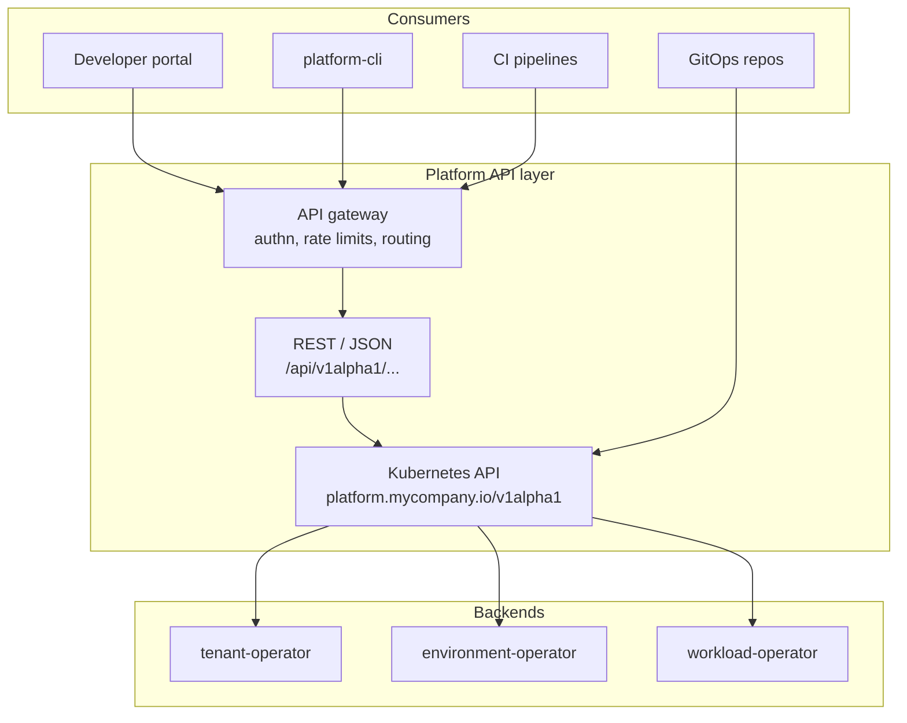
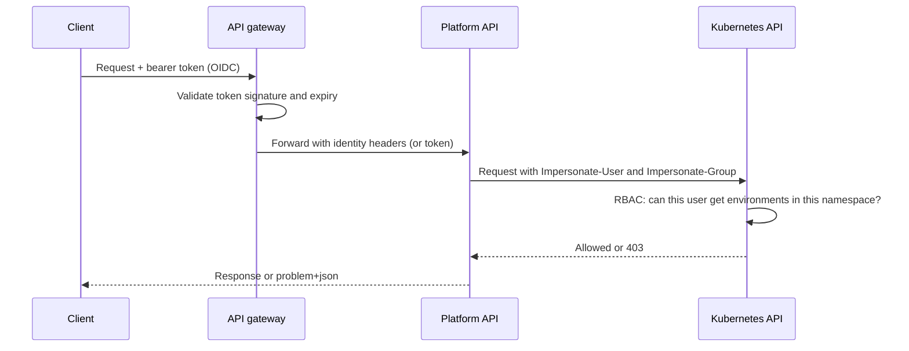

# Platform API Design: REST, gRPC, Versioning, and Kubernetes-Style APIs

## Learning Objectives
- Decide when a platform API should be REST, gRPC, or a Kubernetes-style API, and explain the trade-off to a team that disagrees
- Design resources, collections, and actions so that the API stays stable while the implementation changes
- Apply a versioning policy that lets you ship breaking changes without breaking tenants
- Explain why a Kubernetes-style API (group, version, kind, spec and status, reconciliation) is a strong default for a platform
- Read the Platform API contract used in this repository and map each route to the underlying custom resource
- Plan errors, pagination, idempotency, authentication, and authorization as part of the API, not as afterthoughts

## Prerequisites
- [Kubernetes API Primer](../01-kubernetes-fundamentals/api-primer.md) — resources, verbs, API groups, and versions
- [RBAC](../01-kubernetes-fundamentals/rbac.md) — how Kubernetes authorizes requests
- [Platform Capabilities](../07-internal-developer-platform/platform-capabilities.md) — the capabilities this API exposes
- Basic HTTP and Protocol Buffers familiarity

---

## What a Platform API Is For

A platform API is the contract between the platform and everything that consumes it: the developer portal, the CLI, CI pipelines, GitOps repositories, and other platform components. Every capability in [Platform Capabilities](../07-internal-developer-platform/platform-capabilities.md) should be reachable through it. The portal and CLI are clients of the API, not the source of truth.



The important design point is the arrow from the REST layer into the Kubernetes API. The REST facade does not hold state. It translates HTTP requests into operations on custom resources. That keeps one source of truth (the cluster), gives GitOps a native way in, and means the platform's authorization model is Kubernetes RBAC rather than a second system.

---

## Choosing a Protocol

| Criterion | REST / JSON | gRPC / Protobuf | Kubernetes-style (CRDs) |
|-----------|-------------|-----------------|-------------------------|
| Primary audience | Browsers, portals, third-party tools, scripts | Internal services, high-throughput clients | Anything that can talk to a Kubernetes API server |
| Human readability | High (curl, browser) | Low without tooling | High (`kubectl get -o yaml`) |
| Schema | OpenAPI (optional, often drifts) | `.proto` files (enforced at compile time) | OpenAPI schema generated from Go types; enforced by the API server |
| Streaming | Server-Sent Events, WebSocket | Native bidirectional streams | Watch (long-poll over HTTP) |
| Tooling | Everywhere | Strong codegen, weaker browser support | `kubectl`, client-go, controller-runtime, GitOps |
| Authorization | Whatever you build | Interceptors you build | Kubernetes RBAC, admission, audit |
| Versioning | URL or header, by convention | Package names, by convention | Built in: group, version, conversion |
| Status and reconciliation | You design it | You design it | Built in: `spec`, `status`, conditions, generations |

### Recommendation

- **Make the Kubernetes-style API the system of record** for anything that has a desired state and runs continuously: tenants, environments, workloads.
- **Expose a REST facade** for consumers that are not Kubernetes clients (portals, CI scripts, external tools). Generate the OpenAPI spec and keep it small.
- **Use gRPC only** when an internal service needs high-volume, low-latency calls with streaming, such as a policy decision point called on every admission request or a telemetry ingestion path. Do not use gRPC for the public platform surface unless you have a strong reason; browsers and most scripting environments still need JSON.

A common failure is building a REST API that duplicates the Kubernetes API poorly: its own storage, its own status, its own retry logic, and its own authorization. You will spend the next year reimplementing what the API server already gives you.

---

## Resource Modeling

Model the platform in nouns that match how people think about it, then keep the verbs few. The platform's resources in this repository's API contract (group `platform.mycompany.io`, version `v1alpha1`) are:

| Resource | Scope | Purpose | Owner |
|----------|-------|---------|-------|
| `Tenant` | Cluster | A team or business unit that owns namespaces, quota, and access | Platform team (created by a self-service request or onboarding) |
| `Environment` | Namespaced | A running instance of a service for a purpose: preview, dev, staging, or prod | Tenant (via API, CLI, or CI) |
| `Workload` | Namespaced | A deployable service: image, replicas, port, env, resources, and traits | Tenant |

Each resource follows the same shape:

```yaml
apiVersion: platform.mycompany.io/v1alpha1
kind: Workload
metadata:
  name: checkout
  namespace: team-payments
spec:
  image: registry.mycompany.io/payments/checkout:1.14.2
  replicas: 3
  port: 8080
  env:
    - name: LOG_LEVEL
      value: info
  resources:
    requests: { cpu: 250m, memory: 256Mi }
    limits:   { cpu: "1",  memory: 512Mi }
  traits:
    - type: autoscaling
      config: { minReplicas: 3, maxReplicas: 12, targetCPUUtilization: 70 }
    - type: pdb
      config: { minAvailable: 2 }
    - type: ingress
      config: { host: checkout.payments.mycompany.io, tls: true }
status:
  phase: Available
  readyReplicas: 3
  conditions:
    - type: Ready
      status: "True"
      reason: MinimumReplicasAvailable
      lastTransitionTime: "2026-10-24T09:12:44Z"
```

### Resource Design Rules

1. **Declare desired state in `spec`, observed state in `status`.** Never let clients write `status`. This is a Kubernetes convention and it is what makes reconciliation work.
2. **Prefer a small set of nouns over many verbs.** A `Workload` with `traits` is more maintainable than `POST /workloads/{id}/scale`, `POST /workloads/{id}/expose`, and so on. Traits add capabilities without new endpoints.
3. **Make names user-chosen and stable; make IDs system-chosen.** In Kubernetes, `metadata.name` is the identifier. Avoid a second opaque `id` field.
4. **Use enums for closed sets.** `Environment.spec.type` is `dev | staging | prod | preview`. Validation belongs in the schema (see [Kubernetes CRDs](kubernetes-crds.md)), not in handler code.
5. **Model time as timestamps, durations as durations.** `expiresAt` is an RFC 3339 timestamp in status; `ttl` is a Go-style duration in spec (`72h`).
6. **Avoid leaking implementation.** Do not expose `deploymentName` or `helmReleaseName` as fields clients must set. Clients express intent; the platform chooses how.

---

## Routes and Operations

The REST facade maps HTTP paths to the resources above. The routes in `code/platform-api/openapi.yaml` follow a consistent pattern:

| Method | Path | Operation |
|--------|------|-----------|
| `GET` | `/healthz`, `/readyz`, `/version` | Liveness, readiness, and build information |
| `GET` | `/api/v1alpha1/platform` | Platform summary: versions, capabilities, cluster list |
| `GET` | `/api/v1alpha1/tenants` | List tenants (cluster-scoped) |
| `GET` | `/api/v1alpha1/tenants/{name}` | Get one tenant |
| `GET` | `/api/v1alpha1/environments` | List environments across namespaces the caller can read |
| `GET` | `/api/v1alpha1/namespaces/{namespace}/environments` | List environments in one namespace |
| `GET` | `/api/v1alpha1/namespaces/{namespace}/environments/{name}` | Get one environment |
| `GET` | `/api/v1alpha1/workloads` | List workloads across namespaces |
| `GET` | `/api/v1alpha1/namespaces/{namespace}/workloads` | List workloads in one namespace |
| `GET` | `/api/v1alpha1/namespaces/{namespace}/workloads/{name}` | Get one workload |
| `GET` | `…/{resource}?watch=true` | Stream changes as newline-delimited JSON, opened as the caller |
| `POST` | `/api/v1alpha1/access-reviews` | "Can the caller do this?" via a SelfSubjectAccessReview with the caller's identity |

Writes are `POST` to the collection, `PUT` or `PATCH` to the item, and `DELETE` on the item. Where the list above is read-only, the write methods are defined in the same spec and follow the same authorization rules.

### Why Resources and Not RPC Verbs

An RPC-style API (`/createEnvironment`, `/extendTtl`, `/scaleWorkload`) is easy to start with and hard to keep. Each new action becomes a new endpoint, a new permission, a new client method, and a new test. A resource API stays uniform: every resource can be listed, read, created, updated, and deleted, and the same authorization and audit apply to all of them.

When an operation is genuinely an action (something that is not a state change on one resource), model it as a sub-resource. Kubernetes does this with `pods/exec` and `deployments/scale`. For the platform, a manual promotion is a good example:

```http
POST /api/v1alpha1/namespaces/team-payments/environments/checkout-staging/promotion
Content-Type: application/json

{ "fromWorkload": "checkout", "toEnvironment": "checkout-prod", "image": "registry.mycompany.io/payments/checkout:1.14.2" }
```

Treat the sub-resource as a create (returns `202 Accepted` with a link to the resulting object) rather than a synchronous mutation. Promotions take minutes; the API should say so.

---

## Versioning

Versioning is how the platform changes without breaking the people who depend on it. Choose a policy once, write it down, and enforce it in review.

### Version Levels

| Version | Meaning | Stability promise | Typical length |
|---------|---------|-------------------|----------------|
| `v1alpha1` | Experimental; fields and behavior may change without notice | None; announce changes in release notes | Until the design settles |
| `v1beta1` | Feature complete for its scope; changes are compatible or announced | Breaking changes need a new version and a conversion path | Several releases |
| `v1` | Stable | Breaking changes require a new major version and a deprecation window | Long term |

Kubernetes uses the same convention for APIs. The platform API should match it so that people who know Kubernetes can predict what `v1alpha1` means without reading the policy.

### Compatible vs Breaking Changes

| Change | Compatible? | Notes |
|--------|-------------|-------|
| Add an optional field | Yes | Clients that ignore unknown fields keep working |
| Add a new enum value | Usually | Breaks clients with exhaustive switches; document it |
| Add a new resource | Yes | |
| Make an optional field required | No | |
| Rename a field | No | Add the new name, deprecate the old one, remove later |
| Change a field's type or meaning | No | Requires a new version |
| Tighten validation | No | Existing objects may now be invalid; use ratcheting or a migration |
| Change a default | No | Behavior change for everyone who relied on it |

### Deprecation Policy

For a stable API, use a window that gives tenants real time to migrate, and state it:

1. **Announce** the deprecation in the release notes and in the API itself (a `deprecated` marker in the OpenAPI spec, or a warning header on responses).
2. **Keep it working** for the stated window (for example, two minor releases or six months, whichever is longer).
3. **Measure usage.** Know which tenants still call the old version. Audit logs and the API gateway's metrics can answer this.
4. **Remove** only when the usage is zero or the owners have agreed to a date.

In the Kubernetes world, the API server serves multiple versions of a resource at once and converts between them through a conversion webhook (see [Kubernetes CRDs](kubernetes-crds.md#conversion-between-versions)). The REST facade can do the same by translating a versioned request into the stored version.

### Running Two Versions Side by Side

```yaml
# A CRD serving both versions; only one is the storage version.
versions:
  - name: v1alpha1
    served: true
    storage: true
  - name: v1beta1
    served: true
    storage: false
```

Keep the storage version stable. Changing the storage version is a migration you run on purpose, not a side effect of a release.

---

## Request and Response Conventions

Consistency matters more than any particular choice. Pick these and apply them to every endpoint.

### Errors

Use one error shape everywhere. The following follows RFC 9457 (Problem Details for HTTP APIs), which replaces RFC 7807:

```json
{
  "type": "https://platform.mycompany.io/problems/quota-exceeded",
  "title": "Tenant quota exceeded",
  "status": 422,
  "detail": "Tenant payments has 2 CPUs of 8 remaining; the environment requests 4.",
  "instance": "/api/v1alpha1/namespaces/team-payments/environments",
  "requestId": "7f3c9a1e-2b4d-4f8a-9c3e-1a2b3c4d5e6f"
}
```

| HTTP status | When | Retry? |
|-------------|------|--------|
| `400 Bad Request` | Malformed JSON or unknown field | No |
| `401 Unauthorized` | No or invalid credentials | After re-authenticating |
| `403 Forbidden` | Authenticated but not allowed | No |
| `404 Not Found` | Resource does not exist or caller cannot see it | No |
| `409 Conflict` | Name exists, or a stale `resourceVersion` on update | After re-reading |
| `422 Unprocessable Entity` | Valid JSON that fails validation or business rules | No |
| `429 Too Many Requests` | Rate limit | Yes, after `Retry-After` |
| `503 Service Unavailable` | Backend or cluster unreachable | Yes, with backoff |

Return `404` instead of `403` when the caller should not know a resource exists. Be explicit about which policy you chose.

### Pagination

Use cursor-based pagination for collections that grow. Offsets skip or repeat items when the collection changes between pages.

```http
GET /api/v1alpha1/environments?limit=50&continue=eyJvZmZzZXQiOjUwfQ
```

```json
{
  "items": [ { "...": "..." } ],
  "continue": "eyJvZmZzZXQiOjEwMH0",
  "resourceVersion": "482193"
}
```

The Kubernetes list API uses the same pattern (`limit` and `continue`). Matching it means one client helper works for both.

### Filtering and Selecting

Support label selectors (`?labelSelector=platform.mycompany.io/tenant=payments`) before inventing a query language. Kubernetes clients already know them, and the API server indexes them.

### Idempotency

`POST` creates; a retried `POST` should not create a duplicate. Two approaches:

- **Client-supplied name.** Kubernetes returns `409` when the name exists. The client treats a `409` on retry as success if the existing object matches its intent.
- **Idempotency key.** For operations without a natural name (such as a promotion), accept an `Idempotency-Key` header and store the response for a window (for example, 24 hours).

### Long-Running Operations

Provisioning an environment takes minutes. Return `202 Accepted` with the created object. The client polls `status.phase` or subscribes to a watch. Do not hold the HTTP connection open for the duration.

---

## Authentication and Authorization

The API has three checks, and each belongs in a different layer.



| Layer | Question | Mechanism |
|-------|----------|-----------|
| Gateway | Is this a valid, unexpired caller? | OIDC token validation, rate limits |
| Platform API | Is this request well-formed and within policy? | Schema validation, business rules |
| Kubernetes | Is this user allowed to do this to this object? | RBAC, admission webhooks |

The key decision is whether the platform API calls Kubernetes **as the user** or **as itself**.

- **As the user** (impersonation, the model used by platform-api): Kubernetes RBAC decides everything. The platform API cannot grant more than the user already has. platform-api impersonates only the verified subject and only allowlisted tenant groups; it never forwards `system:*` groups. This is the right default for tenant-facing reads and writes. See [Custom Portal: Authorization](../07-internal-developer-platform/custom-portal.md#authorization-impersonation-through-platform-api).
- **As itself** (a service account): needed for background work such as provisioning, where the user should not need cluster-level rights. Give it a ClusterRole scoped to the resources it reconciles, and record the originating user in an annotation or audit field. The platform-api ServiceAccount itself holds only the impersonate rules described in [Custom Portal](../07-internal-developer-platform/custom-portal.md#what-platform-api-is-allowed-to-impersonate).

Never let the platform service account read everything and filter in application code. A bug in the filter becomes a cross-tenant data leak.

---

## Designing the Handler Layer

Handlers should be thin. They parse, authorize, call a single service function, and map the result. Business rules live in the service, which can be tested without HTTP.

```go
// code/platform-api/handlers/environments.go (sketch of the intended shape)
package handlers

import (
	"encoding/json"
	"net/http"

	"github.com/go-chi/chi/v5"
)

type EnvironmentService interface {
	Create(r *http.Request, namespace string, in EnvironmentInput) (*EnvironmentView, error)
	Get(r *http.Request, namespace, name string) (*EnvironmentView, error)
}

type EnvironmentHandler struct {
	svc EnvironmentService
}

func (h *EnvironmentHandler) Get(w http.ResponseWriter, r *http.Request) {
	namespace := chi.URLParam(r, "namespace")
	name := chi.URLParam(r, "name")

	env, err := h.svc.Get(r, namespace, name)
	if err != nil {
		writeProblem(w, r, err) // maps domain errors to problem+json
		return
	}
	writeJSON(w, http.StatusOK, env)
}

func (h *EnvironmentHandler) Create(w http.ResponseWriter, r *http.Request) {
	namespace := chi.URLParam(r, "namespace")

	var in EnvironmentInput
	dec := json.NewDecoder(r.Body)
	dec.DisallowUnknownFields() // unknown fields are a 400, not silently ignored
	if err := dec.Decode(&in); err != nil {
		writeProblem(w, r, ErrBadRequest(err))
		return
	}

	env, err := h.svc.Create(r, namespace, in)
	if err != nil {
		// writeProblem inspects the error: ErrQuotaExceeded maps to 422,
		// ErrNotFound to 404, and anything unrecognized to 500 with no detail.
		writeProblem(w, r, err)
		return
	}
	w.Header().Set("Location", "/api/v1alpha1/namespaces/"+namespace+"/environments/"+env.Name)
	writeJSON(w, http.StatusAccepted, env) // provisioning is asynchronous
}
```

Points to notice:

- `DisallowUnknownFields` turns a misspelled field (`ttL: 72h`) into an immediate error. Silently ignoring it means the developer gets a preview that never expires.
- The service interface takes `*http.Request` only to pull the caller identity from context. In production, pass a `context.Context` and a typed `Principal` instead; the sketch keeps the request for brevity.
- `Create` returns `202 Accepted` and a `Location` header. The environment is not ready yet.

---

## Generating the Contract

Write the contract once and generate the rest. Two sources of truth (hand-written OpenAPI and Go types) drift within a month.

- **Go types are the source.** The Kubernetes-style resources are defined as Go structs with kubebuilder markers; their CRD schema and OpenAPI are generated. See [Controller Runtime](controller-runtime.md).
- **REST OpenAPI is generated** from the same types where possible, or hand-written and checked in CI against the server with a contract test.
- **Clients are generated** from OpenAPI or built from the generated Go types. The `code/platform-api/client` package is the Go client; the CLI and portal use it rather than hand-rolled HTTP.

CI should fail when:

1. The OpenAPI spec differs from what the server serves (contract test).
2. A field is removed or changed type without a new version (`oasdiff` or equivalent breaking-change detection).
3. An example in the docs no longer validates against the schema.

```bash
# Breaking-change check between the main branch and the PR (illustrative)
oasdiff breaking origin/main:code/platform-api/openapi.yaml code/platform-api/openapi.yaml --fail-on ERR
```

---

## Hands-On Exercises

### Exercise 1: Review the API Contract and Make a Breaking Change Safely

**Goal:** Read the real contract, find a gap, classify four changes, and stage a rename across two releases.

**Before you start:** a clone of this repository and Go 1.22 or later. The contract is [`code/platform-api/openapi.yaml`](https://github.com/GitOpsHub/platform-engineering-on-kubernetes/tree/main/code/platform-api/openapi.yaml).

1. **List every path and method** in the contract:

   ```bash
   grep -nE '^  /|^    (get|post|put|patch|delete):' code/platform-api/openapi.yaml
   ```

   Expected output: one line per path, each followed by its methods. Confirm each `Workload` and `Environment` route maps to a resource in the `platform.mycompany.io/v1alpha1` group.
2. **Find a gap.** Identify one operation a developer would want that has no route, such as listing a tenant's environments through `/tenants/{name}/environments`. Write it as a resource-oriented route, not an RPC name.
3. **Classify each change** as compatible or breaking, and say why:
   - Add `spec.env[].valueFrom` to `Workload`.
   - Rename `spec.replicas` to `spec.desiredReplicas`.
   - Make `spec.port` required.
   - Change the default `ttl` for `preview` from `72h` to `24h`.
4. **Stage the rename.** Add `desiredReplicas` as optional, keep `replicas` working with a deprecation marker, and write a test that both fields produce the same result. Remove `replicas` only in a new version.
5. **Run the contract tests** in `code/platform-api`:

   ```bash
   cd code/platform-api && go test ./...
   ```

   Expected output: `ok` for each package. If your team has an OpenAPI diff tool in CI, run it on your branch and confirm it reports the rename as breaking only when `replicas` is removed.

**Check:**

- [ ] Every route is resource-oriented.
- [ ] The rename is staged across two releases.
- [ ] The tests pass before and after the removal.

---

## Troubleshooting

### Clients break after a release with no visible API change

**Cause:** Validation tightened, or a default changed

**Fix:** Treat as breaking; add ratcheting or a migration; revert the default

### `403` for users who should have access

**Cause:** RBAC on the object is correct but the handler acts as the service account instead of the caller, or the caller's groups were filtered out by the allowlist

**Fix:** Check which identity the handler uses and which groups platform-api forwarded; check `kubectl auth can-i --as <user> --as-group <group>`

### Duplicate environments after client retries

**Cause:** `POST` without a stable name or idempotency key

**Fix:** Use a generated name from the client, or accept `Idempotency-Key`

### `unknown field` errors from a new CLI

**Cause:** Client generated from a newer spec than the server

**Fix:** Pin the client to the server version; check the `/version` endpoint

### List results differ page to page

**Cause:** Offset pagination on a changing collection

**Fix:** Switch to `continue` tokens

### Long requests time out on create

**Cause:** Synchronous provisioning in the handler

**Fix:** Return `202` and poll or watch the resource

### OpenAPI and server disagree

**Cause:** Hand-edited spec, or generated types not regenerated

**Fix:** Add a contract test in CI; regenerate


---

## Further Reading

- [Kubernetes API Conventions](https://github.com/kubernetes/community/blob/master/contributors/devel/sig-architecture/api-conventions.md)
- [Kubernetes Deprecation Policy](https://kubernetes.io/docs/reference/using-api/deprecation-policy/)
- [RFC 9457: Problem Details for HTTP APIs](https://www.rfc-editor.org/rfc/rfc9457)
- [OpenAPI Specification 3.1](https://spec.openapis.org/oas/v3.1.0)
- [oasdiff: OpenAPI breaking-change detection](https://github.com/oasdiff/oasdiff)
- [gRPC: Core concepts](https://grpc.io/docs/what-is-grpc/core-concepts/)
- [Google API Design Guide](https://cloud.google.com/apis/design)
- [Lab 03: Platform API](../../labs/lab-03-platform-api/README.md)

---

## Next Steps

1. **Define the custom resources**: [Kubernetes CRDs](kubernetes-crds.md) — schemas, validation, and conversion
2. **Reconcile them**: [Controller Runtime](controller-runtime.md) — kubebuilder, the reconcile loop, and envtest
3. **Put a gateway in front**: [API Gateway](api-gateway.md) — routing, auth, and rate limits
4. **Build it**: [Lab 03: Platform API](../../labs/lab-03-platform-api/README.md)
