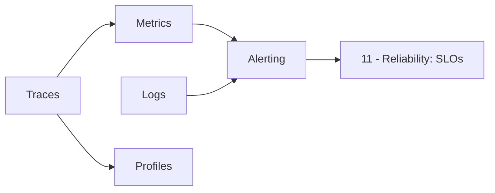

# 10 - Observability

How to build observability as a self-service platform capability: collect metrics, logs, traces, and profiles, correlate them in Grafana, and turn them into actionable alerts.

## Reading Order

| # | Document | Summary |
|---|----------|---------|
| 1 | [Metrics Stack](./metrics-stack.md) | Prometheus data model, kube-prometheus-stack, Operator CRDs, recording rules, and scaling with Thanos, Mimir, or VictoriaMetrics |
| 2 | [Logging Stack](./logging-stack.md) | Loki for aggregation, Vector/Fluent Bit for collection, parsing, enrichment, and log-based alerts |
| 3 | [Tracing Stack](./tracing-stack.md) | OpenTelemetry Operator and Collectors, auto-instrumentation, tail sampling, Tempo/TraceQL, and signal correlation |
| 4 | [Profiling](./profiling.md) | Continuous profiling with Pyroscope and Alloy (eBPF and SDKs), flame-graph diffs, and span profiles |
| 5 | [Alerting](./alerting.md) | Symptom-based alert design, Alertmanager routing, inhibition, silences, and tenant `AlertmanagerConfig` |

## Related

- Lab: [Lab 06: Observability Stack](../../labs/lab-06-observability-stack/)
- Next section: [11 - Reliability](../11-reliability/README.md)
- Security of privileged agents: [Pod Security](../12-security-compliance/pod-security.md)
