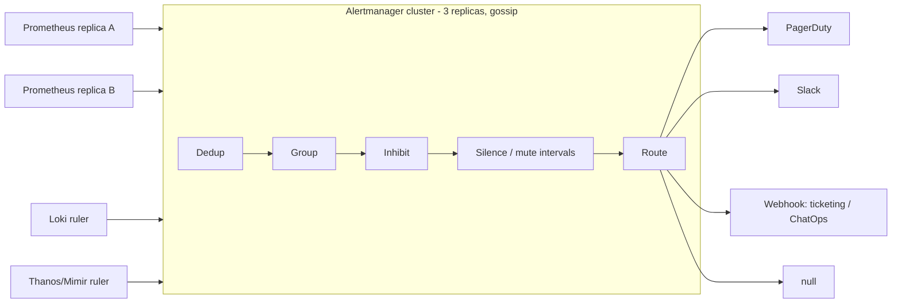
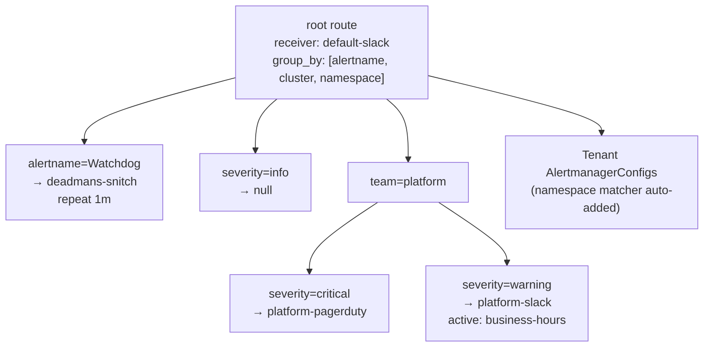

# Alerting - Alertmanager, Routing, Inhibition, Silencing

## Learning Objectives
- Design alerts that are actionable, symptom-based, and tied to SLOs
- Write and unit-test Prometheus alerting rules with `PrometheusRule`
- Configure Alertmanager routing trees, grouping, inhibition, and time-based muting
- Give tenants self-service alert routing with the `AlertmanagerConfig` CRD
- Operate silences, maintenance windows, and a dead man's switch safely

## Prerequisites
- [Metrics Stack](./metrics-stack.md): kube-prometheus-stack installed
- [Logging Stack](./logging-stack.md): Loki ruler alerts use the same Alertmanager
- A Slack workspace and/or PagerDuty (or Opsgenie) service for receivers
- `amtool` and `promtool` (bundled with the Alertmanager and Prometheus releases)

---

## Alerting Philosophy

Bad alerting burns people out and buries real incidents. A page must be **urgent, actionable, and user-impacting**. Everything else is a ticket, a dashboard, or nothing.

| Principle | In practice |
|-----------|-------------|
| **Alert on symptoms, not causes** | Page on "checkout error ratio > SLO burn rate", not "one pod restarted" |
| **Every page has a runbook** | `runbook_url` annotation is mandatory (enforced by policy) |
| **Severity maps to a response** | `critical` → page now; `warning` → ticket/business hours; `info` → no notification |
| **Route to the owner** | Tenant label → tenant receiver; platform components → platform on-call |
| **Fewer, better alerts** | Track pages per on-call shift; delete alerts nobody acted on |
| **SLO burn-rate alerts first** | Multi-window, multi-burn-rate alerts (see [SLOs & SLIs](../11-reliability/slos-slis.md)) |

### Severity Contract

| Severity | Response | Receiver | Example |
|----------|----------|----------|---------|
| `critical` | Page 24/7, acknowledge within 5 min | PagerDuty | Error budget burning 14.4× for 1h |
| `warning` | Ticket / Slack, business hours | Slack + Jira | Budget burning 1× over 3 days; certificate expires in 14d |
| `info` | No notification; visible in dashboards | `null` | Deployment rollout started |

---

## Architecture



Alert lifecycle in Prometheus:

```mermaid
stateDiagram-v2
    [*] --> Inactive
    Inactive --> Pending: expr true
    Pending --> Firing: expr true for `for:` duration
    Pending --> Inactive: expr false
    Firing --> Inactive: expr false (resolved sent; keep_firing_for delays this)
```



All Prometheus replicas send the same alerts to **all** Alertmanager replicas. Alertmanager dedupes on the label set, which is why external labels such as `prometheus_replica` must be dropped before sending (kube-prometheus-stack does this for you).

---

## Writing Alerting Rules

```yaml
# prometheusrule-checkout-alerts.yaml
apiVersion: monitoring.coreos.com/v1
kind: PrometheusRule
metadata:
  name: checkout-alerts
  namespace: checkout
  labels:
    platform.mycompany.io/tenant: checkout
spec:
  groups:
    - name: checkout.slo
      rules:
        # Fast burn: 2% of a 30d budget consumed in 1h (page)
        - alert: CheckoutErrorBudgetFastBurn
          expr: |
            (
              service:http_requests_error_ratio:rate1h{service="checkout"} > (14.4 * 0.001)
            and
              service:http_requests_error_ratio:rate5m{service="checkout"} > (14.4 * 0.001)
            )
          for: 2m
          labels:
            severity: critical
            team: checkout
          annotations:
            summary: "Checkout is burning its 99.9% error budget 14x too fast"
            description: |
              Error ratio over 1h is {{ $value | humanizePercentage }}.
              At this rate the monthly budget is gone in ~2 days.
            runbook_url: https://runbooks.mycompany.io/checkout/error-budget-burn
            dashboard_url: https://grafana.mycompany.io/d/checkout-slo

        # Slow burn: ticket, not page
        - alert: CheckoutErrorBudgetSlowBurn
          expr: |
            (
              service:http_requests_error_ratio:rate3d{service="checkout"} > (1 * 0.001)
            and
              service:http_requests_error_ratio:rate6h{service="checkout"} > (1 * 0.001)
            )
          for: 1h
          labels:
            severity: warning
            team: checkout
          annotations:
            summary: "Checkout error budget slowly eroding"
            runbook_url: https://runbooks.mycompany.io/checkout/error-budget-burn

    - name: checkout.saturation
      rules:
        - alert: CheckoutPodsNearMemoryLimit
          expr: |
            max by (namespace, pod, container) (
              container_memory_working_set_bytes{namespace="checkout", container!=""}
              / on (namespace, pod, container)
              kube_pod_container_resource_limits{namespace="checkout", resource="memory"}
            ) > 0.9
          for: 15m
          keep_firing_for: 5m           # avoid flapping resolve/fire cycles
          labels:
            severity: warning
            team: checkout
          annotations:
            summary: "{{ $labels.pod }}/{{ $labels.container }} at {{ $value | humanizePercentage }} of memory limit"
            runbook_url: https://runbooks.mycompany.io/k8s/memory-near-limit
```

> The `rate1h`, `rate3d`, and other recording rules come from your SLO tooling (Sloth/Pyrra) or from hand-written recording rules (see [Metrics Stack](./metrics-stack.md#recording-rules)).

### Rule Design Checklist

| Field | Guidance |
|-------|----------|
| `expr` | Build on recording rules; aggregate away pod-level labels unless the pod *is* the unit of action |
| `for` | Long enough to skip blips (2–15m). Not a substitute for burn-rate windows |
| `keep_firing_for` | Smooths flapping on noisy signals (Prometheus 2.42+) |
| `labels.severity` | Required, one of `critical` / `warning` / `info` |
| `labels.team` | Required for routing. Default it from the namespace's tenant label |
| `annotations.runbook_url` | Required for `critical` |
| `annotations.summary` | One line, human-readable, includes the affected entity |

### Unit-Testing Rules

```yaml
# tests/checkout-alerts.test.yaml
rule_files:
  - ../rules/checkout-alerts.rules.yaml     # spec.groups extracted from the PrometheusRule
evaluation_interval: 1m
tests:
  - interval: 1m
    input_series:
      - series: 'service:http_requests_error_ratio:rate1h{service="checkout"}'
        values: '0.02x10'
      - series: 'service:http_requests_error_ratio:rate5m{service="checkout"}'
        values: '0.02x10'
    alert_rule_test:
      - eval_time: 5m
        alertname: CheckoutErrorBudgetFastBurn
        exp_alerts:
          - exp_labels:
              severity: critical
              team: checkout
              service: checkout
            exp_annotations:
              summary: "Checkout is burning its 99.9% error budget 14x too fast"
              description: |
                Error ratio over 1h is 2%.
                At this rate the monthly budget is gone in ~2 days.
              runbook_url: https://runbooks.mycompany.io/checkout/error-budget-burn
              dashboard_url: https://grafana.mycompany.io/d/checkout-slo
```

```bash
# Extract groups from the CRD and test them (CI step)
yq '.spec' prometheusrule-checkout-alerts.yaml > rules/checkout-alerts.rules.yaml
promtool check rules rules/checkout-alerts.rules.yaml
promtool test rules tests/checkout-alerts.test.yaml
```

---

## Alertmanager Configuration

### The Routing Tree



```yaml
# kps-values-alertmanager.yaml
alertmanager:
  config:
    global:
      resolve_timeout: 5m
      slack_api_url_file: /etc/alertmanager/secrets/alertmanager-slack/url

    templates:
      - /etc/alertmanager/config/*.tmpl

    route:
      receiver: default-slack
      group_by: [alertname, cluster, namespace]
      group_wait: 30s          # wait to batch the first notification of a group
      group_interval: 5m       # wait before notifying about new alerts in a group
      repeat_interval: 4h      # re-notify if still firing
      routes:
        # Dead man's switch: must always fire; external service pages if it STOPS
        - matchers: ['alertname = "Watchdog"']
          receiver: deadmans-snitch
          group_wait: 0s
          group_interval: 1m
          repeat_interval: 1m

        - matchers: ['severity = "info"']
          receiver: "null"

        - matchers: ['team = "platform"']
          routes:
            - matchers: ['severity = "critical"']
              receiver: platform-pagerduty
              group_by: [alertname, cluster]
            - matchers: ['severity = "warning"']
              receiver: platform-slack
              active_time_intervals: [business-hours]

        # Catch-all for critical alerts lacking a team label: a platform bug
        - matchers: ['severity = "critical"', 'team = ""']
          receiver: platform-pagerduty

    inhibit_rules:
      # If the whole cluster is unreachable, suppress per-namespace noise
      - source_matchers: ['alertname = "ClusterUnreachable"']
        target_matchers: ['severity =~ "warning|critical"']
        equal: [cluster]
      # Critical suppresses warning for the same alert and entity
      - source_matchers: ['severity = "critical"']
        target_matchers: ['severity = "warning"']
        equal: [alertname, cluster, namespace, service]
      # Node down: suppress pod alerts on that node
      - source_matchers: ['alertname = "KubeNodeNotReady"']
        target_matchers: ['alertname =~ "KubePod.*"']
        equal: [cluster, node]

    time_intervals:
      - name: business-hours
        time_intervals:
          - weekdays: ['monday:friday']
            times: [{ start_time: '09:00', end_time: '18:00' }]
            location: Europe/London
      - name: weekly-maintenance
        time_intervals:
          - weekdays: ['sunday']
            times: [{ start_time: '02:00', end_time: '04:00' }]
            location: UTC

    receivers:
      - name: "null"
      - name: default-slack
        slack_configs:
          - channel: '#alerts-unrouted'
            send_resolved: true
            title: '{{ template "platform.slack.title" . }}'
            text: '{{ template "platform.slack.text" . }}'
      - name: platform-slack
        slack_configs:
          - channel: '#platform-alerts'
            send_resolved: true
            title: '{{ template "platform.slack.title" . }}'
            text: '{{ template "platform.slack.text" . }}'
      - name: platform-pagerduty
        pagerduty_configs:
          - routing_key_file: /etc/alertmanager/secrets/alertmanager-pagerduty/routing-key
            severity: '{{ if eq .CommonLabels.severity "critical" }}critical{{ else }}warning{{ end }}'
            description: '{{ .CommonAnnotations.summary }}'
            links:
              - href: '{{ .CommonAnnotations.runbook_url }}'
                text: Runbook
      - name: deadmans-snitch
        webhook_configs:
          - url_file: /etc/alertmanager/secrets/alertmanager-heartbeat/url
            send_resolved: false

  # Mount secret files referenced above (created via External Secrets)
  alertmanagerSpec:
    secrets: [alertmanager-slack, alertmanager-pagerduty, alertmanager-heartbeat]
    # Tenant AlertmanagerConfigs: any namespace, but scoped to that namespace
    alertmanagerConfigSelector:
      matchLabels:
        platform.mycompany.io/alerting: tenant
    alertmanagerConfigNamespaceSelector: {}
    alertmanagerConfigMatcherStrategy:
      type: OnNamespace         # operator injects namespace="<ns>" into every tenant route

  templateFiles:
    platform.tmpl: |-
      {{ define "platform.slack.title" -}}
      [{{ .Status | toUpper }}{{ if eq .Status "firing" }}:{{ .Alerts.Firing | len }}{{ end }}] {{ .CommonLabels.alertname }} — {{ .CommonLabels.cluster }}/{{ .CommonLabels.namespace }}
      {{- end }}
      {{ define "platform.slack.text" -}}
      {{ range .Alerts -}}
      • *{{ .Labels.severity }}* {{ .Annotations.summary }}
        {{ if .Annotations.runbook_url }}<{{ .Annotations.runbook_url }}|Runbook>{{ end }}
      {{ end }}
      {{- end }}
```

| Setting | Effect | Typical value |
|---------|--------|---------------|
| `group_by` | Labels that define one notification "group" | `[alertname, cluster, namespace]` |
| `group_wait` | Delay for the first notification, to collect siblings | 30s |
| `group_interval` | Delay before sending updates for a group | 5m |
| `repeat_interval` | Re-send while still firing | 4h (pages), 24h (tickets) |
| `continue: true` | Keep matching sibling routes after this one | Use sparingly (e.g. also log to an audit webhook) |
| `mute_time_intervals` | Suppress during the named intervals | Maintenance windows |
| `active_time_intervals` | Only notify during the named intervals | Business-hours warnings |

---

## Tenant Self-Service: `AlertmanagerConfig`

Tenants own their routing without touching the global config. With `alertmanagerConfigMatcherStrategy: OnNamespace`, the operator adds a `namespace="checkout"` matcher to every route. A tenant therefore **can't** capture another tenant's alerts.

```yaml
# alertmanagerconfig-checkout.yaml
apiVersion: monitoring.coreos.com/v1alpha1
kind: AlertmanagerConfig
metadata:
  name: checkout-routing
  namespace: checkout
  labels:
    platform.mycompany.io/alerting: tenant
spec:
  route:
    receiver: checkout-slack
    groupBy: [alertname, service]
    groupWait: 30s
    groupInterval: 5m
    repeatInterval: 4h
    routes:
      - receiver: checkout-pagerduty
        matchers:
          - name: severity
            value: critical
            matchType: "="
  receivers:
    - name: checkout-slack
      slackConfigs:
        - apiURL:
            name: checkout-alerting      # Secret in the checkout namespace
            key: slack-webhook-url
          channel: '#checkout-alerts'
          sendResolved: true
    - name: checkout-pagerduty
      pagerdutyConfigs:
        - routingKey:
            name: checkout-alerting
            key: pagerduty-routing-key
  inhibitRules:
    - sourceMatch:
        - { name: alertname, value: CheckoutDatabaseDown, matchType: "=" }
      targetMatch:
        - { name: severity, value: warning, matchType: "=" }
      equal: [service]
```

### Platform Integration via the `Tenant` CRD

The tenant operator renders the `AlertmanagerConfig` and the receiver Secret (through an `ExternalSecret`) from the tenant's spec, so teams declare intent only:

```yaml
# tenant-checkout.yaml (excerpt)
apiVersion: platform.mycompany.io/v1alpha1
kind: Tenant
metadata:
  name: checkout
spec:
  alerting:
    slackChannel: '#checkout-alerts'
    pagerdutyServiceRef: vault:secret/pagerduty/checkout#routing-key
    defaultSeverityRouting:
      critical: pagerduty
      warning: slack
```

### Policy Guardrails

Enforce the alerting contract at admission time. This Kyverno policy requires `severity` and `runbook_url` on critical alerts. See [Policy Engine](../12-security-compliance/policy-engine.md).

```yaml
# kyverno-prometheusrule-contract.yaml
apiVersion: kyverno.io/v1
kind: ClusterPolicy
metadata:
  name: prometheusrule-alert-contract
spec:
  validationFailureAction: Enforce
  background: true
  rules:
    - name: severity-required
      match:
        any:
          - resources:
              kinds: [monitoring.coreos.com/v1/PrometheusRule]
      validate:
        message: "Every alert must set labels.severity to critical, warning or info."
        foreach:
          - list: "request.object.spec.groups[].rules[?alert][]"
            deny:
              conditions:
                any:
                  - key: "{{ element.labels.severity || '' }}"
                    operator: AnyNotIn
                    value: [critical, warning, info]
    - name: runbook-for-critical
      match:
        any:
          - resources:
              kinds: [monitoring.coreos.com/v1/PrometheusRule]
      validate:
        message: "Critical alerts must have annotations.runbook_url."
        foreach:
          - list: "request.object.spec.groups[].rules[?alert && labels.severity == 'critical'][]"
            deny:
              conditions:
                any:
                  - key: "{{ element.annotations.runbook_url || '' }}"
                    operator: Equals
                    value: ""
```

---

## Silences and Maintenance

```bash
# amtool against a port-forwarded Alertmanager
kubectl -n monitoring port-forward svc/kps-alertmanager 9093 &
export AMTOOL="amtool --alertmanager.url=http://localhost:9093"

# What is firing?
$AMTOOL alert query severity=critical

# Silence a known issue for 2h, with author and reason (both required by convention)
$AMTOOL silence add alertname=CheckoutPodsNearMemoryLimit namespace=checkout \
  --duration=2h --author="jane@mycompany.io" \
  --comment="INC-4821: memory leak fix rolling out"

# List and expire
$AMTOOL silence query
$AMTOOL silence expire <silence-id>

# Test routing: which receiver gets this label set?
amtool config routes test --config.file=alertmanager.yaml \
  team=platform severity=warning alertname=CertExpiringSoon
# -> platform-slack

# Print the routing tree
amtool config routes show --config.file=alertmanager.yaml

# Validate config before rollout (CI)
amtool check-config alertmanager.yaml
```

| Mechanism | Scope | Defined in | Use for |
|-----------|-------|------------|---------|
| **Silence** | Ad hoc label matchers, time-bound | API/UI (stored in Alertmanager state) | Known incident, short-lived suppression |
| **Mute time interval** | Recurring schedule on a route | Config (Git) | Planned maintenance windows |
| **Active time interval** | Notify only within the schedule | Config (Git) | Business-hours-only warnings |
| **Inhibition** | Alert-to-alert dependency | Config (Git) | Suppress symptoms of a known root cause |

> **Guardrail:** silences don't go through Git, so they're an audit gap. Alert on long or broad silences, for example by exporting `alertmanager_silences{state="active"}` and reviewing silences without `--comment` in your weekly ops review. Some teams require silences to be created through a ChatOps bot that records the incident ticket.

---

## Monitoring the Alerting Pipeline

```yaml
# prometheusrule-meta-alerts.yaml
apiVersion: monitoring.coreos.com/v1
kind: PrometheusRule
metadata:
  name: alerting-pipeline
  namespace: monitoring
spec:
  groups:
    - name: meta
      rules:
        - alert: Watchdog
          expr: vector(1)
          labels: { severity: none, team: platform }
          annotations:
            summary: "Always firing. External heartbeat pages if this stops arriving."
        - alert: AlertmanagerNotificationsFailing
          expr: |
            sum by (integration) (rate(alertmanager_notifications_failed_total[5m])) > 0
          for: 10m
          labels: { severity: critical, team: platform }
          annotations:
            summary: "Alertmanager failing to send to {{ $labels.integration }}"
            runbook_url: https://runbooks.mycompany.io/platform/alertmanager-notifications
        - alert: PrometheusRuleEvaluationFailures
          expr: increase(prometheus_rule_evaluation_failures_total[10m]) > 0
          labels: { severity: warning, team: platform }
          annotations:
            summary: "Rule evaluation failures on {{ $labels.pod }}"
```

> kube-prometheus-stack already ships `Watchdog`, `AlertmanagerFailedToSendAlerts`, and similar rules. Reuse those instead of duplicating them.

---

## Hands-On Exercises

### Exercise 1: Route, inhibit, and silence

Goal: prove that routing sends alerts to the right receiver, that a critical alert inhibits its
warning twin, and that a silence stops notifications.

Before you start, set `KPS_VERSION` to the kube-prometheus-stack chart version from
[Metrics Stack](./metrics-stack.md) (`helm list -n monitoring` shows it as `CHART`), and install
`amtool` and `yq`.

```bash
# 1. Lightweight webhook receiver to observe notifications
kubectl -n monitoring run echo --image=mendhak/http-https-echo:31 --port=8080
kubectl -n monitoring expose pod echo --port=80 --target-port=8080

# 2. Create an alerting config that routes everything to the echo webhook
cat > am-lab.yaml <<'EOF'
route:
  receiver: echo
  group_by: [alertname, namespace]
  group_wait: 10s
  group_interval: 30s
  repeat_interval: 5m
  routes:
    - matchers: ['severity = "info"']
      receiver: "null"
inhibit_rules:
  - source_matchers: ['severity = "critical"']
    target_matchers: ['severity = "warning"']
    equal: [alertname, namespace]
receivers:
  - name: "null"
  - name: echo
    webhook_configs:
      - url: http://echo.monitoring.svc/alert
EOF
amtool check-config am-lab.yaml
amtool config routes test --config.file=am-lab.yaml severity=info     # -> null
amtool config routes test --config.file=am-lab.yaml severity=warning  # -> echo

# 3. Apply via kube-prometheus-stack values (alertmanager.config is a map)
yq '{"alertmanager": {"config": .}}' am-lab.yaml > am-lab-values.yaml
helm upgrade kps prometheus-community/kube-prometheus-stack -n monitoring \
  --reuse-values -f am-lab-values.yaml --version "${KPS_VERSION}"

# 4. Fire synthetic alerts directly at Alertmanager
kubectl -n monitoring port-forward svc/kps-alertmanager 9093 &
amtool --alertmanager.url=http://localhost:9093 alert add DiskFilling \
  severity=warning namespace=demo --annotation=summary="disk 85%"
amtool --alertmanager.url=http://localhost:9093 alert add DiskFilling \
  severity=critical namespace=demo --annotation=summary="disk 97%"

# 5. Observe: only the critical notification should reach the echo pod
kubectl -n monitoring logs echo | grep -o '"severity":"[a-z]*"' | sort | uniq -c

# 6. Silence it and verify no repeat notification arrives after repeat_interval
amtool --alertmanager.url=http://localhost:9093 silence add alertname=DiskFilling \
  --duration=30m --author=lab --comment="lab exercise"
```

Expected output:

```text
# amtool config routes test (info)
null
# amtool config routes test (warning)
echo
# step 5: the warning is inhibited, so only critical arrives
      1 "severity":"critical"
```

Check: `amtool --alertmanager.url=http://localhost:9093 silence query` lists the silence as
`active`, and `kubectl -n monitoring logs echo` shows no new `DiskFilling` notification after
`repeat_interval` (5 minutes). Clean up with
`kubectl -n monitoring delete pod,svc echo; kill %1`.

**Stretch goals:**
1. Create an `AlertmanagerConfig` in namespace `demo`. In the Alertmanager UI status page, check that the operator injected `namespace="demo"`.
2. Add a `weekly-maintenance` mute interval and test it by setting the interval to the current time.
3. Write a `promtool test rules` file for one of your alerts and run it in CI.

---

## Troubleshooting

| Symptom | Likely cause | Fix |
|---------|--------------|-----|
| Alert firing in Prometheus but no notification | Matched by `null` route, inhibited, silenced, or `group_wait` not elapsed | `amtool config routes test`; check the UI for inhibited/silenced state |
| Duplicate notifications | Alertmanager replicas not clustered (gossip port 9094 blocked) | Check `alertmanager_cluster_members`; allow 9094 TCP/UDP between pods |
| Tenant `AlertmanagerConfig` ignored | Missing selector label, or validation failure | `kubectl -n monitoring logs deploy/kps-operator \| grep -i alertmanagerconfig` |
| Notifications too frequent | Low `group_interval`/`repeat_interval`; flapping `expr` | Raise the intervals; add `for:` and `keep_firing_for:` |
| Alerts resolve then re-fire | Series disappear on pod restart (cause-based alert) | Aggregate away pod labels; alert on symptoms |
| `template: ... function not defined` | Go template error in a receiver | Test templates with `amtool template render` |
| PagerDuty 400 errors | Wrong key type (Events v2 `routing_key` vs `service_key`) | Use `routing_key` for Events API v2 integrations |

```bash
# Effective config as loaded by Alertmanager
kubectl -n monitoring port-forward svc/kps-alertmanager 9093
curl -s localhost:9093/api/v2/status | jq -r '.config.original' | less

# Alertmanager notification metrics
curl -s localhost:9093/metrics | grep -E 'alertmanager_notifications(_failed)?_total'
```

---

## Best Practices

1. **Page only on SLO burn and hard user-facing outages.** Everything else is a ticket.
2. **Require `severity`, `team`, and `runbook_url`** through policy, and test rules in CI.
3. **Keep the global config platform-owned and in Git.** Tenants self-serve through `AlertmanagerConfig`.
4. **Use inhibition for known dependency chains** (cluster → node → pod).
5. **Always run a dead man's switch** and alert on notification failures.
6. **Review alert quality regularly**: pages per shift, time-to-acknowledge, and the share of pages that were actionable.

---

## Further Reading

### Official Documentation
- [Alertmanager configuration](https://prometheus.io/docs/alerting/latest/configuration/)
- [Alerting rules](https://prometheus.io/docs/prometheus/latest/configuration/alerting_rules/)
- [Unit testing rules](https://prometheus.io/docs/prometheus/latest/configuration/unit_testing_rules/)
- [Prometheus Operator: AlertmanagerConfig](https://prometheus-operator.dev/docs/developer/alerting/)
- [Awesome Prometheus Alerts](https://samber.github.io/awesome-prometheus-alerts/)

### Articles & Books
- Rob Ewaschuk, [My Philosophy on Alerting](https://docs.google.com/document/d/199PqyG3UsyXlwieHaqbGiWVa8eMWi8zzAn0YfcApr8Q/)
- Google SRE Workbook, [Alerting on SLOs](https://sre.google/workbook/alerting-on-slos/)

---

## Next Steps

1. **Read**: [SLOs & SLIs](../11-reliability/slos-slis.md). Generate burn-rate alerts automatically.
2. **Read**: [Chaos Engineering](../11-reliability/chaos-engineering.md). Check that alerts fire when things break.
3. **Practice**: [Lab 06: Observability Stack](../../labs/lab-06-observability-stack/)
4. **Explore**: [Compliance](../12-security-compliance/compliance.md). Route security findings through the same pipeline.
