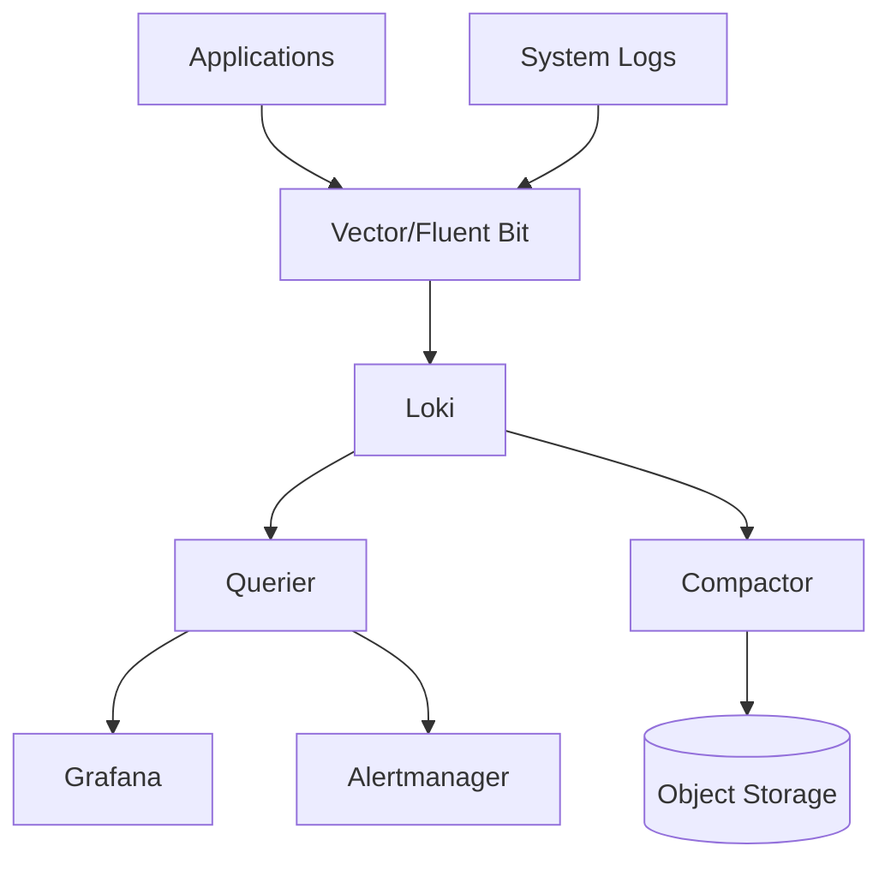

# Logging Stack - Loki, Vector, Fluent Bit

## Learning Objectives
- Deploy and configure Loki for log aggregation
- Set up Vector/Fluent Bit for log collection
- Configure log parsing, labeling, and enrichment
- Implement log-based alerting and dashboards

## Prerequisites
- Kubernetes cluster with storage
- Helm 3.x
- Basic understanding of logging concepts

---

## Architecture



---

## Loki Stack Deployment

### Install via Helm
```bash
helm repo add grafana https://grafana.github.io/helm-charts
helm repo update

helm upgrade --install loki grafana/loki-stack \
  --namespace monitoring --create-namespace \
  --version 2.9.0 \
  --values - <<EOF
loki:
  enabled: true
  image:
    tag: 2.9.0
  persistence:
    enabled: true
    size: 100Gi
    storageClassName: fast-ssd
  config: |
    auth_enabled: false
    server:
      http_listen_port: 3100
      grpc_listen_port: 9096
    common:
      path_prefix: /loki
      storage:
        filesystem:
          chunks_directory: /loki/chunks
          rules_directory: /loki/rules
      replication_factor: 1
      ring:
        instance_addr: 127.0.0.1
        kvstore:
          store: inmemory
    schema_config:
      configs:
        - from: 2024-01-01
          store: boltdb-shipper
          object_store: filesystem
          schema: v12
          index:
            prefix: index_
            period: 24h
    limits_config:
      reject_old_samples: true
      reject_old_samples_max_age: 168h
      ingestion_rate_mb: 10
      ingestion_burst_size_mb: 20
      per_stream_rate_limit: 3MB
      per_stream_rate_limit_burst: 10MB
      max_entries_limit_per_query: 5000
      max_query_parallelism: 32
    chunk_store_config:
      max_look_back_period: 30d
    table_manager:
      retention_deletes_enabled: true
      retention_period: 30d
  resources:
    limits:
      cpu: 2000m
      memory: 4Gi
    requests:
      cpu: 500m
      memory: 1Gi

promtail:
  enabled: true
  config:
    clients:
      - url: http://loki:3100/loki/api/v1/push
    scrape_configs:
      - job_name: kubernetes-pods
        kubernetes_sd_configs:
          - role: pod
        relabel_configs:
          - source_labels: [__meta_kubernetes_pod_annotation_prometheus_io_scrape]
            action: keep
            regex: true
          - source_labels: [__meta_kubernetes_pod_annotation_prometheus_io_path]
            action: replace
            target_label: __metrics_path__
            regex: (.+)
          - source_labels: [__address__, __meta_kubernetes_pod_annotation_prometheus_io_port]
            action: replace
            regex: ([^:]+)(?::\d+)?;(\d+)
            replacement: $1:$2
            target_label: __address__
          - action: labelmap
            regex: __meta_kubernetes_pod_label_(.+)
          - source_labels: [__meta_kubernetes_namespace]
            action: replace
            target_label: namespace
          - source_labels: [__meta_kubernetes_pod_name]
            action: replace
            target_label: pod
          - source_labels: [__meta_kubernetes_pod_container_name]
            action: replace
            target_label: container

grafana:
  enabled: true
  persistence:
    enabled: true
    size: 10Gi
  datasources:
    datasources.yaml:
      apiVersion: 1
      datasources:
        - name: Loki
          type: loki
          url: http://loki:3100
          access: proxy
          isDefault: true
          jsonData:
            maxLines: 1000
EOF
```

---

## Vector (Modern Alternative to Fluent Bit)

### Install Vector
```bash
helm repo add vector https://vectordotdev.github.io/helm-charts
helm repo update

helm upgrade --install vector vector/vector \
  --namespace monitoring --create-namespace \
  --version 0.35.0 \
  --values - <<EOF
vector:
  config:
    api:
      enabled: true
      address: 0.0.0.0:8686
    sources:
      kubernetes_logs:
        type: kubernetes_logs
        include_annotations: true
        include_labels: true
    transforms:
      parse_json:
        type: remap
        inputs: ["kubernetes_logs"]
        source: |
          .message = parse_json!(.message) ?? .message
          .level = .level ?? "info"
          .timestamp = .timestamp ?? now()
      add_kubernetes_metadata:
        type: remap
        inputs: ["parse_json"]
        source: |
          .kubernetes_namespace = .kubernetes.pod_labels["app.kubernetes.io/name"] ?? .kubernetes.namespace
          .kubernetes_pod = .kubernetes.pod_name
          .kubernetes_container = .kubernetes.container_name
    sinks:
      loki:
        type: loki
        inputs: ["add_kubernetes_metadata"]
        endpoint: "http://loki:3100"
        labels:
          job: "kubernetes"
          cluster: "production"
        encoding:
          codec: json
      console:
        type: console
        inputs: ["add_kubernetes_metadata"]
        target: stdout
        encoding:
          codec: json
EOF
```

### Vector Configuration (Advanced)
```yaml
# vector-config.yaml
apiVersion: v1
kind: ConfigMap
metadata:
  name: vector-config
  namespace: monitoring
data:
  vector.yaml: |
    api:
      enabled: true
      address: 0.0.0.0:8686
    
    sources:
      kubernetes_logs:
        type: kubernetes_logs
        include_annotations: true
        include_labels: true
        # Filter namespaces
        # namespace_selector:
        #   match_expressions:
        #     - key: name
        #       operator: NotIn
        #       values: [kube-system, flux-system]
      
      # Also collect container runtime logs
      container_logs:
        type: file
        include:
          - /var/log/containers/*.log
        exclude:
          - /var/log/containers/*_fluent-bit_*.log
        ignore_older_secs: 86400
    
    transforms:
      # Parse structured logs (JSON)
      parse_structured:
        type: remap
        inputs: ["kubernetes_logs", "container_logs"]
        source: |
          # Try to parse JSON
          parsed, err = parse_json(.message)
          if err == null {
            . = merge(., parsed)
          }
          # Normalize level
          .level = .level ?? .severity ?? .log_level ?? "info"
          .level = upcase(string(.level))
      
      # Enrich with Kubernetes metadata
      enrich_k8s:
        type: remap
        inputs: ["parse_structured"]
        source: |
          .k8s_namespace = .kubernetes.namespace
          .k8s_pod = .kubernetes.pod_name
          .k8s_container = .kubernetes.container_name
          .k8s_labels = .kubernetes.pod_labels
          .k8s_annotations = .kubernetes.pod_annotations
          # Add service name from labels
          .service = .k8s_labels["app.kubernetes.io/name"] ?? .k8s_labels["app"] ?? "unknown"
          .version = .k8s_labels["app.kubernetes.io/version"] ?? "unknown"
      
      # Filter sensitive data
      redact_secrets:
        type: remap
        inputs: ["enrich_k8s"]
        source: |
          # Redact common secret patterns
          .message = replace(.message, r'(?i)(password|token|secret|key|api[_-]?key)\s*[:=]\s*\S+', '${1}=[REDACTED]')
      
      # Add cluster metadata
      add_cluster_info:
        type: remap
        inputs: ["redact_secrets"]
        source: |
          .cluster = "production"
          .environment = "production"
          .region = "us-east-1"
    
    sinks:
      # Send to Loki
      loki:
        type: loki
        inputs: ["add_cluster_info"]
        endpoint: "http://loki.monitoring.svc:3100"
        labels:
          job: "kubernetes"
          cluster: "production"
        encoding:
          codec: json
        batch:
          max_bytes: 1048576
          timeout_secs: 10
        healthcheck:
          enabled: true
      
      # Also send to Elasticsearch (optional)
      # elasticsearch:
      #   type: elasticsearch
      #   inputs: ["add_cluster_info"]
      #   endpoints: ["https://elasticsearch:9200"]
      #   index: "logs-kubernetes-%Y-%m-%d"
      #   auth:
      #     strategy: basic
      #     user: elastic
      #     password: ${ELASTIC_PASSWORD}
      
      # Console for debugging
      console:
        type: console
        inputs: ["add_cluster_info"]
        target: stdout
        encoding:
          codec: json
EOF
```

---

## Log Parsing & Enrichment

### Common Log Formats

#### JSON Logs (Recommended)
```json
{
  "timestamp": "2024-01-15T10:30:00.123Z",
  "level": "info",
  "message": "User login successful",
  "service": "auth-service",
  "version": "1.2.3",
  "trace_id": "abc123",
  "span_id": "def456",
  "user_id": "user-789",
  "duration_ms": 45
}
```

#### Structured Logging in Applications
```go
// Go structured logging with zerolog
import "github.com/rs/zerolog/log"

log.Info().
    Str("service", "auth-service").
    Str("version", "1.2.3").
    Str("trace_id", traceID).
    Str("user_id", userID).
    Int("duration_ms", 45).
    Msg("User login successful")
```

```python
# Python structured logging
import structlog

logger = structlog.get_logger()

logger.info(
    "user_login_successful",
    service="auth-service",
    version="1.2.3",
    trace_id=trace_id,
    user_id=user_id,
    duration_ms=45
)
```

### LogQL Queries (Loki Query Language)

#### Basic Queries
```logql
# All logs for a namespace
{namespace="production"}

# Logs for a specific service
{namespace="production", service="auth-service"}

# Error logs only
{namespace="production", service="auth-service"} |= "error"

# Logs with specific label
{namespace="production"} |~ "level=(error|warn)"
```

#### Parsing & Filtering
```logql
# Parse JSON and filter
{namespace="production"} | json | level="error"

# Extract fields
{namespace="production"} | json | trace_id="abc123"

# Filter by duration
{namespace="production"} | json | duration_ms > 1000

# Aggregate
sum by (service) (count_over_time({namespace="production"}[5m]))
```

#### Advanced Queries
```logql
# Rate of errors by service
sum by (service) (rate({namespace="production"} | json | level="error" [5m]))

# Quantile of response times
quantile_over_time(0.95, {namespace="production"} | json | __line__=~ "duration_ms:(\\d+)" [5m])

# Top errors
topk(10, sum by (error_message) (count_over_time({namespace="production"} | json | level="error" [1h])))
```

---

## Grafana Dashboards

### Loki Dashboard (JSON)
```json
{
  "dashboard": {
    "title": "Kubernetes Logging",
    "panels": [
      {
        "title": "Log Volume by Service",
        "type": "timeseries",
        "targets": [
          {
            "expr": "sum by (service) (rate({namespace=~\"production|staging\"}[5m]))",
            "legendFormat": "{{service}}"
          }
        ]
      },
      {
        "title": "Error Rate by Service",
        "type": "timeseries",
        "targets": [
          {
            "expr": "sum by (service) (rate({namespace=~\"production|staging\"} | json | level=\"error\" [5m]))",
            "legendFormat": "{{service}}"
          }
        ]
      },
      {
        "title": "Log Levels Distribution",
        "type": "piechart",
        "targets": [
          {
            "expr": "sum by (level) (count_over_time({namespace=~\"production|staging\"} | json [1h]))",
            "legendFormat": "{{level}}"
          }
        ]
      },
      {
        "title": "Recent Error Logs",
        "type": "logs",
        "targets": [
          {
            "expr": "{namespace=~\"production|staging\"} | json | level=\"error\"",
            "legendFormat": "{{service}} - {{pod}}"
          }
        ]
      }
    ]
  }
}
```

---

## Log-Based Alerting

### Prometheus Rules from Loki
```yaml
# loki-alerts.yaml
apiVersion: monitoring.coreos.com/v1
kind: PrometheusRule
metadata:
  name: loki-alerts
  namespace: monitoring
spec:
  groups:
    - name: logging
      rules:
        - alert: HighErrorRate
          expr: |
            sum by (service, namespace) (
              rate({namespace=~"production|staging"} | json | level="error" [5m])
            ) > 0.1
          for: 5m
          labels:
            severity: warning
          annotations:
            summary: "High error rate for {{ $labels.service }}"
            description: "Error rate is {{ $value }} errors/sec for service {{ $labels.service }} in {{ $labels.namespace }}"
        
        - alert: LogVolumeSpike
          expr: |
            sum by (service, namespace) (
              rate({namespace=~"production|staging"}[5m])
            ) > 1000
          for: 5m
          labels:
            severity: warning
          annotations:
            summary: "Log volume spike for {{ $labels.service }}"
            description: "Log volume is {{ $value }} logs/sec for service {{ $labels.service }}"
        
        - alert: CriticalErrors
          expr: |
            count_over_time({namespace=~"production|staging"} | json | level="critical" [5m]) > 0
          for: 1m
          labels:
            severity: critical
          annotations:
            summary: "Critical errors detected"
            description: "Critical errors found in {{ $labels.service }}"
        
        - alert: LokiIngestionErrors
          expr: |
            rate(loki_write_requests_total{status=~"5.."}[5m]) > 0
          for: 2m
          labels:
            severity: critical
          annotations:
            summary: "Loki ingestion errors"
            description: "Loki is returning 5xx errors for write requests"
```

---

## Retention & Storage

### S3/GCS Backend (Production)
```yaml
loki:
  config: |
    common:
      storage:
        s3:
          bucketnames: loki-logs
          endpoint: s3.us-east-1.amazonaws.com
          region: us-east-1
          access_key_id: ${AWS_ACCESS_KEY_ID}
          secret_access_key: ${AWS_SECRET_ACCESS_KEY}
          s3forcepathstyle: false
          http_config:
            idle_conn_timeout: 90s
    schema_config:
      configs:
        - from: 2024-01-01
          store: boltdb-shipper
          object_store: s3
          schema: v12
          index:
            prefix: index_
            period: 24h
    limits_config:
      retention_deletes_enabled: true
      retention_period: 90d
    compactor:
      working_directory: /loki/compactor
      shared_store: s3
      compaction_interval: 10m
      retention_enabled: true
      retention_delete_delay: 2h
```

---

## Troubleshooting

### Common Issues

#### Loki Not Receiving Logs
```bash
# Check Promtail/Vector logs
kubectl logs -n monitoring -l app.kubernetes.io/name=promtail
kubectl logs -n monitoring -l app.kubernetes.io/name=vector

# Check Loki logs
kubectl logs -n monitoring -l app.kubernetes.io/name=loki

# Test Loki endpoint
curl -X POST http://loki.monitoring.svc:3100/loki/api/v1/push \
  -H "Content-Type: application/json" \
  -d '{"streams":[{"stream":{"job":"test"},"values":[["'$(date +%s%N)'","test message"]]}]}'
```

#### High Memory Usage
```bash
# Check Loki memory
kubectl top pods -n monitoring -l app.kubernetes.io/name=loki

# Adjust limits
# Reduce ingestion_rate_mb, per_stream_rate_limit
# Increase chunk_target_size
```

#### Query Performance
```bash
# Enable query caching
# In Loki config:
# query_cache:
#   enabled: true

# Use recording rules for common queries
# Reduce max_query_parallelism
```

---

## Hands-On Exercises

### Exercise 1: Ship Logs from a Workload
```bash
# Run a pod that writes JSON logs, then confirm they reach Loki with labels
kubectl run log-demo -n default --image=busybox --restart=Never -- \
  sh -c 'while true; do echo "{\"level\":\"info\",\"msg\":\"hello\"}"; sleep 2; done'

# Port-forward Loki and query through its HTTP API
kubectl port-forward -n monitoring svc/loki 3100:3100 &
curl -G -s http://localhost:3100/loki/api/v1/query_range \
  --data-urlencode 'query={pod="log-demo"}' | jq '.data.result[0].stream'
```

### Exercise 2: Parse and Filter with LogQL
```logql
# Parse JSON lines and keep only warnings and errors
{pod="log-demo"} | json | level=~"warn|error"

# Count errors per namespace over five minutes
sum by (namespace) (count_over_time({namespace=~".+"} | json | level="error" [5m]))
```

### Exercise 3: Break and Fix Ingestion
1. Stop the log writer: `kubectl delete pod log-demo`.
2. Re-run Exercise 1 with a pod label you have not used before, such as `app=log-demo-2`.
3. Query by that label and confirm the stream appears within one scrape interval.
4. Explain why a high-cardinality label (for example, a request ID) would hurt Loki and how you would remove it.

---

## Further Reading

- [Loki Documentation](https://grafana.com/docs/loki/)
- [Vector Documentation](https://vector.dev/docs/)
- [LogQL Reference](https://grafana.com/docs/loki/latest/logql/)
- [Grafana Loki Dashboards](https://grafana.com/grafana/dashboards/?dataSource=loki)
