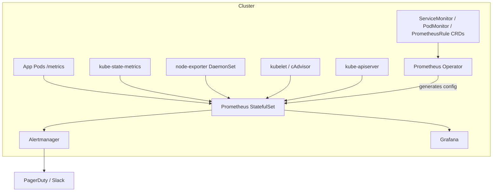
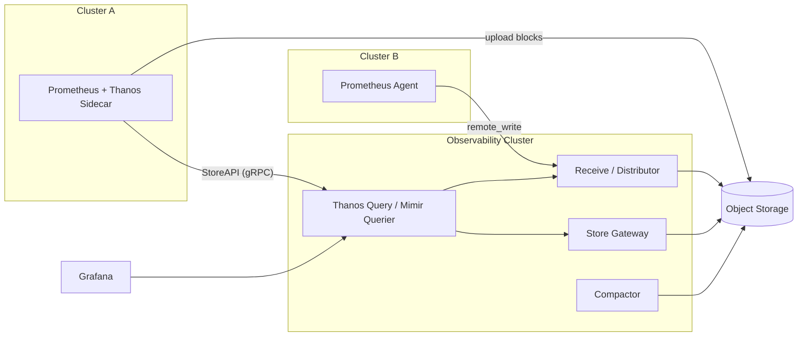
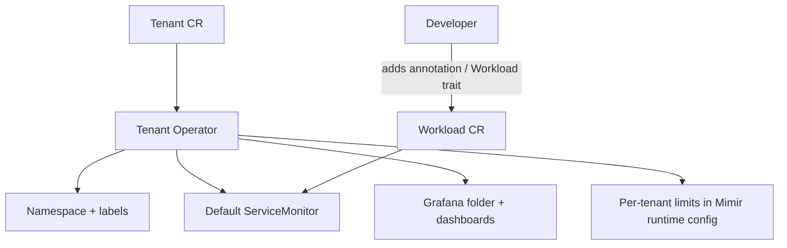

# Metrics Stack - Prometheus, Thanos, Mimir/Cortex, VictoriaMetrics

## Learning Objectives
- Understand the Prometheus data model, pull-based scraping, and the cost of cardinality
- Deploy `kube-prometheus-stack` and manage scrape targets with Prometheus Operator CRDs
- Write recording rules that make dashboards and SLOs cheap to evaluate
- Scale Prometheus horizontally and for long-term retention with Thanos, Mimir, or VictoriaMetrics
- Offer metrics as a multi-tenant platform capability with per-tenant guardrails

## Prerequisites
- Kubernetes fundamentals (Phase 1), especially [API primer](../01-kubernetes-fundamentals/api-primer.md)
- Helm 3.x and a cluster with a default StorageClass
- An S3-compatible object store (MinIO works for labs)
- Recommended: read [Logging Stack](./logging-stack.md) first. Loki copies a lot of Prometheus's label model.

---

## Why Metrics Are the Backbone of Platform Observability

Metrics are cheap to store, fast to query, and easy to aggregate. They answer "is something wrong, and how bad is it?" Logs and traces answer "why?". That's why SLOs, autoscaling, and paging alerts are built on metrics.

| Signal | Question answered | Cost per event | Typical retention | Primary tool |
|--------|-------------------|----------------|-------------------|--------------|
| Metrics | Is it broken? How much? | Very low (aggregated) | 15d hot, 13mo+ cold | Prometheus |
| Logs | What happened? | High | 7–30d | [Loki](./logging-stack.md) |
| Traces | Where is the latency? | Medium (sampled) | 3–14d | [Tempo](./tracing-stack.md) |
| Profiles | Which line of code? | Medium | 7–30d | [Pyroscope](./profiling.md) |

### The Prometheus Data Model

Each time series is identified by a metric name plus a set of key/value labels:

```
http_requests_total{namespace="checkout", service="cart", method="GET", code="200"}  1027
└──── metric name ─┘└──────────────────────── labels ───────────────────────┘  └ sample value
```

**Cardinality** is the number of unique label combinations. It is the main thing that drives Prometheus memory and cost. One label holding user IDs, request IDs, or raw URLs can create millions of series and take down a Prometheus server.

| Metric type | Use for | Example | Query pattern |
|-------------|---------|---------|---------------|
| Counter | Monotonic totals | `http_requests_total` | `rate(x[5m])` |
| Gauge | Values that go up and down | `container_memory_working_set_bytes` | `avg_over_time(x[5m])` |
| Histogram | Latency/size distributions | `http_request_duration_seconds_bucket` | `histogram_quantile(0.99, ...)` |
| Summary | Client-side quantiles (not aggregatable) | `go_gc_duration_seconds` | Avoid for SLOs |

> **Native histograms** (stable since Prometheus 3.x; earlier versions need `--enable-feature=native-histograms`) store a whole distribution as a single series with exponential buckets. You get higher resolution with much lower cardinality than classic `_bucket` series. Turn them on for new services when your client libraries support them.

---

## Architecture

### Single-Cluster Baseline



`kube-prometheus-stack` ships everything in this diagram as a single Helm chart.

| Component | Role |
|-----------|------|
| Prometheus Operator | Watches CRDs and renders Prometheus/Alertmanager config |
| Prometheus | Scrapes, stores (TSDB, ~2h head block + compacted blocks), evaluates rules |
| Alertmanager | Dedupes, groups, routes, and silences alerts (see [Alerting](./alerting.md)) |
| kube-state-metrics | Exposes object state (`kube_deployment_status_replicas_available`, ...) |
| node-exporter | Host metrics (CPU, memory, disk, network) |
| Grafana | Dashboards, plus Explore for PromQL |

### Multi-Cluster / Long-Term Storage

A single Prometheus is limited by local disk and one node's memory. It also can't give you a global view across clusters. There are three common ways to scale:



| Option | Ingest model | Strengths | Trade-offs |
|--------|--------------|-----------|------------|
| **Thanos (sidecar)** | Prometheus uploads 2h blocks | Minimal change to Prometheus; global query; downsampling | Recent data stays in each cluster; query fan-out spans WANs |
| **Thanos (receive)** | `remote_write` | Central ingest; works with Prometheus Agent | Receive hashring has to be operated |
| **Grafana Mimir** | `remote_write` | Horizontally scalable, multi-tenant (`X-Scope-OrgID`), per-tenant limits | Many microservices; heavier to run |
| **Cortex** | `remote_write` | The original CNCF multi-tenant design (Mimir is a fork) | Smaller community than Mimir today |
| **VictoriaMetrics** | `remote_write`, many protocols | Very resource-efficient; simple single-node mode; cluster mode with vminsert/vmselect/vmstorage | MetricsQL is a superset of PromQL with small semantic differences |

**Platform rule of thumb:** below about 10 clusters, one Prometheus per cluster with Thanos sidecar is simplest. Once you need hard tenant isolation, per-tenant quotas, or central ingest from Prometheus Agents, move to Mimir or VictoriaMetrics cluster.

---

## Deploying kube-prometheus-stack

### Install

```bash
# install-kps.sh
helm repo add prometheus-community https://prometheus-community.github.io/helm-charts
helm repo update

# Pin a chart version. Check the newest with:
#   helm search repo prometheus-community/kube-prometheus-stack --versions | head
KPS_VERSION="<pin-me>"

helm upgrade --install kps prometheus-community/kube-prometheus-stack \
  --namespace monitoring --create-namespace \
  --version "${KPS_VERSION}" \
  --values kps-values.yaml
```

### Production-Oriented Values

```yaml
# kps-values.yaml
fullnameOverride: kps

prometheus:
  prometheusSpec:
    replicas: 2                       # HA pair; Alertmanager dedupes alerts from both
    retention: 15d                    # Local retention; long-term lives in object storage
    retentionSize: 90GB               # Safety valve: delete oldest blocks before the disk fills
    scrapeInterval: 30s
    evaluationInterval: 30s
    externalLabels:
      cluster: prod-eu-west-1         # REQUIRED for multi-cluster dedupe and global queries
    replicaExternalLabelName: prometheus_replica   # Thanos/Mimir dedupe on this label

    # Pick up ServiceMonitors/PodMonitors/Rules from ALL namespaces, not only
    # the ones carrying the Helm release label. Tenants can self-serve scraping.
    serviceMonitorSelectorNilUsesHelmValues: false
    podMonitorSelectorNilUsesHelmValues: false
    ruleSelectorNilUsesHelmValues: false
    probeSelectorNilUsesHelmValues: false
    scrapeConfigSelectorNilUsesHelmValues: false

    # Guardrails against cardinality explosions, applied to every scrape
    enforcedSampleLimit: 50000        # Drop the whole scrape if a target exposes more
    enforcedLabelLimit: 40
    enforcedLabelValueLengthLimit: 512

    resources:
      requests: { cpu: "1", memory: 8Gi }
      limits:   { memory: 12Gi }      # No CPU limit, to avoid throttling during compaction

    storageSpec:
      volumeClaimTemplate:
        spec:
          storageClassName: fast-ssd
          resources:
            requests:
              storage: 100Gi

    # Thanos sidecar: ships 2h blocks to object storage, exposes the StoreAPI
    thanos:
      objectStorageConfig:
        existingSecret:
          name: thanos-objstore
          key: objstore.yml

    podAntiAffinity: hard             # Keep the two replicas on different nodes

alertmanager:
  alertmanagerSpec:
    replicas: 3                       # Gossip cluster; quorum survives one node loss
    storage:
      volumeClaimTemplate:
        spec:
          storageClassName: fast-ssd
          resources:
            requests:
              storage: 5Gi

grafana:
  persistence:
    enabled: true
  sidecar:
    dashboards:
      enabled: true
      searchNamespace: ALL            # Tenants ship dashboards as labelled ConfigMaps
      label: grafana_dashboard

# Tune what is scraped out of the box
kubeEtcd:
  enabled: false                      # Managed control planes (EKS/GKE/AKS) hide etcd
kubeControllerManager:
  enabled: false
kubeScheduler:
  enabled: false
```

```yaml
# thanos-objstore-secret.yaml
apiVersion: v1
kind: Secret
metadata:
  name: thanos-objstore
  namespace: monitoring
stringData:
  objstore.yml: |
    type: S3
    config:
      bucket: platform-metrics
      endpoint: s3.eu-west-1.amazonaws.com
      region: eu-west-1
      # Prefer IRSA / Workload Identity over static keys in production
```

> Don't commit this Secret as plaintext. Deliver it through [External Secrets](../06-secrets-management/external-secrets.md) or a sealed/SOPS-encrypted manifest, following [GitOps principles](../05-gitops/gitops-principles.md).

---

## Managing Scrape Targets with Operator CRDs

### ServiceMonitor

```yaml
# servicemonitor-cart.yaml
apiVersion: monitoring.coreos.com/v1
kind: ServiceMonitor
metadata:
  name: cart
  namespace: checkout
  labels:
    platform.mycompany.io/tenant: checkout
spec:
  selector:
    matchLabels:
      app.kubernetes.io/name: cart     # Selects the Service, not the Pods
  namespaceSelector:
    matchNames: [checkout]
  endpoints:
    - port: http-metrics               # Named port on the Service
      path: /metrics
      interval: 30s
      scrapeTimeout: 10s
      # Copy a Pod label into every series as a target label
      podTargetLabels:
        - platform.mycompany.io/workload
      metricRelabelings:
        # Drop high-cardinality histogram buckets nobody queries
        - sourceLabels: [__name__]
          regex: "go_gc_.*|promhttp_.*"
          action: drop
        # Drop a label that leaked request paths into series
        - regex: "path"
          action: labeldrop
```

### PodMonitor (no Service required)

```yaml
# podmonitor-batch.yaml
apiVersion: monitoring.coreos.com/v1
kind: PodMonitor
metadata:
  name: batch-workers
  namespace: data
spec:
  selector:
    matchLabels:
      platform.mycompany.io/workload: batch-worker
  podMetricsEndpoints:
    - port: metrics
      interval: 60s
```

### ScrapeConfig (external targets)

```yaml
# scrapeconfig-external-db.yaml
apiVersion: monitoring.coreos.com/v1alpha1
kind: ScrapeConfig
metadata:
  name: rds-exporter
  namespace: monitoring
spec:
  staticConfigs:
    - targets: ["rds-exporter.data.svc:9042"]
      labels:
        env: prod
  metricsPath: /metrics
```

### Choosing the Right Resource

| Resource | Use when |
|----------|----------|
| `ServiceMonitor` | Workload has a Service; the most common case |
| `PodMonitor` | Headless jobs, DaemonSets, or sidecars without a Service |
| `Probe` | Blackbox probing of URLs through blackbox-exporter |
| `ScrapeConfig` | Targets outside Kubernetes, or file/HTTP/DNS service discovery |

---

## PromQL Essentials for Platform Engineers

```promql
# Request rate per service (5m window)
sum by (namespace, service) (rate(http_requests_total[5m]))

# Error ratio. This is the canonical availability SLI
sum by (service) (rate(http_requests_total{code=~"5.."}[5m]))
  /
sum by (service) (rate(http_requests_total[5m]))

# p99 latency from a classic histogram (keep "le" in the by clause!)
histogram_quantile(0.99,
  sum by (le, service) (rate(http_request_duration_seconds_bucket[5m])))

# p99 latency from a native histogram (no "le" label)
histogram_quantile(0.99, sum by (service) (rate(http_request_duration_seconds[5m])))

# CPU usage vs request: are tenants over- or under-requesting?
sum by (namespace) (rate(container_cpu_usage_seconds_total{container!=""}[5m]))
  /
sum by (namespace) (kube_pod_container_resource_requests{resource="cpu"})

# Memory working set close to the limit (OOMKill risk)
max by (namespace, pod, container) (
  container_memory_working_set_bytes{container!=""}
  / on (namespace, pod, container)
  kube_pod_container_resource_limits{resource="memory"}
) > 0.9

# Top 10 metrics by series count (cardinality audit)
topk(10, count by (__name__) ({__name__=~".+"}))
```

> **Gotcha:** `rate()` needs at least two samples in the window. Use a range of at least 4× the scrape interval: `[2m]` at a 30s interval, and `[5m]` is safer.

---

## Recording Rules

Recording rules precompute expensive expressions. Dashboards load faster, and SLO burn-rate alerts (see [SLOs & SLIs](../11-reliability/slos-slis.md)) stay cheap.

Naming convention: `level:metric:operations`.

```yaml
# prometheusrule-http-recording.yaml
apiVersion: monitoring.coreos.com/v1
kind: PrometheusRule
metadata:
  name: http-recording-rules
  namespace: monitoring
  labels:
    platform.mycompany.io/owner: platform-team
spec:
  groups:
    - name: http.recording
      interval: 30s
      rules:
        - record: service:http_requests:rate5m
          expr: sum by (cluster, namespace, service) (rate(http_requests_total[5m]))

        - record: service:http_requests_errors:rate5m
          expr: sum by (cluster, namespace, service) (rate(http_requests_total{code=~"5.."}[5m]))

        - record: service:http_requests_error_ratio:rate5m
          expr: |
            service:http_requests_errors:rate5m
              /
            service:http_requests:rate5m

        - record: service:http_request_duration_seconds:p99_5m
          expr: |
            histogram_quantile(0.99,
              sum by (cluster, namespace, service, le) (
                rate(http_request_duration_seconds_bucket[5m])))

    - name: tenant.capacity
      interval: 1m
      rules:
        - record: namespace:container_cpu_usage:sum_rate5m
          expr: sum by (cluster, namespace) (rate(container_cpu_usage_seconds_total{container!=""}[5m]))
        - record: namespace:kube_pod_container_resource_requests_cpu:sum
          expr: sum by (cluster, namespace) (kube_pod_container_resource_requests{resource="cpu"})
```

---

## Scaling Out: Thanos

The sidecar is enabled in the values above. Next, deploy the global query layer. The Bitnami `thanos` chart and the community `thanos` manifests both work. The component layout looks like this:

```yaml
# thanos-query-deployment.yaml (excerpt)
apiVersion: apps/v1
kind: Deployment
metadata:
  name: thanos-query
  namespace: monitoring
spec:
  replicas: 2
  selector:
    matchLabels: { app: thanos-query }
  template:
    metadata:
      labels: { app: thanos-query }
    spec:
      containers:
        - name: thanos-query
          image: quay.io/thanos/thanos:v0.37.2   # pin to a current release
          args:
            - query
            - --http-address=0.0.0.0:10902
            - --grpc-address=0.0.0.0:10901
            # Dedupe HA Prometheus replicas on this external label
            - --query.replica-label=prometheus_replica
            # StoreAPI endpoints: sidecars (DNS SRV discovery) + store gateway
            - --endpoint=dnssrv+_grpc._tcp.kps-thanos-discovery.monitoring.svc.cluster.local
            - --endpoint=dnssrv+_grpc._tcp.thanos-storegateway.monitoring.svc.cluster.local
          ports:
            - { name: http, containerPort: 10902 }
            - { name: grpc, containerPort: 10901 }
```

| Thanos component | Purpose |
|------------------|---------|
| Sidecar | Uploads TSDB blocks; serves recent data over StoreAPI |
| Store Gateway | Serves historical blocks from object storage |
| Query / Query Frontend | Fan-out PromQL, dedup, query splitting and caching |
| Compactor | Compacts and downsamples (5m, 1h) and applies retention. **Run exactly one per bucket** |
| Ruler | Evaluates rules against global data |
| Receive | `remote_write` ingest endpoint (alternative to sidecar) |

```bash
# Compactor retention per resolution
thanos compact \
  --data-dir=/var/thanos/compact \
  --objstore.config-file=/etc/thanos/objstore.yml \
  --retention.resolution-raw=30d \
  --retention.resolution-5m=180d \
  --retention.resolution-1h=2y \
  --wait
```

## Scaling Out: Prometheus Agent + Remote Write

In edge or spoke clusters, run Prometheus in **agent mode**. It only scrapes and remote-writes: it has no local querying, no rules, and a small WAL.

```yaml
# prometheus-agent.yaml
apiVersion: monitoring.coreos.com/v1alpha1
kind: PrometheusAgent
metadata:
  name: agent
  namespace: monitoring
spec:
  replicas: 1
  serviceAccountName: kps-prometheus
  serviceMonitorSelector: {}
  podMonitorSelector: {}
  serviceMonitorNamespaceSelector: {}
  podMonitorNamespaceSelector: {}
  externalLabels:
    cluster: edge-store-042
  remoteWrite:
    - url: https://mimir.observability.mycompany.io/api/v1/push
      headers:
        X-Scope-OrgID: retail          # Mimir/Cortex tenant
      queueConfig:
        capacity: 10000
        maxShards: 50
        maxSamplesPerSend: 2000
      writeRelabelConfigs:
        # Only ship what the central store needs
        - sourceLabels: [__name__]
          regex: "(up|service:.*|kube_.*|node_.*|http_.*)"
          action: keep
```

### VictoriaMetrics Alternative

```bash
# Single-node VictoriaMetrics is often enough for 1–2M active series
helm repo add vm https://victoriametrics.github.io/helm-charts/
helm upgrade --install vmsingle vm/victoria-metrics-single \
  -n monitoring \
  --set server.retentionPeriod=12 \
  --set server.persistentVolume.size=200Gi
# retentionPeriod is in months when no unit suffix is given
```

Point Prometheus `remoteWrite` at `http://vmsingle-victoria-metrics-single-server:8428/api/v1/write`, and add it to Grafana as a Prometheus data source at `:8428`.

---

## Metrics as a Multi-Tenant Platform Capability

Tenants (the `Tenant` CRD in `platform.mycompany.io/v1alpha1`) should get metrics with no tickets, but only inside guardrails.



```yaml
# tenant-checkout.yaml
apiVersion: platform.mycompany.io/v1alpha1
kind: Tenant
metadata:
  name: checkout
spec:
  owners: ["group:checkout-team"]
  observability:
    metrics:
      maxActiveSeries: 500000        # Rendered into Mimir per-tenant limits
      retention: 90d
      scrapeInterval: 30s
```

```yaml
# mimir-runtime-overrides.yaml (rendered by the tenant operator)
overrides:
  checkout:
    max_global_series_per_user: 500000
    ingestion_rate: 50000
    ingestion_burst_size: 500000
    compactor_blocks_retention_period: 90d
```

Enforce the guardrails with policy as well (see [Policy Engine](../12-security-compliance/policy-engine.md)). The Kyverno rule below rejects ServiceMonitors that use `honorLabels: true`, which would let a tenant overwrite `namespace`/`cluster` labels.

```yaml
# kyverno-servicemonitor-guardrails.yaml
apiVersion: kyverno.io/v1
kind: ClusterPolicy
metadata:
  name: servicemonitor-guardrails
spec:
  validationFailureAction: Enforce
  background: true
  rules:
    - name: no-honor-labels
      match:
        any:
          - resources:
              kinds: [monitoring.coreos.com/v1/ServiceMonitor]
      validate:
        message: "honorLabels is reserved for platform-owned ServiceMonitors."
        pattern:
          spec:
            endpoints:
              - =(honorLabels): false
```

---

## Dashboards as Code

Grafana's sidecar loads any ConfigMap labelled `grafana_dashboard: "1"`:

```yaml
# dashboard-cart.yaml
apiVersion: v1
kind: ConfigMap
metadata:
  name: cart-dashboard
  namespace: checkout
  labels:
    grafana_dashboard: "1"
  annotations:
    grafana_folder: checkout          # Requires sidecar.dashboards.folderAnnotation
data:
  cart.json: |
    { "title": "Cart - RED", "uid": "cart-red", "panels": [ ... ] }
```

The **RED** method (Rate, Errors, Duration) suits services. The **USE** method (Utilization, Saturation, Errors) suits resources such as nodes, disks, and queues. Ship one golden-signals dashboard per `Workload` type as part of the platform.

---

## Hands-On Exercise

### Lab: Prometheus + Thanos with Tenant Self-Service Scraping

This exercise is a short version of [Lab 06: Observability Stack](../../labs/lab-06-observability-stack/).

**Prerequisites:** a kind/k3d cluster ([Lab 01](../../labs/lab-01-cluster-setup/)), Helm, kubectl.

```bash
# 1. MinIO as the object store
helm repo add minio https://charts.min.io/
helm upgrade --install minio minio/minio -n monitoring --create-namespace \
  --set mode=standalone,replicas=1,persistence.size=10Gi \
  --set rootUser=admin,rootPassword=admin12345 \
  --set 'buckets[0].name=platform-metrics,buckets[0].policy=none'

# 2. Thanos objstore secret pointing at MinIO
kubectl -n monitoring create secret generic thanos-objstore --from-literal=objstore.yml='
type: S3
config:
  bucket: platform-metrics
  endpoint: minio.monitoring.svc:9000
  access_key: admin
  secret_key: admin12345
  insecure: true'

# 3. Install kube-prometheus-stack with the values above
#    (drop storageClassName/fast-ssd on kind, set replicas: 1)
helm upgrade --install kps prometheus-community/kube-prometheus-stack \
  -n monitoring -f kps-values.yaml --version "${KPS_VERSION}"

# 4. Deploy a sample app that exposes metrics
kubectl create ns checkout
kubectl -n checkout create deployment podinfo --image=ghcr.io/stefanprodan/podinfo:6.7.0
kubectl -n checkout label deployment podinfo platform.mycompany.io/workload=podinfo
kubectl -n checkout expose deployment podinfo --port=9898 --name=podinfo
kubectl -n checkout patch svc podinfo --type=json \
  -p='[{"op":"replace","path":"/spec/ports/0/name","value":"http-metrics"}]'
kubectl -n checkout label svc podinfo app.kubernetes.io/name=podinfo

# 5. Self-service: the tenant creates its own ServiceMonitor
cat <<EOF | kubectl apply -f -
apiVersion: monitoring.coreos.com/v1
kind: ServiceMonitor
metadata: { name: podinfo, namespace: checkout }
spec:
  selector: { matchLabels: { app.kubernetes.io/name: podinfo } }
  endpoints: [{ port: http-metrics, interval: 15s }]
EOF

# 6. Verify the target is up
kubectl -n monitoring port-forward svc/kps-prometheus 9090 &
curl -s 'localhost:9090/api/v1/query?query=up{namespace="checkout"}' | jq '.data.result[].value'

# 7. Generate load and query RED metrics
kubectl -n checkout run load --image=busybox --restart=Never -- \
  sh -c 'while true; do wget -qO- http://podinfo:9898/ >/dev/null; done'
# In Grafana Explore:
#   sum(rate(http_requests_total{namespace="checkout"}[1m])) by (status)

# 8. Confirm the sidecar uploaded blocks (after ~2h, or check sidecar logs)
kubectl -n monitoring logs sts/prometheus-kps-prometheus -c thanos-sidecar | grep -i upload
```

**Stretch goals:**
1. Add the recording rules above and point a Grafana panel at `service:http_requests:rate5m`.
2. Install Thanos Query and Store Gateway, then query data older than local retention.
3. Lower `enforcedSampleLimit` to 100 and watch the podinfo target fail with `sample limit exceeded`.

---

## Troubleshooting

| Symptom | Likely cause | Fix |
|---------|--------------|-----|
| ServiceMonitor ignored, target missing | Selector mismatch with `serviceMonitorSelector`, or Service port not *named* | Set `*SelectorNilUsesHelmValues: false`; reference the port by name |
| Target `DOWN` with `context deadline exceeded` | NetworkPolicy blocks the monitoring namespace, or scrape too slow | Allow ingress from `monitoring`; raise `scrapeTimeout`; check `/metrics` size |
| `sample limit exceeded` | Target exposes more series than `enforcedSampleLimit` | Fix cardinality at the source or drop with `metricRelabelings` |
| Prometheus OOMKilled | Cardinality growth, or heavy queries | Run `topk(10, count by (__name__)({__name__=~".+"}))`, check the TSDB status page `/tsdb-status`, add query limits |
| Duplicate series in Grafana | HA replicas queried without dedupe | Query through Thanos/Mimir with `--query.replica-label` |
| `out of order sample` errors on remote write | Two writers with identical external labels | Make sure each replica has a unique `prometheus_replica` label |
| Gaps in `rate()` graphs | Range shorter than 2× scrape interval | Use `[$__rate_interval]` in Grafana |
| Compactor halted: `overlapping blocks` | Two compactors on one bucket, or duplicate uploads | Run one compactor; `thanos tools bucket verify --repair` |

```bash
# Inspect what the operator generated
kubectl -n monitoring get secret prometheus-kps-prometheus -o jsonpath='{.data.prometheus\.yaml\.gz}' \
  | base64 -d | gunzip | less

# Check a ServiceMonitor was picked up
kubectl -n monitoring port-forward svc/kps-prometheus 9090
# open http://localhost:9090/targets and /service-discovery

# Validate rules locally before committing
promtool check rules prometheusrule-http-recording.rules.yaml
promtool test rules tests/http_recording_test.yaml
```

---

## Best Practices

1. **Always set the `cluster` external label.** Every global query and alert route depends on it.
2. **Budget cardinality per tenant.** Enforce sample limits at scrape time and series limits at ingest.
3. **Use recording rules for anything a dashboard or alert evaluates more than once.**
4. **Don't put unbounded values in labels**: no IDs, emails, or raw paths. Use exemplars to link to traces instead (see [Tracing Stack](./tracing-stack.md)).
5. **Run HA pairs, not bigger single nodes.** Dedupe at query time.
6. **Keep rules and dashboards in Git** and test them with `promtool test rules` in CI.
7. **Monitor the monitoring.** Use a dead man's switch `Watchdog` alert routed to an external heartbeat service (see [Alerting](./alerting.md)).

---

## Further Reading

### Official Documentation
- [Prometheus Documentation](https://prometheus.io/docs/)
- [Prometheus Operator API](https://prometheus-operator.dev/docs/api-reference/api/)
- [kube-prometheus-stack chart](https://github.com/prometheus-community/helm-charts/tree/main/charts/kube-prometheus-stack)
- [Thanos](https://thanos.io/tip/thanos/getting-started.md/)
- [Grafana Mimir](https://grafana.com/docs/mimir/latest/)
- [VictoriaMetrics](https://docs.victoriametrics.com/)

### Articles & Books
- "Prometheus: Up & Running" (2nd ed.), Julien Pivotto & Brian Brazil
- [Naming practices for recording rules](https://prometheus.io/docs/practices/rules/)
- [Native histograms](https://prometheus.io/docs/specs/native_histograms/)

---

## Next Steps

1. **Read**: [Tracing Stack](./tracing-stack.md). Link metrics to traces with exemplars.
2. **Read**: [Alerting](./alerting.md). Turn these metrics into actionable pages.
3. **Apply**: [SLOs & SLIs](../11-reliability/slos-slis.md). Build burn-rate alerts on the recording rules above.
4. **Practice**: [Lab 06: Observability Stack](../../labs/lab-06-observability-stack/)
