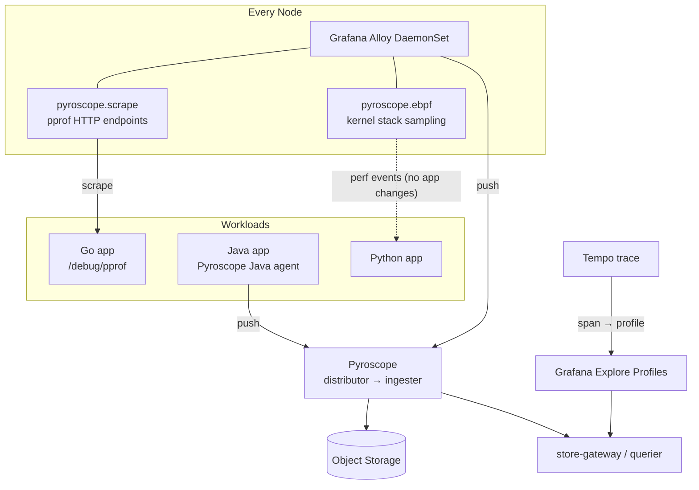
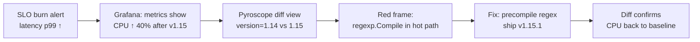

# Continuous Profiling - Pyroscope, eBPF, and the OpenTelemetry Profiles Signal

## Learning Objectives
- Explain what continuous profiling adds on top of metrics, logs, and traces
- Read flame graphs and diff them to find regressions
- Deploy Grafana Pyroscope and collect profiles with Grafana Alloy (eBPF and pull modes)
- Instrument applications with language SDKs and link profiles to trace spans
- Run profiling as a low-overhead, opt-in platform capability with the right security boundaries

## Prerequisites
- [Metrics Stack](./metrics-stack.md) and [Tracing Stack](./tracing-stack.md)
- Grafana 10+ (11+ recommended for the Explore Profiles app)
- Nodes on Linux kernel 4.9+ for eBPF profiling (5.x+ recommended); no gVisor/Kata nodes for eBPF
- Familiarity with [Pod Security](../12-security-compliance/pod-security.md): the eBPF agent is privileged

---

## Why Continuous Profiling?

A trace tells you the `payments` span took 800ms. A profile tells you **which functions burned the CPU or allocated the memory** during that time, down to the line of code.

| Question | Best signal |
|----------|-------------|
| Is the service slow / erroring? | Metrics |
| Which request and which hop? | Traces |
| What did the code log? | Logs |
| **Why is this code slow or expensive?** | **Profiles** |
| Why did memory grow 30% after the last deploy? | Profile diff between versions |

Ad-hoc profiling (`go tool pprof` against a live Pod, async-profiler in a debug session) happens *after* you notice a problem, often on the wrong Pod at the wrong time. **Continuous profiling** samples every process all the time at low frequency (typically ~100 Hz CPU sampling, <2% overhead) and stores the results the way Prometheus stores metrics. You can then look back at any time window, compare versions, and aggregate across replicas.

### Profile Types

| Type | Measures | Typical sources |
|------|----------|-----------------|
| CPU (`process_cpu`) | On-CPU time per stack | eBPF, Go pprof, async-profiler, py-spy |
| Wall clock | Time including waiting/blocking | Java (async-profiler), .NET, Python SDKs |
| Alloc objects / space | Allocation rate per stack | Go pprof, JFR, Ruby, .NET |
| In-use objects / space | Live heap per stack | Go pprof heap |
| Goroutines | Goroutine count per stack | Go pprof |
| Mutex / Block | Lock contention, blocking waits | Go pprof (needs runtime rate settings) |
| Lock (Java) | Monitor contention | JFR / async-profiler |

### Reading a Flame Graph

```
 ┌───────────────────────────────────────────────────────────────────┐
 │ main.main                                                         │  ← root (100%)
 ├──────────────────────────────────────┬────────────────────────────┤
 │ http.(*Server).Serve                 │ runtime.gcBgMarkWorker     │
 ├─────────────────────┬────────────────┤ (GC: 28% — allocation      │
 │ handler.Checkout    │ handler.Health │  pressure!)                │
 ├─────────────────────┤                │                            │
 │ json.Marshal (41%)  │                │                            │
 └─────────────────────┴────────────────┴────────────────────────────┘
   width = share of samples      y-axis = call depth      colour = package
```

- **Width matters, x-position doesn't.** Frames are sorted alphabetically, not by time.
- Look for **wide plateaus**: a function at the top of a wide stack with no children is spending its own (self) time.
- A large `runtime.gcBgMarkWorker` / `GC` frame means look at **allocation** profiles, not CPU.
- **Diff flame graphs** (baseline vs comparison) colour frames red/green by growth or shrinkage. This is the fastest way to triage a regression after a deploy.

---

## Architecture



### Collection Modes

| Mode | How | Pros | Cons |
|------|-----|------|------|
| **eBPF (Alloy `pyroscope.ebpf`)** | Kernel samples stacks of every process on the node | Zero code change, all languages, platform-wide | CPU only; privileged DaemonSet; interpreted languages need symbolization support; frame pointers help |
| **Pull (Alloy `pyroscope.scrape`)** | Scrapes pprof endpoints, like Prometheus | All Go profile types; no SDK push | Go (and anything else exposing pprof) only |
| **Push (language SDK)** | App SDK pushes to Pyroscope | Wall/alloc/lock types; span-profile linking | Code or agent change per service |
| **Java agent** | `-javaagent:pyroscope.jar` (async-profiler) | CPU, alloc, lock, wall with no code change | JVM only |

### Backend Options

| Backend | Notes |
|---------|-------|
| **Grafana Pyroscope** | Merged Phlare and Pyroscope; horizontally scalable, object-storage based, multi-tenant (`X-Scope-OrgID`), same architecture as Mimir/Loki |
| **Parca** | CNCF-adjacent open-source project with its own eBPF agent (`parca-agent`) |
| **OpenTelemetry Profiles** | A **fourth OTel signal**, in development. OTLP profiles plus the OTel eBPF profiler (donated by Elastic). Pyroscope can ingest OTLP profiles. Expect the protocol to keep changing; don't build hard dependencies on it yet |
| Cloud (Google Cloud Profiler, Datadog, ...) | Managed, vendor agents |

---

## Deploying Pyroscope

```bash
# install-pyroscope.sh
helm repo add grafana https://grafana.github.io/helm-charts
helm repo update

# Single binary for labs; microservices mode for production
helm upgrade --install pyroscope grafana/pyroscope \
  --namespace observability --create-namespace \
  --values pyroscope-values.yaml
```

```yaml
# pyroscope-values.yaml
pyroscope:
  # Microservices topology (distributor, ingester, querier, store-gateway, compactor)
  # is enabled by layering the chart's values-micro-services.yaml.
  replicaCount: 1
  persistence:
    enabled: true
    size: 50Gi
  structuredConfig:
    storage:
      backend: s3
      s3:
        bucket_name: platform-profiles
        endpoint: s3.eu-west-1.amazonaws.com
        region: eu-west-1
    limits:
      # Profiles are big. Cap per-tenant ingest and series to keep costs flat
      ingestion_rate_mb: 4
      ingestion_burst_size_mb: 2
      max_label_names_per_series: 30
    compactor:
      blocks_retention_period: 336h   # 14 days (needs compactor enabled)

# The chart can also install Alloy; we install it separately below for control
alloy:
  enabled: false
```

Add the data source to Grafana:

```yaml
# grafana-datasource-pyroscope.yaml (kube-prometheus-stack grafana.additionalDataSources)
- name: Pyroscope
  type: grafana-pyroscope-datasource
  uid: pyroscope
  url: http://pyroscope.observability.svc:4040
```

---

## Collecting Profiles with Grafana Alloy

### eBPF Profiling for Every Workload

```yaml
# alloy-values.yaml
alloy:
  configMap:
    content: |
      // ---------- Discovery ----------
      // pyroscope.ebpf only profiles processes on its own node (matched by
      // container ID), so cluster-wide discovery is fine. Large clusters can add
      // a field selector on spec.nodeName (inject NODE_NAME via the downward API).
      discovery.kubernetes "pods" {
        role = "pod"
      }

      discovery.relabel "profiling" {
        targets = discovery.kubernetes.pods.targets

        // Opt-out: skip namespaces labelled for no profiling
        rule {
          source_labels = ["__meta_kubernetes_namespace_label_platform_mycompany_io_profiling"]
          regex         = "disabled"
          action        = "drop"
        }
        rule {
          source_labels = ["__meta_kubernetes_namespace"]
          target_label  = "namespace"
        }
        rule {
          source_labels = ["__meta_kubernetes_pod_name"]
          target_label  = "pod"
        }
        rule {
          source_labels = ["__meta_kubernetes_pod_container_name"]
          target_label  = "container"
        }
        // service_name is the primary key in Pyroscope (like service.name in OTel)
        rule {
          source_labels = ["__meta_kubernetes_pod_label_platform_mycompany_io_workload"]
          target_label  = "service_name"
        }
      }

      // ---------- eBPF CPU profiling ----------
      pyroscope.ebpf "node" {
        targets    = discovery.relabel.profiling.output
        forward_to = [pyroscope.write.backend.receiver]
        sample_rate = 97         // Hz; a prime avoids lock-step with timers
      }

      // ---------- Pull: Go pprof endpoints (opt-in via annotations) ----------
      discovery.relabel "pprof" {
        targets = discovery.relabel.profiling.output
        rule {
          source_labels = ["__meta_kubernetes_pod_annotation_profiles_grafana_com_cpu_scrape"]
          regex         = "true"
          action        = "keep"
        }
        rule {
          source_labels = ["__address__", "__meta_kubernetes_pod_annotation_profiles_grafana_com_cpu_port"]
          regex         = "(.+?)(?::\\d+)?;(\\d+)"
          replacement   = "$1:$2"
          target_label  = "__address__"
        }
      }

      pyroscope.scrape "go" {
        targets    = discovery.relabel.pprof.output
        forward_to = [pyroscope.write.backend.receiver]
        profiling_config {
          profile.process_cpu { enabled = true }
          profile.memory      { enabled = true }
          profile.goroutine   { enabled = true }
          profile.mutex       { enabled = false }
          profile.block       { enabled = false }
        }
      }

      // ---------- Ship ----------
      pyroscope.write "backend" {
        endpoint {
          url = "http://pyroscope.observability.svc:4040"
        }
        external_labels = {
          cluster = "prod-eu-west-1",
        }
      }

  # eBPF requires host PID namespace and privileged mode
  securityContext:
    privileged: true
    runAsUser: 0
  # Some Alloy versions gate components behind a stability level; set
  # stabilityLevel (e.g. public-preview) only if the component docs require it.

controller:
  type: daemonset
  hostPID: true
```

```bash
helm upgrade --install alloy-profiles grafana/alloy \
  -n observability-agents --create-namespace -f alloy-values.yaml
```

> **Security boundary:** the eBPF agent is privileged with `hostPID`. Run it in a dedicated namespace labelled `pod-security.kubernetes.io/enforce: privileged`, exempt it explicitly in your policy engine, and keep tenants out of that namespace. See [Pod Security](../12-security-compliance/pod-security.md) and [Policy Engine](../12-security-compliance/policy-engine.md).

### Opting a Go Service into Pull Mode

```go
// main.go: expose pprof on a separate, non-public port
import (
    "net/http"
    _ "net/http/pprof"
    "runtime"
)

func main() {
    runtime.SetMutexProfileFraction(5) // enable mutex profiles (1/5 events)
    runtime.SetBlockProfileRate(5)     // enable block profiles
    go func() { _ = http.ListenAndServe(":6060", nil) }()
    // ... app server on :8080
}
```

```yaml
# deployment-cart.yaml (excerpt)
spec:
  template:
    metadata:
      annotations:
        profiles.grafana.com/cpu.scrape: "true"
        profiles.grafana.com/cpu.port: "6060"
      labels:
        platform.mycompany.io/workload: cart
```

> Never expose `/debug/pprof` through an Ingress. It leaks internals and can be used to trigger expensive work. Add a NetworkPolicy so only the Alloy namespace reaches port 6060.

---

## SDK Instrumentation and Span Profiles

SDKs give you more profile types and, most importantly, **span profiles**. These attach the span ID to each profile sample, so you can open the exact flame graph for one slow trace span.

### Java (agent, no code change)

```yaml
# deployment-payments.yaml (excerpt)
spec:
  template:
    spec:
      initContainers:
        - name: pyroscope-agent
          image: grafana/pyroscope-java:latest   # pin a version in production
          command: ["cp", "/app/pyroscope.jar", "/agents/pyroscope.jar"]
          volumeMounts: [{ name: agents, mountPath: /agents }]
      containers:
        - name: payments
          env:
            - name: JAVA_TOOL_OPTIONS
              value: "-javaagent:/agents/pyroscope.jar"
            - name: PYROSCOPE_APPLICATION_NAME
              value: payments
            - name: PYROSCOPE_SERVER_ADDRESS
              value: http://pyroscope.observability.svc:4040
            - name: PYROSCOPE_PROFILER_EVENT
              value: itimer               # cpu without perf_events privileges
            - name: PYROSCOPE_PROFILER_ALLOC
              value: "512k"               # sample every 512 KiB allocated
            - name: PYROSCOPE_PROFILER_LOCK
              value: "10ms"
            - name: PYROSCOPE_LABELS
              value: "namespace=payments,cluster=prod-eu-west-1"
          volumeMounts: [{ name: agents, mountPath: /agents }]
      volumes:
        - name: agents
          emptyDir: {}
```

> Check the image path of the Java agent jar for the version you pin. The packaging has changed between releases. The OTel Java agent can also load the Pyroscope OTel extension so profiles carry span IDs.

### Go (push + span profiles)

```go
// profiling.go
package main

import (
    "os"

    "github.com/grafana/pyroscope-go"
    otelpyroscope "github.com/grafana/otel-profiling-go"
    "go.opentelemetry.io/otel"
    sdktrace "go.opentelemetry.io/otel/sdk/trace"
)

func setupProfiling(tp *sdktrace.TracerProvider) {
    _, _ = pyroscope.Start(pyroscope.Config{
        ApplicationName: "cart",
        ServerAddress:   "http://pyroscope.observability.svc:4040",
        Tags: map[string]string{
            "namespace": os.Getenv("POD_NAMESPACE"),
            "version":   os.Getenv("APP_VERSION"), // enables version-to-version diffs
        },
        ProfileTypes: []pyroscope.ProfileType{
            pyroscope.ProfileCPU,
            pyroscope.ProfileAllocObjects,
            pyroscope.ProfileAllocSpace,
            pyroscope.ProfileInuseSpace,
            pyroscope.ProfileGoroutines,
        },
    })

    // Wrap the tracer provider so CPU samples carry the active span ID
    otel.SetTracerProvider(otelpyroscope.NewTracerProvider(tp))
}
```

Then in Grafana's Tempo data source, configure `tracesToProfiles` (see [Tracing Stack](./tracing-stack.md#correlating-signals-in-grafana)). Spans now show a **"Profiles for this span"** link.

---

## Using Profiles in Practice

### Workflow: Post-Deploy Regression



### Query Language

Pyroscope uses Prometheus-style label selectors on a profile type:

```
process_cpu:cpu:nanoseconds:cpu:nanoseconds{service_name="cart", namespace="checkout"}
memory:alloc_space:bytes:space:bytes{service_name="cart", version="1.15.0"}
```

```bash
# profilecli: query from the terminal / CI
profilecli query merge \
  --url=http://localhost:4040 \
  --profile-type=process_cpu:cpu:nanoseconds:cpu:nanoseconds \
  --query='{service_name="cart"}' \
  --from=now-1h --to=now \
  --output=pprof=./cart-cpu.pb.gz

go tool pprof -top ./cart-cpu.pb.gz | head -20
```

### Cost-Savings Use Case

Platform teams often get more value from **fleet-wide** profiling than from single-service debugging. Aggregate `process_cpu` by function across all `service_name`s to find shared libraries (JSON encoders, logging, TLS, compression) burning a large share of cluster CPU. Optimizing one shared library can give back more capacity than right-sizing dozens of services. Feed the findings into [Capacity Planning](../11-reliability/capacity-planning.md).

---

## Platform Integration

Expose profiling as a `Workload` trait so teams opt in with one field. The workload operator adds the annotations, env vars, or Java agent init container:

```yaml
# workload-payments.yaml
apiVersion: platform.mycompany.io/v1alpha1
kind: Workload
metadata:
  name: payments
  namespace: payments
spec:
  image: ghcr.io/mycompany/payments:3.2.0
  language: java
  traits:
    tracing:  { enabled: true }
    profiling:
      enabled: true
      types: [cpu, alloc, lock]
```

| Policy | Default |
|--------|---------|
| eBPF CPU profiling | On for all namespaces; opt out with `platform.mycompany.io/profiling: disabled` |
| SDK profiling | Opt-in per `Workload` |
| Retention | 14 days |
| Per-tenant ingest limit | 4 MB/s |
| Access | Same Grafana team permissions as the tenant's metrics |

---

## Hands-On Exercise

### Lab: Find a CPU Hotspot with eBPF and a Diff View

```bash
# 1. Install Pyroscope (single binary) and Alloy with the config above
helm upgrade --install pyroscope grafana/pyroscope -n observability --create-namespace
kubectl create ns observability-agents
kubectl label ns observability-agents pod-security.kubernetes.io/enforce=privileged
helm upgrade --install alloy-profiles grafana/alloy -n observability-agents -f alloy-values.yaml

# 2. Deploy a deliberately CPU-hungry workload, version "a"
kubectl create ns demo
cat <<'EOF' | kubectl apply -f -
apiVersion: apps/v1
kind: Deployment
metadata: { name: hasher, namespace: demo }
spec:
  replicas: 2
  selector: { matchLabels: { app: hasher } }
  template:
    metadata:
      labels: { app: hasher, platform.mycompany.io/workload: hasher, version: a }
    spec:
      containers:
        - name: hasher
          image: python:3.12-slim
          command: ["python", "-c"]
          args:
            - |
              import hashlib, time
              while True:
                  for i in range(2000):
                      hashlib.sha256(str(i).encode()).hexdigest()
                  time.sleep(0.05)
          resources: { requests: { cpu: 100m }, limits: { cpu: 500m } }
EOF

# 3. Open Grafana → Explore → Profiles (or the Pyroscope UI)
kubectl -n observability port-forward svc/pyroscope 4040 &
#   Select service_name="hasher", profile type process_cpu, and inspect the flame graph.
#   Python frames are symbolized by the eBPF profiler on supported versions.

# 4. Ship version "b" that does 10x the hashing, then compare
kubectl -n demo patch deploy hasher --type=json -p='[
  {"op":"replace","path":"/spec/template/metadata/labels/version","value":"b"},
  {"op":"replace","path":"/spec/template/spec/containers/0/args/0",
   "value":"import hashlib, time\nwhile True:\n    for i in range(20000):\n        hashlib.sha256(str(i).encode()).hexdigest()\n    time.sleep(0.05)\n"}]'

# 5. Use the "Diff flame graph" / comparison view:
#      baseline:   last 10 min before the patch
#      comparison: last 10 min after the patch
#    The sha256 frames should show up red (growth).
```

> The eBPF profiler uses Pod labels via your relabel rules. Here the `version` label is not mapped, so compare by **time range**. Add a relabel rule for `__meta_kubernetes_pod_label_version` to compare by version instead.

**Stretch goals:**
1. Add a Go service with pprof annotations and view `memory` and `goroutine` profiles.
2. Wire span profiles into a Go service and click through from a Tempo span.
3. Use `profilecli` in CI to export a profile from a load-test run and attach it to the PR.

---

## Troubleshooting

| Symptom | Likely cause | Fix |
|---------|--------------|-----|
| Alloy eBPF pods `CrashLoopBackOff` with permission errors | Not privileged, no `hostPID`, or blocked by PSA/Kyverno | Use a privileged namespace and a policy exemption for the agent ServiceAccount |
| Flame graph full of hex addresses / `[unknown]` | Stripped binaries, missing frame pointers, unsupported runtime | Build with symbols and frame pointers (`-fno-omit-frame-pointer`); use SDK push for that language |
| No profiles for a namespace | Namespace opt-out label, or `service_name` empty and dropped | Check relabel rules in the Alloy UI (`:12345`) under component health/debug |
| Java agent: `perf_events` unavailable | `perf_event_paranoid` restrictive / seccomp | Use `PYROSCOPE_PROFILER_EVENT=itimer` |
| Pyroscope `429` / ingestion limit errors | Per-tenant limits too low for fleet size | Raise `ingestion_rate_mb`; cut the sample rate or label cardinality |
| Span "Profiles" link empty | Span shorter than the sampling interval (~10ms at 100 Hz), or the wrapper is missing | Expected for very short spans; check the `otelpyroscope` wrapper is installed |
| Overhead higher than expected | Alloc profiling with a very small sample interval | Raise the alloc sample size (for example 512k → 2m) |

```bash
# Alloy debug UI: component graph, health, live targets
kubectl -n observability-agents port-forward ds/alloy-profiles 12345
# open http://localhost:12345

# Is Pyroscope receiving data?
kubectl -n observability port-forward svc/pyroscope 4040
curl -s localhost:4040/metrics | grep -E 'pyroscope_distributor_received_(compressed_)?bytes'
```

---

## Best Practices

1. **Start with eBPF CPU profiling fleet-wide.** It needs no code changes and pays off quickly.
2. **Add SDKs where memory, lock, or wall-clock profiles matter**, and for span-profile linking on critical paths.
3. **Label by `version`** so diff views compare deploys directly.
4. **Treat the profiler agent as privileged infrastructure**: give it its own namespace, explicit policy exemptions, and audited changes.
5. **Never expose pprof endpoints publicly.**
6. **Keep label cardinality low.** Profiles are heavier than metrics, so no pod-UID or request-level labels.

---

## Further Reading

### Official Documentation
- [Grafana Pyroscope](https://grafana.com/docs/pyroscope/latest/)
- [Grafana Alloy `pyroscope.ebpf`](https://grafana.com/docs/alloy/latest/reference/components/pyroscope/pyroscope.ebpf/)
- [Parca](https://www.parca.dev/docs/overview)
- [OpenTelemetry Profiles signal](https://opentelemetry.io/docs/specs/otel/profiles/)
- [Go diagnostics: profiling](https://go.dev/doc/diagnostics#profiling)
- [async-profiler](https://github.com/async-profiler/async-profiler)

### Articles
- Brendan Gregg, [Flame Graphs](https://www.brendangregg.com/flamegraphs.html)
- [OpenTelemetry eBPF profiler](https://github.com/open-telemetry/opentelemetry-ebpf-profiler)

---

## Next Steps

1. **Read**: [Alerting](./alerting.md). Close the loop from signal to action.
2. **Apply**: [Capacity Planning](../11-reliability/capacity-planning.md). Use fleet-wide CPU profiles to reclaim capacity.
3. **Review**: [Pod Security](../12-security-compliance/pod-security.md). Handle privileged observability agents.
4. **Practice**: [Lab 06: Observability Stack](../../labs/lab-06-observability-stack/)
