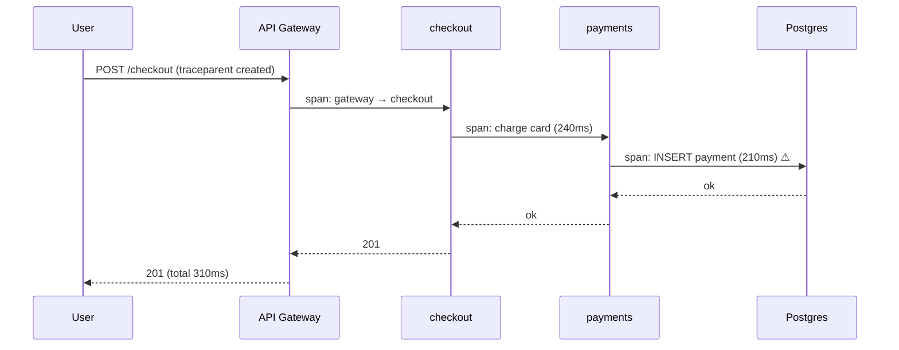
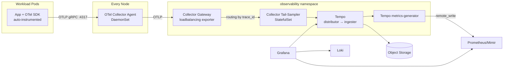

# Tracing Stack - OpenTelemetry, Tempo, Jaeger

## Learning Objectives
- Explain distributed tracing concepts: traces, spans, context propagation, sampling
- Deploy the OpenTelemetry Operator and run Collectors as agents and gateways
- Auto-instrument workloads with the `Instrumentation` CRD, with no code changes
- Store and query traces in Grafana Tempo with TraceQL (and know when Jaeger fits better)
- Correlate traces with metrics (exemplars, span metrics) and logs (trace IDs)
- Design tail-sampling policies that keep costs predictable

## Prerequisites
- [Metrics Stack](./metrics-stack.md): Prometheus and Grafana installed
- [Logging Stack](./logging-stack.md): Loki for log correlation
- cert-manager installed (the OpenTelemetry Operator's webhooks need it)
- Basic HTTP/gRPC understanding

---

## Why Tracing?

In a microservice architecture, one user request can cross dozens of services, queues, and databases. Metrics show that p99 latency went up. Logs show individual errors. **Traces show the causal path**: which hop was slow, which call fanned out, and where retries piled up.



### Core Concepts

| Concept | Description |
|---------|-------------|
| **Trace** | A tree of spans sharing one `trace_id` (16 bytes) |
| **Span** | One unit of work: name, start/end, `span_id`, parent, attributes, events, status |
| **Context propagation** | Passing `trace_id`/`span_id` across process boundaries, by default with the W3C `traceparent` header |
| **Resource attributes** | Who produced the span: `service.name`, `k8s.namespace.name`, `k8s.pod.name` |
| **Semantic conventions** | Standard attribute names (`http.request.method`, `db.system`, `server.address`) |
| **Sampling** | Deciding which traces to keep. *Head* sampling decides at the root; *tail* sampling decides after the trace completes |
| **Exemplar** | A trace ID attached to a metric sample, linking a latency spike to an example trace |

```
traceparent: 00-4bf92f3577b34da6a3ce929d0e0e4736-00f067aa0ba902b7-01
             │  └────────── trace-id ──────────┘ └─ parent-id ──┘ └ flags (01 = sampled)
             version
```

---

## Architecture



**Why the two-tier collector layout?** Tail sampling needs *every span of a trace* on the *same* collector instance. The `loadbalancing` exporter hashes on `trace_id`, so all spans of a trace land on the same sampler replica.

### Backend Comparison

| Backend | Storage | Query language | Strengths | Considerations |
|---------|---------|----------------|-----------|----------------|
| **Grafana Tempo** | Object storage only (Parquet blocks) | TraceQL | Cheap at scale, no index cluster, tight Grafana/Loki/Mimir integration | Search depends on the attributes kept in Parquet columns |
| **Jaeger v2** | Cassandra, Elasticsearch/OpenSearch, Badger, memory | Jaeger UI search | Mature UI; v2 is built on the OTel Collector | Index storage needs to be operated |
| **Commercial (Honeycomb, Datadog, ...)** | SaaS | Vendor-specific | High-cardinality analytics, low ops effort | Cost scales with span volume |

> Jaeger v2 (GA since late 2024) is a distribution of the OpenTelemetry Collector with Jaeger storage extensions. Jaeger client libraries are retired, so instrument with OpenTelemetry SDKs whichever backend you pick.

---

## Installing the OpenTelemetry Operator

```bash
# install-otel-operator.sh
helm repo add open-telemetry https://open-telemetry.github.io/opentelemetry-helm-charts
helm repo update

# The operator needs cert-manager for its admission webhooks
helm upgrade --install otel-operator open-telemetry/opentelemetry-operator \
  --namespace observability --create-namespace \
  --set manager.collectorImage.repository=otel/opentelemetry-collector-contrib \
  --set admissionWebhooks.certManager.enabled=true

kubectl get crd | grep opentelemetry
# instrumentations.opentelemetry.io
# opampbridges.opentelemetry.io
# opentelemetrycollectors.opentelemetry.io
# targetallocators.opentelemetry.io
```

---

## Collector Tier 1: Node Agent (DaemonSet)

```yaml
# otel-agent.yaml
apiVersion: opentelemetry.io/v1beta1
kind: OpenTelemetryCollector
metadata:
  name: agent
  namespace: observability
spec:
  mode: daemonset
  image: otel/opentelemetry-collector-contrib:0.115.0   # pin; contrib has k8sattributes
  serviceAccount: otel-agent                            # needs RBAC to read pods/namespaces
  env:
    - name: K8S_NODE_NAME
      valueFrom: { fieldRef: { fieldPath: spec.nodeName } }
  resources:
    requests: { cpu: 100m, memory: 256Mi }
    limits:   { memory: 512Mi }
  config:
    receivers:
      otlp:
        protocols:
          grpc: { endpoint: 0.0.0.0:4317 }
          http: { endpoint: 0.0.0.0:4318 }

    processors:
      # Must be first: drops data rather than letting the collector OOM
      memory_limiter:
        check_interval: 1s
        limit_percentage: 80
        spike_limit_percentage: 25

      # Enrich spans with Kubernetes metadata from the source Pod IP
      k8sattributes:
        auth_type: serviceAccount
        filter:
          node_from_env_var: K8S_NODE_NAME   # only watch pods on this node
        extract:
          metadata:
            - k8s.namespace.name
            - k8s.pod.name
            - k8s.deployment.name
            - k8s.node.name
          labels:
            - tag_name: platform.tenant
              key: platform.mycompany.io/tenant
              from: namespace
            - tag_name: platform.workload
              key: platform.mycompany.io/workload
              from: pod
        pod_association:
          - sources: [{ from: resource_attribute, name: k8s.pod.ip }]
          - sources: [{ from: connection }]

      resource:
        attributes:
          - key: k8s.cluster.name
            value: prod-eu-west-1
            action: upsert

      batch:
        send_batch_size: 8192
        timeout: 2s

    exporters:
      otlp:
        endpoint: gateway-collector.observability.svc:4317
        tls: { insecure: true }   # use mTLS in production

    service:
      pipelines:
        traces:
          receivers: [otlp]
          processors: [memory_limiter, k8sattributes, resource, batch]
          exporters: [otlp]
```

```yaml
# otel-agent-rbac.yaml
apiVersion: v1
kind: ServiceAccount
metadata: { name: otel-agent, namespace: observability }
---
apiVersion: rbac.authorization.k8s.io/v1
kind: ClusterRole
metadata: { name: otel-agent }
rules:
  - apiGroups: [""]
    resources: [pods, namespaces, nodes]
    verbs: [get, list, watch]
  - apiGroups: [apps]
    resources: [replicasets, deployments]
    verbs: [get, list, watch]
---
apiVersion: rbac.authorization.k8s.io/v1
kind: ClusterRoleBinding
metadata: { name: otel-agent }
roleRef: { apiGroup: rbac.authorization.k8s.io, kind: ClusterRole, name: otel-agent }
subjects: [{ kind: ServiceAccount, name: otel-agent, namespace: observability }]
```

---

## Collector Tier 2: Gateway and Tail Sampling

### Load-Balancing Gateway

```yaml
# otel-gateway.yaml
apiVersion: opentelemetry.io/v1beta1
kind: OpenTelemetryCollector
metadata:
  name: gateway
  namespace: observability
spec:
  mode: deployment
  replicas: 2
  image: otel/opentelemetry-collector-contrib:0.115.0
  config:
    receivers:
      otlp:
        protocols:
          grpc: { endpoint: 0.0.0.0:4317 }
    processors:
      memory_limiter: { check_interval: 1s, limit_percentage: 80, spike_limit_percentage: 25 }
    exporters:
      loadbalancing:
        routing_key: traceID                 # all spans of a trace -> same backend
        protocol:
          otlp:
            tls: { insecure: true }
        resolver:
          k8s:
            service: sampler-collector-headless.observability   # resolves pod IPs
            ports: [4317]
    service:
      pipelines:
        traces:
          receivers: [otlp]
          processors: [memory_limiter]
          exporters: [loadbalancing]
```

### Tail-Sampling Tier

```yaml
# otel-sampler.yaml
apiVersion: opentelemetry.io/v1beta1
kind: OpenTelemetryCollector
metadata:
  name: sampler
  namespace: observability
spec:
  mode: statefulset            # stable identities for the k8s resolver
  replicas: 3
  image: otel/opentelemetry-collector-contrib:0.115.0
  resources:
    requests: { cpu: 500m, memory: 2Gi }
    limits:   { memory: 4Gi }
  config:
    receivers:
      otlp:
        protocols:
          grpc: { endpoint: 0.0.0.0:4317 }
    processors:
      memory_limiter: { check_interval: 1s, limit_percentage: 80, spike_limit_percentage: 25 }
      tail_sampling:
        decision_wait: 10s         # buffer spans this long before deciding
        num_traces: 200000         # traces held in memory per replica
        expected_new_traces_per_sec: 5000
        policies:
          # 1. Always keep errors
          - name: errors
            type: status_code
            status_code: { status_codes: [ERROR] }
          # 2. Always keep slow requests
          - name: slow
            type: latency
            latency: { threshold_ms: 1000 }
          # 3. Keep everything for tenants debugging an incident
          - name: debug-tenants
            type: string_attribute
            string_attribute:
              key: platform.tenant
              values: [payments]
          # 4. Probabilistically keep 5% of the rest
          - name: baseline
            type: probabilistic
            probabilistic: { sampling_percentage: 5 }
      batch: {}
    exporters:
      otlp/tempo:
        endpoint: tempo-distributor.observability.svc:4317
        tls: { insecure: true }
    service:
      pipelines:
        traces:
          receivers: [otlp]
          processors: [memory_limiter, tail_sampling, batch]
          exporters: [otlp/tempo]
```

Tail-sampling policies are OR'd: a trace is kept if **any** policy says sample. For AND logic, use the `and` policy type. Use `composite` to rate-limit by policy.

| Sampling strategy | Where | Pros | Cons |
|-------------------|-------|------|------|
| Head (`parentbased_traceidratio`) | SDK | Zero buffering cost, propagates downstream | Misses rare errors |
| Tail | Collector | Keeps errors and slow traces | Memory; trace-aware routing needed |
| Hybrid | Both | Head at 20–50% to cut volume, tail for the final decision | More moving parts |

---

## Auto-Instrumentation with the `Instrumentation` CRD

The operator injects language agents (Java, Node.js, Python, .NET, Go via eBPF) through an init container when a Pod has an annotation.

```yaml
# instrumentation-default.yaml
apiVersion: opentelemetry.io/v1alpha1
kind: Instrumentation
metadata:
  name: default
  namespace: observability
spec:
  exporter:
    endpoint: http://$(K8S_NODE_IP):4318        # node-local agent (OTLP/HTTP)
  env:
    - name: K8S_NODE_IP
      valueFrom: { fieldRef: { fieldPath: status.hostIP } }
  propagators: [tracecontext, baggage]
  sampler:
    type: parentbased_traceidratio
    argument: "0.25"                             # head-sample 25%; tail sampler refines
  resource:
    addK8sUIDAttributes: true
  java:
    env:
      - name: OTEL_INSTRUMENTATION_JDBC_ENABLED
        value: "true"
  python:
    env:
      - name: OTEL_PYTHON_LOG_CORRELATION        # inject trace_id into log records
        value: "true"
```

> When the exporter endpoint uses `$(K8S_NODE_IP)`, the agent DaemonSet must expose port 4318 on the node. Set `hostPort` in the collector spec, or use `internalTrafficPolicy: Local` on its Service and point at the Service DNS name instead.

Opt a workload in:

```yaml
# deployment-checkout.yaml (excerpt)
spec:
  template:
    metadata:
      annotations:
        # "<namespace>/<name>" of the Instrumentation, or "true" for one in the same ns
        instrumentation.opentelemetry.io/inject-java: "observability/default"
      labels:
        platform.mycompany.io/workload: checkout
```

| Language | Annotation | Mechanism |
|----------|-----------|-----------|
| Java | `inject-java` | `-javaagent` via `JAVA_TOOL_OPTIONS` |
| Node.js | `inject-nodejs` | `NODE_OPTIONS=--require` |
| Python | `inject-python` | `PYTHONPATH` sitecustomize |
| .NET | `inject-dotnet` | CLR profiler env vars |
| Go | `inject-go` | eBPF sidecar (needs elevated privileges; check [Pod Security](../12-security-compliance/pod-security.md)) |

### Platform Integration: a `Workload` Trait

Developers shouldn't need to remember annotations. The workload operator can set them from the platform API:

```yaml
# workload-checkout.yaml
apiVersion: platform.mycompany.io/v1alpha1
kind: Workload
metadata:
  name: checkout
  namespace: checkout
spec:
  image: ghcr.io/mycompany/checkout:1.14.2
  language: java
  traits:
    tracing:
      enabled: true          # operator adds inject-java annotation
      sampleRatio: "0.25"
```

---

## Deploying Grafana Tempo

```bash
# install-tempo.sh. Microservices mode for production
helm upgrade --install tempo grafana/tempo-distributed \
  --namespace observability \
  --values tempo-values.yaml
```

```yaml
# tempo-values.yaml
storage:
  trace:
    backend: s3
    s3:
      bucket: platform-traces
      endpoint: s3.eu-west-1.amazonaws.com
      region: eu-west-1

traces:
  otlp:
    grpc: { enabled: true }      # :4317 on the distributor
    http: { enabled: true }      # :4318

ingester:
  replicas: 3
  persistence: { enabled: true, size: 20Gi }

compactor:
  config:
    compaction:
      block_retention: 336h      # 14 days

# Derive RED metrics and service graphs from spans
metricsGenerator:
  enabled: true
  config:
    storage:
      remote_write:
        - url: http://kps-prometheus.monitoring.svc:9090/api/v1/write
          send_exemplars: true
global_overrides:
  defaults:
    metrics_generator:
      processors: [service-graphs, span-metrics]
```

> `remote_write` into Prometheus needs `--web.enable-remote-write-receiver` (`prometheus.prometheusSpec.enableRemoteWriteReceiver: true` in kube-prometheus-stack). Exemplars need `enableFeatures: [exemplar-storage]`.

### TraceQL by Example

| Goal | TraceQL |
|------|---------|
| All error spans in the checkout namespace | `{ resource.k8s.namespace.name = "checkout" && status = error }` |
| Slow database calls | `{ span.db.system = "postgresql" && duration > 200ms }` |
| Gateway traces where a downstream payments span was slow (structural `>>` descendant) | `{ resource.service.name = "api-gateway" } >> { resource.service.name = "payments" && duration > 500ms }` |
| Traces with more than 5 error spans from one service | `{ status = error } \| by(resource.service.name) \| count() > 5` |
| Request rate per route, computed from traces (TraceQL metrics; needs the `local-blocks` processor) | `{ resource.service.name = "checkout" } \| rate() by (span.http.route)` |

---

## Correlating Signals in Grafana

```mermaid
graph LR
    M[Metric panel<br/>p99 spike] -- exemplar trace_id --> T[Tempo trace view]
    T -- "Logs for this span" --> L[Loki: {namespace=...} |= trace_id]
    T -- "Related metrics" --> M
    L -- derived field trace_id --> T
    T -- "Profiles for this span" --> PR[Pyroscope]
```

```yaml
# grafana-datasources.yaml (provisioned via kube-prometheus-stack grafana.additionalDataSources)
- name: Tempo
  type: tempo
  uid: tempo
  url: http://tempo-query-frontend.observability.svc:3100
  jsonData:
    tracesToLogsV2:
      datasourceUid: loki
      spanStartTimeShift: "-5m"
      spanEndTimeShift: "5m"
      filterByTraceID: true
      tags: [{ key: k8s.namespace.name, value: namespace }]
    tracesToMetrics:
      datasourceUid: prometheus
    tracesToProfiles:
      datasourceUid: pyroscope
      profileTypeId: "process_cpu:cpu:nanoseconds:cpu:nanoseconds"
    serviceMap:
      datasourceUid: prometheus
    nodeGraph:
      enabled: true
- name: Loki
  type: loki
  uid: loki
  url: http://loki-gateway.monitoring.svc
  jsonData:
    derivedFields:
      - name: TraceID
        matcherRegex: '"trace_id":"(\w+)"'
        datasourceUid: tempo
        url: "$${__value.raw}"
```

The log side of this needs services to emit `trace_id` in structured logs. The OTel SDK log bridges do this automatically. See [Logging Stack](./logging-stack.md) for parsing.

---

## Hands-On Exercise

### Lab: End-to-End Traces with Auto-Instrumentation

```bash
# 1. Prereqs: cert-manager + kube-prometheus-stack from metrics-stack.md
helm upgrade --install cert-manager jetstack/cert-manager -n cert-manager \
  --create-namespace --set crds.enabled=true

# 2. Operator + single-binary Tempo (lab sizing)
helm upgrade --install otel-operator open-telemetry/opentelemetry-operator \
  -n observability --create-namespace \
  --set manager.collectorImage.repository=otel/opentelemetry-collector-contrib \
  --set admissionWebhooks.certManager.enabled=true
helm upgrade --install tempo grafana/tempo -n observability \
  --set tempo.metricsGenerator.enabled=true \
  --set tempo.metricsGenerator.remoteWriteUrl=http://kps-prometheus.monitoring.svc:9090/api/v1/write

# 3. A simple single-tier collector (skip tail sampling for the lab)
cat <<'EOF' | kubectl apply -f -
apiVersion: opentelemetry.io/v1beta1
kind: OpenTelemetryCollector
metadata: { name: simple, namespace: observability }
spec:
  mode: deployment
  config:
    receivers: { otlp: { protocols: { grpc: { endpoint: 0.0.0.0:4317 }, http: { endpoint: 0.0.0.0:4318 } } } }
    processors: { batch: {} }
    exporters:
      otlp: { endpoint: tempo.observability.svc:4317, tls: { insecure: true } }
      debug: { verbosity: basic }
    service:
      pipelines:
        traces: { receivers: [otlp], processors: [batch], exporters: [otlp, debug] }
EOF

# 4. Instrumentation pointing at the collector service
cat <<'EOF' | kubectl apply -f -
apiVersion: opentelemetry.io/v1alpha1
kind: Instrumentation
metadata: { name: default, namespace: observability }
spec:
  exporter: { endpoint: http://simple-collector.observability.svc:4318 }
  propagators: [tracecontext, baggage]
  sampler: { type: parentbased_always_on }
EOF

# 5. Deploy a sample Java app (Spring Petclinic)
kubectl create ns petclinic
kubectl -n petclinic create deployment petclinic --image=springcommunity/spring-framework-petclinic
kubectl -n petclinic patch deployment petclinic -p \
  '{"spec":{"template":{"metadata":{"annotations":{"instrumentation.opentelemetry.io/inject-java":"observability/default"}}}}}'
kubectl -n petclinic rollout status deploy/petclinic

# 6. Verify injection
kubectl -n petclinic get pod -l app=petclinic -o jsonpath='{.items[0].spec.initContainers[*].name}'
# -> opentelemetry-auto-instrumentation-java

# 7. Generate traffic and confirm spans reach the collector
kubectl -n petclinic port-forward deploy/petclinic 8080 &
for i in $(seq 1 50); do curl -s localhost:8080/ >/dev/null; done   # adjust the path to your app's routes
kubectl -n observability logs deploy/simple-collector | grep -c "Traces"

# 8. In Grafana → Explore → Tempo, run:
#    { resource.service.name = "petclinic" && duration > 50ms }
```

**Stretch goals:**
1. Replace the single collector with the agent → gateway → sampler layout and confirm errors are always kept.
2. Turn on the metrics-generator and open the Service Graph view.
3. Add the Loki derived field and jump from a log line to its trace.

---

## Troubleshooting

| Symptom | Likely cause | Fix |
|---------|--------------|-----|
| No init container injected | Annotation added after Pod creation; wrong `ns/name`; webhook not ready | Restart the Deployment; `kubectl get instrumentation -A`; check operator logs |
| Spans arrive with no `k8s.*` attributes | `k8sattributes` RBAC missing, or the Pod IP is hidden by a proxy/NAT | Grant `pods`/`namespaces` list/watch; add `from: connection` association |
| Broken traces (orphan spans) | A hop doesn't propagate `traceparent` (custom HTTP client, message queue) | Instrument the client; propagate context in message headers |
| Tail sampler drops traces under load | `num_traces` too low, or spans of a trace split across replicas | Increase `num_traces`; make sure the `loadbalancing` exporter routes by `traceID` |
| Collector OOMKilled | `memory_limiter` missing or not first; huge batches | Put `memory_limiter` first; set `GOMEMLIMIT` to about 80% of the limit |
| TraceQL search finds nothing for recent traces | Ingester hasn't flushed; querier misconfigured | Search by trace ID first; check `tempo_ingester_live_traces`; review query-frontend logs |
| `exemplars` not shown in Grafana | Exemplar storage disabled, or the panel isn't using exemplars | Enable `exemplar-storage`; toggle "Exemplars" in the panel query options |

```bash
# Collector self-telemetry (port 8888 by default)
kubectl -n observability port-forward deploy/gateway-collector 8888
curl -s localhost:8888/metrics | grep -E 'otelcol_(receiver_accepted|exporter_sent|exporter_send_failed)_spans'

# Inspect the final rendered collector config
kubectl -n observability get cm -l app.kubernetes.io/component=opentelemetry-collector -o yaml
```

---

## Best Practices

1. **Standardize on OpenTelemetry SDKs and OTLP** whatever the backend. Swapping backends then means changing a collector exporter only.
2. **Make the collector a platform-owned service.** Apps send to the node-local agent and never to the backend directly.
3. **Set `service.name` deliberately**: it's the primary key for every view. Default it from `platform.mycompany.io/workload`.
4. **Tail-sample for value, head-sample for volume.** Always keep errors and SLO-violating latency.
5. **Keep high-cardinality data in spans, not metric labels**: user IDs, order IDs, and so on.
6. **Link everything**: exemplars, trace IDs in logs, and span-to-profile links ([Profiling](./profiling.md)).

---

## Further Reading

### Official Documentation
- [OpenTelemetry Documentation](https://opentelemetry.io/docs/)
- [OpenTelemetry Operator](https://github.com/open-telemetry/opentelemetry-operator)
- [Collector contrib components](https://github.com/open-telemetry/opentelemetry-collector-contrib)
- [Grafana Tempo](https://grafana.com/docs/tempo/latest/) and [TraceQL](https://grafana.com/docs/tempo/latest/traceql/)
- [Jaeger v2](https://www.jaegertracing.io/docs/latest/)
- [W3C Trace Context](https://www.w3.org/TR/trace-context/)

### Articles & Books
- "Observability Engineering", Charity Majors, Liz Fong-Jones, George Miranda
- [Tail sampling processor README](https://github.com/open-telemetry/opentelemetry-collector-contrib/tree/main/processor/tailsamplingprocessor)

---

## Next Steps

1. **Read**: [Profiling](./profiling.md). Go from a slow span to the hot function.
2. **Read**: [Alerting](./alerting.md). Alert on span-metrics-derived RED signals.
3. **Apply**: [SLOs & SLIs](../11-reliability/slos-slis.md). Latency SLIs from span metrics.
4. **Practice**: [Lab 06: Observability Stack](../../labs/lab-06-observability-stack/) (`tempo-stack.yaml`, `otel-collector.yaml`)
