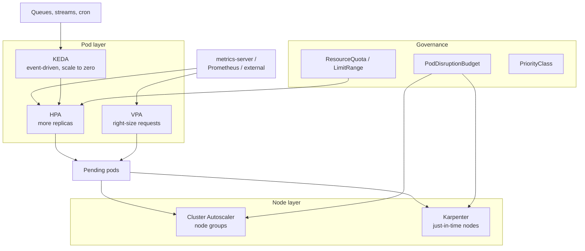
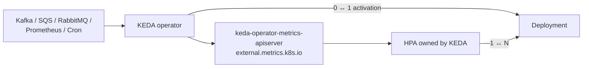
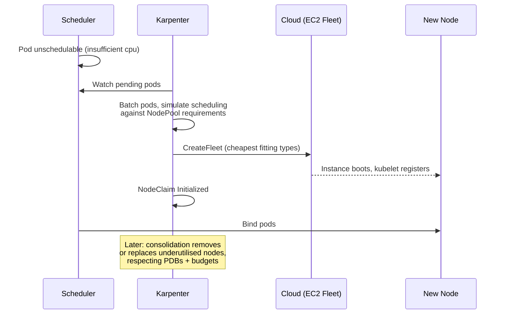

# Capacity Planning - HPA, VPA, KEDA, Cluster Autoscaler, Karpenter

## Learning Objectives
- Understand how requests, limits and QoS drive scheduling, bin-packing and cost
- Configure horizontal scaling with `autoscaling/v2` HPA (including `behavior`) and event-driven scaling with KEDA
- Right-size workloads with the Vertical Pod Autoscaler and avoid HPA/VPA conflicts
- Compare Cluster Autoscaler and Karpenter, and configure Karpenter `NodePool` / `EC2NodeClass` (v1 API)
- Protect availability during scaling and consolidation with PodDisruptionBudgets, priorities and headroom
- Forecast capacity with Prometheus and govern tenants with ResourceQuota and LimitRange

## Prerequisites
- Scheduling basics — see [Scheduling](../01-kubernetes-fundamentals/scheduling.md)
- metrics-server and Prometheus installed — see [Metrics Stack](../10-observability/metrics-stack.md)
- SLOs for your services — see [SLOs, SLIs and Error Budgets](slos-slis.md)
- For the Karpenter sections: an EKS cluster (Karpenter also has providers for Azure and others)

---

## The Capacity Stack

Capacity on Kubernetes is solved at three layers, each with its own autoscaler. They must cooperate: pod autoscalers create demand, node autoscalers supply it.



| Question | Tool |
|----------|------|
| "How many replicas do I need right now?" | HPA, KEDA |
| "How big should each replica be?" | VPA (recommendation), load tests |
| "How many nodes, of what shape?" | Cluster Autoscaler, Karpenter |
| "How much may each tenant consume?" | ResourceQuota, LimitRange |
| "How much will we need next quarter?" | Forecasting with Prometheus, cost tools |

---

## Requests, Limits and QoS

The scheduler only looks at **requests**. Autoscalers compute utilisation **relative to requests**. Getting requests right is therefore the foundation of everything else.

| QoS class | Rule | Eviction order under node pressure |
|-----------|------|-------------------------------------|
| `Guaranteed` | Every container has CPU+memory requests == limits | Last |
| `Burstable` | At least one request or limit set, not Guaranteed | Middle |
| `BestEffort` | No requests or limits | First |

```yaml
# deployment-checkout-resources.yaml (container excerpt)
resources:
  requests:
    cpu: "250m"          # what the scheduler reserves; HPA % is relative to this
    memory: "512Mi"
  limits:
    memory: "512Mi"      # memory limit == request avoids OOM surprises from overcommit
    # no CPU limit: avoids CFS throttling; rely on requests for fair share
```

> **Common platform default:** set memory limit = memory request, set CPU requests but no CPU limit (or a generous one). Enforce "requests must be set" with a policy (see [Policy Engine](../12-security-compliance/policy-engine.md)) and supply defaults with a LimitRange.

### Measuring Over- and Under-Provisioning

```promql
# Requested vs actually used CPU per namespace (cores)
sum by (namespace) (kube_pod_container_resource_requests{resource="cpu"})
-
sum by (namespace) (rate(container_cpu_usage_seconds_total{container!=""}[5m]))

# Cluster-level request utilisation (how full the scheduler thinks we are)
sum(kube_pod_container_resource_requests{resource="cpu"})
/
sum(kube_node_status_allocatable{resource="cpu"})

# Memory working set vs request ratio per container (p95 over a week)
quantile_over_time(0.95,
  (sum by (namespace, pod, container) (container_memory_working_set_bytes{container!=""})
   /
   sum by (namespace, pod, container) (kube_pod_container_resource_requests{resource="memory"}))[7d:5m])
```

| Signal | Meaning | Action |
|--------|---------|--------|
| Request utilisation high, real usage low | Requests inflated → paying for idle | Lower requests (VPA recommendations) |
| Real usage > requests frequently | Noisy neighbours, OOM risk, throttling | Raise requests |
| Many pending pods | Not enough capacity or unschedulable constraints | Check node autoscaler, taints, topology |
| CPU throttling (`container_cpu_cfs_throttled_periods_total`) | CPU limit too low | Raise or remove CPU limit |

---

## Horizontal Pod Autoscaler (`autoscaling/v2`)

HPA computes `desiredReplicas = ceil(currentReplicas × currentMetric / targetMetric)`, evaluated every 15 s by default (`--horizontal-pod-autoscaler-sync-period`), with a 10% tolerance.

```yaml
# hpa-checkout.yaml
apiVersion: autoscaling/v2
kind: HorizontalPodAutoscaler
metadata:
  name: checkout-api
  namespace: checkout
  labels:
    platform.mycompany.io/tenant: payments
spec:
  scaleTargetRef:
    apiVersion: apps/v1
    kind: Deployment
    name: checkout-api
  minReplicas: 3                    # >= PDB minAvailable + 1, spread across zones
  maxReplicas: 30                   # must fit within the namespace ResourceQuota
  metrics:
    # 1. CPU relative to requests
    - type: Resource
      resource:
        name: cpu
        target:
          type: Utilization
          averageUtilization: 65    # leave headroom for spikes during scale-up lag
    # 2. Per-container metric (ignore sidecar CPU), GA in 1.30
    - type: ContainerResource
      containerResource:
        name: cpu
        container: app
        target:
          type: Utilization
          averageUtilization: 70
    # 3. Custom per-pod metric via prometheus-adapter
    - type: Pods
      pods:
        metric:
          name: http_requests_per_second
        target:
          type: AverageValue
          averageValue: "50"
  behavior:
    scaleUp:
      stabilizationWindowSeconds: 0  # react immediately
      selectPolicy: Max
      policies:
        - type: Percent
          value: 100                 # at most double...
          periodSeconds: 30
        - type: Pods
          value: 4                   # ...or add 4 pods, whichever is larger
          periodSeconds: 30
    scaleDown:
      stabilizationWindowSeconds: 300  # use max recommendation of last 5 min — prevents flapping
      selectPolicy: Min
      policies:
        - type: Percent
          value: 20
          periodSeconds: 60
```

> When several metrics are listed, HPA computes a replica count for each and uses the **largest**. Remove the `ContainerResource` metric if you're on a version before it went GA, or keep only one CPU metric to keep reasoning simple.

### Custom Metrics via prometheus-adapter

```yaml
# prometheus-adapter-values.yaml (excerpt)
rules:
  custom:
    - seriesQuery: 'http_requests_total{namespace!="",pod!=""}'
      resources:
        overrides:
          namespace: { resource: namespace }
          pod: { resource: pod }
      name:
        matches: "^(.*)_total$"
        as: "${1}_per_second"
      metricsQuery: 'sum(rate(<<.Series>>{<<.LabelMatchers>>}[2m])) by (<<.GroupBy>>)'
```

```bash
kubectl get --raw "/apis/custom.metrics.k8s.io/v1beta1/namespaces/checkout/pods/*/http_requests_per_second" | jq .
kubectl describe hpa -n checkout checkout-api     # look at Conditions: AbleToScale, ScalingActive, ScalingLimited
```

---

## KEDA - Event-Driven Autoscaling

[KEDA](https://keda.sh/) feeds external metrics (queues, streams, cron, Prometheus) into an HPA it manages and adds **scale to zero**.



```yaml
# scaledobject-orders-consumer.yaml
apiVersion: keda.sh/v1alpha1
kind: ScaledObject
metadata:
  name: orders-consumer
  namespace: checkout
spec:
  scaleTargetRef:
    name: orders-consumer          # Deployment
  minReplicaCount: 0               # scale to zero when topic is idle
  maxReplicaCount: 24              # <= number of topic partitions
  pollingInterval: 15
  cooldownPeriod: 300              # wait before scaling 1 -> 0
  advanced:
    horizontalPodAutoscalerConfig:
      behavior:
        scaleDown:
          stabilizationWindowSeconds: 120
  triggers:
    - type: kafka
      metadata:
        bootstrapServers: kafka-bootstrap.kafka.svc:9092
        consumerGroup: orders-consumer
        topic: orders
        lagThreshold: "100"        # target lag per replica
        activationLagThreshold: "10"
    - type: prometheus
      metadata:
        serverAddress: http://kps-prometheus.monitoring:9090
        query: sum(rate(orders_processed_total{namespace="checkout"}[1m]))
        threshold: "200"
```

```yaml
# scaledobject-cron-business-hours.yaml — pre-scale for predictable peaks
apiVersion: keda.sh/v1alpha1
kind: ScaledObject
metadata:
  name: reporting-ui
  namespace: reporting
spec:
  scaleTargetRef:
    name: reporting-ui
  minReplicaCount: 1
  maxReplicaCount: 10
  triggers:
    - type: cron
      metadata:
        timezone: Europe/London
        start: "0 8 * * 1-5"
        end: "0 19 * * 1-5"
        desiredReplicas: "6"
```

> Don't create both a KEDA `ScaledObject` and your own HPA for the same Deployment — KEDA owns the HPA it creates.

---

## Vertical Pod Autoscaler

VPA observes usage and recommends (or applies) requests. It has three components: **recommender**, **updater** (evicts pods to apply changes) and **admission controller** (rewrites requests at pod creation).

```yaml
# vpa-checkout.yaml
apiVersion: autoscaling.k8s.io/v1
kind: VerticalPodAutoscaler
metadata:
  name: checkout-api
  namespace: checkout
spec:
  targetRef:
    apiVersion: apps/v1
    kind: Deployment
    name: checkout-api
  updatePolicy:
    updateMode: "Off"              # Off | Initial | Recreate | Auto (and InPlaceOrRecreate on newer VPA)
  resourcePolicy:
    containerPolicies:
      - containerName: app
        controlledResources: ["memory"]   # leave CPU to the HPA
        controlledValues: RequestsOnly
        minAllowed:
          memory: 256Mi
        maxAllowed:
          memory: 4Gi
      - containerName: istio-proxy
        mode: "Off"
```

```bash
kubectl get vpa -n checkout checkout-api -o jsonpath='{.status.recommendation.containerRecommendations}' | jq .
# target / lowerBound / upperBound / uncappedTarget per container
```

| `updateMode` | Behaviour | Use for |
|--------------|-----------|---------|
| `Off` | Recommendations only | Default for all tenants; feed into dashboards/PR bots |
| `Initial` | Apply at pod creation only | Batch jobs, CronJobs |
| `Recreate` / `Auto` | Evict pods to apply | Stateless singletons not scaled by HPA |

### HPA + VPA Rule

**Never let HPA and VPA act on the same resource metric.** If HPA scales on CPU and VPA raises CPU requests, utilisation drops, HPA scales in, VPA raises again — a feedback loop. Safe combinations:

| HPA metric | VPA controls | Safe? |
|------------|--------------|-------|
| CPU | CPU | ❌ |
| CPU | Memory only | ✅ |
| Custom (RPS, queue lag) | CPU + memory | ✅ |
| — (no HPA) | CPU + memory, `Auto` | ✅ |

> **In-place pod resize** (`InPlacePodVerticalScaling`, beta and enabled by default since Kubernetes 1.33) lets resources change without restart; VPA's `InPlaceOrRecreate` mode builds on it. On 1.28–1.32 clusters, assume VPA updates restart pods.

---

## Node Autoscaling

### Cluster Autoscaler vs Karpenter

| Aspect | Cluster Autoscaler | Karpenter |
|--------|-------------------|-----------|
| Model | Scales pre-defined node groups (ASGs, MIGs, VMSS) | Provisions individual instances directly from pod requirements |
| Instance choice | Fixed per node group | Chooses from many types per launch (price/capacity-aware) |
| Speed | Minutes (ASG round-trip) | Typically faster (direct fleet API) |
| Consolidation | Scale-down of underutilised nodes | Active consolidation: delete *or replace* with cheaper nodes |
| Spot handling | Via mixed-instance ASGs | Native, with interruption handling (SQS) |
| Cloud support | Very broad | AWS (GA), Azure (AKS NAP), others via providers |
| API | Flags + node group tags | CRDs: `NodePool`, `NodeClaim`, provider `NodeClass` |



### Cluster Autoscaler Configuration

```yaml
# cluster-autoscaler-args.yaml (container args excerpt, AWS)
command:
  - ./cluster-autoscaler
  - --cloud-provider=aws
  - --node-group-auto-discovery=asg:tag=k8s.io/cluster-autoscaler/enabled,k8s.io/cluster-autoscaler/prod-eu1
  - --expander=priority,least-waste     # try priority config first, then least waste
  - --balance-similar-node-groups=true  # keep zones balanced
  - --scale-down-utilization-threshold=0.5
  - --scale-down-unneeded-time=10m
  - --scale-down-delay-after-add=10m
  - --skip-nodes-with-local-storage=false
  - --max-node-provision-time=15m
```

Pods that must not be moved: annotate `cluster-autoscaler.kubernetes.io/safe-to-evict: "false"`.

### Karpenter NodePool and EC2NodeClass (v1)

```yaml
# nodepool-general.yaml
apiVersion: karpenter.sh/v1
kind: NodePool
metadata:
  name: general
spec:
  template:
    metadata:
      labels:
        platform.mycompany.io/pool: general
    spec:
      nodeClassRef:
        group: karpenter.k8s.aws
        kind: EC2NodeClass
        name: default
      requirements:
        - key: karpenter.sh/capacity-type
          operator: In
          values: ["spot", "on-demand"]       # Karpenter prefers spot when allowed
        - key: kubernetes.io/arch
          operator: In
          values: ["amd64", "arm64"]
        - key: karpenter.k8s.aws/instance-category
          operator: In
          values: ["c", "m", "r"]
        - key: karpenter.k8s.aws/instance-generation
          operator: Gt
          values: ["5"]
        - key: karpenter.k8s.aws/instance-size
          operator: NotIn
          values: ["nano", "micro", "small", "metal"]
      expireAfter: 720h                      # rotate nodes monthly (patching, drift)
      terminationGracePeriod: 48h            # upper bound on draining a node
  disruption:
    consolidationPolicy: WhenEmptyOrUnderutilized
    consolidateAfter: 5m
    budgets:
      - nodes: "10%"                         # at most 10% of nodes disrupted at once
      - nodes: "0"                           # no consolidation during business hours
        reasons: ["Underutilized"]
        schedule: "0 8 * * mon-fri"
        duration: 10h
  limits:
    cpu: "2000"                              # cap this pool's total capacity (cost guardrail)
    memory: 8000Gi
  weight: 10
---
# nodepool-gpu.yaml — tainted pool only for workloads that tolerate it
apiVersion: karpenter.sh/v1
kind: NodePool
metadata:
  name: gpu
spec:
  template:
    spec:
      nodeClassRef:
        group: karpenter.k8s.aws
        kind: EC2NodeClass
        name: default
      requirements:
        - key: karpenter.k8s.aws/instance-family
          operator: In
          values: ["g5", "g6"]
        - key: karpenter.sh/capacity-type
          operator: In
          values: ["on-demand"]
      taints:
        - key: nvidia.com/gpu
          value: "true"
          effect: NoSchedule
  disruption:
    consolidationPolicy: WhenEmpty
    consolidateAfter: 10m
  limits:
    nvidia.com/gpu: "16"
```

```yaml
# ec2nodeclass-default.yaml
apiVersion: karpenter.k8s.aws/v1
kind: EC2NodeClass
metadata:
  name: default
spec:
  role: KarpenterNodeRole-prod-eu1         # IAM role for nodes
  amiSelectorTerms:
    - alias: al2023@latest                 # pin a version (e.g. al2023@v20251020) in prod
  subnetSelectorTerms:
    - tags:
        karpenter.sh/discovery: prod-eu1
  securityGroupSelectorTerms:
    - tags:
        karpenter.sh/discovery: prod-eu1
  metadataOptions:
    httpTokens: required                   # IMDSv2 only
    httpPutResponseHopLimit: 1
  blockDeviceMappings:
    - deviceName: /dev/xvda
      ebs:
        volumeSize: 100Gi
        volumeType: gp3
        encrypted: true
  tags:
    platform.mycompany.io/cost-center: platform
```

```bash
kubectl get nodepools,nodeclaims
kubectl describe nodeclaim <name>      # why was this instance type chosen? launch errors?
kubectl logs -n kube-system -l app.kubernetes.io/name=karpenter -c controller --tail=200
```

Workloads opt out of voluntary disruption with the pod annotation `karpenter.sh/do-not-disrupt: "true"` — use sparingly (long batch jobs), as it blocks consolidation and node expiry.

---

## Protecting Availability While Scaling

Every autoscaler that removes capacity uses the eviction API, which honours PodDisruptionBudgets.

```yaml
# pdb-checkout.yaml
apiVersion: policy/v1
kind: PodDisruptionBudget
metadata:
  name: checkout-api
  namespace: checkout
spec:
  maxUnavailable: 1                 # prefer maxUnavailable: works with any replica count
  unhealthyPodEvictionPolicy: AlwaysAllow   # don't let crash-looping pods block node drains
  selector:
    matchLabels:
      app.kubernetes.io/name: checkout-api
```

```yaml
# deployment-checkout-spread.yaml (pod spec excerpt)
topologySpreadConstraints:
  - maxSkew: 1
    topologyKey: topology.kubernetes.io/zone
    whenUnsatisfiable: DoNotSchedule
    labelSelector:
      matchLabels:
        app.kubernetes.io/name: checkout-api
  - maxSkew: 1
    topologyKey: kubernetes.io/hostname
    whenUnsatisfiable: ScheduleAnyway
    labelSelector:
      matchLabels:
        app.kubernetes.io/name: checkout-api
```

> **PDB anti-patterns:** `minAvailable: 100%` or `maxUnavailable: 0` blocks every drain forever — node upgrades and Karpenter expiry stall. Audit with a policy that rejects PDBs allowing zero disruptions.

### Headroom with Overprovisioning

Node provisioning takes 1–3 minutes. To absorb spikes instantly, run low-priority placeholder pods that are preempted when real pods need room; the autoscaler then adds a node for the evicted placeholders.

```yaml
# overprovisioning.yaml
apiVersion: scheduling.k8s.io/v1
kind: PriorityClass
metadata:
  name: overprovisioning
value: -10                          # below the default (0) so anything preempts it
preemptionPolicy: Never
globalDefault: false
description: "Placeholder pods that reserve headroom"
---
apiVersion: apps/v1
kind: Deployment
metadata:
  name: capacity-reservation
  namespace: platform-system
spec:
  replicas: 3                       # ≈ headroom you want (3 × 2 CPU = 6 CPU)
  selector:
    matchLabels: { app: capacity-reservation }
  template:
    metadata:
      labels: { app: capacity-reservation }
    spec:
      priorityClassName: overprovisioning
      terminationGracePeriodSeconds: 0
      containers:
        - name: pause
          image: registry.k8s.io/pause:3.10
          resources:
            requests: { cpu: "2", memory: 4Gi }
```

Scale the placeholder count with [cluster-proportional-autoscaler](https://github.com/kubernetes-sigs/cluster-proportional-autoscaler) to keep headroom a percentage of cluster size.

---

## Tenant Governance: ResourceQuota and LimitRange

The `tenant-operator` should stamp these into every tenant namespace, sized from the `Tenant` spec.

```yaml
# tenant-payments.yaml — illustrative quota fields on the platform Tenant API
apiVersion: platform.mycompany.io/v1alpha1
kind: Tenant
metadata:
  name: payments
spec:
  owners: ["group:payments-team"]
  quota:
    requests.cpu: "64"
    requests.memory: 256Gi
    limits.memory: 256Gi
    persistentvolumeclaims: "40"
```

```yaml
# resourcequota-payments.yaml (rendered by tenant-operator)
apiVersion: v1
kind: ResourceQuota
metadata:
  name: compute
  namespace: checkout
  labels:
    platform.mycompany.io/tenant: payments
spec:
  hard:
    requests.cpu: "64"
    requests.memory: 256Gi
    limits.memory: 256Gi
    persistentvolumeclaims: "40"
    requests.storage: 2Ti
    services.loadbalancers: "2"
---
apiVersion: v1
kind: ResourceQuota
metadata:
  name: no-critical-priority
  namespace: checkout
spec:
  hard:
    pods: "0"
  scopeSelector:
    matchExpressions:
      - operator: In
        scopeName: PriorityClass
        values: ["system-cluster-critical", "system-node-critical"]
---
apiVersion: v1
kind: LimitRange
metadata:
  name: defaults
  namespace: checkout
spec:
  limits:
    - type: Container
      defaultRequest: { cpu: 100m, memory: 128Mi }
      default: { memory: 256Mi }
      max: { cpu: "8", memory: 32Gi }
```

> With a `requests.cpu` quota present, pods without CPU requests are rejected — the LimitRange `defaultRequest` prevents that for developers who forget.

Make sure HPA `maxReplicas × request` fits within quota, otherwise the HPA silently scales to fewer replicas than desired (`kubectl describe hpa` shows `FailedCreate` events on the ReplicaSet).

---

## Forecasting and Cost

### Trend-Based Forecasting

```yaml
# prometheusrule-capacity.yaml
apiVersion: monitoring.coreos.com/v1
kind: PrometheusRule
metadata:
  name: capacity-forecast
  namespace: monitoring
  labels:
    release: kube-prometheus-stack
spec:
  groups:
    - name: capacity
      interval: 5m
      rules:
        - record: cluster:cpu_requests:ratio
          expr: |
            sum(kube_pod_container_resource_requests{resource="cpu"})
            / sum(kube_node_status_allocatable{resource="cpu"})
        - alert: TenantQuotaExhaustedIn7Days
          expr: |
            predict_linear(kube_resourcequota{type="used",resource="requests.cpu"}[7d], 7*24*3600)
            >
            on (namespace, resourcequota, resource) kube_resourcequota{type="hard",resource="requests.cpu"}
          for: 1h
          labels: { severity: ticket, team: platform }
          annotations:
            summary: "Namespace {{ $labels.namespace }} will exhaust its CPU quota within 7 days"
        - alert: PersistentVolumeFillingUp
          expr: |
            predict_linear(kubelet_volume_stats_available_bytes[6h], 4*24*3600) < 0
            and kubelet_volume_stats_available_bytes / kubelet_volume_stats_capacity_bytes < 0.15
          for: 1h
          labels: { severity: ticket }
        - alert: KarpenterNodePoolNearLimit
          expr: |
            karpenter_nodepools_usage{resource_type="cpu"}
            / karpenter_nodepools_limit{resource_type="cpu"} > 0.85
          for: 30m
          labels: { severity: ticket, team: platform }
```

> Karpenter metric names have changed between releases — verify `karpenter_nodepools_*` against your controller's `/metrics` (port 8080) before alerting on them.

### Load Testing to Find Per-Replica Capacity

Autoscaling targets should come from measurement, not guesses:

1. Run one replica with fixed requests; ramp load (k6, Locust, vegeta) until the **latency SLI** breaches.
2. Record the max sustainable RPS per replica (e.g. 80 RPS at 250m CPU).
3. Set the HPA target at ~60–70% of that (e.g. 50 RPS/pod) to absorb the scale-up delay.
4. Peak forecast ÷ per-replica target = `maxReplicas` (plus N+1 for zone loss).

```javascript
// k6-checkout.js
import http from 'k6/http';
import { check } from 'k6';
export const options = {
  scenarios: {
    ramp: { executor: 'ramping-arrival-rate', startRate: 10, timeUnit: '1s',
            preAllocatedVUs: 200, stages: [{ target: 200, duration: '10m' }] },
  },
  thresholds: { http_req_duration: ['p(99)<300'], http_req_failed: ['rate<0.001'] },
};
export default function () {
  const r = http.get('http://checkout-api.checkout.svc:8080/v1/cart');
  check(r, { 'status 200': (res) => res.status === 200 });
}
```

### Cost Visibility

Tools such as [OpenCost](https://www.opencost.io/) (CNCF) allocate node cost to namespaces/labels using requests and usage. Aggregate by `platform.mycompany.io/tenant` for showback, and report **idle cost** (allocatable minus requested) as the platform's own efficiency KPI.

| Lever | Typical saving | Risk |
|-------|----------------|------|
| Right-size requests (VPA recs) | 20–40% | Under-sizing → OOM/latency |
| Spot / preemptible capacity | 60–90% on those nodes | Interruptions → need PDBs, spread |
| Karpenter consolidation | 10–30% | Churn; tune budgets |
| Arm64 (for example, Graviton) | 20%+ price-performance | Multi-arch images required (see [Supply Chain](../12-security-compliance/supply-chain.md)) |
| Scale to zero (KEDA) for dev/preview | Up to 100% off-hours | Cold start |

---

## Hands-On Exercises

### Exercise 1: Watch HPA react to load (kind)

Goal: see an HPA scale a Deployment up under CPU load and back down after the stabilization
window. Requires `kind`, `helm` and `kubectl`; expect about 15 minutes.

```bash
# 1. Cluster + metrics-server (kind needs --kubelet-insecure-tls)
kind create cluster --name capacity-lab
helm repo add metrics-server https://kubernetes-sigs.github.io/metrics-server/
helm upgrade --install metrics-server metrics-server/metrics-server -n kube-system \
  --set args={--kubelet-insecure-tls}

# 2. Sample app with CPU requests
kubectl create namespace capacity
kubectl -n capacity create deployment web --image=registry.k8s.io/hpa-example --port=80
kubectl -n capacity set resources deployment web --requests=cpu=200m,memory=64Mi --limits=memory=128Mi
kubectl -n capacity expose deployment web --port=80

# 3. HPA with behaviour
cat <<'EOF' | kubectl apply -f -
apiVersion: autoscaling/v2
kind: HorizontalPodAutoscaler
metadata: { name: web, namespace: capacity }
spec:
  scaleTargetRef: { apiVersion: apps/v1, kind: Deployment, name: web }
  minReplicas: 1
  maxReplicas: 10
  metrics:
    - type: Resource
      resource: { name: cpu, target: { type: Utilization, averageUtilization: 50 } }
  behavior:
    scaleDown:
      stabilizationWindowSeconds: 60
EOF

# 4. Generate load in another terminal
kubectl -n capacity run load --rm -it --image=busybox:1.36 --restart=Never -- \
  sh -c 'while true; do wget -q -O- http://web; done'

# 5. Watch
kubectl -n capacity get hpa web -w
kubectl -n capacity top pods
```

Expected output from `kubectl -n capacity get hpa web -w` once the load runs:

```text
NAME   REFERENCE        TARGETS    MINPODS   MAXPODS   REPLICAS
web    Deployment/web   <unknown>/50%   1   10   1
web    Deployment/web   250%/50%        1   10   1
web    Deployment/web   120%/50%        1   10   5
web    Deployment/web   48%/50%         1   10   6
```

Check: `kubectl -n capacity get deploy web` shows more than one ready replica while the load runs,
and `kubectl top pods -n capacity` returns values (it fails if metrics-server is not ready).
The replica count and percentages vary by machine.

**Tasks:**
1. Record time from load start to the first scale-up and to steady state.
2. Stop the load; how long until scale-in starts? Change `stabilizationWindowSeconds` to 300 and repeat.
3. Add a `ResourceQuota` with `requests.cpu: "1"` and repeat. What happens at 6 replicas? Where do you see the error?
4. Install VPA in `Off` mode for `web` and compare its recommendation with your 200m request.
5. *(EKS, optional)* Apply `nodepool-general.yaml`, scale a Deployment to exceed capacity, and watch `kubectl get nodeclaims -w`.

**Cleanup:** `kind delete cluster --name capacity-lab`

---

## Troubleshooting

| Symptom | Likely cause | Fix |
|---------|--------------|-----|
| HPA `TARGETS` shows `<unknown>` | metrics-server missing, or pods lack requests | `kubectl get apiservice v1beta1.metrics.k8s.io`; set CPU requests |
| HPA flaps up/down | No scale-down stabilisation, noisy metric | Increase `scaleDown.stabilizationWindowSeconds`; smooth metric with longer `rate()` |
| HPA at `maxReplicas`, latency still bad | Bottleneck elsewhere (DB), or max too low | Check dependency SLIs; raise max only if quota/nodes allow |
| Pods Pending, no new nodes (CA) | Pod requirements match no node group; group at max | `kubectl describe pod` events (`NotTriggerScaleUp`); CA status ConfigMap `cluster-autoscaler-status` |
| Pods Pending, no NodeClaim (Karpenter) | No NodePool satisfies requirements/taints; pool `limits` reached | `kubectl describe pod` and Karpenter controller logs ("incompatible with nodepool") |
| Nodes never scale down | PDB allows 0 disruptions, `do-not-disrupt`/`safe-to-evict=false`, local storage | Audit PDBs; remove annotations; `--skip-nodes-with-local-storage=false` |
| Constant node churn (Karpenter) | Aggressive consolidation | Raise `consolidateAfter`; add disruption `budgets` |
| VPA recommends absurdly high memory | Memory leak or startup spike | Set `maxAllowed`; investigate with [Profiling](../10-observability/profiling.md) |
| `exceeded quota` on ReplicaSet | HPA wants more than quota permits | Raise quota via `Tenant` spec or lower `maxReplicas` |
| KEDA ScaledObject `READY=False` | Trigger auth / connectivity | `kubectl describe scaledobject`; KEDA operator logs; `TriggerAuthentication` |

---

## Further Reading

- [Horizontal Pod Autoscaling](https://kubernetes.io/docs/tasks/run-application/horizontal-pod-autoscale/) — algorithm and `behavior`
- [Vertical Pod Autoscaler](https://github.com/kubernetes/autoscaler/tree/master/vertical-pod-autoscaler)
- [Cluster Autoscaler FAQ](https://github.com/kubernetes/autoscaler/blob/master/cluster-autoscaler/FAQ.md)
- [Karpenter documentation](https://karpenter.sh/docs/) — NodePools, disruption, v1 migration guide
- [KEDA scalers](https://keda.sh/docs/latest/scalers/)
- [Resource management for pods and containers](https://kubernetes.io/docs/concepts/configuration/manage-resources-containers/)
- [OpenCost](https://www.opencost.io/docs/)
- "The Art of Capacity Planning" — Arun Kejariwal & John Allspaw

---

## Next Steps

1. **Drive scaling from SLOs**: Pick HPA targets from latency SLIs — [SLOs, SLIs and Error Budgets](slos-slis.md)
2. **Prove it under stress**: Combine StressChaos with HPA — [Chaos Engineering](chaos-engineering.md)
3. **Size DR capacity**: Pilot-light vs warm-standby — [Disaster Recovery](disaster-recovery.md)
4. **Tenant quotas end-to-end**: [Lab 07: Multi-Tenancy](../../labs/lab-07-multi-tenancy/)
5. **Observe it**: Dashboards for requests vs usage in [Lab 06: Observability Stack](../../labs/lab-06-observability-stack/)
