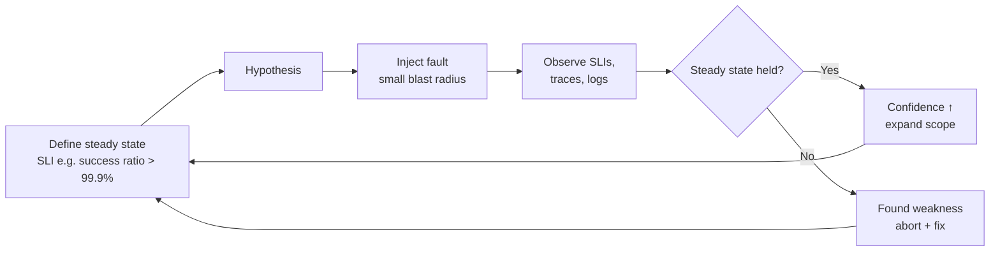
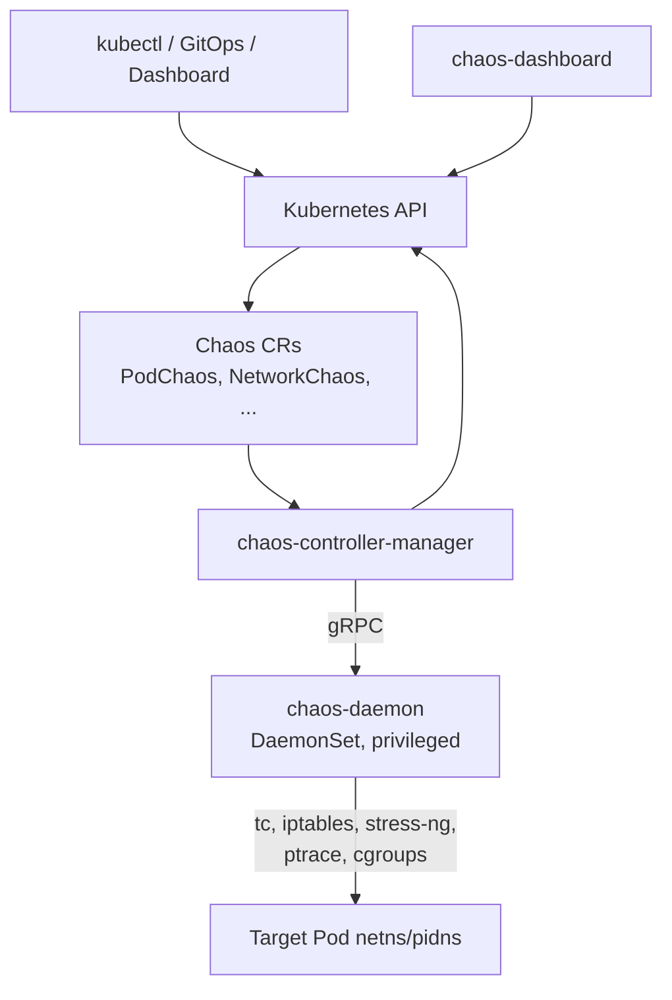
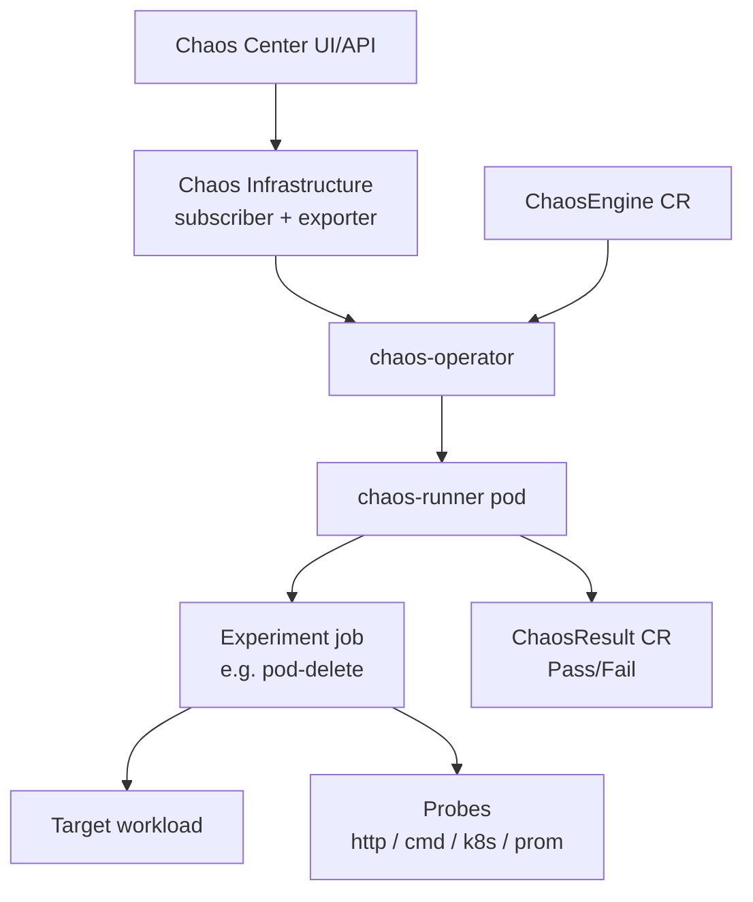
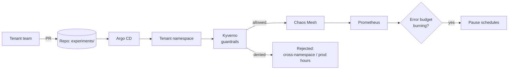

# Chaos Engineering - Chaos Mesh, LitmusChaos, Gremlin

## Learning Objectives
- Explain the principles of chaos engineering and how it differs from "breaking things"
- Design experiments with a steady-state hypothesis tied to SLOs
- Run pod, network, stress and node-level faults with Chaos Mesh
- Build probe-driven experiments with LitmusChaos
- Understand where commercial tools such as Gremlin fit
- Offer chaos as a safe, self-service platform capability with guardrails (RBAC, policy, budgets)

## Prerequisites
- SLOs and error budgets — see [SLOs, SLIs and Error Budgets](slos-slis.md)
- A metrics stack with dashboards — see [Metrics Stack](../10-observability/metrics-stack.md)
- Kubernetes Deployments, PodDisruptionBudgets and probes
- Helm 3.x and a non-production cluster (kind/k3d works for most experiments)

---

## What Is Chaos Engineering?

> "Chaos Engineering is the discipline of experimenting on a system in order to build confidence in the system's capability to withstand turbulent conditions in production." — [Principles of Chaos Engineering](https://principlesofchaos.org/)

It is a **scientific method**, not random destruction:

1. **Define steady state** — a measurable output that indicates normal behaviour (an SLI!).
2. **Hypothesise** that steady state continues in both control and experimental groups.
3. **Introduce variables** that reflect real-world events (pod crash, AZ loss, latency, disk full).
4. **Try to disprove the hypothesis** by comparing steady state between groups.
5. **Minimise blast radius** and automate.



### Why Platform Teams Care

| Platform claim | Experiment that validates it |
|----------------|------------------------------|
| "Workloads survive node loss" | Drain/kill a node; check PDBs and topology spread hold the SLO |
| "Ingress tolerates a bad replica" | Kill ingress pods; check request success |
| "Apps degrade gracefully when a dependency is slow" | Inject 500 ms latency to the DB Service |
| "Autoscaling handles a CPU spike" | StressChaos on pods; HPA scales before latency SLO breaks |
| "DNS failure is survivable" | DNSChaos error for an external hostname |
| "We can restore from backup" | Delete a namespace in staging; Velero restore (see [Disaster Recovery](disaster-recovery.md)) |
| "Alerts fire when they should" | Any fault above — alert must page within the expected time |

### Maturity Progression

| Level | Practice |
|-------|----------|
| 0 | No experiments; reliability assumed |
| 1 | Manual **GameDays** in staging with a facilitator |
| 2 | Scripted experiments in CI against ephemeral environments |
| 3 | Scheduled experiments in production with automated abort on SLO burn |
| 4 | Continuous chaos as a platform service; experiments versioned in Git next to the workload |

---

## Tool Landscape

| Feature | Chaos Mesh | LitmusChaos | Gremlin |
|---------|------------|-------------|---------|
| License / model | Apache-2.0, CNCF Incubating | Apache-2.0, CNCF Incubating | Commercial SaaS |
| Declarative CRDs | Yes (`chaos-mesh.org/v1alpha1`) | Yes (`litmuschaos.io/v1alpha1`) | No (API/UI, agent in cluster) |
| Fault injection mechanism | `chaos-daemon` DaemonSet (privileged, enters target netns/pidns) | Per-experiment runner/helper pods | Agent DaemonSet |
| Pod/network/stress/IO/time faults | Yes | Yes (ChaosHub experiments) | Yes |
| Cloud faults (EC2 stop, AZ) | Limited (AWSChaos, GCPChaos, AzureChaos) | Yes (AWS/GCP/Azure experiments) | Yes |
| Workflows / orchestration | `Workflow`, `Schedule` CRDs | Chaos Center workflows (Argo-based) | Scenarios |
| Built-in steady-state probes | `StatusCheck` in workflows | Rich probes (HTTP, cmd, k8s, Prometheus) | Health checks |
| UI | Chaos Dashboard | Chaos Center | Web app |
| Best fit | GitOps-native, low ceremony | Probe-heavy experiments, hub of experiments | Enterprises wanting support, safety controls, reporting |

---

## Chaos Mesh

### Architecture



- **chaos-controller-manager** reconciles chaos CRs, selects targets, tracks injection/recovery.
- **chaos-daemon** runs on every node with elevated privileges and enters the target container's namespaces.
- An admission webhook validates chaos objects; **namespace filtering** restricts where chaos may run.

### Installation

```bash
helm repo add chaos-mesh https://charts.chaos-mesh.org
helm repo update

# containerd is the default runtime on most 1.28+ clusters (including kind)
helm upgrade --install chaos-mesh chaos-mesh/chaos-mesh \
  --namespace chaos-mesh --create-namespace \
  --version 2.7.2 \
  --set chaosDaemon.runtime=containerd \
  --set chaosDaemon.socketPath=/run/containerd/containerd.sock \
  --set controllerManager.enableFilterNamespace=true \
  --set dashboard.securityMode=true

kubectl get pods -n chaos-mesh
```

With `enableFilterNamespace=true`, chaos is only injected into namespaces annotated as allowed:

```bash
kubectl annotate namespace checkout chaos-mesh.org/inject=enabled
```

> **Security note:** `chaos-daemon` is privileged. The `chaos-mesh` namespace must be exempted from the `restricted` Pod Security Standard and from your admission policies — scope that exemption tightly (see [Pod Security](../12-security-compliance/pod-security.md)).

### Selectors and Modes

Every Chaos Mesh fault shares the same targeting fields:

| Field | Meaning |
|-------|---------|
| `selector.namespaces` | Namespaces to search |
| `selector.labelSelectors` | Label match (`app: checkout-api`) |
| `selector.fieldSelectors`, `selector.annotationSelectors`, `selector.nodes`, `selector.pods` | Narrower targeting |
| `mode: one` | One random matching pod |
| `mode: all` | All matching pods |
| `mode: fixed` + `value: "2"` | Exactly N pods |
| `mode: fixed-percent` + `value: "30"` | N% of pods |
| `mode: random-max-percent` + `value: "50"` | Random up to N% |
| `duration` | How long the fault lasts (for non-instant actions) |

### PodChaos

```yaml
# podchaos-kill-one.yaml — kill one checkout pod; tests replica count + readiness
apiVersion: chaos-mesh.org/v1alpha1
kind: PodChaos
metadata:
  name: checkout-pod-kill
  namespace: checkout
  labels:
    platform.mycompany.io/tenant: payments
spec:
  action: pod-kill            # pod-kill | pod-failure | container-kill
  mode: one
  selector:
    namespaces: ["checkout"]
    labelSelectors:
      app.kubernetes.io/name: checkout-api
  gracePeriod: 0              # 0 = SIGKILL immediately, like a node OOM or crash
```

```yaml
# podchaos-failure.yaml — make 30% of pods unavailable for 2 minutes
apiVersion: chaos-mesh.org/v1alpha1
kind: PodChaos
metadata:
  name: checkout-pod-failure
  namespace: checkout
spec:
  action: pod-failure         # replaces container image with a pause image for `duration`
  mode: fixed-percent
  value: "30"
  duration: "2m"
  selector:
    namespaces: ["checkout"]
    labelSelectors:
      app.kubernetes.io/name: checkout-api
```

### NetworkChaos

```yaml
# networkchaos-db-latency.yaml — 200ms ± 50ms latency from checkout to postgres
apiVersion: chaos-mesh.org/v1alpha1
kind: NetworkChaos
metadata:
  name: checkout-db-latency
  namespace: checkout
spec:
  action: delay               # delay | loss | duplicate | corrupt | partition | bandwidth
  mode: all
  selector:
    namespaces: ["checkout"]
    labelSelectors:
      app.kubernetes.io/name: checkout-api
  direction: to
  target:                     # only traffic to these pods is affected
    mode: all
    selector:
      namespaces: ["checkout"]
      labelSelectors:
        app.kubernetes.io/name: postgres
  delay:
    latency: "200ms"
    jitter: "50ms"
    correlation: "25"
  duration: "5m"
```

```yaml
# networkchaos-partition.yaml — split checkout from the payments provider egress
apiVersion: chaos-mesh.org/v1alpha1
kind: NetworkChaos
metadata:
  name: checkout-partition-external
  namespace: checkout
spec:
  action: partition
  mode: all
  selector:
    namespaces: ["checkout"]
    labelSelectors:
      app.kubernetes.io/name: checkout-api
  direction: to
  externalTargets:
    - "api.payments-provider.example.com"
  duration: "3m"
```

### StressChaos

```yaml
# stresschaos-cpu.yaml — validate HPA reacts before latency SLO is breached
apiVersion: chaos-mesh.org/v1alpha1
kind: StressChaos
metadata:
  name: checkout-cpu-stress
  namespace: checkout
spec:
  mode: fixed
  value: "2"
  selector:
    namespaces: ["checkout"]
    labelSelectors:
      app.kubernetes.io/name: checkout-api
  stressors:
    cpu:
      workers: 2
      load: 80                # percent per worker
    memory:
      workers: 1
      size: "256MB"
  duration: "5m"
```

Other useful kinds: `IOChaos` (latency/faults on file ops), `TimeChaos` (clock skew — great for cert/token expiry bugs), `DNSChaos` (needs the chaos DNS server enabled), `HTTPChaos` (abort/delay/replace HTTP traffic), `KernelChaos`, and `PhysicalMachineChaos`.

### Schedule

```yaml
# schedule-weekday-pod-kill.yaml — recurring chaos during business hours
apiVersion: chaos-mesh.org/v1alpha1
kind: Schedule
metadata:
  name: checkout-weekday-pod-kill
  namespace: checkout
spec:
  schedule: "0 10-16 * * 1-5"   # every hour 10:00–16:00, Mon–Fri (when people are around)
  historyLimit: 5
  concurrencyPolicy: Forbid     # never overlap runs
  type: PodChaos
  podChaos:
    action: pod-kill
    mode: one
    selector:
      namespaces: ["checkout"]
      labelSelectors:
        app.kubernetes.io/name: checkout-api
```

### Workflow with Steady-State Checks

`Workflow` chains faults and `StatusCheck` steps so an experiment aborts automatically when the hypothesis fails.

```yaml
# workflow-checkout-resilience.yaml
apiVersion: chaos-mesh.org/v1alpha1
kind: Workflow
metadata:
  name: checkout-resilience
  namespace: checkout
spec:
  entry: entry
  templates:
    - name: entry
      templateType: Serial
      deadline: 20m
      children:
        - steady-state-before
        - faults-in-parallel
        - steady-state-after

    # 1. Verify steady state BEFORE injecting anything
    - name: steady-state-before
      templateType: StatusCheck
      deadline: 1m
      statusCheck:
        mode: Synchronous
        type: HTTP
        successThreshold: 3
        intervalSeconds: 5
        http:
          url: http://checkout-api.checkout.svc:8080/healthz
          method: GET
          criteria:
            statusCode: "200"

    # 2. Inject two faults together, with a continuous check that aborts the workflow
    - name: faults-in-parallel
      templateType: Parallel
      deadline: 6m
      children:
        - kill-one-pod
        - db-latency
        - continuous-health

    - name: kill-one-pod
      templateType: PodChaos
      deadline: 5m
      podChaos:
        action: pod-kill
        mode: one
        selector:
          namespaces: ["checkout"]
          labelSelectors:
            app.kubernetes.io/name: checkout-api

    - name: db-latency
      templateType: NetworkChaos
      deadline: 5m
      networkChaos:
        action: delay
        mode: all
        selector:
          namespaces: ["checkout"]
          labelSelectors:
            app.kubernetes.io/name: checkout-api
        direction: to
        target:
          mode: all
          selector:
            namespaces: ["checkout"]
            labelSelectors:
              app.kubernetes.io/name: postgres
        delay:
          latency: "100ms"

    - name: continuous-health
      templateType: StatusCheck
      deadline: 5m
      abortWithStatusCheck: true   # abort the whole workflow if this fails
      statusCheck:
        mode: Continuous
        type: HTTP
        failureThreshold: 3
        intervalSeconds: 10
        timeoutSeconds: 2
        http:
          url: http://checkout-api.checkout.svc:8080/healthz
          method: GET
          criteria:
            statusCode: "200"

    # 3. Confirm recovery
    - name: steady-state-after
      templateType: StatusCheck
      deadline: 2m
      statusCheck:
        mode: Synchronous
        type: HTTP
        successThreshold: 3
        intervalSeconds: 10
        http:
          url: http://checkout-api.checkout.svc:8080/healthz
          method: GET
          criteria:
            statusCode: "200"
```

```bash
kubectl apply -f workflow-checkout-resilience.yaml
kubectl get workflow -n checkout checkout-resilience -o wide
kubectl get workflownode -n checkout --selector="chaos-mesh.org/workflow=checkout-resilience"
```

---

## LitmusChaos

### Architecture



Litmus separates **what** (a `ChaosExperiment` — usually pulled from [ChaosHub](https://hub.litmuschaos.io/)) from **when and against whom** (`ChaosEngine`). Results land in a `ChaosResult` CR with a verdict.

### Installation (operator-only, GitOps-friendly)

```bash
helm repo add litmuschaos https://litmuschaos.github.io/litmus-helm/
helm repo update
# Full Chaos Center:
helm upgrade --install chaos litmuschaos/litmus -n litmus --create-namespace

# Install the generic experiments (pod-delete, pod-network-latency, ...) into a namespace
# from the chaos-charts repository matching your Litmus release, e.g.:
# kubectl apply -n checkout -f https://hub.litmuschaos.io/api/chaos/<version>?file=faults/kubernetes/experiments.yaml
```

### RBAC for an Experiment

```yaml
# litmus-sa.yaml — least-privilege service account for pod-delete in one namespace
apiVersion: v1
kind: ServiceAccount
metadata:
  name: pod-delete-sa
  namespace: checkout
---
apiVersion: rbac.authorization.k8s.io/v1
kind: Role
metadata:
  name: pod-delete-sa
  namespace: checkout
rules:
  - apiGroups: [""]
    resources: ["pods", "events", "pods/log", "pods/exec"]
    verbs: ["create", "delete", "get", "list", "patch", "update", "deletecollection", "watch"]
  - apiGroups: ["apps"]
    resources: ["deployments", "replicasets", "statefulsets"]
    verbs: ["get", "list"]
  - apiGroups: ["batch"]
    resources: ["jobs"]
    verbs: ["create", "list", "get", "delete", "deletecollection"]
  - apiGroups: ["litmuschaos.io"]
    resources: ["chaosengines", "chaosexperiments", "chaosresults"]
    verbs: ["create", "list", "get", "patch", "update", "delete"]
---
apiVersion: rbac.authorization.k8s.io/v1
kind: RoleBinding
metadata:
  name: pod-delete-sa
  namespace: checkout
roleRef:
  apiGroup: rbac.authorization.k8s.io
  kind: Role
  name: pod-delete-sa
subjects:
  - kind: ServiceAccount
    name: pod-delete-sa
    namespace: checkout
```

### ChaosEngine with Probes

```yaml
# chaosengine-checkout-pod-delete.yaml
apiVersion: litmuschaos.io/v1alpha1
kind: ChaosEngine
metadata:
  name: checkout-pod-delete
  namespace: checkout
spec:
  engineState: active                 # set to "stop" to abort
  appinfo:
    appns: checkout
    applabel: app.kubernetes.io/name=checkout-api
    appkind: deployment
  chaosServiceAccount: pod-delete-sa
  jobCleanUpPolicy: delete
  experiments:
    - name: pod-delete
      spec:
        components:
          env:
            - name: TOTAL_CHAOS_DURATION
              value: "60"             # seconds
            - name: CHAOS_INTERVAL
              value: "10"             # delete a pod every 10s
            - name: FORCE
              value: "false"
            - name: PODS_AFFECTED_PERC
              value: "50"
        probe:
          # Steady state: the service keeps answering 200 throughout
          - name: checkout-healthz
            type: httpProbe
            mode: Continuous
            httpProbe/inputs:
              url: http://checkout-api.checkout.svc:8080/healthz
              method:
                get:
                  criteria: ==
                  responseCode: "200"
            runProperties:
              probeTimeout: 2s
              interval: 2s
              retry: 2
          # SLO check: error ratio stays below 1% (Prometheus probe at end of chaos)
          - name: checkout-error-ratio
            type: promProbe
            mode: EOT
            promProbe/inputs:
              endpoint: http://kube-prometheus-stack-prometheus.monitoring:9090
              query: >
                sum(rate(http_requests_total{job="checkout-api",code=~"5.."}[2m]))
                / sum(rate(http_requests_total{job="checkout-api"}[2m]))
              comparator:
                criteria: "<"
                value: "0.01"
            runProperties:
              probeTimeout: 5s
              interval: 5s
              retry: 1
```

```bash
kubectl apply -f chaosengine-checkout-pod-delete.yaml
kubectl get chaosengine -n checkout checkout-pod-delete -w
kubectl get chaosresult -n checkout checkout-pod-delete-pod-delete \
  -o jsonpath='{.status.experimentStatus.verdict}{"\n"}'
# Pass | Fail | Stopped | Awaited
```

| Probe type | Checks | Typical use |
|------------|--------|-------------|
| `httpProbe` | HTTP status / body | Service still answers |
| `cmdProbe` | Command exit/output | DB query returns rows |
| `k8sProbe` | Resource exists/absent with field/label selectors | Replicas back to desired |
| `promProbe` | PromQL result vs threshold | SLI stays within SLO |

Probe modes: `SOT` (start of test), `EOT` (end of test), `Edge` (both), `Continuous`, `OnChaos` (only during injection).

---

## Gremlin (Commercial)

Gremlin installs an agent (DaemonSet) and a Kubernetes client, and drives experiments from its SaaS control plane.

- **Fault categories:** resource (CPU, memory, IO, disk), state (shutdown, process killer, time travel), network (latency, packet loss, blackhole, DNS).
- **Reliability scoring / "Reliability Management":** runs a standard test suite against services and produces a score.
- **Safety:** a global **Halt** button, automatic halt on health check failures (e.g. Datadog, Prometheus via webhook), and team-level RBAC.
- **When to choose it:** regulated environments that need audit trails and vendor support, or organisations running chaos across VMs, Kubernetes and serverless from one place.

---

## Chaos as a Platform Capability

Developers should be able to run experiments against **their own** workloads without being able to break someone else's.



### Guardrail: chaos only targets your own namespace

```yaml
# kyverno-chaos-same-namespace.yaml
apiVersion: kyverno.io/v1
kind: ClusterPolicy
metadata:
  name: chaos-target-own-namespace
  annotations:
    policies.kyverno.io/title: Chaos experiments may only target their own namespace
spec:
  validationFailureAction: Enforce
  background: false
  rules:
    - name: selector-namespaces-must-match
      match:
        any:
          - resources:
              kinds:
                - chaos-mesh.org/v1alpha1/PodChaos
                - chaos-mesh.org/v1alpha1/NetworkChaos
                - chaos-mesh.org/v1alpha1/StressChaos
      validate:
        message: "Chaos selector.namespaces must equal the object's namespace."
        deny:
          conditions:
            any:
              - key: "{{ request.object.spec.selector.namespaces || `[]` }}"
                operator: AnyNotIn
                value: ["{{ request.namespace }}"]
              - key: "{{ length(request.object.spec.selector.namespaces || `[]`) }}"
                operator: Equals
                value: 0
```

### Guardrail: only Environments that opted in

Annotate only non-production namespaces (or production namespaces whose `Environment` has opted in) with `chaos-mesh.org/inject=enabled`. The environment-operator can set this from a field such as `spec.chaos.enabled` on `Environment` resources.

### Guardrail: stop chaos when the budget is burning

```yaml
# prometheusrule-chaos-abort.yaml — alert that an automation hook uses to pause schedules
apiVersion: monitoring.coreos.com/v1
kind: PrometheusRule
metadata:
  name: chaos-abort
  namespace: monitoring
  labels:
    release: kube-prometheus-stack
spec:
  groups:
    - name: chaos-safety
      rules:
        - alert: ChaosDuringBudgetBurn
          expr: |
            max by (namespace) (chaos_mesh_experiments{phase="Running"} > 0)
            and on (namespace)
            max by (namespace) (ALERTS{alertstate="firing",severity="page"})
          labels:
            severity: page
            team: platform
          annotations:
            summary: "Chaos running in {{ $labels.namespace }} while a page alert is firing"
            description: "Pause schedules: kubectl annotate schedule -n {{ $labels.namespace }} --all experiment.chaos-mesh.org/pause=true"
```

> Chaos Mesh exports controller metrics (e.g. `chaos_mesh_experiments`) when its ServiceMonitor is enabled; check `/metrics` on the controller-manager for the exact series in your version.

### GameDay Runbook Template

| Phase | Activity |
|-------|----------|
| Before (1 week) | Pick hypothesis, owners, abort criteria, comms channel; notify stakeholders |
| Before (1 hour) | Verify dashboards, on-call aware, steady state green, rollback plan |
| During | Inject fault; scribe records timeline; observer watches SLIs |
| Abort | Any SLO page, customer impact, or facilitator call → `kubectl delete` the chaos object / `engineState: stop` |
| After | Blameless review; file action items; update runbooks and alerts |

---

## Hands-On Exercise

### Lab: Prove (or Disprove) That checkout Survives a Pod Loss

```bash
# 1. kind cluster + Chaos Mesh (see Installation above)
kind create cluster --name chaos-lab
helm upgrade --install chaos-mesh chaos-mesh/chaos-mesh -n chaos-mesh --create-namespace \
  --set chaosDaemon.runtime=containerd \
  --set chaosDaemon.socketPath=/run/containerd/containerd.sock

# 2. Deploy a sample app with ONE replica (deliberately fragile)
kubectl create namespace checkout
kubectl -n checkout create deployment checkout-api --image=ghcr.io/stefanprodan/podinfo:6.7.1 --replicas=1
kubectl -n checkout label deployment checkout-api app.kubernetes.io/name=checkout-api
kubectl -n checkout patch deployment checkout-api --type=merge -p \
  '{"spec":{"template":{"metadata":{"labels":{"app.kubernetes.io/name":"checkout-api"}}}}}'
kubectl -n checkout expose deployment checkout-api --port=8080 --target-port=9898

# 3. Steady-state probe: continuous requests, count failures
kubectl -n checkout run prober --image=curlimages/curl --restart=Never -- \
  sh -c 'while true; do curl -s -o /dev/null -w "%{http_code}\n" --max-time 1 checkout-api:8080/healthz; sleep 0.2; done'

# 4. Inject: kill the only pod
kubectl apply -f podchaos-kill-one.yaml

# 5. Observe failures
kubectl -n checkout logs prober | sort | uniq -c
#   expect a burst of 000 (timeouts) — hypothesis DISPROVED

# 6. Fix: 3 replicas, readiness probe, PDB, topology spread
kubectl -n checkout scale deployment checkout-api --replicas=3
kubectl -n checkout create pdb checkout-api --selector=app.kubernetes.io/name=checkout-api --min-available=2

# 7. Re-run the experiment and compare
kubectl -n checkout delete pod prober
kubectl delete -f podchaos-kill-one.yaml && kubectl apply -f podchaos-kill-one.yaml
# Re-create the prober and count again — failures should be ~0
```

**Extensions:**
1. Run `networkchaos-db-latency.yaml` against a dependency and observe p99 latency in Grafana.
2. Convert the experiment into the `Workflow` above so it aborts automatically.
3. Re-implement the same experiment with a Litmus `ChaosEngine` and a `promProbe`.

**Cleanup:** `kind delete cluster --name chaos-lab`

---

## Troubleshooting

| Symptom | Likely cause | Fix |
|---------|--------------|-----|
| Chaos object stuck, `AllInjected=False` | `chaos-daemon` can't reach runtime socket | Set correct `chaosDaemon.runtime` / `socketPath` (k3s: `/run/k3s/containerd/containerd.sock`) |
| `no pod is selected` | Namespace not annotated (filter mode) or label typo | `kubectl annotate ns X chaos-mesh.org/inject=enabled`; check `labelSelectors` |
| `chaos-daemon` pods rejected | Pod Security `restricted`/`baseline` on `chaos-mesh` ns | Label namespace `pod-security.kubernetes.io/enforce=privileged` (scoped exemption) |
| NetworkChaos has no effect | Target uses host network, or CNI bypasses tc (eBPF host routing) | Check `kubectl get networkchaos -o yaml` status; test with plain pods; see CNI docs |
| Fault never recovers after deleting CR | Finalizer stuck because daemon was gone | Restart `chaos-daemon` on that node; as last resort remove finalizer and restart target pod |
| Litmus `ChaosResult` verdict `Awaited` forever | Runner can't create jobs (RBAC) | `kubectl logs` of `*-runner` pod; check `chaosServiceAccount` Role |
| `promProbe` fails with connection refused | Wrong Prometheus endpoint / NetworkPolicy | Use the in-cluster service FQDN; allow egress to `monitoring` |
| Experiment broke a neighbour | Selectors too broad (`mode: all` across namespaces) | Enforce same-namespace Kyverno policy; start with `mode: one` |

```bash
kubectl describe podchaos -n checkout checkout-pod-kill   # look at Events and status.conditions
kubectl logs -n chaos-mesh -l app.kubernetes.io/component=controller-manager --tail=100
kubectl logs -n chaos-mesh -l app.kubernetes.io/component=chaos-daemon --tail=100
```

---

## Further Reading

### Principles
- [Principles of Chaos Engineering](https://principlesofchaos.org/)
- "Chaos Engineering: System Resiliency in Practice" — Casey Rosenthal & Nora Jones (O'Reilly)
- [Netflix Tech Blog — Chaos Monkey and the Simian Army](https://netflixtechblog.com/tagged/chaos-engineering)

### Tools
- [Chaos Mesh documentation](https://chaos-mesh.org/docs/)
- [LitmusChaos documentation](https://docs.litmuschaos.io/) · [ChaosHub](https://hub.litmuschaos.io/)
- [Gremlin documentation](https://www.gremlin.com/docs)
- [AWS Fault Injection Service](https://docs.aws.amazon.com/fis/) — cloud-level faults (AZ power interruption, EKS node termination)

---

## Next Steps

1. **Back it with SLOs**: Every experiment's steady state should be an SLI from [SLOs, SLIs and Error Budgets](slos-slis.md)
2. **Test recovery, not just resilience**: Run a namespace-loss GameDay with [Disaster Recovery](disaster-recovery.md)
3. **Validate autoscaling**: Combine StressChaos with HPA/Karpenter from [Capacity Planning](capacity-planning.md)
4. **Practice upgrades under failure**: [Lab 08: Platform Upgrade](../../labs/lab-08-platform-upgrade/)
5. **Lock it down**: Scope privileged chaos components with [Pod Security](../12-security-compliance/pod-security.md)
