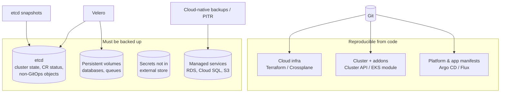
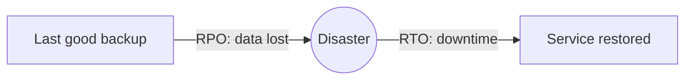
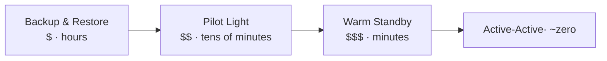
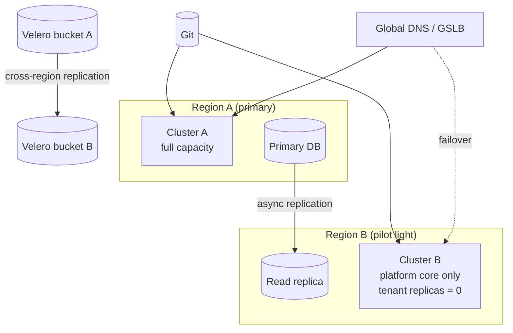
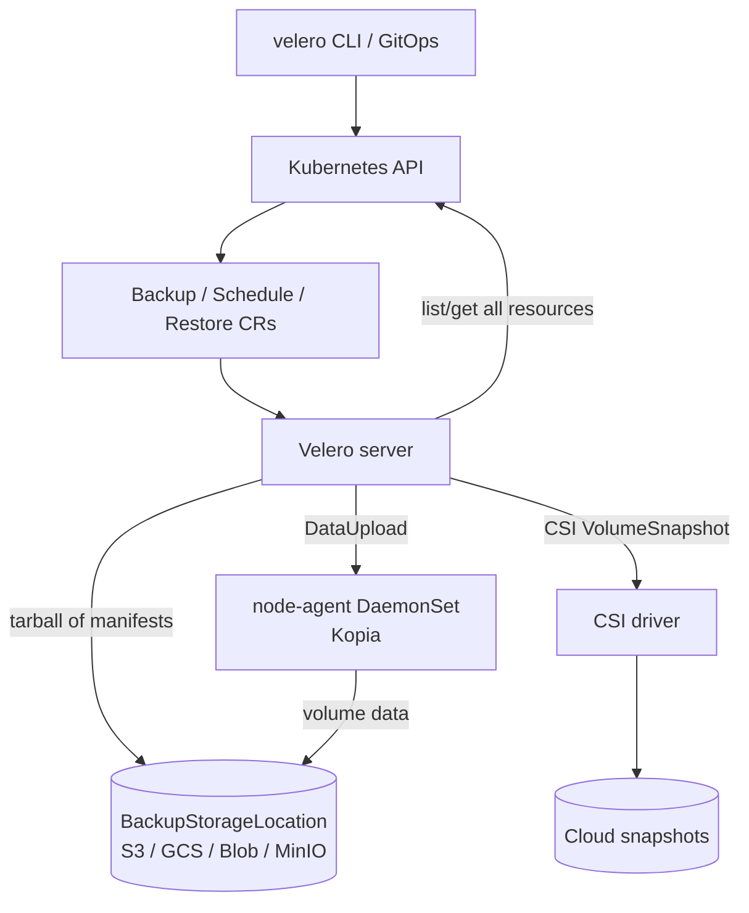
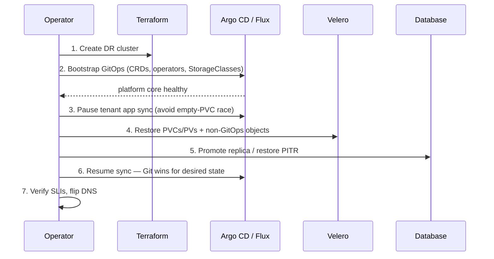

# Disaster Recovery - Velero, etcd and DR Strategies

## Learning Objectives
- Define RPO and RTO and derive them from business impact and SLOs
- Choose between backup/restore, pilot light, warm standby and active-active strategies
- Understand what actually needs backing up in a GitOps-managed cluster (and what doesn't)
- Install and operate Velero: `BackupStorageLocation`, `Schedule`, `Backup`, `Restore`, hooks and volume data
- Take and restore etcd snapshots for self-managed control planes
- Run and automate DR drills so recovery is proven, not assumed

## Prerequisites
- Kubernetes storage: PV, PVC, StorageClass, CSI (see [Storage](../01-kubernetes-fundamentals/storage.md))
- GitOps fundamentals — see [GitOps Principles](../05-gitops/gitops-principles.md)
- Access to object storage (S3, GCS, Azure Blob) or MinIO for local labs
- `velero` CLI, `kubectl`, Helm 3.x

---

## Why DR Is Different on Kubernetes

A cluster is made of several layers, each with different recovery mechanisms. The biggest DR win on Kubernetes is that, with GitOps, **most of the cluster is reproducible from Git** — the hard part is *state*.



| Layer | Source of truth | Recovery method |
|-------|-----------------|-----------------|
| Cloud network, IAM, clusters | Terraform / Crossplane in Git | Re-apply ([Terraform](../04-infrastructure-as-code/terraform-kubernetes.md), [Crossplane](../04-infrastructure-as-code/crossplane.md)) |
| Platform addons (ingress, cert-manager, monitoring) | Git | Bootstrap Argo CD / Flux → reconcile |
| Tenant manifests | Git | Reconcile |
| Kubernetes objects created at runtime (CR status, Leases, generated Secrets, `Tenant`/`Environment` children) | etcd | Velero resource backup or etcd snapshot |
| PersistentVolumes | Storage backend | CSI snapshots / Velero file-system backup / app-native backup |
| Secrets | Vault / cloud secret manager (see [External Secrets](../06-secrets-management/external-secrets.md)) | Store's own replication/backup |
| Managed databases | Cloud provider | Provider PITR + cross-region replicas |

> **GitOps is not a backup.** It restores *desired* state. It does not restore data in PVs, objects created by controllers, or anything someone `kubectl apply`'d by hand. You need both.

---

## RPO, RTO and Business Impact

- **RPO (Recovery Point Objective):** maximum acceptable data loss, measured in time. "We can lose at most 15 minutes of orders."
- **RTO (Recovery Time Objective):** maximum acceptable downtime. "Checkout must be back within 1 hour."



RTO also eats your error budget. A 99.9%/30d SLO allows ~43 minutes of downtime — an RTO of 4 hours means a single disaster blows the budget for the quarter. Make DR objectives consistent with [SLOs](slos-slis.md).

### Tiering Workloads

| Tier | Example | RPO | RTO | Strategy |
|------|---------|-----|-----|----------|
| 0 — platform core | DNS, identity, ingress, GitOps | ~0 (rebuilt from Git) | 15 min | Active-active / multi-cluster |
| 1 — revenue critical | checkout, payments | ≤ 5 min | ≤ 30 min | Warm standby + DB replication |
| 2 — important | search, recommendations | ≤ 1 h | ≤ 4 h | Pilot light |
| 3 — internal / batch | reporting, dev tools | ≤ 24 h | ≤ 24 h | Backup / restore |

Encode the tier on the platform API so backup schedules are generated automatically:

```yaml
# workload-tier-label.yaml — tier drives backup schedule via a Kyverno generate rule
apiVersion: platform.mycompany.io/v1alpha1
kind: Workload
metadata:
  name: checkout-api
  namespace: checkout
  labels:
    platform.mycompany.io/tenant: payments
    platform.mycompany.io/tier: "1"
    platform.mycompany.io/backup: "enabled"
spec:
  image: ghcr.io/mycompany/checkout-api:1.42.0
```

---

## DR Strategies



| Strategy | Secondary site | Data | RPO | RTO | Cost | Complexity |
|----------|----------------|------|-----|-----|------|------------|
| **Backup & restore** | Nothing running; recreate cluster from IaC | Backups in another region | Hours (backup interval) | Hours | Lowest | Low |
| **Pilot light** | Minimal cluster with core platform; workloads scaled to 0 | Async replicated DBs / backups | Minutes | 10–60 min | Low–medium | Medium |
| **Warm standby** | Full stack at reduced capacity, serving no (or test) traffic | Async replication | Seconds–minutes | Minutes | Medium–high | Medium–high |
| **Active-active** | Multiple regions serving production traffic | Multi-region / multi-primary data | ~0 | ~0 (traffic shift) | Highest | Highest (data consistency!) |

### Pilot Light with GitOps



Failover then becomes a sequence of Git changes and a DB promotion:

1. Promote the read replica in region B.
2. Change the overlay for cluster B (`replicas`, HPA `minReplicas`, Karpenter `limits`) in Git.
3. Argo CD / Flux scales the workloads up.
4. Restore any non-GitOps state with Velero from the replicated bucket.
5. Flip DNS / GSLB weights.

See [Multi-Cluster GitOps](../13-multi-cluster/multi-cluster-gitops.md) for managing both clusters from one repo.

---

## Velero

[Velero](https://velero.io/) backs up Kubernetes resources (via the API server — not etcd directly) to object storage and backs up volume data using CSI snapshots, cloud-provider snapshots or file-system backup (Kopia) through its node agent.

### Architecture



### Volume Backup Options

| Method | How | Pros | Cons |
|--------|-----|------|------|
| Provider snapshot plugin (`VolumeSnapshotLocation`) | Cloud API snapshot (EBS, PD) | Fast, crash-consistent | Snapshot stays in same region/account by default |
| CSI snapshot | `VolumeSnapshot` via CSI driver | Provider-agnostic | Same locality limits; needs snapshot CRDs + VolumeSnapshotClass |
| CSI snapshot data movement (`snapshotMoveData: true`) | Snapshot, then node agent copies data to object storage | Portable across regions/clouds | Slower, uses node resources |
| File-system backup (`defaultVolumesToFsBackup: true`) | node agent reads files with Kopia | Works with any volume type | Not crash-consistent without hooks; slower |
| Application-native (pg_dump, Percona/CloudNativePG backups) | The app/operator handles it | Consistent, PITR | Separate tooling |

### Installation

```bash
# velero-credentials (AWS-style INI, works for MinIO as well)
cat > credentials-velero <<'EOF'
[default]
aws_access_key_id=REPLACE_ME
aws_secret_access_key=REPLACE_ME
EOF

# Check the compatibility matrix for matching velero / plugin versions:
# https://github.com/vmware-tanzu/velero-plugin-for-aws#compatibility
velero install \
  --provider aws \
  --plugins velero/velero-plugin-for-aws:v1.12.0 \
  --bucket platform-velero-backups \
  --prefix cluster-prod-eu1 \
  --backup-location-config region=eu-west-1 \
  --snapshot-location-config region=eu-west-1 \
  --secret-file ./credentials-velero \
  --use-node-agent \
  --features=EnableCSI
```

For GitOps, prefer the Helm chart (`vmware-tanzu/velero`) and use IRSA / EKS Pod Identity / Workload Identity rather than static keys.

```yaml
# velero-values.yaml (excerpt for helm chart vmware-tanzu/velero)
initContainers:
  - name: velero-plugin-for-aws
    image: velero/velero-plugin-for-aws:v1.12.0
    volumeMounts:
      - mountPath: /target
        name: plugins
deployNodeAgent: true
serviceAccount:
  server:
    annotations:
      eks.amazonaws.com/role-arn: arn:aws:iam::111122223333:role/velero-prod-eu1
credentials:
  useSecret: false            # IRSA instead of static keys
configuration:
  features: EnableCSI
  defaultVolumesToFsBackup: false
  backupStorageLocation:
    - name: default
      provider: aws
      bucket: platform-velero-backups
      prefix: cluster-prod-eu1
      default: true
      config:
        region: eu-west-1
  volumeSnapshotLocation:
    - name: default
      provider: aws
      config:
        region: eu-west-1
metrics:
  enabled: true
  serviceMonitor:
    enabled: true
    additionalLabels:
      release: kube-prometheus-stack
```

### BackupStorageLocation

```yaml
# bsl-primary-and-dr.yaml
apiVersion: velero.io/v1
kind: BackupStorageLocation
metadata:
  name: default
  namespace: velero
spec:
  provider: aws
  default: true
  accessMode: ReadWrite
  objectStorage:
    bucket: platform-velero-backups
    prefix: cluster-prod-eu1
  config:
    region: eu-west-1
---
# The DR cluster reads the replicated bucket in ReadOnly mode so it can never
# overwrite or garbage-collect primary backups.
apiVersion: velero.io/v1
kind: BackupStorageLocation
metadata:
  name: primary-replica
  namespace: velero
spec:
  provider: aws
  accessMode: ReadOnly
  objectStorage:
    bucket: platform-velero-backups-replica-us-east-1
    prefix: cluster-prod-eu1
  config:
    region: us-east-1
```

> **Protect the bucket.** Enable versioning, S3 Object Lock (compliance mode) or equivalent immutability, cross-region replication, and a separate account. Ransomware that gets cluster-admin can delete backups via Velero if the bucket is writable and mutable.

### Schedules per Tier

```yaml
# schedule-tier1.yaml — every 15 minutes, keep 3 days
apiVersion: velero.io/v1
kind: Schedule
metadata:
  name: tier1-15m
  namespace: velero
spec:
  schedule: "*/15 * * * *"
  useOwnerReferencesInBackup: false   # don't delete backups if the Schedule is deleted
  template:
    includedNamespaces: ["*"]
    labelSelector:
      matchLabels:
        platform.mycompany.io/tier: "1"
    snapshotVolumes: true
    snapshotMoveData: true            # copy CSI snapshot data into object storage
    storageLocation: default
    ttl: 72h0m0s
    itemOperationTimeout: 1h
---
# schedule-cluster-daily.yaml — whole-cluster resource backup, keep 30 days
apiVersion: velero.io/v1
kind: Schedule
metadata:
  name: cluster-daily
  namespace: velero
spec:
  schedule: "0 2 * * *"
  template:
    includedNamespaces: ["*"]
    excludedNamespaces: ["velero", "kube-node-lease"]
    includeClusterResources: true     # CRDs, ClusterRoles, Namespaces, PVs, Tenants
    excludedResources:
      - events
      - events.events.k8s.io
      - leases.coordination.k8s.io
    snapshotVolumes: false            # resources only; volumes covered by tier schedules
    ttl: 720h0m0s
```

> Note the label selector applies to **every** resource. In the tier-1 schedule, objects that lack `platform.mycompany.io/tier: "1"` (e.g. a ConfigMap) are skipped. Either propagate labels to all namespaced objects (a Kyverno mutate rule works well) or use `includedNamespaces` from the tenant operator instead.

### Backup Hooks for Consistency

```yaml
# postgres-statefulset-hooks.yaml (pod template excerpt)
metadata:
  annotations:
    # Freeze writes before the snapshot, unfreeze after
    pre.hook.backup.velero.io/container: postgres
    pre.hook.backup.velero.io/command: '["/bin/bash", "-c", "psql -U postgres -c \"CHECKPOINT;\" && fsfreeze --freeze /var/lib/postgresql/data"]'
    pre.hook.backup.velero.io/timeout: 60s
    post.hook.backup.velero.io/container: postgres
    post.hook.backup.velero.io/command: '["/sbin/fsfreeze", "--unfreeze", "/var/lib/postgresql/data"]'
```

> `fsfreeze` requires privileges most restricted pods don't have. For databases, prefer the operator's native backup (e.g. CloudNativePG `Backup`/`ScheduledBackup` to object storage with WAL archiving for PITR) and use Velero for the surrounding Kubernetes objects.

### On-Demand Backup

```yaml
# backup-pre-upgrade.yaml — taken before a platform upgrade (see Lab 08)
apiVersion: velero.io/v1
kind: Backup
metadata:
  name: pre-upgrade-2026-10-23
  namespace: velero
  labels:
    platform.mycompany.io/reason: upgrade
spec:
  includedNamespaces: ["*"]
  includeClusterResources: true
  snapshotVolumes: true
  snapshotMoveData: true
  ttl: 168h0m0s
```

```bash
velero backup create pre-upgrade-$(date +%F) --include-cluster-resources=true --wait
velero backup describe pre-upgrade-$(date +%F) --details
velero backup logs pre-upgrade-$(date +%F) | grep -iE 'error|warn'
```

### Restore

```yaml
# restore-checkout-to-dr.yaml — restore one tenant namespace into a new name
apiVersion: velero.io/v1
kind: Restore
metadata:
  name: checkout-dr-test
  namespace: velero
spec:
  backupName: tier1-15m-20261023101500
  includedNamespaces: ["checkout"]
  namespaceMapping:
    checkout: checkout-drtest           # restore side-by-side, don't overwrite
  restorePVs: true
  existingResourcePolicy: none          # "update" to patch existing objects
  excludedResources:
    - nodes
    - events
    - events.events.k8s.io
  restoreStatus:
    includedResources:
      - tenants.platform.mycompany.io   # restore status for CRs where it matters
```

```bash
velero restore create --from-backup tier1-15m-20261023101500 \
  --include-namespaces checkout --namespace-mappings checkout:checkout-drtest --wait
velero restore describe checkout-dr-test --details
velero restore logs checkout-dr-test
```

### Restore Order Gotchas with GitOps



- **CRDs first.** Velero restores CRDs before CRs, but operators must be running for the CRs to be meaningful.
- **Avoid fighting the GitOps controller.** If Argo CD creates an empty PVC before Velero restores it, the restore skips the existing PVC. Pause auto-sync or restore volumes first.
- **Don't restore controller-owned children** (ReplicaSets, Pods, generated Secrets) if the controller will recreate them; Velero already skips Pods owned by controllers in most cases, but be deliberate.
- **Cluster-specific objects** (Nodes, `kube-system` Leases, cloud LoadBalancer Service status, Karpenter `NodeClaims`) should be excluded.

---

## etcd Snapshots (Self-Managed Control Planes)

Managed Kubernetes (EKS, GKE, AKS) does not expose etcd — rely on Velero and the provider. For kubeadm, k3s, RKE2 or Talos clusters, take periodic etcd snapshots as the last line of defence for whole-cluster recovery.

```bash
# etcd-snapshot.sh — run on a control-plane node (kubeadm layout)
#!/usr/bin/env bash
set -euo pipefail
TS=$(date +%Y%m%dT%H%M%S)
SNAP=/var/backups/etcd/etcd-${TS}.db
mkdir -p /var/backups/etcd

ETCDCTL_API=3 etcdctl \
  --endpoints=https://127.0.0.1:2379 \
  --cacert=/etc/kubernetes/pki/etcd/ca.crt \
  --cert=/etc/kubernetes/pki/etcd/server.crt \
  --key=/etc/kubernetes/pki/etcd/server.key \
  snapshot save "${SNAP}"

etcdutl --write-out=table snapshot status "${SNAP}"
# Ship off-node, encrypted (snapshots contain Secrets in plaintext unless
# encryption-at-rest is configured for the API server)
aws s3 cp "${SNAP}" "s3://platform-etcd-snapshots/$(hostname)/" --sse aws:kms
```

Restore (cluster-wide, disruptive — every control-plane member must be restored from the **same** snapshot):

```bash
# 1. Stop the API server and etcd on all control-plane nodes (kubeadm: move static pod manifests)
sudo mv /etc/kubernetes/manifests/{kube-apiserver,etcd}.yaml /tmp/

# 2. Restore into a fresh data dir (etcdutl replaces the deprecated `etcdctl snapshot restore`)
sudo etcdutl snapshot restore /var/backups/etcd/etcd-20261023T020000.db \
  --name "$(hostname)" \
  --initial-cluster "cp1=https://10.0.0.11:2380,cp2=https://10.0.0.12:2380,cp3=https://10.0.0.13:2380" \
  --initial-advertise-peer-urls "https://$(hostname -i):2380" \
  --data-dir /var/lib/etcd-restored

# 3. Point the etcd static pod at the new data dir (hostPath), then move manifests back
sudo sed -i 's#/var/lib/etcd#/var/lib/etcd-restored#g' /tmp/etcd.yaml
sudo mv /tmp/{etcd,kube-apiserver}.yaml /etc/kubernetes/manifests/
```

> k3s and RKE2 have built-in scheduled snapshots: `k3s etcd-snapshot save` / `--etcd-snapshot-schedule-cron`, and restore via `--cluster-reset --cluster-reset-restore-path=...`.

### Velero vs etcd Snapshot

| Aspect | Velero | etcd snapshot |
|--------|--------|---------------|
| Granularity | Namespace / label / resource type | Whole cluster only |
| Volume data | Yes | No |
| Cross-cluster / cross-version restore | Yes | No (same cluster topology & compatible version) |
| Works on managed K8s | Yes | No |
| Use for | Tenant restores, migrations, DR | Control-plane catastrophe on self-managed clusters |

---

## Observability for Backups

A backup you don't monitor is a backup that silently stopped last month.

```yaml
# prometheusrule-velero.yaml
apiVersion: monitoring.coreos.com/v1
kind: PrometheusRule
metadata:
  name: velero-backups
  namespace: velero
  labels:
    release: kube-prometheus-stack
spec:
  groups:
    - name: velero
      rules:
        - alert: VeleroBackupFailed
          expr: increase(velero_backup_failure_total[1h]) > 0
          labels: { severity: ticket, team: platform }
          annotations:
            summary: "Velero backup failures for schedule {{ $labels.schedule }}"
        - alert: VeleroBackupPartiallyFailed
          expr: increase(velero_backup_partial_failure_total[1h]) > 0
          labels: { severity: ticket, team: platform }
        - alert: VeleroTier1BackupStale
          # RPO for tier 1 is 15 min; alert if no success for 45 min
          expr: time() - velero_backup_last_successful_timestamp{schedule="tier1-15m"} > 2700
          labels: { severity: page, team: platform }
          annotations:
            summary: "Tier-1 backups have not succeeded for 45 minutes (RPO at risk)"
```

> Metric names above come from the Velero server's `/metrics` endpoint (port 8085). Exact series vary between releases — confirm with `kubectl -n velero port-forward deploy/velero 8085 && curl -s localhost:8085/metrics | grep ^velero_` before relying on them. Also watch `BackupStorageLocation` `.status.phase` (e.g. via kube-state-metrics custom-resource-state config) so an `Unavailable` location pages before the stale-backup alert does.

Route these through [Alerting](../10-observability/alerting.md); graph `velero_backup_duration_seconds` alongside data size to spot growth trends.

---

## DR Drills

Recovery confidence comes only from practice. Treat a restore as a [chaos experiment](chaos-engineering.md) with a hypothesis: *"We can restore tenant `checkout` into the DR cluster within 30 minutes with < 15 minutes of data loss."*

| Drill | Frequency | Success criteria |
|-------|-----------|------------------|
| Single-namespace restore (side-by-side) | Weekly, automated | Pods Ready, smoke test passes, measured RPO/RTO |
| Full cluster rebuild from Git + Velero in staging | Quarterly | Platform core healthy < 1h; all tenants restored |
| Region failover (pilot light → active) | Twice a year | Traffic served from region B within RTO |
| etcd restore (self-managed) | Twice a year | API server consistent, controllers reconcile |
| Backup bucket compromise tabletop | Yearly | Immutable copies verified, restore from replica |

```yaml
# cronjob-restore-drill.yaml — weekly automated restore test into a scratch namespace
apiVersion: batch/v1
kind: CronJob
metadata:
  name: velero-restore-drill
  namespace: velero
spec:
  schedule: "0 4 * * 0"
  concurrencyPolicy: Forbid
  jobTemplate:
    spec:
      backoffLimit: 0
      template:
        spec:
          serviceAccountName: velero-drill    # RBAC: create Restores, read/delete drill ns
          restartPolicy: Never
          containers:
            - name: drill
              image: velero/velero:v1.16.0      # pin to the same version as your Velero server
              command: ["/bin/sh", "-c"]
              args:
                - |
                  set -e
                  LATEST=$(/velero backup get --selector velero.io/schedule-name=tier1-15m -o json \
                    | jq -r '.items | map(select(.status.phase=="Completed")) | sort_by(.status.completionTimestamp) | last | .metadata.name')
                  /velero restore create drill-$(date +%s) --from-backup "$LATEST" \
                    --include-namespaces checkout --namespace-mappings checkout:checkout-drill --wait
                  # smoke test & cleanup omitted for brevity
```

> The Velero image is minimal; in practice build a small drill image containing `velero`, `kubectl` and `jq`, and push results (RTO measured, pass/fail) as metrics via the Pushgateway or an OpenTelemetry exporter.

---

## Hands-On Exercises

### Exercise 1: Back up and restore a stateful app with Velero and MinIO on kind

Goal: back up a namespace with a PVC, delete it, restore it, and measure your recovery time.
Requires `kind`, `kubectl` and the `velero` CLI; expect about 20 minutes.

```bash
# 1. Cluster and MinIO (local S3)
kind create cluster --name dr-lab
kubectl create namespace minio
kubectl -n minio create deployment minio --image=quay.io/minio/minio:latest \
  -- minio server /data --console-address :9001
kubectl -n minio set env deployment/minio MINIO_ROOT_USER=minio MINIO_ROOT_PASSWORD=minio123
kubectl -n minio expose deployment minio --port=9000
kubectl -n minio run mc --rm -it --restart=Never --image=quay.io/minio/mc:latest --command -- \
  sh -c 'mc alias set local http://minio:9000 minio minio123 && mc mb local/velero'

# 2. Install Velero pointing at MinIO; use file-system backup (kind's hostpath has no snapshots)
cat > credentials-velero <<'EOF'
[default]
aws_access_key_id=minio
aws_secret_access_key=minio123
EOF
velero install \
  --provider aws \
  --plugins velero/velero-plugin-for-aws:v1.12.0 \
  --bucket velero \
  --secret-file ./credentials-velero \
  --use-volume-snapshots=false \
  --use-node-agent \
  --default-volumes-to-fs-backup \
  --backup-location-config region=minio,s3ForcePathStyle="true",s3Url=http://minio.minio.svc:9000
kubectl -n velero get backupstoragelocation default   # PHASE should be Available

# 3. Stateful workload with data
kubectl create namespace notes
cat <<'EOF' | kubectl apply -n notes -f -
apiVersion: v1
kind: PersistentVolumeClaim
metadata: { name: data }
spec:
  accessModes: ["ReadWriteOnce"]
  resources: { requests: { storage: 1Gi } }
---
apiVersion: apps/v1
kind: Deployment
metadata: { name: notes, labels: { app: notes } }
spec:
  replicas: 1
  selector: { matchLabels: { app: notes } }
  template:
    metadata: { labels: { app: notes } }
    spec:
      containers:
        - name: app
          image: busybox:1.36
          command: ["sh", "-c", "date >> /data/notes.txt; sleep infinity"]
          volumeMounts: [{ name: data, mountPath: /data }]
      volumes: [{ name: data, persistentVolumeClaim: { claimName: data } }]
EOF
kubectl -n notes rollout status deploy/notes
kubectl -n notes exec deploy/notes -- sh -c 'echo "important record" >> /data/notes.txt; cat /data/notes.txt'

# 4. Back up, then simulate disaster
velero backup create notes-1 --include-namespaces notes --wait
velero backup describe notes-1 --details | grep -A3 "Pod Volume Backups"
kubectl delete namespace notes

# 5. Restore and verify — time it: this is your measured RTO
time velero restore create --from-backup notes-1 --wait
kubectl -n notes exec deploy/notes -- cat /data/notes.txt   # "important record" present
```

Expected output:

```text
# step 2
NAME      PROVIDER   BUCKET/PREFIX   PHASE       LAST VALIDATED
default   aws        velero          Available   10s ago
# step 5
Restore completed with status: Completed.
Tue Jan  1 10:00:00 UTC 2030
important record
```

Check: `velero backup get` lists `notes-1` as `Completed`, and the `important record` line is
present after the restore. The `time` output from step 5 is your measured RTO.

**Questions:**
1. What was your measured RTO? What dominated it?
2. Write a record after the backup, then restore — what is your effective RPO?
3. Create a `Schedule` with `*/5 * * * *` and a `ttl` of `1h`. Watch `velero backup get` over 20 minutes.

**Cleanup:** `kind delete cluster --name dr-lab`

---

## Troubleshooting

### BSL phase `Unavailable`

**Cause:** Wrong credentials, bucket, region or `s3Url`

**Fix:** `kubectl -n velero logs deploy/velero | grep -i backupstoragelocation`; verify IAM/IRSA

### Backup `PartiallyFailed`

**Cause:** Some resources/volumes failed

**Fix:** `velero backup logs <name> | grep -i error`; `velero backup describe --details`

### PV data not in backup

**Cause:** No snapshot location / CSI not enabled / FS backup not opted in

**Fix:** Enable `EnableCSI` + VolumeSnapshotClass label `velero.io/csi-volumesnapshot-class=true`, or opt pods in with `backup.velero.io/backup-volumes` annotation

### Restore skips PVC: "already exists"

**Cause:** GitOps or a previous attempt created it first

**Fix:** Pause sync; delete the empty PVC; restore again

### Restored pods Pending

**Cause:** StorageClass doesn't exist in target cluster

**Fix:** Use the `change-storage-class` restore item action ConfigMap

### CRs restored but nothing happens

**Cause:** Operator not installed in target cluster

**Fix:** Bootstrap platform via GitOps before restoring tenants

### Backups disappear early

**Cause:** TTL too short, or a second cluster's Velero GC'd a shared BSL

**Fix:** Separate prefixes per cluster; DR cluster uses `accessMode: ReadOnly`

### node-agent pod OOMKilled on large volumes

**Cause:** Kopia memory use

**Fix:** Raise node-agent limits; use CSI data mover with concurrency limits

### etcd restore: cluster ID mismatch

**Cause:** Members restored from different snapshots

**Fix:** Restore *all* members from the same snapshot with the same `--initial-cluster`


---

## Further Reading

- [Velero documentation](https://velero.io/docs/) — especially *Disaster recovery*, *CSI snapshot data movement*, *Restore reference*
- [Velero plugin for AWS compatibility matrix](https://github.com/vmware-tanzu/velero-plugin-for-aws)
- [Operating etcd clusters: Backing up an etcd cluster](https://kubernetes.io/docs/tasks/administer-cluster/configure-upgrade-etcd/#backing-up-an-etcd-cluster)
- [AWS Well-Architected — Disaster recovery options in the cloud](https://docs.aws.amazon.com/whitepapers/latest/disaster-recovery-workloads-on-aws/disaster-recovery-options-in-the-cloud.html)
- [CloudNativePG backup and recovery](https://cloudnative-pg.io/documentation/current/backup/)
- [Kasten K10](https://docs.kasten.io/) and [Stash/KubeStash](https://kubestash.com/) — alternative Kubernetes backup tools

---

## Next Steps

1. **Align with SLOs**: Make sure RTO fits inside your error budget — [SLOs, SLIs and Error Budgets](slos-slis.md)
2. **Drill it**: Turn restores into GameDays with [Chaos Engineering](chaos-engineering.md)
3. **Size the DR site**: Use [Capacity Planning](capacity-planning.md) to decide pilot-light vs warm-standby capacity
4. **Back up before upgrades**: [Lab 08: Platform Upgrade](../../labs/lab-08-platform-upgrade/)
5. **Go multi-cluster**: [Cluster Federation](../13-multi-cluster/cluster-federation.md) and [Multi-Cluster GitOps](../13-multi-cluster/multi-cluster-gitops.md)
6. **Compliance**: Backup retention and immutability controls in [Compliance](../12-security-compliance/compliance.md)
