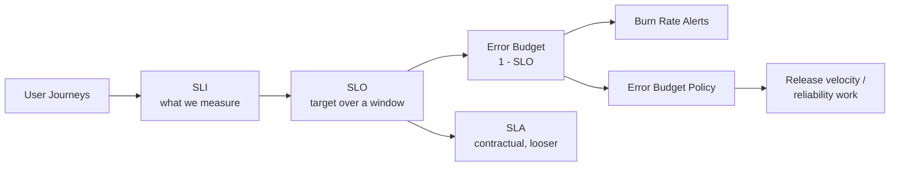
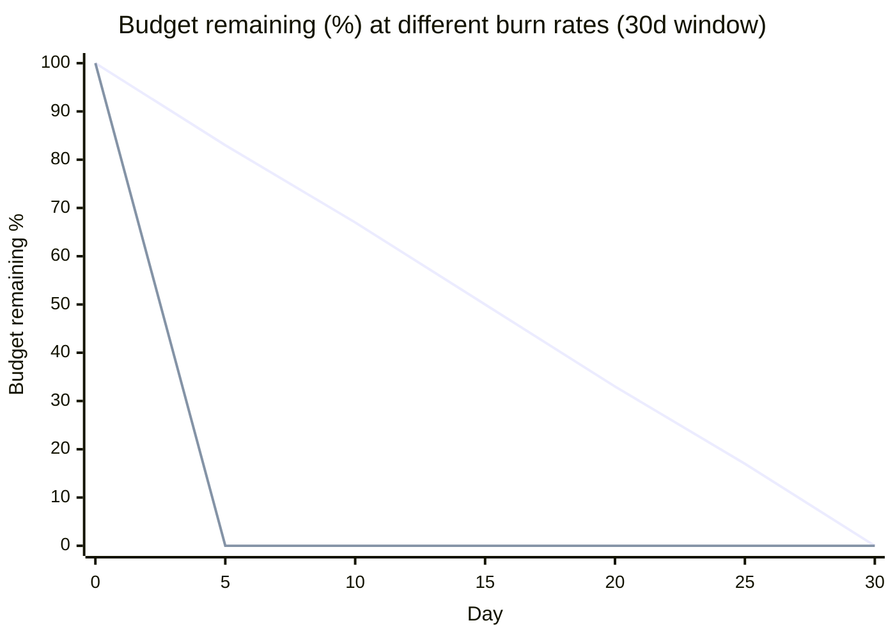
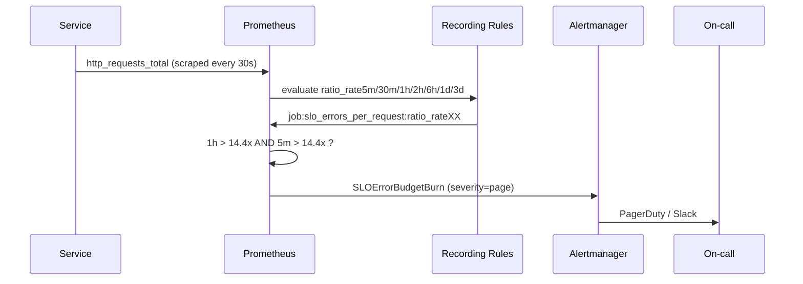
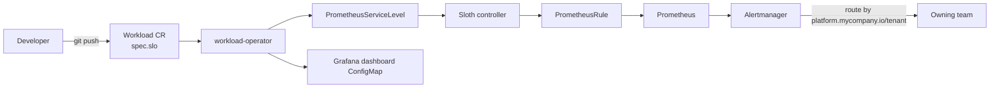
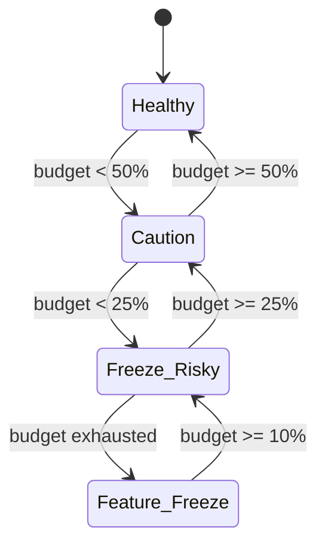

# SLOs, SLIs and Error Budgets

## Learning Objectives
- Distinguish SLIs, SLOs, SLAs and error budgets, and know which one each audience cares about
- Choose good SLIs for request-driven, pipeline and platform (control-plane) services
- Compute error budgets and burn rates and turn them into actionable alerts
- Implement multi-window, multi-burn-rate alerting with Prometheus recording rules
- Generate SLO rules declaratively with Sloth and Pyrra, driven from the platform `Workload` API
- Write and operate an error budget policy that changes team behaviour

## Prerequisites
- A working Prometheus stack — see [Metrics Stack](../10-observability/metrics-stack.md)
- Familiarity with Alertmanager routing — see [Alerting](../10-observability/alerting.md)
- PromQL basics (`rate`, `sum by`, `histogram_quantile`)
- Lab environment from [Lab 06: Observability Stack](../../labs/lab-06-observability-stack/)

---

## Why SLOs Matter for a Platform Team

A platform team runs two kinds of things:

1. **The platform itself** — API server, ingress, DNS, CI runners, GitOps controllers, the `platform.mycompany.io` APIs.
2. **The paved road for tenants** — templates, dashboards and alerts that every `Workload` gets for free.

Without SLOs, "reliability" is a feeling. Teams either page on every CPU spike (alert fatigue) or discover outages from customers. SLOs replace both with a single question: **are users getting the experience we promised, and how much room do we have left to take risks?**



### Terminology

| Term | Definition | Example | Owner |
|------|------------|---------|-------|
| **SLI** (Service Level Indicator) | A ratio of good events to valid events, expressed 0–100% | Proportion of HTTP requests served < 300 ms with non-5xx status | Service team |
| **SLO** (Service Level Objective) | Target value for an SLI over a time window | 99.9% of requests good over a rolling 30 days | Service team + product |
| **SLA** (Service Level Agreement) | Contract with consequences (credits, penalties) | 99.5% monthly availability or 10% credit | Business / legal |
| **Error budget** | Allowed unreliability: `1 − SLO` | 0.1% of requests ≈ 43 min of full outage per 30 days | Shared |
| **Burn rate** | How fast the budget is being consumed relative to "exactly on target" | Burn rate 1 = budget exhausted exactly at end of window | Alerting |

> **Rule of thumb:** SLA < SLO < actual performance. Your internal SLO must be stricter than any SLA so you get warned before money is on the line.

---

## Choosing SLIs

### The SLI Menu

The Google SRE workbook groups SLIs by service type. Prefer measuring as close to the user as practical (load balancer > service > pod).

| Service type | SLI kind | Good event definition | Typical source |
|--------------|----------|-----------------------|----------------|
| Request/response (APIs, web) | Availability | Response status not 5xx (and not 429 if you own the limit) | Ingress / mesh metrics |
| Request/response | Latency | Response served faster than threshold | Histogram `_bucket{le=...}` |
| Data pipeline | Freshness | Data updated within N minutes | `time() - last_success_timestamp` |
| Data pipeline | Correctness | Records passing validation | Pipeline counters |
| Batch / jobs | Completion | Jobs finished successfully before deadline | `kube_job_status_*` |
| Storage | Durability | Objects readable after write | Prober |
| Platform control plane | API availability | `apiserver_request_total` not 5xx | kube-apiserver |
| GitOps delivery | Sync latency | Commit-to-synced under N minutes | Argo CD / Flux metrics |

### SLI Specification vs Implementation

Write the **specification** in plain language first, then the **implementation** in PromQL. Keeping them separate makes it obvious when an implementation drifts from intent.

```yaml
# slo-spec-checkout.yaml — human-readable SLI spec, stored next to the service
service: checkout-api
journey: "Customer completes payment"
slis:
  - name: availability
    specification: >
      Proportion of POST /v1/checkout requests, measured at the ingress,
      that return a non-5xx status.
    implementation: |
      sum(rate(nginx_ingress_controller_requests{ingress="checkout-api",status!~"5.."}[5m]))
      /
      sum(rate(nginx_ingress_controller_requests{ingress="checkout-api"}[5m]))
  - name: latency
    specification: >
      Proportion of POST /v1/checkout requests served in under 300ms.
    implementation: |
      sum(rate(http_server_request_duration_seconds_bucket{service="checkout-api",le="0.3"}[5m]))
      /
      sum(rate(http_server_request_duration_seconds_count{service="checkout-api"}[5m]))
```

> **Latency SLIs need histogram buckets at your threshold.** If your histogram has buckets at 0.25 and 0.5, a 300 ms SLO cannot be measured exactly. Align bucket boundaries with SLO thresholds (or use Prometheus native histograms).

### Anti-patterns

| Anti-pattern | Why it hurts | Better |
|--------------|--------------|--------|
| CPU/memory as an SLI | Users don't feel CPU | Use latency/errors; keep CPU for capacity planning |
| Average latency | Hides the tail | Ratio of requests under threshold |
| 100% target | Zero budget means zero change | 99.9% or whatever users actually need |
| Too many SLOs per service | Nobody watches them | 1–3 per user journey |
| Measuring only from inside the pod | Misses ingress/DNS failures | Measure at the edge, add synthetic probes |

---

## Error Budget Math

For a time-based view, budget = window × (1 − SLO).

| SLO | Error budget | Per 30 days | Per 7 days | Per day |
|-----|--------------|-------------|------------|---------|
| 99% | 1% | 7h 12m | 1h 40m 48s | 14m 24s |
| 99.5% | 0.5% | 3h 36m | 50m 24s | 7m 12s |
| 99.9% | 0.1% | 43m 12s | 10m 5s | 1m 26s |
| 99.95% | 0.05% | 21m 36s | 5m 2s | 43s |
| 99.99% | 0.01% | 4m 19s | 1m | 8.6s |

For request-based SLOs, the budget is a count: at 99.9% and 50M requests/month you may fail 50,000 requests.

### Burn Rate

```text
burn_rate = observed_error_ratio / (1 - SLO)
```

- Burn rate **1** → budget runs out exactly at the end of the window.
- Burn rate **14.4** over 1 hour on a 30-day window → 2% of the monthly budget gone in that hour (14.4 × 1h / 720h = 0.02).
- Burn rate **6** over 6 hours → 5% of the budget gone.



*(Top line: burn rate 1. Bottom line: burn rate 6 — budget exhausted in 5 days.)*

---

## Multi-Window, Multi-Burn-Rate Alerting

Naive alerting (`error_ratio > 0.001 for 5m`) is either too noisy or too slow. The SRE workbook recommends alerting when **both** a long window and a short window exceed a burn-rate threshold:

- The **long window** ensures enough budget is actually consumed to justify waking someone.
- The **short window** (≈1/12 of the long window) makes the alert reset quickly once the problem is fixed.

| Severity | Budget consumed | Long window | Short window | Burn rate | Action |
|----------|-----------------|-------------|--------------|-----------|--------|
| Page | 2% | 1h | 5m | 14.4 | Wake someone up |
| Page | 5% | 6h | 30m | 6 | Wake someone up |
| Ticket | 10% | 1d | 2h | 3 | Next business day |
| Ticket | 10% | 3d | 6h | 1 | Next business day |



### Hand-Written Recording Rules

```yaml
# prometheusrule-checkout-slo.yaml
apiVersion: monitoring.coreos.com/v1
kind: PrometheusRule
metadata:
  name: checkout-api-slo
  namespace: checkout
  labels:
    release: kube-prometheus-stack             # must match the Prometheus ruleSelector
    platform.mycompany.io/tenant: payments
spec:
  groups:
    - name: checkout-api-slo-recordings
      interval: 30s
      rules:
        # One recording rule per window. The ratio is errors / total.
        - record: job:slo_errors_per_request:ratio_rate5m
          expr: |
            sum by (job) (rate(http_requests_total{job="checkout-api",code=~"5.."}[5m]))
            /
            sum by (job) (rate(http_requests_total{job="checkout-api"}[5m]))
        - record: job:slo_errors_per_request:ratio_rate30m
          expr: |
            sum by (job) (rate(http_requests_total{job="checkout-api",code=~"5.."}[30m]))
            /
            sum by (job) (rate(http_requests_total{job="checkout-api"}[30m]))
        - record: job:slo_errors_per_request:ratio_rate1h
          expr: |
            sum by (job) (rate(http_requests_total{job="checkout-api",code=~"5.."}[1h]))
            /
            sum by (job) (rate(http_requests_total{job="checkout-api"}[1h]))
        - record: job:slo_errors_per_request:ratio_rate2h
          expr: |
            sum by (job) (rate(http_requests_total{job="checkout-api",code=~"5.."}[2h]))
            /
            sum by (job) (rate(http_requests_total{job="checkout-api"}[2h]))
        - record: job:slo_errors_per_request:ratio_rate6h
          expr: |
            sum by (job) (rate(http_requests_total{job="checkout-api",code=~"5.."}[6h]))
            /
            sum by (job) (rate(http_requests_total{job="checkout-api"}[6h]))
        - record: job:slo_errors_per_request:ratio_rate1d
          expr: |
            sum by (job) (rate(http_requests_total{job="checkout-api",code=~"5.."}[1d]))
            /
            sum by (job) (rate(http_requests_total{job="checkout-api"}[1d]))
        - record: job:slo_errors_per_request:ratio_rate3d
          expr: |
            sum by (job) (rate(http_requests_total{job="checkout-api",code=~"5.."}[3d]))
            /
            sum by (job) (rate(http_requests_total{job="checkout-api"}[3d]))

    - name: checkout-api-slo-alerts
      rules:
        - alert: CheckoutAPIErrorBudgetBurnFast
          # 99.9% SLO => error budget ratio 0.001
          expr: |
            (
              job:slo_errors_per_request:ratio_rate1h{job="checkout-api"} > (14.4 * 0.001)
              and
              job:slo_errors_per_request:ratio_rate5m{job="checkout-api"} > (14.4 * 0.001)
            )
            or
            (
              job:slo_errors_per_request:ratio_rate6h{job="checkout-api"} > (6 * 0.001)
              and
              job:slo_errors_per_request:ratio_rate30m{job="checkout-api"} > (6 * 0.001)
            )
          labels:
            severity: page
            slo: checkout-availability
          annotations:
            summary: "checkout-api is burning its 30d error budget fast"
            description: "Error ratio {{ $value | humanizePercentage }} exceeds fast-burn threshold."
            runbook_url: https://runbooks.mycompany.io/checkout-api/error-budget-burn
        - alert: CheckoutAPIErrorBudgetBurnSlow
          expr: |
            (
              job:slo_errors_per_request:ratio_rate1d{job="checkout-api"} > (3 * 0.001)
              and
              job:slo_errors_per_request:ratio_rate2h{job="checkout-api"} > (3 * 0.001)
            )
            or
            (
              job:slo_errors_per_request:ratio_rate3d{job="checkout-api"} > (1 * 0.001)
              and
              job:slo_errors_per_request:ratio_rate6h{job="checkout-api"} > (1 * 0.001)
            )
          labels:
            severity: ticket
            slo: checkout-availability
          annotations:
            summary: "checkout-api is slowly burning its error budget"
```

Writing this by hand for every service does not scale, and it's easy to get wrong. That is why platforms generate these rules.

> **Low-traffic caveat:** with a few requests per minute, a single failure can exceed a 14.4× threshold over 5 minutes. Options: add synthetic traffic, lengthen windows, require a minimum request count (`and sum(rate(...[1h])) > 1`), or group small services into one SLO.

---

## Generating SLOs with Sloth

[Sloth](https://sloth.dev/) takes a compact spec and generates all recording rules plus multi-window, multi-burn-rate alerts. It can run as a CLI in CI (output a `PrometheusRule`) or as a Kubernetes controller watching `PrometheusServiceLevel` CRs.

```yaml
# sloth-checkout.yaml
apiVersion: sloth.slok.dev/v1
kind: PrometheusServiceLevel
metadata:
  name: checkout-api
  namespace: checkout
  labels:
    platform.mycompany.io/tenant: payments
spec:
  service: "checkout-api"
  labels:
    owner: "payments-team"
    tier: "1"
  slos:
    - name: "requests-availability"
      objective: 99.9                       # percent
      description: "Checkout requests return non-5xx."
      sli:
        events:
          # {{.window}} is replaced by Sloth for each window (5m, 30m, 1h, ...)
          errorQuery: sum(rate(http_requests_total{job="checkout-api",code=~"(5..|429)"}[{{.window}}]))
          totalQuery: sum(rate(http_requests_total{job="checkout-api"}[{{.window}}]))
      alerting:
        name: CheckoutAPIHighErrorRate
        labels:
          category: "availability"
        annotations:
          summary: "High error rate on checkout-api"
          runbook_url: "https://runbooks.mycompany.io/checkout-api/availability"
        pageAlert:
          labels:
            severity: page                  # routed to PagerDuty in Alertmanager
        ticketAlert:
          labels:
            severity: ticket                # routed to Slack/Jira

    - name: "requests-latency"
      objective: 99
      description: "Checkout requests served under 300ms."
      sli:
        events:
          errorQuery: |
            (
              sum(rate(http_server_request_duration_seconds_count{service="checkout-api"}[{{.window}}]))
              -
              sum(rate(http_server_request_duration_seconds_bucket{service="checkout-api",le="0.3"}[{{.window}}]))
            )
          totalQuery: sum(rate(http_server_request_duration_seconds_count{service="checkout-api"}[{{.window}}]))
      alerting:
        name: CheckoutAPIHighLatency
        pageAlert:
          labels:
            severity: page
        ticketAlert:
          labels:
            severity: ticket
```

```bash
# Generate rules in CI (no controller required)
sloth generate -i sloth-checkout.yaml -o generated/checkout-slo-rules.yaml

# Validate the specs in a directory
sloth validate -i ./slos/
```

Sloth also produces metadata series such as `sloth_slo_info`, `slo:objective:ratio`, `slo:error_budget:ratio` and `slo:sli_error:ratio_rate<window>`, which the official Sloth Grafana dashboards consume.

## Generating SLOs with Pyrra

[Pyrra](https://github.com/pyrra-dev/pyrra) is an alternative with a built-in UI showing budget remaining and burn-rate graphs.

```yaml
# pyrra-checkout.yaml
apiVersion: pyrra.dev/v1alpha1
kind: ServiceLevelObjective
metadata:
  name: checkout-api-availability
  namespace: checkout
  labels:
    prometheus: k8s
    role: alert-rules
    platform.mycompany.io/tenant: payments
spec:
  target: "99.9"
  window: 4w
  description: Checkout requests return non-5xx.
  indicator:
    ratio:
      errors:
        metric: http_requests_total{job="checkout-api",code=~"5.."}
      total:
        metric: http_requests_total{job="checkout-api"}
      grouping: []          # e.g. ["route"] for per-route SLOs
---
apiVersion: pyrra.dev/v1alpha1
kind: ServiceLevelObjective
metadata:
  name: checkout-api-latency
  namespace: checkout
spec:
  target: "99"
  window: 4w
  indicator:
    latency:
      success:
        metric: http_server_request_duration_seconds_bucket{service="checkout-api",le="0.3"}
      total:
        metric: http_server_request_duration_seconds_count{service="checkout-api"}
```

### Sloth vs Pyrra vs Others

| Feature | Sloth | Pyrra | Grafana SLO / Nobl9 (commercial) | OpenSLO |
|---------|-------|-------|----------------------------------|---------|
| Output | PrometheusRule | PrometheusRule | Managed | Spec only |
| Runs as | CLI or controller | Controller + UI | SaaS | Spec consumed by tools |
| UI | Grafana dashboards | Built-in | Built-in | — |
| Plugins for custom SLIs | Yes (SLI plugins) | No | — | — |
| Best for | GitOps, CI generation | Teams wanting a quick UI | Enterprises wanting managed | Vendor-neutral specs |

---

## SLOs as a Platform Capability

The platform should make SLOs the default, not an afterthought. One pattern: tenants declare objectives on their `Workload`, and the workload operator renders a `PrometheusServiceLevel` and a Grafana dashboard.



```yaml
# workload-checkout.yaml — illustrative spec.slo block on the platform Workload API
apiVersion: platform.mycompany.io/v1alpha1
kind: Workload
metadata:
  name: checkout-api
  namespace: checkout
  labels:
    platform.mycompany.io/tenant: payments
    platform.mycompany.io/tier: "1"
spec:
  image: ghcr.io/mycompany/checkout-api:1.42.0
  replicas: 3
  slo:
    availability:
      objective: "99.9"
      window: 30d
    latency:
      objective: "99"
      thresholdSeconds: 0.3
    alerting:
      pageReceiver: payments-pagerduty
      ticketReceiver: payments-slack
```

A Kyverno or `ValidatingAdmissionPolicy` rule can then require that tier-1 workloads declare an SLO (see [Policy Engine](../12-security-compliance/policy-engine.md)):

```yaml
# vap-require-slo.yaml
apiVersion: admissionregistration.k8s.io/v1
kind: ValidatingAdmissionPolicy
metadata:
  name: tier1-workloads-require-slo
spec:
  failurePolicy: Fail
  matchConstraints:
    resourceRules:
      - apiGroups: ["platform.mycompany.io"]
        apiVersions: ["v1alpha1"]
        operations: ["CREATE", "UPDATE"]
        resources: ["workloads"]
  validations:
    - expression: >
        !(has(object.metadata.labels) &&
          object.metadata.labels[?'platform.mycompany.io/tier'].orValue('') == '1') ||
        has(object.spec.slo)
      message: "Tier-1 Workloads must declare spec.slo"
---
apiVersion: admissionregistration.k8s.io/v1
kind: ValidatingAdmissionPolicyBinding
metadata:
  name: tier1-workloads-require-slo
spec:
  policyName: tier1-workloads-require-slo
  validationActions: ["Deny"]
```

### Platform's Own SLOs

The platform team should publish SLOs for what tenants depend on:

| Platform component | SLI | Example objective |
|--------------------|-----|-------------------|
| Kubernetes API | Non-5xx ratio of `apiserver_request_total` (excluding `WATCH`, `CONNECT`) | 99.95% / 30d |
| Kubernetes API latency | `apiserver_request_sli_duration_seconds_bucket` under 1s for mutating, read verbs | 99% / 30d |
| Ingress | Non-5xx at the edge, excluding upstream app errors | 99.95% / 30d |
| DNS (CoreDNS) | `coredns_dns_responses_total` with `rcode!="SERVFAIL"` | 99.99% / 30d |
| GitOps delivery | Commit synced within 10 min | 99% / 30d |
| Self-service provisioning | `Environment` reaches `Ready` within 15 min | 95% / 30d |

```yaml
# sloth-platform-apiserver.yaml
apiVersion: sloth.slok.dev/v1
kind: PrometheusServiceLevel
metadata:
  name: kube-apiserver
  namespace: monitoring
spec:
  service: "kube-apiserver"
  labels:
    owner: platform-team
  slos:
    - name: "requests-availability"
      objective: 99.95
      sli:
        events:
          errorQuery: sum(rate(apiserver_request_total{job="apiserver",verb!~"WATCH|CONNECT",code=~"5.."}[{{.window}}]))
          totalQuery: sum(rate(apiserver_request_total{job="apiserver",verb!~"WATCH|CONNECT"}[{{.window}}]))
      alerting:
        name: KubeAPIServerErrorBudgetBurn
        pageAlert:
          labels: { severity: page, team: platform }
        ticketAlert:
          labels: { severity: ticket, team: platform }
```

---

## Error Budget Policy

An SLO without a policy is only a dashboard. The policy defines what happens when budget runs low. Agree on it **before** the first incident, with product and engineering leadership signing off.

```markdown
<!-- error-budget-policy.md (template) -->
# Error Budget Policy — checkout-api

| Budget remaining (30d) | Consequence                                                   |
|------------------------|---------------------------------------------------------------|
| > 50%                  | Normal release cadence. Chaos experiments allowed in prod.    |
| 25–50%                 | Releases need a rollback plan; no risky migrations.           |
| 0–25%                  | Only bug fixes and reliability work; postmortem for each burn.|
| Exhausted              | Feature freeze until budget recovers above 10%; exec review.  |

Exceptions: security fixes, legal requirements.
Single incident consuming > 20% of budget => mandatory postmortem.
Budget consumed by a dependency (e.g. platform ingress) => counts against
that dependency's SLO, escalate to its owner.
```



Platforms can automate parts of this: e.g. an Argo Rollouts `AnalysisTemplate` or a CI gate querying `slo:period_error_budget_remaining:ratio` (generated by Sloth) and blocking non-hotfix deploys when it is below 0.

```bash
# ci/check-error-budget.sh — fail the pipeline when budget is exhausted
#!/usr/bin/env bash
set -euo pipefail
SERVICE="${1:?service}"
PROM="${PROM_URL:-http://prometheus-operated.monitoring:9090}"
Q="slo:period_error_budget_remaining:ratio{sloth_service=\"${SERVICE}\"}"
remaining=$(curl -sG "${PROM}/api/v1/query" --data-urlencode "query=${Q}" \
  | jq -r '[.data.result[].value[1] | tonumber] | min // 1')
echo "Error budget remaining for ${SERVICE}: ${remaining}"
if (( $(echo "${remaining} <= 0" | bc -l) )); then
  echo "Error budget exhausted — only hotfix/* branches may deploy." >&2
  [[ "${GIT_BRANCH:-}" == hotfix/* ]] || exit 1
fi
```

---

## Hands-On Exercises

### Exercise 1: Define an SLO, burn the budget, catch the alert

Goal: generate SLO recording and alert rules with Sloth, then burn the error budget and watch the
alert fire.

**Prerequisites:** a kind cluster with kube-prometheus-stack installed as in [Metrics Stack](../10-observability/metrics-stack.md) (release `kps`, namespace `monitoring`). [Lab 06](../../labs/lab-06-observability-stack/) uses a different release and namespace, so adjust service names if you use it.

```bash
# 1. Deploy a demo app that exposes http_requests_total with an error knob.
#    podinfo exposes Prometheus metrics on :9898/metrics
kubectl create namespace slo-demo
helm repo add podinfo https://stefanprodan.github.io/podinfo
helm upgrade --install podinfo podinfo/podinfo -n slo-demo \
  --set serviceMonitor.enabled=true \
  --set serviceMonitor.additionalLabels.release=kube-prometheus-stack

# 2. Install the Sloth controller
helm repo add sloth https://slok.github.io/sloth
helm upgrade --install sloth sloth/sloth -n monitoring

# 3. Create an SLO against podinfo's http_request_duration_seconds metrics
cat <<'EOF' | kubectl apply -f -
apiVersion: sloth.slok.dev/v1
kind: PrometheusServiceLevel
metadata:
  name: podinfo
  namespace: slo-demo
spec:
  service: podinfo
  slos:
    - name: availability
      objective: 99
      sli:
        events:
          errorQuery: sum(rate(http_request_duration_seconds_count{namespace="slo-demo",status=~"5.."}[{{.window}}]))
          totalQuery: sum(rate(http_request_duration_seconds_count{namespace="slo-demo"}[{{.window}}]))
      alerting:
        name: PodinfoErrorBudgetBurn
        pageAlert: { labels: { severity: page } }
        ticketAlert: { labels: { severity: ticket } }
EOF

# 4. Confirm Sloth generated a PrometheusRule
kubectl get prometheusrules -n slo-demo
kubectl get prometheusservicelevel -n slo-demo podinfo -o jsonpath='{.status}'

# 5. Generate good traffic, then bad traffic (podinfo /status/500 returns 500)
kubectl run load -n slo-demo --rm -it --image=curlimages/curl --restart=Never -- \
  sh -c 'for i in $(seq 1 3000); do curl -s -o /dev/null podinfo:9898/; \
         curl -s -o /dev/null podinfo:9898/status/500; done'

# 6. Port-forward Prometheus and query burn rate
kubectl -n monitoring port-forward svc/kps-prometheus 9090 &
# In the UI: slo:sli_error:ratio_rate5m{sloth_service="podinfo"}
# and:       ALERTS{alertname="PodinfoErrorBudgetBurn"}
```

Expected output:

```text
# step 4
NAME      AGE
podinfo   10s
# step 6, slo:sli_error:ratio_rate5m{sloth_service="podinfo"}
{sloth_service="podinfo", sloth_slo="availability"}  0.5
```

Check: `ALERTS{alertname="PodinfoErrorBudgetBurn", alertstate="firing"}` returns a series after
about 5 minutes of bad traffic. The error ratio is 0.5 because the loop sends one good and one
failing request per iteration.

**Questions to answer:**
1. With a 50% error ratio and a 99% objective, what is the burn rate? (Answer: 0.5 / 0.01 = 50.)
2. How long until the page alert fires? Why is it not immediate? (Hint: the rule has a `for` and the 5m/1h windows must both exceed 14.4×.)
3. Stop the bad traffic. How quickly does the alert resolve, and which window drives that?
4. Relabel the podinfo metrics so the `status` label matches your ingress — what changes in the SLI?

**Cleanup:** `kubectl delete namespace slo-demo`

---

## Troubleshooting

| Symptom | Likely cause | Fix |
|---------|--------------|-----|
| SLI shows `NaN` or no data | Zero traffic → `0/0`; or label mismatch | Check `totalQuery` alone; add synthetic probes; verify label names (`code` vs `status`) |
| Sloth CR exists but no `PrometheusRule` | Controller not running or CRD version mismatch | `kubectl logs -n monitoring deploy/sloth`; `kubectl get crd prometheusservicelevels.sloth.slok.dev` |
| Rules exist but Prometheus doesn't load them | `ruleSelector` label mismatch | Compare `kubectl get prometheus -o yaml \| grep -A5 ruleSelector` to rule labels |
| Page alert flaps | Low traffic; short window too sensitive | Minimum-traffic guard, longer short window, or synthetic load |
| Latency SLI always 100% or 0% | `le` bucket doesn't exist at the threshold | List buckets: `count by (le) (..._bucket)`; align threshold |
| Budget "recovers" instantly after outage | Window is too short (e.g. 1d) | Use 28d/30d rolling windows for the objective |
| Error budget negative but no alert | Alerts route to a receiver nobody watches | Test routing with `amtool config routes test severity=page` |
| Recording rule evaluation slow | High-cardinality `sum by` in SLI | Aggregate early; drop unneeded labels in recording rules |

```bash
# Useful checks
promtool check rules generated/checkout-slo-rules.yaml
amtool config routes test --config.file=alertmanager.yaml severity=page slo=checkout-availability
kubectl get prometheusrules -A -l app.kubernetes.io/managed-by=sloth
```

---

## Further Reading

### Books & Papers
- [Google SRE Book — Service Level Objectives](https://sre.google/sre-book/service-level-objectives/)
- [Google SRE Workbook — Implementing SLOs](https://sre.google/workbook/implementing-slos/)
- [Google SRE Workbook — Alerting on SLOs](https://sre.google/workbook/alerting-on-slos/) (source of the burn-rate table)
- [Google SRE Workbook — Error Budget Policy](https://sre.google/workbook/error-budget-policy/)
- "Implementing Service Level Objectives" — Alex Hidalgo (O'Reilly)

### Tools
- [Sloth](https://sloth.dev/) · [Pyrra](https://github.com/pyrra-dev/pyrra) · [OpenSLO](https://openslo.com/)
- [Prometheus recording rules](https://prometheus.io/docs/prometheus/latest/configuration/recording_rules/)
- [kubernetes-mixin SLO alerts](https://github.com/kubernetes-monitoring/kubernetes-mixin)

---

## Next Steps

1. **Wire alerts**: Route `severity=page` vs `severity=ticket` in [Alerting](../10-observability/alerting.md)
2. **Validate the SLO**: Inject failure and confirm alerts fire in [Chaos Engineering](chaos-engineering.md)
3. **Plan for the worst**: Set RPO/RTO objectives in [Disaster Recovery](disaster-recovery.md)
4. **Scale to the SLO**: Use latency SLIs to drive autoscaling in [Capacity Planning](capacity-planning.md)
5. **Measure the platform**: [Measuring Success](../14-platform-evolution/measuring-success.md)
